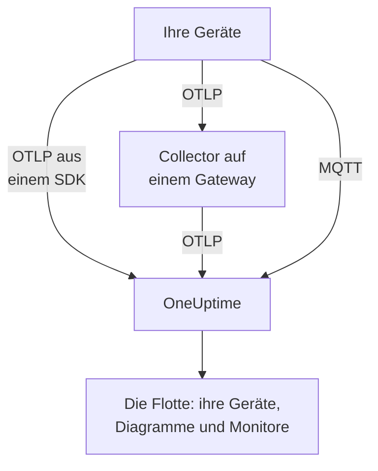

# IoT-Geräte

OneUptime überwacht Flotten von IoT-Geräten — Sensoren, Gateways, Controller und Edge-Boxen — anhand einer kleinen Menge von `iot_*`-Metriken, die sie senden. Es gruppiert die Geräte in Flotten, führt ein Inventar der Geräte jeder Flotte und stellt deren Akku, Signal, Temperatur, CPU, Speicher und Verfügbarkeit in Diagrammen dar. Auf einem Gerät ist kein OneUptime-Agent zu installieren: Geräte senden Standard-OpenTelemetry oder veröffentlichen an den MQTT-Endpunkt von OneUptime. [IoT-Gerätemonitore](/docs/monitor/iot-device-monitor) alarmieren anhand dessen, was sie senden.

:::cards
- [Sendeweg wählen](#sendeweg-wählen): Ein OpenTelemetry-SDK, ein Gateway-Collector oder MQTT.
- [Metriken über MQTT senden](#metriken-über-mqtt-senden): Topics, Zugangsdaten pro Gerät und Last Will.
- [Metrikkonventionen](#metrikkonventionen): Die `iot_*`-Namen, die OneUptime darstellt und für Alarme nutzt.
- [Fehlerbehebung](#fehlerbehebung): Fehlende Flotten, fehlende Geräte, Wechsel auf offline.
:::

## So funktioniert es

Jeder Messwert gehört zu einer Flotte und einem Gerät. OneUptime legt die Flotte mit ihrem ersten Messwert an, fügt jedes neue Gerät dem Inventar der Flotte hinzu und aktualisiert danach mit jedem Messwert die neuesten Werte des Geräts. Über OpenTelemetry und über MQTT gesendete Messwerte speisen dieselben Flotten, dasselbe Inventar, dieselben Diagramme und Monitore.



## Wie OneUptime IoT abbildet

- **Flotte**: eine Gruppe von Geräten, etwa `building-a-sensors` oder `field-gateways`. Sie kommt aus dem Ressourcenattribut `iot.fleet.name` und erscheint in OneUptime als der Telemetriedienst `iot/<fleet>`. Setzen Sie auch `service.name=iot/<fleet>`, damit Logs und Metriken unter demselben Dienst zusammenkommen.
- **Gerät**: ein Gerät in einer Flotte, benannt durch das Attribut `device.id` an jedem Datenpunkt. Das Inventar der Flotte ist nach `device.id` geschlüsselt.

| Attribut | Gesetzt an | Erforderlich | Beschreibung |
| --- | --- | --- | --- |
| `iot.fleet.name` | Ressource | Ja | Die Flotte, zu der das Gerät gehört. Daraus wird der OneUptime-Dienst `iot/<fleet>`. |
| `device.id` | Jedem Datenpunkt | Ja | Eine stabile ID für das Gerät, eindeutig in seiner Flotte. |
| `iot.device.kind` | Jedem Datenpunkt | Nein | Die Geräteklasse, etwa `Device`, `Sensor` oder `Gateway`. Standard ist `Device`. |
| `iot.device.type` | Jedem Datenpunkt | Nein | Ein feinerer Typ oder ein Modell zum Filtern von Monitoren, etwa `temp-sensor`. |
| `iot.device.firmware` | Jedem Datenpunkt | Nein | Die Firmware-Version, die das Gerät meldet. |

Über MQTT legt das Topic die Flotte und das Gerät für Sie fest.

## Sendeweg wählen

| Weg | Verwenden, wenn | Braucht |
| --- | --- | --- |
| [OpenTelemetry-SDK](#metriken-über-das-opentelemetry-sdk-senden) | Das Gerät führt ein OpenTelemetry-SDK aus und erreicht OneUptime selbst. | Einen Ingestion-Schlüssel auf dem Gerät. |
| [OpenTelemetry Collector](#metriken-über-einen-opentelemetry-collector-senden) | Viele Geräte melden über ein Gateway. | Ein Gateway, auf dem der Collector läuft. |
| [MQTT](#metriken-über-mqtt-senden) | Das Gerät spricht bereits MQTT oder soll sich in dem Moment offline melden, in dem es wegfällt. | Einen beliebigen MQTT-Client, der sich über WebSocket verbindet. |

## Bevor Sie beginnen

- Ein Ingestion-Schlüssel. Legen Sie ihn unter **Projekteinstellungen → Telemetrie & APM → Ingestion-Schlüssel** an und kopieren Sie seinen Wert. Geräte senden ihn als Header `x-oneuptime-token` oder als MQTT-Passwort.
- Netzwerkzugriff vom Gerät oder Gateway auf Ihre OneUptime-URL.
- Ein Flottenname für jede Gruppe von Geräten und eine stabile ID für jedes Gerät.

## Metriken über das OpenTelemetry-SDK senden

:::steps
### Das SDK auf OneUptime verweisen

Setzen Sie auf dem Gerät die Standard-Umgebungsvariablen von OpenTelemetry. Ersetzen Sie den Schlüssel, den Flottennamen und die Geräte-ID durch Ihre Werte:

```bash
export OTEL_EXPORTER_OTLP_ENDPOINT=https://oneuptime.com/otlp
export OTEL_EXPORTER_OTLP_PROTOCOL=http/protobuf
export OTEL_EXPORTER_OTLP_HEADERS=x-oneuptime-token=YOUR_TELEMETRY_INGESTION_TOKEN
export OTEL_RESOURCE_ATTRIBUTES=iot.fleet.name=building-a-sensors,device.id=sensor-001,service.name=iot/building-a-sensors
```

Halten Sie `iot.fleet.name` stabil: Eine Änderung registriert eine neue Flotte.

### Messwerte als IoT-Metriken erfassen

Geben Sie jeden Messwert als Metrik mit einem der [konventionellen Namen](#metrikkonventionen) aus und geben Sie jedem Datenpunkt ein Attribut `device.id`:

| Metrik | Wert | Datenpunkt-Attribut |
| --- | --- | --- |
| `iot_device_up` | `1` | `device.id=sensor-001` |
| `iot_battery_percent` | `87` | `device.id=sensor-001` |
| `iot_temperature_celsius` | `21.5` | `device.id=sensor-001` |

Das Inventar ist nach der `device.id` des Datenpunkts geschlüsselt, nicht nach der der Ressource; setzen Sie sie daher an jeder Messung und zusätzlich in `OTEL_RESOURCE_ATTRIBUTES`.
:::

[Prüfen Sie dann, ob die Flotte erscheint](#prüfen-ob-die-flotte-erscheint).

## Metriken über einen OpenTelemetry Collector senden

Wenn viele Geräte über ein Gateway melden, führen Sie auf dem Gateway einen OpenTelemetry Collector aus. Er empfängt OTLP von Ihren Geräten, versieht jeden Messwert mit der Flotte und leitet ihn an OneUptime weiter.

:::steps
### Die Konfiguration des Gateways speichern

Speichern Sie dies als `config.yaml` auf dem Gateway:

```yaml title="config.yaml"
receivers:
  otlp:
    protocols:
      grpc:
        endpoint: 0.0.0.0:4317
      http:
        endpoint: 0.0.0.0:4318

processors:
  batch:
    send_batch_size: 512
    timeout: 5s
  resource:
    attributes:
      - key: iot.fleet.name
        value: field-gateways
        action: upsert
      - key: service.name
        value: iot/field-gateways
        action: upsert

exporters:
  otlphttp:
    endpoint: "https://oneuptime.com/otlp"
    headers:
      "x-oneuptime-token": "YOUR_TELEMETRY_INGESTION_TOKEN"

service:
  pipelines:
    metrics:
      receivers: [otlp]
      processors: [resource, batch]
      exporters: [otlphttp]
```

- `otlp` empfängt von Ihren Geräten über gRPC (`4317`) und HTTP (`4318`). Empfangen Sie Messwerte auf jedem anderen Weg, den der Collector unterstützt (eine MQTT-Bridge, Logdateien), und senden Sie sie durch dieselbe Pipeline.
- `resource` versieht jeden Messwert mit der Flotte. Setzen Sie `iot.fleet.name` und das passende `service.name=iot/<fleet>` pro Gateway, damit die Geräte jedes Gateways in ihrer Flotte landen.
- Behalten Sie `device.id` und gegebenenfalls `iot.device.kind`, `iot.device.type` und `iot.device.firmware` an jedem Datenpunkt, damit OneUptime die Geräte der Flotte auseinanderhalten kann.
- `otlphttp` sendet per HTTPS mit dem Ingestion-Schlüssel an OneUptime. Sowohl die standardmäßige Protobuf-Kodierung als auch `encoding: json` werden akzeptiert.

### Den Collector auf dem Gateway ausführen

:::tabs
@tab Docker
Führen Sie ihn in dem Ordner aus, der `config.yaml` enthält:

```bash
docker run -d \
  --name otel-collector \
  --restart unless-stopped \
  -p 4317:4317 \
  -p 4318:4318 \
  -v $(pwd)/config.yaml:/etc/otelcol-contrib/config.yaml:ro \
  otel/opentelemetry-collector-contrib:0.161.0 \
  --config /etc/otelcol-contrib/config.yaml
```
@tab otelcol-contrib
Hat das Gateway bereits `otelcol-contrib`, verweisen Sie es auf die Datei:

```bash
otelcol-contrib --config config.yaml
```
:::

Geräte senden dann OTLP an das Gateway, zum Beispiel mit `OTEL_EXPORTER_OTLP_ENDPOINT=http://<gateway-host>:4318` im SDK jedes Geräts.
:::

[Prüfen Sie dann, ob die Flotte erscheint](#prüfen-ob-die-flotte-erscheint).

## Metriken über MQTT senden

OneUptime hat einen eigenen MQTT-Endpunkt; Geräte, die MQTT sprechen, veröffentlichen Messwerte daher direkt dorthin, ohne SDK, Collector oder Bridge. Was über MQTT ankommt, durchläuft dieselbe Pipeline wie OTLP: Flotten werden angelegt, das Inventar wird aktualisiert, und jeder IoT-Monitor und jede Alarmvorlage funktioniert genauso.

### Endpunkte

| Transport | Adresse | Hinweise |
| --- | --- | --- |
| MQTT über WebSocket | `wss://<your-host>/mqtt` | Funktioniert bei jeder Bereitstellung, über den normalen HTTPS-Port. |
| MQTT über TCP | `<app-host>:1883` | Nur selbst gehostet, und intern im Cluster- oder Compose-Netzwerk, bis Sie ihn freigeben. Der Port ist `MQTT_INGEST_PORT`. |

### Authentifizierung

- **Mit dem Ingestion-Schlüssel**: Senden Sie ihn als MQTT-Passwort. Der Benutzername wird ignoriert; hat Ihr Client nur ein Feld für den Benutzernamen, tragen Sie den Schlüssel dort ein. Das passt zu einem Gateway, das für viele Geräte veröffentlicht.
- **Mit Zugangsdaten pro Gerät**: empfohlen für Geräte, die sich direkt verbinden. Öffnen Sie die Seite **Geräteregister** der Flotte und registrieren Sie das Gerät, mit der **Geräte-ID**, die es als `device.id` verwendet. Der **MQTT-Benutzername** des Geräts ist sein Benutzername und sein **MQTT-Passwort (Secret)** sein Passwort.

Zugangsdaten eines Geräts können nur unter dessen eigenen Topics `oneuptime/<fleet>/<device>/` veröffentlichen. Sie können ein Gerät widerrufen, ohne den Rest der Flotte anzutasten: Schalten Sie seinen Schalter **Aktiviert** aus oder löschen Sie es, und ein verbundenes Gerät wird innerhalb etwa einer Minute getrennt. Ein registriertes Gerät, das verstummt, bleibt als offline im Inventar, und die Alarmvorlage Device Offline löst für es aus, auch wenn es ohne Last Will ausfällt.

OneUptime lehnt falsche Zugangsdaten bei CONNECT mit Rückgabecode 4 ab (falscher Benutzername oder falsches Passwort), sodass ein falsch konfiguriertes Gerät sichtbar scheitert. Browser-Schlüssel werden über MQTT abgelehnt.

### Topics und Payloads

Veröffentlichen Sie unter dem festen Präfix `oneuptime/`. Die Segmente für Flotte und Gerät dürfen `/`, `+` oder `#` nicht enthalten, nicht mit `$` beginnen und höchstens 100 Zeichen lang sein.

| Topic | Payload |
| --- | --- |
| `oneuptime/<fleet>/<device>/telemetry` | Ein JSON-Objekt mit Messwerten: `{"metrics":{"iot_temperature_celsius":21.5}}`, oder ein flaches Objekt, dessen numerische Felder die Metriken sind. |
| `oneuptime/<fleet>/<device>/metrics/<metricName>` | Ein Wert: eine bloße Zahl (`23.4`) oder `{"value":23.4}`. |
| `oneuptime/<fleet>/<device>/status` | `online` oder `offline` (auch `1` oder `0`, `true` oder `false`, `up` oder `down`). Es setzt `iot_device_up`. |

Ein Telemetrie-Payload kann außerdem `"attributes"` enthalten, eine Map von Zeichenketten, die an jeden Datenpunkt gehängt wird (verwenden Sie sie für `iot.device.kind`, `iot.device.type`, `iot.device.firmware` oder eigene Labels), sowie `"timestamp"`, in ISO 8601 oder in Unix-Sekunden oder -Millisekunden. Beides ist optional: Ohne `timestamp` wird der Zeitpunkt verwendet, zu dem OneUptime den Messwert empfängt.

### Offline-Erkennung mit Last Will

Registrieren Sie einen MQTT-Last-Will auf `oneuptime/<fleet>/<device>/status` mit dem Payload `offline`. Fällt das Gerät aus oder verschwindet es aus dem Netzwerk, veröffentlicht OneUptime für es `iot_device_up = 0` in dem Moment, in dem seine Sitzung endet; das löst die mitgelieferte Alarmvorlage Device Offline aus und markiert das Gerät im Inventar als ausgefallen, ohne Polling. Veröffentlichen Sie nach dem Verbinden `online` auf demselben Topic, damit das Gerät wieder als verfügbar erscheint.

### Beispiele

:::tabs
@tab mosquitto_pub
Über rohes TCP, auf einer selbst gehosteten Instanz:

```bash
mosquitto_pub -h YOUR-ONEUPTIME-APP-HOST -p 1883 \
  -u oneuptime -P "YOUR_TELEMETRY_INGESTION_TOKEN" \
  -t "oneuptime/building-a-sensors/sensor-001/telemetry" \
  -m '{"metrics":{"iot_device_up":1,"iot_battery_percent":87,"iot_temperature_celsius":21.5},"attributes":{"iot.device.type":"temp-sensor","iot.device.firmware":"1.4.2"}}'
```
@tab Node.js
Mit dem Paket `mqtt`, über WebSocket, gegen oneuptime.com oder jede selbst gehostete Instanz:

```javascript
const mqtt = require("mqtt");

const client = mqtt.connect("wss://oneuptime.com/mqtt", {
  username: "oneuptime", // ignored — the token below is what authenticates
  password: "YOUR_TELEMETRY_INGESTION_TOKEN",
  will: {
    topic: "oneuptime/building-a-sensors/sensor-001/status",
    payload: "offline",
  },
});

client.on("connect", () => {
  client.publish("oneuptime/building-a-sensors/sensor-001/status", "online");
  setInterval(() => {
    client.publish(
      "oneuptime/building-a-sensors/sensor-001/telemetry",
      JSON.stringify({
        metrics: {
          iot_device_up: 1,
          iot_battery_percent: readBattery(),
          iot_temperature_celsius: readTemperature(),
        },
      }),
    );
  }, 60 * 1000);
});
```
@tab Python
Mit `paho-mqtt`, über WebSocket:

```python
import json
import paho.mqtt.client as mqtt

client = mqtt.Client(transport="websockets")
client.username_pw_set("oneuptime", "YOUR_TELEMETRY_INGESTION_TOKEN")
client.tls_set()
client.will_set("oneuptime/building-a-sensors/sensor-001/status", "offline")
client.ws_set_options(path="/mqtt")
client.connect("oneuptime.com", 443)

client.publish("oneuptime/building-a-sensors/sensor-001/status", "online")
client.publish(
    "oneuptime/building-a-sensors/sensor-001/telemetry",
    json.dumps({"metrics": {"iot_device_up": 1, "iot_temperature_celsius": 21.5}}),
)
```
:::

### Limits und Zustellung

- Der Endpunkt nimmt nur Messwerte an: Abonnements werden abgelehnt (ein SUBACK-Fehler), und Retained Messages werden nicht aufbewahrt.
- Die Ingestion erfolgt mindestens einmal. Verwenden Sie QoS 1, damit OneUptime jede Veröffentlichung bestätigt; ein erneutes Senden mit QoS 1 oder 2 nach einer verlorenen Bestätigung kann doppelte Datenpunkte erzeugen.
- Eine Veröffentlichung über 128 KB oder mit mehr als 100 Metriken wird verworfen, und ein Paket, das mehr als das angibt, schließt die Verbindung.
- Eine Veröffentlichung außerhalb dieser Topics oder mit fehlerhaftem Payload wird angenommen und verworfen, weil MQTT 3.1.1 keinen Fehler pro Nachricht kennt. OneUptime protokolliert eine Warnung mit dem Grund (`MQTT: dropped publish to …`).
- Halten Sie am WebSocket-Endpunkt das MQTT-Keepalive unter 5 Minuten. Der Ingress schließt einen WebSocket, der 300 Sekunden lang untätig ist, was den Last Will und einen falschen Alarm Device Offline auslöst. Die Standardwerte der Client-Bibliotheken (60 Sekunden für `mqtt` und `paho-mqtt`) sind in Ordnung, und der TCP-Endpunkt hat keine solche Grenze.

## Metrikkonventionen

OneUptime erkennt diese `iot_*`-Metriknamen. Senden Sie nur die, die für Ihr Gerät sinnvoll sind: Fehlende werden nicht dargestellt. Jeder Datenpunkt trägt die `device.id` des Geräts (über MQTT benennt das Topic das Gerät).

| Metrikname | Bedeutung |
| --- | --- |
| `iot_device_up` | Verfügbarkeit: `1` heißt verfügbar und erreichbar, `0` ausgefallen. Der IoT-Gerätemonitor liest sie. |
| `iot_device_info` | Nur Identität. Sie trägt `device.id`, die Klasse, den Typ und die Firmware, damit ein Gerät im Inventar erscheint, bevor es Messwerte meldet. |
| `iot_battery_percent` | Akkuladung, `0` bis `100` (%). |
| `iot_signal_strength_dbm` | Funksignalstärke in dBm, etwa der RSSI von WLAN, LoRa oder Mobilfunk. |
| `iot_temperature_celsius` | Geräte- oder Sensortemperatur in °C. |
| `iot_cpu_usage_ratio` | CPU-Nutzung als Verhältnis von `0` bis `1`. OneUptime speichert und zeigt sie als Prozentsatz. |
| `iot_memory_usage_bytes` | Genutzter Speicher, in Bytes. |
| `iot_memory_size_bytes` | Gesamtspeicher des Geräts, in Bytes. |
| `iot_uptime_seconds` | Sekunden seit dem letzten Start des Geräts. |

## Prüfen, ob die Flotte erscheint

1. Prüfen Sie, ob das Gerät, der Collector des Gateways oder der MQTT-Client fehlerfrei sendet: Suchen Sie in seinen Logs nach Exportfehlern und HTTP-Antworten `401` oder `422` oder nach einer mit Rückgabecode 4 abgelehnten Verbindung.
2. Öffnen Sie **Produkte → Infrastruktur → IoT → Alle Flotten**. Die Flotte erscheint innerhalb etwa einer Minute nach ihren ersten Messwerten als `iot/<fleet>`.
3. Öffnen Sie die Seite **Geräte** der Flotte. Jedes Gerät, für das Sie gesendet haben, sollte mit seinen neuesten Werten für Akku, Signal, Temperatur, CPU, Speicher und Verfügbarkeit aufgeführt sein.
4. Öffnen Sie die Seite **Metriken** der Flotte, um jede der `iot_*`-Serien darzustellen.

## Selbst gehostetes OneUptime

Verweisen Sie den Endpunkt auf Ihre eigene Instanz:

```bash
export OTEL_EXPORTER_OTLP_ENDPOINT=https://your-oneuptime-host.example.com/otlp
```

Oder in einem Collector:

```yaml
exporters:
  otlphttp:
    endpoint: https://your-oneuptime-host.example.com/otlp
    headers:
      "x-oneuptime-token": "YOUR_TELEMETRY_INGESTION_TOKEN"
```

Für MQTT verbinden Sie sich mit `wss://your-oneuptime-host.example.com/mqtt` oder geben für Geräte, die kein WebSocket nutzen können, den rohen MQTT-TCP-Port des App-Dienstes frei (`MQTT_INGEST_PORT`, standardmäßig `1883`). Setzen Sie `MQTT_INGEST_ENABLED=false` am App-Dienst, um beide MQTT-Listener abzuschalten. Spricht die Instanz nur HTTP, verwenden Sie `http://` (und `ws://` für MQTT) und ihren Port.

## Fehlerbehebung

:::details Die Flotte erscheint nicht
1. Prüfen Sie, ob `iot.fleet.name` ein Ressourcenattribut ist (kein Datenpunkt-Label) und ob `service.name` gleich `iot/<fleet>` ist.
2. Prüfen Sie, ob der Endpunkt `https://oneuptime.com/otlp` ist (oder Ihr selbst gehostetes `…/otlp`) und ob der Header `x-oneuptime-token` einen gültigen Ingestion-Schlüssel trägt.
3. Prüfen Sie bei MQTT, ob das Topic genau `oneuptime/<fleet>/<device>/…` folgt: Das Flottensegment des Topics legt die Flotte an.
:::

:::details Geräte fehlen im Inventar
1. Geben Sie jedem Datenpunkt ein Label `device.id`: Geräte sind danach geschlüsselt. Über MQTT ist es das Gerätesegment des Topics.
2. Senden Sie für ein Gerät, das noch keine Messwerte gemeldet hat, `iot_device_info` (oder über MQTT eine `status`-Nachricht), damit es im Inventar erscheint.
3. Halten Sie die Werte von `device.id` stabil: Eine wechselnde ID erzeugt doppelte Geräte.
:::

:::details HTTP 401 oder 422 vom Exporter
`401` bedeutet, dass der Ingestion-Schlüssel fehlt, falsch oder abgelaufen ist; `422` bedeutet, dass er deaktiviert wurde oder ein Browser-Schlüssel ist, der keine Gerätetelemetrie senden kann. Legen Sie unter **Projekteinstellungen → Telemetrie & APM → Ingestion-Schlüssel** einen neuen an und aktualisieren Sie den Header `x-oneuptime-token`.
:::

:::details Die MQTT-Verbindung wird mit „bad username or password“ abgelehnt
OneUptime lehnt falsche Zugangsdaten bei CONNECT mit Rückgabecode 4 ab. Prüfen Sie, ob das Passwort ein gültiger Ingestion-Schlüssel ist, der weder deaktiviert noch abgelaufen ist, oder bei einem registrierten Gerät das Secret der Zugangsdaten, mit seinem **MQTT-Benutzername** als Benutzername. Browser-Schlüssel werden über MQTT abgelehnt.
:::

:::details Geräte springen auf offline, obwohl sie laufen
Am WebSocket-Endpunkt schließt der Ingress eine Verbindung, die 300 Sekunden lang untätig ist, was den Last Will und einen falschen Alarm Device Offline auslöst. Halten Sie das MQTT-Keepalive unter 5 Minuten: Die Standardwerte der Client-Bibliotheken von 60 Sekunden sind in Ordnung.
:::

:::details Messwerte erscheinen nicht in den Diagrammen der Flotte
1. Verwenden Sie die genauen `iot_*`-Namen aus [Metrikkonventionen](#metrikkonventionen): Andere Namen werden als allgemeine Metriken gespeichert und füllen die IoT-Diagramme nicht.
2. Senden Sie `iot_cpu_usage_ratio` als Verhältnis von `0` bis `1`; OneUptime zeigt es als Prozentsatz.
3. Rechnen Sie mit bis zu einer Minute, bis die ersten Datenpunkte erscheinen, nachdem ein Gerät zu melden beginnt.
:::

## Nächste Schritte

:::cards
- [IoT-Geräte-Überwachung](/docs/monitor/iot-device-monitor): Alarmieren, wenn ein Gerät offline geht, der Akku zur Neige geht oder es überhitzt.
- [OpenTelemetry](/docs/telemetry/open-telemetry): Wie OneUptime OTLP von jedem SDK oder Collector annimmt.
- [Host-OpenTelemetry-Collector](/docs/telemetry/host-otel-collector): Ein Linux-, macOS- oder Windows-Gateway selbst überwachen.
:::
