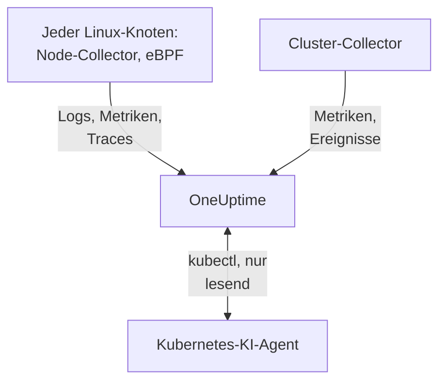

# Kubernetes-Agent

Der OneUptime-Kubernetes-Agent ist ein Helm-Chart, das die Metriken, Ereignisse und Pod-Logs Ihres Clusters erfasst und, mit eBPF, die Traces, Request-Metriken, den Service-Graph und die Netzwerkflüsse jedes Pods, ohne Codeänderungen und ohne SDKs. Außerdem betreibt er den [Kubernetes-KI-Agent](#kubernetes-ki-agent), mit dem OneUptime AI lesendes `kubectl` ausführt, während sie einen Vorfall oder Alarm untersucht. Ein einziges `helm install` richtet ihn ein; [Kubernetes-Monitore](/docs/monitor/kubernetes-monitor) alarmieren anhand dessen, was er sendet.

:::cards
- [Agent installieren](#agent-installieren): Vier Schritte mit Helm.
- [Konfigurationsoptionen](#konfigurationsoptionen): Filter, Sampling, Control Plane, Service Mesh, Kosten und Labels.
- [Kubernetes-KI-Agent](#kubernetes-ki-agent): Lesendes `kubectl` für OneUptime AI und Korrekturen, wenn Sie sie erlauben.
- [Weniger senden](#die-erfasste-datenmenge-verringern): Die Hebel, nach Wirkung geordnet.
:::

## So funktioniert es

Das Chart führt einige Workloads in einem eigenen Namespace aus. Jeder sendet, was er erfasst, per OTLP mit dem Ingestion-Schlüssel, den Sie ihm geben, an Ihre OneUptime-URL, und der Cluster registriert sich unter dem Namen, den Sie in `clusterName` angeben.



| Workload | Art | Was er tut | Läuft |
| --- | --- | --- | --- |
| Cluster-Collector | Deployment | Cluster-Metriken, Kubernetes-Ereignisse und die Spezifikationen von Pods, Knoten und Workloads, aus der Kubernetes-API. | Immer |
| Node-Collector | DaemonSet | Pod-Logs aus `/var/log/pods`, Kubelet- und cAdvisor-Metriken und die Betriebssystemmetriken des Knotens. | Überall außer auf EKS Fargate |
| eBPF-Instrumentierung (OBI) | DaemonSet | HTTP-, gRPC-, SQL- und Redis-Traces und Request-Metriken aller Pods sowie die Service-Map. | Standardmäßig, außer auf GKE Autopilot und EKS Fargate |
| Kubernetes-KI-Agent | Deployment | Lesendes `kubectl` für OneUptime AI, während sie einen Vorfall oder Alarm untersucht. | Standardmäßig |
| Log-Tailer | Deployment | Pod-Logs über die Kubernetes-API, wo der Node-Collector sie nicht lesen kann. | Mit den Presets `gke-autopilot` und `eks-fargate` |
| Kosten-Engine und Poller | Deployments | Ausgaben pro Namespace, Workload und Pod. | Mit `cost.enabled=true` |

Jedes Agent-Image ist nur für Linux, daher ist jeder Workload an Linux-Knoten gebunden.

## Bevor Sie beginnen

- Ein Kubernetes-Cluster ab v1.23 und `kubectl`, das ihn erreicht.
- Helm 3. Upgrades verwenden `--reset-then-reuse-values`, das Helm 3.14 oder neuer braucht.
- Ein Ingestion-Schlüssel. Legen Sie ihn unter **Projekteinstellungen → Telemetrie & APM → Ingestion-Schlüssel** an. Der Agent sendet ihn als Header `x-oneuptime-token`, ein Projekt-API-Schlüssel funktioniert hier also nicht.
- Ein Name für den Cluster, eindeutig in Ihrem Projekt und stabil, etwa `prod-us-east-1`: Unter diesem Namen erscheint der Cluster in OneUptime.
- Ausgehendes HTTPS vom Cluster zu Ihrer OneUptime-URL.

## Agent installieren

:::steps
### Helm-Repository hinzufügen

```bash
helm repo add oneuptime https://helm-chart.oneuptime.com
helm repo update
```

### Chart installieren

Ersetzen Sie `YOUR_ONEUPTIME_URL`, `YOUR_ONEUPTIME_API_KEY` (den Ingestion-Schlüssel) und den Clusternamen durch Ihre Werte und wählen Sie den Tab für Ihre Plattform (siehe [Preset wählen](#preset-wählen)).

:::tabs
@tab Standard
Selbst verwaltete Cluster, EKS auf EC2, GKE Standard, AKS, minikube, kind und k3s:

```bash
helm install kubernetes-agent oneuptime/kubernetes-agent \
  --namespace oneuptime-agent \
  --create-namespace \
  --set oneuptime.url="YOUR_ONEUPTIME_URL" \
  --set oneuptime.apiKey="YOUR_ONEUPTIME_API_KEY" \
  --set clusterName="my-cluster" \
  --set aiAgent.enabled=true
```
@tab GKE Autopilot
```bash
helm install kubernetes-agent oneuptime/kubernetes-agent \
  --namespace oneuptime-agent \
  --create-namespace \
  --set oneuptime.url="YOUR_ONEUPTIME_URL" \
  --set oneuptime.apiKey="YOUR_ONEUPTIME_API_KEY" \
  --set clusterName="my-cluster" \
  --set aiAgent.enabled=true \
  --set preset=gke-autopilot
```
@tab EKS Fargate
```bash
helm install kubernetes-agent oneuptime/kubernetes-agent \
  --namespace oneuptime-agent \
  --create-namespace \
  --set oneuptime.url="YOUR_ONEUPTIME_URL" \
  --set oneuptime.apiKey="YOUR_ONEUPTIME_API_KEY" \
  --set clusterName="my-cluster" \
  --set aiAgent.enabled=true \
  --set preset=eks-fargate
```
:::

**KI-Untersuchungen sind standardmäßig aktiviert.** `aiAgent.enabled=true` führt den [Kubernetes-KI-Agent](#kubernetes-ki-agent) neben dem Collector aus: Wird auf diesem Cluster ein Vorfall oder Alarm ausgelöst, untersucht OneUptime AI ihn mit lesendem `kubectl` (`get`, `describe`, `logs`, `events`, `top`) und ändert nichts. Korrekturen bleiben aus, bis Sie sie erlauben. Um ohne ihn zu installieren, verwenden Sie stattdessen `--set aiAgent.enabled=false`.

### Prüfen, ob die Pods laufen

```bash
kubectl get pods -n oneuptime-agent
```

Jeder Pod sollte innerhalb von ein, zwei Minuten `Running` erreichen:

:::tabs
@tab Standard
Der Cluster-Collector, der KI-Agent und auf jedem Knoten ein Node-Collector und ein eBPF-Pod:

```text
NAME                                          READY   STATUS    RESTARTS   AGE
kubernetes-agent-xxxxxxxxxx-xxxxx             1/1     Running   0          1m
kubernetes-agent-ai-agent-xxxxxxxxxx-xxxxx    1/1     Running   0          1m
kubernetes-agent-ebpf-xxxxx                   1/1     Running   0          1m
kubernetes-agent-logs-xxxxx                   1/1     Running   0          1m
```
@tab GKE Autopilot
Der Node-Collector läuft trotzdem und liest Kubelet- und cAdvisor-Metriken ohne `hostPath`, und ein Log-Tailer-Deployment liest die Pod-Logs über die Kubernetes-API:

```text
NAME                                          READY   STATUS    RESTARTS   AGE
kubernetes-agent-xxxxxxxxxx-xxxxx             1/1     Running   0          1m
kubernetes-agent-ai-agent-xxxxxxxxxx-xxxxx    1/1     Running   0          1m
kubernetes-agent-logs-yyyyyyyyyy-yyyyy        1/1     Running   0          1m
kubernetes-agent-logs-xxxxx                   1/1     Running   0          1m
```
@tab EKS Fargate
Drei Deployments und kein DaemonSet: Fargate gibt jedem Pod eine eigene Micro-VM und plant nie DaemonSets ein, daher gibt es dort keine Knotenmetriken:

```text
NAME                                          READY   STATUS    RESTARTS   AGE
kubernetes-agent-xxxxxxxxxx-xxxxx             1/1     Running   0          1m
kubernetes-agent-ai-agent-xxxxxxxxxx-xxxxx    1/1     Running   0          1m
kubernetes-agent-logs-yyyyyyyyyy-yyyyy        1/1     Running   0          1m
```
:::

### Den Cluster in OneUptime finden

Öffnen Sie **Produkte → Infrastruktur → Kubernetes → Alle Cluster**. Der Cluster erscheint innerhalb weniger Minuten unter seinem `clusterName`, und seine Knoten, Pods und Workloads füllen sich. Der Kubernetes-KI-Agent wird auf der Seite **Agent** des Clusters, unter **KI**, als verbunden angezeigt.
:::

## Preset wählen

`preset` wählt die Standardwerte, die auf Ihrer Plattform funktionieren: ob Pod-Logs über `hostPath` vom Knoten oder über die Kubernetes-API gelesen werden und welche Workloads privilegiert laufen dürfen.

| `preset` | Verwenden für | Pod-Logs | Knotenmetriken |
| --- | --- | --- | --- |
| `standard` (Standard) | Selbst verwaltete Cluster, **EKS on EC2**, **GKE Standard**, **AKS**, minikube, kind, k3s | Der Node-Collector liest `/var/log/pods` über `hostPath` (geringster Aufwand) | Kubelet, cAdvisor und die Betriebssystemmetriken des Knotens |
| `gke-autopilot` | **GKE Autopilot** | Der Log-Tailer liest sie über die Kubernetes-API (kein `hostPath`, kein Hostzugriff) | Kubelet und cAdvisor, ohne `hostPath` |
| `eks-fargate` | **EKS Fargate** | Der Log-Tailer liest sie über die Kubernetes-API (kein `hostPath`, kein Hostzugriff) | Keine: Fargate führt keine DaemonSets aus |

Wenn Sie unsicher sind, beginnen Sie mit `standard`. Scheitert die Installation mit einem Pod-Security-Fehler, der `hostPath` nennt, installieren Sie erneut mit `preset=gke-autopilot` (oder `eks-fargate` auf Fargate). GKE Autopilot und EKS Fargate lehnen außerdem privilegierte Pods ab, die eBPF und der Profiler brauchen; diese beiden Presets lassen daher beide weg.

## Was erfasst wird

| Kategorie | Daten |
| --- | --- |
| Knotenmetriken | Nutzung von CPU, Speicher, Dateisystem und Netzwerk |
| Pod-Metriken | CPU, Speicher, Netzwerk und Neustarts |
| Container-Metriken | CPU und Speicher pro Container |
| Cluster-Metriken | Knotenbedingungen, zuweisbare Ressourcen, Pod-Anzahl |
| Kubernetes-Ereignisse | Warnungen, Fehler und Scheduling-Ereignisse |
| Pod-Logs | stdout und stderr jedes Containers (über `hostPath` auf Standard-Clustern, über die Kubernetes-API auf Autopilot und Fargate) |
| Anwendungs-Traces (eBPF, standardmäßig aktiv) | HTTP-, gRPC-, SQL- und Redis-Spans aller Pods, ohne SDK und ohne Codeänderungen |
| HTTP-RED-Metriken (eBPF) | `http.server.request.duration` sowie Request- und Response-Body-Größen, pro Dienst |
| Service-Graph (eBPF) | Request-Rate, Latenz und Fehlerkanten zwischen Aufrufer und Aufgerufenem, die die Service-Map zeichnen |
| Netzwerkflussmetriken (eBPF) | Byte- und Paketzähler für TCP und UDP von Pod zu Pod, mit Kubernetes-Metadaten |
| TCP-Statistiken (eBPF) | Zähler für Round-Trip-Zeit, fehlgeschlagene Verbindungen und Neuübertragungen pro Knoten |
| Workload-Kosten (optional, `cost.enabled=true`) | Ausgaben pro Namespace, Workload und Pod, mit Leerlauf und Effizienz, sowie stündliche Kosten von Knoten und Volumes: siehe [Kubernetes-Kosten-Observability](/docs/telemetry/kubernetes-cost) |

## Konfigurationsoptionen

Jede der folgenden Optionen ist ein Helm-Wert. Setzen Sie ihn bei der Installation oder bei einem installierten Agent mit `helm upgrade ... --reset-then-reuse-values --set <value>`.

### Namespace-Filterung

`namespaceFilters.rules` wendet Namespace-Muster auf vier Bereiche an, jeden für sich:

| Bereich | Wo er filtert | Was er betrifft |
| --- | --- | --- |
| `podLogs` | Am hostPath-Receiver filelog oder am API-Log-Tailer | Nur stdout und stderr der Pods; Kubernetes-Ereignisse und Audit-Logs sind nicht betroffen |
| `ebpfDiscovery` | Bei der Prozesserkennung von OBI | eBPF-Traces und eBPF-Metriken passender Workloads |
| `metrics` | Im Collector, nachdem Kubernetes-Metadaten hinzugefügt wurden | Metrikserien mit Namespace; Knoten- und Clusterserien ohne Namespace bleiben erhalten |
| `traces` | Im Collector, nachdem Kubernetes-Metadaten hinzugefügt wurden | eBPF-Spans und Spans, die Anwendungen per OTLP senden |

Ein Muster passt auf den ganzen Namespace-Namen und darf `*` enthalten (`team-*`). Hat ein Bereich eine `include`-Regel, werden für diesen Bereich nur passende Namespaces behalten, und `exclude`-Regeln gewinnen immer. Die Standardregel schließt `kube-system` nur von `podLogs` und `ebpfDiscovery` aus.

Um Pod-Logs und eBPF-Erkennung auf einige Namespaces zu beschränken:

```bash
helm install kubernetes-agent oneuptime/kubernetes-agent \
  --namespace oneuptime-agent \
  --create-namespace \
  --set oneuptime.url="YOUR_ONEUPTIME_URL" \
  --set oneuptime.apiKey="YOUR_ONEUPTIME_API_KEY" \
  --set clusterName="my-cluster" \
  --set-json 'namespaceFilters.rules=[{"action":"include","namespaces":["default","production","staging"],"scopes":["podLogs","ebpfDiscovery"]}]'
```

Um die Logs eines lauten Namespaces zu stoppen und seine eBPF-Traces, Service-Map und Metriken zu behalten, beschränken Sie den Ausschluss auf `podLogs`:

```bash
  --set-json 'namespaceFilters.rules=[{"action":"exclude","namespaces":["kube-system"],"scopes":["podLogs","ebpfDiscovery"]},{"action":"exclude","namespaces":["noisy-*"],"scopes":["podLogs"]}]'
```

Regeln für `podLogs` und `ebpfDiscovery` filtern an der Quelle: Ausgeschlossene Logdateien werden nie geöffnet, und ausgeschlossene Workloads werden nie instrumentiert. Regeln für `metrics` und `traces` greifen später im Collector, nachdem der Namespace an die Daten angehängt wurde.

#### Metriken und Traces nach Namespace filtern

Fügen Sie einer Regel diese Bereiche hinzu, um auch Metriken oder Spans mit Namespace zu filtern:

```bash
  --set-json 'namespaceFilters.rules=[{"action":"exclude","namespaces":["kube-system","noisy-*"],"scopes":["podLogs","ebpfDiscovery","metrics","traces"]}]'
```

> [!NOTE]
> Metriken auf Knoten- und Clusterebene bleiben immer erhalten. Ein Namespace gehört zu einem Pod, nicht zu einem Knoten; Serien wie Knoten-CPU, Knotenspeicher und Dateisystemnutzung haben daher nichts, worauf eine Regel passen könnte, und werden nie verworfen: Eine auf `metrics` beschränkte Regel reduziert Serien pro Pod, ohne einen ausfallenden Knoten zu verbergen.

Kubernetes-Ereignisse lassen sich am Agent nicht nach Namespace filtern: Sie kommen vom Receiver `k8sobjects` ohne Attribut `k8s.namespace.name` an (der Namespace steht im Ereignistext), sodass ein Filter nichts findet. Verwerfen Sie sie stattdessen in OneUptime, mit **Protokolle → Einstellungen → Drop-Filter**.

### Filterung nach Log-Schweregrad

`filters.logs.minSeverity` verwirft Pod-Log-Datensätze unterhalb eines Schweregrads, am Agent, bevor etwas gesendet wird:

```bash
  --set filters.logs.minSeverity=WARN
```

Es akzeptiert `TRACE`, `DEBUG`, `INFO`, `WARN`, `ERROR` und `FATAL`. `WARN` behält WARN, ERROR und FATAL und verwirft INFO, DEBUG und TRACE; der Standard (`""`) behält alles. Es gilt in beiden Log-Modi (über den Collector im Modus `daemonset`, im Log-Tailer im Modus `api`), daher schaltet ein Preset es nie hinter Ihrem Rücken ab.

Container-Laufzeiten erfassen keinen Schweregrad, daher liest der Agent ihn aus dem Logtext selbst (`[ERROR]`, `WARN:`, `"level":"info"`, …). Was mit einer Zeile ohne erkennbare Stufe geschieht, hängt vom Log-Modus ab, weil die beiden Modi Unterschiedliches wissen:

| Modus | Eine Zeile ohne Stufe | Warum |
| --- | --- | --- |
| `daemonset` | `stderr` zählt als ERROR (behalten), `stdout` als INFO (von einer WARN-Schwelle verworfen) | Die Container-Laufzeit erfasst, aus welchem Stream jede Zeile kam. |
| `api` | Wird immer behalten | Die Kubernetes-API `pods/log` führt stdout und stderr ohne Markierung pro Zeile in einem Stream zusammen; statt zu raten, behält der Agent die Zeile. |

Der Modus `api` verwirft also bewusst strikt weniger als der Modus `daemonset`: Ein Python-Traceback oder ein `npm ERR!` trägt kein Schweregrad-Schlüsselwort, und es stillschweigend zu löschen, ist genau der Fehler, vor dem eine Schwelle schützen soll. Im Hybridmodus (`logs.windowsPods.enabled`) gelten beide Zeilen, je nach Betriebssystem des Knotens: Linux-Pods folgen `daemonset`, Windows-Pods `api`.

Mehrzeilige Ereignisse werden in beiden Modi vor dem Filtern wieder zusammengesetzt, daher wird ein Java-Stacktrace nach seiner ersten Zeile beurteilt und als Ganzes behalten oder verworfen.

> [!IMPORTANT]
> Kubernetes-Ereignisse und Ressourcenspezifikationen werden dadurch nie gefiltert. Sie kommen ohne eigenen Schweregrad aus der Kubernetes-API, daher würde eine Schwelle den ganzen Feed löschen, einschließlich der Warnungen `FailedScheduling`, `BackOff` und `OOMKilling`, die Sie am dringendsten brauchen. Sie sind wenige und wertvoll, deshalb sendet der Agent sie immer; um sie auszudünnen, verwenden Sie **Protokolle → Einstellungen → Drop-Filter** in OneUptime.

### Metriken nach Namen ein- oder ausschließen

`filters.metrics` entscheidet über alle Receiver hinweg, welche Metriken den Cluster verlassen.

Einige laute Metriken verwerfen (eine Denylist, meist das, was Sie wollen):

```bash
  --set-json 'filters.metrics.exclude=["k8s.volume.available","k8s.volume.capacity"]'
```

Nur eine feste Menge senden (eine Allowlist: alles andere wird verworfen):

```bash
  --set-json 'filters.metrics.include=["k8s.pod.cpu.utilization","k8s.pod.memory.usage"]'
```

Nach Muster statt nach exaktem Namen abgleichen:

```bash
  --set filters.metrics.matchType=regexp \
  --set-json 'filters.metrics.exclude=["^container_network_"]'
```

| Schlüssel | Bedeutung |
| --- | --- |
| `filters.metrics.exclude` | Zu verwerfende Metriknamen. Wird nach `include` angewendet, ein Ausschluss gewinnt also immer. |
| `filters.metrics.include` | Wenn nicht leer, werden nur diese Metriken gesendet. |
| `filters.metrics.matchType` | `strict` (der exakte Name, der Standard) oder `regexp` (RE2, nicht verankert). |

- `regexp` ist nicht verankert: `system.cpu` passt auch auf `system.cpu.time`. Verankern Sie es (`^system\.cpu$`), wenn Sie genau eine Metrik meinen.
- RE2 kennt kein Lookahead, daher kompiliert `^(?!container_)` nicht. Drücken Sie „alles außer“ mit `include` aus, nicht mit einem negativen Muster.
- `include` gilt für alle Receiver zugleich. Eine Allowlist, die eine Metrik vergisst, entfernt stillschweigend die darauf aufbauenden Monitore; bevorzugen Sie daher `exclude`, wenn Sie keine geschlossene Menge wollen.
- Verwenden Sie `--set-json` (oder eine Values-Datei) für Listen: Ein einfaches `--set` ersetzt eine Liste, statt sie zu ergänzen.

> [!WARNING]
> Testen Sie ein Muster, bevor Sie es ausrollen. Der Collector kompiliert Muster beim Start, daher verhält sich ein ungültiges nicht still falsch: Der Collector startet nicht und hängt in einer Neustartschleife, und die Logs dieses Collectors fallen mit seinen Metriken aus. Helm kann RE2 nicht kompilieren, daher akzeptiert `helm upgrade` ein fehlerhaftes Muster ohne Beanstandung.

### Trace-Sampling

Die Filter oben entfernen eine Kategorie von Telemetrie: einen Namespace, einen Schweregrad, einen Metriknamen. Sampling behält jede Kategorie und dünnt stattdessen die Menge aus. Setzen Sie `sampling.traces.percentage` auf den Anteil der zu behaltenden Traces:

```bash
helm upgrade kubernetes-agent oneuptime/kubernetes-agent \
  --namespace oneuptime-agent --reset-then-reuse-values \
  --set sampling.traces.percentage=10
```

Damit wird einer von zehn Traces behalten, und die übrigen neun werden am Agent verworfen, bevor sie Ihren Cluster verlassen.

- **Sie erhalten ganze Traces, keine Bruchstücke.** Die Entscheidung ist ein Hash der Trace-ID, kein Münzwurf pro Span; daher werden alle Spans eines Traces gemeinsam behalten oder verworfen, und die verbleibenden Traces sind von Anfang bis Ende lesbar.
- **Ihre metrikbasierten Monitore bleiben unverändert.** OBI berechnet die eBPF-RED-Metriken (Request-Rate, Fehlerrate, Dauer) aus jedem Request, und sie laufen durch die Metrik-Pipeline, in der der Sampler nicht sitzt. Bei 10% erhalten Sie ein Zehntel der Traces und exakte Rate, Fehler und Latenz.
- **Ihre spanbasierten Monitore ändern sich.** Alles, was OneUptime aus den Spans selbst zählt, sinkt mit der Rate: Beachten Sie die Warnung unten.

| Schlüssel | Bedeutung |
| --- | --- |
| `sampling.traces.percentage` | Der Prozentsatz der zu behaltenden Traces, 0 bis 100. Standard `100` (alles behalten). |
| `sampling.traces.hashSeed` | Der Seed des Trace-ID-Hashes. Standard `22`. |

- `0` behält überhaupt keine Traces. Es ist eine Rate, kein Ausschalter: Es löscht jeden Trace, während das eBPF-DaemonSet weiterläuft und Kosten verursacht. Für keine Traces verwenden Sie `ebpf.enabled=false`; für keine Traces, aber RED-Metriken und Service-Map, lassen Sie eBPF an und setzen bewusst `0`.
- Es gilt nur, wenn `ebpf.enabled` aktiv ist: Andernfalls gibt es keine Traces-Pipeline, und der Wert bewirkt nichts.
- Es sampelt nur Traces. Es gibt bewusst kein `sampling.logs` oder `sampling.metrics`: Siehe den Hinweis unten.
- Brüche brauchen `--set-json` und haben eine Untergrenze. `--set sampling.traces.percentage=0.5` scheitert, weil Helm `0.5` als Zeichenkette liest: Verwenden Sie `--set-json 'sampling.traces.percentage=0.5'` oder eine Values-Datei. Unterhalb von etwa `0.0061` rundet die Rate auf null ab und verhält sich genau wie `0`, ohne Fehler; `0.01` (einer von zehntausend) ist der kleinste Wert, der tut, was er sagt.
- Mehrere Cluster funktionieren von Haus aus. Zwei Agents behalten denselben Trace nur, wenn sie sich bei `hashSeed` und `percentage` einig sind, und beide haben überall dieselben Standardwerte, sodass ein Trace über zwei Cluster ganz erhalten bleibt. Ändern Sie `hashSeed` nur, um zwei Sampling-Stufen unabhängig zu machen: Mit demselben Seed behält eine niedrigere Rate eine Teilmenge der Traces der höheren Rate.
- Pod-Logs werden nie gesampelt; mit `ebpf.logToTraceCorrelation: true` trägt daher jeder Log-Datensatz weiterhin eine Trace-ID, während nur der behaltene Anteil dieser Traces existiert. Etwa (100 − `percentage`)% der Log-Datensätze verweisen dann auf einen Trace, den es nicht gibt; der Weg von einem Trace zu seinen Logs ist nicht betroffen.

> [!WARNING]
> Passen Sie Ihre spanbasierten Monitore an, wenn Sie das setzen. Sampling verringert die Spans, die OneUptime erreichen, daher zählt alles, was sie zählt, weniger: Ein Monitor **Traces** auf `Span Count` und ein Monitor **Ausnahmen** auf `Exception Count` sehen etwa `percentage`% des Volumens von gestern. Eine Schwelle, die auf ungesampeltem Verkehr eingestellt wurde, wird still nicht mehr überschritten: Der Monitor meldet keinen Fehler, er verstummt nur. Teilen Sie diese Schwellen durch denselben Faktor; die Rate gilt clusterweit, kein Dienst lässt sich ausnehmen. Die Fehlergruppierung leidet stärker als linear: Eine häufige Ausnahme erscheint weiterhin, aber ein seltener Einzelfall verschwindet eher ganz, als dass er ein Zehntel so oft erscheint.

> [!NOTE]
> Warum es kein Log- oder Metrik-Sampling gibt: Der Sampler des Collectors kann Metriken gar nicht sampeln. Logs kann er sampeln, aber er nimmt seinen Zufall aus der Trace-ID, die Pod-Logs nicht haben; jeder Log-Datensatz würde also gleich gehasht, und eine Log-Rate würde je nach Seed alles behalten oder alles löschen. Statt eine Einstellung anzubieten, die stillschweigend Ihre Logs löscht, bietet das Chart keine an. Dünnen Sie Logs mit [Filterung nach Log-Schweregrad](#filterung-nach-log-schweregrad) und [Namespace-Filterung](#namespace-filterung) aus, die genau sagen, was sie entfernen.

### Log-Erfassung abschalten

Wenn Sie keine Pod-Logs brauchen:

```bash
helm install kubernetes-agent oneuptime/kubernetes-agent \
  --namespace oneuptime-agent \
  --create-namespace \
  --set oneuptime.url="YOUR_ONEUPTIME_URL" \
  --set oneuptime.apiKey="YOUR_ONEUPTIME_API_KEY" \
  --set clusterName="my-cluster" \
  --set logs.enabled=false
```

Ihre Metriken sind nicht betroffen: Der Node-Collector läuft für Kubelet-, cAdvisor- und Host-Metriken weiter und hört nur auf, Pod-Logs zu lesen. Log-basierte Alarme hören auf, sonst nichts.

### Einen bestimmten Log-Erfassungsmodus erzwingen

`logs.mode` überschreibt die Wahl des Presets und gewinnt immer:

- `logs.mode=daemonset`: das hostPath-DaemonSet (geringster Aufwand; braucht `hostPath`).
- `logs.mode=api`: das Deployment des Kubernetes-API-Log-Tailers (funktioniert auf jedem Cluster).
- `logs.mode=disabled`: keine Pod-Logs.

Der Modus entscheidet nur, woher Pod-Logs kommen: Knotenmetriken werden in jedem Fall erfasst, daher behalten `api` und `disabled` Ihre Kubelet-, cAdvisor- und Host-Metriken. Die Ausnahme ist die Plattform: EKS Fargate kann überhaupt keine DaemonSets einplanen, hat also keinen Node-Collector und keine Knoten-, Pod- oder Container-Metriken. GKE Autopilot führt den Node-Collector aus, blockiert aber `hostPath`, erfasst also Kubelet- und cAdvisor-Metriken ohne die von `hostmetrics` (Datenträger-I/O, Inodes, NIC-Fehler), die `/proc` und `/sys` des Hosts lesen.

Auf Clustern mit Windows-Knotenpools deckt der Modus `daemonset` nur die Linux-Knoten ab, weil jedes Agent-Image nur für Linux ist. Fügen Sie `--set logs.windowsPods.enabled=true` hinzu, um den API-Log-Tailer daneben nur für die Pods auf Windows-Knoten auszuführen: Linux-Pods behalten das lokale Verfolgen der Dateien auf dem Knoten, und die beiden senden nie dieselbe Zeile doppelt. Dafür braucht es ein Image `kubernetes-log-tailer`, das mindestens so neu ist wie das Chart: Ein älteres Image ignoriert die Einschränkung und sendet Linux-Logs doppelt.

### Control-Plane-Überwachung aktivieren

Die Seite **Steuerungsebene** des Clusters zeigt Diagramme für etcd, den API-Server, den Scheduler und den Controller-Manager. Der Agent scrapt alle vier, wenn `controlPlane.enabled` auf `true` steht:

```bash
helm upgrade kubernetes-agent oneuptime/kubernetes-agent \
  --namespace oneuptime-agent \
  --reset-then-reuse-values \
  --set controlPlane.enabled=true
```

Jede Komponente wird an den Adressen in ihrer eigenen Liste gescrapt: `controlPlane.etcd.endpoints`, `controlPlane.apiServer.endpoints`, `controlPlane.scheduler.endpoints` und `controlPlane.controllerManager.endpoints`. Der Scrape läuft im Pod des Agents, der kein Host-Netzwerk hat; die Standardwerte (`https://localhost:<port>/metrics`) zeigen daher auf diesen Pod selbst: Setzen Sie jede Liste auf eine Adresse, die der Pod erreicht. In jedem Cluster antwortet der API-Server unter `https://kubernetes.default.svc:443/metrics`:

```bash
helm upgrade kubernetes-agent oneuptime/kubernetes-agent \
  --namespace oneuptime-agent \
  --reset-then-reuse-values \
  --set controlPlane.enabled=true \
  --set "controlPlane.apiServer.endpoints={https://kubernetes.default.svc:443/metrics}"
```

`controlPlane.enabled` schaltet alle vier Scrapes auf einmal ein. Wo eine Komponente unter ihren Endpunkten nicht erreichbar ist (etcd, der Scheduler und der Controller-Manager auf einem verwalteten Cluster oder unter ihren Standardwerten mit `localhost`), scheitert ihr Scrape in jedem Intervall: Der Collector protokolliert einen Scrape-Fehler und meldet das Ziel als nicht erreichbar, sonst ändert sich nichts.

Der Agent scrapt nur über HTTPS, mit dem Token des Service-Accounts und ohne Client-Zertifikat. Daher:

- **etcd** braucht eine HTTPS-Metrikadresse, die kein Client-Zertifikat verlangt. Die üblichen Metrik-Ports von etcd sind unerreichbar: Einfaches HTTP auf `2381` (`--listen-metrics-urls` von kubeadm) wird als HTTPS gescrapt und scheitert, und `2379` verlangt Client-Zertifikate.
- **Der Scheduler** (`10259`) und **der Controller-Manager** (`10257`) sprechen HTTPS und akzeptieren das Token, aber kubeadm bindet sie auf den Control-Plane-Knoten an `127.0.0.1`: Sie brauchen eine `--bind-address`, die der Pod des Agents erreicht.

Verwaltete Kubernetes-Dienste (EKS, GKE, AKS) legen etcd, den Scheduler und den Controller-Manager nicht offen, daher bleiben diese Tabs dort leer. Solange die Metriken eines Tabs nicht eintreffen, zeigt die Seite **Steuerungsebene** an Stelle seiner Diagramme, was zu setzen ist, mit dem Befehl zum Kopieren.

### CoreDNS-Metriken aktivieren

Der Tab **CoreDNS** der Seite **Steuerungsebene** zeigt DNS-Abfragen, Latenz, den Cache und die Weiterleitung. Ihre Erfassung ist standardmäßig aus:

```bash
helm upgrade kubernetes-agent oneuptime/kubernetes-agent \
  --namespace oneuptime-agent \
  --reset-then-reuse-values \
  --set coreDns.enabled=true
```

Der Agent scrapt Port `9153` der Pods mit dem Label `k8s-app=kube-dns` in `kube-system`, so wie CoreDNS auf kubeadm-Clustern, EKS und AKS läuft. Läuft es bei Ihnen anders, setzen Sie zusätzlich `coreDns.namespace`, `coreDns.service` (das Label `k8s-app`) und `coreDns.port`. GKE verwendet kube-dns (dnsmasq) oder Cloud DNS statt CoreDNS, daher bleibt der Tab dort leer.

### Service-Mesh-Metriken aktivieren

Die Seite **Service Mesh** des Clusters zeigt Diagramme für Istio und Linkerd. Der Agent scrapt ein Mesh, das, das `serviceMesh.provider` nennt (`istio` oder `linkerd`):

```bash
helm upgrade kubernetes-agent oneuptime/kubernetes-agent \
  --namespace oneuptime-agent \
  --reset-then-reuse-values \
  --set serviceMesh.enabled=true \
  --set serviceMesh.provider=istio
```

Für Istio liest er die Envoy-Statistiken jedes Sidecars `istio-proxy` (Port `15090`); für Linkerd den Admin-Port jedes `linkerd-proxy`. Die Control Plane keines der beiden Meshes wird gescrapt: istiod (die Karte **Pilot**) und die Komponenten identity, destination und proxy-injector von Linkerd (die Karte **Steuerungsebene**) liefern ihre Metriken auf eigenen Admin-Ports; diese Karten sagen das daher an Stelle ihrer Diagramme.

### Metriken, die der Agent nicht erfasst

Einige Diagramme zeigen Metriken, für die der Agent keinen Scrape hat: **kube-proxy** auf der Seite **Steuerungsebene**; **Cilium** (mit Hubble) auf der Seite **Service Mesh**; und auf den Tabs Istio und Linkerd die eigenen Control Planes der Meshes (**istiod** und die Komponenten identity, destination und proxy-injector von Linkerd). Sie füllen sich, wenn diese Metriken OneUptime auf anderem Weg erreichen, etwa über Ihren eigenen [OpenTelemetry Collector](/docs/telemetry/open-telemetry), der sie scrapt, mit dem Ressourcenattribut `k8s.cluster.name` auf den Namen des Clusters gesetzt (den `clusterName` des Agents). Cluster, die ohne kube-proxy laufen, haben überhaupt keine kube-proxy-Metriken.

### Kosten-Observability aktivieren

Sehen Sie auf der Seite **Kosten** des Clusters, was jeder Namespace, jeder Workload und jeder Pod kostet, mit Leerlaufkapazität und dem genutzten Anteil jedes Requests:

```bash
helm upgrade kubernetes-agent oneuptime/kubernetes-agent \
  --namespace oneuptime-agent \
  --reset-then-reuse-values \
  --set cost.enabled=true
```

Das allein ist eine vollständige Installation: Das Chart bringt die Open-Source-Engine [OpenCost](https://opencost.io) mit (samt dem kleinen Prometheus, das sie braucht) und bepreist Ihre Knoten und Volumes ohne Zugangsdaten anhand der öffentlichen Listenpreise Ihres Cloud-Anbieters. Es kommen zwei kleine Pods hinzu, und die ersten Kosten erscheinen nach der ersten abgeschlossenen Stunde. Betreiben Sie bereits Kubecost oder OpenCost? Fügen Sie stattdessen `--set cost.engine.url=<its service URL>` hinzu, dann wird nichts mitgeliefert. On-Prem-Cluster können mit `cost.opencost.customPricing` eine Preistabelle festlegen. Die vollständige Anleitung, mit On-Prem-Preisen und Fehlerbehebung, ist [Kubernetes-Kosten-Observability](/docs/telemetry/kubernetes-cost).

### Automatisch mit Projektlabels versehen

Jedes Ressourcenattribut, das mit `oneuptime.label.` beginnt, wird zu einem Projektlabel am Cluster und an den Diensten und Hosts, die dieser Agent meldet: `oneuptime.label.<dimension>=<value>` ist das Label `<dimension>:<value>`. Übergeben Sie Labels bei der Installation mit `--set oneuptime.labels.<key>=<value>`:

```bash
helm install kubernetes-agent oneuptime/kubernetes-agent \
  --namespace oneuptime-agent \
  --create-namespace \
  --set oneuptime.url="YOUR_ONEUPTIME_URL" \
  --set oneuptime.apiKey="YOUR_ONEUPTIME_API_KEY" \
  --set clusterName="prod" \
  --set oneuptime.labels.team=payments \
  --set oneuptime.labels.env=production \
  --set oneuptime.labels.region=us-east-1
```

Oder legen Sie sie in einer Values-Datei ab:

```yaml title="values.yaml"
oneuptime:
  url: YOUR_ONEUPTIME_URL
  apiKey: YOUR_ONEUPTIME_API_KEY
  labels:
    team: payments
    env: production
    region: us-east-1
clusterName: prod
```

Labels werden ohne Beachtung der Groß-/Kleinschreibung abgeglichen, daher wird ein vorhandenes, von Hand angelegtes Label `Production` wiederverwendet statt dupliziert, und in OneUptime hinzugefügte Labels entfernt der Agent nie.

## Anwendungs-Traces und HTTP-Metriken über eBPF (standardmäßig aktiv)

Das Chart führt auf jedem Knoten ein DaemonSet mit [OpenTelemetry eBPF Instrumentation (OBI)](https://opentelemetry.io/docs/zero-code/obi/) aus. Es lädt eBPF-Programme in den Kernel und erfasst den HTTP- und HTTPS-, gRPC-, SQL- und Redis-Verkehr jeder unterstützten Laufzeit (Go, .NET, Java, Node.js, Python, Ruby, Rust), ohne SDK und ohne Sidecar. Die Traces und Request-Metriken fließen dann über den Collector im Cluster zu OneUptime.

Es braucht Linux-Kernel 5.8 oder neuer mit BTF (Standard unter Debian 11+, Ubuntu 20.10+, Fedora 34+, RHEL und Stream 9+), und sein DaemonSet läuft privilegiert, weil das Laden von eBPF-Programmen das erfordert.

### Wie eBPF-Traces aussehen

eBPF sieht Netzwerkaufrufe, nicht Ihren Code; ein Trace wird daher aus den Requests gebildet, die ein Dienst bearbeitet, und den Aufrufen, die er dabei macht:

- **Ein Request und seine Aufrufe bilden einen Trace.** Der Request an einen Dienst ist der Root-Span, benannt `<METHOD> <route>`, und die HTTP-, gRPC-, SQL- und Redis-Aufrufe, die der Dienst während der Bearbeitung macht, sind seine Kinder. (Für Node.js stützt sich das auf den Node.js-Agent von OBI, den das Chart mit `ebpf.nodejs.enabled` einschaltet.) Aufrufe, die gleichzeitige Requests über eine gemeinsame Verbindung senden, wie bei Redis-Clients üblich, lassen sich nicht immer auseinanderhalten; einige davon landen daher nicht im Trace ihres Requests.
- **Ein Aufruf an einen Dienst auf einem anderen Knoten beginnt einen neuen Trace**, sofern nichts den Trace-Kontext weiterträgt: ein OpenTelemetry-SDK oder die unten beschriebene optionale Kontextweitergabe. Laufen beide Enden auf demselben Knoten, sieht OBI beide und verknüpft sie selbst.
- **Arbeit, die kein Request ausgelöst hat, steht für sich.** Ein Queue-Worker, der Redis abfragt, oder ein Cron-Job hat keinen Request, zu dem seine Aufrufe gehören könnten.
- **Datenbankserver stehen meist für sich.** Datenbank-Wire-Protokolle tragen keinen Trace-Kontext; sofern der Aufrufer nicht auf demselben Knoten läuft, ist der Span, den OBI in einem Datenbankserver für jeden Befehl aufzeichnet, ein Trace aus einem einzigen Span.

Diese alleinstehenden Datenbankaufrufe kommen als Traces aus einem Span an, benannt nach einem nackten Befehl (`set`, `evalsha`, `SELECT`), und auf einem ausgelasteten Cluster können sie den Großteil dessen ausmachen, was OBI erfasst. Standardmäßig verwirft der Agent sie, bevor sie den Cluster verlassen: den eigenen Span eines Datenbankservers, der stets den Span des Aufrufers dupliziert (`ebpf.dropDatabaseServerSpans=true`), und einen Aufruf einer Anwendung, der zu keinem Trace gehört (`ebpf.dropUnlinkedDatabaseCalls=true`). Die Datenbankaufrufe einer Anwendung innerhalb des Traces eines Requests bleiben erhalten, Spans, die Ihre Anwendungen aus eigenen SDKs senden, werden nie angetastet, und die Datenbankmetriken zählen weiterhin jeden Befehl.

Ein Kompromiss: OneUptime erkennt Datenbanken aus Datenbank-Client-Spans und zeichnet sie daraus auf der Service-Map. Eine Datenbank, mit der nur Hintergrundarbeit spricht (die Queue eines Workers, das Warehouse eines Cron-Jobs), wird dann nicht mehr aus Traces erkannt und erscheint auf der Service-Map als entfernter Endpunkt. Ihre Metriken sind nicht betroffen. Setzen Sie `ebpf.dropUnlinkedDatabaseCalls=false`, um diese Spans zu behalten.

Die HTTP- und gRPC-Aufrufe von Hintergrundarbeit (ein Worker, der ClickHouse über HTTP abfragt, ein Controller, der seine Kubernetes-Lease erneuert) kommen ebenfalls als Traces aus einem Span an (`POST /`, `PUT /apis/*/...`). Setzen Sie `ebpf.dropUnlinkedClientCalls=true`, um auch sie zu verwerfen, zusammen mit Aufrufen, die OBI nicht dem Trace ihres Requests zuordnen konnte und die genauso aussehen; Datenbank-, Messaging- und GenAI-Aufrufe (MCP eingeschlossen) verwirft es nie. Standardmäßig ist es aus, weil es Daten kostet: Läuft der aufgerufene Dienst auf demselben Knoten, hängt OBI den von ihm bearbeiteten Request unter den Aufruf, sodass der Aufruf die Wurzel dieses Traces ist, und ihn zu verwerfen lässt den Trace ohne Wurzel zurück. Mit aktivem `ebpf.contextPropagation` geschieht das auf jedem Knoten und auch bei einem Dienst mit eigenem OpenTelemetry-SDK. Auch die Service-Map liest diese Aufrufe: Eine Abhängigkeit, die nur Hintergrundarbeit aufruft, wird dann allein aus den Service-Graph-Metriken von OBI gezeichnet, und eine Kante, die auch innerhalb von Requests vorkommt, zählt nur diese Aufrufe. Die Übersicht eines Dienstes zählt seine Spans; ein Worker oder eine Probe, deren Spans überwiegend solche Aufrufe sind, zeigt daher weit weniger Requests, mit Fehlerrate und p95-Latenz über die verbleibenden Spans. Die Client-Request-Metriken von OBI zählen weiterhin jeden Aufruf.

Auf einem selbst gehosteten OneUptime aktualisieren Sie den Server vor dem Agent: Der eBPF-Tracer, den dieses Chart ausführt (OBI v0.14), benennt aufgerufene Dienste und meldet die eigenen Spans von Message-Brokern auf eine Weise, die ältere OneUptime-Server nicht lesen.

Namen kommen aus dem Verkehr. HTTP-Spans verwenden die Routenvorlage der Anwendung, wenn OBI sie lesen kann, andernfalls ein aus der URL gebildetes Muster, in dem ID-artige Segmente durch `*` ersetzt sind; setzen Sie `ebpf.routes.patterns`, um sie selbst zu benennen. OBI liest die Routenvorlagen von Anwendungen in Go (net/http, Gorilla mux, Gin), Java (Spring, JAX-RS), Node.js (Express, Fastify, Koa, NestJS, Next.js), Python (Django, FastAPI, Flask), Ruby (Rails), .NET (Attributrouten von ASP.NET Core) und PHP (Symfony, Laravel, Slim). Namen auf Anwendungsebene wie `OrderService.charge` existieren nur im Code und brauchen ein OpenTelemetry-SDK.

Exportiert eine Anwendung bereits Traces mit einem OpenTelemetry-SDK, bemerkt OBI das und sendet für sie keine eBPF-Traces mehr, damit sie nicht doppelt getraced wird (`ebpf.excludeOtelInstrumentedServices=true`, der Standard von OBI). Setzen Sie es auf `false`, wenn dieses SDK an ein anderes Projekt meldet und Sie für die Anwendung auch in diesem eBPF-Traces möchten.

### eBPF-Autoinstrumentierung abschalten

Schalten Sie eBPF ab, wenn:

- Sie auf **GKE Autopilot** oder **EKS Fargate** installieren: Diese Plattformen lehnen privilegierte Pods ab, daher lassen `preset=gke-autopilot` und `preset=eks-fargate` eBPF bereits für Sie weg, und den Profiler damit.
- Die Knoten einen Kernel älter als 5.8 ohne BTF-Backports verwenden.
- Sie bereits aus jeder Anwendung Traces über OpenTelemetry-SDKs senden und auch die eBPF-Metriken nicht wollen. (Nur wegen der Traces müssen Sie das nicht: OBI sendet für eine Anwendung, die nachweislich eigene exportiert, keine eBPF-Traces mehr, wie oben beschrieben.)

```bash
helm install kubernetes-agent oneuptime/kubernetes-agent \
  --namespace oneuptime-agent \
  --create-namespace \
  --set oneuptime.url="YOUR_ONEUPTIME_URL" \
  --set oneuptime.apiKey="YOUR_ONEUPTIME_API_KEY" \
  --set clusterName="my-cluster" \
  --set ebpf.enabled=false
```

### Einzelne Signalfamilien umschalten

Bis auf eine sind alle standardmäßig aktiv. Schalten Sie jede mit `--set ebpf.features.<name>=false` ab:

| `ebpf.features.*` | Standard | Was sie hinzufügt |
| --- | --- | --- |
| `httpMetrics` | an | HTTP- und gRPC-RED-Metriken (Request-Rate, Latenz, Fehler) pro Dienst |
| `spanMetrics` | an | Anzahl und Dauer der Span-Aufrufe (`traces.span.metrics.*`) |
| `serviceGraph` | an | Kantenmetriken zwischen Aufrufer und Aufgerufenem, die die Service-Map zeichnen |
| `networkMetrics` | an | Zähler für TCP- und UDP-Flüsse von Pod zu Pod |
| `networkInterZoneMetrics` | aus | Die zonenübergreifende Variante der Netzwerkmetriken (verdoppelt ihre Kardinalität) |
| `tcpStats` | an | Zähler für TCP-Round-Trip-Zeit, fehlgeschlagene Verbindungen und Neuübertragungen pro Knoten |

Die dienstübergreifende Weitergabe des Trace-Kontexts, bei der OBI einen W3C-`traceparent` einfügt, damit ein Request von Pod A zu Pod B ohne SDK als ein Trace erscheint, ist standardmäßig aus. Schalten Sie sie mit `--set ebpf.contextPropagation=true` ein. Sie braucht keinen Kernel über das hinaus, was der Rest des Agents braucht, und keine Kernelversion macht sie wirkungslos.

Sie ist aus, weil das Einfügen des Headers bedeutet, Verkehr umzuschreiben, der bereits unterwegs ist: Klartext-HTTP-Requests werden im Kernel an Ort und Stelle erweitert, während TLS und rohes TCP über einen Traffic-Control-Hook eine angehängte TCP-Option erhalten. Wird die Byte-Buchführung der Verbindung nicht exakt korrigiert, gerät der Stream aus dem Takt; das berichtete Symptom sind Übertragungen über einen L7-Proxy wie nginx, die mitten im Body hängen, sobald die Antwort etwa 64KB überschreitet, während kleine Requests weiter funktionieren. Schließen Sie das nicht über das Alter des Kernels aus: Unterhalb von Kernel 5.17 greift OBI auf Programme mit begrenztem Scan zurück und schreibt den Verkehr genauso um. Traces, RED-Metriken und die Service-Map hängen nicht davon ab; zum Verknüpfen über Dienste hinweg gibt ein OpenTelemetry-SDK `traceparent` im Userspace weiter, ohne Umschreiben im Kernel, und ist die sicherere Wahl.

## Kubernetes-KI-Agent

Wird auf diesem Cluster ein Vorfall oder Alarm ausgelöst, untersucht OneUptime AI ihn. Der **Kubernetes-KI-Agent** des Charts gibt ihr ein Terminal: Er führt lesendes `kubectl` aus, so wie es ein Bereitschaftsingenieur tun würde (den ausfallenden Pod beschreiben, seine Ereignisse lesen, die Logs des abstürzenden Containers verfolgen, die Knotenkapazität prüfen), und nennt jeden Befehl auf der Seite des Vorfalls.

Der Agent ist **standardmäßig aktiv** und **schreibgeschützt**: ein kleines Deployment (`kubernetes-agent-ai-agent`, Pod-Label `component=ai-agent`, Image `oneuptime/kubernetes-ai-agent`), dessen ServiceAccount nur lesen darf. Er registriert sich mit demselben `oneuptime.apiKey` und `clusterName` wie der Collector, daher ist im Dashboard nichts einzurichten: Die Seite **KI-Agent** des Clusters (Kubernetes → Cluster → KI → Agent) zeigt ihn innerhalb einer Minute als verbunden an, und **Verbindung testen**, im Menü **⋯** neben diesem Status, führt `kubectl version` und `kubectl auth can-i --list` über ihn aus. Alles, was die KI damit getan hat, steht auf der Seite **KI-Protokolle** des Clusters (KI → Protokolle), und was über den Cluster wissenswert ist — die Probleme, die immer wiederkehren, und warum, der Knoten oder Workload hinter den meisten davon, was die KI behoben hat — auf der Seite **KI-Einblicke** (KI → Einblicke). Der Agent bringt ein festgelegtes kubectl mit (v1.36.4). Er ist kein Runner und erscheint nie unter Runbooks → Runners: OneUptime übergibt ihm nie Zugangsdaten, führt nie Runbooks auf ihm aus, und er wird nie als Befehls-Runner einer Auto-Remediation-Regel akzeptiert.

Bei einem Agent, der installiert wurde, bevor es den KI-Agent gab, aktualisieren Sie zuerst Ihren Chart-Index und führen dann das Upgrade aus (auf einem selbst gehosteten OneUptime aktualisieren Sie zuerst OneUptime — siehe [Agent aktualisieren](#agent-aktualisieren)):

```bash
helm repo update
helm upgrade kubernetes-agent oneuptime/kubernetes-agent \
  --namespace oneuptime-agent --reset-then-reuse-values \
  --set aiAgent.enabled=true
```

Verwenden Sie den Release-Namen und den Namespace, mit denen Sie den Agent installiert haben, falls sie abweichen (`helm list -A | grep kubernetes-agent` zeigt sie an). Ohne `helm repo update` löst Helm möglicherweise das Chart auf, aus dem Sie installiert haben, das `aiAgent` nicht kennt und mit `Additional property aiAgent is not allowed` scheitert. Veröffentlichte Chart-Versionen folgen der OneUptime-Version; gibt `helm show values oneuptime/kubernetes-agent | grep aiAgent` nichts aus, ist Ihr Index noch alt. Um das Chart ohne den KI-Agent zu betreiben, übergeben Sie `--set aiAgent.enabled=false`.

### Was die KI tun darf

Was OneUptime AI auf dem Cluster tun darf, wird im Chart mit zwei Werten festgelegt, und die Seite des KI-Agents des Clusters zeigt sie unter **Was die KI tun darf** an, ohne dass sie sich dort ändern lassen:

- `aiAgent.investigation` — `true`: Die KI führt lesendes `kubectl` aus, während sie einen Vorfall oder Alarm auf dem Cluster untersucht. `false`: Sie untersucht trotzdem, mit den Daten, die OneUptime bereits hat.
- `aiAgent.fixes` — `off`, `ask-for-approval`, `automatic` oder `bypass-approval` (unten). Jede Stufe außer `off` gibt dem KI-Agent Schreibzugriff; `off` gibt keinen, und der Agent lehnt dann selbst jedes Schreiben ab.

Der KI-Agent meldet beide an OneUptime, das sie auf den Cluster anwendet und eine anderswo vorgenommene Änderung ablehnt — über die Seite des KI-Agents, die API oder Terraform. **Ändern** auf dieser Seite zeigt den Befehl für die gewählte Option. Beide sind in `values.yaml` nicht gesetzt: Ein Release, das keinen von beiden setzt, lässt den Agent seine Standardwerte verwenden (Untersuchung an, Korrekturen aus), und OneUptime wendet diese nur auf einen Cluster an, dessen Einstellungen niemand auf seiner Seite des KI-Agents gewählt hat — dort gewählte Einstellungen bleiben, wie sie sind, und die Seite zeigt, wie man sie ins Chart überträgt.

### Die KI beheben lassen, was sie findet

Korrekturen sind aus, bis Sie sie mit `aiAgent.fixes` einschalten — ein eigener, optionaler Schritt, der dem KI-Agent zugleich Schreibzugriff gibt. Die empfohlene Form gewährt ihn nur in den Namespaces, in denen die KI korrigieren darf, mit abgeschalteten Knotenoperationen:

```bash
helm repo update
helm upgrade kubernetes-agent oneuptime/kubernetes-agent \
  --namespace oneuptime-agent --reset-then-reuse-values \
  --set aiAgent.enabled=true \
  --set aiAgent.investigation=true \
  --set aiAgent.fixes=ask-for-approval \
  --set "aiAgent.remediation.namespaces={web,api}" \
  --set aiAgent.remediation.nodeOperations=false
```

Oder clusterweit:

```bash
helm repo update
helm upgrade kubernetes-agent oneuptime/kubernetes-agent \
  --namespace oneuptime-agent --reset-then-reuse-values \
  --set aiAgent.enabled=true \
  --set aiAgent.investigation=true \
  --set aiAgent.fixes=ask-for-approval \
  --set-json 'aiAgent.remediation.namespaces=[]'
```

Jeder aufgeführte Namespace muss bereits existieren: Das Chart legt in jedem ein RoleBinding an und legt nie einen Namespace an, daher lässt ein fehlender das ganze Upgrade scheitern — auch das des Collectors — mit `namespaces "api" not found`. Legen Sie ihn zuerst an oder nehmen Sie ihn von der Liste, und nehmen Sie einen Namespace von der Liste, bevor Sie ihn löschen. Lassen Sie das Flag bei einem Upgrade weg, bleibt die gespeicherte Liste erhalten; `--set-json 'aiAgent.remediation.namespaces=[]'` (Helm 3.10+) kehrt zu clusterweit zurück — nicht `={}`, das Helm als einen leeren Namen liest. `--set aiAgent.remediation.namespaces=null` setzt eine gespeicherte Liste unter `--reuse-values` nicht zurück: Helm behält die gespeicherte Liste. `aiAgent.remediation.nodeOperations=false` hält Korrekturen von Knoten fern; setzen Sie es auf `true`, damit die KI Knoten absperren, freigeben, leeren und mit Taints versehen kann.

`aiAgent.fixes` wählt, wie Korrekturen ablaufen; um sie wieder abzuschalten, führen Sie ein Upgrade mit `--set aiAgent.fixes=off` aus, was auch den Schreibzugriff entzieht:

- **ask-for-approval** — OneUptime AI stellt den genauen `kubectl`-Plan zusammen, und ein Mensch genehmigt ihn mit einem Klick am Vorfall;
- **automatic** — sichere Änderungen laufen von selbst; eine riskantere Änderung nie. Konnte die Runde nur riskantere Korrekturen finden, endet sie damit, genau diese zur Genehmigung mit einem Klick vorzuschlagen; hat sie auch eine sichere Korrektur ausgeführt, wird die riskantere nur vorgeschlagen, wenn die Überprüfung zeigt, dass die sichere Korrektur das Signal nicht wiederhergestellt hat (die Folgerunde, die nachfragt);
- **bypass-approval** — die KI fragt nicht: Jede Änderung, die die Richtlinie erlaubt, läuft von selbst, Folgerunden eingeschlossen, außer dass eine Runde nachfragt, wenn der stündliche Circuit Breaker auslöst, wenn eine andere unbeaufsichtigte Runde von OneUptime AI denselben Cluster noch ändert oder überprüft oder wenn sie auf eine Korrektur folgt, deren Rollback nicht abgeschlossen wurde.

Unabhängig vom Modus braucht ein Schreibvorgang in kube-system, kube-public oder kube-node-lease immer einen Menschen, ebenso ein `drain`, ein `taint` und ein `patch` eines Knotens (ein Drain räumt Pods in jedem Namespace, auch dem eigenen des Agents, und ein `NoExecute`-Taint ebenso, ob `kubectl taint` oder ein `patch` des Knotens ihn setzt); eine benutzerdefinierte Ressource wird nach ihrem Namespace beurteilt, auch eine, die wie eine eingebaute Art heißt; und der KI-Agent ändert nie etwas in seinem eigenen Namespace, außerhalb von `aiAgent.remediation.namespaces` oder an einem Knoten mit `aiAgent.remediation.nodeOperations=false`. OneUptime liest diesen Bereich aus dem, was der KI-Agent meldet, und lehnt eine solche Korrektur ab, wenn sie vorgeschlagen oder genehmigt wird, nicht erst im Agent. In beiden unbeaufsichtigten Modi schlägt eine Runde ihren Plan zur Genehmigung vor, statt ihn auszuführen, wenn der stündliche Circuit Breaker auslöst oder eine andere unbeaufsichtigte Runde den Cluster bereits hält. Siehe [AI SRE — Clusterzugriff](/docs/ai/ai-sre) für das, was jeder Modus ausführen darf und was die Befehlsrichtlinie grundsätzlich ablehnt.

**Was der Schreibzugriff bedeutet.** Patch/Update auf Workloads, Pods und CronJobs und Create auf Jobs in einem Namespace entsprechen dem Ausführen jedes Images als jeder ServiceAccount in diesem Namespace und dem Lesen seiner Secrets — eine Pod-Vorlage kann jedes Image, jeden ServiceAccount und jedes Secret-Volume nennen. Die RBAC des Charts begrenzt daher, *wo* der KI-Agent schreiben darf, nicht, was ein Schreibvorgang tun darf: Die Befehlsrichtlinie lehnt Sicherheits-Patches an Pod-Vorlagen ab, Patches, die die Pod-Spezifikation oder eine ganze Liste `containers` ersetzen, `set serviceaccount`, `create … --image`, `expose --overrides` (das statt eines Service einen Job oder jede andere Objektart anlegen kann) und Patch-Bodys, die kein JSON sind. Sie lehnt `set image` oder einen Patch eines Image-Felds nicht ab: Das ist eine riskantere Änderung — das neue Image läuft als der eigene ServiceAccount des Workloads, mit dessen Secrets —, die ein Mensch genehmigt, sofern der Cluster Genehmigungen nicht umgeht oder seine Allowlist den Befehl nennt. Mit leerem `aiAgent.remediation.namespaces` wird die Schreibrolle clusterweit gebunden, und RBAC kann sie nicht aus kube-system, kube-public, kube-node-lease oder dem eigenen Namespace des Agents heraushalten; dort halten die Richtlinie und der KI-Agent die Linie. Führen Sie Namespaces auf, bindet das Chart sie nur in diesen, und ein Schreibvorgang anderswo wird abgelehnt, wenn er vorgeschlagen oder genehmigt wird, und erneut durch den KI-Agent.

### Werte des KI-Agents

`aiAgent.remediation.*` und `aiAgent.extraEnv` sind in `values.yaml` nicht gesetzt, daher gilt ein unter dem alten Schlüssel `aiAccess` gespeicherter Wert weiter, bis Sie sie setzen (siehe [Agent aktualisieren](#agent-aktualisieren)). Die Standardwerte, die die Tabelle für sie angibt, gelten nur, wenn weder der Schlüssel `aiAgent` noch der Schlüssel `aiAccess` gesetzt ist. `aiAgent.investigation` und `aiAgent.fixes` sind ebenfalls nicht gesetzt, daher bleiben auf der Seite des KI-Agents eines Clusters gewählte KI-Einstellungen bestehen, bis Sie einen davon setzen.

| Wert | Standard | Was er bewirkt |
| --- | --- | --- |
| `aiAgent.enabled` | `true` | Führt den Kubernetes-KI-Agent mit lesender RBAC aus (clusterweit). `false` entfernt ihn. |
| `aiAgent.investigation` | nicht gesetzt (`true`) | Ob OneUptime AI lesendes `kubectl` ausführt, während sie untersucht. Die Seite des KI-Agents des Clusters zeigt es schreibgeschützt an. |
| `aiAgent.fixes` | nicht gesetzt (`off`) | `off`, `ask-for-approval`, `automatic` oder `bypass-approval`. Jede Stufe außer `off` gewährt die unten genannten Schreibverben. Die Seite des KI-Agents des Clusters zeigt es schreibgeschützt an. |
| `aiAgent.remediation.enabled` | `false` | Durch `aiAgent.fixes` abgelöst und nur gelesen, solange dieses nicht gesetzt ist. Gewährt zusätzlich die Schreibverben, die die Korrekturen von OneUptime AI verwenden: patch/update auf Deployments, StatefulSets, DaemonSets, ReplicaSets (und deren Subresource scale), Jobs, CronJobs, Pods und HPAs; create auf Jobs und HPAs; delete nur auf Pods und Jobs. Es gewährt nie Secrets, `exec`, `attach`, `port-forward`, CRDs oder RBAC-Schreibrechte, daher scheitert eine Änderung an jeder anderen Art — das Löschen eines Deployments, das Labeln eines Service oder einer ConfigMap — mit `Forbidden`, selbst wenn sie genehmigt wurde. |
| `aiAgent.remediation.namespaces` | `[]` | Bindet die Schreibrolle nur in diesen Namespaces, mit je einem RoleBinding; ein Schreibvorgang anderswo wird abgelehnt, wenn er vorgeschlagen oder genehmigt wird, und vom KI-Agent. Jeder muss bereits existieren, sonst scheitert das Upgrade. Leer bindet sie clusterweit; `--set-json 'aiAgent.remediation.namespaces=[]'` setzt eine gespeicherte Liste zurück (`--set aiAgent.remediation.namespaces=null` setzt eine gespeicherte Liste unter `--reuse-values` nicht zurück). Der eigene Namespace des Agents kann nicht aufgeführt werden. |
| `aiAgent.remediation.nodeOperations` | `true` | Gewährt mit `remediation.enabled` zusätzlich cordon/uncordon/taint (patch auf Knoten) und drain (Pod-Evictions), clusterweit. Setzen Sie `false`, um Korrekturen von Knoten fernzuhalten: keine Knoten-RBAC, Knotenoperationen werden abgelehnt, wenn sie vorgeschlagen oder genehmigt werden, und der KI-Agent lehnt sie ab (`ONEUPTIME_KUBECTL_ALLOW_NODE_OPERATIONS=false`). |
| `aiAgent.image.repository` | `oneuptime/kubernetes-ai-agent` | Das Image des Agents. Verweisen Sie es auf Ihren Mirror, wenn Knoten nicht von Docker Hub ziehen können. |
| `aiAgent.image.tag` | `release` | `release` bewegt sich mit jedem OneUptime-Release; legen Sie eine Version fest, um es zu halten. |
| `aiAgent.image.pullPolicy` | `Always` für `release`, `IfNotPresent` für ein festgelegtes Tag | Lassen Sie es leer für diesen Standard, damit der zwischengespeicherte Agent eines Knotens nie ein Upgrade überdauert. |
| `aiAgent.imagePullSecrets` | `[]` | Pull-Secrets für eine private Registry oder einen Mirror, als `[{name: <secret>}]`. |
| `aiAgent.resources` | `50m` / `64Mi` Requests, `500m` / `256Mi` Limits | Der Agent ruht zwischen den Befehlen. |
| `aiAgent.extraEnv` | `[]` | Zusätzliche `EnvVar`-Objekte für den Container des Agents — z. B. `HTTPS_PROXY` / `NO_PROXY` hinter einem Egress-Proxy, die der Agent beachtet. Namen, die das Chart selbst setzt (etwa `ONEUPTIME_KUBECTL_ALLOW_WRITES`, `ONEUPTIME_KUBECTL_WRITE_NAMESPACES`, `ONEUPTIME_KUBECTL_ALLOW_NODE_OPERATIONS` oder `ONEUPTIME_KUBERNETES_CLUSTER_NAME`), lassen das Rendern scheitern, statt still den Wert des Charts zu ersetzen. |

### Wenn der KI-Agent sich nicht verbindet

Sagt die Seite des KI-Agents nach ein paar Minuten noch, dass der Agent nicht verbunden ist, lesen Sie sein Log:

```bash
kubectl logs -n oneuptime-agent -l component=ai-agent --tail=100
```

- **"This OneUptime server does not have the Kubernetes AI agent API"** — das Chart ist neuer als Ihr OneUptime-Server. Aktualisieren Sie OneUptime oder installieren Sie die Chart-Version, die zu Ihrem Server passt (`--version <your OneUptime version>`). Der Agent versucht es alle 5 Minuten erneut.
- **Eine Ablehnung, die sich von selbst erledigt** — ein früherer Agent-Pod, der sich noch meldet (ein Pod, der ohne sauberes Herunterfahren ersetzt wurde), oder der alte Runner im Cluster, der während eines Upgrades noch herunterfährt. Der Agent versucht es nach der Wartezeit erneut, die der Server nennt.
- **Eine Ablehnung, die Sie braucht** — ein leerer oder zu langer `clusterName` oder ein Projekt, das sein Limit an KI-Agents erreicht hat; das Log nennt, was zu ändern ist. Verbindet sich ein Agent nie und meldet sein Log `Another Kubernetes AI agent for cluster "<name>" is online`, teilen sich zwei Installationen einen `clusterName` (die Seite des KI-Agents warnt ebenfalls davor): Der bereits verbundene behält ihn, solange er läuft; geben Sie daher jedem Cluster einen eigenen `clusterName` oder entfernen Sie das überzählige Release. Ein Ingestion-Schlüssel mit einem **Festgelegter Dienstname** kann den Agent nicht registrieren — geben Sie dem Chart einen Schlüssel ohne.

**Agent zurücksetzen**, im Menü **⋯** neben dem Status des Agents auf der Seite des KI-Agents, lässt den Server den Schlüssel des Agents vergessen, sobald Sie bestätigen (ein Project Owner, ein Project Admin oder **Edit Auto Remediation Rule** darf das); der Pod verbindet sich innerhalb weniger Minuten von selbst neu. Die Bereitschaft des Agents hängt nicht von OneUptime ab, daher lässt ein falsch konfigurierter KI-Agent nie `helm upgrade --wait` scheitern — nur ein Pod, der sein Image nicht ziehen kann.

## Agent aktualisieren

Ist der Agent älter als Ihr OneUptime, erscheint ein Warnzeichen neben **Agent-Version** in den **Cluster-Details** des Clusters. Wählen Sie es aus, um diesen Befehl zu sehen.

```bash
helm repo update
helm upgrade kubernetes-agent oneuptime/kubernetes-agent \
  --namespace oneuptime-agent \
  --reset-then-reuse-values
```

`--reset-then-reuse-values` (Helm 3.14+) behält die von Ihnen gesetzten Werte (Preset, Clustername, Filter) und übernimmt jeden anderen Wert aus dem neuen Chart; übergeben Sie neue `--set`-Überschreibungen zusätzlich. Mit Helm 3.13 oder älter führen Sie das Upgrade stattdessen mit den von Ihnen gesetzten Werten aus:

```bash
helm repo update
helm get values kubernetes-agent --namespace oneuptime-agent -o yaml > values.yaml && \
  helm upgrade kubernetes-agent oneuptime/kubernetes-agent \
  --namespace oneuptime-agent -f values.yaml
```

Verwenden Sie nicht `--reuse-values`: Es behält auch die Standardwerte des Charts, von dem Sie aktualisieren, sodass die Standardwerte eines neueren Charts (darunter sein eBPF-Image) nie greifen. Läuft ein Release mit den Standardwerten eines älteren Charts, enden die Hinweise, die Helm nach der Installation oder dem Upgrade ausgibt, mit einer Warnung und dem Befehl, der es behebt.

Scheitert das Upgrade mit `namespaces "<name>" not found`, führt `aiAgent.remediation.namespaces` (oder das ältere `aiAccess.remediation.namespaces`) einen Namespace auf, der nicht (mehr) existiert: Das Chart legt in jedem aufgeführten Namespace ein RoleBinding an und legt nie einen an. Legen Sie den Namespace an oder führen Sie das Upgrade mit der Liste ohne diesen Namespace aus (`--set "aiAgent.remediation.namespaces={web}"`) oder mit `--set-json 'aiAgent.remediation.namespaces=[]'`, um zur clusterweiten Bindung zurückzukehren. `--set aiAgent.remediation.namespaces=null` setzt eine gespeicherte Liste unter `--reuse-values` nicht zurück und scheitert daher mit demselben Fehler.

> **eBPF-Span-Metriken haben neue Namen.** `ebpf.features.spanMetrics` sendet jetzt `traces.span.metrics.calls` und `traces.span.metrics.duration` (Sekunden) statt `traces_spanmetrics_calls_total` und `traces_spanmetrics_latency`: dieselben Serien unter den Namen, die OBI beibehält (die alten hat es als veraltet markiert). Ein Dashboard, Diagramm oder Metrik-Monitor auf einem alten Namen erhält nach dem Upgrade keine neuen Daten, ohne Fehler — stellen Sie es auf den neuen Namen um und aktualisieren Sie jeden Eintrag `filters.metrics`, der einen alten nennt.

### Upgrade auf den Kubernetes-KI-Agent

Das Chart führt jetzt standardmäßig den [Kubernetes-KI-Agent](#kubernetes-ki-agent) aus. Er ersetzt den Runner im Cluster (`component=ai-runner`), den `aiAccess.enabled=true` in früheren Versionen installiert hat. Bevor Sie aktualisieren:

- **Selbst gehostetes OneUptime: Aktualisieren Sie zuerst den OneUptime-Server.** Der KI-Agent braucht eine API, die ältere Server nicht haben. Bei einem solchen protokolliert er "This OneUptime server does not have the Kubernetes AI agent API" und versucht es alle 5 Minuten erneut — und das Upgrade hat den alten Runner im Cluster bereits entfernt, sodass OneUptime AI keinen kubectl-Zugriff hat, bis der Server aktualisiert ist. Können Sie den Server noch nicht aktualisieren, installieren Sie die dazu passende Chart-Version (`--version <your OneUptime version>`).
- **Das Upgrade fügt einen Pod hinzu, der `docker.io/oneuptime/kubernetes-ai-agent` zieht.** Ziehen Ihre Knoten über einen Mirror oder eine Image-Allowlist, und führen Sie das Upgrade mit `--wait` oder `--atomic`, mit Terraform oder mit Flux aus (beide warten standardmäßig), spiegeln Sie das Image zuerst und setzen Sie `aiAgent.image.repository` (und `aiAgent.imagePullSecrets` für eine private Registry) — oder übergeben Sie `--set aiAgent.enabled=false`. Andernfalls wird der Pod nie bereit, das Upgrade läuft in ein Timeout, und `--atomic` rollt das ganze Release zurück, einschließlich des Collectors.

Ihre `aiAccess`-Einstellungen werden übernommen:

- Schreibzugriff (`aiAccess.enabled` mit `aiAccess.remediation.enabled`), `aiAccess.remediation.namespaces`, `aiAccess.remediation.nodeOperations` und `aiAccess.extraEnv` gelten weiter, bis Sie den passenden Wert `aiAgent.*` setzen, der immer gewinnt. Entziehen Sie den Schreibzugriff mit `--set aiAgent.fixes=off`, kehren Sie mit `--set-json 'aiAgent.remediation.namespaces=[]'` zu clusterweit zurück und löschen Sie eine gespeicherte Proxy-Einstellung mit `--set-json 'aiAgent.extraEnv=[]'`.
- `aiAccess.enabled=false` schaltet den KI-Agent nicht ab; `--set aiAgent.enabled=false` schon.
- `aiAccess.image` und `aiAccess.resources` werden nicht übernommen: Der KI-Agent ist ein anderes Image, mit eigenem `aiAgent.image` und `aiAgent.resources`.
- In OneUptime behält jeder Cluster seine KI-Einstellungen, mit zwei Änderungen beim Server-Upgrade: Ein Cluster, dessen Runner jemand entbunden oder gelöscht hatte (den Runner im Cluster oder einen anderen), beginnt mit **Mit kubectl untersuchen** und abgeschalteten Korrekturen (schalten Sie sie auf seiner Seite des KI-Agents wieder ein), und **Automatisch** oder **Genehmigung umgehen** auf einem Cluster, dessen Projekt **Enable AI Command Execution** nie eingeschaltet hat, wird zu **Genehmigung anfordern** — dieser Schalter hielt solche Korrekturen früher zurück, und Korrekturen über den KI-Agent brauchen ihn nicht mehr.

Um zurückzugehen, verwenden Sie `helm rollback kubernetes-agent <revision> --namespace oneuptime-agent` (`helm history` listet die Revisionen auf), nicht `helm upgrade --version <older version>`: Das Schema eines älteren Charts lehnt die am Release gespeicherten Werte `aiAgent` ab. Innerhalb einer Woche nach dem Upgrade bringt der Rollback den Runner im Cluster zurück, und er verbindet sich von selbst wieder, sobald der KI-Agent gestoppt ist. Danach hat OneUptime den alten Runner möglicherweise entfernt (der **Feed** des Clusters sagt, wann). Der zurückgerollte Runner verbindet sich dann zwar, wird aber nicht verwendet, bis Sie ihn mit der API oder Terraform wieder an den Cluster binden (den **KI-Zugriffs-Runner** des Clusters; ein Project Owner, ein Project Admin oder **Edit Auto Remediation Rule** darf das) oder das Chart erneut aktualisieren.

Der Kubernetes-KI-Agent hat nichts mit dem in OneUptime 12 eingestellten AI Agent zu tun.

## Agent deinstallieren

```bash
helm uninstall kubernetes-agent --namespace oneuptime-agent
kubectl delete namespace oneuptime-agent
```

Der Cluster bleibt mit den gesendeten Daten in OneUptime und wird als getrennt angezeigt. Wenn Sie ihn nicht mehr brauchen, löschen Sie ihn mit **Cluster löschen** in seinem Menü.

## Die erfasste Datenmenge verringern

Ab Werk ist der Agent auf Abdeckung ausgelegt: Er sendet Metriken, Pod-Logs und eBPF-Traces aus dem ganzen Cluster, damit jedes Dashboard und jeder Monitor vom ersten Tag an funktioniert. Auf einem großen oder ausgelasteten Cluster kann das mehr sein, als Sie brauchen, was sich als mehr Ingestion zeigt (und in OneUptime Cloud als höhere Kosten). Nichts davon ist Pflicht, aber wenn ein Cluster mehr sendet, als Sie möchten, sind dies die Einstellungen, die Sie ändern, grob nach Wirkung geordnet. Jede ist ein Helm-Wert: Wenden Sie sie mit `--set` bei `helm upgrade --reset-then-reuse-values` an und machen Sie sie auf dieselbe Weise rückgängig.

### Woher die Menge kommt

| Signal | Größter Treiber | Verringern mit |
| --- | --- | --- |
| Pod-Logs | Jede Zeile jedes Containers, clusterweit | `namespaceFilters`, `filters.logs.minSeverity`, `logs.enabled`, `logs.mode` |
| eBPF-Traces und Span-Metriken | Ein Trace pro Request aus jedem instrumentierten Prozess | `sampling.traces.percentage`, `ebpf.enabled`, `ebpf.features.*`, `ebpf.autoTargetExe`, `ebpf.excludeExePaths` |
| Metrik-Datenpunkte | Wie oft der Agent scrapt, mal die Pods und Container | `collectionInterval`, `hostMetrics.collectionInterval`, `cadvisor.scrapeInterval` |
| Metrik-Kardinalität | Die Zahl unterschiedlicher Serien (pro Container, pro PVC, …) | `filters.metrics.exclude`, `namespaceFilters.rules` mit dem Bereich `metrics`, `cadvisor.metricsAllowlist`, `kubeletstats.volumeMetrics` |
| Optionale Extras | Profiling, Audit-Logs, die Control Plane, zonenübergreifende Metriken | Sie ausgeschaltet lassen, wie sie es standardmäßig sind |

Es gibt drei Wege, die Menge zu verringern, und es lohnt sich zu wissen, welchen Sie gerade nutzen:

- **Am Receiver**: Die Daten werden nie erfasst. `namespaceFilters` auf Pod-Logs, `cadvisor.metricsAllowlist`, ein längeres `collectionInterval`. Das kostet im Betrieb nichts und spart CPU, Egress und Ingestion zugleich; bevorzugen Sie es also, wo es Ihren Fall abdeckt.
- **Am Filter-Processor**: Die Daten werden erfasst und vor dem Senden verworfen. `filters.logs.minSeverity`, `filters.metrics.*` und `namespaceFilters.rules` mit den Bereichen `metrics` oder `traces`. Etwas mehr CPU im Collector, aber es wirkt über Receiver hinweg und kann ausdrücken, was ein Receiver nicht kann.
- **Am Sampler**: Die Daten werden erfasst, dann wird ein repräsentativer Anteil behalten. `sampling.traces.percentage`. Die beiden anderen entfernen eine ganze Kategorie von Telemetrie; Sampling behält jede Kategorie und dünnt sie aus, sodass das Verbleibende vollständig und repräsentativ bleibt.

Alle drei sind unumkehrbar: Was Sie verwerfen, erreicht OneUptime nie, und alle drei können einen Monitor verstummen lassen. Die ersten beiden lassen einen Monitor verstummen, indem sie entfernen, was er beobachtet. Sampling ist enger: Die eBPF-RED-Metriken werden vor dem Sampler berechnet, daher bleiben Metrik-Monitore exakt, aber Monitore, die Spans zählen (**Traces** auf `Span Count`, **Ausnahmen** auf `Exception Count`), sehen anteilig weniger und brauchen angepasste Schwellen. Um später zu entscheiden, verwerfen Sie Daten stattdessen in OneUptime (**Protokolle → Einstellungen → Drop-Filter**, **Metriken → Einstellungen → Pipeline-Regeln**): Das kostet weiterhin Egress, lässt sich aber ohne erneutes Deployment ändern.

### Zuerst Pod-Logs reduzieren

Container-Logs sind fast immer der größte Anteil der Ingestion: ein Datensatz pro Zeile, aus jedem Container im Cluster.

- Wollen Sie nur Logs aus einigen Namespaces? Verwenden Sie eine Include-Regel für `podLogs`. Der Abgleich geschieht an der Quelle, gefilterte Namespaces werden also nie gelesen, und eBPF-Telemetrie ist nicht betroffen:

```bash
helm upgrade kubernetes-agent oneuptime/kubernetes-agent \
  --namespace oneuptime-agent --reset-then-reuse-values \
  --set-json 'namespaceFilters.rules=[{"action":"include","namespaces":["default","production"],"scopes":["podLogs"]}]'
```

- Um jeden Namespace außer einer Familie lauter Namespaces zu behalten, verwenden Sie eine Ausschlussregel mit `"namespaces":["noisy-*"]` und `"scopes":["podLogs"]`.
- Interessieren Sie nur Warnungen und Fehler? `filters.logs.minSeverity` verwirft den Rest am Agent. Auf einem gesprächigen Cluster ist das oft der größte einzelne Schnitt, weil INFO und DEBUG den Großteil dessen ausmachen, was Anwendungen schreiben (siehe [Filterung nach Log-Schweregrad](#filterung-nach-log-schweregrad) dazu, wie der Schweregrad gelesen wird):

```bash
helm upgrade kubernetes-agent oneuptime/kubernetes-agent \
  --namespace oneuptime-agent --reset-then-reuse-values \
  --set filters.logs.minSeverity=WARN
```

- Brauchen Sie überhaupt keine Pod-Logs in OneUptime? Schalten Sie sie ab:

```bash
helm upgrade kubernetes-agent oneuptime/kubernetes-agent \
  --namespace oneuptime-agent --reset-then-reuse-values \
  --set logs.enabled=false
```

Das stoppt nur Pod-Logs. Knoten-, Pod- und Container-Metriken fließen weiter, und die darauf aufbauenden Monitore (OOM-Kills, CPU-Drosselung, wenig PVC-Speicher) funktionieren weiter: Der Node-Collector bleibt und hört nur auf, `/var/log/pods` zu lesen. Dasselbe gilt für `logs.mode: api` und `logs.mode: disabled`.

### eBPF-Autoinstrumentierung reduzieren

eBPF liefert Traces, RED-Metriken, die Service-Map und Netzwerkflussmetriken ohne Codeänderungen, ist aber auch die zweitgrößte Datenquelle: ein Span pro Request und mehrere Metrikfamilien pro Dienst.

- Senden Sie bereits Traces aus OpenTelemetry-SDKs, oder wollen Sie keine automatischen Traces? Schalten Sie eBPF ab:

```bash
helm upgrade kubernetes-agent oneuptime/kubernetes-agent \
  --namespace oneuptime-agent --reset-then-reuse-values \
  --set ebpf.enabled=false
```

- Behalten Sie die Traces und verwerfen Sie die schweren Metrikfamilien. Die [Tabelle der Signalfamilien](#einzelne-signalfamilien-umschalten) listet jedes Flag `ebpf.features.*` auf; die Netzwerk- und Span-Metriken sind die größten, und wenn Sie sie abschalten, bleiben Traces, HTTP-RED-Metriken und die Service-Map erhalten:

```bash
helm upgrade kubernetes-agent oneuptime/kubernetes-agent \
  --namespace oneuptime-agent --reset-then-reuse-values \
  --set ebpf.features.networkMetrics=false \
  --set ebpf.features.tcpStats=false \
  --set ebpf.features.spanMetrics=false
```

- Lassen Sie `ebpf.features.networkInterZoneMetrics` aus, seinen Standard: Es verdoppelt die Netzwerkflussserien.
- Instrumentieren Sie nur die Laufzeiten, die Sie interessieren. Standardmäßig hängt sich OBI an jeden erkannten Prozess (`ebpf.autoTargetExe: "*"`); schränken Sie das ein oder fügen Sie Binärdateien der Ausschlussliste hinzu (`ebpf.excludeExePaths` in den Werten des Charts), um weniger Dienste und Traces zu erzeugen. `--set` trennt an Kommas, maskieren Sie also das Komma zwischen den beiden Mustern:

```bash
helm upgrade kubernetes-agent oneuptime/kubernetes-agent \
  --namespace oneuptime-agent --reset-then-reuse-values \
  --set 'ebpf.autoTargetExe=*/python\,*/java'
```

### Seltener scrapen

Die Metrikmenge ist proportional dazu, wie oft der Agent scrapt. Ein doppelt so langes Intervall halbiert ungefähr die Datenpunkte dieser Metrik, bei gleicher Abdeckung und gröberer Auflösung. Wenn Ihnen eine Auflösung von 30 Sekunden zu fein ist, sind 60 oder 120 Sekunden ein großer, sicherer Schnitt:

```bash
helm upgrade kubernetes-agent oneuptime/kubernetes-agent \
  --namespace oneuptime-agent --reset-then-reuse-values \
  --set collectionInterval=60s \
  --set hostMetrics.collectionInterval=60s \
  --set cadvisor.scrapeInterval=60s
```

- `collectionInterval` (Standard `30s`) steuert die Knoten-, Pod- und Container-Metriken (`kubeletstats`) und die Clusterzustandsmetriken (`k8s_cluster`): den Großteil der Metrikmenge.
- `hostMetrics.collectionInterval` und `cadvisor.scrapeInterval` decken die Betriebssystemmetriken der Knoten und die Drosselungs- und OOM-Zähler ab.
- `resourceSpecs.interval` (Standard `300s`) legt fest, wie oft vollständige Ressourcenspezifikationen (Labels, Annotationen, Status) gelesen werden: Erhöhen Sie es, wenn Spezifikationsänderungen nicht schnell sichtbar sein müssen.
- Die optionalen Scraper haben eigene: `kubeStateMetrics.scrapeInterval`, `serviceMesh.*.scrapeInterval`, `coreDns.scrapeInterval`, `csi.scrapeInterval`.

### Metrik-Kardinalität begrenzt halten

Die Kardinalität, die Zahl unterschiedlicher Serien, zählt so viel wie die Häufigkeit, weil jede Serie für sich gespeichert und abgerechnet wird.

- cAdvisor ist bewusst mit einer Allowlist versehen. Der Receiver cAdvisor (standardmäßig aktiv) kann Hunderte von Metriken ausgeben; das Chart leitet nur die wenigen weiter, die Monitore verwenden (`cadvisor.metricsAllowlist`). Halten Sie die Liste kurz: Jeder Eintrag wird pro Container behalten, eine Metrik mehr multipliziert sich also mit der Zahl der Container im Cluster. kube-state-metrics ist standardmäßig aus; wenn Sie es einschalten (`kubeStateMetrics.enabled=true`), wirkt seine `kubeStateMetrics.metricsAllowlist` genauso.
- Volumenmetriken pro PVC (`kubeletstats.volumeMetrics.enabled`, standardmäßig aktiv) geben eine Serie pro PVC und Pod aus: für die meisten Cluster in Ordnung, viel auf zustandsbehafteten Workloads (Kafka, Datenbanken) mit Tausenden von PVCs. Schalten Sie sie dort ab, wenn Sie den PVC-Speicherplatz nicht beobachten, mit `--set kubeletstats.volumeMetrics.enabled=false`.
- Sättigungsmetriken (`kubeletstats.utilizationMetrics.enabled`, standardmäßig aktiv) fügen 8 abgeleitete Familien „% von Request oder Limit“ hinzu. Sie kosten keinen zusätzlichen Scrape, aber wenn Sie die Monitore für CPU und Speicher im Verhältnis zum Limit nicht nutzen, verwerfen Sie sie mit `--set kubeletstats.utilizationMetrics.enabled=false`.
- Verwerfen Sie Metriken nach Namen mit `filters.metrics.exclude`, das alle Receiver umfasst, für alles, was die Allowlists der Receiver nicht ausdrücken können (siehe [Metriken nach Namen ein- oder ausschließen](#metriken-nach-namen-ein-oder-ausschließen)):

```bash
helm upgrade kubernetes-agent oneuptime/kubernetes-agent \
  --namespace oneuptime-agent --reset-then-reuse-values \
  --set filters.metrics.matchType=regexp \
  --set-json 'filters.metrics.exclude=["^container_network_"]'
```

- Verwerfen Sie die Metriken eines ganzen Namespaces mit einer auf `metrics` beschränkten Ausschlussregel. Serien pro Pod und pro Container werden gefiltert, Knoten- und Clusterserien ohne Namespace bleiben immer erhalten:

```bash
helm upgrade kubernetes-agent oneuptime/kubernetes-agent \
  --namespace oneuptime-agent --reset-then-reuse-values \
  --set-json 'namespaceFilters.rules=[{"action":"exclude","namespaces":["noisy-*"],"scopes":["metrics"]}]'
```

### Die schweren optionalen Funktionen ausgeschaltet lassen

Diese sind standardmäßig aus, weil sie Last hinzufügen. Schalten Sie eine nur ein, wenn Sie nutzen, was sie liefert, und wieder aus, wenn Sie sie nur ausprobiert haben:

| Wert | Fügt hinzu |
| --- | --- |
| `profiling.enabled` | Ein DaemonSet für kontinuierliches CPU-Profiling, schwerer als eBPF-Traces |
| `auditLogs.enabled` | Jeden Request an die Kubernetes-API als Log-Datensatz (hohes Volumen) |
| `controlPlane.enabled` | Metriken von etcd, API-Server, Scheduler und Controller-Manager |
| `kubeStateMetrics.enabled` | Metriken zu CrashLoop, ImagePull und Scheduling-Gründen (fügt ein Deployment kube-state-metrics und einen Scrape hinzu) |
| `ebpf.features.networkInterZoneMetrics` | Verdoppelt die Netzwerkflussserien |
| `serviceMesh.enabled` / `csi.enabled` / `coreDns.enabled` | Weitere Prometheus-Scrape-Jobs |
| `cost.enabled` | Workload-Kosten (bringt OpenCost und ein kleines Prometheus mit; stündliche Kostenzeilen und ein streng begrenzter Metrik-Scrape; mäßige Ingestion, zwei Pods mehr) |

### Traces sampeln statt verwerfen

Jede Einstellung oben erkauft Menge, indem sie etwas aufgibt: einen Namespace, den Sie nicht mehr beobachten, einen Schweregrad, den Sie nicht mehr behalten, eine Metrikfamilie, die Sie nicht mehr erfassen. Sampling ist die Ausnahme, und auf einem ausgelasteten Cluster ist es oft der größte Schnitt für den kleinsten Verlust:

```bash
helm upgrade kubernetes-agent oneuptime/kubernetes-agent \
  --namespace oneuptime-agent --reset-then-reuse-values \
  --set sampling.traces.percentage=10
```

Das sind 90% weniger Trace-Volumen, und die behaltenen Traces sind vollständig, während Ihre RED-Metriken exakt bleiben. Was Sie aufgeben, sind vor allem Beispiel-Traces: Wenn ein Monitor auslöst, haben Sie ein Zehntel so viele zum Öffnen. Auf einem Cluster mit Tausenden gleicher Requests pro Sekunde ist das meist ein guter Tausch; auf einem ruhigen nicht, weil Sie womöglich kein Beispiel des seltenen Requests haben, der kaputtging. Prüfen Sie zuerst die Monitore, die Spans zählen (siehe [Trace-Sampling](#trace-sampling)), und schalten Sie lieber eBPF-Funktionen ab, wenn Sie etwas überhaupt nicht mehr instrumentieren wollen.

### Ein schlanker Ausgangspunkt

Um weniger zu senden, während jeder Monitor weiter funktioniert, behält dieses Profil die volle Metrikabdeckung und reduziert die beiden Dinge, die die Menge treiben: Logzeilen und eBPF-Spans:

```yaml title="lean-values.yaml"
# lean-values.yaml
oneuptime:
  url: YOUR_ONEUPTIME_URL
  apiKey: YOUR_ONEUPTIME_API_KEY
clusterName: my-cluster

# Halve the metric data points. Coarser resolution, same coverage.
collectionInterval: 60s
hostMetrics:
  collectionInterval: 60s
cadvisor:
  scrapeInterval: 60s

# Keep pod logs, but only ship the ones worth alerting on. (Metrics do
# not depend on this — the node collector runs either way.)
logs:
  enabled: true
  mode: daemonset

filters:
  logs:
    minSeverity: WARN # drop INFO / DEBUG / TRACE at the agent

namespaceFilters:
  rules:
    - action: exclude
      namespaces: [kube-system]
      scopes: [podLogs, ebpfDiscovery]
    - action: exclude
      namespaces: [noisy-*]
      scopes: [podLogs]

ebpf:
  enabled: true
  features:
    networkMetrics: false # the heaviest eBPF families
    tcpStats: false
    spanMetrics: false
```

```bash
helm upgrade --install kubernetes-agent oneuptime/kubernetes-agent \
  --namespace oneuptime-agent --create-namespace \
  -f lean-values.yaml
```

Verschärfen Sie bei Bedarf: Erhöhen Sie `minSeverity` auf `ERROR`, fügen Sie den Bereichen einer Namespace-Regel `metrics` hinzu oder setzen Sie `ebpf.enabled=false`, wenn Sie bereits Traces aus OpenTelemetry-SDKs senden.

> [!CAUTION]
> Achten Sie darauf, was Sie kürzen. Manche Monitore hängen von bestimmten Signalen ab: `cadvisor` abzuschalten entfernt die Monitore für OOM-Kills und CPU-Drosselung, `kubeletstats.volumeMetrics` abzuschalten entfernt den Monitor für wenig PVC-Speicher, und Logs abzuschalten entfernt log-basierte Alarme. `sampling.traces.percentage` entfernt keinen Monitor, verkleinert aber die spanbasierten (**Traces** auf `Span Count`, **Ausnahmen** auf `Exception Count`); passen Sie also deren Schwellen an. Kürzen Sie die Signale, nach denen Sie nicht handeln, nicht die, die ein Monitor beobachtet.

### Die Wirkung messen

Die Telemetrienutzung wird pro Tag gezählt; prüfen Sie den Verlauf daher über ein, zwei Tage unter **Projekteinstellungen → Nutzungsverlauf**: Er bewegt sich nicht in dem Moment, in dem Sie eine Änderung anwenden. Ändern Sie jeweils eine Einstellung (Logs aus, dann das Intervall hoch, dann eBPF reduziert), damit Sie sehen, was jede bewirkt hat, statt alles auf einmal herunterzuregeln und einen Monitor zu verlieren, auf den Sie sich verlassen haben.

## Fehlerbehebung

Beginnen Sie mit dem Diagnoseskript. Es prüft den Zustand der Pods, dekodiert und validiert den Ingestion-Schlüssel, prüft, ob der Cluster OneUptime erreicht, und fragt OneUptime, ob es Ihren Schlüssel akzeptiert, und gibt dann ein Urteil mit der wahrscheinlichsten Ursache aus:

```bash
curl -fsSL https://raw.githubusercontent.com/OneUptime/oneuptime/master/HelmChart/Public/kubernetes-agent/troubleshoot.sh \
  | bash -s -- -n oneuptime-agent
```

Es liest nur den Zustand des Clusters und führt ein paar Prüfungen aus; es ändert nichts. Für den genauesten Egress-Test installieren Sie zuerst mit `--set debug.enabled=true`: Das fügt den Pods des Agents einen kleinen Sidecar mit Netzwerkwerkzeugen hinzu, sodass das Skript den Weg des Collectors selbst nach außen testet.

:::details Die Installation scheitert mit „hostPath volumes are not allowed“ oder einem Pod-Security-Fehler
Ihr Cluster lehnt `hostPath` ab, wie GKE Autopilot und EKS Fargate. Wechseln Sie zum Preset im API-Modus. Es lässt auch eBPF und den Profiler weg, die privilegierte Pods brauchen, die diese Plattformen ablehnen:

```bash
helm repo update
helm upgrade kubernetes-agent oneuptime/kubernetes-agent \
  --namespace oneuptime-agent \
  --reset-then-reuse-values \
  --set preset=gke-autopilot   # or eks-fargate
```
:::

:::details Der Cluster wird als getrennt angezeigt
Der Verbindungsstatus eines Clusters folgt der eintreffenden Telemetrie: Kommen etwa 15 Minuten lang keine Daten an, wird der Cluster als getrennt angezeigt. „Getrennt“ und „keine Metriken“ haben daher fast immer dieselbe Ursache: OneUptime akzeptiert die Telemetrie des Agents nicht.

Der häufigste Grund, besonders nach einer Neuinstallation, ist ein falscher oder widerrufener Ingestion-Schlüssel. OneUptime lehnt einen solchen Schlüssel ab: Die OTLP-Endpunkte antworten mit HTTP `401` für einen fehlenden, unbekannten oder abgelaufenen Schlüssel und mit `422` für einen deaktivierten Schlüssel oder einen Browser-Schlüssel. Keines davon wird wiederholt, daher verwirft der Collector jeden Batch und protokolliert pro Batch einen Fehler `Exporting failed. Dropping data.`, während die Pods Running und Ready bleiben, was die Zeile leicht übersehen lässt.

1. Prüfen Sie, ob die Pods des Agents laufen: `kubectl get pods -n oneuptime-agent`
2. Prüfen Sie die Logs des Metrik-Collectors: `kubectl logs -n oneuptime-agent -l component=metrics-collector -c otel-collector` (eine Zeile `Exporting failed` mit `HTTP Status Code 401` oder `422` bedeutet, dass der Schlüssel abgelehnt wurde)
3. Fragen Sie OneUptime, ob Ihr Schlüssel akzeptiert wird (`200` ist gültig, `401` unbekannt oder widerrufen):

```bash
curl -i -H "x-oneuptime-token: <YOUR_API_KEY>" https://oneuptime.com/otlp/v1/validate
```

4. Antwortet es mit `401`, ist der Schlüssel in Ihrem Release falsch oder widerrufen. Kopieren Sie einen gültigen Schlüssel aus **Projekteinstellungen → Telemetrie & APM → Ingestion-Schlüssel** und spielen Sie ihn ein:

```bash
helm upgrade kubernetes-agent oneuptime/kubernetes-agent \
  --namespace oneuptime-agent --reset-then-reuse-values \
  --set oneuptime.apiKey=<LIVE_KEY>
```

5. Prüfen Sie, ob `oneuptime.url` stimmt und der Cluster es über das Netzwerk erreicht.
6. Haben Sie `clusterName` bei einer Neuinstallation geändert, erscheint der Agent als neuer Cluster, und der alte bleibt getrennt: Das ist erwartet, er ist veraltet.
:::

:::details Es erscheinen keine Metriken
1. Schließen Sie zuerst einen abgelehnten Ingestion-Schlüssel aus: Er ist die häufigste Ursache und von der Seite des Agents schwer zu erkennen. Siehe *Der Cluster wird als getrennt angezeigt* oben, oder führen Sie das Diagnoseskript aus.
2. Prüfen Sie, ob der **Clustername (clusterName)** des Clusters zu dem übergebenen `clusterName` passt. Er steht auf der Seite **Einstellungen** des Clusters, in **Cluster-Details**; um ihn zu korrigieren, wählen Sie **Details bearbeiten** und öffnen **Weitere Felder**.
3. Prüfen Sie die RBAC-Berechtigungen: `kubectl get clusterrolebinding | grep kubernetes-agent`
4. Suchen Sie in den Logs des Collectors nach Exportfehlern.
:::

:::details Es erscheinen keine Pod-Logs (API-Modus)
1. Prüfen Sie, ob der Pod des Log-Tailers Ready ist: `kubectl get pods -n oneuptime-agent -l component=log-collector`
2. Prüfen Sie sein `/healthz`: Der Log-Tailer antwortet auf Port `13133` mit der Zahl seiner aktiven Streams und seinem letzten Exportfehler.
3. Lesen Sie seine Logs: `kubectl logs -n oneuptime-agent deployment/kubernetes-agent-logs`
4. Auf einem sehr großen Cluster kann ein einzelnes Replica ein Engpass sein: Verteilen Sie die Namespaces mit auf `podLogs` beschränkten Include-Regeln in `namespaceFilters.rules` auf mehrere Releases.
:::

:::details Die eBPF-Pods hängen in einer Neustartschleife oder starten nicht
Lesen Sie ihre Logs:

```bash
kubectl logs -n oneuptime-agent -l component=ebpf-instrument --tail=200
```

- **Der Kernel ist zu alt oder hat kein BTF.** OBI braucht Linux 5.8 oder neuer mit BTF; führen Sie `uname -r` auf einem Knoten aus. Können Sie nicht aktualisieren, schalten Sie eBPF mit `--set ebpf.enabled=false` ab.
- **Privilegierte Pods werden abgelehnt.** Auf GKE Autopilot und EKS Fargate lassen ihre Presets eBPF bereits weg; auf anderen abgeschotteten Clustern schalten Sie eBPF ab.
- **`debugfs` oder `tracefs` ist auf dem Host nicht eingehängt.** Die Familie `tcpStats` hängt sich an Kernel-Tracepoints, die sie brauchen. Das Chart hängt beide über `hostPath` ein; haben Ihre Hosts sie nicht, schalten Sie nur diese Familie mit `--set ebpf.features.tcpStats=false` ab.
:::

:::details Es erscheinen keine Anwendungs-Traces
1. Prüfen Sie, ob das eBPF-DaemonSet gesund ist: `kubectl get pods -n oneuptime-agent -l component=ebpf-instrument`
2. Schalten Sie den Trace-Ausdruck von OBI ein, um zu prüfen, ob es Verkehr erfasst: `--set ebpf.printTraces=true --set ebpf.logLevel=debug`, und lesen Sie dann `kubectl logs -n oneuptime-agent -l component=ebpf-instrument --tail=200`.
3. Gibt OBI Spans aus, die das Dashboard nicht zeigt, liegt das Problem beim Export vom Collector zu OneUptime: Lesen Sie die Logs des Metrik-Collectors.
:::

## Nächste Schritte

:::cards
- [Kubernetes-Überwachung](/docs/monitor/kubernetes-monitor): Alarmieren bei Neustartschleifen, OOM-Kills, CPU-Drosselung und vollen Datenträgern.
- [Kubernetes-Kosten-Observability](/docs/telemetry/kubernetes-cost): Sehen, was jeder Workload kostet und welche Requests sich verkleinern lassen.
- [Datenbanken](/docs/telemetry/databases): Datenbank-Workloads im Cluster werden gefunden und erhalten eigene Seiten.
- [Host-OpenTelemetry-Collector](/docs/telemetry/host-otel-collector): Linux-, macOS- und Windows-Rechner außerhalb von Kubernetes überwachen.
:::
