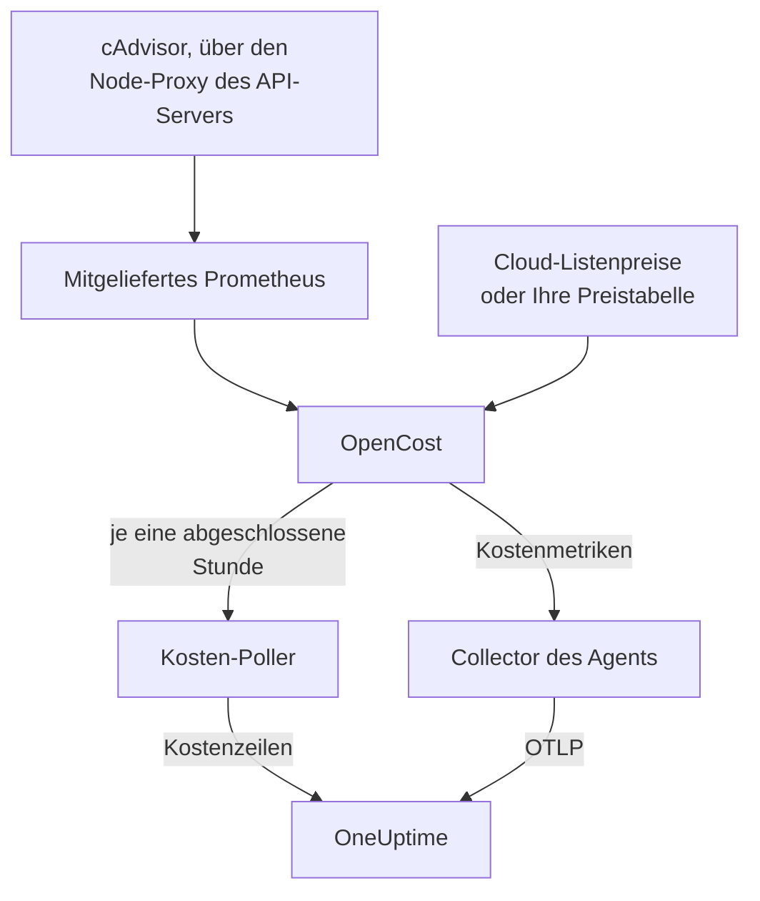

# Kubernetes-Kosten-Observability

Sehen Sie, was jeder Kubernetes-Workload kostet — Ausgaben pro Namespace, Workload und Pod, Leerlaufkapazität und wie viel von jedem Request genutzt wird — neben den Metriken, Logs und Traces, die der [Kubernetes-Agent](/docs/telemetry/kubernetes-agent) bereits erfasst. Ein einziger Helm-Wert schaltet es ein, ohne Cloud-Zugangsdaten, und die Seite **Kosten** des Clusters sagt Ihnen dann, welche Requests Sie verkleinern können.

:::cards
- [Einschalten](#kosten-observability-einschalten): Ein `helm upgrade`.
- [Eigene Engine verwenden](#betreiben-sie-bereits-kubecost-oder-opencost): Den Agent auf Kubecost oder OpenCost verweisen.
- [Größenoptimierung](#größenoptimierung): Empfehlungen für Requests und wie sie entstehen.
- [Fehlerbehebung](#fehlerbehebung): Leere Seiten, fehlende Empfehlungen.
:::

## So funktioniert es

Mit `cost.enabled=true` führt das Chart neben dem Agent vier Dinge aus:



1. **OpenCost**, die Open-Source-Kosten-Engine (Apache-2.0, CNCF; das [cost-model](https://github.com/kubecost/cost-model), auf dem auch Kubecost beruht). Sie beobachtet den Cluster, bepreist Ihre Knoten, Volumes und Load Balancer und berechnet, was jeder Workload kostet.
2. **Ein kleines Prometheus**, das OpenCost für den Nutzungs- und Preisverlauf braucht. Es läuft mit einem Replica, behält 7 Tage Verlauf und scrapt genau zwei Ziele: cAdvisor über den Node-Proxy des API-Servers und OpenCost selbst (das seine eigenen Metriken zu Ressourcen-Requests ausgibt, sodass kube-state-metrics nicht beteiligt ist). Es wird nie außerhalb des Clusters erreichbar gemacht, und seine Daten verlassen ihn nie.
3. **Der Kosten-Poller** (`cost.agent`). Einmal pro abgeschlossener Stunde liest er die Allocation API von OpenCost und sendet eine Kostenzeile pro Workload an OneUptime: CPU, Speicher, GPU, Volumes, Netzwerk, Load Balancer und Leerlauf, mit Effizienz. Jede Stunde wird einmal gesendet; der Server überspringt eine Stunde, die er schon hat, daher kann ein Neustart Ausgaben nicht doppelt zählen.
4. **Ein Scrape der Kostenmetriken** (`cost.metrics`). Der Collector des Agents scrapt die Kostenmetriken von OpenCost und sendet sie mit den übrigen Metriken des Clusters.

OpenCost bepreist Knoten ohne Zugangsdaten anhand der öffentlichen Listenpreise Ihres Cloud-Anbieters (AWS, Google Cloud, Azure). Cluster ohne Cloud-Listenpreis legen stattdessen eine [Preistabelle](#preise-für-on-prem-und-bare-metal) fest.

## Kosten-Observability einschalten

:::steps
### Den Agent mit cost.enabled aktualisieren

```bash
helm upgrade kubernetes-agent oneuptime/kubernetes-agent \
  --namespace oneuptime-agent \
  --reset-then-reuse-values \
  --set cost.enabled=true
```

Das ist eine vollständige Installation: zwei kleine zusätzliche Pods, OpenCost und sein Prometheus. Haben Sie den Agent unter einem anderen Release-Namen oder Namespace installiert, verwenden Sie Ihre (`helm list -A | grep kubernetes-agent` zeigt sie an).

### Auf die erste abgeschlossene Stunde warten

Die ersten Kosten erscheinen, nachdem die erste volle Stunde abgeschlossen ist, und OpenCost braucht nach dem Start ein paar Minuten, um seine erste Stunde zu bepreisen.

### Die Kostenseiten öffnen

- **Produkte → Infrastruktur → Kubernetes → Kosten** zeigt die Ausgaben aller Cluster im Projekt.
- Auf einem Cluster zeigt **Kosten** den Verlauf seiner Ausgaben, **Ausgaben nach Namespace** mit der Aufteilung auf CPU, Speicher und Storage, **Ausgaben nach Workload**, Leerlaufausgaben, Effizienz und die Karte **Größenoptimierung**.
:::

Die Kostenmetriken (`node_total_hourly_cost`, `pv_hourly_cost` und die übrigen) sind gewöhnliche Metriken: Sie stehen im Metrik-Explorer, auf eigenen Dashboards und in Metrik-Monitoren zur Verfügung. Für ein fertiges Dashboard gehen Sie zu **Produkte → Dashboards**, wählen **Dashboard erstellen** und dann **Kubernetes Cost Dashboard**: Verläufe der stündlichen Knotenkosten, Stückkosten für CPU und Speicher sowie Ausgaben für Volumes und Load Balancer.

## Betreiben Sie bereits Kubecost oder OpenCost?

Verweisen Sie den Agent stattdessen auf Ihre Engine, dann wird nichts mitgeliefert:

```bash
helm upgrade kubernetes-agent oneuptime/kubernetes-agent \
  --namespace oneuptime-agent \
  --reset-then-reuse-values \
  --set cost.enabled=true \
  --set cost.engine.url=http://kubecost-cost-analyzer.kubecost.svc.cluster.local:9090
```

| Engine | Übliche Service-URL |
| --- | --- |
| OpenCost | `http://opencost.opencost.svc.cluster.local:9003` |
| Kubecost | `http://kubecost-cost-analyzer.kubecost.svc.cluster.local:9090` |

Der Pfad der Allocation API wird von selbst gefunden (`/model/allocation` für Kubecost, `/allocation/compute` oder `/allocation` für OpenCost). Setzen Sie `cost.engine.allocationPath` nur bei einer ungewöhnlichen Installation. Für Speicherempfehlungen setzen Sie außerdem `cost.engine.prometheusUrl` (siehe [Die Daten dahinter](#die-daten-dahinter)).

## Preise für On-Prem und Bare Metal

Cluster, deren Knoten keinen öffentlichen Cloud-Listenpreis haben, können eine Preistabelle festlegen. OpenCost bepreist dann jede Ressource anhand dieser Werte, alle in USD pro Ressourcenstunde:

```yaml title="values.yaml"
cost:
  enabled: true
  opencost:
    customPricing:
      enabled: true
      cpuPerCoreHour: "0.031611"       # ~$23 per core-month
      ramPerGiBHour: "0.004237"        # ~$3 per GiB-month
      storagePerGBHour: "0.00005479452" # ~$0.04 per GB-month
      gpuPerHour: "0.95"
```

## Wissenswerte Einstellungen

Alle optional; die `values.yaml` des Charts enthält die vollständige Liste:

```yaml title="values.yaml"
cost:
  agent:
    windowSeconds: 3600   # allocation window length (hourly = native)
    includeIdle: true     # ship the engine's __idle__ allocation
    currency: USD         # currency code shown in the UI (informational)
  prometheus:
    retention: 7d         # bundled TSDB history; right-sizing reads peaks back over days
    persistence:
      enabled: false      # set true for a small PVC; emptyDir otherwise
  metrics:
    enabled: true         # cost metrics for dashboards / Metric Explorer
    scrapeInterval: 60s
```

## Größenoptimierung

Die Karte **Größenoptimierung** auf der Seite **Kosten** eines Clusters empfiehlt einen CPU- und einen Speicher-Request für jeden Container, zu dem es genug Verlauf gibt, geordnet danach, wie viel jede Änderung pro Monat spart.

Eine Empfehlung ist der beobachtete Bedarf plus 25% Reserve, gerundet auf einen Wert, den Sie in ein Manifest einfügen können (10m CPU, 16Mi Speicher):

- Die CPU wird nach dem 95. Perzentil der stündlichen Durchschnittsnutzung bemessen: hoch genug, um echte Last abzudecken, niedrig genug, dass eine einzelne Spitze den Request nicht für einen Monat aufbläht.
- Der Speicher wird nach dem Spitzenwert des Working Sets bemessen, nie nach einem Durchschnitt (siehe [Die Daten dahinter](#die-daten-dahinter)).

Empfohlen werden Requests, keine Limits. Ein Request ist das, was der Scheduler reserviert und woraus die Rechnung berechnet wird; er ist also die Zahl, die die Kosten bewegt. Ein Limit ist eine Entscheidung darüber, ob ein fehlerhafter Container gedrosselt oder beendet werden soll, und diese Entscheidung können Nutzungsdaten nicht für Sie treffen.

Jeder Container wird mit seinem aktuellen Request verglichen:

| Urteil | Bedeutung |
| --- | --- |
| Überprovisioniert | Er reserviert deutlich mehr, als er nutzt. Hier entstehen die Einsparungen. |
| Unterprovisioniert | Er reserviert weniger, als er nutzt, und wird daher gedrosselt oder riskiert einen OOM-Kill. Das zu beheben kostet Geld, und die Karte zeigt das als Anstieg. |
| Kein Request gesetzt | Es gibt nichts zu verkleinern, aber der Scheduler kann den Container nicht sicher platzieren, und er wird unter Druck als Erster verdrängt. |

Ein Container, der höchstens 15% von seiner Empfehlung abweicht, gilt als richtig bemessen und wird weggelassen: Niemand sollte ein Manifest bearbeiten, um 3% von einem Request abzuziehen.

Zwei Schutzmechanismen halten die Empfehlungen ehrlich. Ein Workload braucht mindestens 24 Stunden an Kostenfenstern, bevor er überhaupt bemessen wird, weil ein Fenster von vier Stunden einen nächtlichen Batch-Job im Ruhezustand erwischen und raten kann, ihn auf nichts zu verkleinern. Und Einsparungen werden aus der Länge des betrachteten Fensters hochgerechnet, nicht aus der Zahl der Zeilen; die Einsparung eines Deployments wird daher nicht mit seiner Replica-Zahl multipliziert. Die Schätzung nimmt an, dass die Ausgaben mit dem skalieren, was die Engine zugeteilt hat, also `max(request, usage)`; bei einem überprovisionierten Container ist das der Request, die Einsparung ist also exakt.

### Die Daten dahinter

Neben den Ausgaben erfasst der Poller, was eine Empfehlung braucht: die CPU- und Speicher-Requests, Limits und die Nutzung jedes Containers.

Speicher braucht eine weitere Quelle. Die Allocation API meldet nur einen Durchschnitt über jedes Fenster, und ein stündlicher Durchschnitt verbirgt den Ausschlag, der einen Container per OOM-Kill beendet; den Speicher danach zu bemessen, wäre daher gefährlich. Der Poller liest stattdessen die Speicherspitze jedes Containers aus Prometheus, verknüpft über `(namespace, pod, container)`:

- Mit der mitgelieferten Engine (dem Standard) verwendet er das eigene Prometheus des Charts. Nichts zu setzen.
- Mit Ihrer eigenen Engine (`cost.engine.url`) verweisen Sie `cost.engine.prometheusUrl` auf ein Prometheus, das cAdvisor scrapt, und setzen `cost.engine.prometheusCadvisorJob`, wenn dessen Scrape-Job nicht `kubernetes-nodes-cadvisor` heißt.
- Ohne Prometheus funktionieren CPU-Empfehlungen weiterhin, aus den gespeicherten Stundendurchschnitten, und Speicherempfehlungen werden weggelassen, statt geraten zu werden.

Ein Ausfall von Prometheus stoppt die Erfassung der Ausgaben nie: Spitzenwerte sind eine Zugabe, und eine Stunde wird dann ohne sie gesendet. Für die CPU wird Prometheus bewusst nicht verwendet: Ein zu großer CPU-Request drosselt nur, wo ein zu kleiner Speicher-Request beendet; die Stundendurchschnitte sind für die CPU daher sicher, und die CPU-Rate jedes Containers clusterweit abzufragen, ist so aufwendig, dass es ein kleines Prometheus umwerfen kann.

## Bei Kosten alarmieren

Die Kostenmetriken sind gewöhnliche Metriken, daher kann ein [Metrik-Monitor](/docs/monitor/metrics-monitor) wie bei allem anderen bei ihnen alarmieren: zum Beispiel, wenn der Durchschnitt von `node_total_hourly_cost` ein Budget übersteigt oder wenn `pv_hourly_cost` für eine Volume-Klasse erscheint, die es in einem Cluster nicht geben sollte.

## Datenmodell und Aufbewahrung

Kostenzeilen werden in ClickHouse gespeichert, eine pro Cluster, Fenster, Namespace, Controller, Pod und Container. Sie folgen der Telemetrie-Aufbewahrung des Clusters: dem `retainTelemetryDataForDays` des Clusters oder, wenn das nicht gesetzt ist, der Datenaufbewahrung des Projekts. Leerlauf und nicht zugeteilte Kapazität werden als gewöhnliche Zeilen unter den Namespaces `__idle__` und `__unallocated__` gespeichert und lassen sich daher wie Workload-Ausgaben gruppieren und filtern.

## Fehlerbehebung

:::details Die Kostenseiten sind leer
Lesen Sie die Logs des Kosten-Pollers: `kubectl logs -n oneuptime-agent deploy/kubernetes-agent-cost`. (Das Deployment heißt `<release>-kubernetes-agent-cost`, wenn der Release-Name `kubernetes-agent` nicht enthält; `kubectl get deploy -n oneuptime-agent` listet sie auf.) `HTTP 401` bedeutet, dass OneUptime den Ingestion-Schlüssel abgelehnt hat. `did not answer any known allocation path` bedeutet, dass die Engine noch nicht bereit ist (das mitgelieferte OpenCost braucht ein paar Minuten, um seine ersten Stunden zu bepreisen) oder dass `cost.engine.url` falsch ist.
:::

:::details Das mitgelieferte OpenCost ist nicht bereit
Lesen Sie seine Logs: `kubectl logs -n oneuptime-agent deploy/kubernetes-agent-opencost`. Sie nennen den erkannten Cloud-Anbieter und ob seine Preisdaten geladen wurden.
:::

:::details Das OpenCost-Log meldet mkdir /var/configs: permission denied
Ein älteres Chart führte OpenCost ohne beschreibbares Konfigurationsverzeichnis aus; nach `Error downloading default pricing data` konnte seine Allocation API daher nicht antworten, und der Poller blieb stehen, während der Pod `Running` blieb, `/healthz` grün blieb und die Knotenkostenmetriken weiter veröffentlicht wurden. Aktuelle Charts beheben das: Führen Sie `helm repo update` aus und aktualisieren Sie dann mit `--reset-then-reuse-values`. Kostenzeilen erscheinen beim nächsten Abruf.
:::

:::details Das Kubernetes Cost Dashboard zeigt keine Daten
Die Vorlage liest die gescrapten Kostenmetriken: Prüfen Sie, ob `cost.metrics.enabled` auf `true` steht.
:::

:::details Die Karte Größenoptimierung ist leer
Entweder ist der Zeitraum kürzer als die 24 Stunden, die eine Empfehlung braucht (erweitern Sie ihn), oder jeder Container liegt bereits innerhalb von 15% seines empfohlenen Requests, was die Karte dann sagt.
:::

:::details Speicherempfehlungen zeigen - an, CPU-Empfehlungen funktionieren aber
Kein Speicher-Spitzenwert hat OneUptime erreicht, daher wurde der Speicher nicht bemessen, statt aus einem Durchschnitt geraten zu werden. Mit Ihrer eigenen Engine setzen Sie `cost.engine.prometheusUrl`. Die Karte sagt, wie viele Container das betrifft.
:::

:::details Die Zahlen weichen von der Oberfläche der Engine ab
OneUptime rechnet die Abgleichskorrekturen der Engine in jeden Kostenbestandteil ein und sendet ganze, abgeschlossene Stunden: Die Ausgaben der laufenden Stunde erscheinen, nachdem sie abgeschlossen ist.
:::

:::details Das mitgelieferte Prometheus wurde neu gestartet
Mit dem standardmäßigen Speicher `emptyDir` gehen bei einem Neustart einige Stunden Nutzungsverlauf verloren, sodass die Kosten dieser Stunden kleiner ausfallen können. Setzen Sie `cost.prometheus.persistence.enabled=true`, wenn Ihnen das wichtig ist.
:::

## Nächste Schritte

:::cards
- [Kubernetes-Agent](/docs/telemetry/kubernetes-agent): Den Agent installieren, und alles andere, was er erfasst.
- [Metriken-Überwachung](/docs/monitor/metrics-monitor): Alarmieren, wenn die Ausgaben ein Budget überschreiten.
- [Kubernetes-Überwachung](/docs/monitor/kubernetes-monitor): Auch beim Zustand des Clusters alarmieren.
:::
