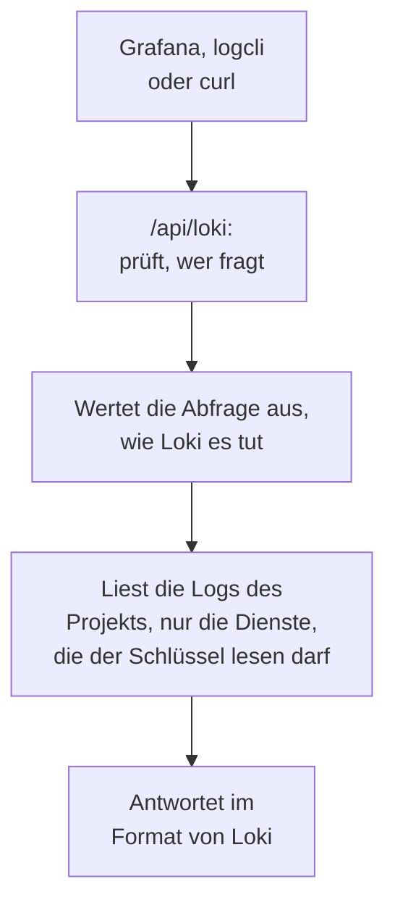

# Logs mit LogQL abfragen

LogQL ist die Abfragesprache von Grafana Loki. OneUptime beantwortet die Abfrage-API von Loki über die Logs Ihres Projekts, sodass die Loki-Datenquelle von Grafana, logcli oder jeder Loki-Client sie liest und die Dashboards und gespeicherten Abfragen, die Sie für Loki geschrieben haben, weiter funktionieren.

:::cards
- [Grafana verbinden](#grafana-verbinden): OneUptime als Loki-Datenquelle hinzufügen.
- [Wie Logs Labels bekommen](#wie-logs-labels-bekommen): Was ein Stream-Selektor trifft.
- [Was LogQL abdeckt](#was-logql-abdeckt): Log-Abfragen, Parser und Metrikabfragen.
- [Grenzen](#grenzen): Was eine Abfrage lesen darf, und wie oft.
:::

## So funktioniert es

Grafana fragt OneUptime, wie es Loki fragt. OneUptime prüft, ob der API-Schlüssel die Logs des Projekts lesen darf, liest nur die Dienste, die er lesen darf, und wertet die Abfrage so aus, wie Loki es tut.



## Bevor Sie beginnen

- **Eintreffende Logs.** Senden Sie sie mit [OpenTelemetry](/docs/telemetry/open-telemetry) oder aus Promtail, Grafana Alloy, Fluent Bit oder Vector über [die Push-API von Loki](/docs/telemetry/compatible-endpoints).
- **Ein API-Schlüssel des Projekts, der Logs liest**, mit der Rolle Projektinhaber, Projektadministrator, Projektmitglied, Betrachter, Telemetrie-Administrator, Telemetrie-Mitglied oder Telemetrie-Betrachter, oder der Berechtigung Read Logs. Ein Schlüssel, der auf einige Dienste beschränkt ist, liest nur deren Logs. Siehe [Einen API-Schlüssel erstellen](/docs/api-reference/api-reference#einen-api-schlüssel-erstellen). In OneUptime Cloud brauchen API-Schlüssel den Tarif **Growth**.
- **Kein Ingestion-Schlüssel.** Ein Ingestion-Schlüssel sendet Telemetrie und liest keine, daher kann sich Grafana nicht mit einem anmelden.

## Grafana verbinden

:::steps
### Einen API-Schlüssel erstellen

Öffnen Sie in OneUptime **Projekteinstellungen → Erweitert → API-Schlüssel** und klicken Sie auf **API-Schlüssel erstellen**. Geben Sie dem Schlüssel eine Rolle, die Telemetrie lesen darf, oder die Berechtigung Read Logs.

### Eine Loki-Datenquelle hinzufügen

Öffnen Sie in Grafana **Connections → Data sources → Add data source** und wählen Sie **Loki**.

### Die URL eingeben

Setzen Sie **URL** auf Ihre OneUptime-Adresse, gefolgt von `/api/loki`. In OneUptime Cloud ist das `https://oneuptime.com/api/loki`.

### Den API-Schlüssel senden

Fügen Sie unter **HTTP headers** den Header `Authorization` hinzu, mit dem Wert `Bearer`, gefolgt von einem Leerzeichen und Ihrem API-Schlüssel. Basic-Authentifizierung funktioniert auch: ein beliebiger Benutzername, mit dem API-Schlüssel als Passwort.

### Speichern und testen

Klicken Sie auf **Save & test**. Grafana führt eine Abfrage aus und meldet, dass die Datenquelle funktioniert.
:::

Explore, das Log-Volumen über den Zeilen, die Label-Browser und Dashboards lesen OneUptime dann, wie sie Loki lesen. logcli und jeder andere Loki-Client funktionieren genauso. Mit curl:

```bash title="Query OneUptime's Loki API"
curl -G -H "Authorization: Bearer $ONEUPTIME_API_KEY" \
  "https://oneuptime.com/api/loki/loki/api/v1/query_range" \
  --data-urlencode 'query={service_name="checkout"} |= "error"'
```

## Wie Logs Labels bekommen

Ein Stream-Selektor trifft die Attribute eines Logs, benannt so, wie Loki 3 OpenTelemetry-Logs benennt:

| In OneUptime | In LogQL |
| --- | --- |
| Ein Ressourcenattribut `service.name` | Das Label `service_name` |
| Ein Ressourcenattribut `k8s.pod.name` | Das Label `k8s_pod_name` |
| Ein Attribut `http.method` | Das Label `http_method` |
| Ein Label, das ein Loki-Client gesendet hat, etwa `job` | Das Label `job` |
| Der Schweregrad des Logs | Das Label `detected_level`: `trace`, `debug`, `info`, `warn`, `error`, `fatal` oder `unknown` |

- **Jedes Attribut ist ein Label.** Eine Log-Abfrage antwortet mit einem Stream pro Label-Satz, daher sind Logs mit unterschiedlichen Attributen unterschiedliche Streams, so wie Loki 3 Logs mit strukturierten Metadaten beantwortet.
- **Das eigene Attribut eines Logs kommt zuerst**, wenn seine Ressource eines mit demselben Namen hat.
- **Ein Selektor nennt einen Wert**, wie Loki es verlangt: mindestens einen Matcher, den ein Log ohne das Label nicht erfüllt, etwa `{service_name="checkout"}` oder `{service_name=~"check.+"}`.

Ein paar Abfragen für den Anfang:

```text title="LogQL"
# The checkout service's lines that say error
{service_name="checkout"} |= "error"

# Requests slower than 250ms, read from JSON lines
{service_name="checkout"} | json | duration > 250ms

# Error logs per second, by service
sum by (service_name) (rate({detected_level="error"} [5m]))
```

## Was LogQL abdeckt

- **Log-Abfragen**: Stream-Selektoren mit `=`, `!=`, `=~` und `!~`; Zeilenfilter `|=`, `!=`, `|~` und `!~`, mit `or`; die Parser `json` und `logfmt`; Label-Filter auf Text, Zahlen, Dauern und Größen, mit `and`, `or` und `__error__`; `line_format` mit `{{.label}}`; `drop`, `keep` und `decolorize`.
- **Metrikabfragen**: `count_over_time`, `rate`, `bytes_over_time`, `bytes_rate` und `absent_over_time`; über ein mit `unwrap` genommenes Label (mit `duration()` oder `bytes()`) `rate`, `sum_over_time`, `avg_over_time`, `min_over_time`, `max_over_time`, `first_over_time`, `last_over_time`, `stddev_over_time`, `stdvar_over_time` und `quantile_over_time`; und `offset`.
- **Rund um sie**: `sum`, `avg`, `min`, `max`, `count`, `stddev`, `stdvar`, `topk` und `bottomk`, mit `by` oder `without`; Arithmetik, Vergleiche (mit `bool`), `and`, `or` und `unless`, mit `on`, `ignoring`, `group_left` und `group_right`; `sort`, `sort_desc`, `label_replace` und `vector()`.

Die Parser `pattern`, `regexp` und `unpack`, `label_format`, `json` mit benannten Feldern, `ip()`-Filter und `line_format`-Vorlagen über `{{.label}}` hinaus sind noch nicht verfügbar. Eine Abfrage, die eines davon verwendet, wird mit einer Meldung abgelehnt, die es nennt.

## Die API

Die API beantwortet die Routen der HTTP-API von Loki, mit `GET` oder `POST`, unter `/api/loki`:

| Route | Was sie beantwortet |
| --- | --- |
| `/loki/api/v1/query_range` | Die Zeilen einer Log-Abfrage von `start` bis `end`, oder eine Metrikabfrage zu jedem `step`. |
| `/loki/api/v1/query` | Eine Metrikabfrage zu einem Zeitpunkt (`time`, standardmäßig jetzt). |
| `/loki/api/v1/labels` | Label-Namen, der Logs, die `query` auswählt, oder aller Logs. |
| `/loki/api/v1/label/<name>/values` | Die Werte eines Labels. |
| `/loki/api/v1/series` | Die Label-Sätze der Logs, die `match[]` auswählt. |

Zeiten sind Nanosekunden seit 1970, Unix-Sekunden oder RFC 3339, und ein Bereich ist die Stunde vor `end`, sofern er nichts anderes sagt. Eine Log-Abfrage antwortet mit `limit` Zeilen, standardmäßig 100, die neuesten zuerst, außer bei `direction=forward`. Antworten sind im Format von Loki, und Fehler sind reiner Text, wie Loki sie schreibt. `/loki/api/v1/status/buildinfo` antwortet wie ein Loki-3-Server.

## Grenzen

Jede Abfrage ist begrenzt, damit ein Dashboard mit vielen Panels OneUptime nicht überlasten kann:

| Grenze | Wert |
| --- | --- |
| Zeilen, mit denen eine Log-Abfrage antwortet | 5.000 |
| Logs, die eine Log-Abfrage liest, wenn Filter nach ihren Parsern welche verwerfen | 20.000 |
| Logs, die eine Metrikabfrage selbst liest, wenn ClickHouse sie nicht zählen kann | 100.000 |
| Reihen, mit denen eine Metrikabfrage antwortet | 500 |
| Punkte in einer Reihe einer Bereichsabfrage | 11.000 |
| Logs, die ein Lesevorgang zurückgibt | 64 MB |
| Zeit, die ein Lesevorgang dauern darf | 30 Sekunden |
| Abfragen, die ein Projekt pro Minute senden darf | 1.200 |

Eine Metrikabfrage, deren Pipeline nur aus Zeilenfiltern besteht, etwa `sum(count_over_time({service_name="checkout"} |= "error" [5m]))`, wird dort gezählt, wo die Logs liegen, und liest daher überhaupt keine Zeilen.

## Fehlerbehebung

:::details Grafana meldet, dass die Datenquelle nicht funktioniert
Prüfen Sie, ob die URL auf `/api/loki` endet und ob der Header `Authorization` `Bearer`, ein Leerzeichen und den API-Schlüssel enthält. Ein Ingestion-Schlüssel oder ein API-Schlüssel ohne Rolle, die Logs lesen darf, wird abgelehnt: Geben Sie dem Schlüssel eine solche Rolle unter **Projekteinstellungen → Erweitert → API-Schlüssel**.
:::

:::details "queries require at least one regexp or equality matcher that does not have an empty-compatible value"
Der Selektor trifft Logs, ohne einen Wert zu nennen, etwa `{service_name=~".*"}`. Fügen Sie einen Matcher hinzu, der einen nennt, etwa `{service_name="checkout"}`.
:::

:::details "This project sent more queries this minute than OneUptime answers."
Die Dashboards und Clients des Projekts haben in dieser Minute mehr als 1.200 Abfragen an die API gesendet. Die Panels laden in der nächsten Minute wieder; aktualisieren Sie Dashboards seltener, um darunter zu bleiben.
:::

## Nächste Schritte

:::cards
- [Protokoll-Explorer](/docs/telemetry/logs-explorer): Logs durchsuchen und filtern, ohne eine Abfrage zu schreiben.
- [PromQL](/docs/telemetry/promql): Metriken mit PromQL abfragen, auch aus der Prometheus-Datenquelle von Grafana.
- [Logs-Überwachung](/docs/monitor/logs-monitor): Bei Log-Volumen und -Inhalt warnen.
:::
