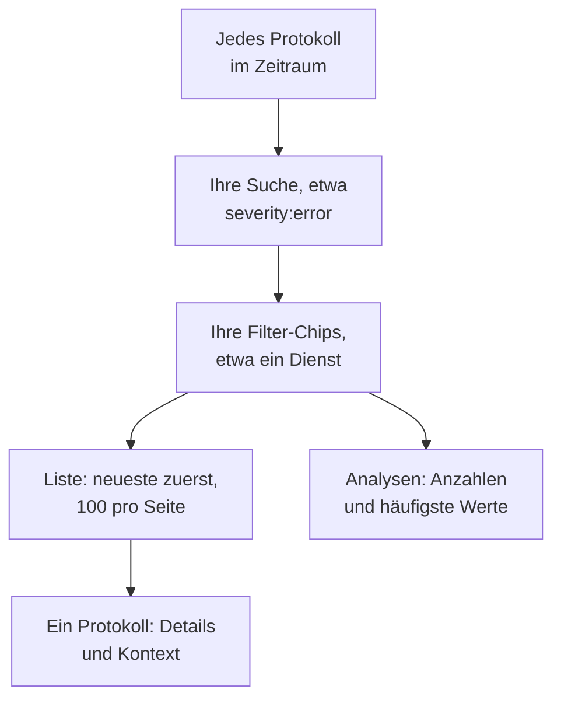

# Protokoll-Explorer

Im Protokoll-Explorer durchsuchen und lesen Sie die Protokolle, die Ihre Dienste, Hosts und Agenten an OneUptime senden. Grenzen Sie Millionen von Zeilen auf die wenigen ein, die zählen, verfolgen Sie neue, sobald sie eintreffen, stellen Sie sie in Diagrammen dar und speichern Sie die Ansichten, zu denen Ihr Team immer wieder zurückkehrt.

:::cards
- [Eine Protokollzeile finden](#eine-protokollzeile-finden): Ein Zeitraum, eine Suche und ein paar Filter.
- [Ein Protokoll lesen](#ein-protokoll-lesen): Seine Attribute, sein Trace und die Zeilen um es herum.
- [Protokolle live verfolgen](#protokolle-live-verfolgen): Neue Zeilen alle 10 Sekunden.
- [Eine Ansicht speichern](#eine-ansicht-speichern): Eine Suche, ihre Filter und ihre Spalten für alle behalten.
- [Protokoll-Einblicke](#protokoll-einblicke): Häufigste Fehler, Schweregrade und wer was protokolliert.
:::

## Wie der Explorer Ihre Protokolle eingrenzt

Alles auf dem Tab **Betrachter** arbeitet mit einer Menge von Protokollen: denen im Zeitraum, die zu Ihrer Suche und zu jedem Filter-Chip passen. Ändern Sie eines davon, ändern sich die Liste, das Volumendiagramm und die Zahlen in der Seitenleiste gemeinsam.

Der Explorer hat vier Tabs:

| Tab | Wofür er da ist |
| --- | --- |
| **Betrachter** | Protokolle suchen, filtern und lesen. Er öffnet mit der letzten Stunde, neueste zuerst, 100 Protokolle pro Seite. |
| **Einblicke** | Was Ihre Dienste in einem Zeitraum protokolliert haben und was schiefging. |
| **Einrichtungsanleitung** | Wie Sie Protokolle mit OpenTelemetry, Fluent Bit oder Fluentd senden, mit einem Ihrer Aufnahmeschlüssel. |
| **Einstellungen** | Was mit Protokollen beim Eintreffen geschieht: **Pipelines**, **Drop-Filter**, **Scrub-Regeln** und **Aufzeichnungsregeln**. |

## Bevor Sie beginnen

- **Eintreffende Protokolle.** Senden Sie sie mit [OpenTelemetry](/docs/telemetry/open-telemetry), [Fluent Bit](/docs/telemetry/fluentbit), [Fluentd](/docs/telemetry/fluentd) oder [Syslog](/docs/telemetry/syslog). Der Tab **Einrichtungsanleitung** zeigt die Konfiguration für Ihre Sprache oder Ihren Collector.
- **Eine Rolle, die Telemetrie lesen darf.** Project Owner, Project Admin, Project Member, Viewer, Telemetry Admin, Telemetry Member oder Telemetry Viewer, oder eine eigene Rolle mit der Berechtigung Read Telemetry Service Log. Ihr Bereich entscheidet, wessen Protokolle Sie sehen: siehe [Telemetrie](/docs/permissions/index#telemetrie).

## Eine Protokollzeile finden

:::steps
### Den Betrachter öffnen

Öffnen Sie **Produkte → Observability → Protokolle**. Der **Betrachter** listet die Protokolle der letzten Stunde, neueste zuerst, mit **Zeit**, **Dienst**, **Schweregrad** und **Nachricht**.

### Den Zeitraum wählen

Wählen Sie einen Zeitraum in der Zeitauswahl, oder ziehen Sie über das Volumendiagramm über der Liste, um in eine Spitze hineinzuzoomen. Ein Doppelklick auf das Diagramm zoomt wieder heraus. Siehe [In einen Zeitraum zoomen](/docs/telemetry/charts-and-time-ranges).

### Suchen

Geben Sie eine Abfrage in das Suchfeld ein und drücken Sie Enter, zum Beispiel `severity:error service:checkout timeout`. Freie Wörter durchsuchen die Nachricht, und `@key:value` durchsucht ein Attribut. Siehe [Suchsyntax](/docs/telemetry/search-syntax#protokolle).

### Mit Filtern eingrenzen

Klicken Sie auf einen Wert in der Seitenleiste **Filter**, um ihn als Chip hinzuzufügen: einen Schweregrad, einen Dienst oder einen Host, Cluster oder eine andere Ressource, die Protokolle gesendet hat. Jeder Wert zeigt, wie viele Protokolle ihn tragen. Auf einem Telefon tippen Sie auf **Filter**, um die Seitenleiste zu öffnen.

### Ein Protokoll öffnen

Klicken Sie auf eine Zeile. Ihre Details öffnen sich neben der Liste.
:::

Ihre Suche, Ihre Chips und der Zeitraum stehen in der Adresse der Seite, sodass ein Neuladen, ein Lesezeichen oder ein geteilter Link dieselben Protokolle öffnet.

## Ein Protokoll lesen

Das Detailfenster hat zwei Tabs:

| Tab | Was er zeigt |
| --- | --- |
| **Details** | Den **Protokolltext**, seine **Trace-ID**, **Span-ID** und **Sitzung**, wenn es sie hat, und seine **Attribute**, als Liste oder als JSON. |
| **Kontext** | Das Protokoll inmitten seiner Nachbarn. **In der Nähe (Dienst + Zeit)** zeigt die fünf Zeilen davor und danach aus demselben Dienst, und **Dieser Trace** zeigt bis zu 100 Protokolle seines Traces. |

- Klicken Sie auf die Trace-ID, um die ganze Anfrage im [Trace-Explorer](/docs/telemetry/traces-explorer) zu öffnen.
- Zeigen Sie auf ein Attribut und klicken Sie auf sein Filtersymbol, um nach diesem Wert zu suchen, oder kopieren Sie ihn. Alle Attribute auf einmal kopieren Sie als JSON.
- **Dieser Trace** erscheint nur bei einem Protokoll, das innerhalb eines Traces geschrieben wurde.

## Protokolle live verfolgen

Klicken Sie über der Liste auf **Live**. Der Explorer springt auf die erste Seite, neueste zuerst sortiert, und sucht alle 10 Sekunden nach neuen Protokollen, sodass Zeilen erscheinen, während Ihre Dienste sie schreiben.

Der Live-Modus schaltet sich aus, wenn Sie die Suche, einen Filter oder den Zeitraum ändern oder auf eine andere Ergebnisseite wechseln: Er zeigt nur die neuesten Protokolle. Klicken Sie erneut auf **Live**, um fortzufahren.

## Spalten wählen und exportieren

- **Spalten** legt fest, was die Liste zeigt. **Zeit**, **Dienst**, **Schweregrad** und **Nachricht** stehen vorn; fügen Sie **Trace-ID**, **Span-ID** oder ein beliebiges Attribut hinzu, verschieben Sie Spalten nach oben und unten, oder kehren Sie mit **Zurücksetzen** zu den Standards zurück.
- **Export** lädt die Protokolle der Seite herunter, die Sie gerade sehen. **Als CSV exportieren** schreibt die angezeigten Spalten; **Als JSON exportieren** schreibt jedes Feld jedes Protokolls mit allen seinen Attributen.

## Eine Ansicht speichern

Eine gespeicherte Ansicht behält eine Suche, ihre Filter-Chips, den Zeitraum, die Spalten, die Sortierung und die Seitengröße unter einem Namen.

:::steps
### Die Ansicht einrichten

Suchen, filtern und wählen Sie die Spalten, die Sie behalten möchten.

### Speichern

Öffnen Sie **Gespeicherte Ansichten** und klicken Sie auf **+ Aktuelle Ansicht speichern**. Geben Sie einen **Name** ein, setzen Sie **Als Standard festlegen**, wenn sich diese Ansicht öffnen soll, sobald jemand die Protokolle öffnet, und klicken Sie auf **Ansicht speichern**.

### Verwenden

Wählen Sie die Ansicht unter **Gespeicherte Ansichten**, um sie anzuwenden, und **Ansicht zurücksetzen**, um zur letzten Stunde ohne Filter zurückzukehren. Zeigen Sie auf eine Ansicht in der Liste, um sie zu **Bearbeiten** oder zu **Löschen**, oder, solange sie angewendet ist, um sie mit Ihren Änderungen zu **Aktualisieren**.
:::

Gespeicherte Ansichten gehören zum Projekt, alle darin sehen also dieselbe Liste. Ein fortlaufender Zeitraum wie die letzte Stunde bleibt fortlaufend: Die Ansicht zeigt die Stunde vor dem Öffnen, nicht die Stunde, in der Sie sie gespeichert haben. Solange das Projekt keine Standardansicht hat, wird die nächste gespeicherte Ansicht zum Standard, und ein Projekt hat immer nur einen Standard.

## Ihre Protokolle in Diagrammen darstellen

Schalten Sie die Liste auf **Analysen** um, um Protokolle zu zählen statt sie zu lesen. Wählen Sie eine Zeitreihe, eine Top-Liste oder eine Tabelle; zählen Sie jedes Protokoll oder die eindeutigen Werte eines Felds; und gruppieren Sie nach Schweregrad, Dienst, Trace, Span oder einem beliebigen Attribut, dann nach einem zweiten Feld. Eine Top-Liste oder eine Tabelle zeigt die obersten 5, 10, 25 oder 50 Gruppen.

Klicken Sie auf **Liste**, um zu den Zeilen selbst zurückzukehren.

## Zugehörige Traces und Metriken öffnen

Die Schaltflächen **Traces** und **Metriken** neben **Gespeicherte Ansichten** öffnen den [Trace-Explorer](/docs/telemetry/traces-explorer) oder den [Metrik-Explorer](/docs/telemetry/metrics-explorer) für dasselbe Zeitfenster, mit so viel von Ihrer Filterung, wie dieser Explorer nutzen kann. Zeigen Sie auf eine Schaltfläche, um zu sehen, was sie nicht übernehmen kann.

## Protokoll-Einblicke

Der Tab **Einblicke** zeigt, was Ihre Dienste in einem Zeitraum protokolliert haben und was schiefging. Beschränken Sie ihn mit der Auswahlliste neben der Zeitauswahl auf bestimmte Dienste, Hosts oder Cluster.

| Bereich | Was er zeigt |
| --- | --- |
| Übersichtskarten | **Protokolle insgesamt**, **Fehler**, **Eindeutige Fehler** und **Meldende Quellen**. |
| **Verteilung der Schweregrade** | Wie sich die Protokolle nach Schweregrad aufteilen. |
| **Häufigste Fehler** | Die unterschiedlichen Meldungen mit dem Schweregrad Error oder Fatal, die häufigsten zuerst. |
| **Quellen, die Protokolle melden** | Das Volumen und das Fehlersignal jedes Dienstes, Hosts oder jeder anderen Quelle. |

Wählen Sie einen der häufigsten Fehler, um zu sehen, was um ihn herum geschah: wann er auftrat, was seine Vorkommen gemeinsam haben, wo er auftritt, welche Traces ihn tragen und seine letzten Zeilen. **Passende Protokolle öffnen** öffnet sie im **Betrachter**, und **Explain with AI** öffnet [Ask AI](/docs/ai/ask-ai) mit dem Fehler und seinen Belegen als Prompt, den Sie bearbeiten können.

## Was mit Protokollen beim Eintreffen geschieht

Der Tab **Einstellungen** enthält die Regeln, die OneUptime auf jedes Protokoll anwendet, bevor es gespeichert wird. Sie wirken auf die Protokolle, die danach eintreffen, nicht auf gespeicherte.

| Regel | Was sie tut |
| --- | --- |
| **Drop-Filter** | Protokolle verwerfen, die Sie nicht behalten möchten, oder nur eine Stichprobe davon behalten. |
| **Scrub-Regeln** | Sensible Daten maskieren, etwa E-Mail-Adressen und Kartennummern. |
| **Pipelines** | Felder aus der Nachricht extrahieren, den Schweregrad korrigieren, Attribute umbenennen. Siehe [Protokoll-Pipelines](/docs/telemetry/log-pipelines). |
| **Aufzeichnungsregeln** | Passende Protokolle in Metriken umwandeln. Siehe [Aufzeichnungsregeln für Protokolle](/docs/telemetry/log-recording-rules). |

## Tastenkürzel

Drücken Sie im Betrachter `?`, um sie zu sehen.

| Taste | Was sie tut |
| --- | --- |
| `j` / `k` | Zum nächsten oder vorherigen Protokoll wechseln. |
| Enter | Das ausgewählte Protokoll öffnen oder schließen. |
| Esc | Das Detailfenster schließen. |
| `/` | Zum Suchfeld springen. |
| ⌘ + Enter oder Strg + Enter | Die Suche anwenden. |
| `?` | Die Tastenkürzel ein- oder ausblenden. |

## Fehlerbehebung

:::details Es erscheinen keine Protokolle
Vergrößern Sie zuerst den Zeitraum: Der Betrachter öffnet mit der letzten Stunde. Ist die Liste weiterhin leer, vergleichen Sie Ihre Einrichtung mit der **Einrichtungsanleitung** und prüfen Sie, ob der Bereich Ihrer Rolle den Dienst abdeckt, der die Protokolle sendet.
:::

:::details Die Suche meldet, dass ihr die Zeit ausging
Eine Suche, die länger als 45 Sekunden läuft, wird abgebrochen. Wählen Sie einen kürzeren Zeitraum oder fügen Sie einen exakten Wert wie einen Dienst hinzu, damit OneUptime seinen Index nutzen kann. Siehe [Suchsyntax](/docs/telemetry/search-syntax#gut-zu-wissen).
:::

:::details Live schaltet sich immer wieder aus
Der Live-Modus folgt nur den neuesten Protokollen, daher schaltet ihn eine Änderung der Suche, eines Filters, des Zeitraums oder der Seite aus. Klicken Sie erneut auf **Live**, sobald Ihre Filter stehen.
:::

## Nächste Schritte

:::cards
- [Suchsyntax](/docs/telemetry/search-syntax): Jeder Filter, den das Suchfeld versteht.
- [Logs-Überwachung](/docs/monitor/logs-monitor): Benachrichtigt werden, wenn die gesuchten Protokolle auftauchen.
- [Protokoll-Pipelines](/docs/telemetry/log-pipelines): Teile einer Protokollzeile in filterbare Attribute verwandeln.
- [Trace-Explorer](/docs/telemetry/traces-explorer): Der Anfrage eines Protokolls durch Ihre Dienste folgen.
:::
