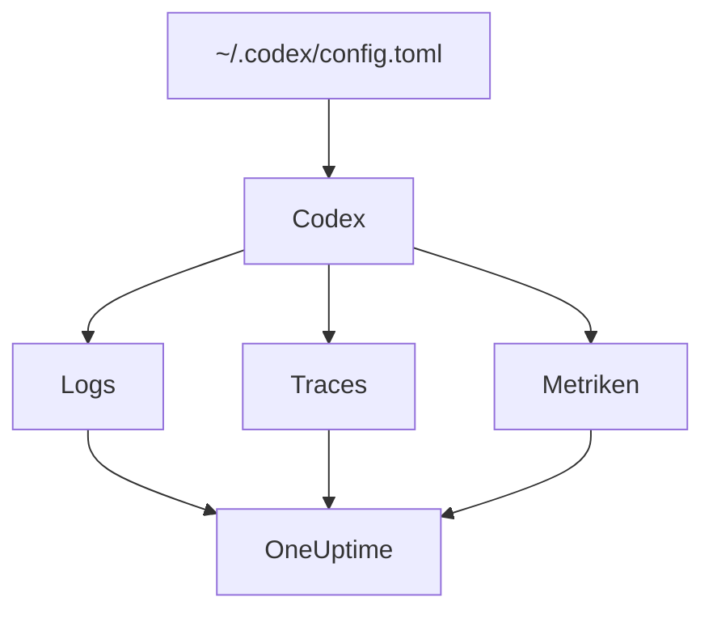

# OpenAI Codex

Die Codex CLI hat drei OpenTelemetry-Exporter eingebaut, je einen für Logs, Traces und Metriken. Richten Sie sie in `~/.codex/config.toml` auf OneUptime, und jede Codex-Runde kommt mit ihren Tokens und Kosten an, ohne Wrapper oder Proxy dazwischen.

:::cards
- [Codex konfigurieren](#codex-konfigurieren): Ein Block `[otel]`, mit einer vollständigen URL pro Signal.
- [Nutzung einer Person zuordnen](#codex-nutzung-einer-person-zuordnen): Codex nennt in Spans und Metriken niemanden, also tun Sie es.
- [Tokens und Kosten](#tokens-und-kosten): Welches Signal OneUptime liest und was das zeigt.
- [Fehlerbehebung](#fehlerbehebung): Was Sie prüfen, wenn nichts ankommt.
:::

## So funktioniert es

Jeder Exporter sendet ein Signal an seine eigene URL. Traces und Logs sind aus, bis Sie sie konfigurieren; Metriken nicht.



> [!WARNING]
> Codex sendet seine Metriken an OpenAI, solange Sie das nicht ändern. In einem Release-Build ist `metrics_exporter` standardmäßig `statsig`, was sie an `https://ab.chatgpt.com/otlp/v1/metrics` sendet. `metrics_exporter` auf einen OTLP-Exporter zu setzen, wie unten, oder auf `none`, beendet das. `[analytics]` mit `enabled = false` beendet den Statsig-Standard ebenfalls, lässt aber einen OTLP-Metrik-Exporter, den Sie eingerichtet haben, weiterlaufen.

## Bevor Sie beginnen

1. Erstellen Sie einen Telemetrie-Ingestion-Schlüssel unter **Projekteinstellungen → Telemetrie & APM → Ingestion-Schlüssel**.
2. Ihr OTLP-Endpunkt ist `https://oneuptime.com/otlp`, oder `https://YOUR-ONEUPTIME-HOST/otlp`, wenn Sie OneUptime selbst betreiben.
3. Jeder Export sendet den Schlüssel im Header `x-oneuptime-token`.

## Codex konfigurieren

:::steps
### Den otel-Block hinzufügen

Tragen Sie dies in `~/.codex/config.toml` ein. Es schaltet alle drei Signale ein und ersetzt nebenbei den Statsig-Standard:

```toml title="~/.codex/config.toml"
[otel]
environment = "prod"
log_user_prompt = false

[otel.exporter.otlp-http]
endpoint = "https://oneuptime.com/otlp/v1/logs"
protocol = "binary"
headers = { "x-oneuptime-token" = "YOUR_INGESTION_TOKEN" }

[otel.trace_exporter.otlp-http]
endpoint = "https://oneuptime.com/otlp/v1/traces"
protocol = "binary"
headers = { "x-oneuptime-token" = "YOUR_INGESTION_TOKEN" }

[otel.metrics_exporter.otlp-http]
endpoint = "https://oneuptime.com/otlp/v1/metrics"
protocol = "binary"
headers = { "x-oneuptime-token" = "YOUR_INGESTION_TOKEN" }

[otel.span_attributes]
"user.id" = "dev@example.com"
"user.email" = "dev@example.com"
"team" = "platform"
```

### Jedem Exporter seine vollständige URL geben

Codex verwendet jeden `endpoint` genau so, wie er geschrieben ist: Es hängt `/v1/logs`, `/v1/traces` oder `/v1/metrics` nicht an, wie es die meisten SDKs tun. Drei Exporter mit dem bloßen `https://oneuptime.com/otlp` senden nirgendwohin etwas, ohne Fehler.

### Eine Runde ausführen

Starten Sie eine interaktive `codex`-Sitzung, fragen Sie etwas Kleines und lassen Sie die Runde enden. Öffnen Sie dann in OneUptime **Protokolle**: Die Ereignisse von Codex, etwa `codex.conversation_starts`, `codex.api_request` und `codex.turn_cost`, erscheinen dort.
:::

> [!IMPORTANT]
> Codex ignoriert Schlüssel unter `[otel]`, die es nicht kennt, ohne Warnung. Seine Schlüssel sind in snake_case (`trace_exporter`, `metrics_exporter`, `span_attributes`), seine Exporter-Namen und TLS-Felder aber in kebab-case (`otlp-http`, `ca-certificate`). Ein `trace-exporter` schaltet Traces ganz ohne Fehler ab.

## Konfigurationsschlüssel

| Schlüssel | Standard | Was er tut |
| --- | --- | --- |
| `environment` | `"dev"` | Setzt das Ressourcenattribut `env` |
| `log_user_prompt` | `false` | Sendet den Prompt-Text in `codex.user_prompt`; sonst steht dort `[REDACTED]` |
| `log_agent_responses` | `false` | Sendet die endgültigen Antworten des Agenten an den Log-Exporter |
| `exporter` | `none` | Der Log-Exporter |
| `trace_exporter` | `none` | Der Trace-Exporter |
| `metrics_exporter` | `statsig` | Der Metrik-Exporter: setzen Sie ihn |
| `span_attributes` | — | Attribute, die jedem exportierten Span hinzugefügt werden |
| `tracestate` | — | Mitglieder von W3C `tracestate` |
| `tool_result` | `{ max_bytes = 2048 }` | Wie viel vom Ergebnis eines Tools ein Log-Eintrag behält, in UTF-8-Bytes |

Ein Exporter ist `none`, `statsig`, `otlp-http` oder `otlp-grpc`. `otlp-http` nimmt `endpoint`, `headers`, `protocol` (`"binary"` oder `"json"`, die OneUptime beide annimmt) und `tls` (`ca-certificate`, `client-certificate`, `client-private-key`); `otlp-grpc` nimmt dasselbe ohne `protocol`.

## Codex-Nutzung einer Person zuordnen

Codex nennt den Entwickler nur an einer Stelle:

- **Log-Einträge** tragen `user.account_id` und `user.email`.
- **Spans** nicht: Codex hält beides absichtlich aus seinen Traces heraus.
- **Metriken** ebenso wenig: Sie tragen `auth_mode`, `session_source`, `originator`, `service_name`, `model` und `app.version`, und keine Person.

OneUptime liest Personen aus Spans und Metrik-Datenpunkten, nie aus Log-Einträgen. Stempeln Sie die Identität also selbst auf jeden Span, in `[otel.span_attributes]`:

```toml title="~/.codex/config.toml"
[otel.span_attributes]
"user.id" = "dev@example.com"
"user.email" = "dev@example.com"
"team" = "platform"
"cost_center" = "eng-123"
```

`user.id` ist der Schlüssel, den OneUptime bevorzugt, und `user.email` füllt die E-Mail-Spalte. Codex hat keine Ressourcenattribute, setzen Sie die Team-Schlüssel (`team.id`, `team`, `cost_center`, `department`) also ebenfalls hier. Dieser Block steht in der eigenen Konfigurationsdatei jedes Entwicklers: Verteilen Sie ihn pro Entwickler, über Ihre Dotfiles oder ein MDM-Profil. Eine gemeinsame Datei mit einer Identität würde die Ausgaben aller einer Person zurechnen.

## Tokens und Kosten

| Signal | Was Codex sendet | Was OneUptime damit tut |
| --- | --- | --- |
| Traces | `gen_ai.usage.input_tokens`, `gen_ai.usage.output_tokens` und die Cache-Tokens, aber kein Modell | Zählt die Tokens pro Person; kann sie nicht bepreisen |
| Metriken | `codex.turn.token_usage` nach `token_type` und `codex.turn.cost_microusd`, in Millionstel USD | Rechnet die Kosten in USD um; liest die Metriken nur, wo Spans nichts melden |
| Logs | `codex.turn_cost`, mit `usage.estimated_usd` und der Person | Speichert es im Explorer **Protokolle**; nicht mit den Ausgaben verknüpft |

Mit der Konfiguration oben ergibt das im Tab **Nutzung** Folgendes:

- Die Tokens kommen aus den Spans, pro Person, und `codex.turn.token_usage` wird nicht obendrauf addiert: Beide werden nie summiert ([warum](/docs/telemetry/ai-llm-observability#spans-zuerst-metriken-springen-ein)).
- Die Spans von Codex nennen kein Modell, daher kann OneUptime sie nicht bepreisen, und ihre Kosten sind 0. Die Kostensummen nehmen die Kosten von Codex dann aus `codex.turn.cost_microusd`, für Sie in USD umgerechnet.
- Die Tabellen **Mitarbeiter**, **Team** und **Modell** zeigen die Zeilen der Spans: Tokens pro Person, aber keine Kosten pro Person.
- Ohne Traces füllen die Metriken diese Tabellen stattdessen, nur mit Kosten, alles unter **Nicht zugeordnet**, da die Metriken von Codex niemanden nennen.

Die genauesten Kosten pro Runde, mit der Person daran, stehen im Log-Eintrag `codex.turn_cost`. OneUptime verknüpft Log-Einträge noch nicht mit den Ausgaben, lassen Sie den Log-Exporter aber eingeschaltet: Der Verlauf ist dann schon da.

## Codex in CI und als MCP-Server

`codex`, `codex exec` und `codex mcp-server` bauen ihre Telemetrie alle aus demselben Block `[otel]`, mit allen drei Exportern. Läufe von `codex exec` tragen den `originator` `codex_exec`, und `codex mcp-server` exportiert als `codex_mcp_server`, sodass Sie CI- und MCP-Läufe an diesen Werten von interaktiven Sitzungen unterscheiden können.

## Datenschutz

`log_user_prompt` und `log_agent_responses` sind standardmäßig `false`: Lassen Sie sie aus. Das Ereignis `codex.user_prompt` kommt trotzdem an, mit dem Prompt durch `[REDACTED]` ersetzt, sodass Sie die Runde, ihre Tokens und ihre Kosten ohne den Prompt-Text behalten. Die Person (`user.email`, `user.account_id`) steht in Log-Einträgen, egal was diese Schalter sagen.

Wenn Sie Inhalte für eine Untersuchung einschalten, maskieren oder verwerfen die **Scrub-Regeln** und **Drop-Filter** der Traces unter **Traces → Einstellungen** sie, bevor sie gespeichert werden.

## Die OpenAI-API statt Codex nutzen

Die Plattform-API von OpenAI sendet kein eigenes OpenTelemetry: Jeder Span entsteht durch die Instrumentierung Ihres eigenen Clients. Drei Instrumentierungen funktionieren mit OneUptime:

- **OpenTelemetry**: `opentelemetry-instrumentation-genai-openai` für Python, das `opentelemetry-instrumentation-openai-v2` ersetzt. `OTEL_INSTRUMENTATION_GENAI_CAPTURE_MESSAGE_CONTENT` entscheidet, ob Nachrichten aufgezeichnet werden.
- **OpenLLMetry** (Traceloop): `opentelemetry-instrumentation-openai`.
- **OpenInference** (Arize): `openinference-instrumentation-openai`.

Richten Sie eine davon auf OneUptime, wie [KI- / LLM-Observability](/docs/telemetry/ai-llm-observability) zeigt. Keine von ihnen weiß, wer Ihr Mitarbeiter ist: Setzen Sie `user.id` selbst.

Das **OpenAI Agents SDK** sendet Traces an den eigenen Endpunkt von OpenAI, nicht über OTLP. Überbrücken Sie es mit `opentelemetry-instrumentation-openai-agents-v2` oder `openinference-instrumentation-openai-agents`, die die Spans des SDK an einen OTLP-Exporter übergeben.

## Fehlerbehebung

:::details Es kommt nichts an
Prüfen Sie zuerst die drei Werte `endpoint`: Jeder muss auf `/v1/logs`, `/v1/traces` oder `/v1/metrics` enden. Prüfen Sie dann den Header `x-oneuptime-token`: OneUptime weist einen falschen Schlüssel ab.
:::

:::details Traces kommen nie an, Logs schon
Suchen Sie nach einem falsch geschriebenen Schlüssel unter `[otel]`: Codex ignoriert ihn stillschweigend. `trace-exporter` statt `trace_exporter` ist der übliche.
:::

:::details Die Kosten von Codex erscheinen in den Summen, aber jede Person zeigt $0
Das ist zu erwarten: Die Spans von Codex tragen Tokens, aber kein Modell, daher lassen sie sich nicht bepreisen, und die Kostenmetrik nennt niemanden. Siehe [Tokens und Kosten](#tokens-und-kosten).
:::

:::details Die Ausgaben aller erscheinen unter einer Person
Auf jedem Rechner steht dieselbe Identität in `[otel.span_attributes]`. Geben Sie jedem Entwickler seine eigene.
:::

## Nächste Schritte

:::cards
- [KI-Coding-Assistenten](/docs/telemetry/ai-coding-assistants): Wie Ausgaben über alle Coding-Assistenten hinweg zugeordnet werden.
- [KI- / LLM-Observability](/docs/telemetry/ai-llm-observability): Unterhaltungen, Warnungen, Kosten und Budgets für Ihre eigenen KI-Aufrufe.
- [KI-Gateways](/docs/telemetry/ai-gateways): Ein Gateway, das jeden Modellaufruf tracet und bepreist.
:::
