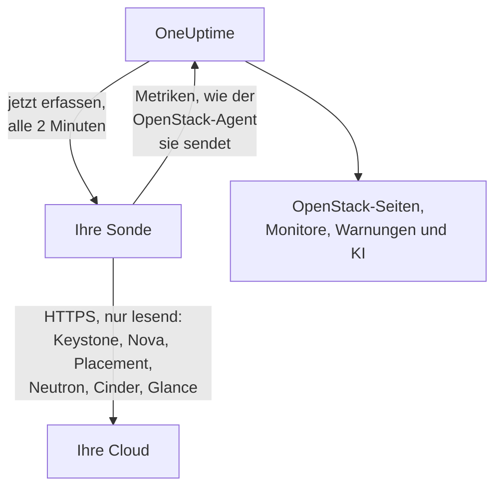

# OpenStack ohne Agent

Überwachen Sie eine OpenStack-Cloud, ohne etwas zu installieren: Geben Sie in OneUptime die Adresse von Keystone und eine Application Credential ein, wählen Sie die Sonde, die die Cloud erreichen kann, und die Sonde erfasst dieselben Daten wie der [OpenStack-Agent](/docs/telemetry/openstack). Es gibt keinen Agent, den Sie installieren, aktualisieren oder am Laufen halten müssen, und keine eigene Maschine, die Sie bereitstellen müssen.

> [!IMPORTANT]
> Eine Sonde spricht mit einer Cloud ausschließlich über HTTPS. Eine Credential oder ihr Token wird nie über unverschlüsseltes HTTP gesendet, und DevStack und Kolla-Ansible stellen ihre APIs standardmäßig über unverschlüsseltes HTTP bereit. Aktivieren Sie bei einer solchen Cloud TLS für ihre APIs oder verwenden Sie den [OpenStack-Agent](/docs/telemetry/openstack), der neben der Cloud läuft. Der Verbindungstest weist darauf hin, wenn er eine Adresse mit unverschlüsseltem HTTP findet.

:::cards
- [Vorbereitung](#vorbereitung): Eine Sonde, die die APIs erreicht, und eine Credential.
- [Eine Cloud verbinden](#eine-cloud-verbinden): Die Adresse, eine Credential, ein Test und ein Name.
- [Fehlerbehebung](#fehlerbehebung): Was jede Meldung bedeutet und was sie behebt.
:::

## So funktioniert es



Alle zwei Minuten liest die Sonde jeden Dienst jeder von Ihnen gewählten Region und sendet das Ergebnis an OneUptime. Es kommt genau so an wie das des OpenStack-Agents, sodass jede OpenStack-Seite, jeder [OpenStack-Monitor](/docs/monitor/openstack-monitor) und jede Warnungsvorlage es auf dieselbe Weise liest.

Jeder Dienst wird für sich und gleichzeitig mit den anderen gelesen. Ein Neutron, das ausfällt oder hängt, kostet die Serien von Neutron, und die Daten von Nova kommen wie gewohnt an, mit einer Ausnahme, die Nova selbst macht: Es fragt Neutron zu jeder Instanz, die es auflistet. Solange Neutron ausgefallen ist, behält eine Sonde daher die zuletzt gelesenen Instanzen und fragt nur nach dem, was sich geändert hat. Hat sich eine Instanz geändert oder ist die Sonde gerade erst gestartet, kann Nova auch diese Liste nicht beantworten: Nova gilt dann als fehlerhaft, seine übrigen Serien kommen weiterhin an, und jede Instanz bleibt auf ihrer Seite so, wie sie zuletzt war, bis Neutron wieder verfügbar ist.

Heat, Magnum, Manila, Trove, Gnocchi, Designate, Swift und Barbican werden dort gelesen, wo der Katalog von Keystone sie nennt. Eine Cloud, die keinen von ihnen betreibt, zahlt dafür nichts, hört im Verbindungstest nichts davon und [zeigt keine Spur davon](/docs/telemetry/openstack#heat-und-magnum).

Hat der Katalog einer Cloud Octavia, liest eine Sonde deren Load Balancer, Pools, Listener und Amphoren mit je einer Listenabfrage, danach die Mitglieder jedes Pools und die Verkehrszähler jedes Load Balancers und Listeners im Status `ACTIVE`, jeweils mit einer Anfrage. Eine Cloud mit 3 Load Balancern, 1 Pool und 1 Listener kostet 9 Anfragen pro Erfassung; ein echtes DevStack, das wir aufgezeichnet haben, kostete genau so viel. Pro Erfassung werden höchstens die Mitglieder von 25 Pools und 50 Zähler gelesen, zuerst die am längsten nicht gelesenen, und die übrigen zeigen weiter, was sie beim letzten Lesen gezeigt haben. Die Zähler von Octavia sind kumulativ, daher merkt sich eine Sonde die letzte Messung jedes Zählers und zeichnet die Differenz pro Sekunde zwischen zwei Messungen: Ein Diagramm beginnt bei der zweiten Erfassung, und ein Zähler, der sinkt (ein neu aufgebauter Listener), zeichnet für dieses Intervall nichts. Der OVN-Provider meldet für jeden Zähler 0, was eine flache Linie und keinen Fehler ergibt.

Amphoren erfordern für jeden Lesezugriff die Admin-Regel von Octavia. Eine Credential unterhalb von Admin sieht die Load Balancer, Pools, Listener und Mitglieder ihres eigenen Projekts sowie ihre eigenen Zähler, aber keine Amphoren: Die Seite Load Balancers weist darauf hin, und es gibt keine Warnung. Die Monitoring-Rolle sieht bei einem Projekt ohne Load Balancer keine. `load-balancer_global_observer` wurde in `stable/2026.1`, dem Release, auf dem das aufgezeichnet wurde, bei allem abgewiesen.

Eine angehaltene Octavia-API ist für eine Sonde `up 0`, was der Exporter des Agents nicht aussagen kann.

## Sonde oder Agent?

| | Eine Sonde (diese Seite) | Der OpenStack-Agent |
|---|---|---|
| Was Sie betreiben | Eine Sonde, die Sie schon betreiben, oder eine neue | Den Agent, auf einer eigenen Maschine |
| Wo die Credential gespeichert ist | Verschlüsselt in OneUptime, nur an die Sonde gesendet | In der Datei `clouds.yaml` des Agents |
| Was erreichbar sein muss | Keystone und die API jedes Dienstes, über HTTPS | Keystone und die API jedes Dienstes |
| APIs über unverschlüsseltes HTTP | Nicht erfasst: Ein Token wird nie unverschlüsselt gesendet | Erfasst |
| Größte Cloud | Getestet mit [200.000 Instanzen](/docs/telemetry/openstack-very-large-clouds) gegen eine simulierte, nicht gegen eine echte Cloud, in bis zu zehn Uploads von 48 MiB | Nicht im großen Maßstab getestet: [Sein Scrape läuft](/docs/telemetry/openstack-very-large-clouds#über-den-agent) schon weit davor in ein Zeitlimit |
| Dienstprotokolle und der KI-Agent | Nicht enthalten | Enthalten |
| Worauf die Cloud aufbaut: RabbitMQ, MariaDB, Memcached, HAProxy, OVN, libvirt | Nicht enthalten: Eine Sonde liest die APIs der Cloud | Enthalten, mit benannten Zielen |
| Echte CPU, echter Speicher und echter Datenträger jeder Instanz, aus libvirt oder Ceilometer | Nicht enthalten | Enthalten, mit benannten Exportern |
| Anmeldungen bei Keystone | Eine pro Lebensdauer eines Tokens, meist eine Stunde | Eine pro Scrape |
| Ein einfacher `reader` für ein Projekt | Die Instanzen, Volumes und Netzwerke dieses Projekts | Die Volumes und Netzwerke dieses Projekts, aber keine Instanzen |

Beide senden dieselben Serien, daher funktionieren die Seiten und Monitore mit beiden. Eine Sonde sendet außerdem, was nur ein nativer Client lesen kann: die Adressen einer Instanz, ihren Task-Status und ihre Fehlermeldung, das Image, von dem sie gebootet wurde, ob ein Operator einen Nova-Dienst erzwungen heruntergefahren hat, welche Netzwerke ein DHCP-Agent bedient, welcher Pool ein Volume enthält, wann eine Instanz, ein Volume oder ein Image zuletzt geändert wurde, sowie den Status jedes Volume-Snapshots und -Backups. Cinder nennt den Pool eines Volumes nur einer Credential, die es als Admin behandelt. Bei einer Cloud, die [Heat oder Magnum](/docs/telemetry/openstack#heat-und-magnum) betreibt, sendet sie außerdem, warum ein Stack oder ein Cluster fehlgeschlagen ist, welche Instanzen und Volumes zu einem Stack gehören, Projekt, Template und Kubernetes-Version jedes Clusters sowie ob jede Heat-Engine und jeder Magnum-Conductor läuft.

Wählen Sie den Agent für Dienstprotokolle, für den KI-Agent, für das, worauf die Cloud aufbaut, und die echte Nutzung jeder Instanz, für eine Cloud, deren APIs nur unverschlüsseltes HTTP sprechen, wie DevStack und Kolla-Ansible es standardmäßig tun, oder für eine so große Cloud, dass sie [aus ihren Datenbanken gelesen](/docs/telemetry/openstack-very-large-clouds#der-datenbankpfad) werden muss. Wählen Sie eine Sonde für alles andere: Es gibt nichts zu installieren, und sie liest mehr von dem, was Nova und Cinder mitteilen. [Sehr große OpenStack-Clouds](/docs/telemetry/openstack-very-large-clouds) nennt, was beides in jeder Größe kostet.

Sie können eine Cloud jederzeit auf ihrer Seite **Einstellungen** von einem zum anderen umstellen.

## Vorbereitung

- **Eine Sonde, die Keystone und die API jedes Dienstes über HTTPS erreichen kann.** Das ist meist eine [eigene Sonde](/docs/probe/custom-probe) im Netzwerk der Cloud. Der Katalog von Keystone nennt, wo jeder Dienst antwortet, und die Sonde verbindet sich mit diesen Adressen, daher muss jede von der Sonde aus erreichbar sein, und jede muss HTTPS verwenden. In OneUptime Cloud erhalten die gemeinsam genutzten Sonden nie eine OpenStack-Credential, richten Sie daher eine eigene Sonde ein. Bei einer selbst gehosteten Instanz können auch die eigenen Sonden der Instanz erfassen.
- **Eine Credential.** Eine Application Credential ist am besten, weil sie auf Lesezugriff beschränkt werden kann und ablaufen kann. Ein Benutzername mit Passwort funktioniert ebenfalls und kann alles, was ihr Konto kann.

OpenStack hat keine globale schreibgeschützte Rolle, daher hängt es von der Credential ab, wie viel die Sonde sieht:

| Stufe | Was sie braucht | Was die Sonde liest |
|---|---|---|
| Vollansicht | Eine Application Credential für ein Konto mit `admin` auf einem eigenen Projekt, durch Zugriffsregeln auf Lesezugriff beschränkt | Alles außer den Benutzern und Gruppen von Keystone, die die Regeln absichtlich auslassen |
| Nur Infrastruktur | Die Rollen `oneuptime_monitoring` und `reader` auf einem eigenen Projekt, das nichts enthält und die Quote null hat, sowie die Richtliniendateien, die der OpenStack-Agent mitbringt | Hypervisoren, die Dienste von Nova, die Agents von Neutron, Adresspools, Placement, die Projektliste und die Instanzen jedes Projekts. Volumes, Netzwerke und Router nur dort, wo die Rolle zugewiesen ist. Nicht den Zustand von `cinder-volume` und `cinder-scheduler` oder Speicherpools: Der eigene Code von Cinder verlangt einen Admin |
| Projektansicht | Einfacher `reader` für ein Projekt | Die Instanzen, Volumes und Netzwerke dieses Projekts, aber keine Infrastruktur |

Der Verbindungstest nennt, auf welche dieser Stufen eine Credential hinausläuft, und warnt, wenn ihr eigenes Projekt Dinge enthält: Wo bei Cinder `enforce_new_defaults` aus ist, was sein eigener Standard ist, kann jede Rolle in einem Projekt dessen Volumes erstellen, auch `reader`.

> [!IMPORTANT]
> Eine durch Zugriffsregeln beschränkte Application Credential wird von jedem Dienst, dessen `keystonemiddleware` kein `service_type` gesetzt hat, mit einem `401` abgewiesen. Der Verbindungstest sagt das für jeden Lesezugriff. Setzen Sie es in der Konfiguration jedes Dienstes und starten Sie ihn dann neu. [Die Credential erstellen](/docs/telemetry/openstack#die-credential-erstellen) enthält die Regeln, die Richtliniendateien und die Einstellungen für jeden Dienst, und [was jede Stufe liest](/docs/telemetry/openstack#was-jede-ebene-liest) ist das, was echte Clouds geantwortet haben.

## Eine Cloud verbinden

:::steps
### Ihre Clouds öffnen
Öffnen Sie in OneUptime **OpenStack → Alle Clouds** und klicken Sie auf **Cloud verbinden**.

### Die Adresse und die Credential eingeben
Geben Sie die `auth_url` aus Ihrer Datei `clouds.yaml` oder `openrc` ein, etwa `https://keystone.example.com:5000/v3`, sowie die ID und das Secret der Application Credential. Wählen Sie die Sonde, die die Cloud erreicht.

### Die Verbindung testen
Klicken Sie auf **Verbindung testen**. Die Sonde meldet sich an, versucht jeden Lesezugriff, den eine Erfassung in jeder Region macht, und meldet sich wieder ab. Sie nennt, welche Regionen der Katalog enthält, was die Credential lesen kann, was ihr verweigert wird, welche Seiten dadurch leer bleiben und die Zeile, die das ändert. Ein fehlgeschlagener Lesezugriff stoppt den Test nicht.

### Dem Zertifikat der Cloud vertrauen
Eine Cloud mit eigener Zertifizierungsstelle präsentiert ein Zertifikat, dem die Sonde nicht vertraut. Der Test zeigt dann das Zertifikat und den Host, der es präsentiert hat. Vergleichen Sie seinen Fingerabdruck mit dem der API selbst und klicken Sie dann auf **Diesem Zertifikat vertrauen**. Eine Cloud mit einem Host pro Dienst kann ein Zertifikat pro Dienst haben, und Sie können bis zu 32 vertrauen.

### Die Regionen wählen und verbinden
Wählen Sie die zu lesenden Regionen, benennen Sie die Cloud und klicken Sie auf **Cloud verbinden**. Die Seite der Cloud öffnet sich.
:::

Die **Übersicht** der Cloud zeigt eine Karte **Datenerfassung**. Sie zeigt **Wird geprüft** bis zur ersten Erfassung, die innerhalb einer Minute beginnt, dann **Wird erfasst**, und die Seiten füllen sich. Wurden einige Dienste gelesen und ein anderer nicht, nennt sie, welcher. Kommt 15 Minuten lang keine Sonde für die Cloud, weil sie offline oder zu alt ist, zeigt sie **Wird nicht erfasst** und sagt das, unabhängig davon, was die letzte Erfassung ergeben hat.

Die Karte **Datenerfassung** auf der Seite **Einstellungen** der Cloud enthält, womit Sie sie verbunden haben:


## Eine Cloud über die API oder Terraform verbinden

Die Verbindungseinstellungen einer Cloud sind gewöhnliche Felder der [Ressource OpenStack-Cloud](/reference/open-stack-cloud) in der API unter `/api/openstack-cloud`, sodass eine Cloud ganz ohne Dashboard verbunden werden kann. Mit Terraform ist das `oneuptime_openstack_cloud`:

```hcl
resource "oneuptime_openstack_cloud" "prod_eu" {
  name                      = "prod-eu"
  collection_method         = "Probe"
  auth_url                  = "https://keystone.example.com:5000/v3"
  credential_kind           = "applicationCredential"
  application_credential_id = var.openstack_application_credential_id
  credential_secret         = var.openstack_application_credential_secret
  collection_probe_id       = oneuptime_probe.eu_west.id
  collection_regions        = jsonencode(["RegionOne"])

  # A cloud with its own certificate authority: the fingerprints it presents.
  trusted_certificate_fingerprints = jsonencode(["AB:CD:EF:..."])
}
```

Für Benutzername und Passwort setzen Sie `credential_kind` auf `password`, mit `keystone_username`, `project_name` und, wenn sie nicht `Default` sind, `user_domain_name` und `project_domain_name`. `endpoint_interface`, `collection_interval_in_minutes` und `collection_options` sind das, was das Formular unter **Weitere Felder** einklappt. Nur `name` ist erforderlich, weil eine Cloud, die der Agent sendet, nichts davon hat.

`credential_secret` ist nur schreibbar, daher gibt es kein Lesen zurück, und Terraform hält es aus Plänen und Ausgaben heraus. [Die Regeln für eine gespeicherte Credential](#die-gespeicherte-credential) gelten auch hier: Eine Änderung der Adresse, der Sonde oder der vertrauten Zertifikate erfordert das Secret in derselben Anfrage. Was die Sonde meldet, etwa `collection_status`, `collection_error` und `presented_certificate`, kann gelesen, aber nicht gesetzt werden.

## Was es Ihre Cloud kostet

Monitoring darf nie der Grund sein, dass eine Cloud ausfällt, daher ist eine Erfassung von Grund auf schonend:

- **Eine Anmeldung, beibehalten.** Das Token wird bis fünf Minuten vor seinem Ablauf verwendet. Eine Anmeldung ist das, was sich ein Keystone in Schwierigkeiten am wenigsten leisten kann.
- **Listen in Seiten.** Jede Liste wird mit `limit` und `marker` tausend Zeilen auf einmal gelesen.
- **Instanzen nach Änderung.** Zwischen vollständigen Lesevorgängen, alle halbe Stunde, fragt die Sonde Nova mit `changes-since` nur nach dem, was sich seit dem letzten Lesen geändert hat.
- **Die Inventare eines Hypervisors einmal.** Placement erhöht die Generation eines Providers, sobald sie sich ändern, was ein einziger Listenaufruf für alle sagt, daher werden sie nur dann erneut gelesen.
- **Eine genannte Last.** Was ein Aufruf pro Objekt ist, wird ab 2.000 pro Erfassung reihum gelesen, und bei Limits ab 250 Projekten. Was dieses Mal nicht gelesen wurde, wird so gesendet, wie es zuletzt gelesen wurde, sodass keine Serie eine Lücke hat und die Last nicht mit der Cloud wächst.
- **Nur die Felder, die es liest.** Die Listen von Neutron nennen ihre Felder, und bei Sicherheitsgruppen werden nur die IDs abgefragt.
- **Nie gestapelt.** Eine Erfassung, die länger dauert als ihr Intervall, wird übersprungen und nicht neben der nächsten ausgeführt.
- **Ein Zeitbudget.** Eine Erfassung hat neun Zehntel ihres Intervalls, höchstens aber zehn Minuten. Was bis dahin gelesen wurde, wird gesendet, und der Dienst, dem die Zeit ausgegangen ist, sagt das.
- **Wartezeit vor erneutem Versuch.** Wird sie mit `429` oder `Retry-After` zum Warten aufgefordert, wartet die Sonde. Ein Dienst, der mit `429`, `503` oder gar nicht antwortet, wird eine Minute in Ruhe gelassen, dann zwei, dann vier, bis zu einer halben Stunde, und seine Serien sagen währenddessen weiter, dass er ausgefallen ist.
- **Verlangsamung.** Eine Antwort, die dreimal langsamer ist, als dieser Dienst üblicherweise antwortet, und mindestens eine Sekunde dauert, oder fünf Sekunden, was auch immer üblich ist, hält die nächste Anfrage an diesen Dienst um genauso lange zurück. Die Karte **Datenerfassung** sagt, wann das geschehen ist.
- **Eine abgewiesene Credential wartet am längsten.** Sie zu wiederholen sperrt ein Konto, daher wartet sie fünf Minuten, dann zehn, bis zu einer Stunde. Eine korrigierte Credential wird sofort versucht.

- **Weniger von einer großen Cloud.** Ab 5.000 Instanzen behält eine Cloud Zählwerte und ihre Teile, aber keine Serie pro Instanz oder pro Volume, es sei denn, Sie wählen auf ihrer Seite **Einstellungen** unter **Echte Nutzung je Instanz** etwas anderes. Was sich geändert hat, was Sie behalten wollten und was eine Warnung beobachtet, geht weiterhin bei jeder Erfassung mit. Der Rest geht reihum, und die Karte **Datenerfassung** sagt, wie lange eine Runde dauert.

Bei jeder Erfassung kostet eine Region mit den Standardwerten 7 Aufrufe an Nova, 7 an Neutron und 5 an Cinder, einen Aufruf an Placement und zwei weitere pro Hypervisor, bis zu 4 weitere, um Placement zu fragen, [wie viele von jedem Flavor passen](/docs/telemetry/openstack#kapazität), und etwa alle fünf Minuten 5 an Keystone und 1 an Glance. Das Inventar eines Hypervisors wird einmal gelesen und erneut nur, wenn Placement sagt, dass es sich geändert hat. Eine Liste mit mehr als tausend Zeilen braucht einen Aufruf pro tausend. Jede Instanz, die sich geändert hat, kostet einen weiteren Aufruf an Nova, um zu lesen, was sie durchlaufen hat, und höchstens 25 werden pro Erfassung gelesen: Eine ruhige Cloud macht keinen. Bei ML2/OVS kostet Neutron einen weiteren Aufruf pro Router, um zu fragen, welche L3-Agents ihn halten, und alle zehn Minuten einen Aufruf pro DHCP-Agent, höchstens 20, um zu fragen, welche Netzwerke er bedient. Eine Cloud mit mehr DHCP-Agents geht sie reihum durch, eine Cloud oberhalb der Größe des Überblicks lässt das weg, und ein langsames Neutron wird gar nicht gefragt. Eine Cloud mit OVN hat keine, nach denen sich fragen ließe. [Sehr große OpenStack-Clouds](/docs/telemetry/openstack-very-large-clouds#die-last-auf-ihrer-steuerungsebene) nennt, auf wie viele Anfragen pro Minute das in jeder Größe hinausläuft.

Eine Cloud, die Manila betreibt, zahlt etwa alle fünf Minuten 2 Aufrufe daran, eine mit Trove 1, mit Gnocchi 1 und mit Barbican 3. Designate braucht 2 und einen weiteren für jede Zone, die nicht `ACTIVE` ist, höchstens 50 pro Erfassung. Swift braucht 1 für das eigene Projekt der Credential und mit `ResellerAdmin` einen weiteren für jedes andere Projekt, höchstens 200 pro Erfassung. Eine Cloud, die Heat oder Magnum betreibt, zahlt etwa alle fünf Minuten 2 Aufrufe an Heat und 3 an Magnum. Keine der Listen sagt alles: Die von Magnum sagt nicht, wem ein Cluster gehört oder warum er fehlgeschlagen ist, und die von Heat sagt nicht, was ein Stack besitzt. Daher liest die Sonde einen Cluster oder einen Stack auch einzeln, wenn sich sein Status bewegt hat, höchstens 25 von jedem pro Erfassung. Eine Cloud mit mehr füllt in den folgenden Erfassungen weiter auf, und eine, die ruhig bleibt, wird nie zweimal gelesen.

Drei Dinge sind aus, solange Sie sie nicht einschalten, unter **Was über die Standardwerte hinaus gelesen wird** in der Karte **Datenerfassung** auf der Seite **Einstellungen** der Cloud oder beim Verbinden unter **Weitere Felder**, weil jedes Ihre Cloud mehr kostet:

| Option | Was Sie bekommen | Was es kostet |
|---|---|---|
| Ports | Eine Serie pro Port sowie wie viele keine Adresse haben oder einen ausgefallenen Load Balancer | Eine seitenweise Liste pro Netzwerk oder Projekt, das Sie nennen, oder aller Ports, wenn Sie keines nennen. Eine Liste aller Ports ohne Eingrenzung kann Neutron bei einer großen Cloud auslasten |
| Projektlimits | Quoten und Limits pro Projekt | Vier Aufrufe pro Projekt, höchstens 250 Projekte pro Erfassung |
| Speicherserver von Swift | Ob jeder antwortet, seine Replikation und ob alle dieselben Ringe haben, wo Sie den `/recon`-Port jedes Servers als `host:port` nennen. Nur eine Cloud, die Swift betreibt, bietet das an, auf ihrer Seite **Einstellungen**, sobald ihre erste Erfassung Swift gelesen hat | 5 Aufrufe pro Server bei jeder Erfassung. Es geht keine Credential an sie |

## Zertifikate

Die Sonde überspringt nie die Zertifikatsprüfung. Jede Verbindung führt einen vollständigen TLS-Handshake durch, und dann gilt:

- Ist kein Zertifikat vertraut, muss das Zertifikat einer API von einer Zertifizierungsstelle stammen, der der Rechner der Sonde vertraut, und zur Adresse passen, unter der sie antwortet;
- sind Zertifikate vertraut, muss eine API genau eines davon präsentieren, identifiziert durch ihre SHA-256-Fingerabdrücke. Nichts anderes wird akzeptiert, nicht einmal ein öffentlich vertrauenswürdiges.

Um einen Fingerabdruck zu prüfen, führen Sie dies auf dem Rechner der Sonde aus:

```bash
openssl s_client -connect keystone.example.com:5000 </dev/null | openssl x509 -noout -fingerprint -sha256
```

Wird ein Zertifikat erneuert, hält die Erfassung mit **Das Zertifikat der API hat sich geändert** an, und das neue Zertifikat wird angezeigt. Es wird nichts gesendet, bis Sie ihm vertrauen, auf der Seite **Übersicht** oder **Einstellungen** der Cloud.

## Die gespeicherte Credential

Das Secret ist verschlüsselt und nur schreibbar: Niemand kann es zurücklesen, und die API gibt es nie zurück. Es wird nur an die Sonde gesendet, die die Cloud erfasst und es im Arbeitsspeicher hält.

Eine gespeicherte Credential wird immer nur an die Adresse, über die Sonde und an die Zertifikate gesendet, für die sie eingegeben wurde. Eine Änderung der Adresse, der Sonde oder der vertrauten Zertifikate verlangt das Secret erneut, sodass niemand, der die Cloud bearbeiten kann, es woandershin senden kann. Dem Zertifikat zu vertrauen, das die Sonde an der gespeicherten Adresse gefunden hat, behält es, und ebenso, weniger zu vertrauen.

Der Katalog unterliegt denselben Regeln wie die Adresse, die Sie eingegeben haben, denn ein Token geht dorthin, wohin er verweist. Die Sonde verbindet sich nicht mit einer Loopback-, Link-Local- oder Cloud-Metadaten-Adresse, gleich ob der Katalog sie nennt oder ein Hostname darauf aufgelöst wird, und sie verbindet sich mit den Adressen, die sie geprüft hat, nicht mit dem, was DNS einen Moment später sagt. Sie folgt keinen Weiterleitungen.

## Zwischen Agent und Sonde wechseln

Öffnen Sie die Seite **Einstellungen** der Cloud. Ihre Karte **Datenerfassung** bietet **Mit einer Sonde erfassen** für eine Cloud, die der Agent sendet, und **OpenStack-Agent verwenden** für eine, die eine Sonde erfasst. Der Wechsel zum Agent vergisst die gespeicherte Credential.

> [!WARNING]
> Beenden Sie den OpenStack-Agent, sobald die erste Erfassung durch die Sonde erfolgreich war. Solange beide laufen, kommt jede Metrik doppelt an.

Ab [5.000 Instanzen](/docs/telemetry/openstack-very-large-clouds#summary-modus) kennt die erste Erfassung einer Sonde die ganze Cloud und sendet einen Teil davon, sodass sich die Listen einer neuen Cloud während ihres ersten Zyklus füllen, und die Karte **Datenerfassung** sagt, wann alle da sein werden.

## Bare Metal

Hat der Katalog einer Cloud Ironic, liest eine Sonde dessen Nodes und fragt jedes Feld einzeln mit Namen ab, sodass das `driver_info` eines Nodes bei einer Erfassung nie gelesen wird. Sie ergänzt, was der Exporter des Agents nicht hat: den Treiber eines Nodes, seinen Conductor, seinen Fehler und warum er fehlgeschlagen ist. Ironic kann `last_error` innerhalb von etwa einer Minute leeren, daher behält eine Seite den letzten, den eine Erfassung gesehen hat, und sagt, wann.

Eine Sonde liest zuerst den Katalog und kann daher sagen, dass die API von Ironic ausgefallen ist, was der Exporter des Agents nicht kann. Eine Cloud ohne Ironic wird dazu nichts gefragt.

Ironic zeigt einem Projekt nur die Nodes, die es besitzt, und verweigert ihm die Liste der Conductors. Nach der Standardrichtlinie von Ironic liest das nur eine Credential mit System-Scope, und die Credential einer Sonde kann keinen System-Scope haben, weil sie die Listen von Nova mit derselben liest. Sofern die Richtlinie der Cloud ihrer Rolle nicht `baremetal:node:list_all` und `baremetal:conductor:get` gibt, sieht eine Sonde daher die Nodes, die ihrem Projekt gehören, und keine Conductors, und die Seiten sagen das. [Bare Metal](/docs/telemetry/openstack#bare-metal) enthält den Rest.

## Referenz

| Einstellung | Standard | Hinweise |
|---|---|---|
| Erfassen alle | 2 Minuten | Von 1 bis 60 Minuten. Erfassen Sie eine große Cloud seltener, um sie zu schonen. Keystone und Glance werden etwa alle fünf Minuten gelesen, egal wie oft der Rest gelesen wird. |
| Endpoint-Interface | public | Welche der URLs des Katalogs verwendet wird: public, internal oder admin. |
| Gleichzeitige Erfassungen | 4 pro Sonde | Eine Erfassung, die langsamer ist als ihr Intervall, wird übersprungen, nie gestapelt. |
| Größter Upload | 48 MiB | Eine Erfassung geht in so vielen, wie nötig, bis zu zehn. Ab [5.000 Instanzen](/docs/telemetry/openstack-very-large-clouds#summary-modus) geht, was sich nicht geändert hat, reihum. |
| Anfragen an jeden Dienst | Eine nach der anderen | Die Aufrufe pro Provider von Placement gehen vier gleichzeitig. |
| Warten auf eine Antwort | 60 Sekunden | Insgesamt dreimal versucht, wenn es ein `429` oder ein Serverfehler ist. |
| Verbindungstest | 90 Sekunden bis zum Start | Ein Test, den keine Sonde rechtzeitig aufnimmt oder der länger als 3 Minuten läuft, wird als fehlgeschlagen beantwortet. Fünf können in einem Projekt gleichzeitig warten oder laufen. |

## Fehlerbehebung

:::details Dem Zertifikat der API wird nicht vertraut
Die Cloud präsentiert ein Zertifikat ihrer eigenen Zertifizierungsstelle. Vergleichen Sie den angezeigten Fingerabdruck mit dem Zertifikat der API und klicken Sie dann auf **Diesem Zertifikat vertrauen**.
:::

:::details Das Zertifikat der API hat sich geändert
Das Zertifikat wurde erneuert, oder jemand hängt dazwischen. Es wird nichts gesendet, bis Sie dem neuen vertrauen. Prüfen Sie seinen Fingerabdruck und vertrauen Sie ihm dann.
:::

:::details Die Auth-URL ist nicht gültig
Geben Sie die Adresse von Keystone über HTTPS ein, etwa `https://keystone.example.com:5000/v3`. Eine Adresse mit unverschlüsseltem HTTP wird abgewiesen, bevor etwas gesendet wird. Aktivieren Sie bei einer Cloud, deren APIs nur unverschlüsseltes HTTP sprechen, TLS oder verwenden Sie den [OpenStack-Agent](/docs/telemetry/openstack).
:::

:::details Der Katalog nennt einen Endpoint mit unverschlüsseltem HTTP
Das Token einer Credential wird nie unverschlüsselt gesendet. Aktivieren Sie TLS für diese API, wählen Sie ein anderes Endpoint-Interface oder verwenden Sie für diese Cloud den [OpenStack-Agent](/docs/telemetry/openstack). Der Verbindungstest schlägt fehl, bis jede API, die er liest, HTTPS verwendet. Bei einer Erfassung geht nur der Dienst mit diesem Endpoint leer aus: Die anderen werden wie gewohnt gelesen.
:::

:::details Keystone hat die Credential abgewiesen
Die ID, das Secret oder das Passwort ist falsch, sie ist abgelaufen oder wurde gelöscht, oder ihr Konto hat seine Rolle auf dem Projekt verloren. Erstellen Sie eine neue und geben Sie sie mit **Verbindung bearbeiten** auf der Seite **Einstellungen** der Cloud ein.
:::

:::details Das Konto hat keine Rolle auf diesem Projekt
Ein Benutzername mit Passwort hat sich angemeldet, aber nicht auf diesem Projekt. Prüfen Sie den Projektnamen und beide Domänen. Eine Application Credential vermeidet das: Ihr Scope wird beim Erstellen festgelegt.
:::

:::details Die Credential kann nicht lesen, was das Monitoring braucht
Der Test listet jeden verweigerten Lesezugriff auf, was dadurch leer bleibt und die Zeile, die es freischaltet. Ein `401` bei einer Credential mit Zugriffsregeln bedeutet, dass die Regeln diesen Pfad nicht aufführen oder dass bei der `keystonemiddleware` dieses Dienstes kein `service_type` gesetzt und sie nicht neu gestartet wurde.
:::

:::details Die Sonde bekommt keine Antwort von der Cloud
Das Netzwerk der Sonde kann diese API nicht erreichen. Erlauben Sie es in der Firewall oder wählen Sie eine Sonde im Netzwerk der Cloud. Die Adresse jedes Dienstes ist seine eigene: Die Meldung nennt den, der nicht geantwortet hat.
:::

:::details Auf diesem Port antwortet nichts
Prüfen Sie die Adresse und den Port. Keystone läuft meist auf 5000 oder auf 443 hinter einem Pfad wie `/identity`.
:::

:::details Die sichere Verbindung ist fehlgeschlagen
Die Adresse zeigt wahrscheinlich auf einen Port, der kein HTTPS spricht. Prüfen Sie sie. Sprechen die APIs der Cloud nur unverschlüsseltes HTTP, aktivieren Sie TLS oder verwenden Sie den OpenStack-Agent.
:::

:::details OneUptime verbindet sich nicht mit dieser Adresse
Die Adresse oder etwas, das der Katalog nennt, ist eine Loopback-, Link-Local- oder Cloud-Metadaten-Adresse oder wird darauf aufgelöst. Verwenden Sie die Adresse, unter der die API in Ihrem Netzwerk antwortet.
:::

:::details Diese Adresse ist nicht Keystone
Geben Sie den Identity-Endpoint aus Ihrer Datei `clouds.yaml` oder `openrc` ein: seine `auth_url`.
:::

:::details Eine Region ist nicht im Katalog
Wählen Sie aus den Regionen, die der Katalog nennt. Der Verbindungstest listet sie auf.
:::

:::details Keystone fällt aus
Keystone hat mit einem Serverfehler geantwortet. Die Sonde wartet zwischen den Anmeldungen länger, bis es sich erholt, und ohne Anmeldung kann nichts anderes gelesen werden. Prüfen Sie den Dienst von Keystone und die Datenbank dahinter.
:::

:::details Ein Dienst ist angehalten oder zu ausgelastet, um zu antworten
Er hat weiter mit `429` oder einem Serverfehler geantwortet, daher wartet die Sonde zwischen den Erfassungen länger, bis er sich erholt. Prüfen Sie, ob er läuft, und dann seine Last. Seltener zu erfassen hilft einem ausgelasteten Dienst.
:::

:::details Die Erfassung hat zu lange gedauert
Die Cloud hat für dieses Intervall zu langsam geantwortet. Erfassen Sie seltener oder prüfen Sie ihre Last.
:::

:::details Die Sonde hat dies nicht aufgenommen
Die Sonde ist offline oder läuft mit einer OneUptime-Version, die älter ist als die OpenStack-Erfassung. Prüfen Sie auf der Seite **Sonden**, ob sie verbunden ist, und aktualisieren Sie sie. Die Karte einer Cloud sagt das auch, sobald eine Erfassung 15 Minuten überfällig ist, unabhängig davon, wie die letzte Erfassung verlief, und geht von selbst zurück, wenn die Sonde es tut.
:::

:::details Diese Cloud ist zu groß, um von einer Sonde erfasst zu werden
Ihre Metriken sind mehr, als eine Erfassung senden darf, und diese Cloud ist so eingestellt, dass sie die Serien jeder Instanz behält. Lassen Sie sie stattdessen Zählwerte behalten, unter **Echte Nutzung je Instanz** auf ihrer Seite **Einstellungen**, oder verwenden Sie den [OpenStack-Agent](/docs/telemetry/openstack). Der [Summary-Modus](/docs/telemetry/openstack-very-large-clouds#summary-modus) nennt, worauf das verzichtet.
:::

## Nächste Schritte

:::cards
- [OpenStack-Monitor](/docs/monitor/openstack-monitor): Warnungen für Dienste, Hypervisoren, Instanzen, Netzwerke und Volumes.
- [Eigene Sonde](/docs/probe/custom-probe): Eine Sonde im Netzwerk der Cloud betreiben.
- [OpenStack-Agent](/docs/telemetry/openstack): Eine Cloud stattdessen mit dem Agent erfassen.
:::
