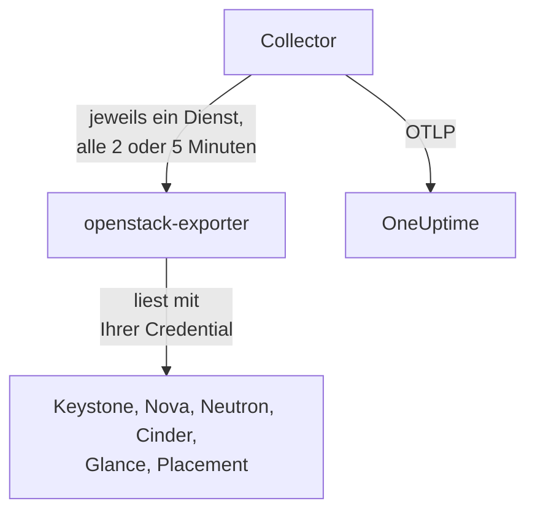

# OpenStack-Agent

Der OneUptime-OpenStack-Agent überwacht eine OpenStack-Cloud: ihre Dienste und Agents, Hypervisoren, Instanzen, Netzwerke, Router, Volumes, Speicherpools, Images und Projekte, in jeder Region. Er liest die APIs der Cloud mit einer von Ihnen gewählten Credential und sendet das Gefundene an OneUptime, wo die Cloud mit ihren Regionen, Hypervisoren und Projekten erscheint. [OpenStack-Monitore](/docs/monitor/openstack-monitor) alarmieren anhand dessen, was ankommt, und eine [Probe](/docs/telemetry/openstack-agentless) kann eine Cloud erfassen, ohne dass etwas installiert werden muss.

:::cards
- [Probe oder Agent?](/docs/telemetry/openstack-agentless#sonde-oder-agent): Was Sie wählen sollten, wenn eine Cloud beides zuließe.
- [Sichtbarkeit wählen](#sichtbarkeit-des-agents-wählen): OpenStack hat keine globale Nur-Lese-Rolle, daher gibt es drei Ebenen.
- [Agent installieren](#den-agent-installieren): Eine Credential, dann das Installationsskript, Docker Compose oder gar kein Docker.
- [Was es Ihre Cloud kostet](#was-es-ihre-cloud-kostet): Was jede Einstellung liest und wie Sie sie ändern.
- [Kapazität](#kapazität): Wie viele weitere Instanzen jedes Flavors noch passen und in wie vielen Tagen jedes Ding voll ist.
- [Ausgaben](#ausgaben): Wer was nutzt, was das zu Ihren Preisen oder nach CloudKitty-Bewertung ergibt und was sich zurückholen ließe.
- [Statusseiten und Projekte informieren](#statusseiten-und-projekte-informieren): Eine Seite pro Region in einem Schritt, und nur die Projekte informieren, die ein Ausfall trifft.
- [Dienstprotokolle](#dienstprotokolle): Geparst, mit einer Anfrage, die über Dienste hinweg verfolgt wird.
- [Lebenszyklusereignisse](#lebenszyklusereignisse): Instanzaktionen im Feed und in Diagrammen, aus Benachrichtigungen oder von einer Probe.
- [Wer was getan hat](#wer-was-getan-hat): Audit-Trails in die Sicherheitsereignisse.
- [Eine Anfrage nachverfolgen](#anfragen-durch-die-steuerungsebene-nachverfolgen): Eine signierte Anfrage, verfolgt quer durch die Steuerungsebene.
- [Von außen prüfen](#die-cloud-von-außen-prüfen): Ob tatsächlich jemand eine Instanz starten kann, von einer Probe außerhalb der Cloud.
- [Ohne Internet](#ohne-internet): Die vier Images des Agents und wie Sie sie in eine eigene Registry kopieren.
- [Nach Deployment-Tool](/docs/telemetry/openstack-deployment-tools): Kolla-Ansible, OpenStack-Ansible, OpenStack-Helm, Atmosphere, Sunbeam, Red Hat und Mirantis.
- [Fehlerbehebung](#fehlerbehebung): Ein Diagnoseskript und die üblichen Probleme.
:::

## So funktioniert es

Der Agent besteht aus zwei festgelegten Upstream-Programmen und ihrer Konfiguration auf einer Maschine: [openstack-exporter](https://github.com/openstack-exporter/openstack-exporter) liest die APIs der Cloud und macht daraus `openstack_*`-Serien, und ein OpenTelemetry Collector fragt ihn jeweils nach einem OpenStack-Dienst, versieht jede Serie mit der Cloud und der Region, aus der sie stammt, und sendet sie an OneUptime. Auf Ihren Controllern oder Compute-Knoten läuft nichts, es sei denn, Sie fügen das optionale [Logs-Profil](#dienstprotokolle) hinzu, das deren Protokolle liest.



Die Cloud registriert sich mit ihren ersten Daten unter dem Namen, den der Agent als `openstack.cloud.name` in jede Metrik schreibt. Ein Agent überwacht eine Cloud: ein Keystone, mit einer oder mehreren Regionen.

## Bevor Sie beginnen

- Docker Engine 20.10 oder neuer mit dem Docker-Compose-v2-Plugin oder, um ohne Docker zu arbeiten, eine Linux-Maschine (x86_64 oder arm64) mit systemd 235 oder neuer, glibc 2.34 oder neuer (RHEL 9, Ubuntu 22.04, Debian 12) und Root-Rechten.
- Eine Route von dieser Maschine zu Keystone und zum öffentlichen Endpunkt jedes Dienstes.
- Die `openstack`-Kommandozeile, als jemand, der die unten genannte Credential erstellen kann.
- Ein Ingestion-Schlüssel. Erstellen Sie einen unter **Projekteinstellungen → Telemetrie & APM → Ingestion-Schlüssel** und kopieren Sie seinen Wert.
- Ausgehendes HTTPS von dieser Maschine zu Ihrer OneUptime-URL.

### Wo der Agent laufen soll

Lassen Sie den Agent außerhalb der Cloud laufen, die er überwacht: auf einer kleinen VM auf separater Hardware, einem Management-Host oder in einer anderen Cloud. Ein Agent innerhalb einer ausgefallenen Cloud verstummt mit ihr, und Stille sieht aus wie eine gesunde Cloud, die nicht mehr berichtet.

## Sichtbarkeit des Agents wählen

OpenStack hat keine globale Nur-Lese-Rolle, und das ist das Schwierigste an seiner Überwachung:

- `reader` ist überall auf ein Projekt beschränkt, außer in Keystone und Ironic.
- Hypervisoren, Dienste, Agents, Pools und Placement erfordern standardmäßig Admin.
- Eine Policy-Überschreibung kann Listen über alle Projekte in Neutron oder Cinder nicht öffnen, denn diese beschränken sie in ihrem eigenen Code über den Admin-Kontext.
- Cinders Dienste und Speicherpools beantworten alles außer einem Admin mit `403`, aus Cinders eigenem Code, nachdem die Policy bereits bestanden wurde. Keine Überschreibung öffnet auch diese.
- Neutron und Cinder beantworten einen einfachen Reader mit `200` und nur mit dem eigenen Projekt dieses Readers. Es sieht aus, als hätte es funktioniert, und das hat es nicht.
- Wo Cinder `enforce_new_defaults` ausgeschaltet hat, was Cinders eigener Standard ist, kann jede Rolle auf einem Projekt dessen Volumes erstellen, einschließlich `reader` und `oneuptime_monitoring`. Auf Epoxy, Flamingo und Gazpacho haben ein einfacher Reader und die Rolle auf einem echten Projekt beide ein Volume erstellt (`202`). Auf Hibiscus wurden beide abgelehnt (`403`), weil DevStack `enforce_new_defaults` nur dort einschaltet. Eine Nur-Lese-Rolle auf einem echten Projekt ist nicht schreibgeschützt.

Es gibt also drei Ebenen, und jede hat ihren Preis. Beginnen Sie nach Möglichkeit mit der ersten.

| Ebene | Was sie braucht | Was sie sieht | Was fehlt |
| --- | --- | --- | --- |
| **1. Vollansicht** | Eine Application Credential auf einem Konto mit `admin` auf einem eigenen Projekt, per Zugriffsregeln auf Lesen beschränkt, mit gesetztem `service_type` für jeden Dienst | Jeden Lesezugriff des Agents sowie den Zustand von `cinder-volume` und `cinder-scheduler` und die Speicherpools, die nur diese Ebene sieht | Keystones Benutzer und Gruppen, absichtlich. Sie kann nicht schreiben: jeder Schreibzugriff wurde mit `401` beantwortet |
| **2. Nur Infrastruktur** | Die Rollen `oneuptime_monitoring` und `reader` auf einem eigenen Projekt, das nichts enthält und Quota null hat, sowie die Policy-Überschreibungen, die der Agent mitliefert | Alle Projekte, Domänen, Dienste und Endpunkte von Keystone, ganz Nova einschließlich der Server aller Projekte, ganz Placement sowie Neutrons Agents und IP-Verfügbarkeiten | Neutrons Netzwerke, Subnetze, Router, Floating-IPs und Ports sowie Cinders Volumes und Snapshots gehören nur zum eigenen Projekt, auf einem leeren Projekt also nur die geteilten und externen. Kein Zustand von `cinder-volume` oder `cinder-scheduler` und keine Speicherpools. Sie kann nicht schreiben: jeder Schreibzugriff wurde mit `403` beantwortet, oder mit `409` und `413` wegen Quota |
| **3. Projektansicht** | Einfaches `reader` auf einem echten Projekt, für ein Team, das seinen eigenen Teil einer von jemand anderem betriebenen Cloud überwacht | Die Volumes, Netzwerke und Router dieses Projekts, aus Cinder und Neutron | Die gesamte Infrastruktur: keine Hypervisoren, Dienste, Agents, Pools oder Kapazität. Über den Agent auch keine Instanzen, weil der Lesezugriff des Exporters auf alle Projekte abgelehnt wird. Und auf vielen Clouds kann `reader` dort schreiben |

Die Vorlagen **Block Storage Service Down**, **Storage Pool Warning** und **Storage Pool Critical** brauchen Ebene 1. **Compute Service Down**, **Network Agent Down** sowie die Placement- und Hypervisor-Vorlagen brauchen Ebene 1 oder 2, und auf Ebene 3 liest nichts eine Instanz.

### Was jede Ebene liest

Das haben fünf echte Clouds geantwortet, auf Epoxy, Flamingo, Gazpacho (OVN und OVS) und Hibiscus. Jede Zelle ist aus diesen Aufzeichnungen geschrieben.

| Lesezugriff | Ebene 1: Vollansicht | Ebene 2: Nur Infrastruktur | Ebene 3: Projektansicht |
| --- | --- | --- | --- |
| Keystone: Projekte | alle | alle | abgelehnt |
| Keystone: Domänen | alle | alle | abgelehnt |
| Keystone: Regionen | alle | was jeder sieht | was jeder sieht |
| Keystone: Dienste | alle | alle | abgelehnt |
| Keystone: Endpunkte | alle | alle | abgelehnt |
| Nova: Server, alle Projekte | alle | alle | abgelehnt |
| Nova: Dienste | alle | alle | abgelehnt |
| Nova: Hypervisoren | alle | alle | abgelehnt |
| Nova: Aggregate | alle | alle | abgelehnt |
| Nova: Verfügbarkeitszonen, Details | alle | alle | abgelehnt |
| Nova: Flavors | alle | was jeder sieht | was jeder sieht |
| Nova: Nutzung pro Projekt | alle | alle | abgelehnt |
| Placement: Resource Provider | alle | alle | abgelehnt |
| Neutron: Agents | alle | alle | nichts |
| Neutron: Netzwerke | alle | nur eigenes Projekt | nur eigenes Projekt |
| Neutron: Subnetze | alle | nur eigenes Projekt | nur eigenes Projekt |
| Neutron: Router | alle | nur eigenes Projekt | nur eigenes Projekt |
| Neutron: Floating-IPs | alle | nur eigenes Projekt | nur eigenes Projekt |
| Neutron: IP-Verfügbarkeiten | alle | alle | nichts |
| Neutron: Sicherheitsgruppen | alle | 409, erwartet | nur eigenes Projekt |
| Neutron: Ports | alle | nur eigenes Projekt | nur eigenes Projekt |
| Neutron: Quotas | alle | abgelehnt | abgelehnt |
| Cinder: Volumes, alle Projekte | alle | nur eigenes Projekt | nur eigenes Projekt |
| Cinder: Dienste | alle | abgelehnt | abgelehnt |
| Cinder: Pools | alle | abgelehnt | abgelehnt |
| Cinder: Snapshots, alle Projekte | alle | nur eigenes Projekt | nur eigenes Projekt |
| Cinder: Backups, alle Projekte | alle | keine aufgezeichnet | keine aufgezeichnet |
| Cinder: Volume-Typen | alle | was jeder sieht | was jeder sieht |
| Glance: Images | alle | was jeder sieht | was jeder sieht |

- **alle**: dieselben Zeilen, die ein Admin sah.
- **nur eigenes Projekt**: die Zeilen dieses Projekts und alles, was geteilt oder extern ist. Auf einem Projekt, das nichts enthält, sind das nur die geteilten und externen.
- **abgelehnt**: ein `401` oder ein `403`.
- **was jeder sieht**: jede Credential sah jede Zeile, auf Clouds, die nur öffentliche Flavors, Volume-Typen und Images enthalten. Ein privates in einem anderen Projekt erfordert Ebene 1.
- **nichts**: ein `200` ohne Zeilen, auf einem Projekt, das auch Netzwerke hat. Es sieht aus, als hätte es funktioniert, und das hat es nicht.
- **keine aufgezeichnet**: ein `200` ohne Zeilen, wo auch ein Admin keine sah, es gab also nichts zu unterscheiden.
- **409, erwartet**: Neutron versucht, beim Auflisten die Standard-Sicherheitsgruppe des Projekts zu erstellen, und Quota null erlaubt das nicht, also antwortet es mit `409 Quota exceeded`. Das ist harmlos und nichts, was behoben werden muss.

Octavia, Ironic, Heat, Magnum, Manila, Designate, Barbican, Swift, Trove und Gnocchi stehen nicht hier, weil jene Clouds sie nicht betreiben. Das [Diagnoseskript](#fehlerbehebung) fragt auch sie ab, wo eine Cloud sie betreibt, und es liest jeden Pfad mit Ihrer echten Credential und sagt, was diese sehen kann.

Was der Exporter des Agents mit jeder erhielt, in Serien pro Dienst. Die Zahlen folgen dem, was eine Cloud beim Abfragen enthält, vergleichen Sie sie also untereinander und nicht mit Ihren:

| Exporter-Dienst | Admin | Ebene 1: Vollansicht | Ebene 2: Nur Infrastruktur | Ebene 3: Projektansicht |
| --- | --- | --- | --- | --- |
| identity | 14 | 13 | 13 | 4 |
| compute | 33 | 33 | 33 | 15 |
| placement | 25 | 25 | 25 | 1 |
| network | 36 bis 40 | 36 bis 40 | 24 bis 26 | 14 |
| volume | 33 | 33 bis 41 | 23 | 29 bis 37 |
| image | 4 | 4 | 4 | 4 |

## Den Agent installieren

Jedes OneUptime stellt das Installationsskript und die Dateien des Agents für seine eigene Version bereit: Die folgenden Befehle laden sie von `https://oneuptime.com` herunter, ersetzen Sie das bei einem selbst gehosteten OneUptime also durch Ihre URL. Das Installationsskript wird zuerst als `install.sh` gespeichert, damit Sie es lesen können, bevor Sie es ausführen.

:::steps
### Die Credential erstellen

Wählen Sie die Ebene, die Sie gewählt haben. Jede erzeugt eine Application Credential, die eine `id` und ein `secret` ausgibt: Das Secret wird nur einmal angezeigt. Geben Sie ihr ein Ablaufdatum und nie `--unrestricted`, womit sie weitere Credentials erstellen dürfte.

:::tabs
@tab Level 1: Full view
Erstellen Sie als Admin ein Projekt und ein Konto für den Agent:

```bash
openstack project create --domain default oneuptime-monitoring
openstack user create --domain default --password-prompt oneuptime-monitoring
openstack role add --project oneuptime-monitoring --user oneuptime-monitoring admin
```

Erstellen Sie dann, angemeldet als dieses Konto auf diesem Projekt, die Credential. Die Regeln sind die exakten `GET`-Pfade, die der Agent verwendet, auf Ihre Cloud zugeschnitten:

```bash
curl -fsSLO https://oneuptime.com/install/openstack-agent/access/application-credential-access-rules.json
curl -fsSLO https://oneuptime.com/install/openstack-agent/access/access-rules-for-cloud.py
openstack catalog list -f json | python3 access-rules-for-cloud.py \
  application-credential-access-rules.json > access-rules-for-this-cloud.json
openstack application credential create oneuptime-agent \
  --role admin \
  --access-rules "$(cat access-rules-for-this-cloud.json)" \
  --expiration 2027-11-01T00:00:00
```

Eine Zugriffsregel wird mit dem Pfad abgeglichen, den der Dienst sieht. Ein Dienst hinter einem Pfadpräfix wie `https://cloud.example/compute/v2.1` sieht `/compute/v2.1/servers` und lehnt die mitgelieferte Regel für `/v2.1/servers` mit `401` ab. `access-rules-for-cloud.py` fügt jede Regel noch einmal unter dem Präfix ihres Dienstes hinzu, gelesen aus Ihrem Katalog.

Zwei der Lesezugriffe des Exporters brauchen Regeln, die man von Hand leicht übersieht. Er liest vor allem anderen die Wurzel von Octavia, und hinter Apache sieht ein Dienst sie als `/load-balancer//`, mit zwei Schrägstrichen. Wird sie abgelehnt, antwortet der Exporter mit einem leeren `200`, und die Cloud sieht aus, als betriebe sie kein Octavia. Außerdem listet er das Swift-Konto mit einem abschließenden Schrägstrich auf, den `/v1/*` nicht trifft. Wird das abgelehnt, steht `openstack_object_store_up` auf `0`. Die zugeschnittenen Regeln enthalten beides. Die Regeln einer Credential lassen sich nicht ändern. Wurde Ihre also aus einer älteren Kopie erstellt, erstellen Sie eine neue.

Zugriffsregeln brauchen außerdem `service_type` für keystonemiddleware in jedem Dienst und einen Neustart dieses Dienstes. Ohne ihn lehnt der Dienst die Credential mit `401` ab:

```ini title="nova.conf"
[keystone_authtoken]
service_type = compute
```

| Konfigurationsdatei | `service_type` |
| --- | --- |
| `nova.conf` | `compute` |
| `neutron.conf` | `network` |
| `cinder.conf` | `block-storage`. Die Regeln enthalten auch `volume` und `volumev3`, für ein so konfiguriertes Cinder |
| `glance-api.conf` | `image` |
| `placement.conf` | `placement` |
| `octavia.conf` | `load-balancer` |
| `ironic.conf` | `baremetal` |
| `heat.conf` | `orchestration` |
| `magnum.conf` | `container-infra` |
| `manila.conf` | `sharev2`. Die Regeln enthalten auch `shared-file-system`, für ein so konfiguriertes Manila |
| `designate.conf` | `dns` |
| `barbican.conf` | `key-manager` |
| `trove.conf` | `database` |
| `gnocchi.conf` | `metric` |
| `cloudkitty.conf` | `rating` |
| `proxy-server.conf`, unter `[filter:authtoken]` | `object-store`, und `include_service_catalog = True` daneben. keystonemiddleware prüft die Regeln gegen den Katalog des Tokens, mit `False`, was DevStack setzt, antwortet Swift der Credential also mit `500` |

Nur die Dienste, die Ihre Cloud betreibt, brauchen eine Zeile.

Bei den Diensten, die eine Cloud möglicherweise nicht betreibt, unterscheidet sich das, was jede Ebene auf echten Clouds erhielt, in vier Punkten von den obigen Tabellen:

- **Ironic** beantwortet die Credential eines Projekts, auch die eines Admins, nur mit den Knoten, die dieses Projekt besitzt, und lehnt dessen Conductors ab. Nur der System-Scope liest jeden Knoten und die Conductors, und die Credential des Agents liegt auf einem Projekt. Um einen Knoten damit zu lesen, machen Sie sein Projekt zum Eigentümer: `openstack baremetal node set --owner`.
- **Swift** listet die Container des eigenen Projekts der Credential auf und keine anderen. Das Konto eines anderen Projekts antwortet mit `403`, sofern die Credential nicht `ResellerAdmin` hat.
- **Barbican** beantwortet eine Credential nur zu ihrem eigenen Projekt und lehnt einen einfachen Reader ab. OneUptime liest kein Secret.
- **Gnocchi** lässt jede Rolle auf einem Projekt eine Metrik erstellen, auf einer Cloud, die es betreibt, können Ebene 2 und Ebene 3 dort also schreiben.

Keystone braucht nichts. Mit angepassten Regeln, gesetztem `service_type` und neu gestarteten APIs wurde jeder Lesezugriff mit `200` und jeder Schreibzugriff mit `401` beantwortet, auf jedem Release, das wir aufzeichnen. Der Exporter erhält, was ein Admin erhält, außer Keystones Benutzern und Gruppen, absichtlich. Das gilt auch für die Dienste, die eine Cloud möglicherweise nicht betreibt: Auf DevStack aufgezeichnet erhielt Ebene 1 von jedem vom Exporter gelesenen dieselben Serien wie die Credential eines Admins, und jeder Schreibzugriff wurde mit `401` beantwortet.

Wenn Sie diese Änderung nicht vornehmen wollen, erstellen Sie dieselbe Credential ohne `--access-rules`: eine einfache Admin-Application-Credential. Sie funktioniert und kann schreiben, deshalb kennzeichnet das Diagnoseskript sie als solche.
@tab Level 2: Infrastructure only
Erstellen Sie als Admin die Rolle, ein Projekt, das nichts enthält und Quota null hat, und ein Konto:

```bash
openstack role create oneuptime_monitoring
openstack project create --domain default --description "OneUptime monitoring: holds nothing" oneuptime-monitoring
openstack quota set --instances 0 --cores 0 --ram 0 --key-pairs 0 oneuptime-monitoring
openstack quota set --volumes 0 --gigabytes 0 --snapshots 0 --backups 0 --backup-gigabytes 0 oneuptime-monitoring
openstack quota set --networks 0 --subnets 0 --ports 0 --routers 0 --floating-ips 0 --secgroups 0 --secgroup-rules 0 oneuptime-monitoring
openstack user create --domain default --password-prompt oneuptime-monitoring
openstack role add --project oneuptime-monitoring --user oneuptime-monitoring oneuptime_monitoring
openstack role add --project oneuptime-monitoring --user oneuptime-monitoring reader
```

Das Projekt enthält absichtlich nichts und hat Quota null. Wo Cinder `enforce_new_defaults` ausgeschaltet hat, kann jede Rolle auf einem Projekt dessen Volumes erstellen. Ohne etwas, das sie anfassen könnte, und ohne Quota, um etwas zu erstellen, gibt es nichts zu schreiben: Auf jedem Release, das wir aufzeichnen, wurde jeder Schreibzugriff mit `403` beantwortet, oder mit `409` und `413` wegen Quota.

Laden Sie die Policy-Überschreibungen herunter und führen Sie jede Datei auf jedem Controller in die Datei ein, die `[oslo_policy] policy_file` in der Konfiguration des jeweiligen Dienstes nennt (`nova.conf`, `neutron.conf` und so weiter). Das ist `/etc/nova/policy.yaml` und so weiter, sofern Ihr Deployment nichts anderes vorgibt: DevStack nennt `policy.json`. Jede Regel behält den Standard des Dienstes und fügt die Rolle hinzu, und oslo.policy bemerkt eine geänderte Datei von selbst, ein Neustart ist also nicht nötig.

```bash
curl -fsSLO https://oneuptime.com/install/openstack-agent/access/policy/nova.yaml
curl -fsSLO https://oneuptime.com/install/openstack-agent/access/policy/neutron.yaml
curl -fsSLO https://oneuptime.com/install/openstack-agent/access/policy/keystone.yaml
curl -fsSLO https://oneuptime.com/install/openstack-agent/access/policy/placement.yaml
```

Für Cinder gibt es keine Datei. Seine `os-services` und `scheduler-stats/get_pools` beantworten die Rolle mit `403 User does not have admin privileges`, auf allen fünf Clouds, die wir aufzeichnen. Das kommt daher, dass Cinders eigener Code einen Admin-Kontext verlangt, nachdem die Policy bereits bestanden wurde, daher kann keine Überschreibung sie öffnen.

**Um die Überschreibungen wieder zu entfernen, leeren Sie die Datei (`{}`) und löschen Sie sie nie.** Auf Flamingo (2025.2) und Epoxy (2025.1) wirft oslo.policy bei jeder Prüfung eine Ausnahme, sobald eine Policy-Datei, die es gelesen hat, verschwunden ist, sodass dieser Dienst jede Anfrage scheitern lässt. Ist der Dienst Keystone, validiert er keine Tokens mehr und die ganze Cloud antwortet mit `503`. Ist das bereits passiert, starten Sie den Dienst neu.

Erstellen Sie dann, angemeldet als dieses Konto auf diesem Projekt, die Credential:

```bash
openstack application credential create oneuptime-agent --expiration 2027-11-01T00:00:00
```

Die Rolle auf ein echtes Projekt zu legen, um dessen Volumes und Router zu sehen, lässt das Konto dort auch schreiben, auf einer Cloud, auf der Cinder `enforce_new_defaults` ausgeschaltet hat. Das Diagnoseskript warnt, wenn das Projekt der Credential etwas enthält.
@tab Level 3: Project view
Geben Sie einem Konto die einfache Rolle `reader` auf dem Projekt und erstellen Sie dann, angemeldet als dieses Konto auf diesem Projekt, die Credential:

```bash
openstack role add --project my-team --user my-monitoring-account reader
openstack application credential create oneuptime-agent --expiration 2027-11-01T00:00:00
```

Der Agent sieht die Zeilen dieses Projekts aus Cinder und Neutron und keine Infrastruktur. Drei Dinge, die Sie wissen sollten, bevor Sie dies wählen:

- **Über den Agent zeigt es gar keine Instanzen.** Der Exporter fragt Nova nach den Servern aller Projekte, Nova lehnt einen einfachen Reader ab, und dieser Lesezugriff schlägt als Ganzes fehl. Nur eine OneUptime-Probe, die ohne diesen Agent erfasst, kann die Instanzen eines einzelnen Projekts auflisten.
- **Es kann möglicherweise schreiben.** Auf einer Cloud, auf der Cinder `enforce_new_defaults` ausgeschaltet hat, kann ein einfacher `reader` auch in seinem Projekt Volumes erstellen. Auf Epoxy, Flamingo und Gazpacho tat er das (`202`), und auf Hibiscus wurde es abgelehnt (`403`), weil DevStack `enforce_new_defaults` nur dort einschaltet. Cinders eigener Standard ist ausgeschaltet.
- **Placement erscheint als nicht antwortend.** Jeder Aufruf wird abgelehnt, und der Exporter meldet das so, wie er ein angehaltenes Placement meldet: `openstack_placement_up 0`, auf allen fünf Clouds, die wir aufzeichnen. Die Seiten können es daran erkennen, was für diese Credential sonst noch gesperrt ist, und sagen es. Die Vorlage [Placement API Down](/docs/monitor/openstack-monitor#vorgefertigte-warnungsvorlagen) kann das nicht, lassen Sie sie auf dieser Ebene also weg.
:::

### Den Agent installieren und starten

:::tabs
@tab install.sh
Laden Sie das Installationsskript herunter und führen Sie es auf der Maschine aus, die den Agent hosten soll:

```bash
curl -fsSL https://oneuptime.com/install/openstack-agent -o install.sh
bash install.sh
```

Das Skript fragt nach Ihrer OneUptime-URL, dem Ingestion-Schlüssel, einem stabilen Namen für die Cloud, der Keystone-Auth-URL, den Regionsnamen, der Application Credential (bei Nein ein Benutzername und Passwort) und einer privaten CA-Datei, falls die Cloud eine eigene Zertifizierungsstelle hat. Nichts Geheimes wird ausgegeben oder landet in einer Kommandozeile. Es prüft die Credential bei Keystone, bevor es etwas schreibt oder startet, installiert nach `/opt/oneuptime-openstack-agent`, oder nach `oneuptime-openstack-agent` in Ihrem Home-Verzeichnis, wenn Sie keine Rechte auf `/opt` haben (es braucht nur die Gruppe `docker`), schreibt `.env` und `clouds.yaml` mit dem Modus `0600` und startet den Agent mit Docker Compose. Jede Antwort funktioniert auch als Umgebungsvariable, und ein erneuter Lauf des Skripts verwendet sie wieder, statt erneut zu fragen. So [aktualisieren Sie den Agent](#den-agent-aktualisieren).
@tab Docker Compose
Laden Sie `docker-compose.yml` und `otel-collector-config.yaml` von Ihrem OneUptime in einen neuen Ordner herunter:

```bash
mkdir oneuptime-openstack-agent && cd oneuptime-openstack-agent
curl -fsSLO https://oneuptime.com/install/openstack-agent/docker-compose.yml
curl -fsSLO https://oneuptime.com/install/openstack-agent/otel-collector-config.yaml
```

Erstellen Sie daneben eine `clouds.yaml` mit einem Eintrag pro Region, **nach der Region benannt**, denn die Serien des Exporters sagen nicht, aus welcher Region sie stammen, und der Collector schreibt den Namen des Eintrags als `openstack.region.name` darauf:

```yaml title="clouds.yaml"
clouds:
  RegionOne:
    region_name: RegionOne
    identity_api_version: 3
    auth_type: v3applicationcredential
    auth:
      auth_url: https://keystone.example.com:5000/v3
      application_credential_id: your-credential-id
      application_credential_secret: your-credential-secret
```

Dann eine `.env`-Datei:

```bash title=".env"
ONEUPTIME_URL=YOUR_ONEUPTIME_URL
ONEUPTIME_TELEMETRY_INGESTION_KEY=YOUR_TELEMETRY_INGESTION_TOKEN
OPENSTACK_CLOUD_NAME=my-cloud
OPENSTACK_EXPORTER_CLOUDS=[RegionOne,RegionTwo]
COMPOSE_PROFILES=openstack-exporter,openstack-ai-agent
```

`OPENSTACK_EXPORTER_CLOUDS` listet jede Region in eckigen Klammern auf, und `COMPOSE_PROFILES` startet den mitgelieferten Exporter und den [KI-Agent](#ki-agent). Beide Dateien enthalten Secrets. Der Exporter läuft als uid 65532 und muss das einzige Konto sein, das `clouds.yaml` lesen kann. Starten Sie den Agent:

```bash
chmod 600 .env
sudo chown 65532:65532 clouds.yaml
sudo chmod 600 clouds.yaml
docker compose up -d
```
@tab Without Docker
Auf Linux (x86_64 oder arm64) mit systemd 235 oder neuer und glibc 2.34 oder neuer führt das Installationsskript die Upstream-Releases derselben beiden Programme als systemd-Dienste aus. RHEL 8 und seine Verwandten haben eine ältere glibc, auf der das Release des Exporters nicht laufen kann: Das Skript sagt das und ändert nichts, verwenden Sie dort also Docker.

```bash
curl -fsSL https://oneuptime.com/install/openstack-agent -o install.sh
sudo bash install.sh --without-docker
```

Dieselben Fragen, dieselbe Prüfung bei Keystone und dieselben Dateien. Jedes Release-Archiv wird an einen in `install.sh` festgelegten sha256 gebunden, und ein Download, der nicht übereinstimmt, stoppt die Installation, bevor sich etwas ändert. Der Collector läuft als Wegwerf-Benutzer ohne Rechte, der die OpenStack-Credential nie sieht, und der Exporter als Systembenutzer `oneuptime-openstack`, das einzige Konto, das `clouds.yaml` lesen kann, und er lauscht allein auf `127.0.0.1:9180`.

Betreiben Sie einen Agent pro Cloud: Beim Umstieg von einer Docker-Installation führen Sie zuerst `docker compose down` aus, sonst kommt jede Metrik doppelt an.
:::

Sie betreiben bereits openstack-exporter mit `--multi-cloud`? Richten Sie den Agent darauf aus, dann startet der mitgelieferte nie: `OPENSTACK_EXPORTER_ADDRESS=10.0.0.5:9180 bash install.sh`, oder lassen Sie `COMPOSE_PROFILES` in `.env` weg und setzen Sie dort `OPENSTACK_EXPORTER_ADDRESS`. Seine `clouds.yaml` braucht einen nach jeder Region benannten Eintrag, und er sollte abschalten, was der mitgelieferte abschaltet: siehe [Was es Ihre Cloud kostet](#was-es-ihre-cloud-kostet). Verwenden Sie eine Adresse, die der Container des Agents erreichen kann: `localhost` ist der Container selbst.

Der Exporter von Kolla-Ansible läuft ohne `--multi-cloud`, hat also kein `/probe`, und er ist auf ein Release festgelegt, das weniger aussagt. [Den Exporter verwenden, den Sie schon betreiben](/docs/telemetry/openstack-deployment-tools#den-exporter-verwenden-den-sie-bereits-betreiben) sagt, wie Sie ihn lesen und worauf die Seiten genau verzichten müssen. [OpenStack nach Deployment-Tool](/docs/telemetry/openstack-deployment-tools) enthält die übrigen Schritte jedes Tools.

### Prüfen, ob der Agent läuft

```bash
cd /opt/oneuptime-openstack-agent    # or the folder the script said it installed to
docker compose ps
docker logs oneuptime-openstack-agent
```

`docker compose ps` listet den Collector (`oneuptime-openstack-agent`), den mitgelieferten Exporter (`oneuptime-openstack-exporter`) und den [KI-Agent](#ki-agent) (`oneuptime-openstack-ai-agent`). Die Logs des Collectors sollten nach dem Start diese Zeile zeigen:

```text
Everything is ready. Begin running and processing data.
```

Ohne Docker fragen Sie `systemctl status oneuptime-openstack-agent oneuptime-openstack-exporter` und `journalctl -u oneuptime-openstack-agent` ab.

### Die Cloud in OneUptime finden

Öffnen Sie **Produkte → Infrastruktur → OpenStack**. Die Cloud erscheint nach ihrer ersten Erfassung unter ihrem `OPENSTACK_CLOUD_NAME`, innerhalb weniger Minuten. Compute, Netzwerk, Volume und Placement werden alle 2 Minuten gelesen, Identity und Images alle 5.
:::

Die **Übersicht** der Cloud sagt, ob ihre Daten OneUptime erreichen, was zuerst Aufmerksamkeit braucht und wie es jedem Dienst geht:


**Hypervisoren** sagt, was Nova und Placement auf jedem Compute-Host zugesagt haben:


**Instanzen** listet jede Instanz mit ihrem Status in Novas eigenen Worten, ihrem Projekt, Flavor und Hypervisor:


## Umgebungsvariablen

Das Installationsskript schreibt diese nach `/opt/oneuptime-openstack-agent/.env`; eine Docker-Compose-Installation liest sie aus der `.env` neben `docker-compose.yml`. Führen Sie nach einer Änderung `docker compose up -d` in diesem Ordner aus, oder ohne Docker `sudo systemctl restart oneuptime-openstack-agent`. Allein `clouds.yaml` enthält die Credential.

| Variable | Erforderlich | Beschreibung |
| --- | --- | --- |
| `ONEUPTIME_URL` | Ja | Ihre OneUptime-URL, etwa `https://oneuptime.com` oder Ihre selbst gehostete Instanz. |
| `ONEUPTIME_TELEMETRY_INGESTION_KEY` | Ja | Der Ingestion-Schlüssel aus **Projekteinstellungen → Telemetrie & APM → Ingestion-Schlüssel**. |
| `OPENSTACK_CLOUD_NAME` | Ja | Der Name der Cloud in OneUptime, als Resource-Attribut `openstack.cloud.name` auf jede Metrik geschrieben. Halten Sie ihn stabil: Eine Änderung registriert eine neue Cloud. Standard ist `openstack`. |
| `OPENSTACK_AUTH_URL` | Mitgelieferter Exporter | Eine Antwort auf das Installationsskript: die Keystone-Auth-URL. `/v3` wird ergänzt, falls es fehlt. |
| `OPENSTACK_EXPORTER_CLOUDS` | Ja | Die Regionen in eckigen Klammern, etwa `[RegionOne,RegionTwo]`, jede der Name eines `clouds.yaml`-Eintrags. Standard ist `[RegionOne]`. |
| `OPENSTACK_EXPORTER_ADDRESS` | Nein | `host:port`, ohne Schema, Ihres eigenen Exporters. Lassen Sie es für den mitgelieferten weg. |
| `OPENSTACK_CA_FILE` | Nein | Eine PEM-Datei mit der Zertifizierungsstelle einer Cloud, die eine eigene hat. Das Installationsskript behält eine Kopie als `ca.pem` neben `clouds.yaml`. |
| `OPENSTACK_EXPORTER_USER` | Nein | Die `uid:gid`, als die der Container des Exporters läuft und der `clouds.yaml` gehören muss. Standard ist `65532:65532`. |
| `COMPOSE_PROFILES` | Mitgelieferter Exporter | `openstack-exporter` startet den mitgelieferten Exporter und `openstack-ai-agent` den [KI-Agent](#ki-agent). |
| `OPENSTACK_LIBVIRT_EXPORTER_TARGETS` | Nein | Die Compute-Knoten, von denen die [echte Nutzung](#echte-nutzung) über `prometheus-libvirt-exporter` gelesen wird, in eckigen Klammern, etwa `[compute-01:9177,compute-02:9177]`. Standard ist keine. |
| `OPENSTACK_CEILOMETER_EXPORTER_TARGETS` | Nein | Dasselbe über Ceilometers eigenen Exporter, etwa `[compute-01:9101]`. Standard ist keine. |
| `OPENSTACK_SINGLE_CLOUD_EXPORTER_TARGETS` | Nein | Ein bereits ohne `--multi-cloud` laufender Exporter, etwa der von Kolla-Ansible: `[10.0.0.254:9198]`. Siehe [Den Exporter verwenden, den Sie schon betreiben](/docs/telemetry/openstack-deployment-tools#den-exporter-verwenden-den-sie-bereits-betreiben). |
| `OPENSTACK_RABBITMQ_TARGETS` | Nein | Das Prometheus-Plugin von RabbitMQ auf jedem Knoten, für [das, worauf die Cloud steht](#worauf-die-cloud-steht): `[10.0.0.11:15692,10.0.0.12:15692]`. Standard ist keine. |
| `OPENSTACK_MARIADB_TARGETS` | Nein | mysqld_exporter neben jedem MariaDB-Knoten, meist auf `9104`. Standard ist keine. |
| `OPENSTACK_MEMCACHED_TARGETS` | Nein | memcached_exporter neben jedem Memcached, meist auf `9150`. Standard ist keine. |
| `OPENSTACK_HAPROXY_TARGETS` | Nein | Der eigene Prometheus-Exporter von HAProxy. Standard ist keine. |
| `OPENSTACK_NETWORK_EXPORTER_TARGETS` | Nein | openstack-network-exporter auf jedem Knoten, für OVN und Open vSwitch, meist auf `1981`. Standard ist keine. |
| `OPENSTACK_LIBVIRT_HEALTH_TARGETS` | Nein | prometheus-libvirt-exporter auf jedem Compute-Knoten, meist auf `9177`, dafür, ob libvirt antwortet, und nichts pro Instanz. Standard ist keine. |
| `OPENSTACK_CONTROL_PLANE_REGION` | Nein | Die Region eines obigen Ziels, das seine eigene nicht nennt. Ein Ziel kann das: `RegionTwo@10.1.0.11:15692`. Standard ist die erste Region. |
| `OPENSTACK_AGENT_SERVICES` | Nein | Welche Dienste dieser Agent liest, um [eine Cloud zwischen Agents zu teilen](/docs/telemetry/openstack-very-large-clouds#eine-cloud-auf-mehrere-collectors-aufteilen), etwa `compute\|placement`. Standard sind alle. |
| `OPENSTACK_AGENT_MEMORY_LIMIT_MIB` | Nein | Was der Collector im Speicher halten darf. Der Scrape einer sehr großen Cloud braucht mehr als den Standard von `512`. |
| `OPENSTACK_DATABASE_EXPORTER_TARGETS` | Nein | `openstack_database_exporter`, für [den Datenbankpfad](/docs/telemetry/openstack-very-large-clouds#der-datenbankpfad): `[openstack-database-exporter:9180]`. Standard ist keine. Die übrigen Einstellungen dieses Pfads sind dort aufgeführt. |

Das Installationsskript liest die Credential auch aus der Umgebung, um seine Fragen zu überspringen: `OPENSTACK_APPLICATION_CREDENTIAL_ID` und `OPENSTACK_APPLICATION_CREDENTIAL_SECRET`, oder `OPENSTACK_USERNAME`, `OPENSTACK_PASSWORD`, `OPENSTACK_PROJECT_NAME`, `OPENSTACK_USER_DOMAIN_NAME` und `OPENSTACK_PROJECT_DOMAIN_NAME`. Sie haben eigene Namen statt der `OS_*`-Namen, die eine openrc-Datei setzt, sodass die eingelesene openrc eines Admins nie zur Credential des Agents wird, ohne dass jemand gefragt wird. Eine Application Credential ist besser als Benutzername und Passwort: Sie kann auf Lesen beschränkt werden und ablaufen.

## Worauf die Cloud steht

Die meisten OpenStack-Ausfälle beginnen darunter: ein verschwundenes RabbitMQ, ein Galera ohne Quorum, eine OVN-Datenbank ohne Leader. Der Agent kann die Exporter lesen, die diese ohnehin haben, jede Minute, und er ist aus, bis Sie sie nennen. Nichts hier schreibt in eines davon, und von jedem werden nur einige Serien behalten.

Nennen Sie jeden in der `.env` des Agents, jedes Mitglied eines Clusters, und führen Sie dann `docker compose up -d` aus:

```bash
OPENSTACK_RABBITMQ_TARGETS=[10.0.0.11:15692,10.0.0.12:15692,10.0.0.13:15692]
OPENSTACK_MARIADB_TARGETS=[10.0.0.11:9104,10.0.0.12:9104,10.0.0.13:9104]
OPENSTACK_MEMCACHED_TARGETS=[10.0.0.11:9150,10.0.0.12:9150]
OPENSTACK_HAPROXY_TARGETS=[10.0.0.11:9101,10.0.0.12:9101]
OPENSTACK_NETWORK_EXPORTER_TARGETS=[10.0.0.21:1981,10.0.0.22:1981,RegionTwo@10.1.0.21:1981]
OPENSTACK_LIBVIRT_HEALTH_TARGETS=[10.0.0.21:9177,10.0.0.22:9177]
OPENSTACK_CONTROL_PLANE_REGION=RegionOne
```

Ein Ziel kann sagen, in welcher Region es liegt, wie das letzte in dieser Liste. Eines, das es nicht sagt, liegt in `OPENSTACK_CONTROL_PLANE_REGION`. Auf Kolla-Ansible, dessen Prometheus sie alle bereits kennt, gibt `control-plane-targets.py` diese Zeilen für Sie aus, und [OpenStack nach Deployment-Tool](/docs/telemetry/openstack-deployment-tools) sagt, wo sich jeder Exporter auf den anderen befindet.

Was jeder liest und was der Agent von ihm braucht:

| Einstellung | Liest | Aktivieren mit |
| --- | --- | --- |
| `OPENSTACK_RABBITMQ_TARGETS` | Das eigene Plugin von RabbitMQ, `/metrics` und jede Queue aus `/metrics/detailed` | `rabbitmq-plugins enable rabbitmq_prometheus` auf jedem Knoten |
| `OPENSTACK_MARIADB_TARGETS` | mysqld_exporter neben jedem Knoten. Seine Standardwerte melden Galera bereits | Nichts über den Exporter hinaus |
| `OPENSTACK_MEMCACHED_TARGETS` | memcached_exporter neben jedem Memcached | Nichts über den Exporter hinaus |
| `OPENSTACK_HAPROXY_TARGETS` | Der eigene Exporter von HAProxy | `http-request use-service prometheus-exporter` auf einem eigenen `frontend` |
| `OPENSTACK_NETWORK_EXPORTER_TARGETS` | openstack-network-exporter auf jeder Maschine mit Open vSwitch oder OVN-Datenbanken | Seine Standard-Collectors. Eine Maschine meldet, was sie betreibt |
| `OPENSTACK_LIBVIRT_HEALTH_TARGETS` | prometheus-libvirt-exporter auf jedem Compute-Knoten, und nur, ob libvirt antwortet | Nichts über den Exporter hinaus |

Dann hat die Karte **Steuerungsebene** der Cloud eine Zeile für jeden und eine Seite pro Abhängigkeit mit einer Zeile pro Maschine. **Nicht überwacht** auf dieser Karte heißt, dass Sie ihn nicht genannt haben: Er erscheint nie als gesund. Probleme dort landen unter **Erfordert Aufmerksamkeit** der Cloud. Die Seite **Empfehlungen** der Cloud bietet [die Alarmvorlagen](/docs/monitor/openstack-monitor#worauf-die-cloud-aufbaut) an, und `troubleshoot.sh` prüft, dass jedes Ziel antwortet und das ist, was Sie gesagt haben.

Für mehr über ein RabbitMQ oder eine Datenbank, als die Gesundheit einer Cloud braucht, lesen die Produkte [Queues](/docs/telemetry/queues) und [Datenbanken](/docs/telemetry/databases) sie über ihre eigenen Agents, was mehr Daten sind als hier und zu eigenen Bedingungen. Die Seiten der Steuerungsebene verlinken darauf. Deren Installation ist getrennt, weil jene Produkte die Serien jener Agents lesen und nicht diese.

Zwei Dinge zu openstack-network-exporter 0.3.0, der Version, mit der diese aufgezeichnet wurden:

- **Er verbindet sich nur einmal mit der Datenbank von Open vSwitch.** Nach einem Neustart von Open vSwitch bleiben `ovs_build_info`, seine Bridges, seine Interfaces und alle Serien von ovn-controller verschwunden, bis auch der Exporter neu startet, während Open vSwitchs eigene Serien sofort zurückkehren. **Exporter Lost Open vSwitch's Database** sagt, wann das passiert ist.
- **Er liest den Cluster-Status nur einer OVN-Datenbank pro Maschine.** Das ist Southbound, wo eine Maschine beide Sockets hat, wie bei Kolla-Ansible. Northbounds Leader erscheint also nur dort, wo eine Maschine kein Southbound zu lesen hat.

## Was der Agent erfasst

Der Collector legt pro OpenStack-Dienst einen Scrape-Job an, über `/probe?cloud=<region>&include_services=<service>` des Exporters, sodass bei einem ausfallenden Nova nur die Serien von Nova fehlen:

| Scrape-Job | Alle | Timeout | Serien |
| --- | --- | --- | --- |
| `oneuptime-openstack-compute` | 2 Minuten | 110 s | `openstack_nova_agent_state`, `openstack_nova_running_vms`, `openstack_nova_vcpus_used`, `openstack_nova_memory_used_bytes`, `openstack_nova_local_storage_used_bytes`, `openstack_nova_total_vms`, `openstack_nova_server_status`, `openstack_nova_flavors`, `openstack_nova_availability_zones` |
| `oneuptime-openstack-network` | 2 Minuten | 110 s | `openstack_neutron_agent_state`, `openstack_neutron_networks`, `openstack_neutron_subnets`, `openstack_neutron_routers`, `openstack_neutron_router`, `openstack_neutron_l3_agent_of_router`, `openstack_neutron_floating_ips`, `openstack_neutron_security_groups`, `openstack_neutron_network_ip_availabilities_total`, `openstack_neutron_network_ip_availabilities_used` |
| `oneuptime-openstack-volume` | 2 Minuten | 110 s | `openstack_cinder_agent_state`, `openstack_cinder_volumes`, `openstack_cinder_volume_gb`, `openstack_cinder_snapshots`, `openstack_cinder_pool_capacity_free_gb`, `openstack_cinder_pool_capacity_total_gb` |
| `oneuptime-openstack-placement` | 2 Minuten | 110 s | `openstack_placement_resource_total`, `openstack_placement_resource_usage`, `openstack_placement_resource_allocation_ratio`, `openstack_placement_resource_reserved` |
| `oneuptime-openstack-identity` | 5 Minuten | 120 s | `openstack_identity_projects`, `openstack_identity_project_info`, `openstack_identity_domains`, `openstack_identity_regions` |
| `oneuptime-openstack-image` | 5 Minuten | 120 s | `openstack_glance_images`, `openstack_glance_image_bytes`, `openstack_glance_image_created_at` |
| `oneuptime-openstack-load-balancer` | 5 Minuten | 120 s | `openstack_loadbalancer_total_loadbalancers`, `openstack_loadbalancer_loadbalancer_status`, `openstack_loadbalancer_total_amphorae`, `openstack_loadbalancer_amphora_status`, `openstack_loadbalancer_total_pools`, `openstack_loadbalancer_pool_status` |
| `oneuptime-openstack-baremetal` | 5 Minuten | 120 s | `openstack_ironic_node`, `openstack_ironic_node_updated_at`, `openstack_ironic_node_provision_updated_at` |
| `oneuptime-openstack-orchestration` | 5 Minuten | 120 s | `openstack_heat_stack_status`, `openstack_heat_stack_status_counter` |
| `oneuptime-openstack-container-infra` | 5 Minuten | 120 s | `openstack_container_infra_total_clusters`, `openstack_container_infra_cluster_masters`, `openstack_container_infra_cluster_nodes`, `openstack_container_infra_cluster_status` |
| `oneuptime-openstack-sharev2` | 5 Minuten | 120 s | `openstack_sharev2_shares_counter`, `openstack_sharev2_share_gb`, `openstack_sharev2_share_status`, `openstack_sharev2_share_status_counter` |
| `oneuptime-openstack-dns` | 5 Minuten | 120 s | `openstack_designate_zones`, `openstack_designate_zone_status`, `openstack_designate_recordsets`, `openstack_designate_recordsets_status` |
| `oneuptime-openstack-object-store` | 5 Minuten | 120 s | `openstack_object_store_objects`, `openstack_object_store_bytes` |
| `oneuptime-openstack-database` | 5 Minuten | 120 s | `openstack_trove_total_instances`, `openstack_trove_instance_status`, `openstack_trove_instance_volume_size_gb`, `openstack_trove_instance_volume_used_gb` |
| `oneuptime-openstack-gnocchi` | 5 Minuten | 120 s | `openstack_gnocchi_status_metricd_processors`, `openstack_gnocchi_status_metric_having_measures_to_process`, `openstack_gnocchi_status_measures_to_process` |

Die letzten neun sind Dienste, die eine Cloud möglicherweise nicht betreibt. Wird der Exporter nach einem gefragt, der nicht in seinem Katalog steht, meldet er sich bei Keystone an, protokolliert eine Zeile (`No suitable endpoint could be found in the service catalog`) und antwortet mit nichts, und diese Cloud zeigt keine Spur des Dienstes. Das ist eine Anmeldung je 5 Minuten pro Dienst und Region, weshalb diese alle 5 Minuten laufen. Um nur nach den Diensten zu fragen, die Sie betreiben, setzen Sie `OPENSTACK_AGENT_SERVICES`, etwa `identity|compute|placement|network|volume|image`.

Jeder Dienst meldet außerdem `openstack_<service>_up`, etwa `openstack_nova_up`. Der [OpenStack-Monitor](/docs/monitor/openstack-monitor#erfasste-metriken) listet jede Serie mit ihrer Bedeutung auf. Jede Serie trägt:

| Attribut | Was es aussagt |
| --- | --- |
| `openstack.cloud.name` | Der Name der Cloud, ein Resource-Attribut |
| `oneuptime.agent.version` | Die Version der Dateien des Agents, ein Resource-Attribut: die Collector-Version, die sie festlegen, wobei die letzte Zahl jedes Mal erhöht wird, wenn sich die Dateien auf diesem Collector ändern |
| `openstack.region.name` | Die Region, aus dem Namen des `clouds.yaml`-Eintrags, an jedem Datenpunkt |
| `openstack_service` | Der OpenStack-Dienst des Jobs (`compute`, `network`, ...), an jedem Datenpunkt |

Monitor-Filter vergleichen auf Gleichheit, behalten Sie also den Prozessor `transform/openstack-identity`, wenn Sie die Konfiguration anpassen, sowie die beiden Löschungen von `service.name` und `service.instance.id` im Prozessor `resource`: Ohne die Löschungen registrieren die Daten eine Phantom-Service-Instanz, statt die Cloud zu erreichen.

## Was es Ihre Cloud kostet

Die Überwachung darf nie das sein, was eine Cloud lahmlegt, daher sind die Standardwerte schonend. Jeder Scrape meldet sich erneut bei Keystone an und macht echte API-Aufrufe. [Sehr große OpenStack-Clouds](/docs/telemetry/openstack-very-large-clouds) enthält, was das bei jeder Größe ausmacht, in Anfragen pro Minute und Gigabyte pro Tag.

| Einstellung | Standard | Einschalten oder Ändern liefert | Was es kostet |
| --- | --- | --- | --- |
| Projekt-Quotas | Aus | Wie viel jeder Quota ein Projekt verbraucht hat, auf seiner Seite und unter **Erfordert Aufmerksamkeit**, sowie den Alarm Project Quota Nearly Reached | Vier API-Aufrufe pro Projekt und Region, einmal pro Stunde (Nova einen, Cinder zwei, Neutron einen), von einem eigenen Exporter |
| Langsame Metriken | Aus | Novas eigene Quota-Listen und die Nutzung pro Server | Ein Aufruf pro Projekt und Scrape, wächst also mit der Zahl der Projekte |
| Serien pro Port | Aus | `openstack_neutron_port`, `openstack_neutron_ports`, `openstack_neutron_ports_no_ips`, `openstack_neutron_ports_lb_not_active` | Eine Liste jedes Ports ohne Scope. Auf einer großen Cloud [kann das Neutron überlasten und Kaskadenausfälle verursachen](https://github.com/openstack-exporter/openstack-exporter/issues/540), lassen Sie es also aus, außer Sie wissen, dass Ihre Portzahl klein ist |
| Dienste, die eine Cloud möglicherweise nicht betreibt | An | Load Balancer, Bare Metal, Stacks, Cluster, Shares, DNS, Objektspeicher, Datenbanken und Gnocchi, wo die Cloud sie hat | Eine Cloud ohne einen davon zahlt eine Anmeldung je 5 Minuten. Designate kostet einen Aufruf pro Zone und Scrape, wächst also mit der Zahl der Zonen |
| Scrape-Intervalle | 2 und 5 Minuten | Frischere Daten oder weniger Last | Doppelt so oft heißt doppelt so viele API-Aufrufe. Halten Sie jedes `scrape_timeout` unter seinem `scrape_interval`, damit sich ein langsamer Scrape nie auf den vorherigen stapelt |

**Projekt-Quotas:** Führen Sie `install.sh` erneut mit `OPENSTACK_COLLECT_QUOTAS=true` aus. Fügen Sie bei einer Docker-Compose-Installation `openstack-quotas` zu `COMPOSE_PROFILES` in `.env` hinzu und setzen Sie `OPENSTACK_QUOTA_CLOUDS` auf das, was `OPENSTACK_EXPORTER_CLOUDS` angibt. Beides startet einen zweiten Exporter, `openstack-quota-exporter`, der sonst nichts liest, und der Collector fragt ihn einmal pro Stunde nach `openstack_nova_limits_*`, `openstack_neutron_quota_*`, `openstack_cinder_limits_*` und `openstack_cinder_volume_type_quota_gigabytes`. Sie ändern sich langsam, und ein Exporter liest dasselbe, egal welcher Job fragt, daher braucht seltenes Lesen einen eigenen Exporter. Ihr eigener Exporter hat so etwas nicht: Der Agent liest, was er sagt, bei jedem Scrape.

**Langsame Metriken:** Löschen Sie die Zeile `--disable-metric` für das, was Sie wollen, aus dem `command` des Exporters in `docker-compose.yml`, oder ohne Docker aus `ExecStart` in `oneuptime-openstack-exporter.service`. Die Kosten sind ein Aufruf pro Projekt und Scrape.

| Löschen | Um zu erfassen |
| --- | --- |
| `--disable-metric=nova-quota_cores` | `openstack_nova_quota_*` |
| `--disable-metric=nova-server_local_gb` | `openstack_nova_server_local_gb`, Nutzung pro Server. Das ist ein einziger Nutzungsbericht, der jeden Server durchläuft, statt eines Aufrufs pro Projekt, und er ist auf einer großen Cloud trotzdem langsam |

Die drei Zeilen, die Projekt-Quotas aus diesem Exporter heraushalten (`--disable-metric=nova-limits_vcpus_max`, `--disable-metric=neutron-quota_network`, `--disable-metric=cinder-limits_volume_max_gb`), bleiben drin. Löschen Sie sie, werden sie ebenfalls alle zwei Minuten gelesen.

Jedes Flag nennt die Serie, die den Rest seiner Zeile liest, weshalb eine Zeile sie alle abschaltet. Verwenden Sie stattdessen nicht das eigene `--disable-slow-metrics` des Exporters: Es nimmt auch `openstack_glance_image_*` weg, die Image-Liste, die die Seite Images mit einem Aufruf liest. Neutrons Quota-Liste gehört auf jeder Ebene außer Ebene 1 allein einem Admin, daher braucht `openstack_neutron_quota_*` diese Ebene.

**Serien pro Port:** Löschen Sie die vier Zeilen `--disable-metric=neutron-port*` an derselben Stelle.

**Intervalle:** Ändern Sie `scrape_interval` und `scrape_timeout` unter einem Job in `otel-collector-config.yaml`.

Führen Sie dann `docker compose up -d --force-recreate` aus, oder ohne Docker `sudo systemctl daemon-reload` und starten Sie beide Dienste neu. Ein Upgrade ersetzt diese Dateien und behält Ihre Kopie als `<file>.bak.<timestamp>`, nehmen Sie Ihre Änderung danach also noch einmal vor.

Drei weitere Zeilen bleiben drin, weil Sie sie nicht vermissen werden. `--disable-metric=neutron-subnets_total` lässt viele Serien weg, die sagen, was die Adresspools schon sagen (`openstack_neutron_subnets_total`, `openstack_neutron_subnets_used`, `openstack_neutron_subnets_free`). `--disable-metric=nova-security_groups` lässt einen Lesezugriff auf eine Route weg, die Nova nicht mehr hat und der nur das Log des Exporters füllen würde. `--disable-metric=gnocchi-total_metrics` lässt einen Lesezugriff auf jede Metrik in Gnocchi aus, Seite für Seite, für eine einzige Zahl (`openstack_gnocchi_total_metrics`): Ein Gnocchi kann Millionen enthalten.

Um interne Endpunkte statt öffentlicher zu lesen, fügen Sie `--endpoint-type=internal` an derselben Stelle hinzu.

Drei offene Upstream-Issues prägen all das, und das Projekt hat außerdem [um Maintainer gebeten](https://github.com/openstack-exporter/openstack-exporter/issues/443):

- [Issue 660](https://github.com/openstack-exporter/openstack-exporter/issues/660): Ein ausfallender Dienst leert einen ganzen Scrape. Deshalb gibt es einen Scrape-Job pro Dienst. Führen Sie sie nicht zusammen.
- [Issue 540](https://github.com/openstack-exporter/openstack-exporter/issues/540): Eine Portliste ohne Scope kann Neutron überlasten. Deshalb sind die Serien pro Port aus, und das Diagnoseskript fragt nach einer kleinen Seite von Ports.
- [Issue 244](https://github.com/openstack-exporter/openstack-exporter/issues/244): Scrapes laufen auf größeren Clouds in ein Timeout. Deshalb sind die Intervalle Minuten statt Sekunden, jeweils mit einem Timeout darunter. Fehlt `openstack_*_up` für einen Dienst auf einer großen Cloud, erhöhen Sie zuerst Intervall und Timeout dieses Jobs.

## Bare Metal

Betreibt Ihre Cloud Ironic, erhält sie einen Abschnitt **Bare Metal** mit jedem Knoten, den Ironic der Credential zeigt: wo er sich in Ironics Zustandsautomat befindet, seine Stromversorgung, ob jemand ihn in Wartung versetzt hat und warum, seine Ressourcenklasse und wann Ironic ihn zuletzt bewegt gesehen hat. Eine Cloud ohne Ironic hat keinen solchen Abschnitt, keinen Alarm dazu und keine Zeile auf irgendeiner Seite.

Ein Knoten ist kein Hypervisor, auch wenn Nova und Placement ihn beide unter seiner UUID als einen auflisten, er wird also nicht als Ort gezählt, an dem eine virtuelle Maschine laufen kann. Wie viele Knoten jeder Ressourcenklasse eine Instanz aufnehmen könnten, steht auf der Seite Bare Metal, für die Knoten, die Ironic dieser Credential zeigt, und auf der Seite [Kapazität](#kapazität), für jeden Knoten, den Placement hält.

Was jemanden braucht, in denselben Zeilen wie die [Alarmvorlagen](/docs/monitor/openstack-monitor#vorgefertigte-warnungsvorlagen):

| Zeigt | Bedeutet |
| --- | --- |
| Ein Fehlerzustand wie `clean failed` oder `deploy failed`, oder `error` | Er bleibt fehlgeschlagen, bis jemand handelt: Ironic wiederholt keinen davon und setzt den Knoten nicht immer in Wartung |
| Derselbe Übergangszustand, etwa `wait call-back`, seit 2 Stunden | Ironic gibt das Warten standardmäßig nach 30 Minuten auf, also hält etwas anderes ihn fest. Ein langes Löschen der Platte kann ehrlich so lange dauern: Die Seite liest Ironics eigene Zeit, die die Heartbeats eines Löschvorgangs weiterbewegen, und ein Alarm liest nur das Wort |
| 7 Tage in Wartung | Bis dahin geplant, wie ein Dienst, den jemand deaktiviert hat, daher sagt vorher nichts, dass er Aufmerksamkeit braucht |
| `active` bei ausgeschalteter Stromversorgung | Was darauf lief, ist gestoppt. Hat sein Eigentümer die Instanz darauf gestoppt, sagt die Seite des Knotens, dass das geplant ist. Ein Alarm liest eine Serie und kann das nicht unterscheiden |

### Was es nicht sehen kann

Jedes davon wurde auf einem echten DevStack aufgezeichnet, und jede Seite sagt es dort, wo es zählt:

- **Ironic zeigt einem Projekt nur die Knoten, die es besitzt.** Placement antwortet jedem, wo es also einen Knoten hält, den Ironic nicht aufgelistet hat, sagt die Seite, dass die Liste nicht die der ganzen Cloud ist. Nach Ironics Standard-Policy liest nur eine Credential mit System-Scope jeden Knoten, oder eine, deren Rolle `baremetal:node:list_all` hat.
- **Der Exporter liefert nicht, warum ein Knoten fehlgeschlagen ist.** Er hat einen Wartungsgrund und kein `last_error`, und Ironic kann `last_error` ohnehin innerhalb etwa einer Minute leeren, während der Knoten weiter fehlgeschlagen ist: Bei einem fehlgeschlagenen Clean tat es das, bei einem fehlgeschlagenen Deploy ließ es ihn stehen. Schauen Sie also sofort nach mit `openstack baremetal node show <node> -c last_error` oder im Log des Conductors. Eine [Probe](/docs/telemetry/openstack-agentless) liest `last_error` und behält den letzten, den sie sah.
- **Der Exporter kennt keine Conductors.** Nur eine Probe liest sie, und Ironic verweigert der Credential eines Projekts die Liste, sofern seine Policy nichts anderes sagt (`baremetal:conductor:get`).
- **Ein gestopptes Ironic sieht aus wie gar kein Ironic.** Nach einem gestoppten gefragt, antwortet der Exporter mit einem leeren 200, wie bei einer Cloud, die es nie hatte. Eine Seite sagt also nur, dass sie nichts von Ironic gehört hat und die Knoten so sind, wie sie zuletzt gelesen wurden. Sie sagt nie ausgefallen. Zwei Wochen nachdem der Rest der Cloud zuletzt ohne es berichtet hat, verschwinden diese Zeilen, und sie kommen zurück, wenn es wiederkommt.

## Kapazität

„Passt das noch?“ ist die Frage, die ein OpenStack-Betreiber am häufigsten gestellt bekommt, und Novas freie Zahlen beantworten sie nicht: Überbuchungsverhältnisse, Reservierungen und Fragmentierung spielen alle eine Rolle, sodass eine Cloud tausende freie vCPUs haben kann und keinen Platz für eine große Instanz. Die Seite **Kapazität** einer Cloud sagt, wie viele weitere Instanzen jedes Flavors noch passen und was knapp ist, das Früheste zuerst. Sie liest eine Zusammenfassung, die alle zwei Minuten berechnet wird, sodass das, was sie lädt, nicht mit der Anzahl der Hosts wächst. **CSV exportieren** an ihrer Flavor-Tabelle lädt alles von der Seite herunter.

Alles darauf ist Zuteilung: was zugesagt wurde, nicht was ausgelastet ist. Eine untätige Instanz hält alles davon.

**Was Kapazität ist.** Für jeden Resource Provider und jede Ressourcenklasse ist die Kapazität `(total - reserved) x allocation_ratio`, und zugeteilt ist, was Placement zugesagt hat. Das summiert sich nach Zone, Aggregat, Region und Cloud. Ein Host, dessen `nova-compute` ausgefallen ist, meldet weiter seine letzten Zahlen, und ein deaktivierter nimmt nichts mehr auf, daher zählt keiner als Platz. Was sie halten, ist weiterhin da, und eine Prognose zählt es mit.

**Bare Metal.** Ein Knoten nimmt eine Instanz ganz auf, daher erhält eine Cloud mit Ironic eine eigene Tabelle nach Ressourcenklasse: wie viele Knoten, wie viele eine Instanz aufnehmen könnten, wie viele in Benutzung sind und wie viele zurückgehalten werden, weil Novas Ironic-Treiber sie gerade nicht nutzen kann. Das sind Placements eigene Zahlen, sie gelten also für die ganze Cloud, auch wo Ironic einem Projekt nur zeigt, was es besitzt, und sie stecken nicht in den vCPUs und dem Arbeitsspeicher oben. Eine Probe liest, welche Klasse ein Flavor verlangt, und zählt ihn gegen diese. Der Exporter des Agents sagt das nicht, daher zählt auf dem Agent ein Bare-Metal-Flavor als seine vCPUs, sein Arbeitsspeicher und sein Datenträger, auf Hosts.

**Wie viele weitere passen.** Jeder Flavor wird Host für Host gezählt, denn eine Instanz braucht alles, was sie verlangt, auf einem Host. Neben der Zahl steht, was sie wäre, wenn alles Freie auf einem Host läge, woran man eine volle Cloud von einer fragmentierten unterscheidet. Ein Flavor, den kein Host auch leer aufnehmen könnte, sagt **Für jeden Host zu groß**, und nie alarmiert etwas darauf. Die Zahlen gelten für eine von einem Image gestartete Instanz: Eine von einem Volume gestartete verlangt keinen Root-Datenträger.

Die Seite sagt, woher jede Zahl kam:

| | Über eine Probe | Über den Agent |
| --- | --- | --- |
| **Gezählt ab** | `GET /allocation_candidates`, was Novas Scheduler fragt, wie [os-capacity von StackHPC](https://github.com/stackhpc/os-capacity). Die Inventare füllen sich, bis ein Flavor an der Reihe ist | Die Placement-Serien, die der Exporter ohnehin sendet: `openstack_placement_resource_{total,reserved,allocation_ratio,usage}` |
| **Sieht Traits und verschachtelte Provider** | Ja. Auch die Extra Specs eines Flavors werden abgefragt, daher zählen `trait:` und `resources:` | Nein: Die Flavor-Serie des Exporters hat keine Extra Specs, ein Flavor, der einen Trait braucht, zählt also jeden Host, und die Seite sagt das |
| **Das `max_unit` eines Hosts** | Das von Placement selbst | Als die Gesamtmenge des Hosts angenommen, was Nova setzt |

Eine Probe fragt behutsam, denn dies ist der eine Lesezugriff, der Placement arbeiten lässt. Sie fragt jeweils nach einer Form von Flavor, sodass Flavors, die dasselbe verlangen, eine einzige Frage sind, und höchstens 4 pro Erfassung, reihum, egal wie viele Flavors es gibt. Eine Cloud mit 40 Flavors, alle 2 Minuten erfasst, kostet also 2 Aufrufe pro Minute und ist in 20 Minuten einmal durch. Jede Antwort ist auf 1.000 Hosts begrenzt, was Novas eigenes `max_placement_results` ist: die Arbeit eines einzigen Starts. Eine Zahl aus einer so langen Antwort ist eine Untergrenze, und die Seite sagt **Mindestens**. Sie fragt bei ihrer ersten Erfassung nichts, nichts, wenn Placement bei dieser Erfassung langsam war, und eine Stunde lang nichts, sobald eine Credential abgelehnt wurde, denn die Zahl aus den Inventaren ist ohnehin da. Eine Application Credential oder die Rolle `oneuptime_monitoring` braucht dafür, dass `/allocation_candidates` erlaubt ist: Es steht in `access/application-credential-access-rules.json` und `access/policy/placement.yaml`.

**Neben dem, was Hosts wirklich nutzen.** Wo die [echte Nutzung](#echte-nutzung) OneUptime erreicht, stellt die Seite das von Ihnen gesetzte Verhältnis neben das, was die Hosts auf ihrem Tageshöchststand wirklich nutzen, und neben das Verhältnis, bei dem sie die 90-%-Linie erreichen würden, die **Hypervisor CPU Saturated** und **Hypervisor Memory Pressure** ziehen. Es ist eine gerade Linie aus einem Tag einer Last, sie sagt also, wie weit ein Verhältnis sich bewegen könnte, nicht dass Sie es bewegen sollten. Sie sagt nichts, bis über die Hälfte der Hosts einer Zone berichtet.

**Wann sich Dinge füllen.** Die Ressourcenklassen jeder Zone, die IPv4-Adressen jedes externen Netzwerks und jeder Speicherpool haben eine Prognose: eine gerade Linie durch das in der letzten Woche Zugeteilte, gegen das, was es heute gibt. Eine neue Cloud sagt **Nicht genug Verlauf**, bis sie einen Tag davon hat.

**Ob eine Zone einen Host verlieren kann.** Was in der Zone zugeteilt ist, auch auf einem verlorenen Host, gegen das, was ihre anderen Hosts mit dem größten weniger zusagen könnten, wie es VMwares Host failure von einem Cluster fragt. Es vergleicht Mengen statt wo jede Instanz landen würde, eine Zone, die besteht, hat also Platz für eine Evakuierung, nicht die Zusage, dass jede Instanz einen Host findet: Die Flavor-Tabelle zeigt, was fragmentiert ist. Eine Zone mit einem Host hat nichts zu sagen, und eine mit einem von jemandem deaktivierten Host auch nicht, denn das ist geplante Arbeit.

**Zuteilungen, die keine Instanz erklärt.** Hält Placement auf einem Host mehr, als die Flavors seiner Instanzen ergeben, länger als eine halbe Stunde, nennt die Seite den Host. Das ist meist eine [verwaiste Zuteilung](https://docs.openstack.org/nova/latest/admin/troubleshooting/orphaned-allocations.html), hinterlassen von einem Löschen oder Verschieben, das auf halbem Weg scheiterte, und sie frisst unbemerkt Kapazität. Sie vergleicht vCPUs und Arbeitsspeicher, weil eine von einem Volume gestartete Instanz nichts vom Datenträger ihres Flavors hält. Zu einem Host, auf dem sich etwas bewegt, oder einer Instanz eines Flavors, den die Cloud nicht mehr auflistet, sagt sie nichts. Um zu sehen, was sie sind, und um sie zu entfernen, nachdem Sie geprüft haben, dass jede wirklich keiner Instanz und keiner Migration gehört:

```bash
nova-manage placement audit --verbose
nova-manage placement audit --verbose --delete
```

**Alarme.** **Flavor Can No Longer Be Placed**, **Capacity Forecast Under 14 Days** und **Reserved Headroom Gone** lesen Serien, die OneUptime aus derselben Zusammenfassung schreibt. Sie stehen in den [Vorlagen des Monitors](/docs/monitor/openstack-monitor#vorgefertigte-warnungsvorlagen) und auf der Seite **Empfehlungen** der Cloud.

**Was es kostet.** Auf dem Agent nichts. Eine Probe fügt die obigen Aufrufe hinzu. OneUptime schreibt etwa 2 Serien für die Ressourcenklasse jeder Zone, jedes externe Netzwerk und jeden Speicherpool und eine für jeden Flavor, den man anfragen kann, alle zwei Minuten, abgerechnet wie jede andere Metrik.

## Ausgaben

Private Clouds kosten trotzdem Geld, und wer eine betreibt, wird gefragt, wer was nutzt und was sich zurückholen ließe. Die Seite **Ausgaben** einer Cloud beantwortet beides und funktioniert ganz ohne Einrichtung. Sie zeigt Nutzung und Schätzungen zum Planen. OneUptime stellt niemandem etwas in Rechnung, und nichts hier ist ein Betrag, den ein Tenant schuldet.

**Dieser Monat gegen den letzten** steht oben, dann wer wächst, dann jedes Projekt, das größte zuerst, mit **CSV exportieren**. Darunter stehen die Domänen und was auf welchem Flavor und Volume-Typ genutzt wurde. Die eigene Seite eines Projekts zeigt seinen Monat Zeile für Zeile und die Monate davor.

### Wie die Nutzung berechnet wird

Alle 15 Minuten liest ein Worker, was jedes Projekt im Inventar der Cloud hält, und addiert das für die Zeit seit der letzten Messung: vCPU-Stunden und Arbeitsspeicher-Stunden je Flavor, Volume-GB-Stunden je Typ, Floating-IP-Stunden sowie Image- und Snapshot-Speicher. Es wird keine Serie pro Instanz gelesen oder geschrieben, es kostet also den Metrikspeicher und die Telemetrie-Rechnung nichts und funktioniert auf einer Cloud im [Zusammenfassungsmodus](/docs/telemetry/openstack-very-large-clouds#summary-modus) genauso.

Was das für die Zahlen bedeutet:

- **Ein Resize verschiebt Stunden von einem Flavor zum anderen**, und ein Löschen stoppt sie. Eine Änderung wird ab der ersten Messung gezählt, die sie zeigt, sodass jede um bis zu 15 Minuten danebenliegen kann. Eine Instanz, die kürzer lebte, wird womöglich nie gesehen.
- **Ein Teil zählt, bis das Inventar ihn loslässt,** und das ist bis zu 15 Minuten, nachdem er verschwand. Auf einer großen Cloud, die reihum gelesen wird, dauert eine Änderung so lange wie ihre Runde bis zur Ankunft.
- **Eine Instanz hält ihren Flavor, von der Platzierung bis zum Löschen.** Eine abgeschaltete zählt weiter, in einer eigenen Zeile, weil Nova ihre vCPUs und ihren Arbeitsspeicher auf ihrem Host reserviert hält. Eine, die nie einen Host erreichte, zählt nicht, und eine vom Host ausgelagerte (Shelve) auch nicht.
- **Ein Volume oder Snapshot im Fehlerzustand oder noch im Entstehen zählt nicht,** weil insgesamt kein Speicher dahintersteht.
- **Stunden, in denen OneUptime nicht las, werden nicht geschätzt.** Eine Lücke von mehr als einer Stunde zählt ihre letzte Stunde, und die Seite sagt, wie viele Stunden nicht gezählt wurden.
- **Der Exporter des Agents meldet, wie viele Snapshots es gibt, nicht welche,** daher wird Snapshot-Speicher nur auf einer Cloud gezählt, die [ohne Agent verbunden](/docs/telemetry/openstack-agentless) ist.

### Preise

Preise gehören Ihnen und sind optional. Ohne sie zeigt die Seite die Nutzung. Legen Sie unter **Preise** eine Währung und einen Stundenpreis für eine vCPU, ein GB Arbeitsspeicher, ein GB Volume, eine Floating-IP, ein GB Image und ein GB Snapshot fest. Unter **Erweitert** gibt es einen Preis pro Instanzstunde je Flavor, der dann der gesamte Preis dieses Flavors ist, einen Preis je Volume-Typ und einen Schalter, um abgeschaltete Instanzen auszulassen. Ein Monat hat etwa 730 Stunden.

Ein Preis von null heißt kein Preis, nicht eine kostenlose Cloud. Was keinen Preis hat, wird als ohne Preis ausgewiesen, und ein Projekt, das etwas Unbepreistes nutzte, wird auf der Seite gezählt, sodass eine Summe des Bepreisten nie als alles ausgegeben wird. Die heutigen Preise gelten für den gesamten gezeigten Zeitraum, auch den letzten Monat, sodass eine Preisänderung nicht wie eine Bewegung der Nutzung eines Projekts aussieht. Ein jetzt geänderter Preis erscheint innerhalb von 15 Minuten.

### CloudKitty

Betreibt die Cloud [CloudKitty](https://github.com/openstack/cloudkitty), ersetzt das, was es bewertet hat, die Berechnung, Projekt für Projekt, und die Seite sagt, welches sie verwendet hat. Eine Probe fragt einmal pro Stunde, für diesen und den letzten Monat, und zwar bei `GET /v2/summary`, oder `GET /v1/report/summary` bei einem CloudKitty, das dafür zu alt ist. Das sind höchstens zwei Anfragen pro 1.000 Projekte und Stunde, plus eine Anfrage nach seiner Version bei jedem Lesen.

- **Nur eine [Probe](/docs/telemetry/openstack-agentless) kann es lesen.** Der Exporter des Agents hat keine Serie für CloudKitty, daher berechnet eine über einen Agent verbundene Cloud selbst und sagt das.
- **Es sieht, was die Credential sehen darf.** CloudKittys eigene Policy zeigt der Credential eines Admins jedes Projekt, mit Zugriffsregeln oder ohne, und allem Geringeren nur das eigene. Die Projekte, die es nicht bewertet, werden weiter aus Ihren Preisen berechnet.
- **Ein CloudKitty pro Region summiert sich.** Jedes wird in seiner eigenen Zeit gelesen, und die Zahl eines Projekts ist das, was sie zusammen bewertet haben. Ein CloudKitty, das der Katalog für mehrere Regionen auflistet, wird einmal gefragt.
- **Seine Zahlen sind der einzige Teil hiervon, der Telemetrie ist.** Sie erreichen OneUptime als `openstack_cloudkitty_rated`, ein Datenpunkt pro Projekt und Monat, einmal pro Stunde: 20.000 pro Stunde bei 10.000 Projekten, was neben dem Rest einer Cloud dieser Größe kaum etwas ist.
- **Es nennt keine Währung.** Ein Satz wird in der Währung Ihrer Preisliste angezeigt, wenn Sie eine gesetzt haben, und sonst als bloße Zahl.
- **Antwortet es nicht mehr,** bleibt, was jedes Projekt bewertet bekam, wo es war, und die Seite sagt, wann zuletzt gelesen wurde. **Rating API Down** alarmiert darauf.
- **Ein echtes CloudKitty hat dies beantwortet,** auf `stable/2026.1`, mit InfluxDB dahinter, das bewertete, was Ceilometer nach Gnocchi schrieb. Das ist der einzige Aufbau, auf dem es gelesen wurde. Ohne aktivierte Regel bewertet es jedes Projekt mit `0`, und solange noch nichts bewertet ist, antwortet es ohne Zeilen. In beiden Fällen werden diese Projekte weiter aus Ihren Preisen berechnet.

### Budgets

Ein Budget sagt, was ein Projekt oder eine ganze Cloud in einem Monat kosten darf, in der Währung Ihrer Preise. Wie bei [den Budgets einer verbundenen Cloud](/docs/telemetry/cloud-costs) löst es einen Alarm aus, wenn die Schätzung in einem Monat zum ersten Mal jeden Anteil davon überschreitet (80 % und 100 %, sofern Sie nichts anderes sagen), und einen, wenn das Halten des jetzt Gehaltenen es vor Monatsende überschreiten würde. Ein neuer Monat beginnt bei null, und die Alarme des letzten Monats werden aufgelöst. Ein Budget alarmiert nur: Es stoppt nichts. Ohne Preise oder CloudKitty gibt es nichts zu vergleichen, es bleibt also still und seine Zeile sagt, dass es nicht geprüft wurde.

### Was sich zurückholen ließe

Die Seite **Empfehlungen** der Cloud listet einmal pro Stunde auf, was ungenutzt liegen blieb, was jedes freigeben würde und den Befehl, der es auflistet. OneUptime entfernt nie etwas, und jedes davon ist eine Frage an den, dem es gehört.

| Was | Wann es genannt wird | Was es freigibt | Der Befehl, der sie auflistet |
|---|---|---|---|
| Hypervisoren, die sich leeren ließen | 20 % oder weniger seiner vCPUs und seines Arbeitsspeichers sind zugeteilt, alles darauf passt auf die anderen Hosts in seiner Zone und seinen Aggregaten, und die Zone könnte danach noch einen Host verlieren | Den ganzen Host | `openstack hypervisor list --long` |
| Lange abgeschaltete Instanzen | 30 Tage abgeschaltet | Ihre vCPUs, ihren Arbeitsspeicher und lokalen Datenträger | `openstack server list --all-projects --status SHUTOFF --long` |
| Volumes, die an nichts angehängt sind | 30 Tage verfügbar, an nichts angehängt und kein `image-<id>`-Volume von Cinder selbst, die der Befehl ebenfalls auflistet | Ihren Speicher | `openstack volume list --all-projects --status available --long` |
| Alte Volume-Snapshots | Vor 90 Tagen erstellt. Nur Probe | Ihren Speicher | `openstack volume snapshot list --all-projects --long` |
| Images, von denen nichts gestartet wurde | Privat oder geteilt, 30 Tage alt, nicht geschützt, und keine Instanz oder kein Volume stammt davon. Nur Probe | Ihren Speicher | `openstack image list --long` |
| Floating-IPs, die nichts nutzt | 7 Tage nicht zugeordnet | Eine Adresse | `openstack floating ip list --status DOWN --long` |

Nichts in Benutzung wird je genannt. Wie lange etwas schon so ist, kommt von der eigenen Uhr der Cloud, wo eine Probe eine meldet. Über einen Agent ist es, wie lange OneUptime es so gesehen hat, daher ist am Tag, an dem Sie eine Cloud verbinden, noch nichts alt. Eine Regel, die nicht sicher sein kann, sagt das, statt zu raten: Der Agent kann nicht sagen, von welchem Image eine Instanz gestartet wurde, ein verwendetes Image sähe also ungenutzt aus, und er kann Snapshots nicht auflisten, sodass diese beiden Regeln auf eine Probe warten. Ein Host wird danach benannt, was zugeteilt ist, nicht wie ausgelastet er ist, er wird nie in einer Zone mit einem verlorenen oder deaktivierten Host genannt, und Hosts werden vom leersten an genommen, sodass sich alles Genannte tun lässt. Er kann keine Traits sehen und nichts anderes, was eine Instanz von einem Host braucht.

### Bei jeder Größe

Eine Messung kostet gleich viel, egal wie oft sich Instanzen ändern, und ihre Kosten wachsen mit dem, was hier genannt wird. Diese sind auf Postgres getestet, mit exakt gezählten Anweisungen und der Zeit der größten Größe an ein Budget gebunden.

| Hypervisoren | Instanzen | Projekte | Anweisungen pro Messung | Gespeicherte Zeilen | Was die Seite liest |
|---|---|---|---|---|---|
| 10 | 100 | 10 | 13 | 750 | Eine Zeile der Cloud, eine Seite Projekte |
| 500 | 20.000 | 1.000 | 14 | 75.000 | Eine Zeile der Cloud, eine Seite Projekte |
| 5.000 | 200.000 | 10.000 | 37 | 750.000 | Eine Zeile der Cloud, eine Seite Projekte |

Sobald eine Cloud einen letzten Monat hat, liest eine Messung auch diesen, eine Anweisung pro 2.000 Projekte. Die stündlichen Regeln lesen fünf Listen mit höchstens 5.000 Zeilen und gehen die Zeile jeder Instanz einmal durch, um zu sehen, was in Benutzung ist.

Bei der größten Größe wird gelesen, was jedes Projekt hält, in unter 5 Sekunden, eine ganze Messung dauert unter 30, und die Zeile, die die Seite liest, bleibt unter 2 MB. Gespeichert wird eine Zeile pro Projekt für jeden von 13 Monaten und eine pro Projekt für jeden der letzten 62 Tage. Sie hängen nicht davon ab, wie viele Instanzen es gibt, und nichts davon zählt als Telemetrie.

## Echte Nutzung

Nova und Placement sagen, was auf einem Hypervisor zugesagt ist, nicht was ausgelastet ist: Eine untätige Instanz hält alle ihre vCPUs. Deshalb nennt nichts in OneUptime diese Zahlen Nutzung. Um zu sehen, was wirklich ausgelastet ist, richten Sie den Agent auf eine der folgenden Quellen aus, die Ihre Cloud ohnehin betreibt. Der OpenTelemetry Collector hat keinen eigenen libvirt-Receiver.

| Quelle | Wo sie läuft | Einschalten |
| --- | --- | --- |
| [`prometheus-libvirt-exporter`](https://github.com/inovex/prometheus-libvirt-exporter) | Port 9177 auf jedem Compute-Knoten. Kolla-Ansible startet ihn, wenn Prometheus und KVM an sind. | Setzen Sie `OPENSTACK_LIBVIRT_EXPORTER_TARGETS=[compute-01:9177,compute-02:9177]` |
| Ceilometers eigener Exporter, ab 2025.1 | Port 9101 auf jedem Compute-Knoten, neben seinem Polling-Agent. | Setzen Sie in `ceilometer.conf` unter `[polling]` `enable_prometheus_exporter = true`, `prometheus_listen_addresses` auf eine Adresse, die der Agent erreichen kann, und `batch_size` höher als die meisten Instanzen auf einem Knoten. Setzen Sie dann `OPENSTACK_CEILOMETER_EXPORTER_TARGETS=[compute-01:9101]` |

Führen Sie nach einer Änderung an einem von beiden `docker compose up -d` aus. Jeder Exporter spricht für einen Compute-Knoten, nennen Sie also jeden Knoten, der gelesen werden soll.

Ceilometer sagt nur, was seine `polling.yaml` verlangt, und die mitgelieferte Datei lässt einiges davon aus. Fügen Sie diese Meter hinzu, um das ganze Bild zu erhalten:

| Meter | Ohne ihn |
| --- | --- |
| `vcpus` | Die CPU einer Instanz wird stattdessen an dem gemessen, was ihr Flavor sagt. Epoxy hat keinen solchen Meter. |
| `memory.resident` | Nichts sagt, was Instanzen auf ihrem Hypervisor halten, daher kein **Hypervisor Memory Pressure** |
| `disk.device.read.latency`, `disk.device.write.latency` | Keine Datenträger-Latenz, daher kein **Instance Disk Latency High** |

OneUptime macht beim Eintreffen aus beiden einen Satz Serien, neben den Originalen: `openstack.instance.*` für jede Instanz, nach ihrer UUID, und `openstack.hypervisor.instances.*` für das, was die Instanzen eines Hypervisors zusammen ergeben. Der [OpenStack-Monitor](/docs/monitor/openstack-monitor#erfasste-metriken) listet sie auf. So bedeuten Seiten und Alarme dasselbe, welche Quelle eine Cloud auch hat:

| Was es liest | libvirt | Ceilometer |
| --- | --- | --- |
| CPU in Benutzung | Wie viel CPU-Zeit verging, über die Zeit zwischen zwei Messungen | Dasselbe, aus einer kumulativen Zahl in Nanosekunden |
| CPU wartet, was der Gast Steal nennt | `libvirt_domain_vcpu_delay_seconds_total` | `ceilometer_cpu_delay`, sobald ein Release es hat. Kein veröffentlichtes Ceilometer hat es bisher, von Epoxy bis Hibiscus, daher zeigen diese keinen Wert |
| Arbeitsspeicher in Benutzung | Was der Balloon-Treiber des Gasts sagt: verfügbar abzüglich nutzbar | `ceilometer_memory_usage`, was dieselbe Summe ist. Ohne Balloon-Treiber hat keiner das, und es wird ausgelassen, statt geraten |
| Arbeitsspeicher auf dem Hypervisor | `libvirt_domain_memory_stats_rss_bytes` | `ceilometer_memory_resident`. Er enthält mehr als die Größe des Flavors, weil QEMU selbst darin steckt |
| Datenträger und Netzwerk | Raten pro Datenträger und Interface, und Latenz als die Zeit, die Anfragen brauchten, geteilt durch ihre Anzahl | Dasselbe |

Ceilometers Werte ändern sich nur einmal pro Polling-Zyklus, standardmäßig fünf Minuten, egal wie oft sie gelesen werden. Eine Rate wird zwischen den Zeitpunkten berechnet, an denen sich ein Wert änderte, sodass sie nicht 0, 0 und dann das Fünffache der Wahrheit zeigt, und ein unveränderter Wert fügt keine Daten hinzu. Der erste gesehene Wert sagt nichts darüber, wann gepollt wurde, daher braucht die erste Rate zwei Polls. Hat ein Poll etwas an einer Instanz bewegt, zeigt das, was er unverändert ließ, 0, und ein Wert an einer Instanz, an der sich nichts bewegt, zeigt nach 11 Minuten 0. Ein Zähler, der rückwärts geht, wurde neu gestartet, nachdem eine Instanz neu gebootet oder verschoben wurde, und zählt ab null. `libvirt_domain_info_memory_usage_bytes` wird nicht als Nutzung gelesen: Es ist die Größe des Balloons, und die ist auf einer untätigen Instanz der Arbeitsspeicher ihres Flavors.

Eine abgeschaltete Instanz hat von keiner Quelle einen Wert: libvirt meldet eine CPU-Zeit von 0 und Ceilometer sagt nichts, und keines von beiden ist eine Instanz, die nichts tut. Ein Config Drive ist ein CD-ROM, das der Exporter von libvirt auslässt und Ceilometer nicht, daher zeigt mit Ceilometer eine Instanz, die eines hat, einen Datenträger mehr, meist `hda`, der nichts liest.

Die Seite einer Instanz zeigt CPU, Arbeitsspeicher, Datenträger und Netzwerk neben der Größe ihres Flavors, mit ihren Diagrammen unter **Nutzung**. Die Seite eines Hypervisors zeigt, was seine Instanzen nutzen, gemessen an dem, was er hat, vor jedem Überbuchungsverhältnis, und nennt die ausgelastetsten neben dem, was jede bekommen hat, mit ihren Diagrammen unter **Metriken**. Ab einer Grenze sagt sie, welche Instanzen verantwortlich sind und welche zum Warten gezwungen werden. Ohne Quelle sagt jede Seite das und was hinzuzufügen ist. Wo der [Host-Agent](/docs/telemetry/hosts) von OneUptime auf einem Hypervisor läuft, liest seine Seite von dort CPU, Arbeitsspeicher, Datenträger und Netzwerk dieser Maschine selbst, was die eigenen Prozesse des Hosts einschließt, sodass er über der Grenze liegen kann, während seine Instanzen es nicht tun.

Das Fehlerbehebungsskript des Agents liest jeden Exporter, den Sie genannt haben, sagt, wie viele Instanzen er kennt und welche Meter Ceilometer nicht pollt, und was jeder Sie kostet.

Vier [Alarmvorlagen](/docs/monitor/openstack-monitor#vorgefertigte-warnungsvorlagen) lesen diese: **Hypervisor CPU Saturated**, **Hypervisor Memory Pressure**, **Instance CPU Saturated** und **Instance Disk Latency High**. Ohne Quelle bleiben sie still.

### Was es kostet

Serien pro Instanz vervielfachen sich schnell, daher ist ihr Behalten eine Wahl, unter den **Einstellungen** der Cloud, bei **Echte Nutzung je Instanz**:

| Wahl | Was sie behält |
| --- | --- |
| Automatisch, der Standard | Jede Instanz, solange die Cloud 500 oder weniger hat, und darüber keine |
| Jede Instanz | Jede Instanz, bei jeder Größe |
| Nur die Projekte und Aggregate, die ich wähle | Die Instanzen dieser Projekte und die auf den Hypervisoren dieser Aggregate |
| Keine | Keine Serie einer Instanz |

Eine nicht behaltene Instanz verliert auch ihre Originalserien, die Wahl stoppt also die ganzen Kosten, und sie zählt weiter zu den Summen ihres Hypervisors, die fünf Serien pro Hypervisor sind, was Sie auch wählen. Die Scrape-Jobs des Agents behalten nur, was OneUptime von jedem Exporter liest. Ab 5.000 Instanzen entscheidet dieselbe Wahl auch, wer eine [Serie seines Status](/docs/telemetry/openstack-very-large-clouds#summary-modus) behält.

Was eine Instanz kostet, mit zwei vCPUs, einem Datenträger und einem Netzwerk-Interface:

| Quelle | Serien pro Instanz | Zeilen pro Stunde | Zeilen pro Monat, 100 Instanzen | Zeilen pro Monat, 1.000 Instanzen |
| --- | --- | --- | --- | --- |
| `prometheus-libvirt-exporter`, jede Minute gelesen | 30 | 1.800 | 131.400.000 | 1.314.000.000 |
| Ceilometers Exporter, jede Minute gelesen und alle 5 gepollt | 24 | 864 | 63.072.000 | 630.720.000 |

Jeder weitere Datenträger fügt bei beiden 12 Serien hinzu, jedes weitere Interface 4. Jede weitere vCPU fügt bei libvirt 1 hinzu. Der Collector des Agents hält diese auf ihrem Weg nach draußen im Speicher, eine große Cloud will also womöglich mehr als seine Standard-512 MiB. Der Rechner des Leitfadens, unter **OpenStack → Dokumentation**, setzt für eine Cloud Ihrer Größe einen Preis darauf.

## Projekte und Domänen

Eine Cloud beherbergt viele Tenants, daher hält OneUptime fest, wem alles gehört.

- **Projekte** listet jedes Projekt mit seiner Domäne auf, was darin läuft, was darin Aufmerksamkeit braucht und die Incidents und Alarme, die auf seinen Teilen offen sind. Die Seite eines Projekts sagt dasselbe ausführlich und nennt jeden Host darunter, der ausgefallen ist.
- **Domänen** sagt, wie viele Projekte jede Domäne enthält.
- **Jede Liste dessen, was einem Projekt gehört,** lässt sich auf ein Projekt eingrenzen, und auf einer Cloud mit mehr als einer auch auf eine Domäne. Beide gehen nach ID, das Umbenennen eines Projekts oder einer Domäne bricht also nichts.

### Die Alarme eines Projekts an sein Team senden

Fügen Sie auf der Seite eines Projekts eine Regel unter **Wer darüber informiert wird** oder **Labels auf dem, was dazu geöffnet wird** hinzu. **Domänen** hat dieselben beiden für eine ganze Domäne. Ab dann bekommt jeder Alarm und Incident, der dieses Projekt oder diese Domäne erreicht, diese Eigentümer oder Labels.

Eine Regel hier ist eine **Eigentümerregel für OpenStack-Clouds** oder **Label-Regel für OpenStack-Clouds** mit der ID des Projekts oder der Domäne darauf, sie erscheint also auch unter den Einstellungen **Eigentümerregeln** oder **Beschriftungsregeln** der Cloud, wo Sie unter **Ein Projekt oder eine Domäne** eine von Hand schreiben können. Eine Regel mit einer der beiden IDs fügt der Cloud selbst nichts hinzu. Bedingungen auf der Cloud gelten weiter, und eine aus **Domänen** erstellte Regel nennt ihre Cloud, denn jede Cloud hat eine Domäne namens `default`. Benennen Sie diese Cloud um, aktualisieren Sie die Namensbedingung der Regel.

Ein Alarm oder Incident auf einem Teil der Cloud erreicht jedes Projekt, das etwas auf diesem Teil hat, egal wie viele es sind. Nur ein Monitor kann sagen, was er erreicht, eine solche Regel erreicht also keinen Incident, den jemand von Hand meldet. Labels werden gesetzt, wenn der Alarm sich öffnet, Eigentümer gleich danach.

Früher geschriebene Regeln als Paar aus Alarm- und Incident-Regel, die in der Beschreibung ``OpenStack project `<id>` `` or ``OpenStack domain `<id>` `` abgleichen, funktionieren weiter und werden hier ebenfalls aufgelistet. Eine Beschreibung nennt höchstens 50 der Projekte, die sie erreicht, ein solches Paar hört also dort auf. Entfernen Sie es und fügen Sie die Regel erneut hinzu, um diese Grenze aufzuheben.

### Quotas

Bei eingeschalteten Quotas zeigt die Seite eines Projekts, wie viel von jeder es verbraucht hat: Instanzen, Kerne, RAM, Gigabyte an Volumes, Netzwerke, Ports und Floating-IPs. Ein Projekt bei 90 % einer davon oder darüber erscheint unter **Erfordert Aufmerksamkeit**. Ein Limit von -1 heißt kein Limit, daher liegt es nie bei etwas. Sie werden einmal pro Stunde gelesen. Eine Messung, die über drei Stunden alt ist, wird noch angezeigt, aber nicht mehr bewertet, weil Quotas womöglich ausgeschaltet wurden.

Sie sind standardmäßig aus wegen ihrer Kosten: siehe [Was es Ihre Cloud kostet](#was-es-ihre-cloud-kostet). OpenStacks Quota dafür, wie viele Volumes ein Projekt halten darf, wird nicht angezeigt, weil der Exporter nur deren Gigabyte liest.

### Labels aus Nova-Metadaten

Um einen Nova-Metadatenschlüssel als Label zu sehen, fügen Sie dem Befehl des Exporters `--nova.metadata-extra-labels=team` hinzu, mit weiteren Schlüsseln nach einem Komma. Die Seite eines Projekts zeigt die Werte, die seine Instanzen tragen.

## Topologie und Auswirkungsradius

Die Seite **Topologie** einer Cloud zeichnet sie Region für Region: Verfügbarkeitszonen, Hypervisoren und die Instanzen darauf, Speicherpools und Volumes, Netzwerke, Router und Floating-IPs sowie die APIs und Dienste. Jeder Teil wird nach denselben Regeln gefärbt wie **Erfordert Aufmerksamkeit**, ein Hypervisor, dessen `nova-compute` gestoppt ist, ist also rot, mit seinen Instanzen darunter.

Ab 5.000 Teilen liest die Karte, was ausgefallen ist und was das mitreißt, statt alles, öffnet sich auf den ausgefallenen Hosts und sagt, was sie ausgelassen hat. **Erfordert Aufmerksamkeit** engt sie auf alles Übrige ein. [Infrastruktur](/docs/telemetry/topology) zeichnet die Cloud neben Ihren Hosts und Clustern.

Ist `nova-compute` auf einem Host gestoppt, wird der Host rot mit seinen Instanzen darunter, und die Seite zählt den offenen Incident und Alarm:


Der Auswirkungsradius eines Teils ist, was er mitreißt, nach Anzahl und nach Projekt:

| Wenn dies ausfällt | Erreicht es |
| --- | --- |
| Ein Hypervisor oder sein `nova-compute` | Seine Instanzen |
| Ein Speicherpool | Seine Volumes und die Instanzen, an die sie angehängt sind |
| Ein L3-Agent | Die Router, die kein anderer Agent übernehmen kann, und ihre Floating-IPs |
| Die API einer Region | Alles, was diese API in der Region bedient, in jedem Projekt |

Die Seite eines Teils zeigt ihn. Ein Alarm oder Incident auf dem Teil sagt ihn in seiner Beschreibung, etwa „3 instances in 2 projects“, mit ihren Namen.

Der Exporter sagt nicht, in welchem Netzwerk eine Instanz ist oder welcher Pool ein Volume hält, daher wird keines von beiden für eine Cloud gezeichnet, die der Agent erfasst. Die Karte sagt das, und der Auswirkungsradius eines Speicherpools sagt, dass er es nicht erkennen kann, statt keine zu antworten. Eine [Probe](/docs/telemetry/openstack-agentless) sagt beides. Die Karte verbindet dann ein Volume mit seinem Pool, wenn Cinder seine Credential als Admin behandelt, und der Auswirkungsradius eines Pools zählt seine Volumes und die Instanzen, an die sie angehängt sind. Sie verbindet auch eine Instanz mit jedem Netzwerk, in dem sie eine Adresse hat. Nova nennt diese Netzwerke nur beim Namen, und Neutron erlaubt zwei mit einem Namen, daher sucht die Karte eines im Projekt der Instanz, dann eines, das mit ihm geteilt ist, dann irgendeines mit diesem Namen, und zeichnet keine Verbindung, wenn zwei gleich wahrscheinlich sind. Was noch unbekannt ist, bleibt im Hinweis der Karte.

## Statusseiten und Projekte informieren

Viele Clouds werden für andere betrieben. Fällt ein Host aus, wollen sie genau die Projekte informieren, die er betrifft, und veröffentlichen, wie es jeder Region geht. Alles hier ist aus dem gebaut, was OneUptime ohnehin hat, und alles, was es erstellt, bleibt dort bearbeitbar, wo es das immer ist. Öffnen Sie zum Beginnen die Seite **Statusseiten** einer Cloud.

### Eine Statusseite in einem Schritt

**Statusseite erstellen** zeigt zuerst, was es erstellen wird, Monitor für Monitor, und erstellt nichts, bevor Sie es sagen. Jede Region ist eine Gruppe, und jeder Dienst, den die Region betreibt, ist eine Zeile: Compute, Networking, Block Storage, Images, Identity und Load Balancing, jeweils gestützt von den Monitoren, die sagen, ob er funktioniert. Ein Dienst, den Ihre Cloud nicht betreibt, hat keine Zeile.

Ein Monitor, der eine Zeile bereits überwacht, wird so verwendet, wie er ist, sodass ein Ausfall weiter einen Incident öffnet. Auf einer Cloud mit mehreren Regionen kann ein Monitor, den Sie für die ganze Cloud erstellt haben, nicht die Zeile einer Region sein, denn ein Ausfall woanders würde sie rot färben. Diese Zeile bekommt einen eigenen Monitor, der nur sagt, wie die Zeile liest, und Ihrer öffnet weiter den Incident.

Die Seite ist privat, bis Sie etwas anderes sagen. Sie ist eine gewöhnliche Statusseite: Ihre Gruppen, Zeilen und wer sie lesen darf stehen alle auf ihren eigenen Seiten.

**Ziele erstellen** erstellt ein Ziel pro Zeile, in [Service Level Objectives](/docs/slo/introduction): 99,9 % der letzten 30 Tage, aus der Verfügbarkeit seiner Monitore und, wo eine [Prüfung von außen](#die-cloud-von-außen-prüfen) an ist, auch dem Monitor dieser Prüfung. Führen Sie es erneut aus, lässt es die bereits erstellten in Ruhe.

### Wen ein Incident nennt

Ein Incident auf einem Teil der Cloud übernimmt seinen [Auswirkungsradius](#topologie-und-auswirkungsradius) und fügt über [Eigentümerregeln eines Projekts](#die-alarme-eines-projekts-an-sein-team-senden) die Teams hinzu, denen die betroffenen Projekte gehören. Ein ausgefallener Hypervisor sagt „42 instances in 7 projects“ und nennt sie.

All das steht unter der Zeile **In this cloud** in der Beschreibung des Incidents und ist immer nur für Ihr Team. Eine Statusseite und ihre Abonnenten lesen die Beschreibung bis zu dieser Zeile, sodass der Name eines Kunden nie die Seite eines anderen erreicht.

### Ein Projekt informieren

Eine **Projektbenachrichtigung** ist eine E-Mail-Adresse oder ein Webhook, der erfährt, wenn ein Teil, der dieses Projekt betrifft, einen Incident oder eine geplante Wartung hat. Fügen Sie eine auf der Seite **Statusseiten** der Cloud oder auf der eigenen Seite eines Projekts hinzu.

Eine Benachrichtigung beginnt ausgeschaltet. Das Einschalten geschieht immer aus ihrer Vorschau, die zeigt, wen sie informiert, welches Projekt sie betrifft und was ein Ausfall sagen würde. Ändern Sie die Adresse, ist sie wieder aus, denn das ist nicht mehr der, den Sie sahen.

Was mitgeteilt wird, betrifft nur dieses Projekt: was es auf dem Teil hält, in unseren Worten. Eine Benachrichtigung nennt nie den Namen eines Hosts, den OpenStack selbst vor einem Projekt verbirgt, und sagt nie etwas über ein anderes Projekt. Jedes Wort aus Ihrer Cloud gilt als Text, sodass ein Projekt mit einem seltsamen Namen in einem Mailprogramm oder bei dem, was einen Webhook liest, nichts bewirkt, und eine E-Mail lädt nichts von außen.

| Zeile | Wer informiert wird |
| --- | --- |
| Drei Projekte auf einem Host, eines eingeschaltet | Dieses eine, mit dem, was es dort hält |
| Ein Projekt mit ausgeschalteten Benachrichtigungen | Niemand, und der Feed des Incidents sagt das |
| Ein Teil, der 500 Projekte erreicht | Jedes eingeschaltete, über die 50 hinaus, die die Beschreibung eines Incidents nennt |
| Eine Instanz ohne Projekt | Niemand. Sie zählt in der Summe, und die Vorschau sagt das |
| Ein gelöschtes Projekt mit einer zurückgebliebenen Instanz | Niemand, egal wie seine Benachrichtigung eingestellt ist |
| Ein zweiter Incident auf einem Teil, über den schon informiert wurde | Niemand, bis beide vorbei sind. Dann erfährt es einmal, dass es vorbei ist |
| Eine Benachrichtigung, die in der Minute vor dem Versand ausgeschaltet wurde | Niemand, und **Was gesendet wurde** sagt warum |
| Ein von jemandem deaktivierter Host, ohne Wartungsereignis | Niemand. Es alarmiert Ihr Team, und was ein Projekt dort betreibt, läuft weiter |

Jede Benachrichtigung geht höchstens einmal hinaus. Stoppt ein Worker mitten im Versand, wird diese Benachrichtigung nicht erneut gesendet, und **Was gesendet wurde** sagt, dass sie hinausgegangen sein kann oder nicht. Ein Webhook ist ein POST mit JSON und einer `id`, die sich nicht ändert, und nur eine Antwort, die sagt, dass er nicht angenommen wurde (`429` oder ein `5xx`), wird erneut versucht.

### Die eigene private Seite eines Projekts

**Private Seite erstellen**, auf der Seite eines Projekts, erstellt eine private Statusseite für die Leute, die dieses Projekt nutzen: eine Zeile für jeden Dienst, den es nutzt, in jeder Region, in der es ist. Eine Zeile wird nur rot, wenn ein Ausfall dieses Projekt erreicht, und eine Ankündigung sagt, was passiert ist, in denselben Worten, die eine Benachrichtigung verwendet.

Niemand kann sie lesen, bis Sie ihn unter ihren **Private Benutzer** hinzufügen, und eine Sitzung auf der Seite eines Projekts liest keine eines anderen. Die Seite listet nur eigene Monitore auf, auf denen nie ein Incident liegt, sodass über sie nichts über ein anderes Projekt gelesen werden kann, weder auf der Seite noch über ihre API.

### Geplante Arbeiten an einem Host oder einer Zone

**Wartung planen**, auf der Seite eines Hypervisors oder einer Verfügbarkeitszone, erstellt ein Wartungsereignis nur dafür. Es zeigt zuerst, wen es informieren würde. Wenn es erstellt wird, nennt sein Feed die Projekte, die es erreicht, und wer von diesen Projekten hören wollte, wird informiert. Solange es läuft, bleibt still, was dieser Host oder die Hosts in dieser Zone sagen, auch in der Zeile einer Statusseite, und jeder andere Teil alarmiert weiter.

Ein mit der Cloud verknüpftes Ereignis, in dem keine Hosts oder Zonen genannt sind, betrifft die ganze Cloud.

`openstack compute service set --disable` wird während eines Ereignisses auf diesem Host erwartet, und die Seite des Hypervisors sagt das. Außerhalb eines solchen hat niemand gesagt, warum, daher alarmiert die Vorlage **Compute Service Disabled** dazu. Fügen Sie diesen Monitor hinzu, wenn ein von Hand deaktivierter Host etwas ist, wovon Sie hören wollen. Er alarmiert Sie und informiert kein Projekt, denn was ein Projekt dort bereits betreibt, läuft weiter. Ein `nova-compute`, das sich selbst deaktiviert hat, weil libvirt ausfiel, ist ein Ausfall und ein Incident: **libvirt Service Down** sagt es, und dies bleibt still, solange jener offen ist.

## Verbunden mit dem Rest von OneUptime

Ein Incident bleibt selten in OpenStack. Ein Pod ist langsam, weil die Instanz seines Knotens auf einem vollen Hypervisor sitzt, dessen Volumes auf einem degradierten Ceph-Pool liegen. Jedes davon berichtet für sich an OneUptime, und das sind die Verbindungen.

Keine Verbindung wird geraten. Ein Name, der auf zwei Teile passt, verknüpft mit keinem, von welchem Ende Sie ihn auch lesen: Ein Host namens `compute-01` neben zwei Hypervisoren namens `compute-01.east.example` und `compute-01.west.example` gehört zu keinem, und ein Hypervisor, der zu zwei Hosts passen könnte, hat keinen Host. Dieselbe UUID in zwei Clouds, etwa eine wiederhergestellte Kopie, verknüpft mit keiner, sofern nicht eine davon archiviert ist.

| Was | Verknüpft mit | Wie |
| --- | --- | --- |
| Ein [Host](/docs/telemetry/hosts) mit dem Agent von OneUptime auf einem Compute-Knoten | Seinem Hypervisor | Nach Namen, wo genau ein Host und ein Hypervisor passen. Ein kurzer Name passt auf einen vollständigen, und zwei vollständige Namen in verschiedenen Domänen sind zwei Maschinen |
| Ein Host innerhalb eines Gasts | Seiner Instanz | Seine `host.id` ist die UUID der Instanz, die der Resource Detector `nova` des Collectors meldet. Setzen Sie ihn an den Anfang, damit er vor `system` gewinnt: `detectors: [nova, system, env]`. Überlassen Sie `host.name` mit `nova: { resource_attributes: { host.name: { enabled: false } } }` dem `system`, sonst ändert sich der Name des Hosts auf den der Instanz |
| Ein Kubernetes-Knoten | Seiner Instanz | Sein `spec.providerID`, `openstack:///<uuid>` oder `openstack://<region>/<uuid>`, den `openstack-cloud-controller-manager` setzt |
| Ein Dienst | Der Instanz oder dem Hypervisor, auf dem er läuft | Der Host, den seine Telemetrie nennt, oder der Kubernetes-Knoten, auf dem seine Pods sind |
| Ein Cinder-Speicherpool | Seinem Ceph-Cluster | Siehe unten |

Jede Seite verlinkt auf die nächste: Ein Host, ein Kubernetes-Knoten und ein Dienst sagen, wo sie laufen, eine Instanz sagt, was sie sonst noch ist, und [Infrastruktur](/docs/telemetry/topology) zeichnet die Dienste eines verknüpften Hosts unter ihrer Instanz. Die Verknüpfung eines Hosts wird einmal hergestellt und in Ruhe gelassen. Sie wird alle fünf Minuten geprüft, bis sie hergestellt werden kann, und nie überschrieben. Könnte mehr als eine Cloud es sein, wählen Sie eine unter **OpenStack-Cloud** auf der Einstellungsseite des Hosts.

Die Seiten zu RabbitMQ und MariaDB unter **Worauf sie steht** führen zu [Queues](/docs/telemetry/queues) und [Datenbanken](/docs/telemetry/databases), die tiefer gehen, sobald ihr eigener Agent sie liest.

Fällt ein Hypervisor aus, reicht sein Auswirkungsradius über die Cloud hinaus, und die Beschreibung eines Alarms und OneUptime AI lesen dieselbe Antwort: seine Instanzen, die Maschine selbst, die Hosts und Kubernetes-Knoten, die seine Instanzen sind, die Cluster, in denen diese sind, und die Dienste auf diesen Hosts und Knoten. Eine Untersuchung, die bei einem langsamen Dienst beginnt, kann bis zu seinem Hypervisor hinuntergehen.

### Ein Speicherpool und Ceph

Was jede Quelle über einen Pool sagt, entscheidet, wie er verknüpft wird:

| Quelle | Was sie sagt | Was passiert |
| --- | --- | --- |
| Eine [Probe](/docs/telemetry/openstack-agentless) auf der Ebene Vollansicht | Cinders RBD-Treiber nennt die fsid und den Pool des Ceph-Clusters in `location_info` | Er verknüpft sich von selbst, wenn ein [Ceph-Cluster](/docs/telemetry/ceph) hier diese fsid meldet. Ein Ceph-Cluster meldet sie nur, wenn `ceph.cluster.fsid` in der Konfiguration seines Agents gesetzt ist |
| Der Exporter des Agents | Der Name des Pools, der Name seines Backends und sein Hersteller, der für LVM und RBD gleichermaßen `Open Source` lautet | Nichts sagt, dass er auf Ceph liegt. Ein Ceph-Pool gleichen Namens in genau einem Cluster wird vorgeschlagen, damit jemand ihn einmal auf der Seite des Pools bestätigt, sofern nicht auch ein anderer Cinder-Pool diesen Namen hat. Ohne solchen Treffer können sie einen Cluster wählen oder sagen, dass er nicht auf Ceph liegt |

Einmal verknüpft, sagt die Seite des Pools, wie sein Cluster liest, und `HEALTH_WARN` oder `HEALTH_ERR` erscheint unter **Erfordert Aufmerksamkeit** der Cloud. Ein Vorschlag, den niemand bestätigt hat, löst nichts aus. Eine Antwort, die jemand gegeben hat, lässt sich auf der Seite des Pools ändern. Nur die Credential der Vollansicht kann Pools überhaupt sehen: siehe [Sichtbarkeit des Agents wählen](#sichtbarkeit-des-agents-wählen).

## Heat und Magnum

Betreibt Ihre Cloud Heat oder Magnum, erscheinen sie von selbst: Es gibt nichts einzuschalten. Eine Cloud, die keines von beiden betreibt, zeigt keine Spur davon, mit keinem Menüeintrag, keiner Karte unter **Dienste** und keinem Alarm zur Auswahl. Was das bestimmt, ist die Antwort der Cloud selbst, nie eine Einstellung: Der Agent fragt bei jeder Erfassung nach jedem, und ein Dienst, den der Katalog von Keystone nicht nennt, antwortet mit nichts.

Eine Cloud mit Heat erhält **Stacks** unter **Orchestrierung**, und eine mit Magnum erhält **Kubernetes-Cluster**. Jede listet jeden Stack oder Cluster mit seinem Status im Wort des Dienstes auf, und jeder hat eine Seite. Ein Stack oder Cluster in einem fehlgeschlagenen Zustand erreicht **Erfordert Aufmerksamkeit** mit Namen, ebenso einer, der nach zwei Stunden noch in Arbeit ist, was das Doppelte dessen ist, was einer der beiden Dienste von sich aus einem gibt. Magnum baut einen Cluster mit einem Heat-Stack, daher lesen sich ein fehlgeschlagener Cluster und sein fehlgeschlagener Stack als eine Zeile, unter dem Namen des Clusters, und jede Seite verlinkt auf die andere.

### Was jede Art der Erfassung sieht

Der Exporter sagt über diese Dienste weniger als ein Lesen ihrer APIs, und keiner der beiden Dienste zeigt jemand anderem als einem Admin die ganze Cloud. Daher sagt jede Seite, was der Collector Ihrer Cloud nicht sehen kann.

| Was | Agent, Vollansicht | Probe, Vollansicht | Alles Geringere |
| --- | --- | --- | --- |
| Die Stacks jedes Projekts und ihr Status | Ja | Ja | Höchstens die des eigenen Projekts, ohne Projekt darauf, und kein Fehler sagt es |
| Wem ein Stack gehört | Ja | Ja | Nein |
| Warum ein Stack fehlgeschlagen ist | Nein. Führen Sie `openstack stack failures list` aus | Ja | Nein |
| Die Kubernetes-Cluster jedes Projekts und ihr Status | Ja | Ja | Keine eines anderen Projekts, und kein Fehler sagt es |
| Wem ein Cluster gehört | Aus seinem Heat-Stack | Von Magnum | Nein |
| Warum ein Cluster fehlgeschlagen ist, sein Template und seine Kubernetes-Version | Nein. Führen Sie `openstack coe cluster show` aus | Ja | Nein |
| Heats Engines und Magnums Conductors unter **Dienste** | Nein | Ja | Nein |
| Welche Instanzen und Volumes ein Stack besitzt | Nein | Ja | Höchstens die des eigenen Projekts |

Zwei Ausfälle lesen sich anders, und beide sind das, was eine echte Cloud tut:

- **Ein gestopptes `heat-engine`** liest sich als **Orchestration API Down**, bei beiden Collectors. Heats API fragt eine Engine nach ihren Listen, daher kann sie sie ohne eine nicht beantworten, nach einer Minute Wartezeit auf ein RPC-Timeout. Ein Stack, den eine Engine in Arbeit zurückließ, kann in Arbeit bleiben, nachdem die Engine zurückkommt, und liest sich als **Stack Stuck In Progress**, sobald zwei Stunden vergangen sind.
- **Ein gestopptes `magnum-conductor`** wird auf einer vom Agent erfassten Cloud nirgends angezeigt, weil Magnums API auch ohne einen weiter antwortet und der Exporter keine Conductors liest. Seine Cluster bewegen sich einfach nicht mehr. Eine Probe mit einer Credential der Vollansicht liest sie, was der einzige Weg ist, das zu sehen, oder führen Sie `openstack coe service list` aus.

Welche Instanzen und Volumes ein Stack besitzt, steht in einem weiteren Lesezugriff auf diesen Stack, den der Exporter des Agents nicht macht. Auf einer Cloud, die eine Probe erfasst, listet die Seite eines Stacks sie auf, und die Seite und die Alarme einer Instanz oder eines Volumes nennen den Stack. Einer Credential der Vollansicht wird zu den Stacks jedes Projekts geantwortet. Allem Geringeren wird das eines anderen Projekts verweigert, und die Seite eines Stacks sagt, wenn ihn nichts gelesen hat. Führen Sie auf einer vom Agent erfassten Cloud `openstack stack resource list` aus.

### Ein Cluster mit dem Kubernetes-Agent darauf

Installieren Sie den [Kubernetes-Agent](/docs/telemetry/kubernetes-agent) auf einem Cluster, den Magnum gebaut hat, und die beiden verknüpfen sich in beide Richtungen, ohne etwas einzustellen: Die Seite des Magnum-Clusters nennt den Kubernetes-Cluster, und die Seite des Kubernetes-Clusters nennt den Magnum-Cluster und die Cloud, in der er ist. Die Seite jedes Knotens sagt bereits, welche Instanz und welcher Hypervisor er ist.

Zur Verknüpfung wird es, weil die `spec.providerID` der Knoten Instanzen nennt und die Namen dieser Instanzen die sind, die Magnums Heat-Treiber den Servern des Stacks dieses Clusters gibt: `<stack>-master-0`, `<stack>-node-0`. Es braucht also drei Dinge, und ohne eines davon gibt es weder Verknüpfung noch Fehler:

- Den OpenStack Cloud Provider auf dem Cluster, der `spec.providerID` setzt und den Magnum standardmäßig einschaltet.
- Eine Credential, die Heat lesen kann, weil der Name des Stacks von dort kommt.
- Einen mit dem Heat-Treiber gebauten Cluster. Ein Treiber, der keinen Heat-Stack baut, hat nichts, womit sich verknüpfen ließe.

Eine Verknüpfung wird nie geraten. Ein zweimal unter zwei Namen installierter Agent oder ein Cluster, der Server zweier Magnum-Cluster hält, verknüpft mit keinem. Eine Maschine, die Sie von Hand dem Cluster hinzugefügt haben, oder eine Node Group mit eigenem Stack, sagt in keine Richtung etwas.

Ein Server eines Magnum-Clusters nennt seinen Cluster auf seiner eigenen Seite und in jedem Alarm dazu, und **Was es mitreißt** bei einem Hypervisor nennt jeden Magnum-Cluster mit einem Server darauf.

Verlässt ein Dienst den Katalog von Keystone, verschwinden seine Zeilen etwa 15 Minuten, nachdem der Exporter beginnt, nichts mehr darüber zu antworten, sofern der Rest der Cloud noch antwortet. Eine fehlgeschlagene Erfassung oder ein Keystone, an dem sich niemand anmelden kann, nimmt nichts weg. Ein Incident, den ein Monitor darauf offen hatte, bleibt offen, bis ihn jemand auflöst, weil Stille nie einen Incident schließt.

## Manila

Betreibt Ihre Cloud Manila, erhält eine Cloud von selbst **Shares** unter **Speicher**, und eine, die es nicht betreibt, zeigt keine Spur davon. Jeder Share hat seinen Status im Wort von Manila, wofür er Platz hält, sein Protokoll und wem er gehört, und eine eigene Seite. Ein Share in einem Fehlerzustand erreicht **Erfordert Aufmerksamkeit** mit Namen, ebenso einer, der nach einer Stunde noch unterwegs ist: Manila hat kein eigenes Timeout für ein langsames Backend, daher liest sich eines, das hängt, bis dahin wie eines, das langsam ist. Ein Share, der migriert oder gesichert wird, bleibt unberührt, denn das dauert so lange, wie das Kopieren seiner Daten braucht.

| Was | Agent, Vollansicht | Probe, Vollansicht | Alles Geringere |
| --- | --- | --- | --- |
| Die Shares jedes Projekts und ihr Status | Ja | Ja | Höchstens die des eigenen Projekts, und die Monitoring-Rolle keine, und kein Fehler sagt es |
| Welches Backend einen Share hält und ob seine Zugriffsregeln in Kraft sind | Nein. Führen Sie `openstack share show` aus | Ja | Nein |
| Warum ein Share fehlgeschlagen ist | Nein. Führen Sie `openstack share message list` aus | Nein. Führen Sie dasselbe aus | Nein |
| Wie viel eines Shares belegt ist | Nein: nur sein Backend weiß es | Nein | Nein |
| `manila-share`, `manila-scheduler` und `manila-data` unter **Dienste** | Nein. Führen Sie `openstack share service list` aus | Ja | Nein |

Manilas API antwortet auch ohne seine anderen Dienste weiter, daher wird auf einer vom Agent erfassten Cloud ein gestopptes `manila-share` nirgends angezeigt: Seine Shares ändern sich einfach nicht mehr, und **Share Stuck** ist es, was das schließlich sagt. Eine Probe mit einer Credential der Vollansicht liest sie, und **Manila Service Down** sagt es dann. Manila sagt `stopped` für einen Dienst, der sauber heruntergefahren wurde, und `down` nur für einen, der starb, sobald sein Heartbeat alt geworden ist.

Eine Cloud ohne Manila kostet dafür nichts: Der Exporter antwortet mit nichts, und das erzeugt keine Zeile. Verlässt Manila den Katalog von Keystone, verschwinden seine Zeilen etwa 15 Minuten danach, wie [die von Heat und Magnum](#heat-und-magnum).

## Octavia

Betreibt Ihre Cloud Octavia, erhält eine Cloud von selbst **Load Balancer** unter **Netzwerk**, und eine, die es nicht betreibt, zeigt keine Spur davon. Jeder Load Balancer hat seinen Provisioning-Status und seinen Betriebsstatus in Octavias Worten, seinen Provider (`amphora` oder `ovn`), seine virtuelle IP und wem er gehört. Pools und Amphorae haben eigene Seiten, und eine Amphora verknüpft mit der Instanz, in der sie läuft.

Ein Load Balancer in `ERROR`, einer, der eine Stunde in `PENDING_UPDATE` oder `PENDING_CREATE` hängt, ein Pool, dessen Mitglieder alle ihren Health Check nicht bestehen, eine Amphora in `ERROR`, ein Active-Standby-Paar mit zwei Mastern und eine Amphora, deren Zertifikat weniger als 14 Tage übrig hat, erreichen alle **Erfordert Aufmerksamkeit** mit Namen. Das Zertifikat einer Amphora hält genau 30 Tage ab dem Tag ihres Baus (aufgezeichnet), und Octavias Housekeeping erneuert eines standardmäßig bei 14 verbleibenden Tagen, eine Linie bei 30 Tagen würde also bei jeder Amphora ihr ganzes Leben lang auslösen.

| Was | Agent, Vollansicht | Alles Geringere |
| --- | --- | --- |
| Die Load Balancer und Pools jedes Projekts, mit beiden Status | Ja | Höchstens die des eigenen Projekts, und die Monitoring-Rolle keine |
| Amphorae, ihre Rolle, ihre Instanz und ihr Zertifikat | Ja | Nein: Octavia lässt nur einen Admin sie auflisten |
| Listener und Mitglieder | Nein: Der Exporter hat keine Serie dafür. Eine [Probe](/docs/telemetry/openstack-agentless) liest sie | Eine Probe: die des eigenen Projekts |
| Traffic: Verbindungen, Bytes, Anfragefehler | Nein: Der Exporter hat keine `stats_*`-Serie, und Octavias API ist der einzige Ort, der es sagt. Eine Probe liest es und zeichnet die Rate zwischen zwei Messungen | Eine Probe: die des eigenen Projekts |
| Octavias eigene Worker unter **Dienste** | Nein: Nichts, was der Agent liest, listet sie auf | Nein |

Ein Pool, dessen Mitglieder alle ihren Health Check nicht bestehen, ist im Betriebsstatus `ERROR`, während er und sein Load Balancer im Provisioning `ACTIVE` bleiben, aufgezeichnet, eine Seite, die allein das Provisioning las, würde also nichts Falsches zeigen. Ein Load Balancer im Provisioning `ERROR` liest sich im Betrieb als `OFFLINE`. Der OVN-Provider meldet für jeden Traffic-Zähler 0, was kein Fehler ist.

Eine gestoppte Octavia-API gibt dem Exporter eine leere Antwort statt `openstack_loadbalancer_up 0`, genau wie bei einer Cloud ohne Octavia. Daher bleibt auf einer vom Agent erfassten Cloud die Vorlage Load Balancers API Down still, und die Seiten sagen, wann zuletzt von Octavia gehört wurde. Verlässt Octavia den Katalog von Keystone, verschwinden seine Zeilen nach viel längerer Zeit als bei Heat, denn eine leere Antwort kann einen Dienst, der gegangen ist, nicht von einem unterscheiden, der gestoppt wurde.

## Designate

Eine Cloud, die Designate betreibt, erhält von selbst **DNS-Zonen** unter **Netzwerk**, und eine, die es nicht betreibt, zeigt keine Spur davon. Jede Zone hat ihren Status im Wort von Designate, wie viele Recordsets sie hält und wem sie gehört, und eine eigene Seite, die jedes ihrer Recordsets auflistet, das nicht `ACTIVE` ist. Nur diese haben Zeilen: Eine Zone kann beliebig viele Recordsets halten, und die Frage ist, welche davon schiefgingen. Eines verschwindet aus der Liste, sobald es wieder `ACTIVE` liest, beim nächsten Durchlauf des Inventars.

Eine Zone in `ERROR` erreicht **Erfordert Aufmerksamkeit** mit Namen, ebenso eine, die nach einer halben Stunde `PENDING` ist. Designates Worker gibt von selbst lange vorher auf, daher arbeitet an dem, was `PENDING` bleibt, nichts. Das eigene `SOA` und `NS` einer Zone liest sich mit ihr als `ERROR`, das wird also einmal gesagt, von der Zone.

| Was | Agent, Vollansicht | Probe, Vollansicht | Alles Geringere |
| --- | --- | --- | --- |
| Die Zonen jedes Projekts und ihr Status | Ja | Ja | Nichts: siehe unten |
| Recordsets, die nicht `ACTIVE` sind | Ja | Ja, von bis zu 50 Zonen pro Erfassung | Nein |
| Wie viele Recordsets jede Zone hält | Ja | Nur von einer Zone, die nicht `ACTIVE` ist | Nein |
| Warum eine Zone fehlgeschlagen ist | Nein: Prüfen Sie das Log von `designate-worker` | Nein | Nein |
| Designates Dienste | Nein. Führen Sie `openstack dns service list` aus | Ja | Nein |

Zwei Dinge lesen sich anders als bei jedem anderen Dienst hier, beide aufgezeichnet:

- **Eine gestoppte Designate-API sagt gar nichts.** Der Exporter liest zuerst ihre Versionen, bekommt keine Antwort und antwortet mit einem leeren `200`, genau wie bei einer Cloud ohne Designate. Nichts vom Exporter kann die beiden also unterscheiden, und OneUptime behauptet das nicht. Eine Cloud, die Designate hatte, liest sich nach 20 Minuten als verstummt, unter **Dienste** und in **Erfordert Aufmerksamkeit**. Ihre Zeilen verschwinden nach zwei Wochen davon und kommen zurück, wenn es zurückkommt. Kein Alarm kann das auf einer vom Agent erfassten Cloud sagen. Eine Probe liest den Katalog von Keystone selbst, daher kann es **DNS API Down**.
- **`openstack_designate_up` mit Wert 0 bedeutet eine Ablehnung.** Der Exporter fragt nach den Zonen jedes Projekts, was nur ein Admin darf. Einer Credential, die sie nie gelesen hat, wird daher das gesagt, statt dass Designate ausgefallen ist, und ihr werden Designates Alarme nicht angeboten.

Ein gestopptes `designate-worker` lässt Designates API weiter antworten und seine eigene Liste eine Weile `UP` lesen, weil sie nach einem Heartbeat geht. Änderungen werden angenommen und nicht ausgeführt, und **DNS Zone Stuck Pending** ist es, was das sagt.

## Trove

Eine Cloud, die Trove betreibt, erhält von selbst **Datenbanken**, und eine, die es nicht betreibt, zeigt keine Spur davon. Jede Datenbank hat ihren Status im Wort von Trove, was sie betreibt, ihr Volume und wem sie gehört, und eine eigene Seite. Eine in einem Fehlerzustand erreicht **Erfordert Aufmerksamkeit** mit Namen, ebenso eine, die nach einer Stunde noch unterwegs ist, oder eine über 85 % ihres Volumes.

| Was | Agent, Vollansicht | Probe, Vollansicht | Alles Geringere |
| --- | --- | --- | --- |
| Die Datenbanken jedes Projekts und ihr Status | Ja | Ja | Gar nichts: siehe unten |
| Wie voll das Volume einer laufenden Datenbank ist | Ja | Ja | Nein |
| Warum eine Datenbank fehlgeschlagen ist und was sie gerade tat | Nein. Führen Sie `openstack database instance show` aus | Ja | Nein |
| `trove-taskmanager` und `trove-conductor` | Nein: Trove hat keine Liste davon | Nein | Nein |

Der Exporter liest Troves Mgmt-API, die nur ein Admin darf. Trove lehnt alles Geringere ab, und der Exporter liest eine Ablehnung genauso wie ein gestopptes Trove: `openstack_trove_up` steht auf 0 und nichts sonst wird gesagt. Einer Credential, die Trove noch nie gelesen hat, wird daher das gesagt, statt dass Trove ausgefallen ist, und ihr werden Troves Alarme nicht angeboten. Eine Probe liest dieselbe Liste und unterscheidet die beiden: Trove hat geantwortet, seine API liest sich also als verfügbar, und der Verbindungstest sagt, dass abgelehnt wurde. Hat sie Trove einmal gelesen, liest sich eine 0 als ausgefallen, was auch für eine Credential gilt, die ihren Zugriff inzwischen verloren hat.

Ein gestopptes `trove-taskmanager` wird nirgends angezeigt, weil Troves Listen ohne es antworten und es keine Liste von Workern hat: Woran es arbeitete, bewegt sich einfach nicht mehr, und **Database Instance Stuck** ist es, was das sagt. Trove gibt einen Guest von selbst lange vor dieser Stunde auf.

Von einer Datenbank, die `ACTIVE` erreicht, wurde nichts aufgezeichnet, weil Nova den Guest bei jedem Testlauf ablehnte, daher wurde, wie voll ein Volume liest, nur an erfundenen Zahlen geprüft. Eine Instanz, die nicht läuft, liest 0 belegt, und das liest sich als nichts statt als leer.

## Gnocchi

Eine Cloud, die Gnocchi betreibt, erhält von selbst seine API unter **Dienste**, und eine, die es nicht betreibt, zeigt keine Spur davon. Gnocchi hat keine Teile, die jemand einzeln öffnet, daher steht, was es sagt, auf der eigenen Seite dieser API: wie viele Measures und Metriken warten und wie viele Prozessoren es hat.

Keine Prozessoren erreichen **Erfordert Aufmerksamkeit**, ebenso ein Rückstau über 10.000 Measures. Gnocchis API antwortet und nimmt Measures weiter an, wenn `gnocchi-metricd` gestoppt ist, aufgezeichnet, daher sind seine Prozessoren der einzige Ort, der es zeigt. Solange das dauert, geht nichts verloren, aber nichts Neueres lässt sich lesen.

| Was | Agent, Vollansicht | Probe, Vollansicht | Alles Geringere |
| --- | --- | --- | --- |
| Ob seine API antwortet | Ja | Ja | Nichts: siehe unten |
| Wie viele Measures und Metriken warten und wie viele Prozessoren es hat | Ja | Ja | Nein |

Der Exporter liest Gnocchis Status, was nur ein Admin darf. Gnocchi lehnt alles Geringere ab, und der Exporter liest eine Ablehnung genauso wie ein gestopptes Gnocchi: `openstack_gnocchi_up` steht auf 0. Einer Credential, die Gnocchi noch nie gelesen hat, wird daher das gesagt, statt dass Gnocchi ausgefallen ist, und ihr werden seine Alarme nicht angeboten. Eine Probe unterscheidet die beiden: Gnocchi hat geantwortet, seine API liest sich also als verfügbar, und der Verbindungstest sagt, dass abgelehnt wurde.

**Gnocchi Backlog Growing** liest eine Linie durch die letzten zwei Stunden. Der Rückstau einer ausgelasteten Cloud liest nie 0, ein großer, der fällt, ist also in Ordnung, und einer, der nicht fällt, ist das, was der Alarm sagt. Unsere Testclouds kamen nie über einen Rückstau von 10 Measures hinaus, daher wurde seine Linie nur an erfundenen Zahlen geprüft.

## Swift

Eine Cloud, die Swift betreibt, erhält von selbst **Object Storage** unter **Speicher**, und eine, die es nicht betreibt, zeigt keine Spur davon. Er listet die Container des eigenen Projekts der Credential auf, wie viel jeder hält und wie viele Objekte, und jeder hat eine eigene Seite.

| Was | Agent, Vollansicht | Probe, Vollansicht | Probe, mit `ResellerAdmin` | Alles Geringere |
| --- | --- | --- | --- | --- |
| Die Container des eigenen Projekts dieser Credential und wie viel jeder hält | Ja, ohne Projekt | Ja | Ja | Nichts: siehe unten |
| Ob sein Proxy antwortet | Ja | Ja | Ja | Nein |
| Die Container eines anderen Projekts | Nein | Nein | Ja, bis zu 200 Projekte pro Erfassung | Nein |
| Ein gestoppter Objekt-, Container- oder Account-Server | Nein | Nein | Nein | Nein |

Swift hält den Account jedes Projekts vor den Credentials jedes anderen Projekts fern, aufgezeichnet, daher ist diese Liste ohne `ResellerAdmin` nie die der ganzen Cloud. Der Exporter fragt in beiden Fällen nur nach seinem eigenen Account. Eine Probe, deren Credential diese Rolle hat, liest den jedes Projekts der Reihe nach, ein Lesezugriff pro Account, und sagt, wem jeder Container gehört.

Eine Credential, die Swift ablehnt, liest `openstack_object_store_up` 0, genau wie ein gestoppter Proxy. Einer Credential, die Swift noch nie gelesen hat, wird daher das gesagt, statt dass Swift ausgefallen ist, und ihr werden seine Alarme nicht angeboten. Eine Probe unterscheidet die beiden: Swift hat geantwortet, seine API liest sich also als verfügbar, und der Verbindungstest sagt, dass abgelehnt wurde. Eine Application Credential mit Zugriffsregeln braucht außerdem `include_service_catalog = True` in `proxy-server.conf`.

Ein gestoppter Objekt-Server ändert nichts von dem, was der Exporter sagt, aufgezeichnet: Swifts Listen kommen von seinen Account- und Container-Servern, und sein Proxy antwortet weiter. Nur was jeder Storage-Server über sein eigenes `/recon` sagt, zeigt es, und das steht nicht im Katalog von Keystone.

Eine Probe liest es also dort, wo Sie sie nennen: Listen Sie unter **Was über die Standardwerte hinaus gelesen wird** auf der Karte **Datenerfassung** den `/recon`-Port jedes Storage-Servers als `host:port` auf. Das kostet 5 Aufrufe pro Server bei jeder Erfassung, und keine Credential geht an sie. Sie erhalten dann **Swift Storage Server Not Answering**, **Swift Rings Differ** und **Swift Replication Stale**, und was sie zusammen ergeben, auf Swifts eigener Seite. Eine Aufzeichnung hatte nur einen Server zu lesen, daher wurden abweichende Ringe nur an erfundenen Zahlen geprüft. Ebenso veraltete Replikation, die auf einer Testcloud alle paar Minuten abschließt.

**Object Container Growth Forecast** liest eine Linie durch die letzte Woche jedes Containers und blickt eine Woche voraus. Swift sagt hier nichts darüber, wie viel Platz eine Cloud hat, daher ist seine Linie von 1 TiB eine, bei der man Bescheid bekommen will, nicht eine, an der etwas bricht. Ändern Sie sie passend zu Ihrer Cloud. Keine Testcloud hält eine Woche Wachstum, daher wurde sie nur an erfundenen Zahlen geprüft.

## Barbican

Der Exporter hat keinen Reader für Barbican: Ihn nach `key-manager` zu fragen ist ein `400`, aufgezeichnet. Eine Cloud, die der Agent erfasst, zeigt daher keine Spur davon, ob sie es betreibt oder nicht, und nur eine [Probe](/docs/telemetry/openstack-agentless) sagt etwas.

Eine Probe liest Barbican dort, wo der Katalog von Keystone es nennt, und setzt es unter **Dienste**: ob seine API antwortet und wie viele Secrets, Orders und Container das eigene Projekt dieser Credential hält. Barbican antwortet immer über ein Projekt, auch einem Admin, daher sind das nie die der Cloud. OneUptime liest kein Secret: Eine Liste sagt nur, dass eines existiert, und es fragt nach der einen Zeile, die es für die Gesamtzahl braucht.

Barbican lehnt einen einfachen Reader ab, und das liest sich als das, was es ist: Seine API hat geantwortet, daher liest sie sich als verfügbar, und die Zahlen sagen nichts.

## Dienstprotokolle

Der obige Agent liest die APIs einer Cloud von außen. Warum eine Instanz nicht gebaut werden konnte, steht woanders: in `nova-api`, `nova-conductor`, `nova-scheduler`, `nova-compute`, Neutron und Cinder, auf mehreren Maschinen. Ein optionales Logs-Profil sendet diese Zeilen geparst an OneUptime, mit einem Stack Trace als ein Datensatz. Anders als der Agent läuft es auf den eigenen Controllern und Compute-Knoten der Cloud, und es liest nur.

:::cards
- [Das Logs-Profil installieren](#das-logs-profil-installieren): Ein Befehl pro Maschine oder ein Chart-Wert.
- [Eine Anfrage verfolgen](#eine-anfrage-verfolgen): Von der Seite einer Instanz zu ihrer Scheduler-Zeile in zwei Klicks.
- [Log-Alarme](#log-alarme): Die Ausfälle, die jeder Betreiber an ihren Worten kennt.
- [Was es behält und kostet](#was-es-behält-und-kostet): Die Filter, mit denen es beginnt, und was sie sparen.
- [Secrets](#secrets-in-logs): Was nie gespeichert wird und wie das geschieht.
:::

### Das Logs-Profil installieren

Wo die Dienste einer Cloud protokollieren, hängt davon ab, womit sie deployt wurde:

| Deployt mit | Wo ihre Dienste protokollieren | Was auszuführen ist |
| --- | --- | --- |
| Kolla-Ansible | Dateien in `/var/log/kolla`, im Docker-Volume `kolla_logs` | `install-logs.sh files` auf jedem Knoten. Ein Container, der diese Dateien lesen kann und nichts sonst |
| OpenStack-Ansible | Das Journal, wobei das seiner Container an den Host durchgereicht wird | `install-logs.sh journald` auf jedem Host. Ein systemd-Dienst in der Gruppe `systemd-journal` |
| DevStack | Das Journal, unter den Units `devstack@*` | `install-logs.sh journald` |
| OpenStack-Helm, Atmosphere, Red Hats Distribution | Pods | Der [Kubernetes-Agent](/docs/telemetry/kubernetes-agent), mit den Chart-Werten unten |

```bash
curl -fsSLO https://oneuptime.com/install/openstack-agent/install-logs.sh
sudo bash install-logs.sh
```

Ohne Argument sieht sich das Skript die Maschine an und fragt, wenn es das nicht erkennen kann. Es fragt nach Ihrer OneUptime-URL, dem Ingestion-Schlüssel, dem Namen der Cloud, der der Name sein muss, den die Cloud in OneUptime hat, und der Region, die diese Maschine bedient. Jede Antwort funktioniert auch als Umgebungsvariable, ein Lauf über eine ganze Flotte fragt also nichts: `ONEUPTIME_URL`, `ONEUPTIME_TELEMETRY_INGESTION_KEY`, `OPENSTACK_CLOUD_NAME`, `OPENSTACK_REGION_NAME`, `OPENSTACK_NODE_NAME` und `OPENSTACK_LOGS_PROFILE`. Ein erneuter Lauf ist das Upgrade und behält jede Antwort.

| Variable | Wofür sie ist |
| --- | --- |
| `OPENSTACK_REGION_NAME` | Die Region, die diese Maschine bedient und nach der die Seite Protokolle der Cloud eingrenzt. Standard ist `RegionOne`. Eine vorher eingerichtete Maschine nennt keine Region, ihre Protokolle erscheinen daher nur unter **Alle Regionen**, bis Sie das Skript erneut ausführen |
| `OPENSTACK_NODE_NAME` | Der Name dieser Maschine, nach dem die Seiten eines Hypervisors und eines Dienstes Protokolle lesen. Standard ist der eigene der Maschine |
| `OPENSTACK_LOGS_DIRECTORY` | Wo die Logs von Kolla-Ansible liegen, falls nicht in seinem üblichen Docker-Volume |
| `OPENSTACK_LOGS_TIMEZONE` | Die Zone, in der oslo.log seine Zeiten schreibt. Standard ist `UTC` |
| `OPENSTACK_LOGS_UNITS` | Die Units des Journals, die gelesen werden, in eckigen Klammern. Standard sind die jedes OpenStack-Dienstes |

Das Dateien-Profil liest die Dienste von OpenStack nach Namen, RabbitMQ, MariaDB, HAProxy und libvirt im selben Ordner bleiben also unberührt. Ein später neu gestarteter Collector macht bei der Zeile weiter, die er erreicht hatte.

Nennen Sie auf einem Cluster die Cloud in den Werten des Kubernetes-Agents, mit den Namespaces, in denen ihre Dienste laufen. Pods in diesen Namespaces bekommen dann ihre Stack Traces zusammengeführt, und ihre Protokolle erscheinen unter der Cloud und dem Cluster. Das setzt den DaemonSet-Log-Modus des Agents voraus: Der Log-Tailer, den die eingeschränkten Presets verwenden, liest sie nicht.

```yaml title="values.yaml"
logs:
  openStack:
    cloudName: my-cloud
    namespaces:
      - openstack
```

### Eine Anfrage verfolgen

Jede Zeile, die OneUptime liest, hat Level, Dienst, Maschine, Anfrage, Benutzer, Projekt und Instanz als Attribute, wie auch immer der Dienst konfiguriert war: das Standardformat von oslo.log, das Journal-Format von DevStack, `use_json` und `use_journal` werden alle als dasselbe gelesen. Also:

- Der Tab **Protokolle** einer Instanz zeigt, was ihre UUID nennt, beginnend mit den Anfragen, zu denen diese Zeilen gehören, die fehlgeschlagenen zuerst. Der eines Hypervisors zeigt, was von dieser Maschine kam, und der eines Dienstes seine eigenen.
- Jede Zeile mit einer Anfrage-ID sagt **Anfrage verfolgen**, was diese Anfrage auf der Seite Protokolle der Cloud öffnet: jede Zeile mit ihrer ID oder ihrer globalen ID, über jeden Dienst hinweg, in zeitlicher Reihenfolge.

Die Dienste werden verbunden, wenn der aufrufende eine globale Anfrage-ID sendet. Nova sendet eine an Neutron, Cinder und Glance, und etwas, das Sie geschrieben haben, vielleicht nicht. Die Seite sagt also, welche Dienste verbunden wurden, und nennt die, die in denselben Momenten Zeilen anderer Anfragen schrieben, bei denen OneUptime nicht erkennen kann, ob sie beteiligt waren.

### Log-Alarme

Die Seite **Empfehlungen** der Cloud bietet diese neben den anderen [Alarmvorlagen](/docs/monitor/openstack-monitor#was-die-dienste-sagen) an:

| Alarm | Löst aus bei |
| --- | --- |
| **No Valid Host** | `No valid host was found` |
| **RabbitMQ Connection Lost** | `AMQP server on <host> is unreachable`, oder `MessagingTimeout` |
| **Database Connection Lost** | `DBConnectionError`, oder MySQLs `Lost connection` und `Can't connect` |
| **Too Many Errors from a Service** | Ein Dienst auf einer Maschine, der viele `ERROR`-Zeilen schreibt |
| **Token Validation Failing** | Ein Dienst, der `Authorization failed for token` sagt, oder Keystone `not a recognized Fernet token`: So sieht ein Controller aus, dessen Fernet-Schlüssel sich von denen der anderen unterscheiden |

### Was es behält und kostet

Eine Cloud schreibt sehr viel, was niemand liest. Wenn die OpenStack-Logs eines Projekts zum ersten Mal ankommen, erhält es diese als [Drop-Filter](/docs/telemetry/drop-filters-and-scrub-rules), wo sie gezählt, geändert oder ausgeschaltet werden können. Ausgeschaltet bleiben sie aus, und das gilt auch für einen, den Sie löschen, solange einer der anderen übrig ist. Löschen Sie alle drei, bringen die nächsten Logs alle drei zurück, schalten Sie also aus, was Sie nicht wollen.

| Filter | Was er verwirft | Was er spart | Was er Sie kostet |
| --- | --- | --- | --- |
| **OpenStack: DEBUG lines** | Jede `DEBUG`-Zeile. Dort sind die Secrets einer Cloud schon durchgesickert | Mit `debug = True` das meiste, was eine Cloud schreibt: 85 bis 87 % der Zeilen und 70 bis 76 % der Bytes auf unseren Test-Clouds, über drei Releases. Nichts mit `debug = False` | Das Detail, für dessen Lesen Sie `debug` einschalten. Schalten Sie diesen aus, während Sie einen Dienst debuggen |
| **OpenStack: health checks** | Ein Load Balancer, der jede API nach `/` oder `/healthcheck` fragt: alle paar Sekunden eine Zeile, pro API, pro Controller | Bei einer Prüfung alle 2 Sekunden 43.200 Zeilen am Tag für jede API auf jedem Controller. Bei den 220 bis 490 Bytes, die diese Zeilen auf unseren Test-Clouds hatten, sind das 10 bis 21 MB am Tag. Das ist Arithmetik aus der Größe einer Zeile: Unsere Test-Clouds haben keinen Load Balancer | Nichts, was eine Person liest. Dieselbe Zeile von einer Person sieht gleich aus |
| **OpenStack: routine notifications** | `metrics.update` und jedes `*.exists` und `*.usage`. Siehe [Lebenszyklusereignisse](#lebenszyklusereignisse) | Nicht gemessen: Unsere Aufzeichnungen sind zu kurz, um viele zu enthalten. Es wächst mit der Zahl der Instanzen | Nichts, was sagt, dass sich etwas geändert hat. Schalten Sie diesen aus, um jede Benachrichtigung zu behalten |

Diese Filter treffen nur, was OneUptime aus den Logs einer Cloud gelesen hat, daher wird nichts anderes in einem Projekt angefasst.

### Secrets in Logs

Die Debug-Logs von OpenStack haben Tokens und Passwörter preisgegeben, und ein Fernet-Token in einem Log ist ein Login. Bevor die Zeile einer Cloud gespeichert wird, entfernt OneUptime, welche Regeln ein Projekt auch gesetzt hat, Fernet-, JWS- und PKI-Tokens an ihrer Form, den Wert von allem, was als Secret benannt ist (`password`, `token`, `X-Auth-Token`, `adminPass` und Ähnliches), das Passwort in einer URL wie einer `transport_url` und private Schlüssel. Eine Zeile, die zu lang ist, um ganz behalten zu werden, wird zuerst gekürzt, und ein Secret, in das der Schnitt fiel, verschwindet ebenfalls. Nichts schaltet das aus. Vier [Scrub-Regeln](/docs/telemetry/drop-filters-and-scrub-rules) decken dieselben Formen in den anderen Logs eines Projekts ab, etwa denen eines Pods ohne genannte Cloud. Diese gehören Ihnen zum Ändern.

oslo.log maskiert selbst einiges, aber nicht alles: Cinder auf unseren Test-Clouds schrieb `connection_info` im Klartext, einschließlich des CHAP-Passworts. OneUptime entfernt auch das, auch wenn jeder, der das eigene Log des Dienstes lesen kann, es dort weiter lesen kann.

## Lebenszyklusereignisse

„Was hat sich kurz davor geändert?“ ist die erste Frage in jedem Incident, und OpenStack sagt es über seine Benachrichtigungen: migrierte Instanzen, ein deaktivierter Hypervisor, ein abgehängtes Volume. Diese gehen an einen Message Bus, den niemand liest, und einen Consumer an ein Produktions-RabbitMQ zu hängen ist ein Risiko, das Betreiber zu Recht ablehnen. OneUptime verlangt daher keinen Consumer. Der `log`-Treiber von oslo.messaging schreibt jede Benachrichtigung als JSON, mit maskierten Passwörtern, in das eigene Log des Dienstes, und das [Logs-Profil](#das-logs-profil-installieren) trägt es weiter.

Jede wird zu:

- Einer Zeile im **Feed** des Teils und in dem der Cloud.
- Einer Markierung in den Diagrammen des Teils und einem Verdächtigen, wenn OneUptime AI einen Incident darauf untersucht.
- Der echten Zeit, zu der sich der Zustand eines Teils änderte, statt wann die nächste Erfassung es bemerkte.
- Für das, was fehlgeschlagen ist, den Alarmen **Instance Action Failed** und **Scheduling Failed**, jeweils mit dem Grund, den sie nennt.

### Benachrichtigungen einschalten

Jeder Dienst nimmt dieselbe Einstellung, und Nova eine weitere, weil es standardmäßig `unversioned` ist:

```ini title="nova.conf"
[oslo_messaging_notifications]
driver = log

[notifications]
notification_format = versioned
```

Setzen Sie `driver = log` auch in `neutron.conf`, `cinder.conf` und `glance-api.conf`. Jeder Dienst braucht einen Neustart, um es zu lesen, und was dazu nötig ist, hängt davon ab, womit deployt wurde:

| Deployt mit | Wohin es geht | Was ihn neu startet |
| --- | --- | --- |
| Kolla-Ansible | `/etc/kolla/config/global.conf` für jeden Dienst und `/etc/kolla/config/nova.conf` für Novas eigenen | `kolla-ansible reconfigure -i <inventory> -t nova,neutron,cinder,glance` |
| OpenStack-Ansible | `nova_nova_conf_overrides`, `neutron_neutron_conf_overrides`, `cinder_cinder_conf_overrides` und `glance_glance_api_conf_overrides` in `user_variables.yml` | `openstack-ansible openstack.osa.nova`, und dasselbe für jeden Dienst. Ein älteres Release nennt seine Playbooks `os-nova-install.yml` |
| OpenStack-Helm | `conf.nova.oslo_messaging_notifications.driver` und `conf.nova.notifications.notification_format` in den Werten des Charts, und dasselbe für das Chart jedes Dienstes | `helm upgrade`, das die Pods neu startet, deren Konfiguration sich geändert hat |
| Red Hats Distribution | `customServiceConfig` für jeden Dienst in der Ressource `OpenStackControlPlane`. Das stammt aus der Dokumentation von Red Hat: Wir haben es nicht ausgeführt | Seine Operatoren, wenn sich die Ressource ändert |
| DevStack | Die Datei jedes Dienstes in `/etc`. `iniset` erledigt das | `sudo systemctl restart "devstack@n-*" "devstack@q-*" "devstack@c-*" "devstack@g-*"` |

Eine Cloud, die diese auch an Ceilometer sendet, kann zwei nennen: `driver` lässt sich mehrfach setzen. Liest dieses Ceilometer Novas ältere Form, verwenden Sie `notification_format = both`. OneUptime liest die versionierte jedes Paars, nichts erscheint also doppelt.

Lassen Sie `notify_on_state_change`, wie es ist. Es fügt nur `instance.update`-Zeilen hinzu, die [Schritte auf dem Weg](#was-behalten-wird) sind, und Novas andere Ereignisse sagen bereits, wann sich der Zustand eines Teils änderte.

### Ohne Benachrichtigungen

Eine Cloud, deren Konfiguration nicht Ihnen gehört, kann trotzdem fehlgeschlagene Aktionen haben. Eine [Probe](/docs/telemetry/openstack-agentless) liest `os-instance-actions` für die Instanzen, die sich seit ihrem letzten Blick geändert haben, und gibt jedes als die Benachrichtigung wieder, die Nova gesendet hätte, mit dem Grund, den Nova nennt. Das kostet einen Aufruf pro geänderter Instanz, höchstens einige pro Erfassung, und bei einer ruhigen Cloud keinen. Sie bleibt still, sobald die eigenen Benachrichtigungen einer Cloud eintreffen, damit nichts doppelt gesagt wird.

Nova hält diese nur pro Instanz, und ohne Datensatz, der sich geändert hat, ruft nichts einen auf. Ein fehlgeschlagenes Anhängen eines Volumes kann seine Instanz lassen, wie sie war, eine Probe kann es also nicht sehen. Benachrichtigungen können es.

Nova kann auch einen Build abschreiben, ohne dass an seiner Aktion etwas steht: Auf unseren Test-Clouds ließ ein auf seinem Compute-Host fehlgeschlagener Build die Aktion in Ordnung aussehen und den Grund im Fault der Instanz. Daher zählt die neueste Aktion einer Instanz in `ERROR` als fehlgeschlagen, mit diesem Fault als Grund.

### Was behalten wird

Drei Ereignisebenen, wie der [Drop-Filter](#was-es-behält-und-kostet) sie liest:

| Ebene | Was | Wohin es geht |
| --- | --- | --- |
| Routine | `metrics.update`, `*.exists` und `*.usage`, die sagen, dass nichts passiert ist | Verworfen, eine Einstellung vom Behalten entfernt. Behalten sind sie Logs und gehen nirgends sonst hin |
| Spur | Schritte auf dem Weg: `*.start`, ein aktualisierter Port, während eine Instanz bootet, `instance.update` | Logs, um eine Anfrage zu verfolgen |
| Änderung | Etwas ist passiert | Logs, der Feed, Diagrammmarkierungen und OneUptime AI |

## Wer was getan hat

Sicherheitsteams müssen wissen, wer was in einer Cloud geändert hat: Rollenvergaben, fehlgeschlagene Logins und Admin-Aktionen. OpenStack kann all das schreiben, und es geht denselben Weg wie alles oben: in die Logs, ohne Bus. OneUptime liest es als Quelle für [Sicherheitsereignisse](/docs/telemetry/security-events).

Was auch immer Sie einschalten, OneUptime liest es, sobald **Sicherheitsereignisse in Ihren Protokollen finden** an ist, unter **Sicherheitsereignisse → Verbindungen**. [Der Leitfaden jedes Tools](/docs/telemetry/openstack-deployment-tools) sagt, wo diese Einstellungen darauf hingehören.

### Keystones Audit-Trail einschalten

```ini title="keystone.conf"
[DEFAULT]
notification_format = cadf
notification_opt_out = identity.authenticate.pending

[oslo_messaging_notifications]
driver = log
```

Nennen Sie `notification_opt_out` selbst. Die Dokumentation von Keystone sagt, jeder Login sei standardmäßig ausgelassen. Auf Epoxy, Flamingo und Hibiscus sendet sein eigener Standard fehlgeschlagene Logins und lässt die erfolgreichen aus: 24 falsche Logins sendeten 24 Benachrichtigungen, ob der Benutzer existierte oder nicht, und gute Logins sendeten keine. Nur `pending` zu nennen sendet eine Zeile für jeden Login, fehlgeschlagen oder nicht. **OpenStack admin credential used from a new address** liest die erfolgreichen. Um nur fehlgeschlagene Logins zu senden, fügen Sie `identity.authenticate.success` hinzu, und diese Erkennung liest dann, was der Audit-Filter sah.

### Den Audit-Filter einschalten

Keystones Benachrichtigungen decken Identity ab. Für das, wer was über Nova, Neutron, Cinder und Glance getan hat, zeichnet der Audit-Filter von keystonemiddleware jeden Aufruf auf. Er kommt in die Paste-Datei des Dienstes, mit einer Map-Datei von pyCADF, in `etc/pycadf` unter der Python-Umgebung, in der der Dienst läuft:

```ini title="api-paste.ini"
[filter:audit]
paste.filter_factory = keystonemiddleware.audit:filter_factory
audit_map_file = /path/to/venv/etc/pycadf/nova_api_audit_map.conf
```

```ini title="nova.conf"
[audit_middleware_notifications]
driver = log
```

In jeder Pipeline steht `audit` direkt nach `authtoken` und dem Context-Filter, der ihm folgt. Nicht am Ende: Neutrons Filter `extensions` beantwortet seine Router und Sicherheitsgruppen, und ein Filter danach sieht sie nie.

Der Filter schreibt zwei Zeilen pro Aufruf, und die meisten Aufrufe sind Lesezugriffe. Ein Lesezugriff sagt nichts, es sei denn, er wurde abgelehnt, daher behält OneUptime, was etwas geändert hat, und was abgelehnt wurde, woran man erkennt, wie jemand eine Cloud abtastet. `ignore_req_list = GET, HEAD` im Abschnitt des Filters lässt Lesezugriffe auch aus den Logs weg, und abgelehnte Lesezugriffe mit ihnen.

### Was die Sicherheitsereignisse erreicht

| Was | Wer, was und worauf |
| --- | --- |
| Ein Login, fehlgeschlagen oder nicht | Wer, von welcher Adresse, bei Keystone |
| Eine vergebene oder entzogene Rolle | Wer, welche Rolle, an wen, auf welchem Projekt oder in welcher Domäne |
| Eine Änderung an Keystones Datensätzen | Wer, welche Änderung und welches Projekt, welcher Benutzer oder welche Application Credential |
| Ein Aufruf durch den Audit-Filter | Wer, welche Aktion, auf welchem Teil und ob er abgelehnt wurde |
| Eine Sicherheitsgruppe, die für die Welt geöffnet wurde | Wer, welche Gruppe, welches Projekt und der sensible Port, den sie öffnete |
| Ein öffentlich gemachtes Image | Wer, welches Image und wem es gehörte |

Keystone sendet nichts für eine auf dem System vergebene Rolle, daher sieht nichts hier eine. Tritt ein Benutzer einer Gruppe bei, sagt es nur, dass sich die Gruppe geändert hat, und nicht, wer beitrat. Ein Login für einen Benutzer, der nicht existiert, nennt, was getippt wurde, und jemand kann ein Passwort dort hineintippen. Um das herauszuhalten, fügen Sie eine [Scrub-Regel](/docs/telemetry/drop-filters-and-scrub-rules) für den `user_name` in diesen Zeilen hinzu.

Ein Projekt und ein Teil werden aus dem Inventar der Cloud benannt, wo OneUptime sie kennt, ein Fall liest sich also `project payments` und `instance web-1` und nicht mit ihren IDs. Das Projekt eines Teils ist das, welches seine Zeile nennt, für welches Projekt das Token, das es berührte, auch war. Keystones Benutzer stehen nicht im Inventar, weil der Zugriff, den der Agent verlangt, sie absichtlich auslässt. Ein Benutzer wird benannt, sobald eines der Ereignisse der Cloud seinen Namen genannt hat, und bis dahin mit seiner ID. Eine Rolle wird mit ihrer ID benannt, weil kein Ereignis ihren Namen nennt.

Die Seite der Cloud sagt, was die Sicherheitsereignisse über sie gefunden haben, ein Fall nennt die Cloud, und die Seite jedes Teils hat **Wer dies geändert hat**: wer um den Moment, in dem sich sein Zustand zuletzt änderte, was getan hat. Es liest den Audit-Trail und ohne diesen den eigenen Akteur einer Benachrichtigung, und es fehlt, wenn keiner von beiden etwas sagt.

Diese sechs [Erkennungen](/docs/telemetry/security-events) stammen aus der Regelbibliothek:

| Erkennung | Was sie sagt |
| --- | --- |
| **OpenStack failed logins burst** | Zehn oder mehr fehlgeschlagene Anmeldungen von einer Adresse in fünf Minuten |
| **OpenStack role granted on a protected project** | Eine Rolle, die auf `admin` oder `service` vergeben wurde. Fügen Sie der Liste der Regel Ihre eigenen Projekte hinzu. Sie liest den Namen eines Projekts, braucht also das Inventar der Cloud |
| **OpenStack admin credential used from a new address** | Das Konto `admin`, verwendet von einer Adresse, die es in dreißig Tagen nicht verwendet hat: eine Anmeldung, eine Änderung oder ein Aufruf durch den Audit-Filter. Hinter einem Load Balancer, der die Adresse des Clients nicht weitergibt, ist jede Adresse die des Load Balancers |
| **OpenStack application credential created** | Eine wurde erstellt. Keystones Benachrichtigung liest sich für eine uneingeschränkte genauso, daher löst dies bei jeder aus und sagt das. `openstack application credential show` sagt, welche es war |
| **OpenStack security group opened to the world** | `0.0.0.0/0`, `::/0` oder gar keine Adresse, eingehend, auf einem sensiblen Port oder jedem Port |
| **OpenStack public image published** | Ein Image, das zum ersten Mal seit dreißig Tagen öffentlich gesehen wurde. Eine Änderung an einem bereits bekannten bleibt still, weil Glance sagt, was ein Image ist, und nicht, was es war. Eines, das innerhalb dieser dreißig Tage privat und wieder öffentlich gemacht wurde, wird also nicht zweimal gemeldet |

### Was nie gespeichert wird

Ein CADF-Ereignis kann enthalten, was nicht behalten werden sollte: Die Credential seines Initiators enthält einen Teil eines Tokens, der Anhang eines ungültigen Passworts enthält einen Teil seines Hashes, und eine API-Anfrage kann alles enthalten. OneUptime führt eine Liste benannter Felder und nichts sonst von einem Ereignis, was ein neues Release hinzufügt, bleibt also draußen, bis jemand es liest und aufnimmt. Ein Anfragepfad behält keinen Query-String. Request- und Response-Bodys bleiben draußen: Der Audit-Filter schreibt sie nicht, und sie würden nicht behalten, wenn er es täte. Audit-Datensätze behalten die eigene Aufbewahrung der [Sicherheitsereignisse](/docs/telemetry/security-events), und eine Zeile durchläuft die Log-Scrub-Regeln eines Projekts, bevor sie gelesen wird.

## Anfragen durch die Steuerungsebene nachverfolgen

„Warum dauert das Starten einer Instanz vier Minuten?“ durchquert Nova, Neutron, Keystone und Glance, und Logs zeigen nur die Teile. Ein Trace zeigt, wohin die Zeit ging. OpenStacks Weg, einen zu erzeugen, ist [OSProfiler](https://docs.openstack.org/osprofiler/latest/), und OneUptime zeigt, was er sendet, in [Traces](/docs/telemetry/traces-explorer), verbunden mit den Teilen der Cloud und ihren Logs.

Seien Sie sich klar, was Sie einschalten:

- **Es ist aus, bis Sie danach fragen, und gilt pro Anfrage.** Ein Span existiert nur für eine Anfrage, die [mit einem HMAC-Schlüssel signiert](https://docs.openstack.org/osprofiler/latest/user/integration.html) ist, den Ihre Dienste halten. Ohne Signiertes wird nichts gesendet, es ist also nie ein Dauer-Feed.
- **Sein [OTLP-Treiber](https://github.com/openstack/osprofiler/blob/master/osprofiler/drivers/otlp.py) ist von OpenStack als experimentell markiert**, probieren Sie ihn also zuerst auf einer Cloud aus, die es verträgt.
- **Er kann nur reines HTTP posten**, weshalb ein Collector auf jeder Maschine seine Spans annimmt und über TLS an OneUptime weiterleitet.
- **Er braucht `opentelemetry-sdk` und `opentelemetry-exporter-otlp` in jedem Dienst**, die in den Images keines Deployment-Tools stecken.

> [!WARNING]
> Bleiben Sie unter Version 1.44 des SDK von OpenTelemetry. Diese Version lässt einen Dienst hängen, wenn er einen Subprozess startet ([ihr Bug](https://github.com/open-telemetry/opentelemetry-python/issues/5789)). Auf unserer 2026.2-Test-Cloud, deren Pins 1.44.0 nennen, ließ sie Neutrons API nie antworten, und cinder-volume arbeitete nicht mehr. Die Befehle hier verlangen weniger als 1.44, und das hielt auf derselben Cloud: Mit 1.43.0 kam jeder Dienst mit eingeschaltetem Treiber zurück, und Neutron ist im Trace. Die Constraints-Datei von 2026.2 nennt 1.44.0 und lehnt sie daher ab: Lassen Sie sie bei dieser einen Installation weg.

:::cards
- [Was ein Trace zeigt](#was-ein-trace-zeigt): Was auf einer Standard-Cloud nachverfolgt wird und was nicht.
- [Traces einschalten](#traces-einschalten): Der Collector, die Bibliotheken und die Konfiguration.
- [Eine Anfrage nachverfolgen](#eine-anfrage-nachverfolgen): Der Befehl für Ihre Cloud und wo ihr Trace liegt.
- [Was Tracing kostet](#was-tracing-kostet): Was gezählt wurde und was niemand gemessen hat.
:::

### Was ein Trace zeigt

Alles hier wurde dem entnommen, was der Treiber bei einem signierten Start auf DevStack wirklich sendete, auf OpenStack 2025.2 und 2026.2, nicht seiner Dokumentation. Eine Anfrage ist ein Trace, welche Dienste sie auch durchquert, und seine Trace-ID ist die, die der Client ausgibt. Jeder Dienst heißt so, wie Sie ihn kennen, und ist mit seiner Seite verbunden. Ein Trace ist auch mit dem verbunden, was seine Anfragen nannten: ein Start mit der Instanz, die er erzeugte, ihrem Image und ihrem Netzwerk.

| Dienst | Auf einer Standard-Cloud | Was Sie tun können |
| --- | --- | --- |
| `nova-api`, `nova-compute`, `neutron-server`, `keystone`, `glance-api`, `cinder-api`, `cinder-scheduler` | Im Trace | |
| Placement | Sendet nichts. Es hat eine eigene Konfiguration ohne `[profiler_otlp]`, daher stoppt der Treiber beim Start, mit `no such option profiler_otlp` in seinem Log | [Eine Zeile](#placement-eine-zeile) seines Codes. Mit `trace_requests` an zeigt `nova-compute` seine eigenen Aufrufe an Placement auch ohne sie |
| `nova-conductor`, `nova-scheduler` | Auf 2025.2 senden sie nichts, solange sie mehr als einen Worker betreiben: Sie erzeugen den Treiber und forken dann auf eventlet, und nichts, was ein geforkter Worker erzeugte, kam an. Auf 2026.2 laufen sie auf Threads und sind im Trace | Auf 2025.2 [je ein Worker](#novas-conductor-und-scheduler-je-ein-worker) |
| `cinder-volume` | Sendet nichts: Es betreibt jedes Backend immer in einem geforkten Worker, auch auf 2026.2 | Nichts einzustellen |
| Neutrons RPC-Server | Sendet nichts. Er sagt nie, dass er OSProfiler gestartet hat, und Neutrons API tut es | Nichts einzustellen |

Auf einer Standard-2025.2-Cloud kommt also ein Span, den einer von diesen aufrief, mit einem Parent an, der nie ankommt. `build_and_run_instance` von `nova-compute` wird von `nova-conductor` aufgerufen, daher steht alles, was `nova-compute` für einen Start tat, unter einem Span, dessen Parent fehlt. Der Trace ist sonst vollständig, er sagt **Nicht in diesem Trace** über dem Wasserfall, und die Zeilen dieser Dienste stehen weiterhin in [den Logs dieser Anfrage](#von-einem-trace-zu-seinen-logs).

Auf 2026.2 kann ein Trace auch enthalten, was nicht zu seiner Anfrage gehört, und verfehlen, was dazu gehört. Novas Worker behalten dort den Kontext einer signierten Anfrage auf ihren Threads, daher kam der Teil von `nova-compute` beim Anhängen eines Volumes unter dem Start davor an, mehr als eine Minute nach diesem Start, und nicht unter dem Anhängen. Die Conductor-Spans eines fehlgeschlagenen Starts taten dasselbe. Lesen Sie die Zeiten eines Traces ebenso wie seine Dienste.

### Traces einschalten

Öffnen Sie die Seite **Traces** Ihrer Cloud. Sie enthält diese Schritte für das Tool, das Ihre Cloud deployt hat, mit dessen Pfaden und Variablen. Der Leitfaden keines dieser Tools wurde auf einem echten Deployment dieses Tools befolgt: Ausgeführt wurde dieselbe Konfiguration auf DevStack, und jeder Leitfaden sagt das.

:::steps
#### Den Collector auf jeder Maschine ausführen

Auf jedem Controller und Compute-Knoten, dessen Dienste nachverfolgt werden sollen. Er lauscht nur auf dieser Maschine, entfernt, was einem Aufruf übergeben wurde, sagt, aus welcher Cloud und von welcher Maschine ein Span stammt, und leitet den Rest über TLS weiter.

```bash
curl -fsSLO https://oneuptime.com/install/openstack-agent/install-traces.sh
sudo -E bash install-traces.sh
```

#### Jedem Dienst die Bibliotheken geben

In der Umgebung, aus der jeder Dienst läuft. Ohne sie sagt ein Dienst das in seinem Log und läuft ohne Tracing weiter. Lassen Sie auf 2026.2 seine Constraints-Datei bei dieser einen Installation weg, weil sie 1.44.0 nennt.

```bash
pip install 'opentelemetry-sdk<1.44' 'opentelemetry-exporter-otlp<1.44'
```

#### OSProfiler einschalten

Erzeugen Sie einen Schlüssel mit `openssl rand -hex 32` und geben Sie jedem Dienst denselben Schlüssel. Jeder, der ihn hält, kann jede Anfrage nachverfolgen lassen, behandeln Sie ihn also wie ein Passwort. Lassen Sie `hmac_keys` ungesetzt, verwendet OSProfiler den Literalwert `SECRET_KEY`. Fügen Sie dies `nova.conf`, `neutron.conf`, `cinder.conf`, `glance-api.conf` und `keystone.conf` hinzu und starten Sie sie neu.

```ini
[profiler]
enabled = True
hmac_keys = <your key>
connection_string = otlp://127.0.0.1:4318
trace_sqlalchemy = False
```

#### Prüfen, ob jeder Dienst es gestartet hat

Das eigene Log jedes Dienstes sollte beim Start diese Zeile enthalten und kein `Could not initialize driver`:

```text
osprofiler is enabled with connection string: otlp://127.0.0.1:4318
```
:::

### Placement, eine Zeile

Ohne dies erreicht eine signierte Anfrage Placement trotzdem und funktioniert, und Placements eigener Teil davon steht nicht im Trace. Mit ihr durchquert ein Start Placement, einschließlich `allocation_candidates` und der Zuteilungen der Instanz: Das wurde auf 2025.2 und auf 2026.2 ausgeführt. Es ist eine Änderung am Code von OpenStack auf Ihren Maschinen, daher bleibt es an Ihnen, sie über Upgrades hinweg zu erhalten. Führen Sie sie mit dem Python in der Umgebung von Placement aus, fügen Sie `placement.conf` denselben Abschnitt `[profiler]` hinzu und starten Sie es neu:

```bash
sed -i '/profiler\.set_defaults(config)/a\        config.register_opts(profiler._OTLP_OPTS, group="profiler_otlp")' "$(python3 -c 'import placement.wsgi as module; print(module.__file__)')"
```

### Novas Conductor und Scheduler, je ein Worker

Auf 2026.2 laufen diese auf Threads und senden Spans, wie sie sind, dies gilt also für 2025.2. Mit je einem Worker laufen sie in dem Prozess, der den Treiber erzeugt hat. Das wurde auf 2025.2 ausgeführt: Mit der Zeile für Placement dazu hatte der Trace eines Starts keinen Span ohne Parent, von `nova-api` durch beide hindurch bis `nova-compute`, und ein fehlgeschlagenes Scheduling zeigte sich als fehlgeschlagener Span, `No valid host was found`. Ein Worker ist auch die gesamte Kapazität, die jeder dieser Prozesse dann hat, dies ist also für eine Test-Cloud oder eine ruhige Stunde der Untersuchung gedacht und nicht dafür, dass eine ausgelastete Cloud darauf läuft.

```ini title="nova.conf"
[conductor]
workers = 1

[scheduler]
workers = 1
```

Das Nova-Chart von OpenStack-Helm setzt beide bereits auf 1 und skaliert über Pods.

### Eine Anfrage nachverfolgen


**Eine Anfrage nachverfolgen**, auf der Seite **Traces** Ihrer Cloud, enthält die Befehle für diese Cloud. Sie fragen Ihren Schlüssel ohne Echo ab, was ihn aus der History Ihrer Shell und der Prozessliste der Maschine heraushält:

```bash
read -rs OS_PROFILE && export OS_PROFILE
openstack server list
openstack server create --wait --flavor <flavor> --image <image> --network <network> oneuptime-trace-test
openstack server delete --wait oneuptime-trace-test
unset OS_PROFILE
```

`openstack --os-profile <key> server create ...` tut dasselbe, mit dem Schlüssel in Ihrer History. Jeder Befehl gibt `Trace ID: ...` aus, ob etwas nachverfolgt wurde oder nicht, fügen Sie sie also in die Seite ein, um diesen Trace zu öffnen. Geben Sie ihm ein paar Sekunden, weil Spans in Batches gesendet werden. Auf 2025.2 können die Spans einer API auf die nächste Anfrage dieses Workers warten: 15 Sekunden nach einem signierten `server list` waren die von `nova-api` auf unserer Test-Cloud nicht angekommen, und sie kamen mit der nächsten Anfrage.

Ein signiertes `server list` durchquert `nova-api`, `keystone`, `neutron-server` und `glance-api`. Ein signierter Start fügt `nova-compute` hinzu, verbunden mit der Instanz, die er erzeugte. Sind diese da, funktioniert es.

| Was Sie sehen | Was es bedeutet |
| --- | --- |
| Keine Zeile `Trace ID` | Der Client hat kein OSProfiler und ignoriert Ihren Schlüssel ohne es. `pip install osprofiler` dort, wo Sie `openstack` ausführen |
| Eine `Trace ID` und kein Trace | Ein falscher Schlüssel ist kein Fehler: Die Anfrage wird einfach nicht nachverfolgt. Prüfen Sie den Schlüssel, ob der Dienst neu gestartet wurde, sein Log und ob der Collector auf `curl -i -X POST http://127.0.0.1:4318/v1/traces` antwortet |
| Ein Span ohne seinen Parent | Er wurde von einem Dienst aufgerufen, der nichts sendet. Siehe [Was ein Trace zeigt](#was-ein-trace-zeigt) |
| Ein Dienst hängt oder antwortet nach einem Neustart nicht | `pip list \| grep opentelemetry-sdk` dort, wo er läuft. Version 1.44 lässt ihn hängen, sobald er einen Befehl ausführt. Installieren Sie eine darunter oder nehmen Sie `[profiler]` von diesem Dienst. `py-spy dump --pid <worker>` zeigt ihn in `TracerProvider._handle_fork` festhängen. Hing er bereits, starten Sie nach der Installation darunter erneut: Auf unserer Test-Cloud antwortete der erste Neustart noch nicht, weil Novas API auf Neutrons hängende Worker wartete, und der nächste tat es. Was hing, kann auch einen Neustart überdauern, beenden Sie also, was übrig ist |

Ihre Traces stehen auf der Seite **Traces** der Cloud, die einer Instanz, eines Volumes und eines Netzwerks auf dessen Tab **Traces**, und die eines Dienstes und einer API auf deren. Eine Instanz, die eine Anfrage erzeugte, wird an den Anfragen gefunden, die sie nannten: Das eigene `POST` eines Starts kann sie nicht nennen, und was folgt, tut es.

### Die Steuerungsebene

Die Seite **Traces** der Cloud zeichnet die Steuerungsebene aus Ihren neuesten Traces: welcher Dienst welchen aufrief, wie oft und wie lange es dauerte. Es ist das, was diese Anfragen durchquerten, und nicht mehr, ein Dienst, den keine nachverfolgte Anfrage erreichte, steht also nicht darauf, und ein Aufruf von einem Dienst, der nichts sendet, wird nicht gezeichnet.

### Von einem Trace zu seinen Logs

Kein Span enthält eine Anfrage-ID, und keine Log-Zeile enthält die eines Traces, weil OSProfiler und oslo.log einander nicht kennen. Mit eingeschaltetem [Logs-Profil](#dienstprotokolle) findet die Karte über einem Trace seine Anfragen anhand dessen, was beide gemeinsam haben, und sagt, wie sicher jede ist:

| Sie sagt | Was bedeutet |
| --- | --- |
| Ihre Zeilen nennen eine Instanz, die dieser Trace berührte | So gut wie eine ID: Bei einem echten Start ergibt dies die Anfrage-ID, die Novas eigene Instanzaktionen ergeben |
| Eine API hat denselben Aufruf im selben Moment protokolliert | Sicher, außer jemand anderes machte im selben Moment denselben Aufruf |
| Nur dieselben Dienste im selben Moment | Auf einer ruhigen Cloud ist das die Anfrage, auf einer ausgelasteten vielleicht nicht |

Jede öffnet [diese Anfrage](#eine-anfrage-verfolgen), über jeden Dienst hinweg, einschließlich derer, die keine Spans senden.

### Was Tracing kostet

Nichts, bis eine Anfrage signiert wird. Mit eingeschaltetem OSProfiler und ohne Signiertes kostet eine Anfrage eine fehlgeschlagene Prüfung eines Headers. OpenStack [nennt keine Zahl](https://docs.openstack.org/osprofiler/latest/user/integration.html) dafür, was eine signierte kostet, und wir auch nicht, weil es niemand gemessen hat. Eine signierte Anfrage macht in jedem Dienst, den sie durchquert, mehr Arbeit, sendet von jedem jeden Span über HTTP und trägt Ihren Schlüssel in ihrem Kontext über den Message Bus. Signieren Sie, was Sie untersuchen, nicht den Traffic.

Gezählt wurde, was ein signierter Start sendet, auf dem DevStack einer Maschine:

| Einstellungen | Auf 2025.2: Spans und was der Collector weitersendet | Auf 2026.2: Spans und was der Collector weitersendet |
| --- | --- | --- |
| Die obigen Standardwerte | Etwa 100, 50 KB | Etwa 180, 80 KB |
| `trace_requests = True` | Etwa 150, 90 KB | Etwa 320, 170 KB |
| `trace_sqlalchemy = True` | Etwa 900, 1 MB | Etwa 1.000, 1 MB |

Auf 2026.2 sendet auch `nova-conductor`, und spätere Arbeit landet im Trace, daher waren von diesen 180 etwa 130 15 Sekunden nach dem Start angekommen.

Mit gestopptem Collector funktionierte ein signierter Start weiterhin und seine Spans gingen verloren, Tracing kam der Anfrage also nicht in die Quere.

### Was ein Span enthält

Der Treiber von OSProfiler kopiert, was einem nachverfolgten Aufruf übergeben wurde, in seinen Span, ausgeschrieben, wie Python es ausgeben würde: das Admin-Passwort und die Benutzerdaten einer Instanz und die Verbindungsinformationen eines Volumes. Der Collector entfernt `args`, `kwargs`, `result` und `db.params`, bevor sie die Maschine verlassen, und OneUptime entfernt sie bei der Ankunft bei einem Span, der anders kam. Nichts schaltet das aus. Eine Anweisung aus `trace_sqlalchemy` wird mit ihren Platzhaltern behalten, ihre Werte nicht.

Ihr Schlüssel ist in keinem von beiden. Er reist zwischen den eigenen Teilen eines Dienstes, im Kontext jeder Nachricht auf Ihrem Message Bus, solange eine signierte Anfrage dauert.

### Traces nach Zeitplan

Ein Trace existiert nur, wenn eine Anfrage signiert wird, daher verfolgt hier nichts eine Cloud von selbst nach. [Die Lebenszyklusprüfung](#die-lebenszyklusprüfung) signiert ihre eigenen Schreibzugriffe, wenn sie den Schlüssel erhält, jeder Schritt in einem eigenen Trace, sodass ein langsamer Start, den sie sieht, einen Trace hat. Der Schlüssel ist die einzige Stelle, an der OneUptime einen hält: verschlüsselt, nur schreibbar und allein für diese Prüfung.

## Die Cloud von außen prüfen

Jeder Dienst kann gesund melden, während niemand eine Instanz starten kann, daher ist der wahrste Test, zu tun, was Benutzer tun, von dort, wo sie sind. Eine Probe tut das von außerhalb der Cloud, denn eine Prüfung innerhalb einer ausgefallenen Cloud sagt nichts. Führen Sie diese auf [einer eigenen Probe](/docs/probe/custom-probe) aus, irgendwo, wo sie die öffentlichen Endpunkte der Cloud so erreicht wie Ihre Benutzer. In OneUptime Cloud erhalten geteilte Proben nie OpenStack-Credentials.

Beide stehen auf der Seite **Prüfungen** der Cloud. [Die Vorlagen des OpenStack-Monitors](/docs/monitor/openstack-monitor#prüfungen-von-außen) machen aus dem Gefundenen Incidents.

### API-Prüfungen

Standardmäßig jede Minute und nur lesend. Keystone stellt ein Token aus, jeder Dienst im Katalog beantwortet einen authentifizierten Lesezugriff auf eine Zeile, und das Zertifikat jedes Endpunkts wird darauf gelesen, wann es abläuft. Was der Katalog nennt, wird gefragt, es gibt also keine Liste zu pflegen.

Eine Cloud, die eine Probe bereits erfasst, braucht einen Klick: **API-Prüfungen einschalten** verwendet dieselbe Probe, Adresse und Credential. Eine Cloud, die der Agent erfasst, hat nichts davon auf einer Probe und fragt daher danach. Jede Credential, die sich anmelden kann, genügt, weil ein Dienst, der sie ablehnt, trotzdem geantwortet hat.

Es kostet pro Dienst und Region jede Minute eine Anmeldung und einen kleinen Lesezugriff, ohne Wiederholungen. Eine Credential, die Keystone ablehnt, wird später erneut gefragt statt jede Minute, weil Wiederholen das ist, was ein Konto sperrt.

### Die Lebenszyklusprüfung

Standardmäßig alle 30 Minuten, und nur, wenn Sie sich dafür entscheiden. In einem Projekt, das sie für sich allein hat, mit einer eigenen Credential, erstellt sie einen Server, wartet auf `ACTIVE`, hängt optional eine Floating-IP an und pingt sie, erstellt und hängt optional ein Volume an und löscht dann alles. Die Dauer jedes Schritts ist eine Serie, und ein fehlgeschlagener Lauf nennt seinen Schritt und den Fault, den Nova oder Cinder gab.

:::warning
Diese Prüfung schreibt in Ihre Cloud. Alles Folgende sorgt dafür, dass das auf ein Projekt beschränkt bleibt, und es wird vor jedem Lauf geprüft.
:::

Erstellen Sie das Projekt, mit Platz für drei gleichzeitige Läufe, weil das, was ein gestorbener Lauf hinterließ, auf die Quota zählt, bis der Janitor es entfernt:

```bash
openstack project create --domain default --description "OneUptime lifecycle check" oneuptime-checks
openstack quota set --instances 3 --cores 3 --ram 2048 --volumes 3 --gigabytes 3 \
  --floating-ips 3 --secgroups 6 --secgroup-rules 20 --ports 8 oneuptime-checks
openstack user create --domain default --password-prompt oneuptime-check
openstack role add --project oneuptime-checks --user oneuptime-check member
```

Geben Sie dem Projekt ein Netzwerk zum Starten, als dieser Benutzer auf diesem Projekt. Der Router ist nur für den Teil mit der Floating-IP:

```bash
openstack network create oneuptime-check-net
openstack subnet create --network oneuptime-check-net --subnet-range 192.168.250.0/24 oneuptime-check-subnet
openstack router create oneuptime-check-router
openstack router set --external-gateway public oneuptime-check-router
openstack router add subnet oneuptime-check-router oneuptime-check-subnet
```

Erstellen Sie dann seine Credential, weiterhin als dieser Benutzer:

```bash
openstack application credential create --role member oneuptime-check
```

Wählen Sie auf der Seite **Prüfungen** **Lebenszyklusprüfung einschalten**, nennen Sie das Projekt und fügen Sie ID und Secret der Credential ein. Lassen Sie Flavor, Image und Netzwerk leer, und jeder Lauf wählt sie: das kleine Test-Image, falls es eines gibt, den kleinsten Flavor, der dazu passt, und das eine Netzwerk des Projekts. Kann sie nicht erkennen, welches Sie meinen, sagt sie das, statt zu raten.

#### Was sie erstellt

Alles hat einen Namen genau dieser Form, im Projekt der Prüfung, und nichts sonst wird je erstellt:

```text
oneuptime-check-<key>-<when>-<random>-<part>
```

`<key>` sind zwölf Hex-Zeichen eines Hashes dieser Prüfung, damit zwei Prüfungen, die sich ein Projekt teilen, einander nie berühren. `<when>` ist, wann der Lauf begann, in UTC. `<part>` sagt, was es ist:

| Teil | Was es ist | Wann |
| --- | --- | --- |
| `server` | Ein Server, vom kleinsten passenden Flavor | Jeder Lauf |
| `sg` | Eine Sicherheitsgruppe, die ICMP von überall hereinlässt | Mit dem Teil Floating-IP |
| `fip` | Eine Floating-IP. Eine Floating-IP hat keinen Namen, daher ist dies ihre Beschreibung | Mit dem Teil Floating-IP |
| `volume` | Ein Volume, 1 GiB, sofern Sie nichts anderes sagen | Mit dem Teil Volume |

Nova erstellt außerdem den Port des Servers und löscht ihn mit dem Server.

#### Was sie anfassen darf

Sie löscht, was ein Lauf gerade erstellt hat, und was der Janitor findet. Der Janitor löscht etwas nur, wenn all das zutrifft, und nichts, was nur ähnlich aussieht:

- Sein Name hat genau die obige Form, für den Schlüssel dieser Prüfung und für das, was es ist: `oneuptime-check-web`, eine Kopie namens `...-server-old` oder ein Volume mit dem Namen eines Servers bleiben alle unberührt.
- Es nennt kein anderes Projekt.
- Es ist älter als zwei Intervalle, sowohl nach dem, was sein Name sagt, als auch nach dem, was der Dienst sagt. Ein noch laufender Lauf ist jünger als eines.
- Bei einem Volume ist es an nichts angehängt, das diese Prüfung nicht erstellt hat.

Jeder Lauf beginnt mit dem Janitor, daher ist, was ein Absturz hinterließ, innerhalb von zwei Intervallen und einem Lauf weg. Bis dahin überspringt sich ein Lauf selbst, wenn etwas, das nach der Prüfung benannt ist, jünger ist, als ein Lauf dauern kann, weil ein Lauf noch laufen könnte, und ein Lauf beginnt nie, solange einer läuft.

#### Was sie verweigert

Vor jedem Lauf und erneut vor jedem Schreibzugriff weigert sie sich weiterzumachen mit einer Credential, die weiter reichen könnte als das Projekt, das ihr gegeben wurde. Ein verweigerter Lauf schreibt nichts, und die Seite sagt warum.

- Ihr Token hat keinen Projekt-Scope oder gehört zu einem anderen. Nach dem ersten Lauf ist die ID des Projekts fest, daher wird auch ein neues Projekt gleichen Namens verweigert.
- Eine ihrer Rollen hat `admin` oder `service` im Namen, oder Keystone nennt dies sein Admin-Projekt.
- Es ist eine mit `--unrestricted` erstellte Application Credential, die weitere Credentials erstellen könnte.
- Sie kann lesen, was nur ein Admin kann: jedes Projekt, jeden Hypervisor oder jeden Netzwerk-Agent. Eine Rolle kann beliebig heißen, daher wird das zusätzlich zu den Namen gefragt.

Eine Application Credential ist hier besser als ein Passwort, weil sie nicht auf ein anderes Projekt beschränkt werden kann.

#### Einen langsamen Start nachverfolgen

Speichern Sie Ihren [OSProfiler](#anfragen-durch-die-steuerungsebene-nachverfolgen)-Schlüssel auf der Seite **Prüfungen**, und die Schreibzugriffe jedes Schritts werden signiert, jeder Schritt mit eigenem Trace, sodass ein langsamer Start einen Trace hat, der den Start und sonst nichts enthält. Die Wartezeiten werden nicht signiert, weil eine signierte Anfrage in jedem Dienst, den sie durchquert, mehr Arbeit macht. Der Schlüssel ist verschlüsselt und nur schreibbar, wie die Credential: Er geht an diese Probe und in jede Signatur und kommt von nirgends zurück.

#### Ausschalten

Schalten Sie die Prüfung aus, und es beginnen keine Läufe mehr. Bis nichts, was nach ihr benannt ist, übrig ist, führt die Probe den Janitor allein weiter aus, weshalb die Credential so lange behalten wird. Dann vergisst OneUptime die Credential und den Schlüssel, und Sie können das Projekt löschen. Das Löschen der Cloud in OneUptime vergisst sie sofort und räumt nichts auf, schalten Sie die Prüfung also zuerst aus und warten Sie, bis die Seite nicht mehr sagt, dass sie aufräumt. Ist die Credential zuerst weg, finden Sie, was übrig ist, am Namen:

```bash
openstack server list --name '^oneuptime-check-'
openstack volume list --name 'oneuptime-check-'
```

### OpenStacks eigenes Tracing

oslo.middleware 8.2.0 und oslo.messaging 18.3.1 können auf 2026.2 ohne Signiertes nachverfolgen und könnten daher eines Tages ein Dauer-Feed sein. Wir haben sie ausgeführt, und OneUptime liest sie noch nicht, weil sie in der ausgelieferten Form eine Anfrage nicht über Dienste hinweg verfolgen:

- oslo.messaging allein sendet nichts und protokolliert bei jedem Aufruf `has no attribute 'trace_exporter'`.
- Mit dem Filter von oslo.middleware in der Pipeline jeder API ist ein API-Aufruf ein eigener Trace. Ein Start erzeugte 83 Traces, und keiner durchquerte zwei Dienste, weil nichts den Trace bei einem ausgehenden HTTP-Aufruf weitergibt. Keystone und Placement haben keine Pipeline, der man ihn hinzufügen könnte.
- Diese Spans enthalten keine Anfrage-ID, die RPC-Spans schon.

Schalten Sie sie ein, erreichen ihre Spans trotzdem die Seite **Traces** dieser Cloud über den Collector, unter ihren eigenen Namen.

## KI-Agent

Die `docker-compose.yml` des Agents startet auch den **OpenStack-KI-Agent**, `oneuptime-openstack-ai-agent` (Image `oneuptime/resource-ai-agent:release`). Während OneUptime AI einen Incident oder Alarm auf dieser Cloud untersucht, führt es darüber schreibgeschützte `openstack`-Befehle aus — `openstack compute service list --host compute-01`, `openstack server list --all-projects --limit 50 --host compute-01`, `openstack server event list ID`, `openstack network agent list`, `openstack volume service list` — und führt an, was es ausgeführt hat. Im Agent gibt es keine `openstack`-Binärdatei und keine Shell: Jeder Befehl wird zu einem `GET` an den Dienst, der ihn beantwortet, mit der eigenen Credential des Agents. Der Agent registriert sich mit demselben `OPENSTACK_CLOUD_NAME`, den der Collector meldet, und bedient so diese Cloud.

- **KI-Untersuchungen sind standardmäßig an.** Sobald sich der Agent verbindet, untersucht OneUptime AI Incidents und Alarme auf dieser Cloud damit, und die **Übersicht** der Cloud zeigt den Status des Agents. Um das zu beenden, setzen Sie `ONEUPTIME_AI_INVESTIGATION=false` dort, wo der Agent läuft. **KI → KI-Agent** enthält den Status des Agents, **Verbindung testen**, **Agent zurücksetzen** und die Installationsanleitung, **KI → Einblicke** was er getan hat und **KI → Protokolle** die Befehle, die er ausgeführt hat.
- **Er liest, bis Sie etwas anderes sagen.** Fixes sind aus, bis Sie sich zweimal dafür entscheiden, und verwenden eine eigene Credential: siehe [Fixes](#fixes). Keystones Benutzer, Credentials und Rollenzuweisungen, Konsolen, was ein Gast ausgegeben hat, und Barbicans Secrets sind für ihn tabu, zum Lesen wie zum Ändern.
- **Die Credential ist die harte Grenze.** Er verwendet die Credential in `clouds.yaml`, die der Exporter liest, und sieht daher, was die Ebene, die Sie in [Sichtbarkeit des Agents wählen](#sichtbarkeit-des-agents-wählen) gewählt haben, ihn sehen lässt. Haben Sie diese Credential mit Zugriffsregeln erstellt, erstellen Sie eine neue aus den aktuellen [Regeln](https://oneuptime.com/install/openstack-agent/access/application-credential-access-rules.json): Sie haben für den Agent ein paar `GET`-Pfade hinzugewonnen (die Aktionen einer Instanz, ein Netzwerk, Subnetz, Router, eine Floating-IP, ein Port oder Image), und die alten funktionieren für alles andere weiter. Um eine eigene Credential zu verwenden, setzen Sie `ONEUPTIME_AI_OPENSTACK_APPLICATION_CREDENTIAL_ID`, `ONEUPTIME_AI_OPENSTACK_APPLICATION_CREDENTIAL_SECRET` und `OPENSTACK_AUTH_URL`, und `OPENSTACK_AI_CLOUDS_FILE=/dev/null`, wenn neben dem Agent keine `clouds.yaml` liegt, wie bei Ihrem eigenen Exporter.
- **Secrets bleiben draußen.** Die `user_data` einer Instanz, ihr Admin-Passwort, die `direct_url` eines Images und die `provider_auth` eines Volumes sowie die allgemeinen Secrets, die jeder KI-Agent maskiert, werden aus der Ausgabe entfernt, bevor sie das Modell oder ein Log erreicht.
- `install.sh` startet ihn mit dem Exporter, den es mitliefert (das Compose-Profil `openstack-ai-agent`). Bei Ihrem eigenen Exporter liegt keine `clouds.yaml` daneben, er braucht also eine eigene Credential und startet, wenn Sie dieses Profil in `COMPOSE_PROFILES` in `.env` hinzufügen. `install.sh --without-docker` führt ihn nicht aus: Verwenden Sie die Docker-Installation, wenn OneUptime AI diese Cloud lesen soll.
- Er läuft als Eigentümer von `clouds.yaml`, ohne Capabilities und mit schreibgeschütztem Root-Dateisystem. Löschen Sie den Dienst `oneuptime-openstack-ai-agent` aus `docker-compose.yml`, wenn Sie OneUptime AI nicht verwenden. Ein erneuter Lauf von `install.sh` setzt ihn zurück und behält Ihre bearbeitete Datei als `docker-compose.yml.bak.<timestamp>`, löschen Sie ihn also nach einem [Upgrade](#den-agent-aktualisieren) erneut.

Was er ausführen darf und wie Sie ihn beheben: [KI-Agents für die Infrastruktur](/docs/ai/infrastructure-ai-agents#openstack-clouds). Die Untersuchungen von OneUptime AI lesen auch Erfordert Aufmerksamkeit, Auswirkungsradius, Dienstprotokolle und Lebenszyklusereignisse dieser Cloud, wo Sie sie eingeschaltet haben.

### Fixes

OneUptime AI kann auf einer Cloud zehn Änderungen vornehmen, und nur zehn. Es löscht nie etwas und fasst nie Keystone, Quotas oder Sicherheitsgruppen an.

| Stufe | Die Änderung |
| --- | --- |
| Sicher | `openstack server start SERVER-ID`, `openstack server reboot --soft SERVER-ID`, `openstack compute service set --enable HOST nova-compute`, `openstack network agent set --enable AGENT-ID` |
| Riskanter | `openstack server reboot --hard SERVER-ID`, `openstack server migrate SERVER-ID [--host HOST]`, `openstack server migrate live SERVER-ID [--host HOST]`, `openstack compute service set --disable --disable-reason "REASON" HOST nova-compute`, `openstack network agent set --disable AGENT-ID` |
| Fragt immer eine Person | `openstack server evacuate SERVER-ID... [--host HOST]`, in jedem Modus, was die Allowlist auch sagt. Die Zahl der Instanzen, die eine Evakuierung ohne Nachfrage berühren darf, ist null: Nova nimmt eine erst an, wenn der Host ausgefallen ist, daher gilt jede Evakuierung, die laufen kann, einem toten Hypervisor |
| Verweigert, wer es auch genehmigt | Alles, was löscht (`server delete`, `volume delete`, `project delete`...), alles in Keystone, Quotas, Sicherheitsgruppen, `--state` und `--down`, und jeder Befehl, der nicht in dieser Tabelle steht |

Jede Änderung hat genau eine Schreibweise, in dieser Reihenfolge: Eine andere Flag-Reihenfolge, eine Abkürzung oder ein Flag, das der echte Client auch nimmt, wird abgelehnt. Was eine Person genehmigt, was ein Allowlist-Eintrag nennt und was läuft, sind also dieselben Worte. Ein kaltes `server migrate` lässt die Instanz in `VERIFY_RESIZE`, bis eine Person bestätigt, was OneUptime AI nie tut.

**Fixes sind aus, bis Sie sich zweimal dafür entscheiden.** Auf dem Agent `ONEUPTIME_AI_ALLOW_WRITES=true` und eine Credential für Änderungen. Auf der Cloud **Was die KI tun darf** auf etwas anderes als Aus, oder `ONEUPTIME_AI_FIXES` auf dem Agent. Eine erste Verbindung lässt sie aus, anders als bei den anderen Arten von Ressourcen.

**Bevor eine Person eine Änderung genehmigt,** liest der Agent, was sie berührt, und die Karte sagt, wie viele Instanzen und Projekte und welche. Die Karte einer Evakuierung sagt außerdem, in welchem Zustand der Host ist und was er sonst hält, das der Plan nicht nennt. Eine Evakuierung, die der Agent nicht vollständig lesen kann, wird nicht vorgeschlagen. Jeder Fix ist ein Änderungsereignis im Feed jedes Teils, das er berührte, und in dem der Cloud, mit dem, der ihn genehmigt hat.

**Wo eine Änderung landen darf.** Beide Einstellungen nehmen `project:ID`, `host:NAME` und `instance:ID`, durch Kommas getrennt, wobei jedes ein `*` enthalten darf. Ein Projekt und eine Instanz gehen nach ihren IDs, weil ein Name wiederverwendet werden kann: Ein Eintrag, der eines auf andere Weise nennt, hält den Agent schreibgeschützt, bis er behoben ist.

- `ONEUPTIME_AI_PROTECTED_TARGETS` ist, was nie angefasst wird. Es gewinnt gegen jede andere Einstellung, ein Schreibziel, das dasselbe nennt, und auch die Genehmigung einer Person. Tragen Sie hier die Instanz ein, auf der dieser Agent läuft, falls er auf dieser Cloud läuft.
- `ONEUPTIME_AI_WRITE_TARGETS` begrenzt, wo Änderungen landen können. Eine Verschiebung, die kein `--host` nennt, wird abgelehnt, wenn in einem von beiden ein Host aufgeführt ist: Der Scheduler könnte sie überall platzieren.

Der Agent liest mit seiner Lese-Credential kurz vor einer Änderung, in welchem Projekt und auf welchem Host eine Instanz ist. Was er nicht lesen kann, ändert er nicht.

#### Die Credential für Änderungen

Änderungen verwenden eine eigene Credential und nie die, mit der der Agent liest: Der Agent weigert sich, mit derselben an beiden Stellen zu laufen.

Nova gibt die Instanz eines anderen Projekts nur an einen Admin-Kontext weiter, in seinem eigenen Code, nachdem die Policy bestanden wurde, daher kann keine engere Rolle eine Instanz im Projekt eines anderen neu starten. Die Rolle dieser Credential ist also `admin`, und was sie begrenzt, ist alles um diese Rolle herum:

1. **Ein eigenes Konto, auf einem leeren Projekt ohne Quota.** Dort gibt es nichts anzufassen und keine Quota, um etwas zu erstellen.

   ```bash
   openstack role create oneuptime_remediation
   openstack project create --domain default --description "OneUptime fixes: holds nothing" oneuptime-remediation
   openstack quota set --instances 0 --cores 0 --ram 0 --key-pairs 0 oneuptime-remediation
   openstack quota set --volumes 0 --gigabytes 0 --snapshots 0 --backups 0 --backup-gigabytes 0 oneuptime-remediation
   openstack quota set --networks 0 --subnets 0 --ports 0 --routers 0 --floating-ips 0 --secgroups 0 --secgroup-rules 0 oneuptime-remediation
   openstack user create --domain default --password-prompt oneuptime-remediation
   openstack role add --project oneuptime-remediation --user oneuptime-remediation admin
   openstack role add --project oneuptime-remediation --user oneuptime-remediation oneuptime_remediation
   ```

2. **Zugriffsregeln: vier Pfade und nichts sonst.** Angemeldet als dieses Konto auf diesem Projekt, auf Ihre Cloud zugeschnitten:

   ```bash
   curl -fsSLO https://oneuptime.com/install/openstack-agent/access/write-application-credential-access-rules.json
   curl -fsSLO https://oneuptime.com/install/openstack-agent/access/access-rules-for-cloud.py
   openstack catalog list -f json | python3 access-rules-for-cloud.py \
     write-application-credential-access-rules.json > write-access-rules-for-this-cloud.json
   openstack application credential create oneuptime-agent-fixes \
     --role admin --role oneuptime_remediation \
     --access-rules "$(cat write-access-rules-for-this-cloud.json)" \
     --expiration 2027-11-01T00:00:00
   ```

   Zugriffsregeln brauchen `service_type` für keystonemiddleware in Nova (`compute`) und Neutron (`network`) und einen Neustart von beiden.

3. **Eine Policy-Datei, für das, was Zugriffsregeln nicht sehen können.** `POST /servers/{id}/action` ist ein Pfad für einen Start und ein erzwungenes Löschen. `https://oneuptime.com/install/openstack-agent/access/policy/write-nova.yaml` nimmt der Rolle `oneuptime_remediation` jede Aktion auf diesem Pfad weg, die der Agent nie ausführt, und lässt die Standardwerte aller anderen, wie sie sind. Eine gestohlene Credential startet, bootet neu, verschiebt und evakuiert dann, und sonst nichts.

Tragen Sie dann seine ID und sein Secret in die `.env` des Agents ein und führen Sie `docker compose up -d` aus:

```bash
ONEUPTIME_AI_ALLOW_WRITES=true
ONEUPTIME_AI_OPENSTACK_WRITE_APPLICATION_CREDENTIAL_ID=...
ONEUPTIME_AI_OPENSTACK_WRITE_APPLICATION_CREDENTIAL_SECRET=...
```

Wo jede Art, eine Cloud zu deployen, diese beiden Einstellungen ablegt. Nur die erste Zeile wurde ausgeführt, auf einem echten DevStack, wo diese Credential ein echtes `nova-compute` wieder aktivierte und Nova die Evakuierung der Instanzen eines toten Hosts annahm, und alles andere, was sie versuchte, wurde abgelehnt: Lesezugriffe und andere Dienste mit 401, und andere Aktionen auf einem Server mit 403. Die übrigen sagen, was die eigene Dokumentation jedes Tools sagt, und wurden auf einem echten Deployment nicht befolgt:

| Deployment | `service_type` | Die Policy-Datei |
| --- | --- | --- |
| Von Hand, Pakete oder DevStack | `[keystone_authtoken] service_type` in `/etc/nova/nova.conf` und `/etc/neutron/neutron.conf`, dann deren APIs neu starten | In `/etc/nova/policy.yaml` einführen |
| Kolla-Ansible | Derselbe Abschnitt in `/etc/kolla/config/nova.conf` und `/etc/kolla/config/neutron.conf`, dann `kolla-ansible reconfigure -t nova,neutron` | `/etc/kolla/config/nova/policy.yaml`, mit demselben `reconfigure` |
| OpenStack-Ansible | `nova_nova_conf_overrides` und `neutron_neutron_conf_overrides` in `user_variables.yml`, dann das Playbook jedes Dienstes ausführen | `nova_policy_overrides` in `user_variables.yml` |
| OpenStack-Helm | `conf.nova.keystone_authtoken.service_type` und `conf.neutron.keystone_authtoken.service_type` in den Werten jedes Charts, dann `helm upgrade` | `conf.policy` in Novas Werten |
| Atmosphere | Dieselben Werte, über `openstack_helm_nova_values` und `openstack_helm_neutron_values` | `conf.policy`, über `openstack_helm_nova_values` |
| Canonical Sunbeam | Von den Charms nicht angeboten, also auch keine Zugriffsregeln: Das ist die einfache Credential unten | Von den Charms nicht angeboten |
| Red Hat OpenStack on OpenShift | `customServiceConfig` der API-Templates von Nova und Neutron im `OpenStackControlPlane` | `defaultConfigOverwrite` des API-Templates von Nova, als `policy.yaml` |
| Mirantis MOSK | `services`-Werte für Nova und Neutron im `OpenStackDeployment` | `features.policies` im `OpenStackDeployment` |

Eine Cloud, auf der Sie keine dieser Änderungen vornehmen, kann trotzdem eine Application Credential auf diesem Konto ohne `--access-rules` verwenden. Sie funktioniert und kann alles, was ein Admin kann, mit nichts als der eigenen Policy des Agents dazwischen. Behalten Sie das im Kopf, wenn Sie entscheiden, wer die `.env` des Agents lesen darf.

### Runbooks für die häufigen Ausfälle

Die Seite **KI-Agent** der Cloud bietet für jeden davon ein Runbook an, das Sie hinzufügen und zu dem Ihres Teams machen können: was zu prüfen ist, mit dem Lesezugriff dafür, und zu welchem Fix es kommen darf und welche Stufe dieser Fix hat. Jedes ist eine Folge manueller Schritte, die eine Person abhakt. Nichts darin läuft von selbst, denn eine Änderung an der Cloud geht über einen Fix und seine Policy.

| Ausfall | Der Fix, zu dem es kommen darf |
| --- | --- |
| Compute-Dienst ausgefallen | Sicher: aktivieren. Riskanter: deaktivieren. Fragt immer eine Person: evakuieren, was er hielt |
| Instanz hängt | Sicher: starten oder sanft neu starten. Riskanter: hart neu starten oder verschieben |
| Volume hängt | Von Hand: Nichts hier ändert ein Volume, und sein Zurücksetzen des Status ist etwas für eine Person, die die Logs gelesen hat |
| Router ohne Agent | Sicher: den Agent aktivieren. Riskanter: ihn deaktivieren |
| RabbitMQ-Partition | Von Hand, auf den Maschinen: RabbitMQ liegt unter OpenStack, und kein Befehl von OneUptime AI erreicht es |
| Galera hat das Quorum verloren | Von Hand, auf den Maschinen, vom Knoten mit dem höchsten `wsrep_last_committed` aus |

### Fixes aus einem Workflow

Ein Workflow kann von einem OpenStack-Alarm ausgehen und einen Fix vorschlagen: Der Schritt **Propose an OpenStack fix** nimmt den Alarm oder Incident und den Befehl. Er durchläuft dieselbe Policy, denselben Schreibbereich und dasselbe Lesen dessen, was eine Änderung berührt, wie ein Fix, den OneUptime AI vorschlägt, braucht kein KI-Modell, und eine Person genehmigt ihn am Alarm. Ein Workflow kann die Änderung nicht selbst vornehmen oder genehmigen, was er vorschlägt, was der Fix-Modus der Cloud auch ist. Die Vorlage **Propose taking a failing OpenStack compute service out of scheduling** ist ein Ort zum Beginnen.

## Als systemd-Dienst ausführen

Um den Agent mit der Maschine zu starten und bei einem Fehler neu zu starten, installieren Sie seine systemd-Unit. Sie nimmt an, dass der Agent in `/opt/oneuptime-openstack-agent` liegt, wohin das Installationsskript ihn legt. Eine Installation ohne Docker ist bereits ein systemd-Dienst.

```bash
sudo curl -fsSL https://oneuptime.com/install/openstack-agent/systemd/oneuptime-openstack-agent.service -o /etc/systemd/system/oneuptime-openstack-agent.service
sudo systemctl daemon-reload
sudo systemctl enable --now oneuptime-openstack-agent
```

## Den Agent aktualisieren

Der Agent meldet die Version seiner Dateien als seine **Agent-Version**: die Collector-Version, die sie festlegen, wobei die letzte Zahl jedes Mal erhöht wird, wenn sich die Dateien auf diesem Collector ändern. Ist diese älter als die Version, die dieses OneUptime-Release festlegt, erscheint daneben ein Warnzeichen. Wählen Sie es aus, um diese Befehle zu sehen.

Das Collector-Image ist in `docker-compose.yml` festgelegt und seine Konfiguration ist eine Datei daneben, ein bloßes Pull bringt den Agent also nicht voran. Führen Sie `install.sh` erneut aus, mit `sudo`, wenn Sie ohne Docker installiert haben: Es verwendet jeden Wert in Ihrer bestehenden `.env` und die Credential in `clouds.yaml` weiter (nichts wird erneut gefragt), prüft die Credential bei Keystone, erneuert die Dateien des Agents (eine von Ihnen bearbeitete Datei wird als `<file>.bak.<timestamp>` behalten), zieht die Images und erstellt den Agent neu, damit der Collector seine neue Konfiguration liest.

```bash
curl -fsSL https://oneuptime.com/install/openstack-agent -o install.sh
bash install.sh
```

Stattdessen mit Docker Compose installiert? Laden Sie im Ordner des Agents beide Dateien erneut herunter (und nehmen Sie jede Änderung, die Sie daran gemacht haben, erneut vor), ziehen Sie dann die Images und erstellen Sie den Agent neu:

```bash
curl -fsSLO https://oneuptime.com/install/openstack-agent/docker-compose.yml
curl -fsSLO https://oneuptime.com/install/openstack-agent/otel-collector-config.yaml
docker compose pull
docker compose up -d --force-recreate
```

Um zu ändern, was in `clouds.yaml` steht, legen Sie die Datei beiseite und führen Sie das Skript erneut aus, das nur nach der Credential fragt. Oder exportieren Sie, was sich ändert, etwa `OPENSTACK_EXPORTER_CLOUDS=RegionOne,RegionTwo`, um eine Region hinzuzufügen. Die alte Datei bleibt als `clouds.yaml.bak.<timestamp>` erhalten, so privat wie sie war. Sie enthält die alte Credential, löschen Sie sie also, sobald der Agent mit der neuen berichtet. Um eine Credential zu ersetzen, erstellen Sie die zweite, bevor Sie die erste löschen, damit der Agent nie ohne eine ist.

## Den Agent deinstallieren

```bash
cd /opt/oneuptime-openstack-agent
docker compose down
cd /
sudo rm -r /opt/oneuptime-openstack-agent
```

Wurde er in Ihrem Home-Verzeichnis installiert, verwenden Sie in diesen Befehlen `~/oneuptime-openstack-agent`, ohne `sudo`. Wenn Sie [ihn als systemd-Dienst ausführen](#als-systemd-dienst-ausführen), nehmen Sie zuerst die Unit weg:

```bash
sudo systemctl disable --now oneuptime-openstack-agent
sudo rm -f /etc/systemd/system/oneuptime-openstack-agent.service
sudo systemctl daemon-reload
```

Ohne Docker:

```bash
sudo systemctl disable --now oneuptime-openstack-agent oneuptime-openstack-exporter
sudo rm -f /etc/systemd/system/oneuptime-openstack-agent.service /etc/systemd/system/oneuptime-openstack-exporter.service
sudo systemctl daemon-reload
sudo rm -r /opt/oneuptime-openstack-agent
sudo userdel oneuptime-openstack
```

Löschen Sie dann die Credential: `openstack application credential delete oneuptime-agent`. Haben Sie die Policy-Überschreibungen verwendet, nehmen Sie sie aus der Datei jedes Dienstes heraus oder leeren Sie die Datei (`{}`). Löschen Sie die Datei nie.

## Ohne Internet

Ein Agent hinter einem Air Gap braucht von außerhalb zwei Dinge: das Installationsskript und seine Dateien, die Ihr eigenes OneUptime bereitstellt, und die Images, die seine `docker-compose.yml` ausführt, die Sie in eine Registry auf Ihrer Seite kopieren. Der Agent sendet immer nur an Ihre OneUptime-URL und liest Ihre Cloud.

Die Images sind in `docker-compose.yml` festgelegt, Sie spiegeln also genau das, was der Agent ausführt:

| Image | Woher es kommt | Wofür |
| --- | --- | --- |
| `otel/opentelemetry-collector-contrib:0.161.0` | Docker Hub | Der Collector. Immer, und die Profile [Logs](#dienstprotokolle) und [Traces](#anfragen-durch-die-steuerungsebene-nachverfolgen) führen denselben aus |
| `ghcr.io/openstack-exporter/openstack-exporter:2.0.0-alpha@sha256:2a864f41db28a1656a5034e8a17831fb37986e8856fd3f5361586a05f928950a` | GitHub Container Registry | Der mitgelieferte Exporter und der, der Projekt-Quotas liest. Nicht nötig, wenn Sie [Ihren eigenen Exporter betreiben](#den-agent-installieren-und-starten) |
| `oneuptime/resource-ai-agent:release` | Docker Hub | Der [KI-Agent](#ki-agent). Nicht nötig, wenn Sie seinen Dienst aus `docker-compose.yml` herausnehmen. Der Tag `release` wandert mit jedem OneUptime-Release, kopieren Sie ihn also beim Upgrade erneut |
| `ghcr.io/vexxhost/openstack-database-exporter:v1.2.0@sha256:cae2c794f14f84f697d802a60b866ce69a99ebcffade7dd5e6e0e46f44457508` | GitHub Container Registry | Nur der [Datenbankpfad](/docs/telemetry/openstack-very-large-clouds#der-datenbankpfad) |

Die beiden, die einen Digest nennen, werden per Digest kopiert, ein Mirror, der den Digest behält, enthält also dieselben Bytes. Auf einer Maschine, die das Internet und Ihre Registry erreicht, behält `crane copy` ihn (`skopeo copy --all --preserve-digests` ebenfalls). Oder speichern Sie sie mit `docker save` in einer Datei, tragen Sie sie hinüber und laden Sie sie auf der Maschine des Agents mit `docker load`.

```bash
crane copy otel/opentelemetry-collector-contrib:0.161.0 registry.example.com/otel/opentelemetry-collector-contrib:0.161.0
crane copy ghcr.io/openstack-exporter/openstack-exporter:2.0.0-alpha@sha256:2a864f41db28a1656a5034e8a17831fb37986e8856fd3f5361586a05f928950a registry.example.com/openstack-exporter/openstack-exporter:2.0.0-alpha
crane copy oneuptime/resource-ai-agent:release registry.example.com/oneuptime/resource-ai-agent:release
```

Führen Sie dann auf der Maschine des Agents wie gewohnt [das Installationsskript](#den-agent-installieren-und-starten) aus, von Ihrem eigenen OneUptime. Es versucht, die Images zu ziehen, sagt es, wenn es nicht kann, und startet mit denen, die die Maschine hat. Mit einer Registry ändern Sie jedes `image:` in `docker-compose.yml` auf Ihre Kopie und führen `docker compose up -d` aus. `install.sh` ersetzt `docker-compose.yml` bei jedem Lauf und behält Ihre bearbeitete als `docker-compose.yml.bak.<timestamp>`, nehmen Sie die Änderung also nach einem [Upgrade](#den-agent-aktualisieren) erneut vor.

Verwenden Sie `--without-docker` nicht hinter einer Lücke. Es lädt die Release-Archive des Collectors und des Exporters von GitHub herunter, ohne Option, stattdessen von einem Mirror zu laden.

Die eigenen Images von OneUptime überqueren die Lücke auf anderem Weg: [Air-Gapped-Installation](/docs/installation/air-gapped) behandelt die der Plattform und nicht die des Agents. Die Images des Agents sind nicht in diesem Bundle.

## Fehlerbehebung

:::details Zuerst das Diagnoseskript ausführen
Der Agent liefert ein Skript mit, [`troubleshoot.sh`](https://oneuptime.com/install/openstack-agent/troubleshoot.sh), das die ganze Kette auf dem Netzwerkpfad prüft, den der Agent verwendet: die Container oder Dienste, `clouds.yaml`, den Exporter, DNS, TLS, Keystone, jeden Dienst im Katalog, den Namen der Cloud und ob OneUptime den Ingestion-Schlüssel akzeptiert. OneUptime lehnt einen schlechten Schlüssel mit `401` ab (`422` bei einem deaktivierten oder einem Browser-Schlüssel), und der Collector verwirft jeden abgelehnten Batch mit einer einzelnen Log-Zeile `Exporting failed`, die leicht zu übersehen ist.

```bash
curl -fsSL https://oneuptime.com/install/openstack-agent/troubleshoot.sh -o troubleshoot.sh
sudo bash troubleshoot.sh    # add -d <dir> if you installed outside /opt/oneuptime-openstack-agent
```

Es liest jeden Pfad, den der Agent braucht, mit der echten Credential, jeweils eine kleine Seite, und meldet jeden als **reads everything**, **may be own project only**, **refused** oder **not deployed**, mit den Seiten und Alarmen, die ohne ihn auskommen müssen, und was zu tun ist. Dann sagt es, auf welche Ebene sich die Antworten summieren, warnt, wenn das eigene Projekt der Credential etwas enthält, und endet mit einem Urteil, das die wahrscheinlichste Ursache nennt.
:::

:::details Keine Cloud erscheint in OneUptime
1. Lesen Sie die Logs des Collectors: `docker logs oneuptime-openstack-agent`, oder ohne Docker `journalctl -u oneuptime-openstack-agent`. Ein `401` beim Export bedeutet einen schlechten Ingestion-Schlüssel; Connection refused bedeutet eine falsche `ONEUPTIME_URL`.
2. Prüfen Sie, ob der Exporter antwortet. Der mitgelieferte Exporter veröffentlicht seinen Port nicht auf dem Host, fragen Sie also aus seinem Netzwerk heraus: `docker run --rm --network container:oneuptime-openstack-exporter curlimages/curl -s "http://localhost:9180/probe?cloud=RegionOne&include_services=identity" | head` sollte `openstack_identity_*`-Zeilen ausgeben.
3. Geben Sie ihm ein Scrape-Intervall: 2 Minuten für Compute, 5 für Identity.
:::

:::details Der Exporter startet ständig neu oder sagt, er könne seine Konfiguration nicht lesen
Der Exporter muss Eigentümer von `clouds.yaml` sein. Sein Image läuft als uid 65532. Als root ausgeführt, gibt `install.sh` die Datei diesem Benutzer; als jemand anderes ausgeführt, führt es stattdessen den Exporter als diesen Benutzer aus und sagt das in `OPENSTACK_EXPORTER_USER`. Führen Sie `install.sh` erneut aus, um es zu korrigieren, oder `sudo chown 65532:65532 clouds.yaml`, wenn die Variable nicht gesetzt ist.
:::

:::details x509- oder TLS-Fehler von Keystone
Das Image des Exporters vertraut öffentlichen Zertifizierungsstellen, nicht denen Ihrer Maschine. Geben Sie ihm die der Cloud: `OPENSTACK_CA_FILE=/path/to/ca.pem bash install.sh`.
:::

:::details Jeder Lesezugriff antwortet mit 401 bei einer Credential mit Zugriffsregeln
Ein Dienst hinter einem Pfadpräfix lehnt die mitgelieferten Regeln ab: Schneiden Sie sie mit `access-rules-for-cloud.py` auf Ihre Cloud zu. Jeder Dienst braucht außerdem `service_type` für keystonemiddleware und einen Neustart. Beides steht unter [Die Credential erstellen](#den-agent-installieren), auf Ebene 1.
:::

:::details Hypervisoren oder Dienste sind leer
Eine Credential der Ebene 3 kann sie nicht lesen, und eine Rolle ohne die Policy-Überschreibungen auch nicht. Verwenden Sie Ebene 1 oder Ebene 2 mit den in die Datei, die `[oslo_policy] policy_file` nennt, eingeführten Policy-Dateien. Eine Datei, die der Dienst nicht liest, ändert nichts: Das Diagnoseskript sagt, welche Lesezugriffe abgelehnt wurden.
:::

:::details Cinders Dienste oder Speicherpools sind leer
Nur Ebene 1 sieht den Zustand von `cinder-volume` und `cinder-scheduler` und die Speicherpools. Cinders eigener Code beantwortet alles andere mit `403 User does not have admin privileges`, nachdem die Policy bereits bestanden wurde, daher öffnet keine Überschreibung sie.
:::

:::details Sicherheitsgruppen antworten mit 409 Quota exceeded
Das wird auf Ebene 2 erwartet und ist harmlos. Neutron versucht beim Auflisten die Standard-Sicherheitsgruppe eines Projekts zu erstellen, und ein Projekt mit Quota null kann keine halten. Es gibt nichts zu beheben.
:::

:::details Volumes und Router zeigen nur ein Projekt
Neutron und Cinder beantworten alles außer einem Admin mit einem `200` und nur dessen eigenem Projekt, was aussieht, als hätte es funktioniert. Jedes Projekt zu sehen erfordert Ebene 1. Eine Rolle auf einem echten Projekt zeigt dieses Projekt und lässt das Konto auf vielen Clouds dort schreiben.
:::

:::details Keine Instanzen auf Ebene 3
Der Exporter fragt Nova nach den Servern aller Projekte, Nova lehnt einen einfachen Reader ab, und dieser Lesezugriff schlägt als Ganzes fehl. Verwenden Sie Ebene 1 oder 2 oder eine [Probe](/docs/telemetry/openstack-agentless), die die Instanzen eines Projekts auflisten kann.
:::

:::details Die Daten eines Dienstes fehlen
Das ist das Design bei der Arbeit: Die anderen berichten weiter. Das Diagnoseskript sagt, ob der Dienst antwortet. Lesen Sie dann das Log des Exporters: `docker logs oneuptime-openstack-exporter`, oder ohne Docker `journalctl -u oneuptime-openstack-exporter`. Eine Credential mit Zugriffsregeln, die aus einer älteren Kopie der Regeln erstellt wurde, verursacht das bei Swift und bei Octavia hinter einem Pfad, obwohl die eigenen Lesezugriffe des Skripts bestehen: Erstellen Sie eine neue.
:::

:::details Jeder OpenStack-Dienst schlägt fehl, nachdem eine Policy-Datei entfernt wurde
Auf Flamingo und Epoxy wirft oslo.policy bei jeder Prüfung eine Ausnahme, sobald eine Policy-Datei, die es gelesen hat, verschwunden ist, und ist der Dienst Keystone, antwortet die ganze Cloud mit `503`. Starten Sie den Dienst neu. Um Überschreibungen zu entfernen, leeren Sie die Datei (`{}`) und löschen Sie sie nie.
:::

:::details Die Dienstprotokolle einer Cloud kommen nicht an
Lesen Sie das Log des Collectors: `docker logs oneuptime-openstack-logs` für das Dateien-Profil oder `journalctl -u oneuptime-openstack-logs` für das des Journals. Ein `401` bedeutet einen schlechten Ingestion-Schlüssel. Kommen Zeilen unter keiner Cloud an, ist `OPENSTACK_CLOUD_NAME` nicht der Name, den die Cloud in OneUptime hat: Führen Sie `install-logs.sh` erneut mit dem richtigen aus.
:::

:::details Zeilen kommen ohne Level, Anfrage oder Dienst an
OneUptime liest die eigenen Formate von oslo.log. Eine Cloud, die `logging_context_format_string` oder `logging_default_format_string` geändert hat, schreibt etwas anderes, und diese Zeilen werden unverändert behalten, ohne dass etwas daraus gelesen wird. Stellen Sie das Format wieder her oder schalten Sie `use_json` ein, das unabhängig vom Format gleich liest.
:::

:::details Der Feed bleibt leer
Jeder Dienst braucht `driver = log` und einen Neustart, und Nova zusätzlich `notification_format = versioned`: siehe [Benachrichtigungen einschalten](#benachrichtigungen-einschalten). Um einen Dienst zu prüfen, suchen Sie in seinem Log mit grep nach `oslo.messaging.notification`. Ist dort nichts, sehen Sie sich `default_log_levels` an: Ein Level über `INFO` für `oslo.messaging` unterdrückt die meisten. Eine Cloud, deren Konfiguration nicht Ihnen gehört, kann eine [Probe](#ohne-benachrichtigungen) verwenden.
:::

## Nächste Schritte

:::cards
- [OpenStack-Monitor](/docs/monitor/openstack-monitor): Alarmieren Sie bei Diensten, Hypervisoren, Instanzen, Netzwerken und Speicherpools.
- [OpenStack ohne Agent](/docs/telemetry/openstack-agentless): Erfassen Sie eine Cloud von einer Probe, ohne etwas zu installieren.
- [Host-OpenTelemetry-Collector](/docs/telemetry/host-otel-collector): Die Sicht auf Betriebssystemebene für jeden Controller und Hypervisor.
:::
