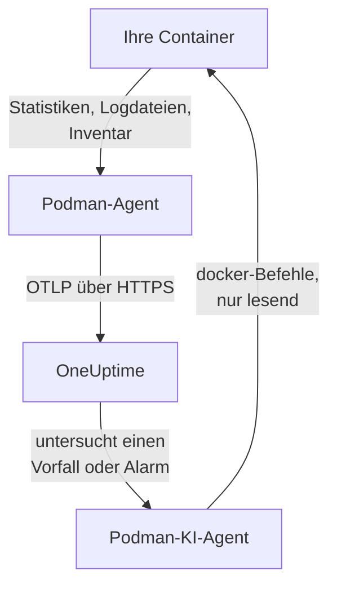

# Podman-Agent

Der OneUptime-Podman-Agent ist ein Container, den Sie auf einem Podman-Host ausführen. Er liest die Statistiken und Logdateien jedes Containers auf dem Host und sendet sie an OneUptime, wo der Host mit seinen Containern, Metriken und Logs erscheint. Ein zweiter Container, der Podman-KI-Agent, lässt OneUptime AI den Host untersuchen. [Podman-Monitore](/docs/monitor/podman-monitor) alarmieren anhand dessen, was der Agent sendet.

:::cards
- [Agent installieren](#agent-installieren): Zwei Container, mit `podman run` oder Podman Compose.
- [Was der Agent erfasst](#was-der-agent-erfasst): Metriken, Logs und ein Inventar aller Container.
- [Container-Logs brauchen k8s-file](#container-logs-brauchen-den-log-treiber-k8s-file): Podman protokolliert nach journald, sofern Sie nicht umstellen.
- [Fehlerbehebung](#fehlerbehebung): Neustartschleifen, fehlende Metriken, fehlende Logs.
:::

## So funktioniert es

Der Agent ist ein OpenTelemetry Collector mit eingebauter OneUptime-Konfiguration. Über den Docker-kompatiblen API-Socket von Podman liest er alle 30 Sekunden die Statistiken jedes Containers und listet alle 5 Minuten jeden Container, jedes Image, jedes Netzwerk und jedes Volume auf. Er verfolgt die Logdateien der Container und sendet alles per OTLP mit dem Ingestion-Schlüssel, den Sie ihm geben, an Ihre OneUptime-URL.



Der Host registriert sich mit seinen ersten Daten unter dem Namen, den Sie ihm in `PODMAN_HOST_NAME` geben. Der KI-Agent ist optional: Lassen Sie ihn weg, und der Collector funktioniert genauso.

## Bevor Sie beginnen

- Podman 4.0 oder neuer und Root-Zugriff auf dem Host.
- Der API-Socket von Podman unter `/run/podman/podman.sock`. Schalten Sie ihn mit `sudo systemctl enable --now podman.socket` ein.
- Ein Ingestion-Schlüssel. Legen Sie ihn unter **Projekteinstellungen → Telemetrie & APM → Ingestion-Schlüssel** an und kopieren Sie seinen Wert.
- Ausgehendes HTTPS vom Host zu Ihrer OneUptime-URL.
- Für Container-Logs Container, die den Log-Treiber `k8s-file` verwenden. Rootful Podman protokolliert standardmäßig nach `journald`, das der Agent nicht lesen kann. Siehe [Container-Logs brauchen den Log-Treiber k8s-file](#container-logs-brauchen-den-log-treiber-k8s-file).

## Agent installieren

:::steps
### Agent starten

Ersetzen Sie `YOUR_ONEUPTIME_URL` durch Ihre OneUptime-URL, `YOUR_TELEMETRY_INGESTION_TOKEN` durch den Ingestion-Schlüssel und `my-podman-host` durch einen Namen für diesen Host, etwa `prod-podman-01`. Unter diesem Namen erscheint der Host in OneUptime; halten Sie ihn also stabil: Ein neuer Name registriert einen neuen Host.

:::tabs
@tab Podman CLI
```bash
podman run -d \
  --name oneuptime-podman-agent \
  --user 0:0 \
  --restart unless-stopped \
  -v /run/podman/podman.sock:/run/podman/podman.sock:ro \
  -v /var/lib/containers/storage:/var/lib/containers/storage:ro \
  -e ONEUPTIME_URL="YOUR_ONEUPTIME_URL" \
  -e ONEUPTIME_SERVICE_TOKEN="YOUR_TELEMETRY_INGESTION_TOKEN" \
  -e PODMAN_HOST_NAME="my-podman-host" \
  oneuptime/podman-agent:release
```

Starten Sie dann den [KI-Agent](#ki-agent) daneben, mit denselben Werten. **KI-Untersuchungen sind standardmäßig aktiviert**: Während OneUptime AI einen Vorfall oder Alarm auf diesem Host untersucht, führt sie über den KI-Agent lesende `docker`-Befehle gegen die Docker-kompatible API von Podman aus und ändert nichts, sofern Sie keine Korrekturen erlauben. Um ohne KI-Untersuchungen zu installieren, lassen Sie diesen Befehl weg.

```bash
podman run -d \
  --name oneuptime-podman-ai-agent \
  --user 0:0 \
  --restart unless-stopped \
  --read-only --tmpfs /tmp \
  -v /run/podman/podman.sock:/run/podman/podman.sock:ro \
  -e ONEUPTIME_URL="YOUR_ONEUPTIME_URL" \
  -e ONEUPTIME_SERVICE_TOKEN="YOUR_TELEMETRY_INGESTION_TOKEN" \
  -e ONEUPTIME_AI_AGENT_RESOURCE_TYPE=podman \
  -e PODMAN_HOST_NAME="my-podman-host" \
  oneuptime/resource-ai-agent:release
```
@tab Podman Compose
Speichern Sie dies als `docker-compose.yml` in einem Ordner auf dem Host. Der zweite Dienst ist der [KI-Agent](#ki-agent): Lassen Sie ihn weg, um den Collector ohne KI-Untersuchungen auszuführen.

```yaml title="docker-compose.yml"
services:
  oneuptime-podman-agent:
    image: oneuptime/podman-agent:release
    container_name: oneuptime-podman-agent
    user: "0:0"
    restart: unless-stopped
    volumes:
      - /run/podman/podman.sock:/run/podman/podman.sock:ro
      - /var/lib/containers/storage:/var/lib/containers/storage:ro
    environment:
      - ONEUPTIME_URL=YOUR_ONEUPTIME_URL
      - ONEUPTIME_SERVICE_TOKEN=YOUR_TELEMETRY_INGESTION_TOKEN
      - PODMAN_HOST_NAME=my-podman-host
    logging:
      driver: json-file
      options:
        max-size: "10m"
        max-file: "3"
  oneuptime-podman-ai-agent:
    image: oneuptime/resource-ai-agent:release
    container_name: oneuptime-podman-ai-agent
    user: "0:0"
    restart: unless-stopped
    read_only: true
    tmpfs:
      - /tmp
    volumes:
      - /run/podman/podman.sock:/run/podman/podman.sock:ro
    environment:
      - ONEUPTIME_URL=YOUR_ONEUPTIME_URL
      - ONEUPTIME_SERVICE_TOKEN=YOUR_TELEMETRY_INGESTION_TOKEN
      - ONEUPTIME_AI_AGENT_RESOURCE_TYPE=podman
      - PODMAN_HOST_NAME=my-podman-host
```

Starten Sie ihn in diesem Ordner:

```bash
podman compose up -d
```
:::

### Prüfen, ob der Agent läuft

```bash
podman ps --filter name=oneuptime-podman-agent
podman logs -f oneuptime-podman-agent
```

Sobald der Collector gestartet ist, sollten die Logs diese Zeile zeigen:

```text
Everything is ready. Begin running and processing data.
```

### Den Host in OneUptime finden

Öffnen Sie **Produkte → Infrastruktur → Podman → Alle Hosts**. Der Host erscheint innerhalb etwa einer Minute unter seinem `PODMAN_HOST_NAME`, mit seinen Containern, Metriken und Logs. Der KI-Agent wird auf der Seite **KI-Agent** des Hosts und unten in seiner **Übersicht** als verbunden angezeigt.
:::

## Umgebungsvariablen

| Variable | Erforderlich | Beschreibung |
| --- | --- | --- |
| `ONEUPTIME_URL` | Ja | Ihre OneUptime-URL, etwa `https://oneuptime.com` oder Ihre selbst gehostete Instanz. Verwenden Sie `http://` und ihren Port, wenn die Instanz nur HTTP spricht. |
| `ONEUPTIME_SERVICE_TOKEN` | Ja | Der Ingestion-Schlüssel aus **Projekteinstellungen → Telemetrie & APM → Ingestion-Schlüssel**. |
| `PODMAN_HOST_NAME` | Nein | Der Name des Hosts in OneUptime. Standard ist `podman-host`; geben Sie daher jedem Host einen eigenen. |
| `DOCKER_API_VERSION` | Nein | Die Docker-API-Version, die der Agent mit dem Podman-Socket spricht. Standard ist `1.44`. Senken Sie sie, wenn der Socket ein älteres Maximum meldet, oder setzen Sie einen leeren Wert, um sie auszuhandeln (siehe [Fehlerbehebung](#fehlerbehebung)). |

Um einen Wert zu ändern, entfernen Sie den Agent und führen seinen Befehl erneut aus (Podman CLI), oder Sie bearbeiten `docker-compose.yml` und führen `podman compose up -d` aus (Podman Compose).

## Was der Agent erfasst

| Daten | Was es ist |
| --- | --- |
| Container-Metriken | CPU (Nutzung, Prozentsatz, Drosselung), Speicher (Nutzung, Limit, Prozentsatz), Netzwerk- und Block-I/O, Betriebszeit, Neustarts und Prozessanzahl, pro Container, alle 30 Sekunden. |
| Container-Logs | stdout und stderr jedes Containers, aus der Datei `ctr.log`, die der Log-Treiber `k8s-file` schreibt. |
| Inventar | Jeder Container in jedem Zustand sowie jedes Image, Netzwerk und Volume, alle 5 Minuten. |

Die Metriken und Logs jedes Containers werden unter einem Dienst abgelegt, der nach dem Container benannt ist. Jede Logzeile erhält einen Schweregrad aus der Stufe, die sie nennt, etwa `[ERROR]`, `level=warn` oder `{"level":"info"}`; eine Zeile ohne Stufe übernimmt die ihres Streams: stderr ist `ERROR`, stdout ist `INFO`. Zeilen, die mit Leerraum oder einer schließenden Klammer beginnen, werden an die vorherige Zeile angehängt, sodass ein Stacktrace als ein Datensatz ankommt. Die eigenen Logs des Agents werden weggelassen.

[Podman-Überwachung](/docs/monitor/podman-monitor#erfasste-metriken) listet jede Metrik und ihre Bedeutung auf.

## Container-Logs brauchen den Log-Treiber k8s-file

Der Agent verfolgt `/var/lib/containers/storage/overlay-containers/*/userdata/ctr.log`, die Dateien, die der Log-Treiber `k8s-file` von Podman schreibt (`json-file` ist in Podman derselbe Treiber). Der Standardtreiber von Rootful Podman ist `journald`, der keine Datei zum Lesen hinterlässt, und ebenso ein entfernter Treiber wie `syslog`. Die Metriken eines solchen Containers kommen weiterhin an, seine Logs nicht.

Prüfen Sie den Log-Treiber eines Containers und den Standard von Podman:

```bash
podman inspect <container> --format '{{.HostConfig.LogConfig.Type}}'
podman info --format '{{.Host.LogDriver}}'
```

Führen Sie einen Container mit `k8s-file` aus, oder stellen Sie einen Compose-Dienst darauf um:

```bash
podman run --log-driver k8s-file --log-opt max-size=100m ... <image>
```

```yaml
services:
  my-app:
    image: my-app:latest
    logging:
      driver: "k8s-file"
      options:
        max-size: "100m"
```

Oder machen Sie ihn in `containers.conf` zum Standard für jeden danach erstellten Container (`/etc/containers/containers.conf` rootful, `~/.config/containers/containers.conf` rootless):

```toml title="containers.conf"
[containers]
log_driver = "k8s-file"
log_size_max = 104857600
```

Erstellen Sie dann die Container neu. Ein Container behält den Log-Treiber, mit dem er erstellt wurde; ein Neustart reicht daher nicht.

## Agent aktualisieren

Ist der Agent älter als Ihr OneUptime, erscheint ein Warnzeichen neben **Agent-Version** in der **Übersicht** des Hosts. Wählen Sie es aus, um diese Befehle zu sehen.

:::tabs
@tab Podman CLI
```bash
podman pull oneuptime/podman-agent:release
podman pull oneuptime/resource-ai-agent:release
podman rm -f oneuptime-podman-agent oneuptime-podman-ai-agent
```

Führen Sie dann beide `podman run`-Befehle aus [Agent starten](#agent-starten) erneut aus.
@tab Podman Compose
```bash
podman compose pull
podman compose up -d
```
:::

Das Tag `release` zeigt immer auf das neueste Release. Um eine Version festzulegen, verwenden Sie `oneuptime/podman-agent:<version>`, etwa `oneuptime/podman-agent:10.0.31`. Dasselbe Image liegt in der GitHub Container Registry als `ghcr.io/oneuptime/podman-agent:release`.

## Agent deinstallieren

:::tabs
@tab Podman CLI
```bash
podman rm -f oneuptime-podman-agent
podman rm -f oneuptime-podman-ai-agent
```
@tab Podman Compose
```bash
podman compose down
```
:::

Der Host bleibt mit den gesendeten Daten in OneUptime. Wenn Sie ihn nicht mehr brauchen, löschen Sie ihn mit **Host löschen** in seinem Menü.

## KI-Agent

Die Befehle und die Compose-Datei oben, das `install.sh` des Podman-Agents und die `docker-compose.yml` in seinem [Verzeichnis PodmanAgent](https://github.com/OneUptime/oneuptime/tree/master/agents/PodmanAgent) führen alle den **Podman-KI-Agent** aus: einen zweiten Container, `oneuptime-podman-ai-agent` (Image `oneuptime/resource-ai-agent:release`), der die lesenden Befehle ausführt, die OneUptime AI anfordert, während sie einen Vorfall oder Alarm auf diesem Host untersucht — über die Docker-kompatible API von Podman, mit der CLI `docker`: `docker ps -a`, `docker logs --tail 200 web`, `docker container inspect web` — und, nur wenn Sie es erlauben, Korrekturen anwendet, etwa einen benannten Container neu zu starten. Er liest dieselben Werte `ONEUPTIME_URL`, `ONEUPTIME_SERVICE_TOKEN` und `PODMAN_HOST_NAME` wie der Collector, bedient also genau diesen Host und erscheint in OneUptime auf der Seite **KI-Agent** des Hosts.

- **KI-Untersuchungen sind standardmäßig aktiviert.** Sobald der Agent verbunden ist, untersucht OneUptime AI Vorfälle und Alarme auf diesem Host mit ihm, und die **Übersicht** des Hosts zeigt den Status des Agents an. Zum Beenden setzen Sie `ONEUPTIME_AI_INVESTIGATION=false` dort, wo der Agent läuft (**Ändern** unter **Was die KI tun darf** auf der Seite des KI-Agents zeigt, wie), oder lassen den Agent weg.
- Er ist schreibgeschützt, sofern Sie ihn nicht mit `ONEUPTIME_AI_ALLOW_WRITES=true` starten; `ONEUPTIME_AI_WRITE_TARGETS` (zum Beispiel `web-*,api-*`) begrenzt, welche Container eine Korrektur antasten darf. Starten Sie ihn außerdem mit `ONEUPTIME_AI_FIXES`, um festzulegen, wie Korrekturen ablaufen — `ask-for-approval` (ein Mensch genehmigt jede), `automatic` oder `bypass-approval` —, und die Seite des KI-Agents zeigt es schreibgeschützt an ([Was die KI tun darf, vom Agent festgelegt](/docs/ai/infrastructure-ai-agents#what-ai-may-do-set-by-the-agent)).
- Er braucht denselben Socket wie der Collector und läuft als root mit eingehängtem Socket, weil der Socket root gehört — und bei Rootful Podman ist, wer den Socket nutzen kann, root auf diesem Host, ob mit `:ro` oder nicht. Die Grenze ist die Befehlsrichtlinie des Agents: Er führt nie `exec`, `run`, `rm` oder `prune` aus und ändert nie sich selbst, den Collector oder etwas in `ONEUPTIME_AI_PROTECTED_TARGETS` (Globs für Containernamen).
- `install.sh --no-ai-agent` lässt ihn weg; `podman rm -f oneuptime-podman-ai-agent` entfernt ihn. Aktualisieren Sie ihn wie den Collector: `podman pull oneuptime/resource-ai-agent:release`, ihn entfernen und erneut starten.

Was er ausführen darf, wie Korrekturen funktionieren und wie Sie Fehler beheben: [Infrastructure AI Agents](/docs/ai/infrastructure-ai-agents#docker-and-podman-hosts).

## Fehlerbehebung

:::details Der Agent startet neu mit „client version is too new“
Die Logs des Agents zeigen:

```text
Error: cannot start pipelines: failed to start "docker_stats" receiver:
Error response from daemon: client version 1.44 is too new.
Maximum supported API version is 1.41
```

Ein Docker-API-Server, der eine maximale Client-Version erzwingt, lehnt eine neuere ab; der Receiver startet daher nie, und der Collector beendet sich mit ihm. Prüfen Sie die API-Version, die der Podman-Socket meldet:

```bash
curl -s -o /dev/null -D - --unix-socket /run/podman/podman.sock http://localhost/_ping | grep -i '^api-version'
```

Fügen Sie dann `-e DOCKER_API_VERSION=1.41` (oder den ermittelten Wert) zu `podman run` hinzu, oder setzen Sie `DOCKER_API_VERSION` in Compose. Neuere Server bedienen weiterhin ältere API-Versionen, daher bleibt die Einstellung nach einem Upgrade gültig.

Sie möchten die Zahl lieber nicht nachschlagen? Setzen Sie `DOCKER_API_VERSION` auf die leere Zeichenkette. Der Agent handelt die Version dann mit dem Socket aus (ein `HEAD /_ping`, dann das Maximum, das der Socket meldet), statt eine festzulegen:

```bash
podman run -d ... -e DOCKER_API_VERSION= ...
```
:::

:::details Podman-Socket: Zugriff verweigert, oder kein Socket
Der Agent muss als root laufen, um `/run/podman/podman.sock` zu lesen. Prüfen Sie, ob `--user 0:0` in Ihrem `podman run`-Befehl steht oder `user: "0:0"` in Compose, und ob der Socket aktiv ist: `sudo systemctl enable --now podman.socket`. Rootless Podman hat seinen Socket stattdessen unter `/run/user/<uid>/podman/podman.sock` (`systemctl --user enable --now podman.socket`): Hängen Sie diesen Pfad anstelle von `/run/podman/podman.sock` ein.
:::

:::details Der Host wird als getrennt angezeigt
1. Prüfen Sie, ob der Agent läuft: `podman ps --filter name=oneuptime-podman-agent`
2. Suchen Sie in seinen Logs nach Fehlern: `podman logs oneuptime-podman-agent 2>&1 | grep -i error`
3. Prüfen Sie `ONEUPTIME_URL` und `ONEUPTIME_SERVICE_TOKEN`: Der Schlüssel muss ein gültiger Ingestion-Schlüssel sein, der nicht deaktiviert wurde.
4. Prüfen Sie, ob der Host Ihre OneUptime-URL über das Netzwerk erreicht.
:::

:::details Es erscheinen keine Metriken
1. Prüfen Sie, ob der Podman-Socket in den Agent eingehängt ist. Sein Image hat keine Shell; sehen Sie daher aus einem Wegwerf-Container nach, der seine Mounts teilt: `podman run --rm --volumes-from oneuptime-podman-agent alpine:3.19 ls -la /run/podman/podman.sock`
2. Suchen Sie in seinen Logs nach Exportfehlern: `podman logs oneuptime-podman-agent 2>&1 | tail -100`
3. Prüfen Sie, ob der Ingestion-Schlüssel gültig und nicht abgelaufen ist.
:::

:::details Metriken kommen an, aber keine Container-Logs
Ihre Container verwenden höchstwahrscheinlich `journald`, den Standard-Log-Treiber von Podman. Prüfen Sie, welche Dateien der Agent beobachtet und welchen Treiber ein Container verwendet:

```bash
podman logs oneuptime-podman-agent 2>&1 | grep -E "Started watching file|no files match"
podman inspect <container> --format '{{.HostConfig.LogConfig.Type}}'
```

Meldet der Agent `no files match the configured criteria`, stellen Sie die Container auf `k8s-file` um und erstellen sie neu, wie [Container-Logs brauchen den Log-Treiber k8s-file](#container-logs-brauchen-den-log-treiber-k8s-file) zeigt.
:::

:::details Die Logs liegen bei einem anderen Host, oder der Host heißt podman-host
Der Name des Hosts kommt aus `PODMAN_HOST_NAME`. Ein ohne ihn gestarteter Agent meldet `podman-host`, sodass jeder so eingerichtete Host wie derselbe aussieht; ändern Sie den Namen später, registriert OneUptime einen zweiten Host, der dann die neuen Daten enthält. Setzen Sie `PODMAN_HOST_NAME` auf jedem Host auf einen eigenen Namen und erstellen Sie den Agent neu. So prüfen Sie den Namen, den der Agent meldet:

```bash
podman inspect oneuptime-podman-agent --format '{{range .Config.Env}}{{println .}}{{end}}' | grep PODMAN_HOST_NAME
```
:::

## Nächste Schritte

:::cards
- [Podman-Überwachung](/docs/monitor/podman-monitor): Alarmieren bei CPU, Speicher und Neustarts von Containern.
- [Datenbanken](/docs/telemetry/databases): Datenbank-Container auf dem Host werden gefunden und erhalten eigene Seiten.
- [Kubernetes-Agent](/docs/telemetry/kubernetes-agent): Stattdessen einen Kubernetes-Cluster überwachen.
- [Host-OpenTelemetry-Collector](/docs/telemetry/host-otel-collector): Den Rechner selbst überwachen: CPU, Datenträger, Prozesse und Logs.
:::
