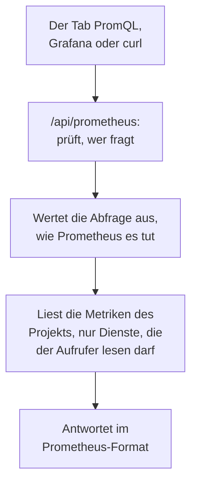

# Metriken mit PromQL abfragen

PromQL ist die Abfragesprache von Prometheus, und die meisten, die Metriken in Diagrammen darstellen, kennen sie bereits. OneUptime liest die Metriken Ihres Projekts damit: im Tab **PromQL** der Seite Metriken und über eine Prometheus-kompatible API, die Grafana oder jedes andere Tool mit einer Prometheus-Datenquelle ansprechen kann.

:::cards
- [Eine Abfrage schreiben](#eine-abfrage-schreiben): PromQL auf der Seite Metriken ausführen und ein Diagramm oder eine Tabelle sehen.
- [Wie Metriken benannt werden](#wie-metriken-benannt-werden): Wie OpenTelemetry-Namen und -Attribute in PromQL lauten.
- [Grafana verbinden](#grafana-verbinden): OneUptime als Prometheus-Datenquelle hinzufügen.
- [Grenzen](#grenzen): Was eine Abfrage lesen darf, und wie lange.
:::

## So funktioniert es

Der Tab PromQL und Grafana fragen dieselbe API ab. OneUptime prüft, ob der Aufrufer die Metriken des Projekts lesen darf, liest nur die Dienste, die er lesen darf, und wertet die Abfrage so aus, wie Prometheus es tut.



## Bevor Sie beginnen

- **Eintreffende Metriken.** Senden Sie sie mit [OpenTelemetry](/docs/telemetry/open-telemetry) oder von einem Agenten wie dem [Host-OpenTelemetry-Collector](/docs/telemetry/host-otel-collector).
- **Eine Rolle, die Metriken lesen darf.** Project Owner, Project Admin, Project Member, Viewer, Telemetry Admin, Telemetry Member oder Telemetry Viewer, oder eine eigene Rolle mit der Berechtigung Read Metrics. Eine Rolle, die auf einige Dienste beschränkt ist, liest nur deren Metriken.
- **Für Grafana oder ein Skript: ein API-Schlüssel des Projekts** mit einer dieser Rollen oder der Berechtigung Read Metrics. Siehe [Einen API-Schlüssel erstellen](/docs/api-reference/api-reference#einen-api-schlüssel-erstellen). In OneUptime Cloud brauchen API-Schlüssel den Tarif **Growth**.

## Eine Abfrage schreiben

:::steps
### PromQL öffnen

Öffnen Sie **Metriken** und klicken Sie auf den Tab **PromQL**.

### Die Abfrage schreiben

Geben Sie sie im Editor ein, wählen Sie unter **Beispiele** ein Beispiel, oder beginnen Sie mit **Metriknamen einfügen**, das die Metriken Ihres Projekts so auflistet, wie PromQL sie benennt.

### Ausführen

Klicken Sie auf **Abfrage ausführen** oder drücken Sie Strg+Enter (⌘+Enter auf einem Mac). **Diagramm** zeichnet die Abfrage über den Zeitraum; **Tabelle** zeigt den Wert jeder Reihe am Ende des Zeitraums.
:::

Ein paar Abfragen für den Anfang:

```text title="PromQL"
# Requests per second, by service
sum by (job) (rate(http_requests_total[5m]))

# The 95th percentile of a latency histogram
histogram_quantile(0.95, sum by (le) (rate(http_server_request_duration_bucket[5m])))

# The five hosts using the most memory
topk(5, system_memory_usage)
```

Bei einer Abfrage, die nicht läuft, zeigt der Editor, was schiefgegangen ist und wo: `rate(http_requests_total)` meldet zum Beispiel, dass die Funktion einen Bereich wie `[5m]` braucht.

## Wie Metriken benannt werden

OneUptime speichert Metriken im Stil von OpenTelemetry. PromQL liest sie mit den Namen, die ihnen die in Prometheus eingebaute OpenTelemetry-Unterstützung gibt, sodass eine für Prometheus geschriebene Abfrage hier funktioniert:

| In OneUptime | In PromQL |
| --- | --- |
| Ein Gauge `system.cpu.utilization` | `system_cpu_utilization` |
| Ein Zähler `http.requests` | `http_requests` oder `http_requests_total` |
| Ein Histogramm `http.server.request.duration` | `http_server_request_duration_bucket` (mit `le`), `_count` und `_sum` |
| Eine Summary `rpc.latency` | `rpc_latency` (mit `quantile`), `_count` und `_sum` |
| Ein Attribut `http.route` | Das Label `http_route` |
| Ein Ressourcenattribut `service.name` | Das Label `resource_service_name` und `job` |
| Ein Ressourcenattribut `service.instance.id` | Das Label `resource_service_instance_id` und `instance` |

- **Punkte und Bindestriche werden zu Unterstrichen**, in Metrik- wie in Label-Namen. Um den Namen einer Metrik oder eines Labels genau so zu schreiben, wie er gespeichert ist, setzen Sie ihn in Anführungszeichen, wie Prometheus 3 es tut: `{"http.server.request.duration", "http.route"="/checkout"}`.
- **Delta-Zähler werden aufaddiert**, ab dem Beginn des Zeitraums der Abfrage, sodass `rate()` und `increase()` sie wie jeden anderen Zähler lesen.
- **Exponentielle Histogramme** haben `_count` und `_sum`, aber keine Buckets.

## Grafana verbinden

:::steps
### Einen API-Schlüssel erstellen

Öffnen Sie in OneUptime **Projekteinstellungen → Erweitert → API-Schlüssel** und klicken Sie auf **API-Schlüssel erstellen**. Geben Sie dem Schlüssel eine Rolle, die Telemetrie lesen darf, oder die Berechtigung Read Metrics.

### Eine Prometheus-Datenquelle hinzufügen

Öffnen Sie in Grafana **Connections → Data sources → Add data source** und wählen Sie **Prometheus**.

### Die Server-URL eingeben

Setzen Sie **Prometheus server URL** auf Ihre OneUptime-Adresse, gefolgt von `/api/prometheus`. In OneUptime Cloud ist das `https://oneuptime.com/api/prometheus`. Der Tab **PromQL** zeigt die Adresse Ihres eigenen Servers, mit einer Schaltfläche zum Kopieren.

### Den API-Schlüssel senden

Fügen Sie unter **HTTP headers** den Header `Authorization` hinzu, mit dem Wert `Bearer`, gefolgt von einem Leerzeichen und Ihrem API-Schlüssel. Basic-Authentifizierung funktioniert auch: ein beliebiger Benutzername, mit dem API-Schlüssel als Passwort.

### Speichern und testen

Klicken Sie auf **Save & test**. Grafana führt eine Abfrage aus und meldet, dass die Datenquelle funktioniert.
:::

Jeder andere Prometheus-Client funktioniert genauso. Mit curl:

```bash title="Query OneUptime's Prometheus API"
curl -H "Authorization: Bearer $ONEUPTIME_API_KEY" \
  "https://oneuptime.com/api/prometheus/api/v1/query?query=up"
```

## Die API

Die API beantwortet die Routen der Prometheus-HTTP-API, mit `GET` oder `POST`, unter `/api/prometheus`:

| Route | Was sie beantwortet |
| --- | --- |
| `/api/v1/query` | Eine Abfrage zu einem Zeitpunkt (`time`, standardmäßig jetzt). |
| `/api/v1/query_range` | Eine Abfrage bei jedem `step` von `start` bis `end`. |
| `/api/v1/series` | Die Reihen, die `match[]` auswählt. |
| `/api/v1/labels` | Label-Namen, der Reihen, die `match[]` auswählt, oder aller Metriken. |
| `/api/v1/label/<name>/values` | Die Werte eines Labels. `__name__` listet die Metriknamen. |
| `/api/v1/metadata` | Typ, Hilfetext und Einheit jeder Metrik. |

Zeitpunkte sind Unix-Sekunden oder RFC 3339, Zeitspannen sind Sekunden oder eine Dauer wie `15s`, und die Antworten haben das Format von Prometheus. `/api/v1/status/buildinfo` antwortet wie ein Prometheus-3-Server; Regeln und Warnungen sind leer, weil OneUptime mit [Monitoren](/docs/monitor/metrics-monitor) warnt.

## Was PromQL abdeckt

- **Selektoren** mit jedem Matcher (`=`, `!=`, `=~`, `!~`), Bereiche, `offset`, `@` (mit `start()` und `end()`) und Unterabfragen.
- **Operatoren**: Arithmetik, Vergleiche (mit `bool`), `and`, `or`, `unless` sowie Vektorabgleich mit `on`, `ignoring`, `group_left` und `group_right`.
- **Aggregationen**: `sum`, `avg`, `min`, `max`, `count`, `group`, `stddev`, `stdvar`, `topk`, `bottomk`, `quantile` und `count_values`, mit `by` oder `without`.
- **Funktionen**: `rate`, `irate`, `increase`, `delta`, `idelta`, `deriv`, `predict_linear`, `histogram_quantile`, jede `*_over_time`-Funktion, `changes`, `resets`, `absent`, `label_replace`, `label_join`, `sort`, `clamp`, `round`, die Mathematik- und Datumsfunktionen und mehr.

Die Funktionen für native Histogramme von Prometheus, etwa `histogram_count()`, sind nicht verfügbar: OneUptime speichert Histogramme mit Buckets; gelesen werden sie mit `histogram_quantile()` und über die Reihen `_count` und `_sum`.

## Grenzen

Jede Abfrage ist begrenzt, damit ein Dashboard mit vielen Panels OneUptime nicht überlasten kann:

| Grenze | Wert |
| --- | --- |
| Punkte in einer Reihe einer Bereichsabfrage | 11.000 |
| Samples, die eine Abfrage lesen und im Speicher halten darf | 5.000.000 |
| Metrikpunkte, die ein Selektor lesen darf | 1.000.000 |
| Zeit, die ein Lesevorgang dauern darf | 30 Sekunden |
| Zeit, die die Auswertung dauern darf | 30 Sekunden |
| Wie weit ein Selektor nach dem letzten Sample einer Reihe zurückschaut | 5 Minuten |
| Die Schrittweite einer Unterabfrage, wenn die Abfrage sie weglässt | 1 Minute |

## Fehlerbehebung

:::details Grafana meldet, dass die Datenquelle nicht funktioniert
Prüfen Sie, ob die URL auf `/api/prometheus` endet und ob der Header `Authorization` `Bearer`, ein Leerzeichen und den API-Schlüssel enthält. Ein Schlüssel ohne Rolle, die Metriken lesen darf, wird abgelehnt: Geben Sie ihm eine unter **Projekteinstellungen → Erweitert → API-Schlüssel**.
:::

:::details Eine Metrik aus dem Explorer liefert nichts
Ihr PromQL-Name hat Unterstriche, wo der gespeicherte Name Punkte hat, und ein Histogramm wird über `_bucket`, `_count` oder `_sum` gelesen. **Metriknamen einfügen** im Tab PromQL listet jeden Namen so auf, wie PromQL ihn schreibt.
:::

:::details "The query reads more than 1,000,000 metric points"
Die Abfrage verlangt mehr, als ein Lesevorgang fassen darf. Fügen Sie Label-Matcher hinzu, verkürzen Sie den Zeitraum oder verwenden Sie eine größere Schrittweite.
:::

## Nächste Schritte

:::cards
- [Metrik-Explorer](/docs/telemetry/metrics-explorer): Metriken in Diagrammen darstellen, ohne eine Abfrage zu schreiben.
- [Metriken-Überwachung](/docs/monitor/metrics-monitor): Benachrichtigt werden, wenn eine Metrik einen Schwellenwert überschreitet.
- [Externe Datenquellen](/docs/dashboards/data-sources): Ein externes Prometheus in Ihren Dashboards darstellen.
:::
