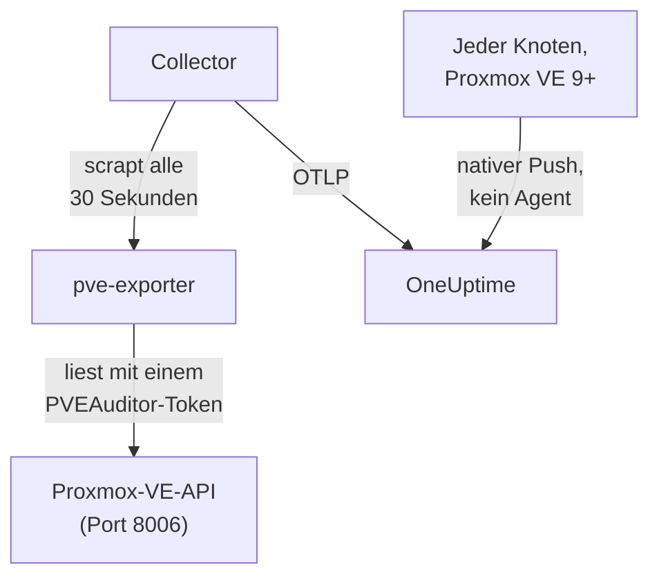

# Proxmox-Agent

Der OneUptime-Proxmox-Agent überwacht einen Proxmox-VE-Cluster: seine Knoten, QEMU-VMs, LXC-Container, den Speicher, den HA-Zustand, die Backup-Abdeckung und die Replikation. Er liest den Cluster über die Proxmox-VE-API mit einem schreibgeschützten Token und sendet, was er findet, an OneUptime, wo der Cluster mit seinen Knoten, Gästen und seinem Speicher erscheint. Ab Proxmox VE 9 können die Knoten ihre eigenen Metriken auch selbst senden, ohne dass etwas zu installieren ist. [Proxmox-Monitore](/docs/monitor/proxmox-monitor) alarmieren anhand dessen, was ankommt.

:::cards
- [Verbindungsweg wählen](#verbindungsweg-wählen): Der Agent oder der eigene Push von Proxmox VE 9.
- [Agent installieren](#agent-installieren): Ein API-Token, dann das Installationsskript oder Docker Compose.
- [Nativer Push](#alternative-ohne-installation-nativer-opentelemetry-push-ab-proxmox-ve-9): Proxmox VE 9 sendet seine Metriken selbst.
- [Fehlerbehebung](#fehlerbehebung): Ein Diagnoseskript und die üblichen Probleme.
:::

## So funktioniert es

Der Agent ist eine Reihe von Containern, die Sie mit Docker Compose auf einem Rechner ausführen: [prometheus-pve-exporter](https://github.com/prometheus-pve/prometheus-pve-exporter) liest die Proxmox-VE-API auf Port 8006, ein OpenTelemetry Collector scrapt den Exporter alle 30 Sekunden und versieht jede Metrik mit dem Namen Ihres Clusters, und der Proxmox-KI-Agent lässt OneUptime AI den Cluster lesen, während sie untersucht. Der native Push von Proxmox VE 9 sendet die Metriken jedes Knotens stattdessen direkt an OneUptime.



Der Cluster registriert sich mit seinen ersten Daten unter dem Namen, den der Agent als `proxmox.cluster.name` an jede Metrik hängt.

## Verbindungsweg wählen

| | Der Agent | Nativer Push |
| --- | --- | --- |
| Proxmox VE | Jede unterstützte Version | 9.0 oder neuer |
| Zu installieren | Docker Compose auf einem Rechner | Nichts: ein Metrikserver in der Proxmox-Weboberfläche |
| Knoten, Gäste und Speicher | Ja | Ja |
| HA-Zustand, Start beim Booten, Backup-Abdeckung und Replikation | Ja | Nein |
| Proxmox-KI-Agent | Ja | Nein |

Die Vorlagen **HA Resource in Error State**, **Guest Down**, **Guest Not Backed Up** und **Replication Failing** brauchen den Agent. Verwenden Sie für einen Cluster das eine oder das andere: Beides zu betreiben meldet jede Ressource doppelt.

## Bevor Sie beginnen

- Docker Engine 20.10 oder neuer mit dem Plugin Docker Compose v2, auf einem Rechner, der die Proxmox-VE-API auf Port 8006 erreicht.
- Eine Root-Shell auf einem beliebigen Proxmox-VE-Knoten oder die Proxmox-Weboberfläche, um ein API-Token anzulegen.
- Ein Ingestion-Schlüssel. Legen Sie ihn unter **Projekteinstellungen → Telemetrie & APM → Ingestion-Schlüssel** an und kopieren Sie seinen Wert.
- Ausgehendes HTTPS von diesem Rechner zu Ihrer OneUptime-URL.

### Wo der Agent laufen sollte

Der Agent fragt die Proxmox-VE-API über das Netzwerk ab; er muss daher nicht auf einem Clusterknoten laufen und sollte es auch nicht: Führen Sie ihn auf einem Rechner aus, der den Ausfall eines Knotens übersteht (eine kleine Monitoring-VM auf separater Hardware, ein Management-Host), oder verweisen Sie `PVE_HOST` auf eine virtuelle IP oder einen Round-Robin-DNS-Namen statt auf die Adresse eines einzelnen Knotens. Ist das API-Ziel des Agents genau der Knoten, der gerade ausgefallen ist, fällt Ihr Monitoring mit ihm aus. Die einzige Ausnahme ist die optionale Log-Pipeline für journald, die auf einem Proxmox-VE-Knoten laufen muss (siehe [Proxmox-Dienstlogs senden](#optional-proxmox-dienstlogs-senden)).

## Agent installieren

:::steps
### Ein schreibgeschütztes API-Token anlegen

Der Agent liest den Cluster mit einem API-Token, das die Rolle **PVEAuditor** hat, die lesen kann und sonst nichts.

:::tabs
@tab Shell
Als root auf einem beliebigen Proxmox-VE-Knoten:

```bash
pveum user add monitoring@pam
pveum acl modify / --roles PVEAuditor --users monitoring@pam
pveum user token add monitoring@pam oneuptime --privsep 1
pveum acl modify / --roles PVEAuditor --tokens 'monitoring@pam!oneuptime'
```

Der erste Befehl scheitert nur, und zwar harmlos, wenn `monitoring@pam` bereits existiert: API-Tokens tragen ihr eigenes Secret, daher braucht der Benutzer weder Passwort noch Systemkonto. `pveum user token add` gibt das Token-Secret einmal aus; die Token-ID ist `monitoring@pam!oneuptime`.
@tab Proxmox web UI
1. Gehen Sie zu *Datacenter → Permissions → API Tokens* und klicken Sie auf **Add**.
2. Wählen (oder erstellen) Sie einen Benutzer, geben Sie dem Token eine ID wie `oneuptime` und lassen Sie **Privilege Separation** aktiviert.
3. Kopieren Sie die Token-ID (`user@realm!tokenname`) und das Secret: Das Secret wird nur einmal angezeigt.
4. Fügen Sie unter *Datacenter → Permissions* die Rolle **PVEAuditor** auf dem Pfad `/` zweimal hinzu: einmal als **API Token Permission** für das Token, einmal als **User Permission** für seinen Benutzer.
:::

Die Rolle gehört an den Benutzer wie an das Token, weil ein Token mit Privilege Separation nur die Rechte erhält, die auch sein Benutzer hat. Sie muss auf dem Wurzelpfad `/` liegen, weil der Exporter jedes Knoten-, Gast- und Speicherobjekt liest: Ein engerer Pfad verbirgt den Rest des Clusters und scheitert mit `401`/`403 Permission check failed (/, Sys.Audit)`.

### Den Agent installieren und starten

:::tabs
@tab install.sh
Laden Sie das Installationsskript herunter und führen Sie es auf dem Rechner aus, auf dem der Agent laufen soll:

```bash
curl -sSL https://raw.githubusercontent.com/OneUptime/oneuptime/master/agents/ProxmoxAgent/install.sh -o install.sh
bash install.sh
```

Das Skript fragt nach Ihrer OneUptime-URL, dem Ingestion-Schlüssel, einem Namen für den Cluster, dem Host der Proxmox-VE-API, ob der mitgelieferte Exporter laufen soll, sowie nach Token-ID und Secret — und ob der [KI-Agent](#ki-agent) Korrekturen anwenden darf, und wenn ja, nach einem eigenen Token für ihn und den Gästen, die er nie ändern darf. Es installiert nach `/opt/oneuptime-proxmox-agent`, schreibt eine `.env`-Datei mit `0600` und startet den Agent mit Docker Compose. Ein erneuter Lauf des Skripts verwendet alles in dieser `.env` wieder, statt erneut zu fragen; so [aktualisieren Sie den Agent](#agent-aktualisieren).
@tab Docker Compose
Laden Sie `docker-compose.yml` und `otel-collector-config.yaml` aus dem [Verzeichnis ProxmoxAgent](https://github.com/OneUptime/oneuptime/tree/master/agents/ProxmoxAgent) in einen neuen Ordner herunter:

```bash
mkdir oneuptime-proxmox-agent && cd oneuptime-proxmox-agent
curl -fsSLO https://raw.githubusercontent.com/OneUptime/oneuptime/master/agents/ProxmoxAgent/docker-compose.yml
curl -fsSLO https://raw.githubusercontent.com/OneUptime/oneuptime/master/agents/ProxmoxAgent/otel-collector-config.yaml
```

Legen Sie daneben eine Datei `.env` an. Sie enthält das Token-Secret; schützen Sie sie daher mit `chmod 600 .env`:

```bash title=".env"
ONEUPTIME_URL=YOUR_ONEUPTIME_URL
ONEUPTIME_TELEMETRY_INGESTION_KEY=YOUR_TELEMETRY_INGESTION_TOKEN
PROXMOX_CLUSTER_NAME=my-proxmox-cluster
PVE_HOST=192.168.1.10
PVE_API_TOKEN_ID=monitoring@pam!oneuptime
PVE_API_TOKEN_SECRET=your-token-secret
COMPOSE_PROFILES=pve-exporter
```

`COMPOSE_PROFILES=pve-exporter` startet zusätzlich den mitgelieferten Exporter. Starten Sie den Agent:

```bash
docker compose up -d
```
:::

Betreiben Sie bereits prometheus-pve-exporter? Antworten Sie mit **n**, wenn das Skript fragt, ob der mitgelieferte laufen soll, oder entfernen Sie `COMPOSE_PROFILES` aus `.env`, und verweisen Sie den Agent auf Ihren (`host:port`, ohne Schema, eine Adresse, die der Container des Agents erreicht: `localhost` ist der Container selbst). Behalten Sie `PVE_API_TOKEN_ID` und `PVE_API_TOKEN_SECRET`, wenn Sie den [KI-Agent](#ki-agent) verwenden, der die API mit diesem Token aufruft:

```bash
PVE_EXPORTER_URL=your-exporter-host:9221
```

### Prüfen, ob der Agent läuft

```bash
docker compose ps
docker logs -f oneuptime-proxmox-agent
```

`docker compose ps` listet den Collector (`oneuptime-proxmox-agent`), den mitgelieferten Exporter (`oneuptime-pve-exporter`, sofern Sie nicht Ihren eigenen verwenden) und den KI-Agent (`oneuptime-proxmox-ai-agent`) auf. Sobald der Collector gestartet ist, sollten seine Logs diese Zeile zeigen:

```text
Everything is ready. Begin running and processing data.
```

### Den Cluster in OneUptime finden

Öffnen Sie **Produkte → Infrastruktur → Proxmox → Alle Cluster**. Der Cluster erscheint etwa eine Minute nach dem ersten Scrape unter seinem `PROXMOX_CLUSTER_NAME`, mit seinen Knoten, Gästen und seinem Speicher.
:::

## Umgebungsvariablen

Das Installationsskript schreibt diese nach `/opt/oneuptime-proxmox-agent/.env`; eine Docker-Compose-Installation liest sie aus der `.env` neben `docker-compose.yml`. Nachdem Sie einen Wert geändert haben, führen Sie in diesem Ordner `docker compose up -d` aus.

| Variable | Erforderlich | Beschreibung |
| --- | --- | --- |
| `ONEUPTIME_URL` | Ja | Ihre OneUptime-URL, etwa `https://oneuptime.com` oder Ihre selbst gehostete Instanz. Verwenden Sie `http://` und ihren Port, wenn die Instanz nur HTTP spricht. |
| `ONEUPTIME_TELEMETRY_INGESTION_KEY` | Ja | Der Ingestion-Schlüssel aus **Projekteinstellungen → Telemetrie & APM → Ingestion-Schlüssel**. |
| `PROXMOX_CLUSTER_NAME` | Ja | Der Name des Clusters in OneUptime, an jede Metrik als Ressourcenattribut `proxmox.cluster.name` gehängt. Halten Sie ihn stabil: Eine spätere Änderung registriert einen zweiten Cluster. Standard ist `proxmox-cluster`. |
| `PVE_HOST` | Ja | Der Host der Proxmox-VE-API (ein beliebiger Knoten des Clusters), den der Exporter und der KI-Agent abfragen, etwa `192.168.1.10`. |
| `PVE_EXPORTER_URL` | Nein | Die Adresse (`host:port`, ohne Schema) von prometheus-pve-exporter. Standard ist der mitgelieferte Exporter, `pve-exporter:9221`. |
| `PVE_API_TOKEN_ID` | Mitgelieferter Exporter oder KI-Agent | Die vollständige ID des Proxmox-API-Tokens, etwa `monitoring@pam!oneuptime`. Der KI-Agent liest die API damit, sofern er kein eigenes Token hat (`ONEUPTIME_AI_PVE_API_TOKEN_ID` / `ONEUPTIME_AI_PVE_API_TOKEN_SECRET`). |
| `PVE_API_TOKEN_SECRET` | Mitgelieferter Exporter oder KI-Agent | Das Secret des Proxmox-API-Tokens. |
| `PVE_VERIFY_SSL` | Nein | Das TLS-Zertifikat der Proxmox-API prüfen (Exporter und KI-Agent). Standard ist `false`, weil Proxmox selbstsignierte Zertifikate mitbringt. |
| `COMPOSE_PROFILES` | Nein | Auf `pve-exporter` setzen, um den mitgelieferten Exporter-Container zu starten. |

## Was der Agent erfasst

Der Collector scrapt den Exporter alle 30 Sekunden mit eingeschalteten Cluster- und Knoten-Collectors; das deckt auch die standardmäßig aktiven Collectors `backup-info` (Clusterebene) und `replication` (Knotenebene) des Exporters ab. Jede Serie trägt ein Label `id`, das die Ressource benennt: `node/<name>`, `qemu/<vmid>`, `lxc/<vmid>` oder `storage/<node>/<storage>`.

| Kategorie | Metriken |
| --- | --- |
| Verfügbarkeit | `pve_up`, `pve_uptime_seconds` |
| Knoten | `pve_node_info`, `pve_cpu_usage_ratio`, `pve_cpu_usage_limit`, `pve_memory_usage_bytes`, `pve_memory_size_bytes` |
| Gast (VM oder LXC) | `pve_guest_info` sowie CPU-, Speicher- und Netzwerkserien auf den IDs `qemu/*` und `lxc/*` (`pve_network_receive_bytes`, `pve_network_transmit_bytes`) |
| Speicher | `pve_disk_usage_bytes`, `pve_disk_size_bytes`, `pve_storage_info` |
| HA | `pve_ha_state` |
| Backup-Abdeckung | `pve_not_backed_up_total` (die Gäste, die kein Backup-Job abdeckt; eine Serie auf Clusterebene, ohne Label `id`) und `pve_not_backed_up_info` (eine Serie pro nicht abgedecktem Gast, mit seiner `id`). Abgedeckt heißt, dass mindestens ein Job den Gast auswählt: Ob Backups kürzlich liefen oder erfolgreich waren, gibt der Exporter nicht preis. |
| Replikation | `pve_replication_failed_syncs`, `pve_replication_duration_seconds`, `pve_replication_last_sync_timestamp_seconds`, `pve_replication_last_try_timestamp_seconds`, `pve_replication_next_sync_timestamp_seconds`, `pve_replication_info`, pro Speicher-Replikationsjob. Ihr Label `id` ist die Job-ID (etwa `100-0`), keine Ressource. |

Monitorkriterien und Attributfilter vergleichen auf Gleichheit, nicht auf ein Präfix; der Processor `transform/pve-identity` des Collectors teilt `id` daher zusätzlich in drei Attribute auf. Die eingebauten Proxmox-Alarmvorlagen filtern darauf; behalten Sie den Processor also, wenn Sie die Konfiguration anpassen:

| Attribut | Werte | Für `qemu/100` |
| --- | --- | --- |
| `pve.scope` | `node`, `guest`, `storage`, `cluster` (`qemu` und `lxc` sind beide `guest`) | `guest` |
| `pve.type` | `node`, `qemu`, `lxc`, `storage` | `qemu` |
| `pve.id` | Alles nach dem ersten `/` von `id` (`pve1`, `100`, `pve1/local`) | `100` |

Das ursprüngliche Label `id` bleibt unverändert erhalten.

## Optional — Proxmox-Dienstlogs senden

Standardmäßig sendet der Agent nur Metriken, daher bleibt die Seite **Protokolle** des Clusters leer. Die Dienste von Proxmox VE protokollieren unter acht Units in das systemd-Journal: `pveproxy`, `pvedaemon`, `pve-firewall`, `pve-ha-crm`, `pve-ha-lrm`, `pvescheduler`, `pvestatd` und `qmeventd`. Die mitgelieferte `otel-collector-config.yaml` enthält einen auskommentierten Receiver `journald` für genau diese Units, verbunden mit einer auskommentierten Pipeline `logs`, die `proxmox.cluster.name` anhängt, damit die Logs bei Ihrem Cluster landen.

:::steps
### Den Agent auf einem Knoten ausführen

Das Journal gibt es pro Host, daher kann ein entfernter Agent es nicht lesen. Das ist die einzige Einrichtung, die [Wo der Agent laufen sollte](#wo-der-agent-laufen-sollte) widerspricht: Um den Metrik-Agent vom Cluster fernzuhalten, führen Sie stattdessen einen zweiten, reinen Log-Collector auf dem Knoten aus (kopieren Sie die Konfiguration und löschen Sie dann den Receiver `prometheus` und die Pipeline `metrics`).

### Den Receiver einschalten

Kommentieren Sie den Receiver `journald` und die Pipeline `logs` in `otel-collector-config.yaml` sowie die Journal-Volumes in `docker-compose.yml` ein, damit der Container das Journal des Hosts lesen kann:

```yaml
- /var/log/journal:/var/log/journal:ro
- /etc/machine-id:/etc/machine-id:ro
```

### Das Collector-Image austauschen

Das Standard-Image `otel/opentelemetry-collector-contrib` ist `FROM scratch` gebaut: Es hat kein `journalctl`, das der journald-Receiver ausführt, und läuft als Benutzer, der das Journal nicht lesen kann. Bauen Sie diesen Wrapper und verweisen Sie `image:` in `docker-compose.yml` darauf:

```dockerfile title="Dockerfile"
FROM otel/opentelemetry-collector-contrib:0.161.0 AS otelcol
FROM debian:stable-slim
RUN apt-get update \
    && apt-get install -y --no-install-recommends systemd \
    && rm -rf /var/lib/apt/lists/*
COPY --from=otelcol /otelcol-contrib /otelcol-contrib
ENTRYPOINT ["/otelcol-contrib"]
CMD ["--config", "/etc/otelcol-contrib/config.yaml"]
```

Das Paket `systemd` ist nur wegen `journalctl` dabei, und dieses Image läuft als root, der das Journal lesen kann. Oder verzichten Sie für die Logs auf Docker und führen Sie das Release-`.deb` von `otelcol-contrib` auf dem Knoten selbst aus, wo `journalctl` bereits vorhanden ist.
:::

Jeder Knoten sendet nur sein eigenes Journal: Für Dienstlogs aller Knoten führen Sie den reinen Log-Collector auf jedem Knoten aus.

### Ausweichlösung ohne eigenes Image: filelog auf /var/log/syslog

Um das Standard-Image zu behalten, verfolgen Sie stattdessen syslog. Installieren Sie rsyslog auf dem Knoten (`apt install rsyslog`; Debian 12 und Proxmox VE ab 8 liefern es nicht mehr mit), hängen Sie das Verzeichnis `/var/log` in den Container ein (`- /var/log:/var/log:ro`; das Verzeichnis, nicht die Datei, damit die Logrotation keine veraltete Datei festhält), und verwenden Sie einen Receiver `filelog` anstelle des journald-Receivers:

```yaml
receivers:
  filelog:
    include:
      - /var/log/syslog
    start_at: end
```

Sie verlieren den Filter pro Unit (syslog enthält alles, nicht nur die acht Dienste), und der Benutzer des Standard-Images muss die Datei lesen können. Binden Sie ihn in dieselbe auskommentierte Pipeline `logs` ein (`receivers: [filelog]`).

## Alternative ohne Installation: nativer OpenTelemetry-Push ab Proxmox VE 9+

Ab Proxmox VE 9.0 gibt es einen OpenTelemetry-Metrikserver, der Knoten-, Gast- und Speichermetriken an jeden OTLP/HTTP-Endpunkt sendet, ohne dass ein Agent oder Exporter zu installieren ist. Gehen Sie in der Proxmox-Weboberfläche zu *Datacenter → Metric Server → Add → OpenTelemetry* und füllen Sie aus:

| Feld | Wert |
| --- | --- |
| Server | Ihr OneUptime-Host, etwa `oneuptime.com`, oder Ihr selbst gehosteter Host |
| Port | `443` |
| Protocol | `https` |
| Path | `/otlp/v1/metrics` |
| Headers | `{"x-oneuptime-token": "YOUR_TELEMETRY_INGESTION_TOKEN"}` |

Fügen Sie ihn einmal hinzu: Jeder Knoten des Clusters sendet seine eigenen Metriken. OneUptime erkennt den Push und übersetzt ihn in dieselben `pve_*`-Serien, die der Agent sendet; daher gilt:

- Der Cluster registriert sich unter Ihrem Proxmox-Clusternamen (ein einzelner Knoten unter seinem Knotennamen), und ein `proxmox.cluster.name`, das Sie unter *Resource Attributes* setzen, wird stattdessen weiter verwendet;
- die Seiten Knoten, Gäste und Speicher, die Übersichtsdiagramme, der Metrikkatalog und die Alarmvorlagen für CPU, Speicher und Storage funktionieren wie mit dem Agent;
- die ursprünglichen Serien `proxmox_node_*`, `proxmox_vm_*` und `proxmox_storage_*` bleiben im [Metrik-Explorer](/docs/monitor/metrics-monitor) für alles andere, was Proxmox VE meldet (Load Average, Swap, Pressure Stall, Verkehr pro NIC).

### Wenn ein Knoten nicht mehr meldet

Jeder Knoten sendet nur seinen eigenen Status; ein Knoten, der ausfällt, kann das also nicht selbst mitteilen. Die noch lebenden Knoten melden es für ihn:

- Etwa 2 Minuten nach seiner letzten Meldung zeigt der Knoten auf der Seite Knoten **Offline**. **Zuletzt gesehen** auf der eigenen Seite des Knotens behält den Zeitpunkt seiner letzten eigenen Meldung.
- Nach etwa 5 Minuten löst **Node Offline** für ihn aus. **Cluster Quorum at Risk** zählt ihn ebenfalls als offline; weil diese Vorlage ein volles 5-Minuten-Fenster an Meldungen braucht, löst sie etwa 7–9 Minuten nach dem Verstummen des Knotens aus.
- Mit seiner nächsten Meldung ist er wieder **Online**, und sein Alarm erholt sich.

Offline bedeutet hier, dass der Knoten nicht mehr meldet, nicht unbedingt, dass er ausgefallen ist. Ein Knoten, der läuft, dessen `pvestatd` aber hängt oder beendet wurde, dessen Cluster-Dateisystem (`pmxcfs`) ausgefallen ist oder dessen Netzwerkverbindung zu OneUptime unterbrochen ist, wird genauso gemeldet.

Was das nicht abdecken kann:

- Einen einzelnen Host oder einen ganzen Cluster, der auf einmal verstummt: Es ist niemand mehr da, der es meldet, daher löst kein Alarm pro Knoten aus. Der Cluster wird stattdessen **Getrennt**, wie wenn der Agent stoppt.
- Ein Knoten, der länger als 7 Tage verstummt ist, wird nicht mehr gemeldet: Sein Alarm wird aufgelöst, und er verschwindet von der Seite Knoten. Ein selbst gehostetes OneUptime ändert die 7 Tage mit `PVE_SILENT_NODE_RETENTION_HOURS`.
- Ein Knoten, den Sie aus dem Cluster nehmen, sieht genauso aus wie ein ausgefallener. Verwenden Sie **Knoten entfernen** auf seiner Seite: Er verschwindet, und sein Alarm wird aufgelöst. Andernfalls bleibt er bis zu 7 Tage Offline.
- Die Gäste und den Speicher des Knotens: Nur der Knoten selbst wird als Offline geführt. Seine VMs, Container und sein Speicher verschwinden etwa 15 Minuten nach seiner letzten Meldung von ihren Seiten, und Gäste, die HA auf einem anderen Knoten neu startet, erscheinen unter diesem Knoten wieder.

Nach einem Ausfall der OneUptime-Ingestion wird ein neu verstummter Knoten erst gemeldet, wenn einer der anderen wieder 2 Minuten lang gesendet hat; der Ausfall selbst alarmiert daher nie für jeden Knoten. Ein Knoten, der bereits Offline war, bleibt während eines kurzen Ausfalls Offline und behält seinen Alarm; nach einem Ausfall von mehr als 5 Minuten wird er erneut gemeldet, sobald die anderen 2 Minuten lang gesendet haben.

Im [Metrik-Explorer](/docs/monitor/metrics-monitor) sind diese Meldungen die Punkte `pve_up` = 0 mit dem Label `oneuptime.proxmox.inferred` = `not-reporting`, sodass Sie sie immer von dem unterscheiden können, was ein Knoten über sich selbst gesagt hat.

### Was der native Push nicht kann

Der native Push sendet nur, was jeder Knoten über sich selbst weiß; ein Teil dessen, was der Agent erfasst, hat daher keine native Entsprechung:

| Braucht den Agent | Warum |
| --- | --- |
| HA-Zustand | Wird nicht gesendet: Die Vorlage **HA Resource in Error State** braucht den Agent. |
| Flag Start beim Booten | Wird nicht gesendet: **Guest Down**, das nur bei Gästen alarmiert, die beim Booten starten sollen, braucht den Agent. |
| Backup-Abdeckung und Replikation | Werden nicht gesendet: **Guest Not Backed Up** und **Replication Failing** brauchen den Agent. |

Brauchen Sie diese, betreiben Sie stattdessen den Agent und entfernen Sie den Metrikserver: Beides zu betreiben meldet jede Ressource doppelt.

## Als systemd-Dienst ausführen

Um den Agent mit dem Rechner zu starten und bei einem Fehler neu zu starten, installieren Sie seine systemd-Unit. Sie geht davon aus, dass der Agent in `/opt/oneuptime-proxmox-agent` liegt, wo das Installationsskript ihn ablegt:

```bash
sudo cp systemd/oneuptime-proxmox-agent.service /etc/systemd/system/
sudo systemctl daemon-reload
sudo systemctl enable --now oneuptime-proxmox-agent
```

## Agent aktualisieren

Der Agent meldet die Collector-Version, die seine Dateien festlegen, als seine **Agent-Version**. Ist sie älter als die Version, die dieses OneUptime-Release festlegt, erscheint daneben in der **Übersicht** des Clusters ein Warnzeichen. Wählen Sie es aus, um diese Befehle zu sehen. Ein Agent, der installiert wurde, bevor seine Dateien eine Version meldeten, zeigt keine an, bis er auf diese Weise aktualisiert wurde.

Das Collector-Image ist in `docker-compose.yml` festgelegt, und seine Konfiguration ist eine Datei daneben; ein Pull allein bringt den Agent daher nicht voran. Führen Sie `install.sh` erneut aus: Es verwendet jeden Wert Ihrer vorhandenen `.env` wieder (es wird nichts erneut abgefragt), erneuert `docker-compose.yml` und `otel-collector-config.yaml` (eine von Ihnen bearbeitete Datei wird als `<file>.bak.<timestamp>` aufbewahrt), zieht die Images und erstellt den Agent neu, damit der Collector seine neue Konfiguration liest.

```bash
curl -sSL https://raw.githubusercontent.com/OneUptime/oneuptime/master/agents/ProxmoxAgent/install.sh -o install.sh
bash install.sh
```

Haben Sie stattdessen mit Docker Compose installiert? Laden Sie im Ordner des Agents beide Dateien erneut herunter (und nehmen Sie Ihre Änderungen daran erneut vor), ziehen Sie dann die Images und erstellen Sie den Agent neu:

```bash
curl -fsSLO https://raw.githubusercontent.com/OneUptime/oneuptime/master/agents/ProxmoxAgent/docker-compose.yml
curl -fsSLO https://raw.githubusercontent.com/OneUptime/oneuptime/master/agents/ProxmoxAgent/otel-collector-config.yaml
docker compose pull
docker compose up -d --force-recreate
```

## Agent deinstallieren

```bash
cd /opt/oneuptime-proxmox-agent
docker compose down
```

Löschen Sie dann das API-Token unter *Datacenter → Permissions → API Tokens*, wenn Sie es nicht mehr brauchen.

## KI-Agent

Die `docker-compose.yml` des Agents führt außerdem den **Proxmox-KI-Agent** aus, `oneuptime-proxmox-ai-agent` (Image `oneuptime/resource-ai-agent:release`). Während OneUptime AI einen Vorfall oder Alarm auf diesem Cluster untersucht, führt sie darüber lesende `pvesh`-Befehle aus — `pvesh get /cluster/status`, `pvesh get /nodes/pve1/qemu/101/status/current`, `pvesh get /nodes/pve1/tasks --errors 1 --limit 20` — und wendet, nur wenn Sie es erlauben, Korrekturen an, etwa einen Gast zu starten oder neu zu starten. Er enthält kein `pvesh`-Binary: Jeder Befehl wird zu genau einem Aufruf der Proxmox-VE-API unter `PVE_HOST`, mit einem Token aus derselben `.env`. Er registriert sich wie der Collector als der Cluster namens `PROXMOX_CLUSTER_NAME` und erscheint in OneUptime auf der Seite **KI-Agent** des Clusters.

- **KI-Untersuchungen sind standardmäßig aktiviert.** Sobald der Agent verbunden ist, untersucht OneUptime AI Vorfälle und Alarme auf diesem Cluster mit ihm, und die **Übersicht** des Clusters zeigt den Status des Agents an. Zum Beenden setzen Sie `ONEUPTIME_AI_INVESTIGATION=false` dort, wo der Agent läuft (**Ändern** unter **Was die KI tun darf** auf der Seite des KI-Agents zeigt, wie), oder lassen den Agent weg.
- Das API-Token ist die harte Grenze. Untersuchungen verwenden das PVEAuditor-Token des Collectors (`PVE_API_TOKEN_ID` / `PVE_API_TOKEN_SECRET`), das lesen kann und sonst nichts; betreiben Sie einen eigenen Exporter und haben kein Token in `.env`, fügen Sie eines hinzu. Korrekturen brauchen ein eigenes Token des KI-Agents, das Gäste ein- und ausschalten darf (`VM.PowerMgmt`, zum Beispiel die Rolle `PVEVMUser` auf `/vms` oder auf einem Pool), gesetzt als `ONEUPTIME_AI_PVE_API_TOKEN_ID` / `ONEUPTIME_AI_PVE_API_TOKEN_SECRET`.
- Er ist schreibgeschützt, sofern Sie nicht `ONEUPTIME_AI_ALLOW_WRITES=true` setzen; `ONEUPTIME_AI_WRITE_TARGETS` (VMIDs wie `100,101` und `<node>/<service>` für Knotendienste) begrenzt, was eine Korrektur antasten darf. Läuft der Agent in einem Gast dieses Clusters, tragen Sie die VMID dieses Gasts in `ONEUPTIME_AI_PROTECTED_TARGETS` ein. `ONEUPTIME_AI_FIXES` in derselben `.env` legt fest, wie Korrekturen ablaufen — `ask-for-approval` (ein Mensch genehmigt jede), `automatic` oder `bypass-approval` —, und die Seite des KI-Agents zeigt es schreibgeschützt an ([Was die KI tun darf, vom Agent festgelegt](/docs/ai/infrastructure-ai-agents#what-ai-may-do-set-by-the-agent)).
- Wie der Exporter prüft er das selbstsignierte Zertifikat der API nicht, sofern Sie nicht `PVE_VERIFY_SSL=true` setzen oder `PVE_CA_FILE` auf die CA des Clusters verweisen (`/etc/pve/pve-root-ca.pem`, in den Container eingehängt).
- Er läuft als UID 1000 ohne Capabilities und mit schreibgeschütztem Root-Dateisystem, liest nie `/access`, öffnet nie eine Konsole und ändert nie die Konfiguration. Löschen Sie den Dienst `oneuptime-proxmox-ai-agent` aus `docker-compose.yml`, wenn Sie OneUptime AI nicht verwenden.

Was er ausführen darf, wie Korrekturen funktionieren und wie Sie Fehler beheben: [Infrastructure AI Agents](/docs/ai/infrastructure-ai-agents#proxmox-clusters). Das README des Agents enthält die genauen `pveum`-Befehle für ein Token für Korrekturen.

## Fehlerbehebung

:::details Zuerst das Diagnoseskript ausführen
Der Agent bringt ein Skript mit, [`troubleshoot.sh`](https://github.com/OneUptime/oneuptime/blob/master/agents/ProxmoxAgent/troubleshoot.sh), das die ganze Kette prüft: die Container-Laufzeit, den Scrape des Exporters, den an jede Metrik gehängten Clusternamen, die Form des Tokens, die eigenen Metriken des Collectors und ob OneUptime den Ingestion-Schlüssel akzeptiert. Diese letzte Prüfung zählt am meisten. OneUptime lehnt einen falschen Schlüssel mit `401` ab (`422` für einen deaktivierten Schlüssel oder einen Browser-Schlüssel), und der Collector behandelt beides als dauerhaft: Er verwirft den Batch und protokolliert einen Fehler `Exporting failed`, der leicht zu übersehen ist, während der Container gesund bleibt. Das Skript fragt `GET <url>/otlp/v1/validate` aus dem Netzwerk des Agents ab, um direkt `200` (gültig) oder `401` (ungültig) zu erhalten, und weicht auf älteren Servern auf `POST /fluentd/v1/logs` aus.

```bash
curl -sSL https://raw.githubusercontent.com/OneUptime/oneuptime/master/agents/ProxmoxAgent/troubleshoot.sh -o troubleshoot.sh
bash troubleshoot.sh    # add -d <dir> if you installed outside /opt/oneuptime-proxmox-agent
```

Es endet mit einem Urteil, das die wahrscheinlichste Ursache nennt.
:::

:::details Es erscheint kein Cluster in OneUptime
1. Lesen Sie die Logs des Collectors: `docker logs oneuptime-proxmox-agent`. Ein `401` beim Export bedeutet einen falschen Ingestion-Schlüssel; eine abgelehnte Verbindung bedeutet eine falsche `ONEUPTIME_URL`.
2. Prüfen Sie, ob der Exporter antwortet. Der mitgelieferte Exporter veröffentlicht seinen Port nicht auf dem Host; fragen Sie daher aus seinem Netzwerk: `docker run --rm --network container:oneuptime-pve-exporter curlimages/curl -s "http://localhost:9221/pve?target=YOUR_PVE_HOST" | head` sollte `pve_*`-Zeilen ausgeben. Bei Ihrem eigenen Exporter fragen Sie direkt dessen `host:9221` ab.
3. Prüfen Sie, ob `PROXMOX_CLUSTER_NAME` gesetzt ist: Der Cluster wird über sein Ressourcenattribut `proxmox.cluster.name` gefunden.
:::

:::details Der Exporter liefert 401- oder 595-Fehler
Das API-Token ist falsch oder hat zu wenige Rechte. Prüfen Sie das Format der Token-ID (`user@realm!tokenname`), das Secret und ob die Rolle **PVEAuditor** auf dem Pfad `/` für das Token und für seinen Benutzer gesetzt ist. Die eigenen Logs des Exporters zeigen die Antwort der API: `docker logs oneuptime-pve-exporter`.
:::

:::details Nur Knotenmetriken, keine Gastmetriken
Gastserien (IDs `qemu/*` und `lxc/*`) kommen aus dem Cluster-Collector des Exporters, den die mitgelieferte Konfiguration mit dem Scrape-Parameter `cluster=1` einschaltet. Haben Sie `otel-collector-config.yaml` angepasst, fügen Sie den Parameter `cluster: ["1"]` wieder ein.
:::

:::details Metriken landen beim falschen Cluster
OneUptime registriert einen Proxmox-Cluster über sein `proxmox.cluster.name`, das der Agent aus `PROXMOX_CLUSTER_NAME` nimmt. Eine Änderung nach den ersten Daten legt einen zweiten Cluster an, statt den ersten umzubenennen.
:::

:::details Mit nativem Push wird ein Knoten als Offline angezeigt
Er meldet nicht mehr: Ein ausgefallener Knoten, ein hängendes `pvestatd`, ein gestopptes `pmxcfs` oder eine unterbrochene Netzwerkverbindung zu OneUptime sehen gleich aus. Seine nächste Meldung bringt ihn zurück. Haben Sie den Knoten aus dem Cluster genommen, verwenden Sie **Knoten entfernen** auf seiner Seite; andernfalls bleibt er bis zu 7 Tage Offline. Siehe [Wenn ein Knoten nicht mehr meldet](#wenn-ein-knoten-nicht-mehr-meldet).
:::

:::details Mit nativem Push lösen Guest Down, HA- oder Backup-Alarme nie aus
Der native Push sendet keinen HA-Zustand, kein Start beim Booten, keine Backup-Abdeckung und keine Replikation. [Installieren Sie dafür den Agent](#agent-installieren) und entfernen Sie den Metrikserver: Beides zu betreiben meldet jede Ressource doppelt.
:::

## Nächste Schritte

:::cards
- [Proxmox-Überwachung](/docs/monitor/proxmox-monitor): Alarmieren bei Knoten, Gästen, Speicher, HA, Backups und Replikation.
- [Ceph-Agent](/docs/telemetry/ceph): Den Ceph-Speicher unter Ihrem Proxmox-Cluster überwachen.
- [Infrastructure AI Agents](/docs/ai/infrastructure-ai-agents): Was der Proxmox-KI-Agent ausführen darf und wie Korrekturen funktionieren.
- [Host-OpenTelemetry-Collector](/docs/telemetry/host-otel-collector): Die Sicht des Betriebssystems auf jeden Knoten.
:::
