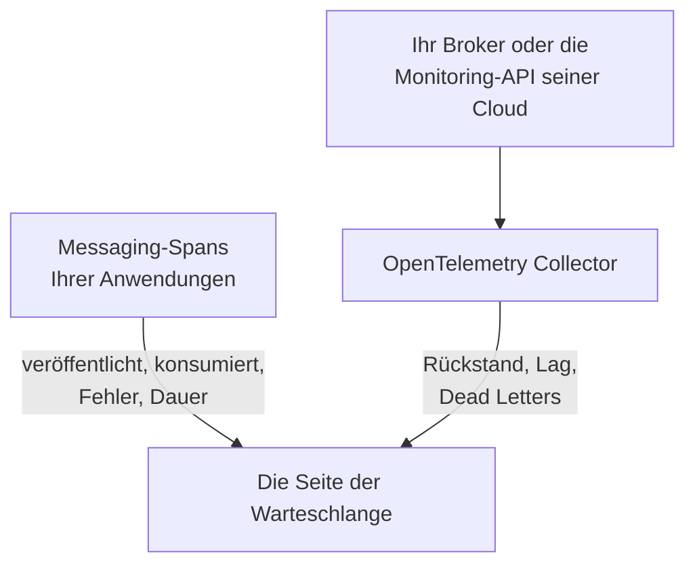

# Warteschlangen

**Warteschlangen** gibt jeder Nachrichtenwarteschlange, jedem Topic und jedem Abonnement, das Ihre Anwendungen nutzen, eine eigene Seite: welche Services darin veröffentlichen und welche daraus konsumieren, wie viele Nachrichten durchlaufen, wie viele fehlschlagen und wie lange die Verarbeitung dauert, ihre Traces und Metriken – und, sobald die eigenen Metriken des Brokers OneUptime erreichen, ihren Rückstand, den Consumer-Lag, Dead Letters und die Drosselung. Warteschlangen haben Labels, Eigentümer, Label- und Eigentümerregeln und Archivierung wie jede andere Ressource. Sie öffnen sie unter **Produkte → Ressourcen → Warteschlangen**.

:::cards
- [Anwendungen instrumentieren](#anwendungen-instrumentieren): Die Messaging-Spans, die Ihre OpenTelemetry-Instrumentierung bereits sendet.
- [Zustandsmetriken des Brokers](#zustandsmetriken-des-brokers): Rückstand, Lag und Dead Letters aus Ihrem Broker, System für System.
- [Warnungen](#warnungen): Fertige Vorlagen sowie verspätete oder gezählte Metriken.
- [Fehlerbehebung](#fehlerbehebung): Eine Warteschlange, die nicht angelegt wurde, oder ein Broker-Zustand, der leer bleibt.
:::

## So funktioniert es

Es funktioniert für jeden Broker gleich – Apache Kafka, RabbitMQ, Apache ActiveMQ und andere JMS-Broker, Amazon SQS und SNS, Google Cloud Pub/Sub, Azure Service Bus, Event Hubs und Event Grid, Apache Pulsar, Apache RocketMQ, NATS und BullMQ (siehe [Unterstützte Messaging-Systeme](#unterstützte-messaging-systeme)) – und für jeden anderen Broker, den Ihre Spans in `messaging.system` nennen. Die meisten Warteschlangen erscheinen von selbst, aus zwei Quellen:

| Quelle | Was sie von Ihnen braucht | Was sie zur Seite der Warteschlange hinzufügt |
| --- | --- | --- |
| **Anwendungs-Traces** | Instrumentierte Anwendungen (OpenTelemetry) – siehe [Anwendungen instrumentieren](#anwendungen-instrumentieren) | Veröffentlichte und konsumierte Nachrichten, Fehler und Verarbeitungszeit, die Services auf beiden Seiten und die Traces selbst |
| **Broker-Metriken** (ein OpenTelemetry Collector) | Der Collector-Receiver oder das Scraping für Ihren Broker – siehe [Zustandsmetriken des Brokers](#zustandsmetriken-des-brokers) | **Broker health**: Rückstand, Consumer-Lag, Dead Letters, Alter der ältesten Nachricht, Drosselung und die eigenen Nachrichtenraten des Brokers |



Traces sagen OneUptime, dass eine Warteschlange existiert und wie Anwendungen sie nutzen, aber nicht, wie voll sie ist. Das kommt vom Broker selbst oder von der Monitoring-API seines Cloud-Anbieters – oder, bei [BullMQ](#bullmq), das seine Jobs in Redis hält und keinen Broker hat, den man fragen könnte, von einem Gauge, den die Anwendung meldet.

Sie können eine Warteschlange auch von Hand hinzufügen: **Warteschlangen → Warteschlange erstellen**, mit ihrem Messaging-System und dem Namen des Ziels – und bei Azure Service Bus und Event Hubs mit ihrem Namespace. Das Formular fragt diese Angaben in seinem ersten Schritt ab, **Messaging-System**, danach einen optionalen Namen und eine Beschreibung, mit Labels unter **Weitere Felder** (**Warteschlangeninformationen**). Lassen Sie den Namespace nur bei einer Warteschlange leer, die Ihre Anwendungen über einen Emulator oder einen eigenen Domainnamen erreichen: Deren Spans nennen keinen Namespace, und die Metriken von Azure Monitor erreichen eine solche Warteschlange nie (siehe [Einschränkungen](#einschränkungen)).

## Erste Schritte

:::steps
### Die Traces Ihrer Anwendungen senden

Instrumentieren Sie die Anwendungen, die veröffentlichen und konsumieren, und senden Sie ihre Traces an OneUptime (siehe [Anwendungen instrumentieren](#anwendungen-instrumentieren)). Nichts OneUptime-Spezifisches ist nötig: Die Messaging-Spans, die Ihre Instrumentierung bereits erzeugt, nennen die Warteschlangen.

### Die Metriken Ihres Brokers senden

Suchen Sie Ihr Messaging-System unter [Zustandsmetriken des Brokers](#zustandsmetriken-des-brokers) und betreiben Sie seine Collector-Konfiguration mit Ihrem Ingestion-Schlüssel. Der Tab **Dokumentation** jeder Warteschlange enthält die Konfiguration für diese Warteschlange, fertig zum Kopieren.

### Die Warteschlange öffnen

Öffnen Sie **Produkte → Ressourcen → Warteschlangen**. Die Erkennung läuft alle 10 Minuten: Eine Warteschlange erscheint, sobald mindestens 3 ihrer Spans innerhalb von 15 Minuten eingetroffen sind oder eine Broker-Metrik sie genannt hat.
:::

## Unterstützte Messaging-Systeme

OneUptime kennt die folgenden Messaging-Systeme beim Namen. Es normalisiert, was Instrumentierungen in `messaging.system` schreiben, auf den Wert in der zweiten Spalte – den bekannten OpenTelemetry-Wert, wo es einen gibt –, ohne Rücksicht auf Groß- und Kleinschreibung, sodass `AmazonSQS`, `aws.sqs` und `aws_sqs` ein System sind. `nats` und `bullmq` sind keine bekannten OpenTelemetry-Werte: `nats` meldet die NATS-Instrumentierung des Java-Agents, und `bullmq` ist der Wert, den Sie für BullMQ setzen (siehe [BullMQ](#bullmq)).

Ein System, das OneUptime nicht kennt, funktioniert trotzdem: Ein wohlgeformter Wert (`ibmmq`, `solace`, `mqtt` – Kleinbuchstaben, Ziffern, `.`, `_` und `-`, bis zu 64 Zeichen) wird so behalten, wie er kam, sodass die Warteschlangen dieses Brokers unter diesem Namen erkannt und angezeigt werden; nur die eigenen Metriken des Brokers brauchen ein System aus dieser Tabelle. `spring_integration` wird ignoriert: Die Kanäle von Spring Integration sind Methodenaufrufe innerhalb eines Prozesses, kein Broker.

**Broker-Metriken** gibt an, woher die Zustandsmetriken eines Systems kommen: ein collector-contrib-Receiver, ein Prometheus-Endpunkt (`:port/path`, gescrapt mit dem `prometheus`-Receiver des Collectors), die Monitoring-API des Cloud-Anbieters oder ein Programm außerhalb des Collectors, das sie per OTLP sendet. Jedes System verlinkt unten auf seine Einrichtung, und der Tab **Dokumentation** jeder Warteschlange macht daraus eine Konfiguration für diese Warteschlange.

| System | `messaging.system` | Ebenfalls akzeptiert | Broker-Metriken |
| --- | --- | --- | --- |
| [Amazon SNS](#amazon-sns) | `aws.sns` | `aws_sns`, `amazonsns`, `sns` | Receiver `aws_cloudwatch` oder `awsfirehose` (Cloud-Monitoring) |
| [Amazon SQS](#amazon-sqs) | `aws_sqs` | `aws.sqs`, `amazonsqs`, `sqs` | Receiver `aws_cloudwatch` oder `awsfirehose` (Cloud-Monitoring) |
| [Apache ActiveMQ](#apache-activemq) | `activemq` | `artemis`, `activemq_artemis` | OpenTelemetry JMX Scraper (sendet per OTLP) |
| [Apache Kafka](#apache-kafka) | `kafka` | — | Receiver `kafka_metrics` |
| [Apache Pulsar](#apache-pulsar) | `pulsar` | `apache_pulsar` | Prometheus (Pulsar-Broker), `:8080/metrics/` |
| [Apache RocketMQ](#apache-rocketmq) | `rocketmq` | — | Prometheus (RocketMQ-Broker), `:5557/metrics` |
| [Azure Event Grid](#azure-event-grid) | `eventgrid` | `azure_eventgrid`, `azure.eventgrid`, `microsoft.eventgrid` | Receiver `azure_monitor` (Cloud-Monitoring) |
| [Azure Event Hubs](#azure-event-hubs) | `eventhubs` | `azure_eventhubs`, `azure.eventhubs`, `microsoft.eventhub` | Receiver `azure_monitor` (Cloud-Monitoring) |
| [Azure Service Bus](#azure-service-bus) | `servicebus` | `azure_servicebus`, `azure.servicebus`, `microsoft.servicebus` | Receiver `azure_monitor` (Cloud-Monitoring) |
| [BullMQ](#bullmq) | `bullmq` | — | Nichts eingebaut |
| [Google Cloud Pub/Sub](#google-cloud-pubsub) | `gcp_pubsub` | `gcp.pubsub`, `pubsub`, `google_pubsub` | Receiver `googlecloudmonitoring` (Cloud-Monitoring) |
| [JMS](#jms) | `jms` | — | Nichts eingebaut |
| [NATS](#nats) | `nats` | `jetstream` | Prometheus (prometheus-nats-exporter), `:7777/metrics` |
| [RabbitMQ](#rabbitmq) | `rabbitmq` | — | Receiver `rabbitmq` |

Eine Warteschlange ist ein Ziel eines Systems. Bei **Azure Service Bus** und **Azure Event Hubs** gehört auch ihr Namespace dazu, da zwei Namespaces jeweils eine Warteschlange namens `orders` enthalten können. **JMS** und **Apache ActiveMQ** teilen sich ihre Warteschlangen: Java-Anwendungen erreichen ActiveMQ über die JMS-API, deren Spans `jms` sagen, egal welcher Broker dahintersteht, während die eigenen Metriken des Brokers nur `activemq` sagen können – deshalb landen beide auf einer Warteschlange (siehe [Was zwei Sichtungen zu einer Warteschlange macht](#was-zwei-sichtungen-zu-einer-warteschlange-macht)).

## Wie Warteschlangen erkannt werden

Jede Warteschlange hält fest, ob Traces, Broker-Metriken oder eine Person sie angelegt haben. Alles, was später dieselbe Warteschlange nennt, ergänzt sie, statt eine weitere anzulegen (siehe [Was zwei Sichtungen zu einer Warteschlange macht](#was-zwei-sichtungen-zu-einer-warteschlange-macht)).

### Aus Anwendungs-Traces

Alle 10 Minuten fasst OneUptime die Spans zusammen, die Ihre Anwendungen in den letzten 15 Minuten gesendet haben und die einen der Schlüssel `messaging.system`, `messaging.destination.name`, `messaging.destination`, `message_bus.destination`, `az.namespace`, `azure.resource_provider.namespace`, `aws.sqs.queue.url`, `aws.queue_url` oder `aws.sns.topic.arn` tragen. Jeder Span außer einem SERVER-Span zählt: PRODUCER-, CONSUMER-, CLIENT- und INTERNAL-Spans sowie Spans, denen der **Span-Art-Remapper** einer Trace-Pipeline eine andere Art (etwa Unspecified) oder keine gegeben hat; ein SERVER-Span nennt nie eine Warteschlange.

Auch die eigenen Spans eines Brokers sind SERVER-Spans. Der eBPF-Tracer des [Kubernetes-Agents](/docs/telemetry/kubernetes-agent#wie-ebpf-traces-aussehen) zeichnet die Seite eines Kafka-, MQTT- oder NATS-Brokers bei jedem Austausch auf – eine Nachricht, die er empfängt, eine Nachricht, die er zustellt – und sendet die meisten davon als PRODUCER oder CONSUMER; OneUptime speichert sie als SERVER, sodass ein Broker nicht unter den Producern oder Consumern der Topics aufgeführt wird, die er transportiert. Ein MQTT-Broker, der eine Nachricht an einen Abonnenten weiterreicht, schreibt dasselbe PUBLISH wie ein Client, und der Tracer meldet beides gleich, deshalb richtet sich OneUptime bei MQTT- und NATS-Veröffentlichungen nach dem Port des anderen Endes der Verbindung: Ab Port 32768 – wo Betriebssysteme den Port eines sich verbindenden Clients wählen (der Standardbereich von Linux beginnt dort; Windows und macOS verwenden 49152–65535) – ist es der eines Abonnenten, und der Span gehört dem Broker. Eine Anwendung, die an einen MQTT- oder NATS-Broker veröffentlicht, der selbst auf einem Port ab 32768 lauscht, etwa einem zufällig veröffentlichten Docker-Port, wird deshalb nicht als Producer ihrer Topics aufgeführt, und ein Topic, das nur solche Anwendungen nutzen, wird aus den Spans des Tracers womöglich gar nicht erkannt. Ein Abonnent, der sich von einem Port unter 32768 mit einem Broker verbindet (ein eingeschränkter Portbereich oder ein von NAT umgeschriebener Port), führt den Broker weiterhin als Producer der Topics, die ihm zugestellt werden.

Jedes Messaging-Attribut in OpenTelemetry ist noch als in Entwicklung markiert, deshalb melden Anwendungen in einem Projekt dieselben Dinge unter bis zu fünf Generationen von Namen. OneUptime liest sie alle, die neuesten zuerst, und wertet nie Span-Namen aus, deren Format sich mit den semantischen Konventionen 1.27 geändert hat und die Anbieter frei wählen:

- **Das System**: `messaging.system`, normalisiert wie unter [Unterstützte Messaging-Systeme](#unterstützte-messaging-systeme). Ohne diesen Schlüssel `az.namespace` oder `azure.resource_provider.namespace` der Azure-SDKs (`Microsoft.ServiceBus`, `Microsoft.EventHub`), der ältere Schlüssel `component` des Azure-SDKs, ein AWS-SDK-Span (`rpc.system` = `aws-api`), der SQS oder SNS aufruft – die SNS-Spans des Java-Agents tragen kein `messaging.system` –, oder ein Schlüssel mit einer SQS-Warteschlangen-URL oder einem SNS-Topic-ARN.
- **Das Ziel**: der erste der Schlüssel `messaging.destination.template`, `messaging.destination.name`, `messaging.source.template`, `messaging.source.name`, `messaging.destination` und `message_bus.destination`, den der Span trägt. Ein Span ohne jeden davon greift auf die eigenen Schlüssel seines Systems zurück: die SQS-Warteschlangen-URL (`aws.sqs.queue.url`, `aws.queue_url` oder eine Warteschlangen-URL in `messaging.url`, `server.address` oder `net.peer.name`), den SNS-Topic-ARN (`aws.sns.topic.arn`) und bei RabbitMQ den Routing Key (`messaging.rabbitmq.destination.routing_key` oder `messaging.rabbitmq.routing_key`), der der Name der Warteschlange ist, wenn eine Nachricht über den Default Exchange läuft.
- **Die Richtung**: zuerst `messaging.operation.type`, dann die Span-Art – PRODUCER veröffentlicht, CONSUMER konsumiert –, dann das ältere `messaging.operation`, dann `messaging.operation.name` und bei SQS und SNS die AWS-SDK-Operation in `rpc.method` (`SendMessage`, `ReceiveMessage`, …). Die Art hat Vorrang vor den älteren Schlüsseln, weil manche Instrumentierungen sie falsch befüllt haben: confluent-kafka für Python schrieb `receive` in seine Producer-Spans.

Eine Warteschlange wird aus Traces **angelegt**, sobald ihre Spans im 15-Minuten-Fenster, das ein Durchlauf betrachtet, mindestens 3 zählen (`MESSAGE_QUEUE_MIN_SPANS`), damit ein einmaliges Skript keine anlegt, und nur solange das Projekt unter seinem [Budget für automatisches Anlegen](#das-budget-für-automatisches-anlegen) liegt. Spans, die keine Warteschlange anlegen, zählen trotzdem für eine bestehende.

Jeder Messaging-Span wird beim Ingest außerdem mit seiner Warteschlange markiert, sodass der Tab **Traces** der Warteschlange jeden Span zeigt, der sie nennt – auch Spans, die gesendet wurden, bevor die Warteschlange angelegt wurde.

### Aus Broker-Metriken

Eine Broker-Metrik aus den Listen unter [Zustandsmetriken des Brokers](#zustandsmetriken-des-brokers) nennt ihre Warteschlange im eigenen Attribut des Brokers – Kafkas `topic`, RabbitMQs `rabbitmq.queue.name`, die Dimension `EntityName` von Azure Monitor, CloudWatchs `QueueName` –, und OneUptime ordnet sie beim Ingest dieser Warteschlange zu. Broker-Metriken tragen kein `messaging.system`: Jede wird an ihrem Namen erkannt (`kafka.consumer_group.lag_sum`) und, wo zwei Systeme einen Namen teilen – Azure Monitor benennt die Metriken von Service Bus und Event Hubs gleich –, am Ressourcentyp, den der Datenpunkt trägt.

Der nächste Erkennungsdurchlauf legt die Warteschlange an, falls sie noch nicht existiert: Eine Broker-Metrik genügt, innerhalb des [Budgets für automatisches Anlegen](#das-budget-für-automatisches-anlegen). So erscheint auch eine Warteschlange, die keine instrumentierte Anwendung berührt, sobald ihr Broker sie meldet.

Cloud-Monitoring-APIs – CloudWatch, Azure Monitor und Cloud Monitoring – veröffentlichen jeden Wert Minuten nach dem Zeitpunkt, den er misst, und er wird unter diesem Zeitpunkt gespeichert. Deshalb liest jeder Durchlauf ihre Metriken aus der letzten Stunde statt aus den letzten 15 Minuten, aus denen er Spans und andere Metriken liest: Ein Datenpunkt, der verspätet eintrifft, sichtet seine Warteschlange trotzdem oder legt sie an.

### Aus Metriken von Messaging-Clients

Instrumentierte Clients können ebenfalls Metriken melden: die Messaging-Client-Metriken von OpenTelemetry `messaging.client.sent.messages`, `messaging.client.consumed.messages`, `messaging.client.operation.duration` und `messaging.process.duration`, ihre älteren Namen `messaging.publish.duration`, `messaging.receive.duration`, `messaging.publish.messages`, `messaging.receive.messages`, `messaging.process.messages` und `messaging.client.published.messages` sowie die Metriken des Azure SDK für Java `messaging.servicebus.messages.sent`, `messaging.servicebus.receiver.lag`, `messaging.servicebus.settlement.request.duration` und `messaging.servicebus.settlement.sequence_number`. Jeder Datenpunkt nennt sein System und sein Ziel so, wie ein Span es tut – die Service-Bus-Metriken des Azure SDK nennen kein System, deshalb steht ihr Name dafür –, und wird beim Ingest dieser Warteschlange zugeordnet, sodass er im Tab **Metriken** der Warteschlange erscheint. Das gilt auch für jede eigene Metrik, die `messaging.system` und `messaging.destination.name` an jedem Datenpunkt trägt – nicht an der Ressource, wo sie nicht gelesen werden –, etwa einen Gauge für die Warteschlangentiefe (siehe [BullMQ](#bullmq)).

Messaging-Client-Metriken legen nie eine Warteschlange an: Das tun Traces, Broker-Metriken oder eine Person. Eine Client-Metrik, die eine bestehende Warteschlange nennt, hält deren **Zuletzt gesehen** aktuell, wie es ihre Spans tun. Eine eigene Metrik tut keines von beidem: Sie erscheint nur im Tab **Metriken** der Warteschlange.

### Was zwei Sichtungen zu einer Warteschlange macht

Die Identität einer Warteschlange ist ihr **System** und ihr **Ziel**, verglichen ohne Rücksicht auf Groß- und Kleinschreibung: `Orders` und `orders` sind eine Warteschlange, angezeigt unter dem Namen, wie er zuerst gesehen wurde. Bei Azure Service Bus und Event Hubs gehört zur Identität außerdem der **Namespace**:

- an einem Span das erste DNS-Label des Hosts, mit dem sich das SDK verbunden hat, aus `server.address`, `net.peer.name`, `peer.address` oder `network.peer.address` in dieser Reihenfolge, wenn dieser Host ein Namespace-Host ist: `<namespace>.servicebus.windows.net` oder `.servicebus.usgovcloudapi.net`, `.servicebus.chinacloudapi.cn` oder `.servicebus.cloudapi.de` einer souveränen Cloud. Event Hubs teilt die Domain von Service Bus;
- an einer Azure-Monitor-Metrik der `name` des Namespace, über den sie berichtet.

Nichts anderes gehört dazu, deshalb teilt nichts davon je eine Warteschlange: die Adresse des Brokers (Kafka-Clients melden selten eine, und ein Azure-Namespace antwortet unter vielen), die Consumer-Gruppe oder das Abonnement (die Consumer eines Topics sind keine eigenen Warteschlangen), die Partition und eine Dead-Letter-Unterwarteschlange. Davon behält eine Warteschlange nur die Adresse des Brokers, zur Anzeige.

**JMS und ActiveMQ sind eine Familie.** Jeder JMS-Span sagt `jms`, egal welcher Broker dahintersteht, und die eigenen Metriken des Brokers (der [OpenTelemetry JMX Scraper](#apache-activemq)) können nur `activemq` sagen, deshalb schlüsselt OneUptime eine ActiveMQ-Warteschlange über ihre JMS-Familie: Die Spans und die Broker-Metriken von `orders` landen auf einer Warteschlange. Sie erscheint als JMS, bis die Metriken des Brokers eintreffen, und ab dann als Apache ActiveMQ – nie umgekehrt. Eine Warteschlange, die Sie von Hand als Apache ActiveMQ anlegen, ist dieselbe Warteschlange.

### Wie Zielnamen gelesen werden

Instrumentierungen nennen eine Warteschlange auf viele Arten, und OneUptime reduziert das Gemeldete auf den eigenen Namen der Warteschlange:

| System | Gemeldet als | Warteschlange |
| --- | --- | --- |
| Amazon SQS | `https://sqs.us-east-1.amazonaws.com/123456789012/orders`, eine Warteschlangen-URL (`otelaws` für Go legt sie in `server.address` ab) | `orders` |
| Amazon SNS | `arn:aws:sns:us-east-1:123456789012:order-events`, ein Topic-ARN | `order-events` |
| Google Cloud Pub/Sub | `projects/shop/topics/orders`, ein Ressourcenname | `orders` |
| Azure Service Bus | `orders/Subscriptions/billing`, der Entitätspfad des Abonnements `billing` des Topics | `orders` |
| Azure Service Bus | `orders/$DeadLetterQueue`, der Entitätspfad der Dead-Letter-Unterwarteschlange der Warteschlange | `orders` |
| Azure Event Hubs | `telemetry/ConsumerGroups/$Default/Partitions/3`, der Entitätspfad eines Empfängers, für die Consumer-Gruppe `$Default` | `telemetry` |
| Apache Pulsar | `orders-partition-3`, eine Partition eines Topics mit Kurznamen | `persistent://public/default/orders` |
| Apache Pulsar | `acme/shop/orders`, ein Topic ohne seine Domain | `persistent://acme/shop/orders` |
| JMS | `queue://orders`, mit seinem Präfix für den Zieltyp | `orders` |
| RabbitMQ | `shop:new-order:orders`, Exchange, Routing Key und Warteschlange bei einem Consumer (semantische Konventionen 1.30 und neuer) | `orders` |
| RabbitMQ | `amq.default`, der Default Exchange, mit dem Routing Key `orders` | `orders` |
| RabbitMQ | `,orders`, das `{exchange},{routing key}` von aio-pika über den Default Exchange | `orders` |
| RabbitMQ | `shop,new-order`, das `{exchange},{routing key}` von aio-pika | `shop` |

Eine Pulsar-Partition geht in ihrem Topic auf, und ein Name ohne Domain wird so vervollständigt, wie Pulsar selbst ihn vervollständigt – ein Kurzname in den Namespace `public/default` –, sodass die Namen des Java-Agents mit den voll qualifizierten Metrik-Labels der Broker zusammenfinden. Ein RabbitMQ-Span nennt meist den Exchange, über den eine Nachricht lief, auf der veröffentlichenden wie auf der konsumierenden Seite; der Default Exchange (`amq.default`, `<default>` oder ein leerer Name) steht für seinen Routing Key, der der Name der Warteschlange ist. Die semantischen Konventionen 1.30 verbinden Exchange, Routing Key und Warteschlange mit `:` – die Opt-in-Namen des Java-Agents –, und OneUptime nimmt die Warteschlange aus dem verbundenen Namen eines Consumers und den Exchange aus dem eines Publishers. aio-pika verbindet Exchange und Routing Key auf der Veröffentlichungsseite mit einem Komma, und OneUptime trennt das auf dieselbe Weise.

### Was ignoriert wird

OneUptime entscheidet im Zweifel gegen eine Warteschlange: Ein Name, der pro Anfrage oder pro Consumer ausgedacht wird, würde sonst für jede Nachricht eine Warteschlange anlegen, die niemandem gehört. Diese werden nie zu Warteschlangen:

- **SERVER-Spans** und Spans, deren `messaging.system` `spring_integration` ist.
- **Als temporär oder anonym markierte Ziele**: `messaging.destination.temporary`, `messaging.destination.anonymous`, `messaging.source.temporary` oder `messaging.source.anonymous` auf `true` gesetzt. Dem älteren `messaging.temp_destination` wird nicht vertraut: Die Instrumentierungen pika und aio-pika für Python setzen es bei jeder Veröffentlichung.
- **Platzhalter, die Instrumentierungen statt eines Namens melden**: `(temporary)`, `(anonymous)`, `<generated>`, `unknown` (ein Kafka-Batch über mehrere Topics), `aws:sqs` (die Lambda-SQS-Ereignisse des Java-Agents), `-NamespaceOnlyMetric-` von Azure Monitor und ein Wert, den die eigene Datenbereinigung von OneUptime vollständig ersetzt hat (`[REDACTED]`).
- **Generierte Ziele und Antwortziele**: vom Server benannte Warteschlangen von RabbitMQ im Stil von `amq.gen-JzTY20BRgKO-HjmUJj0wLg`, die Warteschlangen `spring.gen-…` von Spring und die Warteschlangen `<destination>.anonymous.<id>` von Spring Cloud Stream für Consumer ohne Gruppe sowie Direct Reply-to (`amq.rabbitmq.reply-to…`); temporäre JMS-Ziele (`temp-queue://…`, `temp-topic://…`) und `$TMP$…` von TIBCO; die Advisory-Topics von ActiveMQ (`ActiveMQ.Advisory.…`); NATS-Inboxen (`_INBOX.…`) und JetStream-Bestätigungssubjekte (`$JS.ACK.…`); die System-Topics von Pulsar (`__change_events`, `__transaction_…` und alles unterhalb eines Segments `/__`); und ein Ziel, das nur aus einer UUID besteht.
- **SNS-Textnachrichten und Mobile Push**: eine Telefonnummer (`+15555550123` oder `phone_number:**` aus botocore) oder ein Plattform-Endpunkt-ARN (`arn:aws:sns:us-east-1:123456789012:endpoint/GCM/shop-app/1234`) ist ein Gerät, kein Topic.
- **Namen, die keine einzelne Warteschlange sein können**: eine Liste von Zielen aus einem Batch (`["orders","payments"]`), ein Name mit einem Steuerzeichen und ein Name mit mehr als 255 Zeichen.

**UUIDs werden zu Vorlagen.** Jede UUID innerhalb eines Ziels wird durch `{uuid}` ersetzt, sodass Namen pro Anfrage wie `reply-7f1c2a9e-4b1d-4c3e-9f1a-2b3c4d5e6f70` eine Warteschlange werden, `reply-{uuid}`, statt jeweils einer eigenen.

### Das Budget für automatisches Anlegen

Traces und Broker-Metriken legen nur dann selbstständig Warteschlangen an, solange das Projekt weniger als 500 aktive, nicht archivierte erkannte Warteschlangen hat (`MESSAGE_QUEUE_AUTO_CREATE_BUDGET`, siehe [Abstimmung für Self-Hosting](#abstimmung-für-self-hosting)). Von Hand angelegte Warteschlangen zählen nie und werden nie blockiert; archivierte Warteschlangen zählen nicht, daher gibt die [automatische Archivierung](#lebenszyklus-und-archivierung) Budget frei; und bereits vorhandene Warteschlangen werden weiter zugeordnet und aktualisiert.

### Lebenszyklus und Archivierung

- **Zuletzt gesehen** ist der Zeitpunkt, zu dem die Erkennung die Warteschlange zuletzt gesehen hat, in Traces, Messaging-Client-Metriken oder Broker-Metriken.
- **Archivieren, um loszuwerden.** Das Löschen einer erkannten Warteschlange entfernt sie nur, bis sie wieder gesehen wird: Ihre nächste Sichtung bringt sie als neue Warteschlange zurück. Um eine endgültig loszuwerden, **archivieren** Sie sie. Eine archivierte Warteschlange behält ihre Identität, sodass alles, was sie nennt, der archivierten Warteschlange zugeordnet bleibt, statt eine neue anzulegen.
- **Automatische Archivierung.** Eine erkannte Warteschlange, die 7 Tage lang nicht gesehen wurde (`MESSAGE_QUEUE_AUTO_ARCHIVE_DAYS`), wird automatisch archiviert, es sei denn, eine Person hat sie umbenannt, beschrieben, mit Labels versehen oder ihr Eigentümer gegeben. Labels und Eigentümer, die Label- oder Eigentümerregeln selbstständig angehängt haben, zählen nicht.
- **Wiederherstellen.** Eine automatisch archivierte Warteschlange wird automatisch wiederhergestellt, wenn sie wieder gesehen wird. Warteschlangen, die Sie von Hand angelegt haben, und Warteschlangen, die eine Person archiviert hat, werden von der Erkennung nie archiviert oder wiederhergestellt. Eine Warteschlange, die eine Person wiederherstellt, bleibt 30 Tage lang wiederhergestellt (oder für das Archivfenster, wenn das länger ist), auch wenn nichts sie sieht; ab ihrer nächsten Sichtung gilt wieder die 7-Tage-Regel.

## Anwendungen instrumentieren

Warteschlangen entstehen aus den Messaging-Spans, die Ihre OpenTelemetry-Instrumentierung bereits erzeugt; nichts OneUptime-Spezifisches ist nötig. Senden Sie die Traces an OneUptime, wie es unter [OpenTelemetry](/docs/telemetry/open-telemetry) beschrieben ist, und prüfen Sie dann die Liste für Ihre Sprache.

:::tabs
@tab Java
Der OpenTelemetry-Java-Agent tracet Kafka-, RabbitMQ-, JMS- (ActiveMQ, Artemis, IBM MQ und jeder andere JMS-Broker), Amazon-SQS- und SNS-, Pulsar-, RocketMQ- und NATS-Clients ohne Codeänderungen. OneUptime liest sowohl die Attributnamen, die er standardmäßig ausgibt, als auch die neueren, die er mit `OTEL_SEMCONV_STABILITY_OPT_IN=messaging` ausgibt (Agent 2.31.0 und neuer). JMS-Spans sagen `jms`, egal welcher Broker dahintersteht (siehe [JMS](#jms)).

- **Azure Service Bus und Event Hubs**: Das Azure SDK für Java tracet sich selbst, und der Java-Agent verbindet dieses Tracing mit OpenTelemetry.
- **Google Cloud Pub/Sub**: Der Client tracet sich selbst, sobald seine Builder `Publisher` und `Subscriber` eine OpenTelemetry-Instanz und den Tracing-Schalter erhalten – `setOpenTelemetry(GlobalOpenTelemetry.get())` und `setEnableOpenTelemetryTracing(true)`. Einer der beiden Aufrufe allein tracet nichts.
@tab .NET
- **Azure Service Bus und Event Hubs** (`Azure.Messaging.ServiceBus`, `Azure.Messaging.EventHubs`): Ihre OpenTelemetry-Spans sind im Azure SDK experimentell. Schalten Sie sie mit der Umgebungsvariable `AZURE_EXPERIMENTAL_ENABLE_ACTIVITY_SOURCE=true` (oder dem Schalter `Azure.Experimental.EnableActivitySource` unten) ein und abonnieren Sie die Quellen `Azure.*`.
- **RabbitMQ.Client** 7 tracet sich selbst: Abonnieren Sie `RabbitMQ.Client.*`.
- **MassTransit** tracet sich selbst: Abonnieren Sie `MassTransit` (siehe [Einschränkungen](#einschränkungen) dazu, was seine Spans auslassen).
- **Confluent.Kafka**: das Paket `OpenTelemetry.Instrumentation.ConfluentKafka`.
- **Amazon SQS und SNS**: das Paket `OpenTelemetry.Instrumentation.AWS` mit `.AddAWSInstrumentation(opt => opt.SemanticConventionVersion = SemanticConventionVersion.Latest)`. Sein Standard-Attributsatz (`V1_28_0`) nennt eine SQS-Warteschlange nur über ihre URL (`aws.queue_url`, die OneUptime liest) und ein SNS-Topic gar nicht.

```csharp
// Before any Azure client is created; or set AZURE_EXPERIMENTAL_ENABLE_ACTIVITY_SOURCE=true.
AppContext.SetSwitch("Azure.Experimental.EnableActivitySource", true);

builder.Services.AddOpenTelemetry()
    .WithTracing(tracing => tracing
        .AddSource("Azure.*")
        .AddSource("RabbitMQ.Client.*")
        .AddSource("MassTransit")
        .AddOtlpExporter());
```
@tab Node.js
- `@opentelemetry/auto-instrumentations-node` tracet `amqplib` (RabbitMQ), `kafkajs` und das AWS SDK (SQS und SNS).
- **Azure Service Bus und Event Hubs**: Registrieren Sie `createAzureSdkInstrumentation()` aus `@azure/opentelemetry-instrumentation-azure-sdk`.
- **Google Cloud Pub/Sub**: `new PubSub({ enableOpenTelemetryTracing: true })`.
- **BullMQ**: siehe [BullMQ](#bullmq) – seine eigene Telemetrie braucht zwei zusätzliche Attribute.
@tab Python
- Kafka: `opentelemetry-instrumentation-kafka-python`, `opentelemetry-instrumentation-confluent-kafka` oder `opentelemetry-instrumentation-aiokafka`. RabbitMQ: `opentelemetry-instrumentation-pika` oder `opentelemetry-instrumentation-aio-pika`. SQS und SNS: `opentelemetry-instrumentation-botocore` oder für SQS `opentelemetry-instrumentation-boto3sqs`. `opentelemetry-bootstrap -a install` wählt die aus, die Ihre installierten Bibliotheken brauchen.
- **Azure Service Bus und Event Hubs**: Installieren Sie `azure-core-tracing-opentelemetry` und setzen Sie `settings.tracing_implementation = "opentelemetry"` (aus `azure.core.settings`).
- **Google Cloud Pub/Sub**: `PublisherOptions(enable_open_telemetry_tracing=True)` und `SubscriberOptions(enable_open_telemetry_tracing=True)`.
- Die Spans von Celery tragen kein `messaging.system` und nennen keinen Broker, deshalb legen sie keine Warteschlangen an.
@tab Go
- **Amazon SQS und SNS**: `otelaws` (`go.opentelemetry.io/contrib/instrumentation/github.com/aws/aws-sdk-go-v2/otelaws`), hinzugefügt mit `otelaws.AppendMiddlewares(&cfg.APIOptions)`. Seine SQS-Spans tragen die Warteschlangen-URL in `server.address`, die OneUptime als die Warteschlange liest.
- **Google Cloud Pub/Sub**: `pubsub.ClientConfig{EnableOpenTelemetryTracing: true}`.
- **Kafka** mit `segmentio/kafka-go`: Die automatische Instrumentierung von OpenTelemetry für Go (`go.opentelemetry.io/auto`, eBPF, unter Linux) tracet seine Producer und Consumer ohne Codeänderungen.
- Die Go-Contrib-Bibliotheken von OpenTelemetry haben keine Instrumentierung für Kafka, RabbitMQ oder NATS. Nutzen Sie für andere Clients die eigene OpenTelemetry-Unterstützung der Client-Bibliothek, oder setzen Sie `messaging.system`, `messaging.destination.name` und die Span-Art an den Spans um Ihre Sendevorgänge und Handler.
:::

## Zustandsmetriken des Brokers

Ein Broker weiß, was keine Anwendung sehen kann: wie viele Nachrichten warten, wie weit jede Consumer-Gruppe zurückliegt, was in eine Dead-Letter-Warteschlange ging. Jeder Abschnitt unten enthält die Collector-Konfiguration für ein System – eine vollständige OpenTelemetry-Collector-Konfiguration, die mit dem OTLP-Exporter endet, der an OneUptime sendet. Tragen Sie einen Telemetrie-Ingestion-Schlüssel (**Projekteinstellungen → Telemetrie & APM → Ingestion-Schlüssel**) in `x-oneuptime-token` ein, ersetzen Sie `https://oneuptime.com` durch Ihren eigenen Host, wenn Sie selbst hosten, und betreiben Sie sie mit `otel/opentelemetry-collector-contrib` 0.161.0 oder neuer (jede Konfiguration hier ist gegen 0.161.0 validiert). Neuere Collectors protokollieren, dass `otlphttp` zugunsten von `otlp_http` veraltet ist; beide Namen bezeichnen denselben Exporter. Um mehrere Systeme zu erfassen, führen Sie ihre Receiver in einem Collector zusammen.

Der Abschnitt **Broker health** jeder Warteschlange stellt die für ihr System aufgeführten Metriken dar – einen Gauge als seinen Wert, eine Anzahl pro Zeitraum summiert pro Intervall, einen Zähler als Rate pro Sekunde – und kombiniert die Serien einer Warteschlange so, wie es jede Metrik braucht (die bereiten und unbestätigten Nachrichten einer RabbitMQ-Warteschlange addieren sich; die am weitesten zurückliegende Consumer-Gruppe ist der Lag). Alles, was der Collector sendet, steht außerdem im Explorer **Metriken**. Solange für eine Warteschlange keine aufgeführte Metrik eingetroffen ist, zeigt der Abschnitt, woher die Metriken dieses Systems kommen, mit einem Link zu seinem Abschnitt hier.

### Amazon SNS

Lesen Sie die CloudWatch-Metriken der Topics mit dem `aws_cloudwatch`-Receiver des Collectors, oder streamen Sie sie über einen CloudWatch Metric Stream und Amazon Data Firehose an seinen `awsfirehose`-Receiver.

Der `aws_cloudwatch`-Receiver fragt die API `GetMetricData` von CloudWatch ab, einen Namespace pro Receiver, deshalb bekommt SNS eine eigene Instanz neben der von [Amazon SQS](#amazon-sqs). Er nutzt die Standard-Anmeldedaten des AWS SDK (Umgebung, gemeinsames Profil oder Instanzrolle), die `cloudwatch:ListMetrics` und `cloudwatch:GetMetricData` brauchen:

```yaml
receivers:
  aws_cloudwatch/sns:
    region: us-east-1
    metrics:
      collection_interval: 5m
      period: 1m
      delay: 10m
      discovery:
        filters:
          namespace: AWS/SNS
        limit: 500

processors:
  batch: {}

exporters:
  otlphttp:
    endpoint: https://oneuptime.com/otlp
    headers:
      x-oneuptime-token: YOUR_TELEMETRY_INGESTION_TOKEN

service:
  pipelines:
    metrics:
      receivers: [aws_cloudwatch/sns]
      processors: [batch]
      exporters: [otlphttp]
```

Lassen Sie `stats` ungesetzt, wie bei [Amazon SQS](#amazon-sqs). Ein Metric Stream transportiert SNS und SQS zusammen: Fügen Sie `AWS/SNS` in der Einrichtung von [Amazon SQS](#amazon-sqs) zu den Namespaces des Streams hinzu.

Ein Topic wird von beiden Seiten gleich benannt: Spans melden seinen ARN oder seinen Namen, und OneUptime behält den Namen nach dem letzten `:` des ARN.

| Metrik | Angezeigt als | Typ |
| --- | --- | --- |
| `amazonaws.com/aws/sns/numberofmessagespublished` (JSON-Stream: `numberofmessagespublished`) | Messages published | Anzahl pro Zeitraum |
| `amazonaws.com/aws/sns/numberofnotificationsdelivered` (JSON-Stream: `numberofnotificationsdelivered`) | Notifications delivered | Anzahl pro Zeitraum |
| `amazonaws.com/aws/sns/numberofnotificationsfailed` (JSON-Stream: `numberofnotificationsfailed`) | Notifications failed | Anzahl pro Zeitraum |
| `amazonaws.com/aws/sns/numberofnotificationsredriventodlq` (JSON-Stream: `numberofnotificationsredriventodlq`) | Redriven to dead-letter queue | Anzahl pro Zeitraum |

### Amazon SQS

Lesen Sie die CloudWatch-Metriken der Warteschlangen mit dem `aws_cloudwatch`-Receiver des Collectors, oder streamen Sie sie über einen CloudWatch Metric Stream und Amazon Data Firehose an seinen `awsfirehose`-Receiver.

**CloudWatch abfragen** braucht auf der AWS-Seite nichts außer Anmeldedaten. Der Receiver nutzt die Standard-Anmeldedaten des AWS SDK (Umgebung, gemeinsames Profil oder Instanzrolle), die `cloudwatch:ListMetrics` und `cloudwatch:GetMetricData` brauchen:

```yaml
receivers:
  aws_cloudwatch/sqs:
    region: us-east-1
    metrics:
      collection_interval: 5m
      period: 1m
      delay: 10m
      discovery:
        filters:
          namespace: AWS/SQS
        # Metrics per scrape: about nine per queue. Must be set.
        limit: 500

processors:
  batch: {}

exporters:
  otlphttp:
    endpoint: https://oneuptime.com/otlp
    headers:
      x-oneuptime-token: YOUR_TELEMETRY_INGESTION_TOKEN

service:
  pipelines:
    metrics:
      receivers: [aws_cloudwatch/sqs]
      processors: [batch]
      exporters: [otlphttp]
```

- **Lassen Sie `stats` ungesetzt.** Ohne diesen Schlüssel kommt jede Metrik als eine Zusammenfassung pro Zeitraum an, und genau das liest OneUptime; mit ihm wird jede Statistik zu einer eigenen Serie, und die Diagramme vermischen sie.
- `discovery.limit` muss gesetzt sein und begrenzt die pro Scrape gelesenen Metriken – etwa neun pro Warteschlange. Jede kostet pro Scrape vier Unterabfragen von `GetMetricData`, die AWS berechnet.
- `delay` wartet, bis CloudWatch einen Zeitraum veröffentlicht (das dauert einige Minuten), deshalb treffen die Broker-Metriken einer Warteschlange mit dieser Konfiguration 11 bis 17 Minuten verspätet ein: Ein Monitor darüber braucht ein längeres Fenster (siehe **Verspätete Metriken** unter [Warnungen](#warnungen)).
- Ein Receiver liest eine Region und einen Namespace: Fügen Sie pro Region eine Instanz hinzu.

**Streaming** sendet die Metriken, sobald CloudWatch sie veröffentlicht. Legen Sie für die Namespaces `AWS/SQS` (und `AWS/SNS`) einen CloudWatch Metric Stream mit dem Ausgabeformat **OpenTelemetry 1.0** an, der an einen Amazon-Data-Firehose-Stream liefert, dessen Ziel ein HTTP-Endpunkt ist: Ihr Collector, mit einem Zugriffsschlüssel. Firehose liefert nur an `https://` auf Port 443, deshalb braucht der Collector ein Zertifikat und einen öffentlichen Port 443 (zum Beispiel hinter einem Load Balancer):

```yaml
extensions:
  awscloudwatchmetricstreams_encoding:
    format: opentelemetry1.0

receivers:
  awsfirehose:
    # Firehose delivers to HTTPS on port 443 only: expose this port as 443,
    # for example behind a load balancer.
    endpoint: 0.0.0.0:4433
    encoding: awscloudwatchmetricstreams_encoding
    access_key: ${env:FIREHOSE_ACCESS_KEY}
    tls:
      cert_file: /etc/otelcol/tls/server.crt
      key_file: /etc/otelcol/tls/server.key

processors:
  batch: {}

exporters:
  otlphttp:
    endpoint: https://oneuptime.com/otlp
    headers:
      x-oneuptime-token: YOUR_TELEMETRY_INGESTION_TOKEN

service:
  extensions: [awscloudwatchmetricstreams_encoding]
  pipelines:
    metrics:
      receivers: [awsfirehose]
      processors: [batch]
      exporters: [otlphttp]
```

Ein Stream im Ausgabeformat **JSON** (`format: json`) funktioniert ebenfalls: Er sendet jede Metrik unter ihrem bloßen Namen, und OneUptime unterscheidet die von SQS von denen von SNS am `service.name`, den der Stream setzt (`SQS`, `SNS`).

Eine Dead-Letter-Warteschlange ist eine gewöhnliche SQS-Warteschlange mit eigenen Metriken, also in OneUptime eine eigene Warteschlange. Warteschlangen werden allein nach ihrem Namen benannt, nicht nach ihrem Konto oder ihrer Region (siehe [Einschränkungen](#einschränkungen)).

| Metrik | Angezeigt als | Typ |
| --- | --- | --- |
| `amazonaws.com/aws/sqs/approximatenumberofmessagesvisible` (JSON-Stream: `approximatenumberofmessagesvisible`) | Messages visible | Gauge |
| `amazonaws.com/aws/sqs/approximateageofoldestmessage` (JSON-Stream: `approximateageofoldestmessage`) | Oldest message age | Gauge |
| `amazonaws.com/aws/sqs/approximatenumberofmessagesnotvisible` (JSON-Stream: `approximatenumberofmessagesnotvisible`) | Messages in flight | Gauge |
| `amazonaws.com/aws/sqs/numberofmessagessent` (JSON-Stream: `numberofmessagessent`) | Messages sent | Anzahl pro Zeitraum |
| `amazonaws.com/aws/sqs/numberofmessagesreceived` (JSON-Stream: `numberofmessagesreceived`) | Messages received | Anzahl pro Zeitraum |
| `amazonaws.com/aws/sqs/numberofmessagesdeleted` (JSON-Stream: `numberofmessagesdeleted`) | Messages deleted | Anzahl pro Zeitraum |

### Apache ActiveMQ

Der Collector hat keinen JMX-Receiver, deshalb betreiben Sie den OpenTelemetry JMX Scraper mit `OTEL_JMX_TARGET_SYSTEM=activemq` neben einem ActiveMQ-Classic-Broker; er sendet die Zielmetriken des Brokers per OTLP.

1. Lassen Sie den Broker JMX-Verbindungen annehmen. Setzen Sie beim Image `apache/activemq-classic` oder beim Skript `bin/activemq` vor dem Start `ACTIVEMQ_SUNJMX_START`. Dieses Beispiel schaltet die Authentifizierung aus: Halten Sie den Port in einem privaten Netz, oder schalten Sie `jmxremote.authenticate` mit einer Passwortdatei ein und geben Sie dem Scraper `OTEL_JMX_USERNAME` und `OTEL_JMX_PASSWORD`.

```bash
ACTIVEMQ_SUNJMX_START="-Dcom.sun.management.jmxremote.port=1099 -Dcom.sun.management.jmxremote.rmi.port=1099 -Dcom.sun.management.jmxremote.authenticate=false -Dcom.sun.management.jmxremote.ssl=false -Djava.rmi.server.hostname=activemq"
```

2. Betreiben Sie den Scraper dort, wo er diesen Port erreicht, mit einer Java-Laufzeitumgebung. Er sendet direkt an OneUptime; um ihn stattdessen über Ihren eigenen Collector zu leiten, richten Sie `OTEL_EXPORTER_OTLP_ENDPOINT` auf den OTLP-Receiver des Collectors.

```bash
curl -fsSLo opentelemetry-jmx-scraper.jar https://github.com/open-telemetry/opentelemetry-java-contrib/releases/latest/download/opentelemetry-jmx-scraper.jar

export OTEL_JMX_SERVICE_URL=service:jmx:rmi:///jndi/rmi://activemq:1099/jmxrmi
export OTEL_JMX_TARGET_SYSTEM=activemq
export OTEL_JMX_TARGET_SOURCE=instrumentation
export OTEL_METRIC_EXPORT_INTERVAL=30000
export OTEL_SERVICE_NAME=activemq-prod
export OTEL_EXPORTER_OTLP_PROTOCOL=http/protobuf
export OTEL_EXPORTER_OTLP_ENDPOINT=https://oneuptime.com/otlp
export OTEL_EXPORTER_OTLP_HEADERS=x-oneuptime-token=YOUR_TELEMETRY_INGESTION_TOKEN
java -jar opentelemetry-jmx-scraper.jar
```

`OTEL_JMX_TARGET_SOURCE=instrumentation` behält die Metriknamen bei, die der Scraper seit 1.53.0-alpha verwendet (`activemq.message.queue.size`, mit dem Ziel in `messaging.destination.name`). OneUptime liest auch die Namen älterer Scraper und von `OTEL_JMX_TARGET_SOURCE=legacy` (`activemq.message.current`, mit dem Ziel in `destination`).

Die Metriken des Brokers kommen zu der Warteschlange, die die Spans ihrer JMS-Clients angelegt haben – und ab dann erscheint die Warteschlange als Apache ActiveMQ (siehe [Was zwei Sichtungen zu einer Warteschlange macht](#was-zwei-sichtungen-zu-einer-warteschlange-macht)). Der Scraper meldet jedes Ziel: OneUptime ignoriert die Advisory-Topics, während Dead-Letter-Warteschlangen (`ActiveMQ.DLQ` oder `DLQ.<destination>` bei einer individuellen Dead-Letter-Strategie) eigene Warteschlangen sind. ActiveMQ Artemis hat andere MBeans, die diese Regeln nicht lesen: Artemis-Warteschlangen entstehen weiterhin aus ihren JMS-Spans, ohne Broker-Zustand.

| Metrik | Angezeigt als | Typ |
| --- | --- | --- |
| `activemq.message.queue.size` | Queue size | Gauge |
| `activemq.message.current` | Queue size (legacy names) | Gauge |
| `activemq.message.enqueued` | Enqueued | Zähler, pro Sekunde dargestellt |
| `activemq.message.dequeued` | Dequeued | Zähler, pro Sekunde dargestellt |
| `activemq.message.expired` | Expired | Zähler, pro Sekunde dargestellt |
| `activemq.consumer.count` | Consumers | Gauge |
| `activemq.message.enqueue.average_duration` | Average time in queue | Gauge |
| `activemq.message.wait_time.avg` | Average time in queue (legacy names) | Gauge |

### Apache Kafka

Der `kafka_metrics`-Receiver des Collectors liest den Lag der Consumer-Gruppen und die Partitions-Offsets von den Brokern; aktivieren Sie seine Scraper `topics` und `consumers`.

```yaml
receivers:
  kafka_metrics:
    brokers: ["kafka-1:9092", "kafka-2:9092"]
    # topics: each partition's log-end offset; consumers: each group's
    # committed offsets and lag. brokers: the broker count.
    scrapers: [brokers, topics, consumers]
    collection_interval: 30s
    # auth:
    #   sasl:
    #     mechanism: SCRAM-SHA-512
    #     username: ${env:KAFKA_USERNAME}
    #     password: ${env:KAFKA_PASSWORD}
    # tls:
    #   ca_file: /etc/kafka/ca.pem

processors:
  batch: {}

exporters:
  otlphttp:
    endpoint: https://oneuptime.com/otlp
    headers:
      x-oneuptime-token: YOUR_TELEMETRY_INGESTION_TOKEN

service:
  pipelines:
    metrics:
      receivers: [kafka_metrics]
      processors: [batch]
      exporters: [otlphttp]
```

Kommentieren Sie für einen Cluster mit SASL oder TLS `auth` und `tls` ein. Der Receiver nennt jedes Topic in `topic`, und darüber finden die Metriken die Warteschlange des Topics. Er meldet den Lag und die committeten Offsets einer Consumer-Gruppe nur für Topics, für die die Gruppe einen Offset committet hat, und überspringt Topics, deren Namen mit `_` beginnen – die internen von Kafka (`topic_match` ist standardmäßig `^[^_].*$`).

| Metrik | Angezeigt als | Typ |
| --- | --- | --- |
| `kafka.consumer_group.lag_sum` | Consumer lag | Gauge |
| `kafka.consumer_group.lag` | Partition lag | Gauge |
| `kafka.consumer_group.offset_sum` | Consumed | Zähler, pro Sekunde dargestellt |
| `kafka.partition.current_offset` | Produced | Zähler, pro Sekunde dargestellt |

### Apache Pulsar

Jeder Broker stellt seine Topic- und Abonnementmetriken auf seinem Webservice-Port bereit; scrapen Sie jeden Broker, denn ein Broker meldet nur die Topics, die ihm gerade gehören.

```yaml
receivers:
  prometheus:
    config:
      scrape_configs:
        - job_name: pulsar-broker
          scrape_interval: 30s
          metrics_path: /metrics/
          # Every broker: each one reports only the topics it owns.
          static_configs:
            - targets: ["pulsar-broker-0:8080", "pulsar-broker-1:8080"]
          # Keeps the families the queue page charts; remove it to keep all.
          metric_relabel_configs:
            - source_labels: [__name__]
              regex: "pulsar_(msg_backlog|subscription_back_log|storage_backlog_age_seconds|in_messages_total|out_messages_total)"
              action: keep

processors:
  batch: {}

exporters:
  otlphttp:
    endpoint: https://oneuptime.com/otlp
    headers:
      x-oneuptime-token: YOUR_TELEMETRY_INGESTION_TOKEN

service:
  pipelines:
    metrics:
      receivers: [prometheus]
      processors: [batch]
      exporters: [otlphttp]
```

- Topic- und Abonnementserien brauchen `exposeTopicLevelMetricsInPrometheus=true` in `broker.conf`, was der Standard ist.
- Pulsar versieht jede Serie mit dem vollständigen Namen des Topics (`persistent://public/default/orders`) und die einer Partition mit dem der Partition (`persistent://public/default/orders-partition-3`): Partitionen addieren sich zu ihrem Topic.
- Der Rückstand wird in Einträgen gezählt, und Pulsar zählt einen Batch von Nachrichten als einen Eintrag.
- Pulsar wiederholt `pulsar_out_messages_total` pro Consumer, wenn `exposeConsumerLevelMetricsInPrometheus=true` ist; diese Serien pro Consumer bleiben in den Diagrammen außen vor, sodass keine Nachricht doppelt zählt.
- `pulsar_storage_backlog_age_seconds` zeigt `-1`, solange der Broker es nicht sagen kann.
- Die nativen OpenTelemetry-Metriken von Pulsar 3.3 und neuer (experimentell, standardmäßig aus) verwenden andere Namen, die nicht dargestellt werden.

| Metrik | Angezeigt als | Typ |
| --- | --- | --- |
| `pulsar_msg_backlog` | Backlog | Gauge |
| `pulsar_subscription_back_log` | Subscription backlog | Gauge |
| `pulsar_storage_backlog_age_seconds` | Backlog age | Gauge |
| `pulsar_in_messages_total` | Messages in | Zähler, pro Sekunde dargestellt |
| `pulsar_out_messages_total` | Messages out | Zähler, pro Sekunde dargestellt |

### Apache RocketMQ

Setzen Sie `metricsExporterType=PROM` in der `broker.conf` des Brokers, damit der Broker seine Lag- und Durchsatzmetriken bereitstellt.

```text
metricsExporterType=PROM
metricsPromExporterPort=5557
metricsPromExporterHost=0.0.0.0
```

Scrapen Sie dann jeden Broker:

```yaml
receivers:
  prometheus:
    config:
      scrape_configs:
        - job_name: rocketmq-broker
          scrape_interval: 30s
          metrics_path: /metrics
          static_configs:
            - targets: ["rocketmq-broker-a:5557", "rocketmq-broker-b:5557"]

processors:
  batch: {}

exporters:
  otlphttp:
    endpoint: https://oneuptime.com/otlp
    headers:
      x-oneuptime-token: YOUR_TELEMETRY_INGESTION_TOKEN

service:
  pipelines:
    metrics:
      receivers: [prometheus]
      processors: [batch]
      exporters: [otlphttp]
```

Das ist der eingebaute Exporter von RocketMQ 5. RocketMQ 4 hat keinen; der separate `rocketmq-exporter`, den es verwendet, meldet andere Metriknamen, die nicht dargestellt werden. Das Dead-Letter-Topic einer Consumer-Gruppe (`%DLQ%<group>`) ist eine eigene Warteschlange.

| Metrik | Angezeigt als | Typ |
| --- | --- | --- |
| `rocketmq_consumer_lag_messages` | Consumer lag | Gauge |
| `rocketmq_consumer_ready_messages` | Ready messages | Gauge |
| `rocketmq_send_to_dlq_messages_total` | Sent to dead-letter queue | Zähler, pro Sekunde dargestellt |
| `rocketmq_messages_in_total` | Messages in | Zähler, pro Sekunde dargestellt |

### Azure Event Grid

Azure Monitor hat die Zustellungs- und Dead-Letter-Metriken der Topics, die der `azure_monitor`-Receiver des Collectors liest; sie werden auf einer Warteschlangenseite noch nicht dargestellt, erkunden Sie sie daher unter Metriken.

Der Receiver meldet sich über die Erweiterung `azure_auth` an. Geben Sie dem Service Principal die Rolle **Monitoring Reader** für das Abonnement:

```yaml
extensions:
  azure_auth:
    service_principal:
      tenant_id: ${env:AZURE_TENANT_ID}
      client_id: ${env:AZURE_CLIENT_ID}
      client_secret: ${env:AZURE_CLIENT_SECRET}

receivers:
  azure_monitor/eventgrid:
    subscription_ids: ["${env:AZURE_SUBSCRIPTION_ID}"]
    auth:
      authenticator: azure_auth
    collection_interval: 60s
    services:
      - Microsoft.EventGrid/topics
      - Microsoft.EventGrid/systemTopics
      - Microsoft.EventGrid/domains
    maximum_number_of_records_per_resource: 1000

processors:
  batch: {}

exporters:
  otlphttp:
    endpoint: https://oneuptime.com/otlp
    headers:
      x-oneuptime-token: YOUR_TELEMETRY_INGESTION_TOKEN

service:
  extensions: [azure_auth]
  pipelines:
    metrics:
      receivers: [azure_monitor/eventgrid]
      processors: [batch]
      exporters: [otlphttp]
```

OneUptime stellt die Metriken von Event Grid nicht auf der Seite einer Warteschlange dar: Azure Monitor meldet sie pro Event-Grid-Ressource und Ereignisabonnement, nicht in einer Form, die eine Ihrer Warteschlangen nennt. Sie erscheinen im Explorer **Metriken** – `azure_publishsuccesscount_total`, `azure_deliverysuccesscount_total`, `azure_deadletteredcount_total` und die übrigen. Fügen Sie für Event-Grid-Namespaces `Microsoft.EventGrid/namespaces` zu `services` hinzu.

### Azure Event Hubs

Lesen Sie die Metriken des Namespace aus Azure Monitor mit dem `azure_monitor`-Receiver des Collectors, der sie über die Dimension EntityName pro Event Hub aufteilt.

Der Receiver meldet sich über die Erweiterung `azure_auth` an. Geben Sie dem Service Principal die Rolle **Monitoring Reader** für das Abonnement:

```yaml
extensions:
  azure_auth:
    service_principal:
      tenant_id: ${env:AZURE_TENANT_ID}
      client_id: ${env:AZURE_CLIENT_ID}
      client_secret: ${env:AZURE_CLIENT_SECRET}

receivers:
  azure_monitor/eventhubs:
    subscription_ids: ["${env:AZURE_SUBSCRIPTION_ID}"]
    auth:
      authenticator: azure_auth
    collection_interval: 60s
    services: [Microsoft.EventHub/namespaces]
    maximum_number_of_records_per_resource: 1000
    metrics:
      "Microsoft.EventHub/namespaces":
        IncomingMessages: [Total]
        OutgoingMessages: [Total]
        ServerErrors: [Total]
        UserErrors: [Total]
        QuotaExceededErrors: [Total]
        ThrottledRequests: [Total]

processors:
  batch: {}

exporters:
  otlphttp:
    endpoint: https://oneuptime.com/otlp
    headers:
      x-oneuptime-token: YOUR_TELEMETRY_INGESTION_TOKEN

service:
  extensions: [azure_auth]
  pipelines:
    metrics:
      receivers: [azure_monitor/eventhubs]
      processors: [batch]
      exporters: [otlphttp]
```

Die Metriken finden ihren Event Hub über den Namespace (`name`) und den Event Hub (`EntityName`) – den Namespace melden Spans als `<namespace>.servicebus.windows.net`. `maximum_number_of_records_per_resource` gibt an, wie viele Serien Azure pro Metrik und Namespace zurückgibt, 10, sofern Sie den Wert nicht erhöhen: Halten Sie ihn über der Anzahl Ihrer Event Hubs, sonst werden die übrigen nicht gemeldet. Lassen Sie `use_batch_api` aus, wie es standardmäßig ist: Die Batch-API schlägt für Event-Hubs-Namespaces seit Collector 0.155.0 fehl.

Azure Monitor hat für Event Hubs keine Metrik für den Consumer-Lag: Sein `ConsumerLag` existiert nur in den Anwendungsmetrik-Logs der Tarife Premium und Dedicated, die dieser Receiver nicht liest.

| Metrik | Angezeigt als | Typ |
| --- | --- | --- |
| `azure_incomingmessages_total` | Incoming messages | Anzahl pro Zeitraum |
| `azure_outgoingmessages_total` | Outgoing messages | Anzahl pro Zeitraum |
| `azure_servererrors_total` | Server errors | Anzahl pro Zeitraum |
| `azure_usererrors_total` | User errors | Anzahl pro Zeitraum |
| `azure_quotaexceedederrors_total` | Quota exceeded errors | Anzahl pro Zeitraum |
| `azure_throttledrequests_total` | Throttled requests | Anzahl pro Zeitraum |

### Azure Service Bus

Lesen Sie die Metriken des Namespace aus Azure Monitor mit dem `azure_monitor`-Receiver des Collectors, der sie über die Dimension EntityName pro Warteschlange und Topic aufteilt.

Der Receiver meldet sich über die Erweiterung `azure_auth` an. Geben Sie dem Service Principal die Rolle **Monitoring Reader** für das Abonnement:

```yaml
extensions:
  azure_auth:
    service_principal:
      tenant_id: ${env:AZURE_TENANT_ID}
      client_id: ${env:AZURE_CLIENT_ID}
      client_secret: ${env:AZURE_CLIENT_SECRET}

receivers:
  azure_monitor/servicebus:
    subscription_ids: ["${env:AZURE_SUBSCRIPTION_ID}"]
    auth:
      authenticator: azure_auth
    collection_interval: 60s
    services: [Microsoft.ServiceBus/namespaces]
    # Series Azure returns per metric and namespace (default 10): keep it
    # above your number of queues and topics.
    maximum_number_of_records_per_resource: 1000
    metrics:
      "Microsoft.ServiceBus/namespaces":
        ActiveMessages: [Average]
        DeadletteredMessages: [Average]
        IncomingMessages: [Total]
        OutgoingMessages: [Total]
        CompleteMessage: [Total]
        AbandonMessage: [Total]
        ServerErrors: [Total]
        UserErrors: [Total]
        ThrottledRequests: [Total]

processors:
  batch: {}

exporters:
  otlphttp:
    endpoint: https://oneuptime.com/otlp
    headers:
      x-oneuptime-token: YOUR_TELEMETRY_INGESTION_TOKEN

service:
  extensions: [azure_auth]
  pipelines:
    metrics:
      receivers: [azure_monitor/servicebus]
      processors: [batch]
      exporters: [otlphttp]
```

- Die Metriken finden ihre Warteschlange oder ihr Topic über den Namespace (`name`) und die Entität (`EntityName`); die Spans der SDKs nennen denselben Namespace als `<namespace>.servicebus.windows.net`. Ein Span auf `orders/Subscriptions/billing` oder `orders/$DeadLetterQueue` gehört zu `orders`, wie die Metriken.
- `maximum_number_of_records_per_resource` gibt an, wie viele Serien Azure pro Metrik und Namespace zurückgibt, 10, sofern Sie den Wert nicht erhöhen: Halten Sie ihn über der Anzahl Ihrer Warteschlangen und Topics – die Fehlermetriken teilen jede Entität zusätzlich nach Ergebnis auf –, sonst werden die übrigen nicht gemeldet.
- Azure Monitor teilt nicht nach Topic-Abonnement auf: Die Zählungen eines Topics umfassen alle seine Abonnements.
- Die Liste `metrics` erfasst genau das, was die Warteschlangenseite darstellt, jeweils mit der einen Aggregation, die sie darstellt; fügen Sie eine Metrik (`ScheduledMessages`, `Size`, …) hinzu, um auch sie zu erfassen.
- Der Receiver listet Ihre Namespaces einmal am Tag auf, deshalb kann es bis zu 24 Stunden dauern, bis ein neuer Namespace erscheint.

| Metrik | Angezeigt als | Typ |
| --- | --- | --- |
| `azure_activemessages_average` | Active messages | Gauge |
| `azure_deadletteredmessages_average` | Dead-lettered messages | Gauge |
| `azure_incomingmessages_total` | Incoming messages | Anzahl pro Zeitraum |
| `azure_outgoingmessages_total` | Outgoing messages | Anzahl pro Zeitraum |
| `azure_completemessage_total` | Completed messages | Anzahl pro Zeitraum |
| `azure_abandonmessage_total` | Abandoned messages | Anzahl pro Zeitraum |
| `azure_servererrors_total` | Server errors | Anzahl pro Zeitraum |
| `azure_usererrors_total` | User errors | Anzahl pro Zeitraum |
| `azure_throttledrequests_total` | Throttled requests | Anzahl pro Zeitraum |

### BullMQ

BullMQ hält seine Jobs in Redis und hat keinen Broker, den man scrapen könnte; melden Sie die Warteschlangentiefe aus der Anwendung als Metrik mit `messaging.system` und `messaging.destination.name`, so wie es die eigenen Worker von OneUptime mit `queue.size` tun.

Die eigene Telemetrie von BullMQ – seine Option `telemetry`, die das Paket `bullmq-otel` implementiert – nennt die Warteschlange in `bullmq.queue.name` und setzt kein `messaging.system`, deshalb legt sie allein keine Warteschlange an. Ein `transform`-Prozessor im Collector, an den Ihre Anwendungen senden, fügt die beiden Schlüssel hinzu, die OneUptime liest, an den Spans, die Jobs hinzufügen und verarbeiten, und an den eigenen Metriken von BullMQ:

```yaml
receivers:
  otlp:
    protocols:
      grpc:
        endpoint: 0.0.0.0:4317
      http:
        endpoint: 0.0.0.0:4318

processors:
  # BullMQ names the queue in bullmq.queue.name and sets no
  # messaging.system: copy it into the keys OneUptime reads, on the spans
  # that publish (add) and process jobs, and on BullMQ's own metrics.
  transform/bullmq:
    error_mode: ignore
    trace_statements:
      - set(span.attributes["messaging.system"], "bullmq") where span.attributes["bullmq.queue.name"] != nil and span.attributes["messaging.system"] == nil and (span.kind == SPAN_KIND_PRODUCER or span.kind == SPAN_KIND_CONSUMER)
      - set(span.attributes["messaging.destination.name"], span.attributes["bullmq.queue.name"]) where span.attributes["messaging.system"] == "bullmq" and span.attributes["messaging.destination.name"] == nil
    metric_statements:
      - set(datapoint.attributes["messaging.system"], "bullmq") where datapoint.attributes["bullmq.queue.name"] != nil and datapoint.attributes["messaging.system"] == nil
      - set(datapoint.attributes["messaging.destination.name"], datapoint.attributes["bullmq.queue.name"]) where datapoint.attributes["messaging.system"] == "bullmq" and datapoint.attributes["messaging.destination.name"] == nil
  batch: {}

exporters:
  otlphttp:
    endpoint: https://oneuptime.com/otlp
    headers:
      x-oneuptime-token: YOUR_TELEMETRY_INGESTION_TOKEN

service:
  pipelines:
    traces:
      receivers: [otlp]
      processors: [transform/bullmq, batch]
      exporters: [otlphttp]
    metrics:
      receivers: [otlp]
      processors: [transform/bullmq, batch]
      exporters: [otlphttp]
```

Nur die PRODUCER-Spans, die Jobs hinzufügen, und die CONSUMER-Spans, die sie verarbeiten, werden markiert: Die internen Spans von BullMQ (den nächsten Job holen, Sperren verlängern) nennen die Warteschlange ebenfalls, sind aber keine Nachrichten. Beobachten Sie für die Warteschlangentiefe die Job-Zählungen in der Anwendung; ein Gauge, der die beiden Schlüssel selbst trägt, braucht keine Transformation:

```ts
import { metrics } from "@opentelemetry/api";
import { Queue } from "bullmq";

const queue = new Queue("orders", { connection: { host: "redis" } });

metrics
  .getMeter("bullmq-queues")
  .createObservableGauge("queue.size", { unit: "{job}" })
  .addCallback(async (result) => {
    const counts = await queue.getJobCounts("waiting", "active", "delayed", "failed");
    for (const [state, count] of Object.entries(counts)) {
      result.observe(count, {
        "messaging.system": "bullmq",
        "messaging.destination.name": queue.name,
        state,
      });
    }
  });
```

Er erscheint im Tab **Metriken** der Warteschlange. OneUptime hat keine eigenen BullMQ-Metriken, die es unter **Broker health** darstellen könnte.

### Google Cloud Pub/Sub

Lesen Sie die Metriken der Topics und Abonnements aus Cloud Monitoring mit dem `googlecloudmonitoring`-Receiver des Collectors, wobei Sie jeden Metriktyp unter `metrics_list` aufführen.

Der Receiver meldet sich mit Application Default Credentials an (`GOOGLE_APPLICATION_CREDENTIALS` oder dem Dienstkonto, unter dem der Collector läuft), die die Rolle **Monitoring Viewer** für das Projekt brauchen:

```yaml
receivers:
  googlecloudmonitoring:
    project_id: my-gcp-project
    collection_interval: 2m
    # Only the metric types listed here are read.
    metrics_list:
      - metric_name: pubsub.googleapis.com/subscription/num_undelivered_messages
      - metric_name: pubsub.googleapis.com/subscription/oldest_unacked_message_age
      - metric_name: pubsub.googleapis.com/subscription/dead_letter_message_count
      - metric_name: pubsub.googleapis.com/subscription/ack_message_count
      - metric_name: pubsub.googleapis.com/topic/send_request_count

processors:
  batch: {}

exporters:
  otlphttp:
    endpoint: https://oneuptime.com/otlp
    headers:
      x-oneuptime-token: YOUR_TELEMETRY_INGESTION_TOKEN

service:
  pipelines:
    metrics:
      receivers: [googlecloudmonitoring]
      processors: [batch]
      exporters: [otlphttp]
```

- Ein Metriktyp, der in `metrics_list` fehlt, wird nie gelesen, und die Liste wird beim Start des Collectors gelesen: Starten Sie ihn nach einer Änderung neu.
- `collection_interval` beträgt mindestens eine Minute. Cloud Monitoring veröffentlicht die Metriken von Pub/Sub zwei bis vier Minuten verspätet.
- Abonnementmetriken gehören zur Warteschlange des Abonnements (`subscription_id`), Topic-Metriken zu der des Topics (`topic_id`) – so benennen sie auch die Spans der Client-Bibliotheken (siehe [Einschränkungen](#einschränkungen)).

| Metrik | Angezeigt als | Typ |
| --- | --- | --- |
| `pubsub.googleapis.com/subscription/num_undelivered_messages` | Undelivered messages | Gauge |
| `pubsub.googleapis.com/subscription/oldest_unacked_message_age` | Oldest unacked message age | Gauge |
| `pubsub.googleapis.com/subscription/dead_letter_message_count` | Dead-lettered messages | Anzahl pro Zeitraum |
| `pubsub.googleapis.com/subscription/ack_message_count` | Acknowledged messages | Anzahl pro Zeitraum |
| `pubsub.googleapis.com/topic/send_request_count` | Publish requests | Anzahl pro Zeitraum |

### JMS

JMS ist eine API, und ihre Spans nennen nicht den Broker dahinter; wenn der Broker Apache ActiveMQ ist, betreiben Sie den OpenTelemetry JMX Scraper dagegen, und seine Metriken kommen zur selben Warteschlange, die dann als ActiveMQ-Warteschlange erscheint, während andere JMS-Broker wie IBM MQ keinen fertigen Weg für Metriken haben.

Warteschlangen von JMS-Anwendungen entstehen aus ihren Spans, egal welcher Broker: Den Scraper finden Sie unter [Apache ActiveMQ](#apache-activemq). Senden Sie für jeden anderen Broker seine Metriken mit `messaging.system` auf `jms` und `messaging.destination.name` auf den Namen der Warteschlange an jedem Datenpunkt: Dann gehören sie zur selben Warteschlange wie die Spans und erscheinen in ihrem Tab **Metriken**.

### NATS

Betreiben Sie prometheus-nats-exporter mit `-jsz=all` gegen den Monitoring-Port des Servers. Seine JetStream-Metriken gelten pro Stream und Consumer, nicht pro Subject, deshalb gehören sie nicht zu Warteschlangen auf Subject-Ebene.

Schalten Sie den Monitoring-Port des Servers mit `-m 8222` (oder `http_port: 8222` in seiner Konfiguration) ein, und betreiben Sie dann den Exporter:

```bash
prometheus-nats-exporter -varz -jsz=all http://nats:8222
```

Und scrapen Sie ihn:

```yaml
receivers:
  prometheus:
    config:
      scrape_configs:
        - job_name: nats
          scrape_interval: 30s
          metrics_path: /metrics
          static_configs:
            - targets: ["nats-exporter:7777"]

processors:
  batch: {}

exporters:
  otlphttp:
    endpoint: https://oneuptime.com/otlp
    headers:
      x-oneuptime-token: YOUR_TELEMETRY_INGESTION_TOKEN

service:
  pipelines:
    metrics:
      receivers: [prometheus]
      processors: [batch]
      exporters: [otlphttp]
```

NATS-Warteschlangen sind Subjects (`orders.created`), benannt durch die Spans des Java-Agents, und die Streams und Consumer von JetStream lassen sich nicht auf ein Subject abbilden, deshalb stellt OneUptime nichts davon auf der Seite einer Warteschlange dar. Sie erscheinen im Explorer **Metriken**: `jetstream_consumer_num_pending`, `jetstream_consumer_num_ack_pending`, `jetstream_stream_total_messages` und die übrigen.

### RabbitMQ

Der `rabbitmq`-Receiver des Collectors liest die Tiefe, die Consumer und die Nachrichtenraten jeder Warteschlange aus der HTTP-API des Management-Plugins, als Benutzer mit dem Tag `monitoring` und Zugriff auf jeden virtuellen Host.

Aktivieren Sie das Management-Plugin und legen Sie diesen Benutzer an. Der Tag `monitoring` allein zeigt ihm keine Warteschlange: Die Management-API listet einem Benutzer nur die Warteschlangen der virtuellen Hosts auf, auf die er Zugriff hat, geben Sie ihm daher Zugriff auf jeden zu überwachenden virtuellen Host. Leere Muster gewähren diesen Zugriff ohne jedes Recht zum Konfigurieren, Veröffentlichen oder Konsumieren:

```bash
rabbitmq-plugins enable rabbitmq_management
rabbitmqctl add_user otel 'a-strong-password'
rabbitmqctl set_user_tags otel monitoring
# Once per virtual host to monitor; "/" is the default one.
rabbitmqctl set_permissions -p / otel "" "" ""
```

```yaml
receivers:
  rabbitmq:
    endpoint: http://rabbitmq:15672
    username: ${env:RABBITMQ_USERNAME}
    password: ${env:RABBITMQ_PASSWORD}
    collection_interval: 30s

processors:
  batch: {}

exporters:
  otlphttp:
    endpoint: https://oneuptime.com/otlp
    headers:
      x-oneuptime-token: YOUR_TELEMETRY_INGESTION_TOKEN

service:
  pipelines:
    metrics:
      receivers: [rabbitmq]
      processors: [batch]
      exporters: [otlphttp]
```

- Der Receiver meldet jede Warteschlange unter ihrem RabbitMQ-Namen. Die Spans der meisten Instrumentierungen nennen stattdessen den Exchange, auf Publishern wie auf Consumern, deshalb landen sie in OneUptime auf einer eigenen Warteschlange. Spans nennen die Warteschlange selbst bei Nachrichten, die über den Default Exchange gesendet werden, und bei Consumern, die der Java-Agent mit `OTEL_SEMCONV_STABILITY_OPT_IN=messaging` tracet (siehe [Einschränkungen](#einschränkungen)).
- Ohne Zugriff auf einen virtuellen Host sieht der Receiver keine seiner Warteschlangen: Er sendet für sie nichts und protokolliert keinen Fehler.
- Die Zähler für veröffentlicht, zugestellt, bestätigt und verworfen erscheinen erst, wenn die Warteschlange diese Aktivität gesehen hat: Bis dahin sendet der Receiver nichts, nicht 0.

| Metrik | Angezeigt als | Typ |
| --- | --- | --- |
| `rabbitmq.message.current` | Queue depth | Gauge |
| `rabbitmq.message.published` | Published | Zähler, pro Sekunde dargestellt |
| `rabbitmq.message.delivered` | Delivered | Zähler, pro Sekunde dargestellt |
| `rabbitmq.message.acknowledged` | Acknowledged | Zähler, pro Sekunde dargestellt |
| `rabbitmq.message.dropped` | Dropped | Zähler, pro Sekunde dargestellt |
| `rabbitmq.consumer.count` | Consumers | Gauge |

## Warnungen

Warteschlangen werden mit **Metriken**-Monitoren über ihre Broker-Metriken überwacht (siehe [Metriken-Überwachung](/docs/monitor/metrics-monitor)).

**Von der Seite der Warteschlange.** Jeder Gauge und jede Anzahl pro Zeitraum unter **Broker health** hat **Monitor erstellen**: Es öffnet einen neuen Metriken-Monitor über diese Metrik, gefiltert auf genau die Attributwerte, die diese Warteschlange darin nennen, mit einem Startschwellenwert, wo die Metrik etwas mit einer offensichtlich schlechten Richtung misst – Rückstand, Dead Letters, Consumer-Lag, Alter der ältesten Nachricht, Drosselung oder Fehler. Vier davon starten ohne einen, weil ein fester Schwellenwert bei ihnen in die Irre führt: Kafkas Partitions-Lag (`kafka.consumer_group.lag`), den der Lag seiner Consumer-Gruppe bereits abdeckt; ActiveMQs durchschnittliche Zeit in der Warteschlange (`activemq.message.enqueue.average_duration`, `activemq.message.wait_time.avg`), ein Durchschnitt seit dem Start des Brokers, der nach einem Stau noch lange hoch bleibt; und Pulsars Rückstandsalter (`pulsar_storage_backlog_age_seconds`), das `-1` zeigt, solange der Broker es nicht sagen kann. Zähler bekommen keinen Monitor: Ihr Diagramm zeigt eine Rate, und ein Monitor hat keine Ratenfunktion.

**Zähler.** Die Zähler von RabbitMQ, Apache ActiveMQ und Apache RocketMQ erreichen den Collector als kumulative Summen, die ein `cumulative_to_delta`-Prozessor (`cumulativetodelta` in älteren Collectors) in Deltas umwandelt, auf die ein Monitor warnen kann. Wandeln Sie eine Kopie unter einem eigenen Namen um, nie den Zähler selbst: Die Warteschlangenseite liest jeden dieser Zähler als laufende Summe und stellt dar, wie schnell er wächst, deshalb ergibt ein in Deltas umgewandelter Zähler unter **Broker health** und im Tab **Metriken** Unsinn – gleichmäßiger Verkehr erscheint als 0 Nachrichten pro Sekunde. Die Offsets von Apache Kafka (`kafka.consumer_group.offset_sum`, `kafka.partition.current_offset`) sowie `pulsar_in_messages_total` und `pulsar_out_messages_total` von Apache Pulsar kommen als Gauges an, die `cumulative_to_delta` unverändert lässt: Warnen Sie bei diesen Systemen stattdessen auf die Gauges für Lag und Rückstand.

Die Konfiguration für [RabbitMQ](#rabbitmq) mit einer Kopie von `rabbitmq.message.published`, auf die gewarnt werden kann:

```yaml
receivers:
  rabbitmq:
    endpoint: http://rabbitmq:15672
    username: ${env:RABBITMQ_USERNAME}
    password: ${env:RABBITMQ_PASSWORD}
    collection_interval: 30s

processors:
  # A copy of each counter to alert on, under a name of its own: the queue
  # page keeps charting the original.
  transform/alerting:
    error_mode: ignore
    metric_statements:
      - copy_metric(name="rabbitmq.message.published.delta") where metric.name == "rabbitmq.message.published"
  # Turns only the copies into deltas. `drop` keeps back each copy's first
  # point after a start, which would otherwise be the counter's whole total.
  cumulative_to_delta/alerting:
    initial_value: drop
    include:
      metrics:
        - rabbitmq.message.published.delta
      match_type: strict
  batch: {}

exporters:
  otlphttp:
    endpoint: https://oneuptime.com/otlp
    headers:
      x-oneuptime-token: YOUR_TELEMETRY_INGESTION_TOKEN

service:
  pipelines:
    metrics:
      receivers: [rabbitmq]
      processors: [transform/alerting, cumulative_to_delta/alerting, batch]
      exporters: [otlphttp]
```

Jeder Punkt von `rabbitmq.message.published.delta` ist die Anzahl der seit dem vorigen Scrape veröffentlichten Nachrichten, deshalb zählt ein Metriken-Monitor darauf, gefiltert auf `resource.rabbitmq.queue.name` und über sein Fenster summiert, was in diesem Fenster veröffentlicht wurde: unter 1 über 15 Minuten heißt, dass niemand veröffentlicht. Nach jedem Start des Collectors hat der Prozessor keinen früheren Wert, von dem er den ersten Punkt einer Warteschlange abziehen könnte, und sendet diesen Punkt standardmäßig so, wie er ist: die gesamte laufende Summe des Zählers, als wären alle Nachrichten, die die Warteschlange je hatte, in einem Scrape veröffentlicht worden. `initial_value: drop` hält diesen Punkt zurück, sodass die Kopie einer Warteschlange mit dem zweiten Scrape beginnt, der ihren Zähler meldet. Kopieren Sie einen weiteren Zähler auf dieselbe Weise, mit je einer Anweisung `copy_metric` und einem Eintrag `include`. Der JMX Scraper von ActiveMQ muss dann über einen solchen Collector senden, an einen `otlp`-Receiver anstelle von `rabbitmq`; die Zähler von RocketMQ nehmen dieselben zwei Prozessoren in die Pipeline seines `prometheus`-Receivers.

**Von Hand** filtern Sie auf das Attribut, das die Warteschlange in dieser Metrik nennt – es ist für jede Warteschlange eines Systems dasselbe:

| Warnen, wenn | Metrik | Filter | Aggregation |
| --- | --- | --- | --- |
| Eine Kafka-Consumer-Gruppe zurückfällt | `kafka.consumer_group.lag_sum` | `topic` = `orders` | Max |
| Die älteste Nachricht einer SQS-Warteschlange alt wird | `amazonaws.com/aws/sqs/approximateageofoldestmessage` | `Dimensions.QueueName` = `orders` | Max |
| Nachrichten eine Dead-Letter-Warteschlange von Service Bus erreichen | `azure_deadletteredmessages_average` | `name` = `shop-prod`, `metadata_entityname` = `orders` | Max |
| Der Rückstand eines Pub/Sub-Abonnements wächst | `pubsub.googleapis.com/subscription/num_undelivered_messages` | `resource.subscription_id` = `orders-billing` | Max |
| Niemand eine RabbitMQ-Warteschlange konsumiert | `rabbitmq.consumer.count` | `resource.rabbitmq.queue.name` = `orders` | Min |

Um jede Warteschlange eines Systems mit einem Monitor zu überwachen, gruppieren Sie nach diesem Attribut, statt darauf zu filtern: Jede Warteschlange warnt dann für sich (siehe [Warnungen pro Serie](/docs/monitor/metrics-monitor#warnungen-pro-reihe-group-by)). Die Tiefe einer RabbitMQ-Warteschlange (`rabbitmq.message.current`) kommt als zwei Serien an, `state` = `ready` und `state` = `unacknowledged`. Der Monitor, den **Monitor erstellen** baut, addiert sie so, wie es die Warteschlangenseite tut: eine Abfrage pro Zustand, `a_ready` und `a_unacknowledged`, und die Formel `a_ready + a_unacknowledged`, auf deren Alias `a` sich sein Startschwellenwert bezieht. Ein von Hand gebauter Monitor sollte dasselbe tun, mit seinen Kriterien auf der Formel.

**Verspätete Metriken.** Cloud-Monitoring-APIs veröffentlichen ihre Werte Minuten nach dem Ereignis: Der neueste Punkt des `aws_cloudwatch`-Receivers ist mit der Konfiguration auf dieser Seite 11 bis 17 Minuten alt und mit dem standardmäßigen fünfminütigen `period` des Receivers bis zu 25; der des `googlecloudmonitoring`-Receivers bis zu 9. Ein Monitor über Metriken von SQS, SNS oder Pub/Sub braucht deshalb ein längeres Fenster, sonst sieht er keine Daten und löst nie aus; **Monitor erstellen** startet diese Monitore mit 30 und 15 Minuten.

## Einschränkungen

- **Gleichnamige Ziele auf zwei Clustern oder Konten sind eine Warteschlange.** Ein Kafka-Topic, eine RabbitMQ-Warteschlange oder eine SQS-Warteschlange wird allein über ihren Namen geschlüsselt: Spans nennen selten ihren Cluster (der Java-Agent, kafkajs und der .NET-Client von Confluent melden keine Broker-Adresse), deshalb würde ein Cluster in der Identität stattdessen jedes Topic nach Instrumentierung aufteilen. Zwei Cluster mit einem Topic namens `orders` oder zwei AWS-Konten oder -Regionen mit einer Warteschlange namens `orders` teilen sich in einem Projekt eine Warteschlange. Azure Service Bus und Event Hubs sind die Ausnahme: Ihr Namespace gehört zur Identität.
- **Kafka-Clients auf Event Hubs sind Kafka.** Ein Kafka-Client, der mit dem Kafka-Endpunkt von Event Hubs verbunden ist, meldet `kafka`, deshalb ist sein Topic eine Kafka-Warteschlange, getrennt von der eigenen Azure-Event-Hubs-Warteschlange des Event Hub und deren Azure-Monitor-Metriken.
- **Service-Bus-Spans ohne Namespace-Host werden getrennt geschlüsselt.** Der Namespace kommt vom Host, mit dem sich das SDK verbunden hat. Spans, die an den Service-Bus-Emulator oder über einen eigenen Domainnamen gesendet werden, nennen keinen Namespace, deshalb ist ihre Warteschlange eine andere als die, zu der die Metriken von Azure Monitor gehören.
- **RabbitMQ-Spans nennen meist Exchanges; die Metriken des Brokers nennen Warteschlangen.** Die meisten Instrumentierungen – der Java-Agent standardmäßig, amqplib für Node.js, pika und aio-pika für Python, RabbitMQ.Client für .NET – nennen den Exchange, über den eine Nachricht lief, auf der veröffentlichenden wie auf der konsumierenden Seite. Ihre Spans landen auf einer Warteschlange, die nach dem Exchange benannt ist, und die Metriken des `rabbitmq`-Receivers auf der Warteschlange selbst. Beide treffen sich bei Nachrichten, die über den Default Exchange gesendet werden, dessen Routing Key der Name der Warteschlange ist, und bei Consumern, die der Java-Agent 2.31.0 oder neuer mit `OTEL_SEMCONV_STABILITY_OPT_IN=messaging` tracet und deren Spans Exchange, Routing Key und Warteschlange nennen (`shop:new-order:orders`), woraus OneUptime die Warteschlange nimmt. MassTransit nennt einen Exchange pro Nachrichtentyp (`Namespace:Type`), der ganz erhalten bleibt, und seine Empfangs-Spans setzen kein `messaging.system`, deshalb legen sie keine Warteschlange an und erscheinen nicht als deren Consumer.
- **Pub/Sub-Publisher nennen Topics; Abonnenten nennen Abonnements.** Jede Google-Client-Bibliothek meldet auf der veröffentlichenden Seite das Topic und auf der konsumierenden Seite das Abonnement, deshalb sind ein Topic und jedes seiner Abonnements getrennte Warteschlangen: Veröffentlichungs-Spans und Topic-Metriken auf der einen, Konsum-Spans und Abonnementmetriken auf den anderen.
- **Die Serien pro Consumer von Pulsar bleiben in den Diagrammen außen vor**, sodass Nachrichten, die an ein Abonnement zugestellt werden, nicht doppelt gezählt werden.
- **Azure Storage Queues haben keine Metriken pro Warteschlange.** Azure Monitor meldet nur die Nachrichtenanzahl eines ganzen Speicherkontos, einmal pro Stunde, deshalb haben sie keinen Broker-Zustand.
- **Die Retry- und System-Topics von RocketMQ werden aus den Broker-Metriken nicht herausgefiltert.** Serien, die RocketMQ mit `is_retry` oder `is_system` markiert, zählen wie alle anderen.

## Abstimmung für Self-Hosting

Self-Hosting-Installationen können die Erkennung mit diesen Umgebungsvariablen in der OneUptime-App abstimmen:

| Variable | Standard | Was sie steuert |
| --- | --- | --- |
| `MESSAGE_QUEUE_MIN_SPANS` | `3` | Spans, die ein Ziel innerhalb des 15-Minuten-Fensters braucht, das jeder 10-Minuten-Durchlauf betrachtet, bevor Traces dafür eine Warteschlange anlegen |
| `MESSAGE_QUEUE_AUTO_CREATE_BUDGET` | `500` | Aktive, nicht archivierte erkannte Warteschlangen, die ein Projekt haben kann, bevor Traces und Broker-Metriken keine neuen mehr anlegen. Von Hand angelegte Warteschlangen sind ausgenommen; `0` schaltet das automatische Anlegen aus |
| `MESSAGE_QUEUE_AUTO_ARCHIVE_DAYS` | `7` | Tage ohne Sichtung, bevor eine unberührte erkannte Warteschlange archiviert wird (mindestens 1) |

## Fehlerbehebung

### Eine Warteschlange, die meine Anwendungen nutzen, wurde nicht angelegt

- Ihre Spans nennen kein Messaging-System, das OneUptime erkennen kann: die Spans von Celery, die eigene Telemetrie von BullMQ (siehe [BullMQ](#bullmq)) oder ein selbst gebauter Client. Fügen Sie `messaging.system` und `messaging.destination.name` hinzu, und geben Sie den Spans die Art PRODUCER oder CONSUMER.
- Ihr Name ist einer, den OneUptime ignoriert (siehe [Was ignoriert wird](#was-ignoriert-wird)), oder nur SERVER-Spans nennen sie.
- Weniger als 3 ihrer Spans sind in den letzten 15 Minuten eingetroffen, oder das Projekt hat sein [Budget für automatisches Anlegen](#das-budget-für-automatisches-anlegen) erreicht.

Wenn ihre Spans sie nennen, legen Sie sie von Hand mit demselben System und Ziel an (**Warteschlangen → Warteschlange erstellen**): Ihr Tab **Traces** füllt sich aus den bereits gespeicherten Spans.

### Der Broker-Zustand bleibt leer

- Prüfen Sie das Log des Collectors. OneUptime lehnt einen falschen Ingestion-Schlüssel mit `401` ab (`422` bei einem deaktivierten Schlüssel oder einem Browser-Schlüssel), und der Collector protokolliert `Exporting failed` für jeden Batch, den er verwirft.
- Die Metrik nennt die Warteschlange anders als die Spans. RabbitMQ-Spans nennen meist den Exchange, während die Metriken des Brokers Warteschlangen beschreiben; ein Pub/Sub-Topic hat die Topic-Metriken und seine Abonnements die Abonnementmetriken; Spans von Service Bus und Event Hubs ohne Namespace-Host liegen auf einer anderen Warteschlange als die Metriken von Azure Monitor (siehe [Einschränkungen](#einschränkungen)).
- Der Receiver meldet sie nicht. Kafka meldet den Lag einer Consumer-Gruppe erst, nachdem die Gruppe einen Offset committet hat; RabbitMQ meldet nur die Warteschlangen virtueller Hosts, auf die sein Benutzer Zugriff hat, und protokolliert für den Rest keinen Fehler (siehe [RabbitMQ](#rabbitmq)); die Zähler von RabbitMQ erscheinen mit der ersten Aktivität; Azure Monitor gibt pro Metrik und Namespace 10 Warteschlangen zurück, sofern `maximum_number_of_records_per_resource` nicht erhöht wird; Cloud Monitoring liest nur die Typen in `metrics_list`.
- Sie ist verspätet. `aws_cloudwatch` wartet `delay` (10 Minuten), bis CloudWatch veröffentlicht, deshalb treffen seine Punkte 11 bis 17 Minuten verspätet ein, und die Metriken von Pub/Sub treffen Minuten verspätet ein.
- Das System hat keine dargestellten Metriken: Azure Event Grid, NATS, andere JMS-Broker als ActiveMQ und BullMQ (siehe ihre Abschnitte). Ihre Metriken stehen im Explorer **Metriken**.

### Zwei Warteschlangen für ein Ziel

- Zwei Systeme nennen es: Ein Kafka-Client am Kafka-Endpunkt von Event Hubs meldet `kafka`, das Event-Hubs-SDK `eventhubs`.
- Eine Sichtung von Service Bus oder Event Hubs hat keinen Namespace: der Emulator oder eine eigene Domain.
- RabbitMQ-Spans nennen meist den Exchange und die Metriken des Brokers die Warteschlange: zwei Warteschlangen in OneUptime, sofern Exchange und Warteschlange nicht denselben Namen haben (siehe [Einschränkungen](#einschränkungen)).

Archivieren Sie die, die Sie nicht wollen: Eine archivierte Warteschlange bleibt archiviert, und was sie nennt, legt keine neue mehr an.

### Eine neue Warteschlange für jede Anfrage

Ein Ziel, das pro Anfrage oder pro Consumer benannt wird und das OneUptime nicht erkennt – ein numerisches Suffix, ein Hash –, ergibt eine Warteschlange pro Name. UUIDs werden bereits zusammengefasst (siehe [Was ignoriert wird](#was-ignoriert-wird)). Markieren Sie solche Ziele in Ihrer Instrumentierung mit `messaging.destination.temporary=true` oder geben Sie ihnen einen stabilen Namen, und archivieren Sie dann die bereits angelegten Warteschlangen.

## Nächste Schritte

:::cards
- [Metriken-Überwachung](/docs/monitor/metrics-monitor): Warnen Sie bei Rückstand, Lag oder Dead Letters einer Warteschlange.
- [OpenTelemetry](/docs/telemetry/open-telemetry): Senden Sie die Traces Ihrer Anwendungen, damit ihre Warteschlangen erscheinen.
- [Serverless-Funktionen](/docs/telemetry/serverless-functions#azure-functions): Azure Functions, die durch Service Bus oder Event Hubs ausgelöst werden.
:::
