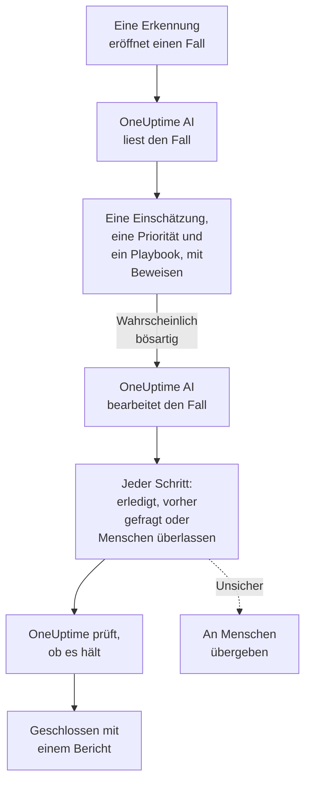

# OneUptime AI in der Sicherheit

OneUptime AI liest jeden Sicherheitsfall so, wie es ein Analyst täte: seine Erkennungen, Ereignisse, Entitäten und Threat Intelligence sowie die Hosts und Personen rundherum. Es sagt, was passiert ist und ob es echt aussieht, schlägt eine Priorität und ein Playbook vor und belegt jede Aussage mit den Beweisen dahinter. Wenn Sie es lassen, bearbeitet es den Fall danach von Anfang bis Ende: Es übernimmt den Fall, dämmt die Bedrohung ein, prüft, ob das Getane hält, lässt den Code korrigieren und schließt den Fall mit einem Bericht. Jede Art von Schritt erledigt es selbstständig, fragt vorher eine Person oder überlässt sie einer Person, je nachdem, wie Sie es einstellen, und jeden Schritt führt es über dieselbe Playbook-Engine aus, die auch Menschen nutzen, sodass jeder Schritt in der Zeitachse des Falls als Schritt von OneUptime AI steht und sich rückgängig machen lässt. Außerdem entwirft es Erkennungsregeln aus einem Satz, und im Chat KI fragen beantwortet es Ihre Fragen zu den Sicherheitsdaten.

:::cards
- [Einen Fall triagieren](#einen-fall-triagieren): Was OneUptime AI liest, was es folgert und was es nie tut.
- [Neue Fälle automatisch triagieren](#neue-fälle-automatisch-triagieren): Jeder Fall, den eine Erkennung eröffnet, wird beim Eröffnen triagiert.
- [Einen Fall von Anfang bis Ende bearbeiten](#einen-fall-von-anfang-bis-ende-bearbeiten): Eindämmen, prüfen, korrigieren und schließen, wobei eine Person genehmigt, was Sie festlegen.
- [Was OneUptime AI in einem Fall tun darf](#was-oneuptime-ai-in-einem-fall-tun-darf): Aus, Vorher fragen oder Selbstständig, für jede Art von Schritt.
- [Wann es einen Fall an Menschen übergibt](#wann-es-einen-fall-an-menschen-übergibt): Warum es aufhört und wer davon erfährt.
- [Ein Playbook nach einer Triage ausführen](#ein-playbook-nach-einer-triage-ausführen): Auf einen Fall reagieren, der als Wahrscheinlich bösartig gelesen wird.
- [Eine Erkennungsregel entwerfen](#eine-erkennungsregel-entwerfen): Beschreiben, was erkannt werden soll, und die Sigma-Regel lesen.
- [KI fragen auf den Sicherheitsseiten](#ki-fragen-auf-den-sicherheitsseiten): Fragen zu Fällen und Ereignissen, in einfachen Worten.
:::

## So funktioniert es

Eine Triage liest nur. Das Bearbeiten eines Falls handelt, im Rahmen dessen, was Sie erlauben, und übergibt den Fall an Menschen, sobald es unsicher ist. Beide laufen mit der eigenen KI des Projekts: **KI aktivieren**, seinem LLM-Anbieter, seinem KI-Guthaben und seinen täglichen KI-Limits.

## Bevor Sie beginnen

- **KI aktivieren** eingeschaltet, unter **Projekteinstellungen → KI → KI-Funktionen**. Ist es aus, zeigt Sicherheit nichts von OneUptime AI, und nichts läuft.
- Ein LLM-Anbieter, den OneUptime AI nutzen kann, unter **Projekteinstellungen → KI → LLM-Anbieter**. OneUptime Cloud stellt einen bereit.
- Eine Rolle, die Sicherheitsfälle bearbeiten darf, um eine Triage zu starten: Projektinhaber, Projektadministrator, Sicherheits-Administrator oder Sicherheits-Mitglied. Sicherheits-Betrachter liest jede Triage, kann aber keine starten. Siehe [Rollen](/docs/permissions/reference#rollen).

## Einen Fall triagieren

Öffnen Sie einen Fall: Die Karte **OneUptime AI** steht oben auf seiner Seite.

| Die Karte sagt | Was es bedeutet |
| --- | --- |
| **Noch nicht triagiert** | Es ist noch keine Triage gelaufen. **Mit KI triagieren** startet eine. |
| **Dieser Fall wird triagiert** | OneUptime AI liest den Fall. Jede Prüfung erscheint, während sie läuft. |
| Eine Einschätzung wie **Wahrscheinlich bösartig** | Die Triage ist fertig. **Erneut triagieren** liest den Fall neu. |
| **Die Triage wurde nicht abgeschlossen** | Der Lauf wurde abgebrochen. **Erneut versuchen** startet einen neuen. |

Ein Sicherheits-Betrachter liest dieselbe Karte: **Mit KI triagieren** und **Erneut versuchen** bleiben ausgegraut, und daneben steht, wer eine Triage starten kann; **Erneut triagieren** und **Priorität setzen** werden nicht angeboten.

Eine Triage liest:

- den Fall: Titel, Priorität, Status, Entitäten und ATT&CK-Zuordnung;
- seine Erkennungen, die neueste zuerst, mit einem Beispielereignis zu jeder;
- die Sicherheitsereignisse und die Threat Intelligence zu seinen Benutzern, Hosts und Adressen;
- das Risiko seiner Benutzer, Hosts und Adressen, und was diese Woche dazu beitrug;
- die Hosts in OneUptime, zu denen seine Hosts und Adressen passen, und wem sie gehören;
- den Vorfall, den er ausgelöst hat, seine Notizen, seine geschützten Entitäten und die aktivierten Playbooks.

Den Rest von OneUptime kann sie ebenfalls lesen, so wie es die Untersuchung eines Vorfalls tut: Logs, Traces, Metriken, Hosts und die schreibgeschützten Werkzeuge der MCP-Server des Projekts.

Alle, die den Fall sehen dürfen, lesen seine Triage, daher liest eine Triage nur, was alle von ihnen lesen dürfen. Liest ein Team, eine benutzerdefinierte Rolle oder ein API-Schlüssel eine Art von Datensatz nur nach Eigentümer oder Label, zählt das nur, wenn der API-Schlüssel oder jemand im Team Sicherheitsfälle oder das Audit-Protokoll lesen darf. Eine Art von Datensatz, die keiner von ihnen nur nach Eigentümer oder Label liest, wird ganz gelesen; wo einige das tun, wird ein Host, Cluster, Dienst oder anderer Datensatz, den ein Eigentümer oder ein Label abgrenzt, ausgelassen und nie genannt oder mitgezählt. Wer Sicherheitsfälle lesen darf, wird bei jeder Triage neu ermittelt, daher kann eine Triage, die geschrieben wurde, bevor jemand diesen Zugriff erhielt, Datensätze nennen, die für diese Person abgegrenzt sind. Der Fall wird immer gelesen, ebenso der Vorfall, den er ausgelöst hat, es sei denn, dieser Vorfall ist privat. Private Vorfälle und Warnungen werden nie gelesen.

### Was sie folgert

| Einschätzung | Bedeutet | Schlägt zum Schließen vor |
| --- | --- | --- |
| Wahrscheinlich bösartig | Die Beweise deuten auf bösartige oder unbefugte Aktivität hin | True Positive |
| Wahrscheinlich harmlos | Die Aktivität wirkt echt, aber erwartet, etwa eine Admin-Aufgabe oder ein Scan Ihres Teams | Benign Positive |
| Wahrscheinlich Fehlalarm | Die Erkennung scheint normale Aktivität falsch gedeutet zu haben | False Positive |
| Nicht eindeutig | Die Beweise reichten nicht für ein Urteil, eine Person muss es sich ansehen | Nichts |

Die Einschätzung gehört OneUptime AI, sie ist nie die Bewertung des Falls: **Fall schließen** beginnt mit der Bewertung, die sie vorschlägt, und eine Person wählt. Unter der Einschätzung zeigt die Karte:

- **Vorgeschlagene Priorität**, mit **Priorität setzen**, wenn der Fall eine andere Priorität hat.
- **Vorgeschlagenes Playbook**, mit **Playbook ausführen**, das es in Ihrem Namen ausführt, mit jeder Genehmigung, die es braucht. Läuft dieses Playbook auf dem Fall bereits, steht statt **Playbook ausführen** der Status seiner Ausführung, etwa **Wartet auf Genehmigung**: Die Ausführung ist unter **Playbooks** des Falls, und eine zweite würde dieselbe Genehmigung noch einmal anfordern.
- Den Bericht: was passiert ist, wie sicher sie ist und was als Nächstes zu tun ist, jede Aussage gefolgt von einem Verweis wie C1.
- **Geprüfte Belege**: jede Abfrage, die die Triage ausgeführt hat. Ein Verweis öffnet seine Abfrage, und wenn Sie eine aufklappen, läuft sie erneut mit Ihren Berechtigungen, über den Zeitraum, den die Triage gelesen hat.
- **Zu diesem Fall fragen**, das KI fragen zu diesem Fall öffnet.

Jede Fallliste zeigt die Einschätzung neben dem Titel jedes Falls und filtert mit **KI-Einschätzung** danach.

### Was sie nie tut

Eine Triage ändert nichts am Fall: weder Status, Priorität, Zuständigkeit, Bewertung noch Notizen. Sie führt kein Playbook aus und dämmt niemanden ein. Ein Playbook, das sie vorschlägt, läuft, wenn eine Person es ausführt, oder über den Auslöser weiter unten. Am Fall handelt OneUptime AI erst, wenn es ihn bearbeitet, und dafür gibt es eine eigene Einstellung: siehe [Einen Fall von Anfang bis Ende bearbeiten](#einen-fall-von-anfang-bis-ende-bearbeiten).

### Text, der eine KI steuern soll

Ereignisse, Warnungen und Werte von Entitäten kommen von außerhalb des Projekts, und ein Angreifer kann sie schreiben. OneUptime AI liest sie alle als Daten, nie als Anweisungen. Liest sich ein Teil der Daten eines Falls wie Anweisungen an eine KI, sagt die Karte das zuerst, eine Einschätzung Wahrscheinlich harmlos oder Wahrscheinlich Fehlalarm wird zu Nicht eindeutig, diese Triage startet kein Playbook, und OneUptime AI bearbeitet den Fall nicht: Es übergibt ihn an Menschen.

## Neue Fälle automatisch triagieren

Öffnen Sie **Produkte → Sicherheitsereignisse → KI → Einstellungen** und schalten Sie **Neue Fälle triagieren** ein: Dann wird jeder Fall, den eine Erkennung eröffnet, beim Eröffnen triagiert. Der Schalter speichert, sobald Sie ihn umlegen. Projektinhaber und Projektadministrator können ihn ändern.

Neue Projekte starten mit ihm eingeschaltet; ein vorher angelegtes Projekt behält ihn aus, bis jemand ihn einschaltet. Ein von Hand eröffneter Fall und der Fall des Testangriffs aus **Testangriff senden** werden triagiert, wenn jemand auf **Mit KI triagieren** klickt.

## Einen Fall von Anfang bis Ende bearbeiten

Schalten Sie auf derselben Seite **Fälle von Anfang bis Ende bearbeiten** ein: Dann übernimmt OneUptime AI jeden Fall, den seine Triage als Wahrscheinlich bösartig einschätzt, und bearbeitet ihn im Rahmen dessen, was Sie unter **Was OneUptime AI in einem Fall tun darf** erlauben. Neue Projekte starten mit diesem Schalter eingeschaltet; ein vorher angelegtes Projekt behält ihn aus, bis jemand ihn einschaltet. Projektinhaber und Projektadministrator können ihn ändern.

Solange er eingeschaltet ist, kann eine Person es auch für einen einzelnen Fall starten: **Mit KI reagieren** auf der Karte **OneUptime AI** des Falls bearbeitet einen Fall, den die Triage von OneUptime AI als Wahrscheinlich bösartig, Wahrscheinlich harmlos oder Wahrscheinlich Fehlalarm eingeschätzt hat. Nicht angeboten wird es bei einem Fall, dessen Triage Nicht eindeutig war, dessen Daten sich wie Anweisungen an eine KI lesen oder der Ihre höchste Priorität hat: Solche Fälle gehören einer Person. Dafür braucht es eine Rolle, die Sicherheitsfälle bearbeiten darf.

### Was es tut

OneUptime AI arbeitet den **Reaktionsplan** des Falls ab, das Dringendste zuerst: **Bestätigen, dass es echt ist**, **Eindämmen**, **Beheben, was es ermöglicht hat** und **Den Fall schließen**. Jeder Schritt wird erledigt, bei einer Person erfragt oder einer Person überlassen, wie es die Zeile für seine Art unter **Was OneUptime AI in einem Fall tun darf** festlegt.

| Schritt | Was OneUptime AI tut |
| --- | --- |
| Den Fall übernehmen | Übernimmt ihn und erhöht seine Priorität auf die, die die Triage vorgeschlagen hat. Es senkt nie eine Priorität, und ein Fall, den es auf Ihre höchste Priorität anhebt, geht an Menschen |
| Einen Fehlalarm ausschließen | Markiert den Schritt nur dann als erledigt, wenn die eigenen Fakten von OneUptime keinen Zweifel lassen: Die Adresse gehört nicht zu Ihren, und niemand hat sich von ihr aus angemeldet. Sonst überlässt es den Schritt einer Person |
| Adresse sperren | Sperrt sie über Ihre [Sperrliste](/docs/telemetry/security-cases#sperrliste) für 24 Stunden und wartet dann auf die Prüfung von OneUptime, ob die Sperre hält. Setzt nichts Ihre Sperrliste durch, überlässt es den Schritt einer Person |
| Benutzer sperren, Host eindämmen | Führt den Schritt eines Ihrer Playbooks aus, der das tut, über Ihren Identitätsanbieter oder Ihr EDR. Gibt es kein solches Playbook, überlässt es den Schritt einer Person |
| Einen Vorfall melden | Fragt immer vorher nach: Ein Vorfall alarmiert Menschen |
| Den Fall auf Eingedämmt setzen | Sobald OneUptime jeden Schritt verifiziert hat, der die Bedrohung eindämmt |
| Die Route korrigieren, die ein Angriff erreicht hat | Lässt „Mit KI beheben“ einen Pull Request öffnen. Eine Person mergt ihn. Es schließt den Fall, sobald OneUptime die Korrektur in Produktion verifiziert, fragt eine Person, wenn die Korrektur nur erledigt aussieht, und bearbeitet den Fall weiter, solange sie nicht hält |
| MFA einschalten, Änderungen des Kontos prüfen | Einer Person überlassen: Kein Produkt sagt OneUptime, ob sie halten |
| Den Fall schließen | Sobald jeder andere Schritt erledigt ist und die Erkennung des Falls 24 Stunden lang ruhig war, als Richtig positiv, mit einem [Abschlussbericht](#der-abschlussbericht) |

Ein Schritt, den die Erkennungsregel des Falls selbst hinzufügt, und alles, was OneUptime nicht ausführen kann, etwa eine Domain in Ihrem DNS-Filter zu sperren, wird einer Person überlassen, mit Begründung.

Jeder Schritt, den OneUptime AI ausführt, läuft über die Playbook-Engine, als Ausführung mit einem einzigen Schritt auf der Seite **Playbooks** des Falls, mit **OneUptime AI** als Auslöser. Daher wartet er auf Genehmigung, lässt geschützte Entitäten in Ruhe, erscheint in der Zeitachse des Falls, wird im Audit-Protokoll festgehalten und lässt sich rückgängig machen, genau wie ein Schritt, den irgendjemand ausführt, und die Zeitachse sagt, dass er von OneUptime AI stammt. Ein Schritt, zu dem es nachfragt, wartet auf die Genehmigung einer Person: im Fall, auf seiner Seite **Playbooks** oder mit einem Tippen in Slack oder Microsoft Teams.

### Sein Protokoll im Fall

Unter der Triage sagt die Karte **OneUptime AI** unter **Bearbeitung des Falls**, wie OneUptime AI den Fall bearbeitet:

| Die Karte sagt | Was es bedeutet |
| --- | --- |
| **OneUptime AI bearbeitet diesen Fall nicht** | **Mit KI reagieren** übernimmt ihn. |
| **Dieser Fall wird bearbeitet** | OneUptime AI arbeitet den Plan ab. **Übernehmen** stoppt es, und der Fall gehört Ihnen. |
| **Wartet auf eine Person** | Es hat jemanden gebeten, einen Schritt zu genehmigen, und macht weiter, sobald jemand antwortet. |
| **An Menschen übergeben** | Es hat aufgehört und sagt, warum. |
| **Der Fall ist geschlossen** | Es hat den Fall geschlossen, oder eine Person hat es getan. Sein **Abschlussbericht** steht über seinen Schritten. |

Darunter steht jeder Schritt, den es ausgeführt, erfragt oder überlassen hat, der neueste zuerst, jeweils mit dem Grund: **Selbstständig erledigt: Ihre Einstellungen erlauben es.**, **Laut Ihren Einstellungen wartet dies auf die Genehmigung einer Person.**, **OneUptime kann diesen Schritt nicht ausführen, daher erledigt ihn eine Person.** Ein erfragter Schritt hat **Genehmigen** und **Ablehnen**; ein ausgeführter Schritt verlinkt auf seine Ausführung, wo er sich rückgängig machen lässt. Ein Schritt, den OneUptime prüft, sagt, was die Prüfung ergeben hat, und ein Schritt, den es schon bei Fällen derselben Regel ausgeführt hat, sagt, wie oft er gehalten hat: „Es hat bei 14 von 15 ähnlichen Fällen gehalten.“

### Ein Fall, den es als harmlos oder als Fehlalarm einschätzt

**Mit KI reagieren** schließt einen Fall, den die Triage als Wahrscheinlich harmlos oder Wahrscheinlich Fehlalarm eingeschätzt hat, als Harmlos positiv oder Falsch positiv, soweit **Den Fall schließen** es erlaubt. Sobald er geschlossen ist, hebt OneUptime AI die Sperren auf, die der Fall gesetzt hat, ebenfalls soweit **Den Fall schließen** es erlaubt, und schlägt für die Regel des Falls eine Ausnahme für den Wert vor, der ihn ausgelöst hat. Die Ausnahme wartet immer auf eine Person: **Genehmigen** fügt sie hinzu, in Ihrem Namen.

## Was OneUptime AI in einem Fall tun darf

Unter **Was OneUptime AI in einem Fall tun darf** auf **Produkte → Sicherheitsereignisse → KI → Einstellungen** hat jede Art von Schritt eine eigene Zeile, die speichert, sobald Sie eine Option wählen:

- **Aus**: OneUptime AI überlässt dies einer Person und vermerkt das im Fall.
- **Vorher fragen**: Es fragt eine Person, mit den Belegen, und erledigt es, sobald jemand genehmigt.
- **Selbstständig**: Es erledigt es ohne Nachfrage und vermerkt das in der Zeitachse des Falls.

| Zeile | Umfasst | Neue Projekte starten mit |
| --- | --- | --- |
| **Den Fall bearbeiten** | Den Fall übernehmen, seine Priorität erhöhen, Schritte mit ihren Belegen als erledigt markieren, ihn auf Eingedämmt setzen | Selbstständig |
| **Adressen sperren** | Die Adresse des Falls an Ihrem Edge sperren, für 24 Stunden | Vorher fragen |
| **Konten eindämmen** | Den Benutzer des Falls sperren oder seine Sitzungen beenden | Vorher fragen |
| **Hosts eindämmen** | Den Host des Falls eindämmen oder isolieren | Vorher fragen |
| **Code korrigieren** | „Mit KI beheben“ einen Pull Request für die Route öffnen lassen, die ein Angriff erreicht hat | Selbstständig |
| **Den Fall schließen** | Den Fall mit seinem Abschlussbericht schließen und die Sperren des Falls aufheben, sobald er als harmlos geschlossen ist | Vorher fragen |

Die Einstellungen gelten, solange **Fälle von Anfang bis Ende bearbeiten** eingeschaltet ist, und die Karte weist darauf hin, solange es aus ist. Projektinhaber und Projektadministrator können sie ändern.

**Adressen sperren**, **Konten eindämmen** oder **Hosts eindämmen** auf **Selbstständig** zu setzen, erfordert die Befugnis eines Sicherheits-Administrators, die auch Projektinhaber und Projektadministratoren haben, und OneUptime hält fest, wer es wann getan hat, wie bei einem Playbook-Schritt, dessen Genehmigung ausgeschaltet ist. **Adressen sperren** fragt zuerst nach: **Bestätigen und einschalten** ist die Bestätigung eines Sicherheits-Administrators, und die Zeile sagt danach, wann sie erteilt wurde. Bis ein Sicherheits-Administrator es bestätigt, fragt OneUptime AI nach, bevor es sperrt.

Was auch immer die Zeilen sagen, OneUptime AI:

- handelt nie an einem geschützten Benutzer, Host oder einer geschützten Adresse: Es übergibt den Fall an Menschen;
- führt selbstständig höchstens 10 Aktionen pro Stunde über alle Ihre Fälle hinweg aus und übergibt danach den nächsten Fall an Menschen;
- sperrt höchstens für 24 Stunden;
- mergt nie Code: Jeden Pull Request mergt eine Person;
- fragt immer nach, bevor es einen Vorfall meldet oder eine Regelausnahme hinzufügt;
- bearbeitet einen Fall mit jeweils einer Ausführung, und ein Server, der neu startet, verliert nie eine Ausführung, die handelt.

## Wann es einen Fall an Menschen übergibt

OneUptime AI zieht sich nie stillschweigend zurück. Es übergibt den Fall an Menschen und sagt auf der Karte und in der Zeitachse, warum, wenn:

- sich ein Teil der Daten des Falls wie Anweisungen an eine KI liest;
- der Fall Ihre höchste Priorität hat;
- das Ziel seines nächsten Schritts geschützt ist;
- es innerhalb einer Stunde so oft selbstständig gehandelt hat, wie es darf;
- KI für das Projekt oder für Sicherheitsfälle ausgeschaltet ist, kein LLM-Anbieter vorhanden ist oder das Projekt kein KI-Guthaben mehr hat oder sein tägliches KI-Limit erreicht hat;
- seine Triage nicht feststellen konnte, ob der Fall echt ist;
- ein ausgeführter Schritt nicht hält, ein gestarteter Schritt nicht abgeschlossen wurde oder eine Person einen seiner Schritte abgelehnt oder rückgängig gemacht hat;
- es nicht erkennen kann, was als Nächstes zu tun ist, oder alles, was im Fall noch offen ist, eine Person erledigen muss.

Die Zuständigen des Falls erfahren es sofort, oder, wenn niemand zuständig ist, die Personen, die über Fälle seiner Priorität informiert werden: **OneUptime AI hat einen Sicherheitsfall an Menschen übergeben**, unter **Benutzereinstellungen → Benachrichtigungseinstellungen**. Eine Workspace-Benachrichtigungsregel für Sicherheitsfälle postet es in ihrem Kanal in Slack oder Microsoft Teams unter **Von OneUptime AI an Menschen übergebene Fälle**. **Übernehmen** übergibt den Fall, ohne jemanden zu benachrichtigen, denn die Person, die es gedrückt hat, hat ihn.

**Mit KI reagieren** bittet OneUptime AI, den Fall erneut zu bearbeiten, ab dem Stand, an dem der Fall gerade ist.

## Der Abschlussbericht

Wenn OneUptime AI einen Fall schließt oder eine Person darum bittet, schreibt es einen Abschlussbericht aus dem, was der Fall enthält, nicht aus den Worten der Triage: was passiert ist, die Auswirkungen, was getan wurde, was behoben wurde und was zu beobachten ist. Der Bericht ist die Abschlussnotiz des Falls, er steht in der Zeitachse, und die Karte zeigt ihn unter **Abschlussbericht**. Steht **Den Fall schließen** auf **Vorher fragen**, wartet der Fall darauf, dass eine Person das Schließen genehmigt, mit dem Bericht zum Lesen vorab.

## Wie es gemessen wird

**Produkte → Sicherheitsereignisse → Übersicht** zeigt, wie OneUptime AI die Fälle der letzten 30 Tage bearbeitet hat, sobald es einen bearbeitet oder dazu nachgefragt hat: **Von OneUptime AI aufgelöst**, gemessen an den Fällen, die es bearbeitet hat; **Zeit bis zur Eindämmung mit KI** und **Zeit bis zum Schließen mit KI**, jeweils neben der Zeit ohne KI; und **Angefragte Genehmigungen**, wie schnell Menschen geantwortet haben und wie viele seiner Schritte Menschen rückgängig gemacht haben.

## Ein Playbook nach einer Triage ausführen

Ein Playbook, dessen **Auslöser** **Als wahrscheinlich bösartig triagiert** ist, läuft einmal auf einem Fall, wenn eine Triage ihn als Wahrscheinlich bösartig liest. **Für Fälle mindestens**, **Nur für Erkennungen aus** und **Nur für diese Erkennungsregeln** grenzen es ein wie bei jedem Auslöser, und seine Eindämmungsschritte warten wie immer auf Genehmigung. Es läuft nicht:

- nach einer Triage, die Text gefunden hat, der eine KI steuern soll;
- ein zweites Mal auf demselben Fall, wie oft der Fall auch triagiert wird;
- auf dem Fall des Testangriffs, außer jeder Schritt des Playbooks bleibt innerhalb von OneUptime.

Einem neuen Playbook wird dieser Auslöser nur angeboten, solange die KI des Projekts an ist.

## Eine Erkennungsregel entwerfen

Klicken Sie auf der Seite **Erkennungsregeln** unter dem Feld **Sigma-Regel (YAML)** auf **Mit KI entwerfen** und sagen Sie, was die Regel erkennen soll, etwa zehn fehlgeschlagene Anmeldungen von einer IP-Adresse innerhalb von fünf Minuten. **Regel entwerfen** setzt eine Sigma-Regel in das Feld, geprüft wie eine gespeicherte Regel. Lesen Sie sie, ändern Sie sie nach Bedarf und speichern Sie sie wie gewohnt: Gespeichert wird erst, wenn Sie speichern. Steht schon eine Regel im Feld, heißt die Schaltfläche **Mit KI neu entwerfen**, und der Entwurf ersetzt diese Regel.

Zum Entwerfen braucht es eine Rolle, die Erkennungsregeln anlegen darf.

## KI fragen auf den Sicherheitsseiten

**KI fragen** weiß, auf welcher Sicherheitsseite Sie sind. Auf einem Fall liest es zuerst den Fall und bietet Fragen wie **Ist es echt?** an. Auf den anderen Seiten der Sicherheitsereignisse durchsucht eine Frage in einfachen Worten Ihre Sicherheitsereignisse. Es kann außerdem Werte mit Ihrer Threat Intelligence abgleichen, sehen, wie aktiv ein Benutzer, ein Host oder eine Adresse war, und die Playbooks auflisten, die für einen Fall infrage kommen.

KI fragen kann einem Fall eine Notiz hinzufügen und ein Playbook darauf ausführen, in Ihrem Namen, und fragt vor jedem Schritt nach. Ein Playbook, das es ausführt, wartet wie jedes andere auf Genehmigung.

Wenn ein Fall einen Vorfall auslöst, liest auch die KI-Untersuchung des Vorfalls den Fall: was erkannt wurde, zu wem und die Triage von OneUptime AI dazu.

## Kosten und Limits

Eine Triage ist Arbeit von OneUptime AI, wie die Untersuchung eines Vorfalls. Auf OneUptime Cloud wird sie aus dem KI-Guthaben des Projekts bezahlt und zählt zu den eigenen täglichen KI-Limits des Projekts (**Tägliche Limits**, unter **Projekteinstellungen → KI → KI-Funktionen**). Die täglichen Limits für Vorfälle und Warnungen gelten nicht. Ein Fall hat jeweils eine Triage, und die KI-Protokolle (**Projekteinstellungen → KI → KI-Protokolle**) listen ihre Aufrufe.

Ist das KI-Guthaben des Projekts aufgebraucht oder ein tägliches KI-Limit erreicht, werden neue Fälle nicht triagiert: Die Karte sagt warum, und **Mit KI triagieren** funktioniert wieder, sobald Guthaben hinzugefügt ist oder das Limit zurückgesetzt wird. Wenn OneUptime AI einen Fall bearbeitet, liest es den eigenen Plan und die Prüfungen des Falls, statt das LLM zu fragen, und es hält an denselben Limits an: Es übergibt den Fall an Menschen und sagt, warum.

## Fehlerbehebung

:::details Ein neuer Fall wurde nicht triagiert
Prüfen Sie, ob **KI aktivieren** eingeschaltet ist, und **Neue Fälle triagieren** unter **Produkte → Sicherheitsereignisse → KI → Einstellungen**. Ein von Hand eröffneter Fall und der Fall des Testangriffs werden nur triagiert, wenn jemand darum bittet. Öffnen Sie den Fall: Wenn etwas eine Triage verhindert, sagt die Karte, was, und wo es sich beheben lässt.
:::

:::details OneUptime AI hat einen Fall nicht bearbeitet
Prüfen Sie, ob **Fälle von Anfang bis Ende bearbeiten** unter **Produkte → Sicherheitsereignisse → KI → Einstellungen** eingeschaltet ist. Von sich aus nimmt es einen Fall nur auf, wenn die Triage ihn als Wahrscheinlich bösartig einschätzt. Öffnen Sie den Fall: Unter **Bearbeitung des Falls** sagt die Karte, warum es ihn nicht bearbeitet, und **Mit KI reagieren** bittet es darum.
:::

:::details Es fragt vor dem Sperren nach, obwohl Adressen sperren auf Selbstständig steht
**Selbstständig** für **Adressen sperren** gilt erst, wenn ein Sicherheits-Administrator es bestätigt hat: Die Zeile sagt, wann, oder dass es noch niemand getan hat. Eine geschützte Adresse oder eine Ihrer eigenen wird nie gesperrt: OneUptime AI übergibt den Fall an Menschen. Solange nichts Ihre Sperrliste durchsetzt, überlässt es den Schritt einer Person.
:::

:::details Die Karte sagt, dass das Projekt kein KI-Guthaben mehr hat oder sein tägliches KI-Limit erreicht hat
Ein Projektinhaber oder jemand mit Manage Billing kann unter **Projekteinstellungen → KI → KI-Guthaben** Guthaben hinzufügen oder unter **Projekteinstellungen → KI → KI-Funktionen** das Limit anheben oder entfernen. Klicken Sie danach auf dem Fall auf **Mit KI triagieren**.
:::

:::details Die Karte sagt, dass sich Text im Fall wie Anweisungen an eine KI liest
Ein Teil der Daten des Falls, etwa eine Ereignismeldung oder ein Benutzername, wurde geschrieben, um eine KI zu steuern. OneUptime AI hat ihn als Daten gelesen und die Entscheidung Ihnen überlassen: Lesen Sie die Erkennungen und die Beweise selbst, bevor Sie den Fall schließen.
:::

:::details Ein Playbook mit dem KI-Auslöser ist nicht gelaufen
Prüfen Sie, ob das Playbook aktiviert ist, ob die Triage den Fall als Wahrscheinlich bösartig gelesen hat und ob seine Einstellungen **Für Fälle mindestens**, **Nur für Erkennungen aus** und **Nur für diese Erkennungsregeln** zum Fall passen. Es läuft einmal pro Fall und nicht nach einer Triage, die Text gefunden hat, der eine KI steuern soll.
:::

## Nächste Schritte

:::cards
- [Sicherheitsfälle und Playbooks](/docs/telemetry/security-cases): Fälle bearbeiten, mit einer Bewertung schließen und Playbooks bauen.
- [AI SRE](/docs/ai/ai-sre): Wie OneUptime AI Vorfälle und Warnungen untersucht, und seine Limits.
- [KI fragen](/docs/ai/ask-ai): Stellen Sie Fragen zu Ihrem Projekt in einfachen Worten.
- [LLM-Anbieter](/docs/ai/llm-provider): Wählen Sie das Modell, das OneUptime AI nutzt.
:::
