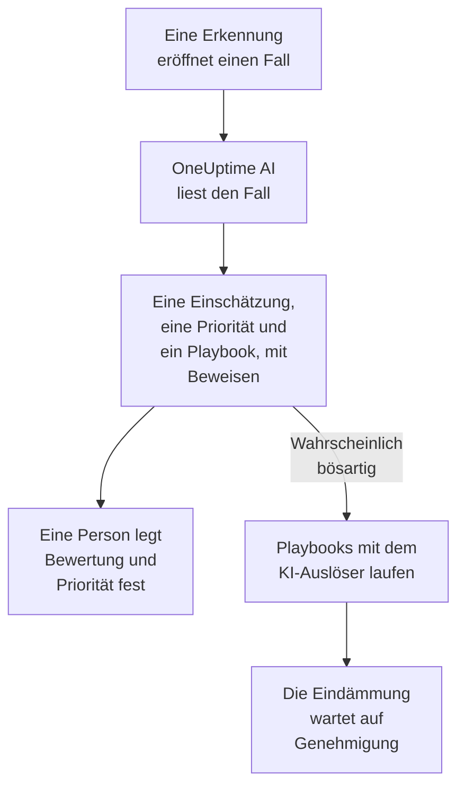

# OneUptime AI in der Sicherheit

OneUptime AI liest jeden Sicherheitsfall so, wie es ein Analyst täte: seine Erkennungen, Ereignisse, Entitäten und Threat Intelligence sowie die Hosts und Personen rundherum. Es sagt, was passiert ist und ob es echt aussieht, schlägt eine Priorität und ein Playbook vor und belegt jede Aussage mit den Beweisen dahinter. Von sich aus ändert es nichts: Eine Person legt die Bewertung und die Priorität fest und führt das Playbook aus. Außerdem entwirft es Erkennungsregeln aus einem Satz, und im Chat KI fragen beantwortet es Ihre Fragen zu den Sicherheitsdaten.

:::cards
- [Einen Fall triagieren](#einen-fall-triagieren): Was OneUptime AI liest, was es folgert und was es nie tut.
- [Neue Fälle automatisch triagieren](#neue-fälle-automatisch-triagieren): Jeder Fall, den eine Erkennung eröffnet, wird beim Eröffnen triagiert.
- [Ein Playbook nach einer Triage ausführen](#ein-playbook-nach-einer-triage-ausführen): Auf einen Fall reagieren, der als Wahrscheinlich bösartig gelesen wird.
- [Eine Erkennungsregel entwerfen](#eine-erkennungsregel-entwerfen): Beschreiben, was erkannt werden soll, und die Sigma-Regel lesen.
- [KI fragen auf den Sicherheitsseiten](#ki-fragen-auf-den-sicherheitsseiten): Fragen zu Fällen und Ereignissen, in einfachen Worten.
:::

## So funktioniert es

Eine Triage liest nur. Sie läuft mit der eigenen KI des Projekts: **KI aktivieren**, seinem LLM-Anbieter, seinem KI-Guthaben und seinen täglichen KI-Limits.

## Bevor Sie beginnen

- **KI aktivieren** eingeschaltet, unter **Projekteinstellungen → KI → KI-Funktionen**. Ist es aus, zeigt Sicherheit nichts von OneUptime AI, und nichts läuft.
- Ein LLM-Anbieter, den OneUptime AI nutzen kann, unter **Projekteinstellungen → KI → LLM-Anbieter**. OneUptime Cloud stellt einen bereit.
- Eine Rolle, die Sicherheitsfälle bearbeiten darf, um eine Triage zu starten: Project Owner, Project Admin, Security Admin oder Security Member. Security Viewer liest jede Triage, kann aber keine starten. Siehe [Rollen](/docs/permissions/reference#rollen).

## Einen Fall triagieren

Öffnen Sie einen Fall: Die Karte **OneUptime AI** steht oben auf seiner Seite.

| Die Karte sagt | Was es bedeutet |
| --- | --- |
| **Noch nicht triagiert** | Es ist noch keine Triage gelaufen. **Mit KI triagieren** startet eine. |
| **Dieser Fall wird triagiert** | OneUptime AI liest den Fall. Jede Prüfung erscheint, während sie läuft. |
| Eine Einschätzung wie **Wahrscheinlich bösartig** | Die Triage ist fertig. **Erneut triagieren** liest den Fall neu. |
| **Die Triage wurde nicht abgeschlossen** | Der Lauf wurde abgebrochen. **Erneut versuchen** startet einen neuen. |

Eine Triage liest:

- den Fall: Titel, Priorität, Status, Entitäten und ATT&CK-Zuordnung;
- seine Erkennungen, die neueste zuerst, mit einem Beispielereignis zu jeder;
- die Sicherheitsereignisse und die Threat Intelligence zu seinen Benutzern, Hosts und Adressen;
- das Risiko seiner Benutzer, Hosts und Adressen, und was diese Woche dazu beitrug;
- die Hosts in OneUptime, zu denen seine Hosts und Adressen passen, und wem sie gehören;
- den Vorfall, den er ausgelöst hat, seine Notizen, seine geschützten Entitäten und die aktivierten Playbooks.

Den Rest von OneUptime kann sie ebenfalls lesen, so wie es die Untersuchung eines Vorfalls tut: Logs, Traces, Metriken, Hosts und die schreibgeschützten Werkzeuge der MCP-Server des Projekts.

### Was sie folgert

| Einschätzung | Bedeutet | Schlägt zum Schließen vor |
| --- | --- | --- |
| Wahrscheinlich bösartig | Die Beweise deuten auf bösartige oder unbefugte Aktivität hin | True Positive |
| Wahrscheinlich harmlos | Die Aktivität wirkt echt, aber erwartet, etwa eine Admin-Aufgabe oder ein Scan Ihres Teams | Benign Positive |
| Wahrscheinlich Fehlalarm | Die Erkennung scheint normale Aktivität falsch gedeutet zu haben | False Positive |
| Nicht eindeutig | Die Beweise reichten nicht für ein Urteil, eine Person muss es sich ansehen | Nichts |

Die Einschätzung gehört OneUptime AI, sie ist nie die Bewertung des Falls: **Fall schließen** beginnt mit der Bewertung, die sie vorschlägt, und eine Person wählt. Unter der Einschätzung zeigt die Karte:

- **Vorgeschlagene Priorität**, mit **Priorität setzen**, wenn der Fall eine andere Priorität hat.
- **Vorgeschlagenes Playbook**, mit **Playbook ausführen**, das es in Ihrem Namen ausführt, mit jeder Genehmigung, die es braucht.
- Den Bericht: was passiert ist, wie sicher sie ist und was als Nächstes zu tun ist, jede Aussage gefolgt von einem Verweis wie C1.
- **Geprüfte Belege**: jede Abfrage, die die Triage ausgeführt hat. Ein Verweis öffnet seine Abfrage, und wenn Sie eine aufklappen, läuft sie erneut mit Ihren Berechtigungen, über den Zeitraum, den die Triage gelesen hat.
- **Zu diesem Fall fragen**, das KI fragen zu diesem Fall öffnet.

Jede Fallliste zeigt die Einschätzung neben dem Titel jedes Falls und filtert mit **KI-Einschätzung** danach.

### Was sie nie tut

Eine Triage ändert nichts am Fall: weder Status, Priorität, Zuständigkeit, Bewertung noch Notizen. Sie führt kein Playbook aus und dämmt niemanden ein. Ein Playbook, das sie vorschlägt, läuft, wenn eine Person es ausführt, oder über den Auslöser weiter unten.

### Text, der eine KI steuern soll

Ereignisse, Warnungen und Werte von Entitäten kommen von außerhalb des Projekts, und ein Angreifer kann sie schreiben. OneUptime AI liest sie alle als Daten, nie als Anweisungen. Liest sich ein Teil der Daten eines Falls wie Anweisungen an eine KI, sagt die Karte das zuerst, eine Einschätzung Wahrscheinlich harmlos oder Wahrscheinlich Fehlalarm wird zu Nicht eindeutig, und diese Triage startet kein Playbook.

## Neue Fälle automatisch triagieren

Öffnen Sie **Produkte → Sicherheitsereignisse → KI → Einstellungen** und schalten Sie **Neue Fälle triagieren** ein: Dann wird jeder Fall, den eine Erkennung eröffnet, beim Eröffnen triagiert. Der Schalter speichert, sobald Sie ihn umlegen. Project Owner und Project Admin können ihn ändern.

Neue Projekte starten mit ihm eingeschaltet; ein vorher angelegtes Projekt behält ihn aus, bis jemand ihn einschaltet. Ein von Hand eröffneter Fall und der Fall des Testangriffs aus **Testangriff senden** werden triagiert, wenn jemand auf **Mit KI triagieren** klickt.

## Ein Playbook nach einer Triage ausführen

Ein Playbook, dessen **Auslöser** **Als wahrscheinlich bösartig triagiert** ist, läuft einmal auf einem Fall, wenn eine Triage ihn als Wahrscheinlich bösartig liest. **Für Fälle mindestens**, **Nur für Erkennungen aus** und **Nur für diese Erkennungsregeln** grenzen es ein wie bei jedem Auslöser, und seine Eindämmungsschritte warten wie immer auf Genehmigung. Es läuft nicht:

- nach einer Triage, die Text gefunden hat, der eine KI steuern soll;
- ein zweites Mal auf demselben Fall, wie oft der Fall auch triagiert wird;
- auf dem Fall des Testangriffs, außer jeder Schritt des Playbooks bleibt innerhalb von OneUptime.

Einem neuen Playbook wird dieser Auslöser nur angeboten, solange die KI des Projekts an ist.

## Eine Erkennungsregel entwerfen

Klicken Sie auf der Seite **Erkennungsregeln** unter dem Feld **Sigma-Regel (YAML)** auf **Mit KI entwerfen** und sagen Sie, was die Regel erkennen soll, etwa zehn fehlgeschlagene Anmeldungen von einer IP-Adresse innerhalb von fünf Minuten. **Regel entwerfen** setzt eine Sigma-Regel in das Feld, geprüft wie eine gespeicherte Regel. Lesen Sie sie, ändern Sie sie nach Bedarf und speichern Sie sie wie gewohnt: Gespeichert wird erst, wenn Sie speichern. Steht schon eine Regel im Feld, heißt die Schaltfläche **Mit KI neu entwerfen**, und der Entwurf ersetzt diese Regel.

Zum Entwerfen braucht es eine Rolle, die Erkennungsregeln anlegen darf.

## KI fragen auf den Sicherheitsseiten

**KI fragen** weiß, auf welcher Sicherheitsseite Sie sind. Auf einem Fall liest es zuerst den Fall und bietet Fragen wie **Ist es echt?** an. Auf den anderen Seiten der Sicherheitsereignisse durchsucht eine Frage in einfachen Worten Ihre Sicherheitsereignisse. Es kann außerdem Werte mit Ihrer Threat Intelligence abgleichen, sehen, wie aktiv ein Benutzer, ein Host oder eine Adresse war, und die Playbooks auflisten, die für einen Fall infrage kommen.

KI fragen kann einem Fall eine Notiz hinzufügen und ein Playbook darauf ausführen, in Ihrem Namen, und fragt vor jedem Schritt nach. Ein Playbook, das es ausführt, wartet wie jedes andere auf Genehmigung.

Wenn ein Fall einen Vorfall auslöst, liest auch die KI-Untersuchung des Vorfalls den Fall: was erkannt wurde, zu wem und die Triage von OneUptime AI dazu.

## Kosten und Limits

Eine Triage ist Arbeit von OneUptime AI, wie die Untersuchung eines Vorfalls. Auf OneUptime Cloud wird sie aus dem KI-Guthaben des Projekts bezahlt und zählt zu den eigenen täglichen KI-Limits des Projekts (**Tägliche Limits**, unter **Projekteinstellungen → KI → KI-Funktionen**). Die täglichen Limits für Vorfälle und Warnungen gelten nicht. Ein Fall hat jeweils eine Triage, und die KI-Protokolle (**Projekteinstellungen → KI → KI-Protokolle**) listen ihre Aufrufe.

Ist das KI-Guthaben des Projekts aufgebraucht oder ein tägliches KI-Limit erreicht, werden neue Fälle nicht triagiert: Die Karte sagt warum, und **Mit KI triagieren** funktioniert wieder, sobald Guthaben hinzugefügt ist oder das Limit zurückgesetzt wird.

## Fehlerbehebung

:::details Ein neuer Fall wurde nicht triagiert
Prüfen Sie, ob **KI aktivieren** eingeschaltet ist, und **Neue Fälle triagieren** unter **Produkte → Sicherheitsereignisse → KI → Einstellungen**. Ein von Hand eröffneter Fall und der Fall des Testangriffs werden nur triagiert, wenn jemand darum bittet. Öffnen Sie den Fall: Wenn etwas eine Triage verhindert, sagt die Karte, was, und wo es sich beheben lässt.
:::

:::details Die Karte sagt, dass das Projekt kein KI-Guthaben mehr hat oder sein tägliches KI-Limit erreicht hat
Ein Projektinhaber oder jemand mit Manage Billing kann unter **Projekteinstellungen → KI → KI-Guthaben** Guthaben hinzufügen oder unter **Projekteinstellungen → KI → KI-Funktionen** das Limit anheben oder entfernen. Klicken Sie danach auf dem Fall auf **Mit KI triagieren**.
:::

:::details Die Karte sagt, dass sich Text im Fall wie Anweisungen an eine KI liest
Ein Teil der Daten des Falls, etwa eine Ereignismeldung oder ein Benutzername, wurde geschrieben, um eine KI zu steuern. OneUptime AI hat ihn als Daten gelesen und die Entscheidung Ihnen überlassen: Lesen Sie die Erkennungen und die Beweise selbst, bevor Sie den Fall schließen.
:::

:::details Ein Playbook mit dem KI-Auslöser ist nicht gelaufen
Prüfen Sie, ob das Playbook aktiviert ist, ob die Triage den Fall als Wahrscheinlich bösartig gelesen hat und ob seine Einstellungen **Für Fälle mindestens**, **Nur für Erkennungen aus** und **Nur für diese Erkennungsregeln** zum Fall passen. Es läuft einmal pro Fall und nicht nach einer Triage, die Text gefunden hat, der eine KI steuern soll.
:::

## Nächste Schritte

:::cards
- [Sicherheitsfälle und Playbooks](/docs/telemetry/security-cases): Fälle bearbeiten, mit einer Bewertung schließen und Playbooks bauen.
- [AI SRE](/docs/ai/ai-sre): Wie OneUptime AI Vorfälle und Warnungen untersucht, und seine Limits.
- [KI fragen](/docs/ai/ask-ai): Stellen Sie Fragen zu Ihrem Projekt in einfachen Worten.
- [LLM-Anbieter](/docs/ai/llm-provider): Wählen Sie das Modell, das OneUptime AI nutzt.
:::
