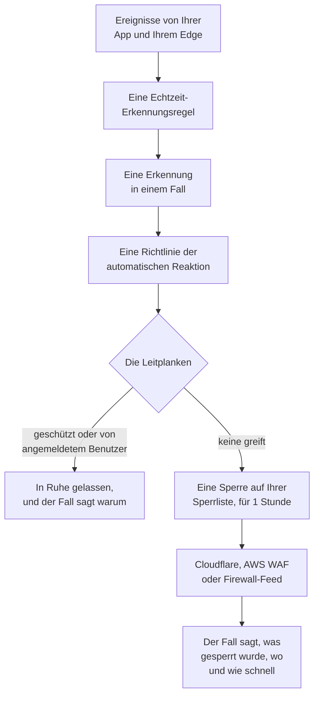

# Automatische Reaktion

Richtlinien der automatischen Reaktion belegen eine angreifende Adresse mit einer Challenge oder sperren sie, sobald die Erkennung erfolgt, noch bevor jemand den Fall sichtet: Scanner, die Ihre App abtasten, und Bots, die ein Passwort nach dem anderen ausprobieren, werden innerhalb weniger Minuten nach ihrer ersten Anfrage abgewiesen. Jedes Projekt bringt drei vorgefertigte Richtlinien mit, jede aus, bis Sie sie einschalten, und jede beginnt mit einem einwöchigen Testlauf, der nur aufzeichnet, was sie getan hätte. Leitplanken machen eine Richtlinie sicher genug, um sie eingeschaltet zu lassen: Sie berührt nie Ihre eigenen Adressen oder eine, die Ihre angemeldeten Benutzer verwenden, und sie hört auf und alarmiert einen Menschen, wenn ein Angriff größer ist, als sie allein bewältigen sollte.

:::cards
- [Eine Richtlinie einschalten](#eine-richtlinie-einschalten): Zuerst eine Woche Testlauf, dann ein Klick.
- [Die Leitplanken](#die-leitplanken): Was eine Richtlinie nie tut, und wann sie aufhört.
- [Zeit bis zur Sperre](#zeit-bis-zur-sperre): Wie schnell jede Richtlinie sperrt, auf ihrer Karte und im Fall.
- [Ihre eigene Richtlinie](#ihre-eigene-richtlinie): Reagieren Sie auf die Techniken, Regeln oder Threat Intel Ihrer Wahl.
:::

## So funktioniert es

Eine Richtlinie reagiert auf eine Erkennung, sobald sie in ihrem Fall erfasst wird, wenige Sekunden nachdem die Regel auslöst. Ihre Sperre kommt auf Ihre [Sperrliste](/docs/telemetry/security-cases#sperrliste), so wie der Playbook-Schritt **Adresse sperren**, mit dem Namen der Richtlinie als Urheber: Die Ziele, die Ihre Sperrliste durchsetzen, halten sie, sie erscheint in der Zeitachse des Falls und im Audit-Log, und sie läuft von selbst ab. Sie braucht keine Genehmigung: Wer die Richtlinie eingeschaltet hat, hat ihre Sperren genehmigt.

## Bevor Sie beginnen

- Ein Ziel, das Ihre Sperrliste durchsetzt: Cloudflare, AWS WAF oder eine Firewall oder ein Proxy, der einen [Sperrlisten-Feed](/docs/telemetry/blocklist-feeds) liest. Solange nichts sie durchsetzt, sagt die Seite das, und die Sperren einer Richtlinie greifen nirgends.
- Die Ereignisse, die die Regeln einer Richtlinie lesen: die Zugriffsprotokolle oder Traces Ihrer App oder die Ereignisse Ihres Edge, etwa die Firewall-Ereignisse von Cloudflare, und Ihre Anmeldungen. Siehe [Sicherheitsereignisse](/docs/telemetry/security-events).
- Eine Rolle, die eine Richtlinie einschalten darf: Sicherheits-Administrator, Projektadministrator oder Projektinhaber. Sicherheits-Mitglied und Sicherheits-Betrachter sehen die Richtlinien und was sie getan haben. Siehe [Rollen](/docs/permissions/reference#rollen).

## Die vorgefertigten Richtlinien

| Richtlinie | Reagiert auf | Tut | Erste Sperre |
| --- | --- | --- | --- |
| **Scanner** | Web-Scans und Angriffsversuche (ATT&CK T1595, T1190): SQL-Injection-, Path-Traversal- und Log4Shell-Versuche und viele Treffer verwalteter Cloudflare-Regeln von einer Adresse, solange jede Anfrage der Adresse abgewiesen wurde | Challenge | 1 Stunde |
| **Passwortraten** | Brute Force und Password Spraying (ATT&CK T1110): fehlgeschlagene Anmeldungen von einer Adresse und fehlgeschlagene Anmeldungen und dann ein Erfolg von derselben Adresse | Sperren | 1 Stunde |
| **Bekannt bösartige Adressen** | Jede Erkennung zu einer Adresse, die Ihre [Threat Intel](/docs/telemetry/threat-intelligence) auflistet | Sperren | 24 Stunden |

Menschen bestehen eine Challenge, Skripte und Bots nicht. Scanner belegt eine Adresse nur mit einer Challenge, solange keine ihrer Anfragen Ihre App erreicht hat: Eine Adresse, deren Anfragen durchkamen, ist ein Fall für einen Menschen.

Wenn Sie Scanner oder Passwortraten einschalten, in den Testlauf oder ganz, laufen die Regeln der **Regelbibliothek**, auf die sie reagiert, in Echtzeit, und die fehlenden kommen in Ihr Projekt: Eine Echtzeit-Regel löst Sekunden nach dem Eintreffen der Ereignisse aus, eine geplante liest Minuten später. Eine Regel, die jemand ausgeschaltet hat, bleibt aus. Ein Projekt führt höchstens 50 Regeln in Echtzeit aus: Darüber hinaus bleibt eine Regel bei ihrem Zeitplan, und die Karte der Richtlinie zeigt **Nach Zeitplan** daneben.

## Eine Richtlinie einschalten

:::steps
### Automatische Reaktion öffnen

Öffnen Sie **Produkte → Sicherheitsereignisse → Playbooks → Automatische Reaktion**. Jede Richtlinie hat ihre Karte: was sie tut, ein Chip mit **Aus**, **Testlauf**, **Testlauf beendet** oder **An**, und ihren Schalter.

### Den Testlauf starten

Legen Sie den Schalter der Richtlinie um. 7 Tage lang zeichnet sie auf, was sie getan hätte, und berührt keinen Datenverkehr: Der Fall sagt "Trial run: the Scanners policy would have challenged 35.205.11.131 for 1 hour." Die Karte zählt die bisherigen Adressen und was ihre Leitplanken in Ruhe gelassen haben.

### Einschalten

Wenn die Woche um ist, sagt die Karte, was die Richtlinie getan hätte, etwa "In 7 Tagen hätte sie 1.283 Adressen mit einer Challenge belegt. Keine hatte angemeldete Benutzer, und keine gehörte Ihnen. Einschalten?", und Ihre Sicherheitsverantwortlichen bekommen dasselbe per E-Mail. Klicken Sie auf **Einschalten**: Ab dann reagiert die Richtlinie.
:::

Um eine Richtlinie ohne ihre Woche Testlauf einzuschalten, öffnen Sie **Weitere Einstellungen** auf ihrer Karte und klicken Sie auf **Ohne Testlauf einschalten**. Ihre Leitplanken gelten weiterhin. Legen Sie den Schalter erneut um, um eine Richtlinie auszuschalten; nach einer ganzen Woche Testlauf wieder eingeschaltet, reagiert sie sofort.

## Die Leitplanken

- **Nie Ihre eigenen oder geschützte Adressen.** Die Einträge von **Geschützte Entitäten** und alles, was OneUptime von selbst schützt: Ihre Hosts, Cloud-Ressourcen und Prüfer, die Bereiche, die nicht im Internet liegen, und der Edge vor Ihrer App. Siehe [Sperrliste](/docs/telemetry/security-cases#sperrliste).
- **Nie eine Adresse, die ein angemeldeter Benutzer in den letzten 30 Tagen verwendet hat.** Das Netz eines Büros, der Proxy eines Kunden oder das Zuhause eines Menschen: OneUptime sucht die Adresse in den Anmeldungen Ihres Identitätsanbieters und in den Anfragen, die Ihre App einem angemeldeten Benutzer beantwortet hat, denen mit einer Benutzer-ID in ihren Traces oder Logs. Eine Adresse, die es nicht prüfen kann, weil diese Ereignisse nicht gelesen werden konnten oder Ihre Scrub-Regeln Adressen so verbergen, dass es sie nicht zuordnen kann, bleibt einem Menschen überlassen.
- **Längere Sperren für eine Adresse, die wiederkommt.** Die erste Sperre dauert 1 Stunde, dann 24 Stunden, dann 7 Tage für eine Adresse, die innerhalb von 30 Tagen erneut gesperrt wird. Bekannt bösartige Adressen beginnt bei 24 Stunden.
- **Höchstens 50 automatische Sperren pro Stunde.** Darüber hinaus hören Ihre Richtlinien auf zu sperren und alarmieren Ihre Sicherheitsverantwortlichen: Ein so großer Angriff braucht einen Menschen. Die Seite sagt das, solange es anhält.
- **Rückgängig bei Zweifel.** Wenn ein angemeldeter Benutzer von einer Adresse aus gesehen wird, die eine Richtlinie gesperrt hat, hebt die Richtlinie die Sperre auf und informiert Ihre Sicherheitsverantwortlichen.

Ihre Sicherheitsverantwortlichen sind die Sicherheits-Administratoren Ihres Projekts oder, wenn es keine hat, seine Projektinhaber. Jede Adresse, die eine Leitplanke in Ruhe gelassen hat, steht mit dem Grund in ihrem Fall.

## Wo ein Ziel keine Challenge stellen kann

Cloudflare und AWS WAF stellen Challenges. Eine Firewall, die einen Sperrlisten-Feed liest, kann das nicht, daher ist die Challenge einer Richtlinie dort eine Sperre für dieselbe Zeit, und die Karte der Richtlinie und der Fall sagen das, etwa "FortiGate feed cannot challenge, so it blocks the address there for the same time." Eine Challenge, die Sie selbst setzen, wird nie zur Sperre.

## Zeit bis zur Sperre

Die Zeit bis zur Sperre läuft von der ersten Anfrage der Adresse, dem frühesten Ereignis ihrer Erkennung, bis die Sperre an Ihrem Edge greift. Die Karte jeder Richtlinie zeigt ihr 50. und 95. Perzentil Tag für Tag über die letzten 30 Tage. Ein Fall, den eine automatische Reaktion gesperrt hat, sagt das unter **Zeit bis zur Eindämmung** auf seiner **Übersicht**, etwa "Automatisch gesperrt 41s nach ihrer ersten Anfrage", und seine Zeitachse sagt, was gesperrt wurde, wo und wie schnell: "OneUptime challenged 35.205.11.131 at Cloudflare for 1 hour (Scanners policy), 41 seconds after its first request." Der Schritt der Adresse im **Reaktionsplan** des Falls ist erledigt, mit **Aufheben** daneben.

## Ihre eigene Richtlinie

Klicken Sie unter den vorgefertigten Richtlinien auf **Richtlinie erstellen**. Eine eigene Richtlinie braucht einen **Name** und das, worauf sie reagiert:

| Feld | Was es tut |
| --- | --- |
| **ATT&CK-Techniken** | Die Techniken, die eine Erkennung tragen muss, durch Kommas getrennt, etwa `T1110, T1190`. Eine Technik umfasst ihre Untertechniken. |
| **Aktion** | **Sperren** oder **Challenge**. |
| **Erste Sperre dauert** | Unter **Weitere Felder**: 1 Stunde, 24 Stunden oder 7 Tage. Eine Adresse, die wiederkommt, wird länger gesperrt. |
| **Erkennungsregeln** | Unter **Weitere Felder**: oder eine Erkennung durch eine dieser Regeln. |
| **Nur Adressen, die Ihre Threat Intel auflistet** | Unter **Weitere Felder**: reagiert nur auf Adressen, die Ihre Threat Intel auflistet. Allein reagiert sie auf jede Erkennung zu einer solchen. |
| **Nur solange jede Anfrage abgewiesen wurde** | Unter **Weitere Felder**: reagiert nur, solange keine Anfrage der Adresse Ihre App erreicht hat. |

Eine eigene Richtlinie startet aus, läuft eine Woche im Testlauf wie eine vorgefertigte und hat dieselben Leitplanken. **Richtlinie bearbeiten** und **Richtlinie löschen** stehen auf ihrer Karte; wenn Sie sie löschen, bleiben ihre Sperren auf Ihrer Sperrliste, bis sie ablaufen.

## Fehlerbehebung

:::details Eine Richtlinie ist an, hat eine Adresse aber nicht gesperrt
Sehen Sie sich die Zeitachse des Falls an: Eine Richtlinie, die eine Adresse in Ruhe gelassen hat, sagt warum, etwa weil ein angemeldeter Benutzer sie verwendet hat. Prüfen Sie, dass ein Ziel Ihre Sperrliste durchsetzt und dass die Regeln der Richtlinie auf ihrer Karte **Echtzeit** zeigen.
:::

:::details Die Seite sagt, die automatischen Sperren der Stunde sind aufgebraucht
Ihre Richtlinien haben in der letzten Stunde 50 automatische Sperren gesetzt und Ihre Sicherheitsverantwortlichen alarmiert. Sie machen weiter, sobald die Sperren dieser Stunde älter werden. Sehen Sie sich die Fälle des Angriffs an, und sperren Sie unter **Sperrliste** einen Bereich, wenn er aus einem Netz kommt.
:::

## Nächste Schritte

:::cards
- [Sicherheitsfälle und Playbooks](/docs/telemetry/security-cases): Bearbeiten Sie die Fälle, auf die Ihre Richtlinien reagieren, und sperren Sie per Hand.
- [Sperrlisten-Feeds](/docs/telemetry/blocklist-feeds): Setzen Sie Ihre Sperrliste an einer Firewall oder einem Proxy durch.
- [Threat Intelligence](/docs/telemetry/threat-intelligence): Die Feeds, auf die Bekannt bösartige Adressen reagiert.
:::
