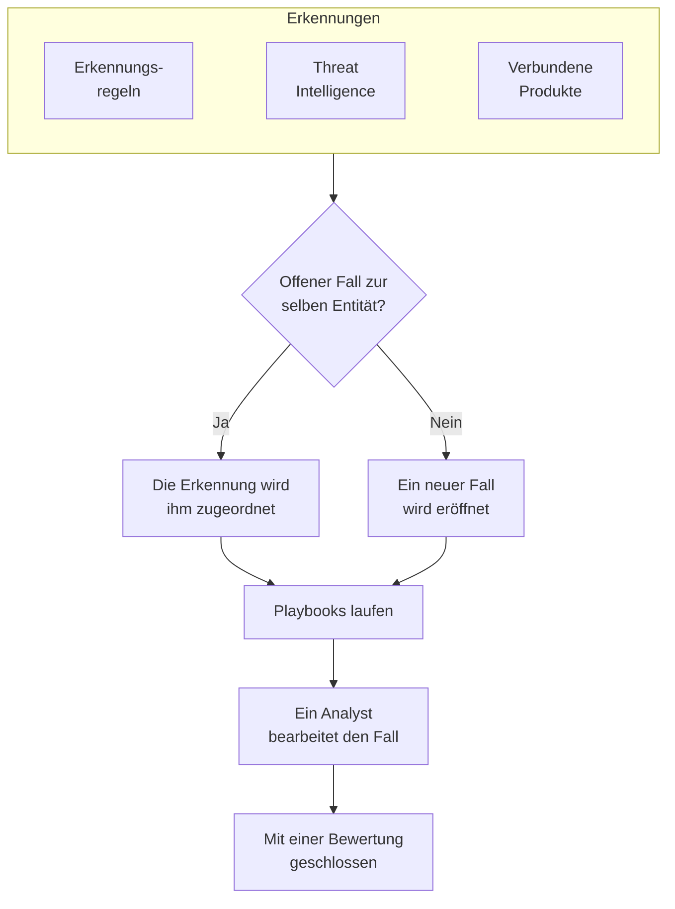

# Sicherheitsfälle und Playbooks (SOAR)

Das Produkt Sicherheitsereignisse macht aus den Funden Ihrer Erkennungsregeln, Ihrer Threat Intelligence und Ihrer verbundenen Sicherheitsprodukte Fälle: einen Fall für jede Sache, die eine Untersuchung wert ist, und darin gebündelt alle Erkennungen zum selben Benutzer, zum selben Host oder zur selben Adresse. Analysten bearbeiten die Fälle in einer Warteschlange, und Playbooks reagieren darauf, von selbst oder auf Knopfdruck.

:::cards
- [Woher Fälle kommen](#woher-fälle-kommen): Erkennungsregeln, Threat Intelligence, verbundene Produkte und Personen.
- [Einen Fall bearbeiten](#einen-fall-bearbeiten): Ihn zuweisen, seine Entitäten untersuchen und ihn mit einer Bewertung schließen.
- [Playbooks](#playbooks): Schritte, die auf einem Fall laufen, mit Genehmigung, wo es darauf ankommt.
- [Die Übersicht](#die-übersicht): Was gerade Aufmerksamkeit braucht, und wie schnell Fälle bearbeitet werden.
:::

## So funktioniert es

Öffnen Sie **Produkte → Sicherheitsereignisse → Security Cases**. Die Warteschlange zeigt zunächst die offenen Fälle; **Assigned to Me**, **Unassigned**, **Geschlossen** und **Alle** sind die anderen Ansichten.

## Bevor Sie beginnen

Fälle und Playbooks folgen den drei Security-Rollen. Project Owner und Project Admin dürfen alles.

| Rolle | Was sie darf |
| --- | --- |
| Security Admin | Alles, auch Fälle löschen und Playbooks einrichten |
| Security Member | Fälle eröffnen, zuweisen, ändern und schließen, Notizen schreiben, Playbooks ausführen und ihre Schritte genehmigen oder ablehnen |
| Security Viewer | Fälle, Erkennungen, Notizen, Playbooks und deren Ausführungen lesen |

Jedes dieser Rechte lässt sich auch einzeln vergeben, vom Erstellen eines Falls bis zum Genehmigen der Schritte eines Playbooks; siehe [Berechtigungsreferenz](/docs/permissions/reference).

## Woher Fälle kommen

| Quelle | Eröffnet einen Fall, wenn | Abschalten mit |
| --- | --- | --- |
| Erkennungsregeln | Eine Regel passt | **Open a Case on Match**, im Schritt **Bei Treffer** der Regel |
| Threat Intelligence | Ein Ereignis einen bekannten Indikator nennt | **Open a Case on Match**, im Schritt **Bei Treffer** des Feeds |
| Verbundene Produkte | Eine eigene Warnung des Produkts auf oder über dem Schwellenwert der Verbindung importiert wird | **Open Cases From** auf **Nie** gesetzt, im Schritt **Abfrage** der Verbindung |
| Personen | Jemand einen unter **Security Cases** eröffnet, oder mit **Open Case** im Panel eines Ereignisses | Nicht abschaltbar |

Jede Quelle ist standardmäßig eingeschaltet. Eine Verbindung eröffnet Fälle für **High and above**, sofern Sie keine andere Stufe wählen; die Warnungen darunter werden weiterhin als Ereignisse importiert.

### Wie Erkennungen gruppiert werden

Eine Erkennung betrifft eine Entität: den Wert, nach dem ihre Regel gruppiert, etwa die IP-Adresse bei einer Brute-Force-Regel, oder den Indikator, den ein Threat-Intelligence-Treffer nennt. Eine Erkennung ohne Entität steht für sich allein.

- Gibt es bereits einen offenen Fall zu dieser Entität, wird die Erkennung ihm zugeordnet. Die Entitäten und das ATT&CK-Mapping des Falls wachsen, und seine Priorität steigt auf die der Erkennung, sinkt aber nie.
- Gibt es keinen, wird ein neuer Fall eröffnet, benannt nach der Erkennung und mit deren Priorität.
- Eine Erkennung, die erneut auslöst, zählt in ihrer Zeile hoch, statt eine weitere hinzuzufügen.

Die Priorität eines Falls ergibt sich aus dem Schweregrad der Erkennung:

| Schweregrad | Priorität |
| --- | --- |
| Critical oder Fatal | Kritisch |
| High | Hoch |
| Medium, Unknown oder Other | Medium |
| Low | Low |
| Informational | Hinweise |

## Einen Fall bearbeiten

Ein Fall durchläuft vier Status. Er kann einen davon überspringen, etwa wenn ein False Positive direkt aus „Neu“ heraus geschlossen wird, und er kann wieder geöffnet werden.

| Status | Bedeutung |
| --- | --- |
| Neu | Noch niemand hat ihn sich angesehen |
| Untersuchung läuft | Jemand klärt, was passiert ist |
| Contained | Die Bedrohung kann keinen Schaden mehr anrichten; die Bereinigung steht noch aus |
| Geschlossen | Erledigt, mit einer Bewertung, was er war |

Die Seite des Falls bietet alles, um ihn zu bearbeiten:

- Oben: **Assign to Me**, **Run Playbook**, **Vorfall melden** und **Close Case**, die Statusschritte und die Priorität im Menü daneben.
- **Erkennungen**: was ausgelöst hat, um den Fall zu eröffnen oder ihn zu ergänzen, wie oft, und das neueste passende Ereignis.
- **Entitäten**: die Benutzer, Hosts und Adressen, um die es im Fall geht, mit ihrer Aktivität in allen Ihren Sicherheitsereignissen der letzten 7 Tage. Jede öffnet sich in **Korrelieren**.
- **MITRE ATT&CK**: die Taktiken und Techniken, denen seine Erkennungen zugeordnet sind, jeweils verlinkt mit ihrer Seite auf attack.mitre.org.
- **Playbook Runs**: was jedes Playbook am Fall getan hat, Schritt für Schritt, und die Schritte, die auf Genehmigung warten.
- **Notizen** und **Zeitachse**: was das Team geschrieben hat, und alles, was geschehen ist, jeweils mit der Person, die es getan hat.

Um mehrere Fälle auf einmal zu bearbeiten, wählen Sie sie in der Warteschlange aus und nutzen **Assign to Me**, **Change Status** oder **Change Priority**.

### Einen Fall schließen

**Close Case** fragt nach einer Bewertung und einer optionalen Abschlussnotiz:

| Bewertung | Bedeutung |
| --- | --- |
| True Positive | Bösartige oder unbefugte Aktivität hat tatsächlich stattgefunden |
| Benign Positive | Die Aktivität war echt, aber erwartet, etwa ein Penetrationstest oder eine Admin-Aufgabe |
| False Positive | Die Erkennung lag falsch: Die Regel oder die Daten haben normale Aktivität falsch gedeutet |
| Undetermined | Es gab nicht genug Informationen für eine Entscheidung |

Die Bewertungen werden in der Übersicht gezählt. Eine Regel, deren Fälle immer wieder als False Positive geschlossen werden, sollte nachgeschärft werden.

### Einen Vorfall melden

**Vorfall melden** öffnet für den Fall einen OneUptime-Vorfall mit dem Schweregrad, den Sie wählen, und verknüpft beide in beide Richtungen: Die Beschreibung des Vorfalls nennt den Fall, und der Kopfbereich des Falls verlinkt auf den Vorfall. Ab dort übernehmen Bereitschaft, Statusseiten und das Postmortem. Dafür braucht es eine Rolle, die sowohl Fälle bearbeiten als auch Vorfälle erstellen darf.

## Playbooks

Ein Playbook ist eine Liste von Schritten, die auf einem Fall laufen. Erstellen Sie eines unter **Produkte → Sicherheitsereignisse → Playbooks**, aus einer Vorlage oder leer, und fügen Sie seine Schritte auf seiner Seite hinzu.

### Wann ein Playbook läuft

| Auslöser | Wann es läuft |
| --- | --- |
| Case Opened | Einmal, wenn ein Fall eröffnet wird |
| Detection Added | Jedes Mal, wenn eine neue Erkennung einem offenen Fall zugeordnet wird |
| Manuell | Nur, wenn jemand es aus einem Fall heraus ausführt |

Jedes aktivierte Playbook lässt sich auch per Hand ausführen, mit **Run Playbook** an einem Fall. Ein Playbook, das von selbst läuft, lässt sich eingrenzen:

- **For Cases At Least**: nur Fälle dieser Priorität oder höher.
- **Only For Detections From**: nur, wenn die Erkennung hinter dem Fall aus dieser Quelle stammt.
- **Only For These Detection Rules**: nur, wenn sie aus einer dieser Regeln stammt.

Ein deaktiviertes Playbook läuft weder von selbst noch per Hand.

### Schritte

| Kategorie | Schritt | Was er tut |
| --- | --- | --- |
| Fall | Assign the case | Übergibt den Fall an eine Person, ein Team oder beide |
| Fall | Set the priority | Hebt oder senkt die Priorität des Falls |
| Fall | Set the status | Setzt den Fall auf „Untersuchung läuft“, „Contained“ oder „Geschlossen“, mit der Bewertung, die Sie wählen |
| Fall | Add a note | Schreibt eine Notiz an den Fall, etwa eine Checkliste für den Analysten |
| Fall | Add labels | Versieht den Fall mit Labels |
| Untersuchen | Check entities against threat intel | Schlägt jede Entität in Ihrer Threat Intelligence nach und kann bei einem Treffer die Priorität anheben |
| Untersuchen | Look up entity activity | Zählt die Sicherheitsereignisse jeder Entität in einem kürzlich zurückliegenden Zeitfenster und vermerkt das am Fall |
| Benachrichtigen | Email people | Schickt Benutzern und Teams eine Zusammenfassung des Falls per E-Mail, mit einem Link darauf |
| Benachrichtigen | Post to Slack | Postet eine Zusammenfassung des Falls in einen Slack-Kanal |
| Benachrichtigen | Post to Microsoft Teams | Postet eine Zusammenfassung des Falls in einen Kanal von Microsoft Teams |
| Eskalieren | Page on-call | Führt eine Bereitschaftsrichtlinie aus |
| Eskalieren | Vorfall melden | Öffnet einen OneUptime-Vorfall, der mit dem Fall verknüpft ist |
| Eindämmen | Suspend the user in Okta | Sperrt jeden Benutzer des Falls in Okta |
| Eindämmen | End the user's Okta sessions | Meldet jeden Benutzer des Falls bei Okta ab und widerruft seine Tokens |
| Eindämmen | Contain the host in CrowdStrike | Isoliert jeden Host des Falls mit CrowdStrike Falcon vom Netzwerk |
| Eindämmen | Isolate the device in Microsoft Defender | Isoliert jeden Host des Falls mit Microsoft Defender for Endpoint |
| Automatisieren | Send a webhook | Sendet den Fall als JSON per POST an eine URL |
| Automatisieren | Run a workflow | Startet einen OneUptime-Workflow mit dem Fall als Eingabe |

Ein Playbook hat höchstens 25 Schritte. Sie laufen der Reihe nach, jeder, sobald der vorige fertig ist. Jeder Schritt kann außerdem:

- **Needs Approval**: die Ausführung vor dem Schritt anhalten, bis jemand ihn am Fall genehmigt. Für die vier Eindämmungsschritte, die außerhalb von OneUptime handeln, ist das standardmäßig eingeschaltet.
- **Only If Threat Intel Matched**: den Schritt überspringen, sofern nicht ein früherer Schritt **Check entities against threat intel** derselben Ausführung einen bekannten Indikator gefunden hat.
- **Carry On If It Fails**: den nächsten Schritt ausführen, auch wenn dieser fehlschlägt. Ist die Option aus, beendet ein fehlgeschlagener Schritt die Ausführung.

### Eindämmung

Die Eindämmungsschritte handeln über eine [Verbindung für Sicherheitsereignisse](/docs/telemetry/security-events#ein-sicherheitsprodukt-verbinden) zum Produkt, die dafür mehr als Lesezugriff braucht:

| Schritt | Verbindung | Braucht |
| --- | --- | --- |
| Suspend the user in Okta, End the user's Okta sessions | Okta System Log | Ein API-Token, das Benutzer verwalten darf |
| Contain the host in CrowdStrike | CrowdStrike Falcon | Einen API-Client mit Schreibrecht im Scope Hosts |
| Isolate the device in Microsoft Defender | Microsoft Defender XDR | Eine App mit der Berechtigung Machine.Isolate |

Ein Eindämmungsschritt wirkt auf höchstens 10 der Benutzer oder Hosts des Falls. Er sucht jeden davon im Produkt nach seinem Namen und vermerkt am Fall, was er mit jedem getan hat: eingedämmt, bereits eingedämmt, nicht gefunden oder abgelehnt.

### Nachrichten

Eine Notiz, eine E-Mail, ein Slack-Beitrag und ein Teams-Beitrag können die Werte des Falls nutzen:

| Platzhalter | Wird zu |
| --- | --- |
| `{{case.number}}` | Die Fallnummer, etwa CASE-42 |
| `{{case.title}}` | Der Titel des Falls |
| `{{case.priority}}` | Critical, High, Medium, Low oder Informational |
| `{{case.status}}` | New, Investigating, Contained oder Closed |
| `{{case.assignee}}` | Wem der Fall zugewiesen ist |
| `{{case.url}}` | Ein Link zum Fall in OneUptime |
| `{{case.entities}}` | Die Benutzer, Hosts und Adressen, um die es im Fall geht |
| `{{case.detections}}` | Wie viele Erkennungen der Fall enthält |

Eine E-Mail oder ein Beitrag ohne eigene Nachricht sendet eine Zusammenfassung des Falls.

### Ausführungen und Genehmigungen

Jede Ausführung wird an ihrem Fall und unter **Produkte → Sicherheitsereignisse → Playbooks → Playbook Runs** aufgelistet, Schritt für Schritt:

| Status der Ausführung | Bedeutung |
| --- | --- |
| In der Warteschlange | Wartet auf einen Worker |
| Wird ausgeführt | Führt ihre Schritte aus |
| Wartet auf Genehmigung | Vor einem Schritt angehalten, der eine Genehmigung braucht |
| Erfolgreich | Jeder Schritt lief oder wurde übersprungen |
| Fehlgeschlagen | Ein Schritt ist fehlgeschlagen, und die Ausführung wurde beendet |
| Abgebrochen | Jemand hat sie abgebrochen oder einen Schritt abgelehnt |

Ein Schritt, der auf Genehmigung wartet, zeigt an der Ausführung **Approve** und **Ablehnen**, mit einem optionalen Kommentar. Eine Genehmigung setzt die Ausführung ab diesem Schritt fort; eine Ablehnung beendet sie. Die Entscheidung, wer sie getroffen hat, und der Kommentar werden am Schritt und in der Zeitachse des Falls festgehalten. **Playbook Runs** öffnet mit den Ausführungen, die auf Genehmigung warten, und der Menüeintrag **Playbooks** zählt sie.

Eine Ausführung, von deren Worker nichts mehr kommt, etwa nach einem Neustart, wird wieder aufgegriffen: Eine Ausführung in der Warteschlange wird nach 2 Minuten erneut eingereiht, und eine Ausführung, die sich 30 Minuten lang nicht gemeldet hat, gilt als fehlgeschlagen.

## Die Übersicht

**Produkte → Sicherheitsereignisse → Übersicht** ist die Seite, mit der das Produkt öffnet:

- Die offenen Fälle, die Ihnen zugewiesen sind, die offenen Fälle, die noch niemand übernommen hat, und die Playbook-Schritte, die auf Genehmigung warten.
- **Mean Time to Acknowledge**, **Mean Time to Contain** und **Mean Time to Close**, über die in den letzten 30 Tagen eröffneten Fälle: von der Eröffnung eines Falls, bis jemand ihn übernimmt (eine Person zuweist oder ihn aus „Neu“ herausholt), bis „Contained“ und bis „Geschlossen“. Ein Fall, der noch wartet, geht in keinen Mittelwert ein.
- Die pro Tag eröffneten Fälle über 30 Tage, nach Priorität, und die pro Tag ausgelösten Erkennungen über 14 Tage, nach Quelle.
- Die offenen Fälle nach Priorität und nach Status, die Bewertungen der letzten 30 Tage, die ATT&CK-Taktiken hinter den Fällen, die am häufigsten ausgelösten Erkennungen und die Entitäten, die in den meisten Befunden vorkommen.

Darüber zeigt ein Streifen, wie Sicherheit eingerichtet ist: ihre Quellen, Erkennungen, Fälle und Playbooks, jeweils mit ihren Zahlen. Ein Projekt, das sie noch nicht eingerichtet hat, sieht dort **Turn on recommended** und **Send a test attack**; siehe [Erste Schritte mit Sicherheit](/docs/telemetry/security-getting-started). Braucht nichts jemanden, sagt die Seite **All quiet**, und die Diagramme erscheinen, sobald es etwas darzustellen gibt.

## Bedrohungen finden

- **Entitäten** ordnet die Benutzer, Hosts, Adressen und Hashes, die Ihre Befunde am häufigsten nennen, über den letzten Tag, die letzte Woche oder den letzten Monat, und schlägt jeden Wert in den Ereignissen von 30 Tagen nach.
- **Rule Library** enthält fertige Erkennungsregeln für Bedrohungen rund um Identität, Endpunkte, Cloud, Netzwerk, Web und Kubernetes. Jede ist eine Sigma-Regel, geschrieben für die Felder, auf die jede verbundene Quelle normalisiert wird. **Regel hinzufügen** legt sie als Ihre eigene Erkennungsregel an, eingeschaltet und so eingestellt, dass sie Fälle statt Warnungen eröffnet; ändern Sie sie unter **Erkennungsregeln** wie jede andere. Die mit **Empfohlen** markierten Regeln finden Bedrohungen in Daten, die OneUptime bereits hat, und eine Schaltfläche fügt die hinzu, die Ihnen noch fehlen.
- **ATT&CK Coverage** zeichnet die Matrix von MITRE ATT&CK, hebt die Techniken hervor, die Ihre aktivierten Regeln abdecken, und umrandet die, die eine Regel aus der Bibliothek abdecken würde.

## Automatisieren

- **Arbeitsabläufe**: Ein Fall oder eine Notiz kann einen Workflow starten, wenn er oder sie erstellt, aktualisiert oder gelöscht wird. Ein Schritt **Run a workflow** startet einen Workflow, dessen Trigger ein Webhook ist.
- **API**: Fälle, Notizen, Erkennungen, Playbooks und Ausführungen haben dieselbe REST-API wie der Rest von OneUptime, unter `/security-case`, `/security-case-note`, `/security-detection`, `/security-playbook` und `/security-playbook-run`. Siehe [API-Referenz](/docs/api-reference/api-reference).
- KI-Agenten: Der MCP-Server hat Werkzeuge für Fälle, Notizen, Erkennungen und Playbooks. Siehe [MCP-Server](/docs/ai/mcp-server).

## Fehlerbehebung

:::details Eine Regel passt, aber es wird kein Fall eröffnet
Prüfen Sie **Open a Case on Match** im Schritt **Bei Treffer** der Regel. Eine Erkennung zu einer Entität, die bereits einen offenen Fall hat, wird diesem Fall zugeordnet, statt einen weiteren zu eröffnen: Suchen Sie sie unter **Erkennungen** im offenen Fall.
:::

:::details Ein Playbook ist nicht gelaufen
Prüfen Sie, dass es aktiviert ist, dass sein **Auslöser** passt (Case Opened läuft einmal, wenn ein Fall eröffnet wird) und dass der Fall seine Einstellungen **For Cases At Least**, **Only For Detections From** und **Only For These Detection Rules** erfüllt. Ein per Hand eröffneter Fall hat keine Erkennung, also läuft ein Playbook, das auf eine Quelle oder auf Regeln beschränkt ist, nicht darauf.
:::

:::details Ein Eindämmungsschritt ist fehlgeschlagen
Öffnen Sie die Ausführung am Fall: Der Schritt sagt für jeden Benutzer oder Host, ob das Produkt die Aktion abgelehnt hat, ihn nicht gefunden hat oder nicht erreichbar war. Prüfen Sie, dass die Zugangsdaten der Verbindung die Änderung vornehmen dürfen, und nutzen Sie **Verbindung testen** in ihrer Zeile.
:::

## Nächste Schritte

:::cards
- [Sicherheitsereignisse](/docs/telemetry/security-events): Ereignisse senden, Erkennungsregeln schreiben und Sicherheitsprodukte verbinden.
- [Threat Intelligence](/docs/telemetry/threat-intelligence): Ihre Ereignisse mit STIX/TAXII-Feeds abgleichen.
- [Berechtigungsreferenz](/docs/permissions/reference): Die Security-Rollen und was jede darf.
:::
