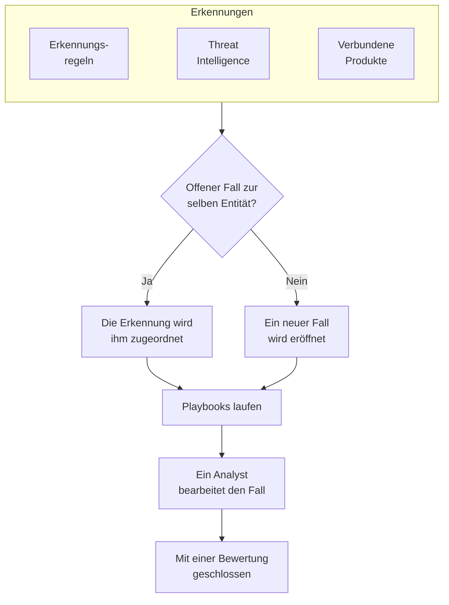

# Sicherheitsfälle und Playbooks (SOAR)

Das Produkt Sicherheitsereignisse macht aus den Funden Ihrer Erkennungsregeln, Ihrer Threat Intelligence und Ihrer verbundenen Sicherheitsprodukte Fälle: einen Fall für jede Sache, die eine Untersuchung wert ist, und darin gebündelt alle Erkennungen zum selben Benutzer, zum selben Host oder zur selben Adresse. Analysten bearbeiten die Fälle in einer Warteschlange, und Playbooks reagieren darauf, von selbst oder auf Knopfdruck.

:::cards
- [Woher Fälle kommen](#woher-fälle-kommen): Erkennungsregeln, Threat Intelligence, verbundene Produkte, Entitätsrisiko und Personen.
- [Einen Fall bearbeiten](#einen-fall-bearbeiten): Ihn zuweisen, seine Entitäten untersuchen und ihn mit einer Bewertung schließen.
- [Fallprioritäten und Fallstatus](#fallprioritäten-und-fallstatus): Umbenennen, umfärben, neu ordnen und eigene hinzufügen.
- [Reaktionsziele](#reaktionsziele): Wie schnell ein Fall jeder Priorität übernommen und eingedämmt werden muss.
- [Benachrichtigungen](#benachrichtigungen): Wer von einem neuen Fall, einer Zuweisung, einem Reaktionsziel, einer Aufgabe und einem Schritt erfährt, der auf Genehmigung wartet.
- [Playbooks](#playbooks): Schritte, die auf einem Fall laufen, mit Genehmigung, wo es darauf ankommt.
- [Die Übersicht](#die-übersicht): Was gerade Aufmerksamkeit braucht, und wie schnell Fälle bearbeitet werden.
:::

## So funktioniert es

Öffnen Sie **Produkte → Sicherheitsereignisse → Sicherheitsfälle → Offene Fälle** für die Warteschlange. **Mir zugewiesen**, **Nicht zugewiesen**, **Geschlossene Fälle** und **Alle Fälle** sind eigene Seiten daneben, und jede listet die Fälle, die ihr Name sagt.

## Bevor Sie beginnen

Fälle und Playbooks folgen den drei Security-Rollen. Projektinhaber und Projektadministrator dürfen alles.

| Rolle | Was sie darf |
| --- | --- |
| Sicherheits-Administrator | Alles, auch Fälle löschen, Belege entfernen und Playbooks einrichten |
| Sicherheits-Mitglied | Fälle eröffnen, zuweisen, ändern und schließen, Notizen schreiben, Aufgaben bearbeiten, Belege hinzufügen, Playbooks ausführen und ihre Schritte genehmigen oder ablehnen |
| Sicherheits-Betrachter | Fälle, Erkennungen, Notizen, Aufgaben, Belege, Playbooks und deren Ausführungen lesen |

Jedes dieser Rechte lässt sich auch einzeln vergeben, vom Erstellen eines Falls bis zum Genehmigen der Schritte eines Playbooks; siehe [Berechtigungsreferenz](/docs/permissions/reference).

## Woher Fälle kommen

| Quelle | Eröffnet einen Fall, wenn | Abschalten mit |
| --- | --- | --- |
| Erkennungsregeln | Eine Regel passt | **Bei Treffer einen Fall eröffnen**, im Schritt **Bei Treffer** der Regel |
| Threat Intelligence | Ein Ereignis einen bekannten Indikator nennt | **Bei Treffer einen Fall eröffnen**, im Schritt **Bei Treffer** des Feeds |
| Verbundene Produkte | Eine eigene Warnung des Produkts auf oder über dem Schwellenwert der Verbindung importiert wird | **Fälle eröffnen ab** auf **Nie** gesetzt, im Schritt **Abfrage** der Verbindung |
| Sicherheitsprodukte in Ihren Logs | Eine Bedrohung, die eine Firewall, ein IDS oder ein Endpunktprodukt in Ihre Logs schreibt, auf oder über dem Schwellenwert der Karte Ihre Protokolle liegt | **Fälle eröffnen ab** auf **Nie** gesetzt, auf **Ihre Protokolle** |
| Entitätsrisiko | Das Risiko eines Benutzers, Hosts oder einer Adresse den Schwellenwert des Projekts erreicht | **Risikofälle** unter **Einstellungen → Risikobewertung** |
| Personen | Jemand einen unter **Sicherheitsfälle** eröffnet, oder mit **Fall eröffnen** im Panel eines Ereignisses | Nicht abschaltbar |

Jede Quelle eröffnet standardmäßig Fälle, außer dem Entitätsrisiko in Projekten, die vor ihm angelegt wurden: Dort schalten Sie zuerst **Risikofälle** ein ([Entitätsrisiko](/docs/telemetry/security-entity-risk)). Eine Verbindung eröffnet Fälle für **Hoch und höher**, sofern Sie keine andere Stufe wählen; die Warnungen darunter werden weiterhin als Ereignisse importiert. **Ihre Protokolle** macht es mit den Bedrohungen in Ihren Logs genauso.

### Wie Erkennungen gruppiert werden

Eine Erkennung betrifft eine Entität: den Wert, nach dem ihre Regel gruppiert, etwa die IP-Adresse bei einer Brute-Force-Regel, oder den Indikator, den ein Threat-Intelligence-Treffer nennt. Eine Erkennung ohne Entität steht für sich allein.

- Gibt es bereits einen offenen Fall zu dieser Entität, wird die Erkennung ihm zugeordnet. Die Entitäten und das ATT&CK-Mapping des Falls wachsen, und seine Priorität steigt auf die der Erkennung, sinkt aber nie.
- Gibt es keinen, wird ein neuer Fall eröffnet, benannt nach der Erkennung und mit deren Priorität.
- Eine Erkennung, die erneut auslöst, zählt in ihrer Zeile hoch, statt eine weitere hinzuzufügen.

Die Priorität eines Falls ergibt sich aus dem Schweregrad der Erkennung, als die vordefinierte Priorität des Projekts für diese Stufe, wie auch immer Sie sie benannt haben:

| Schweregrad | Priorität |
| --- | --- |
| Critical oder Fatal | Kritisch |
| High | Hoch |
| Medium, Unknown oder Other | Medium |
| Low | Low |
| Informational | Hinweise |

## Einen Fall bearbeiten

Die Fälle eines neuen Projekts durchlaufen vier Status, die Sie umbenennen und um eigene ergänzen können (siehe [Fallprioritäten und Fallstatus](#fallprioritäten-und-fallstatus)). Ein Fall kann einen davon überspringen, etwa wenn ein False Positive direkt aus „Neu“ heraus geschlossen wird, und er kann wieder geöffnet werden.

| Status | Bedeutung |
| --- | --- |
| Neu | Noch niemand hat ihn sich angesehen |
| Untersuchung läuft | Jemand klärt, was passiert ist |
| Contained | Die Bedrohung kann keinen Schaden mehr anrichten; die Bereinigung steht noch aus |
| Geschlossen | Erledigt, mit einer Bewertung, was er war |

Ein Fall hat ein eigenes Seitenmenü, wie ein Vorfall, und jeder Teil des Falls ist eine eigene Seite:

| Abschnitt im Seitenmenü | Seiten |
| --- | --- |
| **Übersicht** | **Übersicht**, **Zeitachse** |
| **Untersuchung** | **Hergang**, **Erkennungen**, **Entitäten**, **Verbundene Signale**, **Belege**, **Aufgaben**, **Playbooks** |
| **Notizen** | **Private Notizen** |
| **Erweitert** | **Benutzerdefinierte Felder**, **Audit-Protokolle**, **Fall löschen**, eingeklappt, bis Sie auf **Erweitert** klicken |

Jede Seite behält oben den Kopf des Falls: Nummer, Priorität, Status und Titel, **Mir zuweisen**, **Playbook ausführen**, **Vorfall melden** und **Fall schließen**, und im Menü ⋯ daneben **Priorität setzen**, **Jemand anderem zuweisen**, **Status ändern**, **Fall bearbeiten** und **Fall löschen**. So lässt sich der Fall von jeder seiner Seiten aus bearbeiten, und ein Link zum Fall öffnet weiterhin seine **Übersicht**. Hat die Priorität des Falls Reaktionsziele, zeigt der Kopf auch, wann das nächste fällig ist ([Reaktionsziele](#reaktionsziele)).

- **Übersicht**: die Beschreibung, Labels und Statusschritte des Falls, wer ihn hat und was ihn eröffnet hat, und seine Kennzahlen: wie viele Erkennungen er hat, wie lange er schon offen ist und wie lange es bis zur Bestätigung und bis zur Eindämmung gedauert hat. Unter **Zeit bis zur Bestätigung** und **Zeit bis zur Eindämmung** steht, wie der Fall zu seinen Reaktionszielen steht.
- **Warum dieser Fall eröffnet wurde**, auf der **Übersicht**: die Erkennung, die den Fall eröffnet hat, und wie ihre Regel auslöst (ihr Schwellenwert, wonach sie gruppiert, und das Zeitfenster, in dem sie zählt), auf wie viele Ereignisse sie zutraf, woher diese kamen und in welchem Zeitraum, wonach die Regel sucht und wie weit die Anfragen kamen. Unter **Treffer** stehen die Ereignisse selbst, die ältesten zuerst: In jedem ist hervorgehoben, wonach die Regel sucht, und es zeigt, wie weit seine Anfrage kam und aus welcher Protokollzeile oder von welchem Produkt es stammt, mit **Trace**, **Protokolle** und **Ausnahme** jeweils einen Klick entfernt; die Protokollzeile, aus der es stammt, öffnet sich im Protokoll-Explorer an genau dieser Zeile. Klicken Sie auf ein Ereignis, um es vollständig zu sehen, mit der Protokollzeile, aus der es gelesen wurde. **In diesem Fall aufbewahren**, in seiner Zeile oder in seinem Panel, bewahrt das Ereignis auf der Seite **Belege** des Falls auf und nennt dabei die Erkennung, die darauf zutraf; ein Ereignis, das der Fall bereits aufbewahrt, zeigt das an und öffnet es dort. Eine Erkennung behält beim Auslösen bis zu 25 der Ereignisse, auf die sie zutraf, und listet diese auch über ihre Aufbewahrung hinaus; Ihre Rolle sieht die aus den Quellen, die sie lesen darf. Eine Regel, die für viele Gruppen zugleich auslöst, auch eine Korrelationsregel, behält Ereignisse für jede davon: insgesamt höchstens 1.000, sodass jede mindestens 10 behält und bis zu 25, wenn sie erneut auslöst. Bei einer Erkennung aus der Zeit, bevor sie ihre Ereignisse behielt, sind die Treffer einer Regel das, worauf ihre eigene Bedingung zutraf, für die Gruppe der Erkennung, in den Zeitfenstern, in denen sie ausgelöst hat; ein Threat-Intelligence-Treffer listet die Ereignisse, die seinen Indikator enthalten, und die Warnung eines verbundenen Produkts das Ereignis, als das sie gesendet wurde. **Als Nächstes ansehen** öffnet alles über die Adresse oder den Benutzer der Erkennung, die Ereignisse und Protokollzeilen, die diesen Wert nennen, die Protokolle der Dienste, aus denen ihre Protokollzeilen stammen, und die Traces ihrer Anfragen, jeweils im Zeitfenster der Erkennung, sowie **Hergang** und **Verbundene Signale** des Falls. Die übrigen Erkennungen des Falls sind unter **Ebenfalls in diesem Fall** eingeklappt.
- **Reaktionsplan**, auf der **Übersicht**: was jetzt in dem Fall zu tun ist, das Dringendste zuerst, unter **Bestätigen, dass es echt ist**, **Eindämmen**, **Beheben, was es ermöglicht hat** und **Den Fall schließen**. Jeder Schritt bezieht sich auf diesen Fall: seine Adressen, Benutzer und Hosts, wie weit seine Anfragen kamen, was laut seiner Regel ebenfalls zum Auslösen führen kann, die ATT&CK-Taktiken und -Techniken, denen seine Erkennungen zugeordnet sind, und die Playbooks, die das Projekt hat. Die eigenen Schritte einer Erkennungsregel, die in ihrem Formular unter **Reaktionsschritte** eingetragen werden, stehen in dem Teil des Plans, zu dem sie gehören, an erster Stelle, und die Regeln der Regelbibliothek bringen eigene Schritte mit. Ein Schritt, den OneUptime erledigen kann, hat seine eigene Schaltfläche: **Mir zuweisen**, **Ausnahme hinzufügen** mit vorausgefüllter Regel und Adresse, **Playbook ausführen** für das Playbook, das das Konto sperrt oder den Host eindämmt, oder für das von OneUptime AI vorgeschlagene, **Vorfall melden**, **Als eingedämmt markieren** und **Fall schließen**. Der Schritt einer öffentlichen Adresse sperrt sie mit einem Klick, **Für 24 Stunden sperren**, sobald ein Ziel Ihre Sperrliste durchsetzt (siehe [Eine Adresse aus einem Fall sperren](#eine-adresse-aus-einem-fall-sperren)). Ein Schritt, den OneUptime nicht erledigen kann, etwa eine Domain an Ihrem DNS-Filter zu blockieren, zeigt **Außerhalb von OneUptime**, und der Wert ist mit einem Klick in der Zwischenablage. Wo eine Verbindung auf jedem Rechner sperrt (siehe [Sperrliste](#sperrliste)), ist auch das Sperren der Domäne, der Datei oder des Command-and-Control-Servers des Falls ein Klick: **Für 7 Tage sperren** oder **Datei sperren** für 30 Tage setzt es auf die Sperrliste, und der Schritt ist erledigt, sobald Microsoft Defender oder CrowdStrike Falcon die Sperre hält. Haken Sie einen Schritt ab, sobald er erledigt ist: Er bleibt als erledigte Aufgabe unter den **Aufgaben** des Falls erhalten, mit der Person, die es getan hat, und dem Zeitpunkt. Schritte, über die der Fall selbst entscheidet, haken sich von selbst ab: Er ist zugewiesen, ein Vorfall wurde gemeldet, ein Playbook ist gelaufen, er ist eingedämmt oder geschlossen. Sobald jeder Schritt erledigt ist, der die Bedrohung eindämmt, bietet der Plan **Als eingedämmt markieren** an, womit die Zeit bis zur Eindämmung des Falls festgehalten wird. Hat OneUptime AI den Fall triagiert, steht seine Einschätzung am Anfang des Plans, und die von ihm vorgeschlagenen Schritte sind unter den eigenen Schritten des Plans eingeklappt. Die meisten Schritte prüft OneUptime selbst und zeigt neben jedem, was es gefunden hat: siehe [Wie OneUptime einen Schritt prüft](#wie-oneuptime-einen-schritt-prüft).
- **OneUptime AI**, auf der **Übersicht**: was OneUptime AI aus dem Fall gelesen hat, die Priorität und das Playbook, die es vorschlägt, und die Beweise dahinter. Siehe [OneUptime AI in der Sicherheit](/docs/telemetry/security-ai).
- **Auswirkungen**, auf der **Übersicht**: was der Fall gefährdet: ob OneUptime gesehen hat, dass seine Einträge aus dem Internet erreicht wurden, wem sie gehören, was sich zuletzt an ihnen geändert hat, und die gefährdeten Daten - die Datenspeicher mit sensiblen Daten, die der Fall nennt oder die seine Benutzer und Rollen erreichen können (siehe [Integrationen der Datensicherheit](/docs/data-security/integrations#security-operations)). Klappen Sie sie auf, um zu sehen, was jeder Eintrag aufruft und wovon er aufgerufen wird, welche Monitore und Statusseiten ihn beobachten und mit welchen Rechnern die Adressen des Falls kommuniziert haben.
- **MITRE ATT&CK**, auf der **Übersicht**: die Taktiken und Techniken, denen seine Erkennungen zugeordnet sind, jeweils verlinkt mit ihrer Seite auf attack.mitre.org.
- **Zeitachse**: alles, was mit dem Fall geschehen ist, jeweils mit der Person, die es getan hat.
- **Hergang**: was geschehen ist, der Reihe nach und über ganz OneUptime hinweg: jede Erkennung und die Sicherheitsereignisse dahinter, wie weit ihre Anfragen kamen, die Ausnahmen, die sie auslösten, die Änderungen an den Einträgen, die der Fall nennt, die dort ausgelösten Vorfälle und Warnungen, und was das Team getan hat. Die vielen Sonden eines Scanners sind eine Zeile, und jede Zeile öffnet, was sie nennt, etwa den Trace der Anfrage oder die Ausnahme.
- **Erkennungen**: was ausgelöst hat, um den Fall zu eröffnen oder ihn zu ergänzen, wie oft, und das neueste passende Ereignis.
- **Entitäten**: die Benutzer, Hosts und Adressen, um die es im Fall geht, mit ihrer Aktivität in allen Ihren Sicherheitsereignissen der letzten 7 Tage. Jede öffnet sich in **Korrelieren**.
- **Verbundene Signale**: die Hosts, Cluster, Dienste und Mitglieder, die der Fall nennt, wie OneUptime sie kennt, und was auf jedem davon rund um seine Erkennungen geschah: ihre Protokolle, Traces und Metriken, was darauf offen ist und was sich geändert hat. Siehe [Verbundene Signale](/docs/telemetry/security-connected-signals).
- **Belege**: die Dateien, Links und Sicherheitsereignisse, die zum Fall aufbewahrt werden, jeweils mit Person und Zeitpunkt des Hinzufügens. Mit **Datei hinzufügen** laden Sie eine Datei mit bis zu 10 MB hoch, und der SHA-256 des Hochgeladenen wird festgehalten, damit jeder, der sie später herunterlädt, prüfen kann, dass es das Aufbewahrte ist; mit **Link hinzufügen** verweisen Sie auf Belege, die anderswo liegen. Nur ein Sicherheits-Administrator kann einen Beleg entfernen, und die **Zeitachse** des Falls zeigt, was hinzugefügt und entfernt wurde. Ein Sicherheitsereignis wird so aufbewahrt, wie es war, mit **Zum Fall hinzufügen** unter **Ereignisse** oder auf der Seite einer [Bedrohungssuche](/docs/telemetry/security-events#bedrohungssuchen) oder mit **In diesem Fall aufbewahren** an einem Ereignis, auf das eine Erkennung zutraf, und **Ereignis anzeigen** öffnet es. Der Schritt **Preserve the evidence** eines Playbooks bewahrt hier auch die Ereignisse hinter den Erkennungen des Falls auf.
- **Aufgaben**: was im Fall zu tun ist, wer es erledigt und ob es erledigt ist. Fügen Sie eine Aufgabe als Zeile hinzu, geben Sie sie jemandem und haken Sie sie ab, wenn sie erledigt ist. Wer die Aufgabe bekommt, wird benachrichtigt, außer er hat sie sich selbst genommen, und das Menü zeigt neben **Aufgaben**, wie viele Aufgaben offen sind. Der Schritt **Aufgaben hinzufügen** eines Playbooks fügt ebenfalls Aufgaben hinzu und lässt jede weg, die der Fall schon hat.
- **Playbooks**: was jedes Playbook am Fall getan hat, Schritt für Schritt, und die Schritte, die auf Genehmigung warten. Solange Ausführungen warten, zeigt das Menü neben **Playbooks**, wie viele es sind.
- **Private Notizen**: was das Team zum Fall geschrieben hat. Das Menü **Vorlagen** des Eingabefelds fügt eine der Notizvorlagen des Projekts in eine Notiz ein.
- **Benutzerdefinierte Felder**: die eigenen Felder des Projekts, für diesen Fall ausgefüllt, und **Felder bearbeiten**, um sie zu ändern. Sobald das Projekt ein Feld hat, zeigt die **Übersicht** sie ebenfalls, in ihrer letzten Karte. Siehe [Benutzerdefinierte Felder, Notizvorlagen und Nummerierung](#benutzerdefinierte-felder-notizvorlagen-und-nummerierung).
- **Audit-Protokolle**: jede Änderung am Fall und wer sie vorgenommen hat. Siehe [Audit-Protokolle](/docs/configuration/audit-logs).
- **Fall löschen**: löscht den Fall mit seinen Erkennungen, Notizen, seiner Zeitachse und seinen Playbook-Ausführungen endgültig. Um ihn als Nachweis zu behalten, schließen Sie ihn stattdessen mit einer Bewertung.

### Wie OneUptime einen Schritt prüft

Ein Häkchen sagt, dass jemand einen Schritt erledigt hat. OneUptime prüft die Schritte im **Reaktionsplan** eines Falls außerdem selbst, an dem, was wirklich passiert ist: jede Minute, solange der Fall offen ist, und sofort, wenn ein Schritt abgehakt wird, sich eine Aufgabe ändert oder ein Playbook etwas eindämmt. Neben jedem geprüften Schritt zeigt der Plan, was OneUptime gefunden hat:

| Neben dem Schritt | Bedeutet |
| --- | --- |
| **Von OneUptime geprüft** | OneUptime hat den Schritt erledigt gesehen, und er hält. Niemand muss ihn abhaken |
| **Scheint erledigt** | Was OneUptime sieht, passt zu einem erledigten Schritt, beweist ihn aber nicht. **Bestätigen** hakt ihn als Ihren ab |
| **Noch nicht erledigt** | OneUptime sieht, dass der Schritt noch zu tun ist |
| **OneUptime kann es nicht sagen** | OneUptime hat nichts, woran es den Schritt prüfen kann, und sagt, warum, mit **So kann OneUptime das prüfen** |
| **Hält nicht mehr** | Der Schritt war erledigt und wirkt nicht mehr, etwa wenn eine blockierte Adresse wieder durchkommt |
| **Bisher nicht nötig** | Bisher ist nichts geschehen, das den Schritt verlangt |

**Woher wir es wissen**, neben dem, was OneUptime gefunden hat, öffnet den Rest: was es sonst gesehen hat, einen Link zu den Traces oder dem Produkt, das es gelesen hat, und wann es geprüft hat. Der Fortschritt des Plans zählt die Schritte, die OneUptime selbst geprüft hat, etwa „4 von 9 erledigt, 3 von OneUptime geprüft“.

| Schritt | Was OneUptime liest |
| --- | --- |
| Die Adresse blockieren | Ob ein Ziel eine Sperre der Adresse aus Ihrer [Sperrliste](#sperrliste) hält und sie zurückgelesen hat, und ob Anfragen von der Adresse Ihre App noch erreichen, in ihren Traces und Zugriffsprotokollen. Eine Sperre, die ein Ziel hält, gilt als geprüft; eine Sperre, die nichts durchsetzt, nicht. Eine Adresse, die ohne Sperre verstummt, scheint erledigt: Sie wurde vielleicht blockiert oder hat einfach aufgehört |
| Prüfen, dass nichts anderes durchkam | Wie jede Anfrage von der Adresse seit der ersten Erkennung des Falls endete. Hat Ihre App jede davon abgewiesen, ist der Schritt geprüft |
| Das Konto sperren | Das Konto in Okta, Microsoft Entra ID oder Google Workspace: gesperrt, oder deaktiviert und seine Sitzungen nach dem Öffnen des Falls beendet |
| Den Host vom Netzwerk nehmen | Der Host in CrowdStrike Falcon oder Microsoft Defender for Endpoint: eingedämmt oder isoliert |
| Die Domäne, die Datei oder den Server auf jedem Rechner sperren | Ihre Sperre auf der Sperrliste: erledigt, solange Microsoft Defender oder CrowdStrike Falcon sie hält, nicht erledigt, solange sie unterwegs ist oder abgelehnt wurde, was der Schritt sagt |
| Einen Vorfall melden | Ob eine Anfrage die Prüfungen Ihrer App passiert hat oder ein Monitor der Dienste, die sie erreichte, ausgefallen ist, während der Fall offen war. Bis dahin ist der Schritt bisher nicht nötig |
| Einen Fehlalarm ausschließen | Nichts: Ausschließen können nur Sie. Der Schritt listet, was OneUptime über die Adresse weiß: ob einer Ihrer Einträge sie hat, die Threat-Intel-Feeds, die sie listen, und die angemeldeten Benutzer, die sie in den letzten 30 Tagen verwendet haben |
| Die Route korrigieren, auf die der Angriff zielte | Die Angriffsanfragen an die Route, in den Traces und Protokollen Ihrer App, vor und nach der Auslieferung einer Änderung an den Dienst dahinter: ein Pull Request, den der Schritt **Fix the code with AI** eines Playbooks geöffnet hat, oder jeder Deploy und jede neue Version des Dienstes. Sobald seitdem genug Anfragen desselben Angriffs abgewiesen wurden, oder von der Datenbank ferngehalten, die sie vorher erreichten, ist der Schritt geprüft. Gab es seitdem keinen Angriff, sagt er, dass es seit der Korrektur keine Angriffsversuche gab, und scheint erledigt |
| Das Passwort zurücksetzen | Das Konto in Okta oder Microsoft Entra ID: sein Passwort nach dem Öffnen des Falls geändert und seine Sitzungen beendet. Google Workspace gibt nicht an, wann sich ein Passwort geändert hat, daher kann OneUptime es nicht sagen |
| Sicherstellen, dass die Konten MFA nutzen | Jedes Konto, auf das der Angriff zielte, in Okta, Microsoft Entra ID oder Google Workspace: ein aktiver Faktor, eine MFA-Methode oder die Bestätigung in 2 Schritten. Ist MFA auf jedem davon eingerichtet, scheint der Schritt erledigt: Kein Produkt sagt, ob fehlgeschlagene Anmeldungen zu einer Sperre führen, daher bestätigen Sie es selbst |

- Ein außerhalb von OneUptime erledigter Schritt zählt ebenso. Blockieren Sie die Adresse an Ihrer eigenen Firewall, und OneUptime sieht ihre Anfragen aufhören; sperren Sie das Konto in Okta, und OneUptime liest es zurück.
- Sie können einen Schritt weiterhin selbst abhaken, auch einen, den OneUptime nicht erledigt sieht. Ein Schritt, den OneUptime geprüft hat, braucht kein Häkchen.
- Wenn ein erledigter Schritt nicht mehr hält, sagt der Plan das ganz oben, die **Zeitachse** des Falls sagt, was OneUptime gesehen hat, und die Personen am Fall werden informiert: siehe [Benachrichtigungen](#benachrichtigungen).
- OneUptime kann die Anfragen einer Adresse nicht sehen, wenn Ihre App ihm keine Traces oder Protokolle sendet, wenn ihre Traces nicht sagen, von welcher Adresse jede Anfrage kam, oder wenn sie statt der Adressen Ihrer Besucher die von Cloudflare oder eines Load Balancers vor Ihrer App tragen. Setzen Sie die Adresse des Clients (`client.address`) auf den Server-Spans Ihrer App: aus `CF-Connecting-IP` hinter Cloudflare, aus `X-Forwarded-For` hinter einem Load Balancer.
- OneUptime liest Konten und Hosts über die Verbindungen des Projekts zu den Produkten, die sie haben, dieselben, die [Reagieren mit OneUptime](#reagieren-mit-oneuptime) nutzt. Ohne eine solche Verbindung kann es das nicht sagen.
- Ein Produkt, das nicht antwortet, oder ein fehlgeschlagener Lesevorgang zählt nie als nicht erledigter Schritt: Der Schritt sagt, dass OneUptime ihn gerade nicht prüfen konnte, und OneUptime versucht es in einigen Minuten erneut.
- Die Korrektur einer Route ist erst geprüft, wenn der Angriff selbst abgewiesen wird: Ein Deploy allein ist keine Korrektur. OneUptime wartet auf so viele seit der Auslieferung der Korrektur abgewiesene Angriffe, dass bei der Rate, mit der sie vorher durchkamen, fast sicher (95 %) mindestens einer durchgekommen wäre, hätte sich nichts geändert, und nie auf weniger als 3. Der Schritt sagt, auf wie viele er wartet, und beobachtet die Route 7 Tage lang ab der Auslieferung der Korrektur, etwa „/api/search wird bis 27. Nov. beobachtet“. Kam vorher fast keiner durch, können die Angriffe nicht zeigen, dass eine Korrektur gewirkt hat, und der Schritt bleibt bei **Scheint erledigt**, damit Sie ihn bestätigen.
- OneUptime erkennt die Auslieferung einer Korrektur an den Deploys des Dienstes: Senden Sie sie an OneUptime, oder melden Sie `service.version` in der Telemetrie Ihrer App (siehe [Deploys und Änderungen](/docs/telemetry/change-events)). Ein Pull Request, den **Fix the code with AI** geöffnet hat, bleibt beim Fall erhalten, und sein Deploy wird ihm über seinen Commit zugeordnet. Anfragen, die schon an Ihrem Edge-Netzwerk gestoppt wurden, etwa von Cloudflare, haben Ihre App nie erreicht, daher sagen sie nichts über die Korrektur aus.
- Um die MFA eines Kontos in Microsoft Entra ID zu lesen, braucht OneUptime die Anwendungsberechtigung UserAuthenticationMethod.Read.All, zusätzlich zu denen, die unter [Eindämmung](#eindämmung) stehen.

**Fälle bei Verifizierung als eingedämmt markieren**, unter **Produkte → Sicherheitsereignisse → Einstellungen → Fallstatus**, setzt einen Fall auf Eingedämmt, sobald jeder Schritt, der ihn eindämmt, **Von OneUptime geprüft** oder **Bisher nicht nötig** ist. Seine Zeit bis zur Eindämmung wird festgehalten, und die **Zeitachse** des Falls sagt, dass OneUptime jeden Schritt verifiziert hat, der die Bedrohung eindämmt. Ein Schritt, der nur erledigt scheint, oder ein Häkchen setzt einen Fall nie von selbst weiter. Die Einstellung ist in jedem Projekt an, und ein Projektinhaber oder Projektadministrator kann sie ausschalten: Ein Fall bleibt dann, wo er ist, bis ihn jemand auf Eingedämmt setzt.

Jeder, der einen Fall sehen kann, sieht, was OneUptime gefunden hat. Niemand bearbeitet es: Wer anderer Meinung ist, hakt den Schritt selbst ab, wofür es eine Rolle braucht, die die Aufgaben des Falls bearbeiten darf.

### Eine Adresse aus einem Fall sperren

Eine öffentliche Adresse, um die es im Fall geht, hat im **Reaktionsplan** einen eigenen Schritt. Solange ein Ziel Ihre Sperrliste durchsetzt, etwa Cloudflare, [AWS WAF](/docs/telemetry/cloud-aws-waf-blocklist) oder eine Firewall, die eine Liste liest, nennt der Schritt es, wie in „35.205.11.131 bei Cloudflare sperren.“ **Für 24 Stunden sperren** sperrt die Adresse dort, und das Menü daneben enthält **Stattdessen Challenge**, **Für 7 Tage sperren** und **Bis zur Aufhebung sperren**, die nur ein Sicherheits-Administrator, ein Projektadministrator oder ein Projektinhaber wählen kann. Menschen bestehen eine Challenge, Skripte und API-Clients nicht. Auf der Seite **Entitäten** des Falls tut **Sperren…** bei einer Adresse dasselbe und fragt, wie lange.

- Eine Sperre läuft über die Playbook-Engine, wie die Sperre eines Playbooks: Sie wird auf der Seite **Playbooks** des Falls, in seiner **Zeitachse** und im Audit-Protokoll festgehalten. Sie wartet auf die Genehmigung einer anderen Person, es sei denn, Sie sind Sicherheits-Administrator, Projektadministrator oder Projektinhaber.
- Sie wird mit Begründung abgelehnt für eine Adresse, die in den Anfragen des Falls nur behauptet wurde, für eine Ihrer eigenen oder eine geschützte Adresse und für eine, die eine Sperre bereits abdeckt.
- Sobald ein Ziel die Sperre hält, ist der Schritt erledigt und nennt, wo, seit wann, von wem und bis wann, mit **Aufheben**. Solange kein Ziel sie hält, sagt der Schritt das und ist nicht erledigt.
- Solange nichts Ihre Sperrliste durchsetzt, sagt der Schritt, wie Sie Cloudflare, AWS WAF oder eine Firewall verbinden, und **Anleitung zum Sperren** zeigt die Adresse im Cloudflare-Dashboard, in der AWS CLI, in nginx und in nftables.
- Wird ein Fall als **Falsch positiv** oder **Harmlos positiv** geschlossen, wird angeboten, die Sperren aufzuheben, die er gesetzt hat: angehakt und jede mit Namen.

### Fälle aus der Warteschlange bearbeiten

Sie müssen einen Fall nicht öffnen, um ihn zu bearbeiten. In den Listen der Warteschlange hat das Menü ⋯ in der Zeile eines Falls **Mir zuweisen**, **Jemand anderem zuweisen**, **Status ändern** und **Priorität ändern**. Um mehrere Fälle auf einmal zu bearbeiten, wählen Sie sie aus und nutzen dieselben Aktionen unter **Massenaktionen**: Dort steht, welche Fälle geändert wurden, welche unverändert blieben und warum.

- Um einen Fall jemand anderem zu geben, nutzen Sie **Jemand anderem zuweisen** und wählen eine Person oder ein Team. Der Fall eines Teams wartet unter **Nicht zugewiesen**, bis ihn jemand aus dem Team übernimmt.
- Ein Status, der einen Fall schließt, fragt wie **Fall schließen** nach einer Bewertung und einer Abschlussnotiz.
- Ein geschlossener Fall wird niemandem zugewiesen. Um ihn wieder zu bearbeiten, öffnen Sie ihn mit **Status ändern** wieder.

### Einen Fall schließen

**Fall schließen** fragt nach einer Bewertung und einer optionalen Abschlussnotiz:

| Bewertung | Bedeutung |
| --- | --- |
| True Positive | Bösartige oder unbefugte Aktivität hat tatsächlich stattgefunden |
| Benign Positive | Die Aktivität war echt, aber erwartet, etwa ein Penetrationstest oder eine Admin-Aufgabe |
| False Positive | Die Erkennung lag falsch: Die Regel oder die Daten haben normale Aktivität falsch gedeutet |
| Undetermined | Es gab nicht genug Informationen für eine Entscheidung |

Die Bewertungen werden in der Übersicht gezählt. Eine Regel, deren Fälle immer wieder als False Positive geschlossen werden, sollte nachgeschärft werden.

Solange Aufgaben des Falls noch offen sind, nennt der Dialog **Fall schließen** ihre Anzahl.

Ein Fall, der aus Google SecOps-Warnungen eröffnet wurde, schließt sie auch in Google SecOps, mit dem Urteil und der Abschlussnotiz, wenn an seiner Verbindung **Warnungen schließen, wenn ihr Fall geschlossen wird** eingeschaltet ist: siehe [Google SecOps](/docs/integrations/google-secops#warnungen-schließen-wenn-ihr-fall-geschlossen-wird).

### Einen Vorfall melden

**Vorfall melden** öffnet für den Fall einen OneUptime-Vorfall mit dem Schweregrad, den Sie wählen, und verknüpft beide in beide Richtungen: Die Beschreibung des Vorfalls nennt den Fall, und der Kopfbereich des Falls verlinkt auf den Vorfall. Ab dort übernehmen Bereitschaft, Statusseiten und das Postmortem. Dafür braucht es eine Rolle, die sowohl Fälle bearbeiten als auch Vorfälle erstellen darf.

## Fallprioritäten und Fallstatus

Jedes Projekt hat seine eigenen Fallprioritäten und Fallstatus, unter **Produkte → Sicherheitsereignisse → Einstellungen → Fallprioritäten** und **Fallstatus**. Benennen Sie sie um, färben Sie sie um, ziehen Sie sie in eine andere Reihenfolge und fügen Sie eigene hinzu, etwa einen Status „Triage“ oder eine Priorität „Notfall“ über **Kritisch**. Ein neuer Name gilt sofort überall: in der Warteschlange, auf den Fallseiten und in der Übersicht, in Benachrichtigungen, in Slack, Microsoft Teams und Mattermost und in Playbook-Nachrichten.

Einige sind vordefiniert, weil OneUptime liest, was sie bedeuten. Sie lassen sich umbenennen und umfärben, aber weder löschen noch archivieren, und sie behalten ihre Reihenfolge:

| Vordefiniert | Was OneUptime damit macht |
| --- | --- |
| Der neue Status | Neue Fälle beginnen darin |
| Der bestätigte Status | Erreicht ein Fall ihn, wird festgehalten, wann er bestätigt wurde, und **Wieder öffnen** setzt einen geschlossenen Fall darauf zurück |
| Der eingedämmte Status | Erreicht ein Fall ihn, wird festgehalten, wann er eingedämmt wurde |
| Der geschlossene Status | **Fall schließen** setzt einen Fall darauf, mit einer Bewertung |
| Die Prioritäten Kritisch, Hoch, Medium, Low und Hinweise | Eine Erkennung eröffnet ihren Fall mit der Priorität ihres Schweregrads, und ein Fall, den jemand eröffnet, beginnt mit Medium |

- Wo ein Status steht, entscheidet, wofür ein Fall darin zählt, wie die Spalte **Zählt als** zeigt: ab dem bestätigten Status abwärts als bestätigt, ab dem eingedämmten Status abwärts als eingedämmt, ab dem geschlossenen Status abwärts als geschlossen. Ein Status, den Sie hinzufügen, kommt direkt über den geschlossenen Status, und wer einen Fall in einen Status setzt, der ihn schließt, wird zuerst nach einer Bewertung gefragt.
- Der Rang einer Priorität ist ihre Dringlichkeit, die dringendste zuerst: **Für Fälle mindestens**, die Auswahl bei den Benachrichtigungen und die Regeln für Slack, Microsoft Teams und Mattermost lesen diese Reihenfolge. Eine Priorität, die Sie hinzufügen, kommt ans Ende, und die Spalte **Schweregrad der Erkennung** zeigt, welche Erkennungen ihre Fälle mit welcher vordefinierten Priorität eröffnen.

Um einen eigenen Status oder eine eigene Priorität nicht mehr zu verwenden, nutzen Sie **Archivieren** in ihrer Zeile. Niemand kann sie dann mehr wählen, und die API, Terraform und MCP lehnen sie ab, aber die Fälle, die sie haben, behalten sie, und Sie können weiter danach filtern. Archivierte Werte stehen im eingeklappten Abschnitt **Archivierte Fallstatus** oder **Archivierte Fallprioritäten** unter der Tabelle, wo **Aus dem Archiv holen** einen zurückholt. **Löschen** wird abgelehnt, solange Fälle den Wert haben oder ein Playbook ab der Priorität läuft.

## Reaktionsziele

Ein Reaktionsziel legt fest, wie schnell ein Fall bearbeitet werden muss: **Bestätigen innerhalb von**, wie lange ein neuer Fall warten darf, bis ihn jemand übernimmt, und **Eindämmen innerhalb von**, wie lange es dauern darf, bis er eingedämmt oder geschlossen ist. Jede Fallpriorität hat ihre eigenen, unter **Produkte → Sicherheitsereignisse → Einstellungen → Reaktionsziele**: Mit **Bearbeiten** in der Zeile einer Priorität setzen Sie ihre beiden Ziele, in Minuten, Stunden oder Tagen, bis zu einem Jahr, und ein leeres Ziel bedeutet kein Ziel. Die Prioritäten eines neuen Projekts beginnen mit diesen:

| Priorität | Bestätigen innerhalb von | Eindämmen innerhalb von |
| --- | --- | --- |
| Kritisch | 15 Minuten | 4 Stunden |
| Hoch | 1 Stunde | 1 Tag |
| Medium | 12 Stunden | 3 Tage |
| Low | 1 Tag | 7 Tage |
| Hinweise | Kein Ziel | Kein Ziel |

Ein Projekt, das vor den Reaktionszielen angelegt wurde, hat keine, bis jemand sie setzt.

- Die Fälligkeiten eines Falls werden bei seiner Eröffnung aus den Zielen seiner Priorität gesetzt. Ein später geändertes Ziel gilt für die Fälle, die danach eröffnet werden.
- Ein Fall ist bestätigt, sobald ihn jemand übernimmt: Eine Person wird zugewiesen, oder er wechselt in einen Status, der als bestätigt zählt. Er ist eingedämmt, sobald er einen Status erreicht, der als eingedämmt zählt, oder geschlossen wird.
- Ändert sich die Priorität eines Falls, bleibt ein Ziel, das er erreicht oder verfehlt hat, wie es war. Eine höhere Priorität rückt eine Fälligkeit näher: Das neue Ziel zählt ab der Änderung, es sei denn, die alte Fälligkeit kommt zuerst. Eine niedrigere Priorität verschiebt sie nach hinten, nie nach vorn: Das neue Ziel zählt ab der Eröffnung des Falls. Eine Priorität ohne Ziel behält die Fälligkeit eines hochgestuften Falls und löscht die eines herabgestuften.
- Ein geschlossener Fall, der wieder geöffnet wird, bevor er je eingedämmt war, bekommt eine neue Fälligkeit für die Eindämmung, gezählt ab dem Wiederöffnen.
- Im letzten Fünftel eines Ziels verfehlt der Fall es gleich: Die Zuständigen werden benachrichtigt, und noch einmal, wenn es verfehlt ist. Siehe [Benachrichtigungen](#benachrichtigungen).

Wo die Ziele zu sehen sind:

- Der Kopf des Falls nennt das nächste Ziel und wie viel Zeit bleibt, oder wie lange es überfällig ist: grau, solange Zeit bleibt, bernsteinfarben im letzten Fünftel, rot, sobald es verfehlt ist.
- In der **Übersicht** des Falls, unter **Zeit bis zur Bestätigung** und **Zeit bis zur Eindämmung**: wie der Fall zu jedem Ziel steht, oder wie weit er darüber lag.
- In den Listen der Warteschlange: die Zeile unter der Priorität jedes Falls und eine Spalte **Fällig**, die Sie einblenden und nach der Sie sortieren können. Solange die Spalte eingeblendet ist, entfällt die Zeile unter der Priorität. Die Listen zeigen sie nur, wenn eine Priorität des Projekts ein Ziel hat.

## Benutzerdefinierte Felder, Notizvorlagen und Nummerierung

Drei weitere Einstellungen machen Fälle zu denen Ihres Projekts, unter **Produkte → Sicherheitsereignisse → Einstellungen**:

- **Benutzerdefinierte Felder**: die Felder, die Ihr Team in jedem Fall ausfüllt, etwa den Geschäftsbereich, um den es geht, oder sein Ticket in einem anderen Tool. Ein Feld enthält Text, eine Zahl, ein Datum, ein Ja oder Nein, eine Auswahl aus einer Liste oder eine Datei. Die Seite **Benutzerdefinierte Felder** eines Falls, unter **Erweitert**, listet jedes Feld mit dem Wert des Falls auf, und **Felder bearbeiten** ändert sie. In den Listen der Warteschlange ist jedes Feld eine Spalte, die Sie unter **Spalten** einblenden können.
- **Notiz-Vorlagen**: fertige Texte für die Notizen, die Ihr Team Fall für Fall schreibt, etwa eine Checkliste zur Eindämmung oder eine Übergabe an die nächste Schicht. Unter **Private Notizen** eines Falls fügt das Menü **Vorlagen** des Eingabefelds eine davon in die Notiz ein, die Sie vor dem Veröffentlichen anpassen, und **Vorlagen verwalten** öffnet die Liste.
- **Nummerierung**: der Text vor den Fallnummern, `CASE-` in `CASE-42`, sofern Sie keinen eigenen festlegen, und die Nummer, die der nächste Fall erhält. Sie wechseln von einem anderen Tool? Beginnen Sie nach dessen letzter Fallnummer, damit eine Nummer nie zwei Fälle bezeichnet. Ein neues Präfix oder ein neuer Beginn gilt nur für neue Fälle, und ein Beginn muss höher sein als die bisher höchste Nummer.

Ein Sicherheits-Administrator verwaltet die benutzerdefinierten Felder und Notizvorlagen, und ein Sicherheits-Mitglied füllt die Felder eines Falls aus; auf OneUptime Cloud setzen sie den Plan Growth oder höher voraus. Die Nummerierung legt ein Projektinhaber oder Projektadministrator fest, wie bei Vorfällen und Warnungen.

## Benachrichtigungen

OneUptime informiert Personen über sieben Dinge an einem Fall. Niemand muss dafür etwas einrichten: Ein Projekt, das nur auf **Empfohlenes aktivieren** geklickt hat, erfährt von seinen Fällen mit Priorität Hoch und Kritisch per E-Mail und Push.

| Benachrichtigung | Wer informiert wird | Standardmäßig |
| --- | --- | --- |
| Neuer Sicherheitsfall | Alle, die die Fälle des Projekts sehen können, wenn ein Fall eröffnet wird oder in der Priorität steigt, ab der Priorität, die sie gewählt haben | Per E-Mail und Push, für Fälle mit Priorität Hoch und Kritisch |
| Mir zugewiesener Sicherheitsfall | Die Person, der der Fall zugewiesen ist, und die Mitglieder des Teams, dem er zugewiesen ist | Per E-Mail und Push |
| Playbook-Schritt wartet auf meine Genehmigung | Die Personen am Fall, die den Schritt genehmigen dürfen: die Person, der er zugewiesen ist, und die Mitglieder seines Teams. Darf keiner von ihnen genehmigen, alle im Projekt, die es dürfen | Per E-Mail und Push |
| Reaktionsziel eines Sicherheitsfalls | Die Personen am Fall: die Person, der er zugewiesen ist, und die Mitglieder seines Teams. Ist niemand am Fall, die Personen, die über neue Fälle seiner Priorität informiert werden | Per E-Mail und Push |
| Mir zugewiesene Aufgabe eines Sicherheitsfalls | Die Person, der eine Aufgabe des Falls gegeben wird, außer sie hat sie sich selbst genommen | Per E-Mail und Push |
| Schritt eines Sicherheitsfalls hält nicht mehr | Die Personen am Fall, wenn ein Schritt, den OneUptime erledigt gesehen hat, nicht mehr hält: die Person, der er zugewiesen ist, und die Mitglieder seines Teams. Ist niemand am Fall, die Personen, die über neue Fälle seiner Priorität informiert werden | Per E-Mail und Push |
| OneUptime AI hat einen Sicherheitsfall an Menschen übergeben | Die Personen am Fall, wenn OneUptime AI die Bearbeitung beendet und sagt, warum: die Person, der er zugewiesen ist, und die Mitglieder seines Teams. Ist niemand am Fall, die Personen, die über neue Fälle seiner Priorität informiert werden | Per E-Mail und Push |

- Nur Personen, die den Fall sehen können, werden darüber informiert: Projektinhaber, Projektadministrator und die Rollen Sicherheits-Administrator, Sicherheits-Mitglied und Sicherheits-Betrachter. Eine Rolle, die auf bestimmte Labels beschränkt ist, wird nur über die Fälle mit diesen Labels informiert.
- Niemand wird über das informiert, was er selbst getan hat: Wer einen Fall per Hand eröffnet, ihn zuweist oder eine Ausführung startet, wird darüber nicht benachrichtigt.
- Jede Person erfährt nur einmal von einem Fall. Ein Fall, der mit Medium eröffnet wird und später auf Kritisch steigt, erreicht beim Anstieg die Personen, die Hoch und Kritisch oder Nur Kritisch gewählt haben, und nicht noch einmal die Personen, die Mittel und höher gewählt und schon bei der Eröffnung davon erfahren haben.
- Der Testangriff aus **Testangriff senden** eröffnet einen Fall, der niemanden benachrichtigt.
- Ein Fall mit Priorität Kritisch und ein Schritt, der auf Genehmigung wartet, werden sofort gesendet und nie in einer [E-Mail-Zusammenfassung](/docs/emails/notification-rollup) zurückgehalten. Ebenso ein Reaktionsziel, das gleich verfehlt wird oder verfehlt ist, ein Schritt, der nicht mehr hält, und ein Fall, den OneUptime AI an Menschen übergeben hat.
- Die **Zeitachse** des Falls zeigt, wer wann informiert wurde.

### Wählen, worüber Sie informiert werden

Jede Person wählt selbst, unter **Benutzereinstellungen → Benachrichtigungseinstellungen → Sicherheit**: die Kanäle für jede Benachrichtigung (E-Mail, SMS, Anruf, Push, Telegram, Slack, Microsoft Teams, Mattermost oder Webhook) und unter **Neuer Sicherheitsfall** die Priorität, ab der sie benachrichtigt wird:

| Auswahl | Benachrichtigt über Fälle der Priorität |
| --- | --- |
| Nur Kritisch | Kritisch |
| Hoch und höher | Kritisch und Hoch (die Voreinstellung) |
| Mittel und höher | Kritisch, Hoch und Medium |
| Niedrig und höher | Jede außer Hinweise |
| Jeder Fall | Jede |

Die Auswahl folgt den Fallprioritäten des Projekts, unter ihren eigenen Namen: Dies sind die eines neuen Projekts.

Für Sicherheitsfälle werden keine WhatsApp-Nachrichten gesendet. Eine Push-Benachrichtigung öffnet den Fall in der App OneUptime On-Call (1.7.0 oder neuer), wo Sie einen wartenden Playbook-Schritt genehmigen oder ablehnen, den Fall übernehmen und schließen können. Ihr Link öffnet den Fall im Browser. Eine Push-Benachrichtigung zu einem Schritt, der auf Ihre Genehmigung wartet, öffnet genau diese Genehmigung mit ihren Belegen; hat inzwischen jemand entschieden, zeigt der Fall, wer, wann und wie der Schritt verlaufen ist.

Ein Schritt, der auf Ihre Genehmigung wartet, erreicht Sie in Slack oder Microsoft Teams als Nachricht, aus der Sie ihn genehmigen können, und seine E-Mail sagt, was der Schritt tun wird und warum: siehe [Aus Slack und Microsoft Teams genehmigen](#aus-slack-und-microsoft-teams-genehmigen).

### In Kanäle von Slack, Microsoft Teams und Mattermost posten

Um in einem Kanal zu posten, fügen Sie unter **Produkte → Sicherheitsereignisse → Arbeitsbereich → Slack** (oder **Microsoft Teams** oder **Mattermost**) eine Regel hinzu. Ist keiner verbunden, ist der einzige Eintrag des Bereichs **Arbeitsbereich verbinden**. Eine Regel nennt die Kanäle, in die gepostet wird (und in Microsoft Teams die Chats), und auf Wunsch die Fälle, für die sie gilt:

| Bedingung | Trifft zu auf |
| --- | --- |
| Priorität des Sicherheitsfalls | Eine der Fallprioritäten des Projekts, etwa Kritisch oder Hoch |
| Titel des Sicherheitsfalls, Beschreibung des Sicherheitsfalls | Text, den der Titel oder die Beschreibung des Falls enthält, mit dem sie beginnen oder auf den sie enden |
| Status des Sicherheitsfalls | Einer der Fallstatus des Projekts, etwa Neu oder Geschlossen |
| Quelle des Sicherheitsfalls | Erkennungsregel, Threat Intel, Connected Product, Entitätsrisiko, Datensicherheit oder Manuell |
| Beschriftungen des Sicherheitsfalls | Die Labels des Falls |

Jede Benachrichtigung außer der zu einer Aufgabe wird in die Kanäle jeder Regel gepostet, auf die der Fall in diesem Moment passt. Eine Regel, deren **Priorität des Sicherheitsfalls** eines von **Kritisch** und **Hoch** enthält, postet Fälle mit Priorität Hoch und Kritisch, sobald sie eröffnet werden, und einen Fall mit Medium, wenn er auf Hoch steigt. Ein Sicherheitsfall bekommt nie einen eigenen Kanal.

Der Schritt **Aktualisierungen** einer Regel wählt aus, welche dieser Meldungen sie postet: **Neue und hochgestufte Fälle**, **Zuweisungen**, **Genehmigungsanfragen**, **Reaktionsziele** und **Von OneUptime AI an Menschen übergebene Fälle**, je ein Kästchen unter **Aktualisierungen auswählen**. **Nur wichtige Aktualisierungen** postet alle außer den Zuweisungen, für einen Kanal, der nur hören soll, worauf jemand reagieren muss. Eine Regel, die vor dem Schritt gespeichert wurde, und eine neue Regel posten jede Meldung.

## Playbooks

Ein Playbook ist eine Liste von Schritten, die auf einem Fall laufen. Erstellen Sie eines unter **Produkte → Sicherheitsereignisse → Playbooks**, aus einer Vorlage oder leer, und fügen Sie seine Schritte auf seiner Seite hinzu. Ein Projekt ohne Playbooks sieht statt einer leeren Liste die Vorlagen; sobald es Playbooks gibt, öffnet **Aus Vorlage erstellen** an der Liste sie, mit **Hinzugefügt** bei denen, die das Projekt schon hat.

### Wann ein Playbook läuft

| Auslöser | Wann es läuft |
| --- | --- |
| Case Opened | Einmal, wenn ein Fall eröffnet wird |
| Detection Added | Jedes Mal, wenn eine neue Erkennung einem offenen Fall zugeordnet wird |
| Als wahrscheinlich bösartig triagiert | Einmal, wenn die Triage von OneUptime AI den Fall als Wahrscheinlich bösartig liest |
| Manuell | Nur, wenn jemand es aus einem Fall heraus ausführt |

Jedes aktivierte Playbook lässt sich auch per Hand ausführen, mit **Playbook ausführen** an einem Fall. Ein Playbook, das von selbst läuft, lässt sich eingrenzen:

- **Für Fälle mindestens**: nur Fälle dieser Priorität oder höher.
- **Nur für Erkennungen aus**: nur, wenn die Erkennung hinter dem Fall aus dieser Quelle stammt.
- **Nur für diese Erkennungsregeln**: nur, wenn sie aus einer dieser Regeln stammt.

Ein deaktiviertes Playbook läuft weder von selbst noch per Hand.

### Schritte

| Kategorie | Schritt | Was er tut |
| --- | --- | --- |
| Fall | Assign the case | Übergibt den Fall an eine Person, ein Team oder beide |
| Fall | Set the priority | Hebt oder senkt die Priorität des Falls |
| Fall | Set the status | Setzt den Fall auf einen anderen Status des Projekts, mit der Bewertung, die Sie wählen, wenn dieser Status ihn schließt |
| Fall | Add a note | Schreibt eine Notiz an den Fall, etwa Kontext für den Analysten |
| Fall | Add labels | Versieht den Fall mit Labels |
| Fall | Add tasks | Fügt der Checkliste des Falls Aufgaben hinzu, für eine Person oder für die Person, die den Fall bearbeitet |
| Untersuchen | Check entities against threat intel | Schlägt jede Entität in Ihrer Threat Intelligence nach und kann bei einem Treffer die Priorität anheben |
| Untersuchen | Look up entity activity | Zählt die Sicherheitsereignisse jeder Entität in einem kürzlich zurückliegenden Zeitfenster und vermerkt das am Fall |
| Untersuchen | Preserve the evidence | Behält die Ereignisse hinter den Erkennungen des Falls und die Session Replays seiner Anfragen und vermerkt deren Traces und Ausnahmen am Fall |
| Benachrichtigen | Email people | Schickt Benutzern und Teams eine Zusammenfassung des Falls per E-Mail, mit einem Link darauf |
| Benachrichtigen | Notify data store owners | Schickt den Eigentümern jedes Datenspeichers, um den es im Fall geht, eine E-Mail mit einem Link zum Fall |
| Benachrichtigen | Post to Slack | Postet eine Zusammenfassung des Falls in einen Slack-Kanal |
| Benachrichtigen | Post to Microsoft Teams | Postet eine Zusammenfassung des Falls in einen Kanal von Microsoft Teams |
| Benachrichtigen | Post a status page announcement | Veröffentlicht eine von Ihnen geschriebene Ankündigung auf den gewählten Statusseiten |
| Eskalieren | Page on-call | Führt eine Bereitschaftsrichtlinie aus |
| Eskalieren | Vorfall melden | Öffnet einen OneUptime-Vorfall, der mit dem Fall verknüpft ist |
| Eindämmen | Suspend the user in Okta | Sperrt den Benutzer, um den es im Fall geht, in Okta |
| Eindämmen | End the user's Okta sessions | Meldet den Benutzer, um den es im Fall geht, bei Okta ab und widerruft seine Tokens |
| Eindämmen | Contain the host in CrowdStrike | Isoliert den Host, um den es im Fall geht, mit CrowdStrike Falcon vom Netzwerk |
| Eindämmen | Isolate the device in Microsoft Defender | Isoliert den Host, um den es im Fall geht, mit Microsoft Defender for Endpoint |
| Eindämmen | Disable the user in Microsoft Entra ID | Deaktiviert das Konto des Benutzers, um den es im Fall geht, in Microsoft Entra ID |
| Eindämmen | Sign the user out of Microsoft Entra ID | Meldet den Benutzer, um den es im Fall geht, überall von Microsoft Entra ID ab und widerruft seine Aktualisierungstoken |
| Eindämmen | Suspend the user in Google Workspace | Sperrt den Benutzer, um den es im Fall geht, in Google Workspace |
| Eindämmen | Sign the user out of Google Workspace | Meldet den Benutzer, um den es im Fall geht, in jedem Browser und auf jedem Gerät von Google Workspace ab |
| Eindämmen | Unsuspend the user in Okta | Hebt die Sperre des Benutzers, um den es im Fall geht, in Okta auf |
| Eindämmen | Lift containment in CrowdStrike | Hebt die Netzwerkisolierung durch CrowdStrike Falcon für den Host auf, um den es im Fall geht |
| Eindämmen | Release the device in Microsoft Defender | Hebt die Isolierung des Hosts, um den es im Fall geht, in Microsoft Defender for Endpoint auf |
| Eindämmen | Enable the user in Microsoft Entra ID | Aktiviert das Konto des Benutzers, um den es im Fall geht, in Microsoft Entra ID wieder |
| Eindämmen | Unsuspend the user in Google Workspace | Hebt die Sperre des Benutzers, um den es im Fall geht, in Google Workspace auf |
| Eindämmen | Öffentlichen Zugriff auf Datenspeicher sperren | Sperrt den öffentlichen Zugriff auf jeden Bucket und jedes Speicherkonto, um die es im Fall geht, über deren Cloud-Verbindung |
| Eindämmen | Freigabe von Datenspeichern widerrufen | Beendet die Freigabe der Snapshots jeder Datenbank, um die es im Fall geht, außerhalb Ihrer Konten, über deren Cloud-Verbindung |
| Eindämmen | Adresse sperren | Sperrt die Adresse, um die es im Fall geht, bei jedem Ziel, das Ihre Sperrliste durchsetzt, oder belegt sie dort mit einer Challenge |
| Eindämmen | Sperre der Adresse aufheben | Hebt die Sperre der Adresse auf, um die es im Fall geht |
| Automatisieren | Send a webhook | Sendet den Fall als JSON per POST an eine URL |
| Automatisieren | Run a workflow | Startet einen OneUptime-Workflow mit dem Fall als Eingabe |
| Automatisieren | Run a runbook | Startet eines Ihrer OneUptime-Runbooks mit dem Fall als Eingaben |
| Automatisieren | Fix the code with AI | Bittet OneUptime AI um einen Pull Request, der die Ausnahmen behebt, die die Anfragen des Falls ausgelöst haben |
| Ablaufsteuerung | Ausführung stoppen | Beendet die Ausführung dort als erledigt: Die Schritte danach laufen nicht |

Ein Playbook hat höchstens 25 Schritte. Sie laufen der Reihe nach, jeder, sobald der vorige fertig ist. Jeder Schritt kann außerdem:

- **Genehmigung erforderlich**: die Ausführung vor dem Schritt anhalten, bis jemand ihn am Fall genehmigt. Die neun Schritte, die jemanden aussperren, halten immer an, es sei denn, ein Sicherheits-Administrator schaltet das ab. **Run a runbook**, **Post a status page announcement** und die beiden Datenspeicher-Schritte beginnen mit eingeschalteter Genehmigung, denn sie führen Befehle auf Ihren Systemen aus, sprechen zu Ihren Kunden oder ändern die Einstellungen einer Cloud; wer den Schritt hinzufügt, kann sie abschalten.
- **Diesen Schritt ausführen**: **Immer** oder nur nach Ergebnissen von Schritten davor, etwa wenn **Entitäten mit Threat Intel abgleichen** eine bekannt bösartige Entität findet; siehe [Nach dem Ergebnis eines Schritts verzweigen](#nach-dem-ergebnis-eines-schritts-verzweigen).
- **Bei Fehler weitermachen**: den nächsten Schritt ausführen, auch wenn dieser fehlschlägt. Ist die Option aus, beendet ein fehlgeschlagener Schritt die Ausführung. Die Option liegt unter **Weitere Felder**, zusammen mit **Diesen Schritt ausführen**.

### Nach dem Ergebnis eines Schritts verzweigen

**Diesen Schritt ausführen** lässt einen Schritt darauf warten, wie ein Schritt davor geendet hat. Jeder Schritt davor bietet seine Ergebnisse an:

| Ein Schritt davor | Seine Ergebnisse |
| --- | --- |
| Entitäten mit Threat Intel abgleichen | Eine bekannt bösartige Entität gefunden, oder nichts bekannt Bösartiges gefunden |
| Aktivität der Entitäten nachschlagen | Aktivität gefunden, oder keine Aktivität gefunden |
| Jeder andere Schritt | Erfolgreich, und fehlgeschlagen, wenn bei ihm **Bei Fehler weitermachen** an ist |

Zwei Schritte, die auf entgegengesetzte Ergebnisse desselben Schritts warten, sind ein Wenn und ein Sonst: einen Benutzer nur sperren, wenn Threat Intel ihn kennt, und sonst eine Aufgabe hinzufügen, die Anmeldung mit ihm zu bestätigen. Endet der Schritt, auf den gewartet wird, anders, wird der wartende Schritt übersprungen, und die Ausführung sagt darunter, warum; ebenso ein Schritt, der auf einen übersprungenen wartet. Die Karte eines Schritts sagt, worauf er wartet, und ein Schritt, auf den ein anderer wartet, lässt sich weder unter ihn verschieben noch löschen, bis jener anders läuft. Die Vorlage **Bekannt bösartige Indikatoren eskalieren** hebt Priorität und Status eines Falls nur bei einem Threat-Intel-Treffer an, und ein Schritt, der mit dem alten Threat-Intel-Schalter gespeichert wurde, behält ihn als **Nur wenn eine frühere Threat-Intel-Prüfung eine bekannt bösartige Entität gefunden hat**.

Ein Schritt kann auf bis zu fünf Ergebnisse warten: Wählen Sie jedes in **Diesen Schritt ausführen**, und **Wann ausführen** fragt, wie sie gelesen werden, **Wenn alle davon eingetreten sind** oder **Wenn eines davon eingetreten ist**. Sperren Sie einen Benutzer nur, wenn Threat Intel ihn kennt und seine Aktivität gefunden wurde, oder alarmieren Sie die Rufbereitschaft, wenn eine der beiden Abfragen etwas gefunden hat. Ein Schritt, der auf alle seine Ergebnisse wartet, kann nicht auf zwei Ergebnisse desselben Schritts warten, etwa gefunden und nichts gefunden, da keine Ausführung beide hat.

### Die Ausführung stoppen

**Ausführung stoppen** unter **Ablaufsteuerung** beendet die Ausführung dort, wo sie ist, als erledigt: Die Schritte danach werden übersprungen und sagen jeweils, wo die Ausführung gestoppt hat, und die Ausführung ist erfolgreich. Mit **Diesen Schritt ausführen** stoppt er nur nach einem Ergebnis: stoppen, wenn Threat Intel nichts bekannt Bösartiges gefunden hat, und sonst die Eindämmungsschritte darunter laufen lassen. Was Sie unter **Grund für den Stopp** schreiben, wird in der Zeitachse des Falls genannt, wenn die Ausführung dort stoppt. Er hat nichts zu genehmigen und schlägt nie fehl, daher hat er weder **Genehmigung erforderlich** noch **Bei Fehler weitermachen**, und kein Schritt kann auf ihn warten. Einer, der immer läuft, beendet jede Ausführung und kann daher nur der letzte Schritt sein.

### Einen Webhook senden

**Webhook senden** sendet den Fall als JSON per POST an seine **Webhook-URL**, signiert, damit der Empfänger prüfen kann, dass er von OneUptime kommt. Ein Empfänger mit einem Zertifikat, das er selbst signiert hat oder das Ihre eigene CA signiert hat, wird abgelehnt, bis der Schritt ihm vertraut: Es wird nichts gesendet, und der Schritt schlägt fehl und sagt, was zu ändern ist. Fügen Sie unter **Weitere Felder** das Zertifikat, das es signiert hat, in **CA-Zertifikat** ein: das der CA oder das eigene des Empfängers, wenn es selbstsigniert ist. Der Schritt prüft das Zertifikat des Empfängers dann dagegen, samt Hostnamen und Gültigkeitszeitraum, sodass ein Server, der sich nur als der Empfänger ausgibt, weiterhin abgelehnt wird. Schalten Sie **Selbstsignierte Zertifikate zulassen** nur ein, wenn Sie keines einfügen können: Der Schritt prüft dann überhaupt kein Zertifikat, und jeder auf dem Netzwerkpfad könnte den Fall lesen und die Antwort ändern. Beides ist standardmäßig aus, und beides gilt nur für die Anfrage dieses Schritts, nie für einen anderen Schritt, eine andere Anfrage von OneUptime oder die Verbindung zu einem ausgehenden Proxy. Ein Empfänger mit einem solchen Zertifikat steht meist in Ihrem eigenen Netzwerk, das ein Playbook nur erreicht, wenn ein Administrator einer selbst gehosteten Installation private Netzwerkadressen für Webhooks erlaubt: siehe [Webhooks und Workflows](/docs/self-hosted/private-network-access#webhooks-und-workflows).

### Reagieren mit OneUptime

Vier Schritte handeln über den Rest von OneUptime statt über ein verbundenes Produkt:

- **Run a runbook** startet eines Ihrer [Runbooks](/docs/runbooks/index) mit dem Fall als Eingaben, die ein Bash-Schritt als Umgebungsvariablen liest (siehe [Den Webhook aufrufen](/docs/runbooks/triggers#den-webhook-aufrufen)). `ONEUPTIME_INPUT_IP`, `ONEUPTIME_INPUT_USER` und `ONEUPTIME_INPUT_HOST` sind Adresse, Benutzer und Host, um die es im Fall geht, gewählt nach derselben Regel wie bei einem Eindämmungsschritt, und leer, wenn es um keinen geht. `ONEUPTIME_INPUT_IPS`, `ONEUPTIME_INPUT_USERS` und `ONEUPTIME_INPUT_HOSTS` führen als JSON alle auf, die der Fall nennt, und `ONEUPTIME_INPUT_CASE_NUMBER`, `ONEUPTIME_INPUT_CASE_TITLE` und `ONEUPTIME_INPUT_CASE_URL` sagen, um welchen Fall es geht. Ein geschützter Benutzer oder Host ist nie darunter. Beim Lauf des Runbooks steht, dass ihn **Security playbook** für den Fall gestartet hat.
- **Preserve the evidence** bewahrt das neueste Ereignis jeder Erkennung des Falls, bis zu 100, so wie es jetzt ist, auf seiner Seite **Belege** auf, behält die Session Replays der Anfragen hinter dem Fall über ihre Aufbewahrung hinaus und schreibt eine Notiz an den Fall, die den Trace jeder Anfrage, jedes Replay und jede Ausnahme verlinkt. Logs und Traces lassen sich nicht länger halten, als das Projekt Telemetrie aufbewahrt; exportieren Sie also vorher, was Sie brauchen.
- **Post a status page announcement** veröffentlicht, was Sie geschrieben haben, so wie Sie es geschrieben haben, auf den Statusseiten, die Sie wählen. Nichts aus dem Fall wird hinzugefügt. Deren Abonnenten werden nur benachrichtigt, wenn **Abonnenten benachrichtigen** an ist.
- **Fix the code with AI** bittet OneUptime AI für jede Ausnahme, die die Anfragen des Falls ausgelöst haben, bis zu drei, um einen Pull Request, der sie behebt. Dafür braucht es eingeschaltete OneUptime AI, ein über die GitHub App verbundenes Repository mit dem Code und einen Runner. Fehlt etwas davon, wird der Schritt übersprungen und nennt, was fehlt. Jeder Pull Request bleibt beim Fall erhalten, und der Behebungsschritt des Reaktionsplans prüft, ob er ausgeliefert wurde und der Angriff seitdem abgewiesen wird: siehe [Wie OneUptime einen Schritt prüft](#wie-oneuptime-einen-schritt-prüft).

### Eindämmung

Die Eindämmungsschritte handeln über eine Verbindung, die mehr als Lesezugriff braucht: eine [Verbindung für Sicherheitsereignisse](/docs/telemetry/security-events#ein-sicherheitsprodukt-verbinden) zum Produkt oder die [Cloud-Verbindung](/docs/telemetry/cloud-accounts) des Datenspeichers:

| Schritt | Verbindung | Braucht |
| --- | --- | --- |
| Suspend the user in Okta, End the user's Okta sessions, Unsuspend the user in Okta | Okta System Log | Ein API-Token, das Benutzer verwalten darf |
| Contain the host in CrowdStrike, Lift containment in CrowdStrike | CrowdStrike Falcon | Einen API-Client mit Schreibrecht im Scope Hosts |
| Isolate the device in Microsoft Defender, Release the device in Microsoft Defender | Microsoft Defender XDR | Eine App mit der Berechtigung Machine.Isolate |
| Disable the user in Microsoft Entra ID, Sign the user out of Microsoft Entra ID, Enable the user in Microsoft Entra ID | Microsoft Entra ID | Eine App mit den Anwendungsberechtigungen User.Read.All, User.EnableDisableAccount.All und User.RevokeSessions.All |
| Suspend the user in Google Workspace, Sign the user out of Google Workspace, Unsuspend the user in Google Workspace | Google Workspace | Domainweite Delegierung mit den Bereichen admin.directory.user und admin.directory.user.security, für einen Administrator, der den Benutzer verwaltet |
| Öffentlichen Zugriff auf Datenspeicher sperren, Freigabe von Datenspeichern widerrufen | Die Cloud-Verbindung des Datenspeichers | **Datensicherheitsreaktion** eingeschaltet und ihr Einrichtungsbefehl erneut ausgeführt |

Ein Schritt für Benutzer oder Hosts wirkt nur auf die Benutzer oder Hosts, um die es im Fall geht, nie auf alle, die der Fall nennt:

- Der Wert, nach dem eine Erkennung des Falls gruppiert ist, etwa das Konto, nach dem eine Regel für unmögliche Ortswechsel gruppiert, oder der Host, den die Warnung eines verbundenen Produkts nennt.
- Ein Benutzer oder Host des Falls, den Ihre Threat Intelligence als Indikator kennt.

Bei einem Fall, der nach einer Adresse gruppiert ist, etwa einem Brute-Force-Angriff auf Ihr VPN, geht es um keines von beiden: Seine Eindämmungsschritte werden übersprungen, und das Konto, bei dem er es versucht hat, und das Gateway, das er getroffen hat, bleiben unangetastet. Ein Schritt wirkt auf höchstens 10 Benutzer oder Hosts. Er sucht jeden davon im Produkt nach seinem Namen und vermerkt an der Ausführung, was er mit jedem getan hat: erledigt, bereits erledigt, nicht gefunden, abgelehnt oder geschützt. Microsoft Entra ID findet einen Benutzer über Anmeldenamen oder E-Mail-Adresse und ändert das Konto eines Administrators nur für eine App, die zusätzlich die Rolle Privileged Authentication Administrator hat; Google Workspace findet ihn über die primäre Adresse oder einen Alias.

**Adresse sperren** und **Sperre der Adresse aufheben** wirken über Ihre [Sperrliste](#sperrliste), die deren Ziele durchsetzen, und brauchen daher keine eigene Verbindung. Sie wirken auf die öffentlichen Adressen des Falls, nach denen eine Erkennung ihn gruppiert hat oder die Ihre Threat Intelligence kennt, höchstens 10, nie auf eine, die seine Anfragen nur behauptet haben. Eine Ihrer eigenen Adressen, etwa die eines Hosts oder eines Load Balancers, ist geschützt und bleibt unangetastet, mit dem Hinweis, was sie ist. Die Sperre eines Playbooks läuft ab: nach 24 Stunden, sofern der Schritt nicht 1 Stunde, 7 Tage oder 30 Tage angibt. Eine Sperre, die nichts durchsetzt, lässt den Schritt fehlschlagen: „Not enforced anywhere: connect Cloudflare, AWS WAF or a firewall.“

Die beiden Datenspeicher-Schritte wirken auf die Datenspeicher, um die es im Fall geht, höchstens 10: die der Datensicherheitsprobleme, die er aufgenommen hat, und alle, nach denen eine Erkennung ihn gruppiert hat. Sie lassen einen als **Absichtlich öffentlich** markierten Datenspeicher unangetastet, ändern, wie ein Datenspeicher geteilt wird, aber nie seine Daten, und vermerken an der Ausführung, was sie mit jedem Datenspeicher getan haben (siehe [Eine Exponierung schließen](/docs/data-security/integrations#eine-exponierung-schließen)).

#### Geschützte Entitäten

**Geschützte Entitäten**, im Menü unter **Playbooks**, listet die Benutzer, Hosts, IP-Adressen, Domänen und Dateien, die kein Playbook eindämmt und die Sperrliste nie sperrt, etwa Notfallzugriffskonten, Domänencontroller, VPN-Gateways, Büroadressen, Ihre Domänen und Ihre Builds. Ein Wert passt unabhängig von der Groß- und Kleinschreibung, und `*` steht für eine beliebige Folge von Zeichen: `svc-*` schützt jedes Dienstkonto. Ein Adresseintrag ist eine Adresse oder ein Bereich, etwa `203.0.113.0/24`, der jede Adresse darin schützt. Ein Domäneneintrag wie `status.acme.com` wird nie gesperrt, und auch keine Domäne darüber, deren Sperre ihn mitsperren würde; schreiben Sie `*.` vor eine Domäne, etwa `*.acme.com`, um auch jeden Namen darunter zu schützen. Ein Datei-Hash-Eintrag, MD5, SHA-1 oder SHA-256, schützt diese Datei: Listen Sie die Hashes der Software auf, die Sie ausliefern. Ein Schritt meldet einen geschützten Benutzer oder Host als geschützt und lässt ihn unangetastet. Sicherheits-Administratoren pflegen die Liste.

#### Genehmigung

Die neun Schritte, die jemanden aussperren, warten auf Genehmigung. Nur ein Sicherheits-Administrator kann **Genehmigung erforderlich** für einen von ihnen abschalten, und OneUptime hält fest, wer das getan hat. Die Genehmigung listet unter **Anwenden auf** die Benutzer oder Hosts, auf die der Schritt wirken würde, alle angehakt: Entfernen Sie den Haken bei allen, die er unangetastet lassen soll. Geschützte werden nicht angeboten. Wer eine Ausführung gestartet hat, kann ihre Schritte nicht genehmigen: Das tut jemand anderes, ablehnen kann er sie aber weiterhin.

#### Aus Slack und Microsoft Teams genehmigen

Ein Schritt, der auf Genehmigung wartet, ist eine Nachricht mit **Genehmigen**, **Ablehnen** und **Fall öffnen**; wirkt er auf mehr als einen Benutzer oder Host, können Sie auch nur einen Teil davon genehmigen. Sie geht an die Kanäle und Chats jeder Regel für Sicherheitsfälle, deren **Aktualisierungen** **Genehmigungsanfragen** posten, und an jede genehmigende Person, die Slack oder Microsoft Teams für **Playbook-Schritt wartet auf meine Genehmigung** gewählt hat, in der Sprache ihres Kontos. Sie sagt, was der Schritt tun wird und über welche Verbindung, auf welche Benutzer oder Hosts er wirkt und warum, welche geschützten er auslässt, wer oder was gefragt hat, welche Belege hinter dem Fall stehen (wie weit die Anfragen dahinter gekommen sind, was Threat Intelligence weiß, dass nichts, worauf er wirkt, geschützt ist) und ob er sich rückgängig machen lässt. Die E-Mail, die um die Genehmigung bittet, sagt dasselbe; ihre Schaltfläche öffnet die Genehmigung am Fall und entscheidet nie etwas, da Mail-Scanner Links folgen.

- Wer nur einen Teil genehmigt, sieht die Benutzer oder Hosts, auf die der Schritt wirken würde, alle angehakt: Entfernen Sie den Haken bei denen, die er auslassen soll. Mindestens einer bleibt, sonst lehnen Sie den Schritt stattdessen ab.
- Ein Druck auf eine Schaltfläche entscheidet als Sie, über das Slack- oder Microsoft-Teams-Konto, das Sie mit OneUptime verbunden haben. Sind Sie noch nicht verbunden, werden Sie gebeten, die Verbindung herzustellen und dann erneut zu drücken. Sie brauchen eine Rolle, die Playbooks ausführen darf, und müssen den Fall sehen können; wer die Ausführung gestartet hat, kann sie nicht genehmigen, aber ablehnen. Eine Ablehnung sagt, warum: In Slack sehen nur Sie sie.
- OneUptime prüft, dass jeder Druck aus Slack oder Microsoft Teams kam, und entscheidet einmal: Ein wiederholter, erneut gesendeter oder auf einer Nachricht zu einem anderen Schritt gemachter Druck entscheidet nichts, und ein Druck, nachdem jemand entschieden hat, sagt, wer und wann.
- Sobald jemand entscheidet, in Slack, in Microsoft Teams, am Fall oder in der App, sagt jede Kopie der Nachricht, wer sie wann genehmigt oder abgelehnt hat, dann, wie der Schritt verlaufen ist und was aus jedem Benutzer oder Host wurde, ohne andere Schaltflächen als **Fall öffnen**. Die Entscheidung wird in der Zeitachse des Falls festgehalten, mit dem Hinweis, dass sie aus Slack oder Microsoft Teams kam, und im Audit-Protokoll des Projekts.

Mattermost erhält die Genehmigung als Text, ohne Schaltflächen.

#### Rückgängig machen

Die Schritte zum Rückgängigmachen wirken auf die Benutzer oder Hosts, um die es im Fall geht, wie die Schritte, die sie rückgängig machen. Sobald die Ausführung beendet ist, hat ein eingedämmter Benutzer oder Host an seinem Schritt außerdem eine eigene Schaltfläche: **Sperre aufheben**, **Eindämmung aufheben**, **Freigeben**, **Aktivieren** oder **Aufheben**. Eine Abmeldung lässt sich nicht rückgängig machen. Jedes Rückgängigmachen wird in der Zeitachse des Falls und im Audit-Protokoll des Projekts festgehalten. In der App OneUptime On-Call listet der Fall auf, was seine Playbooks eingedämmt haben, und jedes davon lässt sich dort rückgängig machen.

### Sperrliste

**Sperrliste**, im Menü unter **Playbooks**, listet, was Ihr Projekt sperrt, auf einem Tab je Art, **Adressen**, **Domänen und URLs** und **Dateien**: warum, bis wann, zu welchem Fall es gehört und wer oder was es hinzugefügt hat. **Adresse sperren** sperrt eine Adresse oder einen Bereich für 24 Stunden, sofern Sie nicht 1 Stunde, 7 Tage oder 30 Tage wählen. Nur ein Sicherheits-Administrator, ein Projektadministrator oder ein Projektinhaber kann eine Sperre behalten, bis jemand sie aufhebt, oder einen Bereich sperren, der größer als ein /24 ist (ein /48 bei IPv6), und niemand sperrt einen Bereich, der größer als ein /8 ist (ein /16 bei IPv6). **Aufheben** beendet eine Sperre, in einer Zeile oder in mehreren auf einmal, und **Verlängern** verschiebt ihr Ende.

**Domäne oder URL sperren** und **Datei sperren** sperren auf jedem Rechner, über eine Verbindung zu [Microsoft Defender](/docs/integrations/microsoft-defender-xdr) oder [CrowdStrike Falcon](/docs/integrations/crowdstrike-falcon), an der das Sperren eingeschaltet ist: eine Domäne mit jedem Namen darunter, eine URL oder eine Datei anhand ihres MD5-, SHA-1- oder SHA-256-Hashes, die auch unter Quarantäne gestellt wird, sofern Sie **Unter Quarantäne stellen** nicht ausschalten. Eine Domäne oder URL wird für 7 Tage gesperrt und eine Datei für 30, sofern Sie nichts anderes wählen. **Auch auf jedem Rechner sperren** in **Adresse sperren** sperrt eine Adresse am Edge und auf jedem Rechner, für einen Command-and-Control-Server, den Ihre Rechner kontaktieren. Eine Sperre, die nichts von dem durchsetzen kann, was Sie verbunden haben, wird abgelehnt, mit dem Hinweis, was einzuschalten ist.

Die eigenen Adressen Ihres Projekts werden nie gesperrt: die Einträge unter **Geschützte Entitäten**, Ihre Hosts, Kubernetes-Knoten, Cloud-Ressourcen, Netzwerkgeräte und -endpunkte, Ihre Adressnamen und Sonden, die Sonden von OneUptime Cloud, die Bereiche, die nicht im Internet liegen, und das Edge-Netzwerk vor Ihrer App. Eine Sperre, die eine davon treffen würde, wird abgelehnt, mit dem Hinweis, was die Adresse ist, und **Geschützte Entitäten** listet sie unter **Automatisch geschützt**. Auch die eigenen Domänen des Projekts werden nie gesperrt: die von OneUptime, Microsoft Defender und CrowdStrike Falcon, die Hosts, die Ihre Monitore prüfen, die Domänen Ihrer Statusseiten, Ihre bestätigten Domänen und die DNS-Namen und Zonen Ihrer Cloud-Ressourcen, und auch nicht der Hash einer leeren Datei. Eine Sperre davon wird ebenso abgelehnt. Wenn OneUptime nicht feststellen kann, ob eine Adresse, eine Domäne oder eine Datei geschützt ist, sperrt es sie nicht.

**Durchgesetzt bei** zeigt jeden Ort, an dem eine Sperre durchgesetzt wird, und ob sie dort greift. Firewalls und Proxys setzen eine Sperre durch, indem sie einen [Sperrlisten-Feed](/docs/telemetry/blocklist-feeds) lesen, eine geheime URL, die sie alle paar Minuten abrufen. AWS WAF setzt sie in den Web-ACLs durch, die Sie wählen, sobald Sie es für eine AWS-Cloud-Verbindung einschalten: [Adressen in AWS WAF blockieren](/docs/telemetry/cloud-aws-waf-blocklist). Azure WAF und Cloud Armor setzen sie in den Richtlinien durch, die Sie wählen, sobald Sie es für eine Azure- oder Google-Cloud-Verbindung einschalten: [Adressen in Azure WAF blockieren](/docs/telemetry/cloud-azure-waf-blocklist) und [Adressen in Cloud Armor blockieren](/docs/telemetry/cloud-armor-blocklist). Solange nichts die Sperrliste durchsetzt, sagt die Seite das, und eine Sperre wird erfasst, sperrt aber nichts. Jede Sperre, Aufhebung und jeder Ablauf wird im Audit-Protokoll des Projekts festgehalten und, wenn es einen Fall gibt, auch in der Zeitachse dieses Falls. Eine Sperre der Adresse eines Falls steht auch in dessen **Reaktionsplan**, wo **Aufheben** sie beendet, und **Adresse sperren** in einer Zeile von **Kampagnen** sperrt die Adresse dieser Kampagne.

### Nachrichten

Eine Notiz, eine E-Mail, ein Slack-Beitrag und ein Teams-Beitrag können die Werte des Falls nutzen:

| Platzhalter | Wird zu |
| --- | --- |
| `{{case.number}}` | Die Fallnummer, etwa CASE-42 |
| `{{case.title}}` | Der Titel des Falls |
| `{{case.priority}}` | Die Priorität des Falls, wie Ihr Projekt sie nennt, etwa High |
| `{{case.status}}` | Der Status des Falls, wie Ihr Projekt ihn nennt, etwa Investigating |
| `{{case.assignee}}` | Wem der Fall zugewiesen ist |
| `{{case.url}}` | Ein Link zum Fall in OneUptime |
| `{{case.entities}}` | Die Benutzer, Hosts und Adressen, um die es im Fall geht |
| `{{case.detections}}` | Wie viele Erkennungen der Fall enthält |

Eine E-Mail oder ein Beitrag ohne eigene Nachricht sendet eine Zusammenfassung des Falls.

### Ausführungen und Genehmigungen

Jede Ausführung wird an ihrem Fall und unter **Produkte → Sicherheitsereignisse → Playbooks → Ausführungen** aufgelistet, Schritt für Schritt:

| Status der Ausführung | Bedeutung |
| --- | --- |
| In der Warteschlange | Wartet auf einen Worker |
| Wird ausgeführt | Führt ihre Schritte aus |
| Wartet auf Genehmigung | Vor einem Schritt angehalten, der eine Genehmigung braucht |
| Erfolgreich | Jeder Schritt lief oder wurde übersprungen, oder ein Schritt **Ausführung stoppen** hat sie beendet |
| Fehlgeschlagen | Ein Schritt ist fehlgeschlagen, und die Ausführung wurde beendet |
| Abgebrochen | Jemand hat sie abgebrochen oder einen Schritt abgelehnt |

Ein Schritt, der auf Genehmigung wartet, zeigt an der Ausführung **Genehmigen** und **Ablehnen**, mit einem optionalen Kommentar. Eine Genehmigung setzt die Ausführung ab diesem Schritt fort; eine Ablehnung beendet sie. Die Entscheidung, wer sie getroffen hat, und der Kommentar werden am Schritt, in der Zeitachse des Falls und im Audit-Protokoll des Projekts festgehalten. Die Seite **Genehmigungen**, im Menü unter **Playbooks**, listet die Ausführungen, die auf eine Entscheidung warten, und zählt sie; **Ausführungen** listet jede Ausführung. Auf **Ausführungen**, auf der Seite eines Playbooks und unter **Playbooks** eines Falls ist jede Ausführung eine Zeile, die sagt, wie weit sie gekommen ist oder bei welchem Schritt sie angehalten hat; **Schritte anzeigen** öffnet ihre Schritte. Eine Ausführung, die auf Genehmigung wartet, öffnet sich von selbst, ebenso die neueste Ausführung eines Falls.

Eine Ausführung, von deren Worker nichts mehr kommt, etwa nach einem Neustart, wird wieder aufgegriffen: Eine Ausführung in der Warteschlange wird nach 2 Minuten erneut eingereiht, und eine Ausführung, die sich 30 Minuten lang nicht gemeldet hat, gilt als fehlgeschlagen.

## Die Übersicht

**Produkte → Sicherheitsereignisse → Übersicht** ist die Seite, mit der das Produkt öffnet:

- Die offenen Fälle, die Ihnen zugewiesen sind, die offenen Fälle, die noch niemand übernommen hat, und die Playbook-Schritte, die auf Genehmigung warten; jede Zahl öffnet die Seite, die sie auflistet.
- **Mittlere Zeit bis zur Bestätigung**, **Mittlere Zeit bis zur Eindämmung** und **Mittlere Zeit bis zum Schließen**, über die in den letzten 30 Tagen eröffneten Fälle: von der Eröffnung eines Falls, bis jemand ihn übernimmt (eine Person zuweist oder ihn in einen Status setzt, der als bestätigt zählt), bis zu einem Status, der als eingedämmt zählt, und bis zu einem, der als geschlossen zählt. Ein Fall, der noch wartet, geht in keinen Mittelwert ein.
- Die pro Tag eröffneten Fälle über 30 Tage, nach Priorität, und die pro Tag ausgelösten Erkennungen über 14 Tage, nach Quelle.
- Die offenen Fälle nach Priorität und nach Status, die riskantesten Entitäten nach ihrem Risikowert, die am häufigsten ausgelösten Erkennungen, die ATT&CK-Taktiken hinter den Fällen und die Bewertungen der letzten 30 Tage.

Darüber zeigt ein Streifen, wie Sicherheit eingerichtet ist: ihre Quellen, Erkennungen, Fälle und Playbooks, jeweils mit ihren Zahlen. Ein Projekt, das sie noch nicht eingerichtet hat, sieht dort **Empfohlenes aktivieren** und **Testangriff senden**; siehe [Erste Schritte mit Sicherheit](/docs/telemetry/security-getting-started). Braucht nichts jemanden, sagt die Seite **Alles ruhig**, und die Diagramme erscheinen, sobald es etwas darzustellen gibt.

## Bedrohungen finden

- **Entitätsrisiko** ordnet die Benutzer, Hosts und Adressen nach ihrem Risikowert, die riskantesten zuerst, und **Riskanteste Entitäten** auf der Übersicht zeigt den Anfang derselben Liste. Wählen Sie eine Entität, um zu sehen, warum sie riskant ist. Unter der Liste schlägt **Eine Entität nachschlagen** jeden Wert in den Ereignissen von 30 Tagen nach, auch eine Domain oder einen Datei-Hash, und öffnet ihn in **Korrelieren**.
- **Regelbibliothek** enthält fertige Erkennungsregeln für Bedrohungen rund um Identität, Endpunkte, Cloud, Netzwerk, Web und Kubernetes. Jede ist eine Sigma-Regel, geschrieben für die Felder, auf die jede verbundene Quelle normalisiert wird. Ihre Zeile nennt, was sie findet, die MITRE-ATT&CK-Taktiken und -Techniken, denen sie zugeordnet ist, die Ereignisse, die sie liest, und ob in den letzten 7 Tagen welche eingegangen sind (**Empfangen** oder **Nicht empfangen**), sowie ihren Schweregrad. Grenzen Sie die Liste nach Kategorie, nach den Daten, die die Regeln lesen, und danach ein, ob Sie sie hinzugefügt haben, oder durchsuchen Sie sie nach Name, ATT&CK-Technik oder Schweregrad; die Adresse der Seite behält die Filter. Wählen Sie eine Regel für ihre Details: wie Sie anfangen, die Ereignisse zu senden, die sie liest, wie sie läuft, und ihre Sigma-Regel. **Hinzufügen** legt sie als Ihre eigene Erkennungsregel an, eingeschaltet und so eingestellt, dass sie Fälle statt Warnungen eröffnet; ändern Sie sie unter **Erkennungsregeln** wie jede andere. Die mit **Empfohlen** markierten Regeln finden Bedrohungen in Daten, die OneUptime bereits hat, und eine Schaltfläche fügt die hinzu, die Ihnen noch fehlen.
- **ATT&CK-Abdeckung** listet die Taktiken von MITRE ATT&CK, jede damit, wie viele ihrer Techniken Ihre aktivierten Regeln abdecken und für wie viele weitere die **Regelbibliothek** Regeln hat. Öffnen Sie eine Taktik für ihre Techniken, oder wechseln Sie zu **Matrix** für die ganze Matrix. Wählen Sie eine Technik, um die Regeln aus der Bibliothek zu sehen, die sie abdecken, und die **Regelbibliothek** mit ihnen zu öffnen.

## Automatisieren

- **Arbeitsabläufe**: Ein Fall oder eine Notiz kann einen Workflow starten, wenn er oder sie erstellt, aktualisiert oder gelöscht wird. Ein Schritt **Arbeitsablauf ausführen** startet einen Workflow, dessen Trigger ein Webhook ist.
- **API**: Fälle, Notizen, Aufgaben, Belege, Erkennungen, Playbooks, Ausführungen, geschützte Entitäten, Sperren sowie Fallprioritäten und Fallstatus haben dieselbe REST-API wie der Rest von OneUptime, unter `/security-case`, `/security-case-note`, `/security-case-task`, `/security-case-evidence`, `/security-detection`, `/security-playbook`, `/security-playbook-run`, `/security-protected-entity`, `/security-block`, `/security-case-priority` und `/security-case-status`. Siehe [API-Referenz](/docs/api-reference/api-reference).
- KI-Agenten: Der MCP-Server hat Werkzeuge für Fälle, Notizen, Aufgaben, Belege, Erkennungen, Playbooks sowie Fallprioritäten und Fallstatus. Siehe [MCP-Server](/docs/ai/mcp-server).
- Terraform: Die Ressourcen `oneuptime_security_case_priority` und `oneuptime_security_case_status` halten die Prioritäten und Status eines Projekts als Code fest.

## Fehlerbehebung

:::details Eine Regel passt, aber es wird kein Fall eröffnet
Prüfen Sie **Bei Treffer einen Fall eröffnen** im Schritt **Bei Treffer** der Regel. Eine Erkennung zu einer Entität, die bereits einen offenen Fall hat, wird diesem Fall zugeordnet, statt einen weiteren zu eröffnen: Suchen Sie sie unter **Erkennungen** im offenen Fall.
:::

:::details Niemand wurde über einen Fall informiert
Sehen Sie in der **Zeitachse** des Falls nach, die zeigt, wer benachrichtigt wurde. Eine Benachrichtigung **Neuer Sicherheitsfall** geht an die Personen, deren gewählte Priorität der Fall erreicht; ein Fall mit Medium benachrichtigt also niemanden, der die Voreinstellung **Hoch und höher** behalten hat. Prüfen Sie, dass die Personen, die davon erfahren sollen, Sicherheitsfälle sehen können (eine Security-Rolle oder Projektinhaber bzw. Projektadministrator) und dass die Benachrichtigung für sie unter **Benutzereinstellungen → Benachrichtigungseinstellungen → Sicherheit** eingeschaltet ist.
:::

:::details Ein Fall zeigt keine Fälligkeit
Seine Priorität hat kein Reaktionsziel, oder hat es erst nach der Eröffnung des Falls bekommen: Die Fälligkeiten eines Falls werden bei seiner Eröffnung gesetzt. Der Fall des Testangriffs hat keine. Siehe [Reaktionsziele](#reaktionsziele).
:::

:::details Ein Schritt zeigt „OneUptime kann es nicht sagen“
Der Schritt sagt daneben, warum. Meist sendet Ihre App OneUptime keine Traces oder Protokolle, ihre Traces tragen die Adresse des Clients nicht, oder das Projekt hat keine Verbindung zu dem Produkt, das das Konto oder den Host hat. Siehe [Wie OneUptime einen Schritt prüft](#wie-oneuptime-einen-schritt-prüft).
:::

:::details Ein Playbook ist nicht gelaufen
Prüfen Sie, dass es aktiviert ist, dass sein **Auslöser** passt (Case Opened läuft einmal, wenn ein Fall eröffnet wird) und dass der Fall seine Einstellungen **Für Fälle mindestens**, **Nur für Erkennungen aus** und **Nur für diese Erkennungsregeln** erfüllt. Ein per Hand eröffneter Fall hat keine Erkennung, also läuft ein Playbook, das auf eine Quelle oder auf Regeln beschränkt ist, nicht darauf.
:::

:::details Ein Eindämmungsschritt ist fehlgeschlagen
Öffnen Sie die Ausführung am Fall: Der Schritt sagt für jeden Benutzer oder Host, ob das Produkt die Aktion abgelehnt hat, ihn nicht gefunden hat oder nicht erreichbar war. Prüfen Sie, dass die Zugangsdaten der Verbindung die Änderung vornehmen dürfen, und nutzen Sie **Verbindung testen** in ihrer Zeile.
:::

:::details Ein Eindämmungsschritt wurde übersprungen
Im Fall geht es um keinen Benutzer und keinen Host, etwa nur um eine Adresse, oder jeder Benutzer oder Host, um den es darin geht, ist geschützt. Öffnen Sie die Ausführung am Fall: Der Schritt sagt, was davon zutrifft.
:::

:::details Ein Schritt, der erst nach einem anderen läuft, wurde übersprungen
Der Schritt, auf den er wartet, hat anders geendet oder wurde selbst übersprungen: Er fand etwa nichts bekannt Bösartiges, wo der Schritt auf eine bekannt bösartige Entität wartet. Öffnen Sie die Ausführung am Fall: Der übersprungene Schritt sagt, auf welchen Schritt er gewartet hat und worauf. Um das zu ändern, bearbeiten Sie den Schritt und öffnen **Weitere Felder**.
:::

:::details Eine Ausführung endete vor ihren letzten Schritten
Ein Schritt **Ausführung stoppen** lief: Das Ergebnis, auf das er wartet, ist eingetreten, oder er läuft immer. Öffnen Sie die Ausführung am Fall: Die Schritte danach sagen, wo die Ausführung gestoppt hat, und der Stopp-Schritt sagt, warum, wenn Sie ihm einen Grund gegeben haben. Um zu ändern, wann er stoppt, bearbeiten Sie den Schritt und öffnen **Weitere Felder**.
:::

:::details Ein Status oder eine Priorität lässt sich nicht löschen oder archivieren
Ein vordefinierter Wert lässt sich umbenennen und umfärben, aber nie löschen oder archivieren: Sein **Archivieren** ist gesperrt, mit dem Grund. Einen eigenen Wert können Sie nicht löschen, solange Fälle ihn haben oder ein Playbook ab ihm läuft: Setzen Sie die Fälle zuerst auf einen anderen, oder archivieren Sie ihn.
:::

## Nächste Schritte

:::cards
- [Sicherheitsereignisse](/docs/telemetry/security-events): Ereignisse senden, Erkennungsregeln schreiben und Sicherheitsprodukte verbinden.
- [Threat Intelligence](/docs/telemetry/threat-intelligence): Ihre Ereignisse mit STIX/TAXII-Feeds abgleichen.
- [OneUptime AI in der Sicherheit](/docs/telemetry/security-ai): Fälle triagieren, Erkennungsregeln entwerfen und mit KI Fragen zur Sicherheit stellen.
- [Berechtigungsreferenz](/docs/permissions/reference): Die Security-Rollen und was jede darf.
:::
