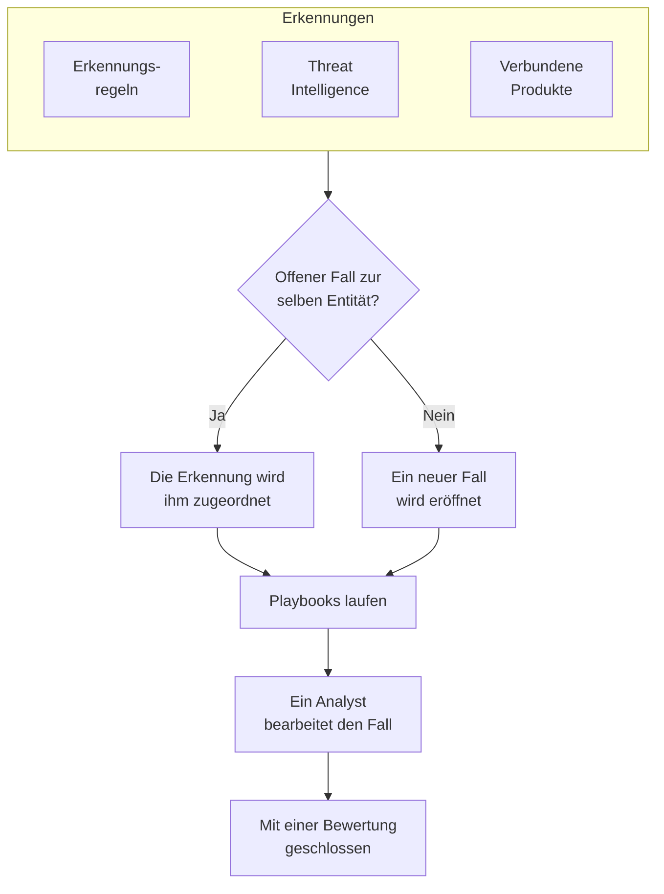

# Sicherheitsfälle und Playbooks (SOAR)

Das Produkt Sicherheitsereignisse macht aus den Funden Ihrer Erkennungsregeln, Ihrer Threat Intelligence und Ihrer verbundenen Sicherheitsprodukte Fälle: einen Fall für jede Sache, die eine Untersuchung wert ist, und darin gebündelt alle Erkennungen zum selben Benutzer, zum selben Host oder zur selben Adresse. Analysten bearbeiten die Fälle in einer Warteschlange, und Playbooks reagieren darauf, von selbst oder auf Knopfdruck.

:::cards
- [Woher Fälle kommen](#woher-fälle-kommen): Erkennungsregeln, Threat Intelligence, verbundene Produkte, Entitätsrisiko und Personen.
- [Einen Fall bearbeiten](#einen-fall-bearbeiten): Ihn zuweisen, seine Entitäten untersuchen und ihn mit einer Bewertung schließen.
- [Fallprioritäten und Fallstatus](#fallprioritäten-und-fallstatus): Umbenennen, umfärben, neu ordnen und eigene hinzufügen.
- [Benachrichtigungen](#benachrichtigungen): Wer von einem neuen Fall, einer Zuweisung und einem Schritt erfährt, der auf Genehmigung wartet.
- [Playbooks](#playbooks): Schritte, die auf einem Fall laufen, mit Genehmigung, wo es darauf ankommt.
- [Die Übersicht](#die-übersicht): Was gerade Aufmerksamkeit braucht, und wie schnell Fälle bearbeitet werden.
:::

## So funktioniert es

Öffnen Sie **Produkte → Sicherheitsereignisse → Sicherheitsfälle → Offene Fälle** für die Warteschlange. **Mir zugewiesen**, **Nicht zugewiesen**, **Geschlossene Fälle** und **Alle Fälle** sind eigene Seiten daneben, und jede listet die Fälle, die ihr Name sagt.

## Bevor Sie beginnen

Fälle und Playbooks folgen den drei Security-Rollen. Project Owner und Project Admin dürfen alles.

| Rolle | Was sie darf |
| --- | --- |
| Security Admin | Alles, auch Fälle löschen und Playbooks einrichten |
| Security Member | Fälle eröffnen, zuweisen, ändern und schließen, Notizen schreiben, Playbooks ausführen und ihre Schritte genehmigen oder ablehnen |
| Security Viewer | Fälle, Erkennungen, Notizen, Playbooks und deren Ausführungen lesen |

Jedes dieser Rechte lässt sich auch einzeln vergeben, vom Erstellen eines Falls bis zum Genehmigen der Schritte eines Playbooks; siehe [Berechtigungsreferenz](/docs/permissions/reference).

## Woher Fälle kommen

| Quelle | Eröffnet einen Fall, wenn | Abschalten mit |
| --- | --- | --- |
| Erkennungsregeln | Eine Regel passt | **Bei Treffer einen Fall eröffnen**, im Schritt **Bei Treffer** der Regel |
| Threat Intelligence | Ein Ereignis einen bekannten Indikator nennt | **Bei Treffer einen Fall eröffnen**, im Schritt **Bei Treffer** des Feeds |
| Verbundene Produkte | Eine eigene Warnung des Produkts auf oder über dem Schwellenwert der Verbindung importiert wird | **Open Cases From** auf **Nie** gesetzt, im Schritt **Abfrage** der Verbindung |
| Entitätsrisiko | Das Risiko eines Benutzers, Hosts oder einer Adresse den Schwellenwert des Projekts erreicht | **Risikofälle** unter **Einstellungen → Risikobewertung** |
| Personen | Jemand einen unter **Sicherheitsfälle** eröffnet, oder mit **Fall eröffnen** im Panel eines Ereignisses | Nicht abschaltbar |

Jede Quelle eröffnet standardmäßig Fälle, außer dem Entitätsrisiko in Projekten, die vor ihm angelegt wurden: Dort schalten Sie zuerst **Risikofälle** ein ([Entitätsrisiko](/docs/telemetry/security-entity-risk)). Eine Verbindung eröffnet Fälle für **Hoch und höher**, sofern Sie keine andere Stufe wählen; die Warnungen darunter werden weiterhin als Ereignisse importiert.

### Wie Erkennungen gruppiert werden

Eine Erkennung betrifft eine Entität: den Wert, nach dem ihre Regel gruppiert, etwa die IP-Adresse bei einer Brute-Force-Regel, oder den Indikator, den ein Threat-Intelligence-Treffer nennt. Eine Erkennung ohne Entität steht für sich allein.

- Gibt es bereits einen offenen Fall zu dieser Entität, wird die Erkennung ihm zugeordnet. Die Entitäten und das ATT&CK-Mapping des Falls wachsen, und seine Priorität steigt auf die der Erkennung, sinkt aber nie.
- Gibt es keinen, wird ein neuer Fall eröffnet, benannt nach der Erkennung und mit deren Priorität.
- Eine Erkennung, die erneut auslöst, zählt in ihrer Zeile hoch, statt eine weitere hinzuzufügen.

Die Priorität eines Falls ergibt sich aus dem Schweregrad der Erkennung, als die vordefinierte Priorität des Projekts für diese Stufe, wie auch immer Sie sie benannt haben:

| Schweregrad | Priorität |
| --- | --- |
| Critical oder Fatal | Kritisch |
| High | Hoch |
| Medium, Unknown oder Other | Medium |
| Low | Low |
| Informational | Hinweise |

## Einen Fall bearbeiten

Die Fälle eines neuen Projekts durchlaufen vier Status, die Sie umbenennen und um eigene ergänzen können (siehe [Fallprioritäten und Fallstatus](#fallprioritäten-und-fallstatus)). Ein Fall kann einen davon überspringen, etwa wenn ein False Positive direkt aus „Neu“ heraus geschlossen wird, und er kann wieder geöffnet werden.

| Status | Bedeutung |
| --- | --- |
| Neu | Noch niemand hat ihn sich angesehen |
| Untersuchung läuft | Jemand klärt, was passiert ist |
| Contained | Die Bedrohung kann keinen Schaden mehr anrichten; die Bereinigung steht noch aus |
| Geschlossen | Erledigt, mit einer Bewertung, was er war |

Ein Fall hat ein eigenes Seitenmenü, wie ein Vorfall, und jeder Teil des Falls ist eine eigene Seite:

| Abschnitt im Seitenmenü | Seiten |
| --- | --- |
| **Übersicht** | **Übersicht**, **Zeitachse** |
| **Untersuchung** | **Erkennungen**, **Entitäten**, **Verbundene Signale**, **Playbooks** |
| **Notizen** | **Private Notizen** |
| **Erweitert** | **Audit-Protokolle**, **Fall löschen**, eingeklappt, bis Sie auf **Erweitert** klicken |

Jede Seite behält oben den Kopf des Falls: Nummer, Priorität, Status und Titel, **Mir zuweisen**, **Playbook ausführen**, **Vorfall melden** und **Fall schließen**, und im Menü ⋯ daneben **Priorität setzen**, **Jemand anderem zuweisen**, **Status ändern**, **Fall bearbeiten** und **Fall löschen**. So lässt sich der Fall von jeder seiner Seiten aus bearbeiten, und ein Link zum Fall öffnet weiterhin seine **Übersicht**.

- **Übersicht**: die Beschreibung, Labels und Statusschritte des Falls, wer ihn hat und was ihn eröffnet hat, und seine Kennzahlen: wie viele Erkennungen er hat, wie lange er schon offen ist und wie lange es bis zur Bestätigung und bis zur Eindämmung gedauert hat.
- **OneUptime AI**, auf der **Übersicht**: was OneUptime AI aus dem Fall gelesen hat, die Priorität und das Playbook, die es vorschlägt, und die Beweise dahinter. Siehe [OneUptime AI in der Sicherheit](/docs/telemetry/security-ai).
- **MITRE ATT&CK**, auf der **Übersicht**: die Taktiken und Techniken, denen seine Erkennungen zugeordnet sind, jeweils verlinkt mit ihrer Seite auf attack.mitre.org.
- **Zeitachse**: alles, was mit dem Fall geschehen ist, jeweils mit der Person, die es getan hat.
- **Erkennungen**: was ausgelöst hat, um den Fall zu eröffnen oder ihn zu ergänzen, wie oft, und das neueste passende Ereignis.
- **Entitäten**: die Benutzer, Hosts und Adressen, um die es im Fall geht, mit ihrer Aktivität in allen Ihren Sicherheitsereignissen der letzten 7 Tage. Jede öffnet sich in **Korrelieren**.
- **Verbundene Signale**: die Hosts, Cluster, Dienste und Mitglieder, die der Fall nennt, wie OneUptime sie kennt, und was auf jedem davon rund um seine Erkennungen geschah: ihre Protokolle, Traces und Metriken, was darauf offen ist und was sich geändert hat. Siehe [Verbundene Signale](/docs/telemetry/security-connected-signals).
- **Playbooks**: was jedes Playbook am Fall getan hat, Schritt für Schritt, und die Schritte, die auf Genehmigung warten. Solange Ausführungen warten, zeigt das Menü neben **Playbooks**, wie viele es sind.
- **Private Notizen**: was das Team zum Fall geschrieben hat.
- **Audit-Protokolle**: jede Änderung am Fall und wer sie vorgenommen hat. Siehe [Audit-Protokolle](/docs/configuration/audit-logs).
- **Fall löschen**: löscht den Fall mit seinen Erkennungen, Notizen, seiner Zeitachse und seinen Playbook-Ausführungen endgültig. Um ihn als Nachweis zu behalten, schließen Sie ihn stattdessen mit einer Bewertung.

### Fälle aus der Warteschlange bearbeiten

Sie müssen einen Fall nicht öffnen, um ihn zu bearbeiten. In den Listen der Warteschlange hat das Menü ⋯ in der Zeile eines Falls **Mir zuweisen**, **Jemand anderem zuweisen**, **Status ändern** und **Priorität ändern**. Um mehrere Fälle auf einmal zu bearbeiten, wählen Sie sie aus und nutzen dieselben Aktionen unter **Massenaktionen**: Dort steht, welche Fälle geändert wurden, welche unverändert blieben und warum.

- Um einen Fall jemand anderem zu geben, nutzen Sie **Jemand anderem zuweisen** und wählen eine Person oder ein Team. Der Fall eines Teams wartet unter **Nicht zugewiesen**, bis ihn jemand aus dem Team übernimmt.
- Ein Status, der einen Fall schließt, fragt wie **Fall schließen** nach einer Bewertung und einer Abschlussnotiz.
- Ein geschlossener Fall wird niemandem zugewiesen. Um ihn wieder zu bearbeiten, öffnen Sie ihn mit **Status ändern** wieder.

### Einen Fall schließen

**Fall schließen** fragt nach einer Bewertung und einer optionalen Abschlussnotiz:

| Bewertung | Bedeutung |
| --- | --- |
| True Positive | Bösartige oder unbefugte Aktivität hat tatsächlich stattgefunden |
| Benign Positive | Die Aktivität war echt, aber erwartet, etwa ein Penetrationstest oder eine Admin-Aufgabe |
| False Positive | Die Erkennung lag falsch: Die Regel oder die Daten haben normale Aktivität falsch gedeutet |
| Undetermined | Es gab nicht genug Informationen für eine Entscheidung |

Die Bewertungen werden in der Übersicht gezählt. Eine Regel, deren Fälle immer wieder als False Positive geschlossen werden, sollte nachgeschärft werden.

Ein Fall, der aus Google SecOps-Warnungen eröffnet wurde, schließt sie auch in Google SecOps, mit dem Urteil und der Abschlussnotiz, wenn an seiner Verbindung **Warnungen schließen, wenn ihr Fall geschlossen wird** eingeschaltet ist: siehe [Google SecOps](/docs/integrations/google-secops#warnungen-schließen-wenn-ihr-fall-geschlossen-wird).

### Einen Vorfall melden

**Vorfall melden** öffnet für den Fall einen OneUptime-Vorfall mit dem Schweregrad, den Sie wählen, und verknüpft beide in beide Richtungen: Die Beschreibung des Vorfalls nennt den Fall, und der Kopfbereich des Falls verlinkt auf den Vorfall. Ab dort übernehmen Bereitschaft, Statusseiten und das Postmortem. Dafür braucht es eine Rolle, die sowohl Fälle bearbeiten als auch Vorfälle erstellen darf.

## Fallprioritäten und Fallstatus

Jedes Projekt hat seine eigenen Fallprioritäten und Fallstatus, unter **Produkte → Sicherheitsereignisse → Einstellungen → Fallprioritäten** und **Fallstatus**. Benennen Sie sie um, färben Sie sie um, ziehen Sie sie in eine andere Reihenfolge und fügen Sie eigene hinzu, etwa einen Status „Triage“ oder eine Priorität „Notfall“ über **Kritisch**. Ein neuer Name gilt sofort überall: in der Warteschlange, auf den Fallseiten und in der Übersicht, in Benachrichtigungen, in Slack und Microsoft Teams und in Playbook-Nachrichten.

Einige sind vordefiniert, weil OneUptime liest, was sie bedeuten. Sie lassen sich umbenennen und umfärben, aber weder löschen noch archivieren, und sie behalten ihre Reihenfolge:

| Vordefiniert | Was OneUptime damit macht |
| --- | --- |
| Der neue Status | Neue Fälle beginnen darin |
| Der bestätigte Status | Erreicht ein Fall ihn, wird festgehalten, wann er bestätigt wurde, und **Wieder öffnen** setzt einen geschlossenen Fall darauf zurück |
| Der eingedämmte Status | Erreicht ein Fall ihn, wird festgehalten, wann er eingedämmt wurde |
| Der geschlossene Status | **Fall schließen** setzt einen Fall darauf, mit einer Bewertung |
| Die Prioritäten Kritisch, Hoch, Medium, Low und Hinweise | Eine Erkennung eröffnet ihren Fall mit der Priorität ihres Schweregrads, und ein Fall, den jemand eröffnet, beginnt mit Medium |

- Wo ein Status steht, entscheidet, wofür ein Fall darin zählt, wie die Spalte **Zählt als** zeigt: ab dem bestätigten Status abwärts als bestätigt, ab dem eingedämmten Status abwärts als eingedämmt, ab dem geschlossenen Status abwärts als geschlossen. Ein Status, den Sie hinzufügen, kommt direkt über den geschlossenen Status, und wer einen Fall in einen Status setzt, der ihn schließt, wird zuerst nach einer Bewertung gefragt.
- Der Rang einer Priorität ist ihre Dringlichkeit, die dringendste zuerst: **Für Fälle mindestens**, die Auswahl bei den Benachrichtigungen und die Regeln für Slack und Microsoft Teams lesen diese Reihenfolge. Eine Priorität, die Sie hinzufügen, kommt ans Ende, und die Spalte **Schweregrad der Erkennung** zeigt, welche Erkennungen ihre Fälle mit welcher vordefinierten Priorität eröffnen.

Um einen eigenen Status oder eine eigene Priorität nicht mehr zu verwenden, nutzen Sie **Archivieren** in ihrer Zeile. Niemand kann sie dann mehr wählen, und die API, Terraform und MCP lehnen sie ab, aber die Fälle, die sie haben, behalten sie, und Sie können weiter danach filtern. Archivierte Werte stehen im eingeklappten Abschnitt **Archivierte Fallstatus** oder **Archivierte Fallprioritäten** unter der Tabelle, wo **Aus Archiv entfernen** einen zurückholt. **Löschen** wird abgelehnt, solange Fälle den Wert haben oder ein Playbook ab der Priorität läuft.

## Benachrichtigungen

OneUptime informiert Personen über drei Dinge an einem Fall. Niemand muss dafür etwas einrichten: Ein Projekt, das nur auf **Empfohlenes aktivieren** geklickt hat, erfährt von seinen Fällen mit Priorität Hoch und Kritisch per E-Mail und Push.

| Benachrichtigung | Wer informiert wird | Standardmäßig |
| --- | --- | --- |
| Neuer Sicherheitsfall | Alle, die die Fälle des Projekts sehen können, wenn ein Fall eröffnet wird oder in der Priorität steigt, ab der Priorität, die sie gewählt haben | Per E-Mail und Push, für Fälle mit Priorität Hoch und Kritisch |
| Mir zugewiesener Sicherheitsfall | Die Person, der der Fall zugewiesen ist, und die Mitglieder des Teams, dem er zugewiesen ist | Per E-Mail und Push |
| Playbook-Schritt wartet auf meine Genehmigung | Die Personen am Fall, die den Schritt genehmigen dürfen: die Person, der er zugewiesen ist, und die Mitglieder seines Teams. Darf keiner von ihnen genehmigen, alle im Projekt, die es dürfen | Per E-Mail und Push |

- Nur Personen, die den Fall sehen können, werden darüber informiert: Project Owner, Project Admin und die Rollen Security Admin, Security Member und Security Viewer. Eine Rolle, die auf bestimmte Labels beschränkt ist, wird nur über die Fälle mit diesen Labels informiert.
- Niemand wird über das informiert, was er selbst getan hat: Wer einen Fall per Hand eröffnet, ihn zuweist oder eine Ausführung startet, wird darüber nicht benachrichtigt.
- Jede Person erfährt nur einmal von einem Fall. Ein Fall, der mit Medium eröffnet wird und später auf Kritisch steigt, erreicht beim Anstieg die Personen, die Hoch und Kritisch oder Nur Kritisch gewählt haben, und nicht noch einmal die Personen, die Mittel und höher gewählt und schon bei der Eröffnung davon erfahren haben.
- Der Testangriff aus **Testangriff senden** eröffnet einen Fall, der niemanden benachrichtigt.
- Ein Fall mit Priorität Kritisch und ein Schritt, der auf Genehmigung wartet, werden sofort gesendet und nie in einer [E-Mail-Zusammenfassung](/docs/emails/notification-rollup) zurückgehalten.
- Die **Zeitachse** des Falls zeigt, wer wann informiert wurde.

### Wählen, worüber Sie informiert werden

Jede Person wählt selbst, unter **Benutzereinstellungen → Benachrichtigungseinstellungen → Sicherheit**: die Kanäle für jede Benachrichtigung (E-Mail, SMS, Anruf, Push, Telegram, Slack, Microsoft Teams oder Webhook) und unter **Neuer Sicherheitsfall** die Priorität, ab der sie benachrichtigt wird:

| Auswahl | Benachrichtigt über Fälle der Priorität |
| --- | --- |
| Nur Kritisch | Kritisch |
| Hoch und höher | Kritisch und Hoch (die Voreinstellung) |
| Mittel und höher | Kritisch, Hoch und Medium |
| Niedrig und höher | Jede außer Hinweise |
| Jeder Fall | Jede |

Die Auswahl folgt den Fallprioritäten des Projekts, unter ihren eigenen Namen: Dies sind die eines neuen Projekts.

Für Sicherheitsfälle werden keine WhatsApp-Nachrichten gesendet. Eine Push-Benachrichtigung öffnet den Fall in der App OneUptime On-Call (1.7.0 oder neuer), wo Sie einen wartenden Playbook-Schritt genehmigen oder ablehnen, den Fall übernehmen und schließen können. Ihr Link öffnet den Fall im Browser.

### In Kanäle von Slack und Microsoft Teams posten

Um in einem Kanal zu posten, fügen Sie unter **Produkte → Sicherheitsereignisse → Arbeitsbereich → Slack** (oder **Microsoft Teams**) eine Regel hinzu. Ist keines von beiden verbunden, ist der einzige Eintrag des Bereichs **Slack oder Teams verbinden**. Eine Regel nennt die Kanäle, in die gepostet wird (und in Microsoft Teams die Chats), und auf Wunsch die Fälle, für die sie gilt:

| Bedingung | Trifft zu auf |
| --- | --- |
| Priorität des Sicherheitsfalls | Eine der Fallprioritäten des Projekts, etwa Kritisch oder Hoch |
| Titel des Sicherheitsfalls, Beschreibung des Sicherheitsfalls | Text, den der Titel oder die Beschreibung des Falls enthält, mit dem sie beginnen oder auf den sie enden |
| Status des Sicherheitsfalls | Einer der Fallstatus des Projekts, etwa Neu oder Geschlossen |
| Quelle des Sicherheitsfalls | Erkennungsregel, Threat Intel, Connected Product, Entitätsrisiko oder Manuell |
| Beschriftungen des Sicherheitsfalls | Die Labels des Falls |

Die drei Benachrichtigungen werden jeweils in die Kanäle jeder Regel gepostet, auf die der Fall in diesem Moment passt. Eine Regel, deren **Priorität des Sicherheitsfalls** eines von **Kritisch** und **Hoch** enthält, postet Fälle mit Priorität Hoch und Kritisch, sobald sie eröffnet werden, und einen Fall mit Medium, wenn er auf Hoch steigt. Ein Sicherheitsfall bekommt nie einen eigenen Kanal.

## Playbooks

Ein Playbook ist eine Liste von Schritten, die auf einem Fall laufen. Erstellen Sie eines unter **Produkte → Sicherheitsereignisse → Playbooks**, aus einer Vorlage oder leer, und fügen Sie seine Schritte auf seiner Seite hinzu. Ein Projekt ohne Playbooks sieht statt einer leeren Liste die Vorlagen; sobald es Playbooks gibt, öffnet **Aus Vorlage erstellen** an der Liste sie, mit **Hinzugefügt** bei denen, die das Projekt schon hat.

### Wann ein Playbook läuft

| Auslöser | Wann es läuft |
| --- | --- |
| Case Opened | Einmal, wenn ein Fall eröffnet wird |
| Detection Added | Jedes Mal, wenn eine neue Erkennung einem offenen Fall zugeordnet wird |
| Als wahrscheinlich bösartig triagiert | Einmal, wenn die Triage von OneUptime AI den Fall als Wahrscheinlich bösartig liest |
| Manuell | Nur, wenn jemand es aus einem Fall heraus ausführt |

Jedes aktivierte Playbook lässt sich auch per Hand ausführen, mit **Playbook ausführen** an einem Fall. Ein Playbook, das von selbst läuft, lässt sich eingrenzen:

- **Für Fälle mindestens**: nur Fälle dieser Priorität oder höher.
- **Nur für Erkennungen aus**: nur, wenn die Erkennung hinter dem Fall aus dieser Quelle stammt.
- **Nur für diese Erkennungsregeln**: nur, wenn sie aus einer dieser Regeln stammt.

Ein deaktiviertes Playbook läuft weder von selbst noch per Hand.

### Schritte

| Kategorie | Schritt | Was er tut |
| --- | --- | --- |
| Fall | Assign the case | Übergibt den Fall an eine Person, ein Team oder beide |
| Fall | Set the priority | Hebt oder senkt die Priorität des Falls |
| Fall | Set the status | Setzt den Fall auf einen anderen Status des Projekts, mit der Bewertung, die Sie wählen, wenn dieser Status ihn schließt |
| Fall | Add a note | Schreibt eine Notiz an den Fall, etwa eine Checkliste für den Analysten |
| Fall | Add labels | Versieht den Fall mit Labels |
| Untersuchen | Check entities against threat intel | Schlägt jede Entität in Ihrer Threat Intelligence nach und kann bei einem Treffer die Priorität anheben |
| Untersuchen | Look up entity activity | Zählt die Sicherheitsereignisse jeder Entität in einem kürzlich zurückliegenden Zeitfenster und vermerkt das am Fall |
| Benachrichtigen | Email people | Schickt Benutzern und Teams eine Zusammenfassung des Falls per E-Mail, mit einem Link darauf |
| Benachrichtigen | Post to Slack | Postet eine Zusammenfassung des Falls in einen Slack-Kanal |
| Benachrichtigen | Post to Microsoft Teams | Postet eine Zusammenfassung des Falls in einen Kanal von Microsoft Teams |
| Eskalieren | Page on-call | Führt eine Bereitschaftsrichtlinie aus |
| Eskalieren | Vorfall melden | Öffnet einen OneUptime-Vorfall, der mit dem Fall verknüpft ist |
| Eindämmen | Suspend the user in Okta | Sperrt den Benutzer, um den es im Fall geht, in Okta |
| Eindämmen | End the user's Okta sessions | Meldet den Benutzer, um den es im Fall geht, bei Okta ab und widerruft seine Tokens |
| Eindämmen | Contain the host in CrowdStrike | Isoliert den Host, um den es im Fall geht, mit CrowdStrike Falcon vom Netzwerk |
| Eindämmen | Isolate the device in Microsoft Defender | Isoliert den Host, um den es im Fall geht, mit Microsoft Defender for Endpoint |
| Eindämmen | Unsuspend the user in Okta | Hebt die Sperre des Benutzers, um den es im Fall geht, in Okta auf |
| Eindämmen | Lift containment in CrowdStrike | Hebt die Netzwerkisolierung durch CrowdStrike Falcon für den Host auf, um den es im Fall geht |
| Eindämmen | Release the device in Microsoft Defender | Hebt die Isolierung des Hosts, um den es im Fall geht, in Microsoft Defender for Endpoint auf |
| Automatisieren | Send a webhook | Sendet den Fall als JSON per POST an eine URL |
| Automatisieren | Run a workflow | Startet einen OneUptime-Workflow mit dem Fall als Eingabe |

Ein Playbook hat höchstens 25 Schritte. Sie laufen der Reihe nach, jeder, sobald der vorige fertig ist. Jeder Schritt kann außerdem:

- **Genehmigung erforderlich**: die Ausführung vor dem Schritt anhalten, bis jemand ihn am Fall genehmigt. Die vier Schritte, die jemanden aussperren, halten immer an, es sei denn, ein Security Admin schaltet das ab.
- **Nur bei Threat-Intel-Treffer**: den Schritt überspringen, sofern nicht ein früherer Schritt **Entitäten mit Threat Intel abgleichen** derselben Ausführung einen bekannten Indikator gefunden hat.
- **Bei Fehler weitermachen**: den nächsten Schritt ausführen, auch wenn dieser fehlschlägt. Ist die Option aus, beendet ein fehlgeschlagener Schritt die Ausführung.

### Eindämmung

Die Eindämmungsschritte handeln über eine [Verbindung für Sicherheitsereignisse](/docs/telemetry/security-events#ein-sicherheitsprodukt-verbinden) zum Produkt, die dafür mehr als Lesezugriff braucht:

| Schritt | Verbindung | Braucht |
| --- | --- | --- |
| Suspend the user in Okta, End the user's Okta sessions, Unsuspend the user in Okta | Okta System Log | Ein API-Token, das Benutzer verwalten darf |
| Contain the host in CrowdStrike, Lift containment in CrowdStrike | CrowdStrike Falcon | Einen API-Client mit Schreibrecht im Scope Hosts |
| Isolate the device in Microsoft Defender, Release the device in Microsoft Defender | Microsoft Defender XDR | Eine App mit der Berechtigung Machine.Isolate |

Ein Eindämmungsschritt wirkt nur auf die Benutzer oder Hosts, um die es im Fall geht, nie auf alle, die der Fall nennt:

- Der Wert, nach dem eine Erkennung des Falls gruppiert ist, etwa das Konto, nach dem eine Regel für unmögliche Ortswechsel gruppiert, oder der Host, den die Warnung eines verbundenen Produkts nennt.
- Ein Benutzer oder Host des Falls, den Ihre Threat Intelligence als Indikator kennt.

Bei einem Fall, der nach einer Adresse gruppiert ist, etwa einem Brute-Force-Angriff auf Ihr VPN, geht es um keines von beiden: Seine Eindämmungsschritte werden übersprungen, und das Konto, bei dem er es versucht hat, und das Gateway, das er getroffen hat, bleiben unangetastet. Ein Schritt wirkt auf höchstens 10 Benutzer oder Hosts. Er sucht jeden davon im Produkt nach seinem Namen und vermerkt an der Ausführung, was er mit jedem getan hat: erledigt, bereits erledigt, nicht gefunden, abgelehnt oder geschützt.

#### Geschützte Entitäten

**Geschützte Entitäten**, im Menü unter **Playbooks**, listet die Benutzer und Hosts, die kein Playbook eindämmt, etwa Notfallzugriffskonten, Domänencontroller und VPN-Gateways. Ein Wert passt unabhängig von der Groß- und Kleinschreibung, und `*` steht für eine beliebige Folge von Zeichen: `svc-*` schützt jedes Dienstkonto. Ein Schritt meldet einen geschützten Benutzer oder Host als geschützt und lässt ihn unangetastet. Security Admins pflegen die Liste.

#### Genehmigung

Die vier Schritte, die jemanden aussperren, warten auf Genehmigung. Nur ein Security Admin kann **Genehmigung erforderlich** für einen von ihnen abschalten, und OneUptime hält fest, wer das getan hat. Die Genehmigung listet unter **Anwenden auf** die Benutzer oder Hosts, auf die der Schritt wirken würde, alle angehakt: Entfernen Sie den Haken bei allen, die er unangetastet lassen soll. Geschützte werden nicht angeboten. Wer eine Ausführung gestartet hat, kann ihre Schritte nicht genehmigen: Das tut jemand anderes, ablehnen kann er sie aber weiterhin.

#### Rückgängig machen

Die Schritte zum Rückgängigmachen wirken auf die Benutzer oder Hosts, um die es im Fall geht, wie die Schritte, die sie rückgängig machen. Sobald die Ausführung beendet ist, hat ein eingedämmter Benutzer oder Host an seinem Schritt außerdem eine eigene Schaltfläche: **Sperre aufheben**, **Eindämmung aufheben** oder **Freigeben**. Das Beenden einer Okta-Sitzung lässt sich nicht rückgängig machen. Jedes Rückgängigmachen wird in der Zeitachse des Falls und im Audit-Protokoll des Projekts festgehalten.

### Nachrichten

Eine Notiz, eine E-Mail, ein Slack-Beitrag und ein Teams-Beitrag können die Werte des Falls nutzen:

| Platzhalter | Wird zu |
| --- | --- |
| `{{case.number}}` | Die Fallnummer, etwa CASE-42 |
| `{{case.title}}` | Der Titel des Falls |
| `{{case.priority}}` | Die Priorität des Falls, wie Ihr Projekt sie nennt, etwa High |
| `{{case.status}}` | Der Status des Falls, wie Ihr Projekt ihn nennt, etwa Investigating |
| `{{case.assignee}}` | Wem der Fall zugewiesen ist |
| `{{case.url}}` | Ein Link zum Fall in OneUptime |
| `{{case.entities}}` | Die Benutzer, Hosts und Adressen, um die es im Fall geht |
| `{{case.detections}}` | Wie viele Erkennungen der Fall enthält |

Eine E-Mail oder ein Beitrag ohne eigene Nachricht sendet eine Zusammenfassung des Falls.

### Ausführungen und Genehmigungen

Jede Ausführung wird an ihrem Fall und unter **Produkte → Sicherheitsereignisse → Playbooks → Ausführungen** aufgelistet, Schritt für Schritt:

| Status der Ausführung | Bedeutung |
| --- | --- |
| In der Warteschlange | Wartet auf einen Worker |
| Wird ausgeführt | Führt ihre Schritte aus |
| Wartet auf Genehmigung | Vor einem Schritt angehalten, der eine Genehmigung braucht |
| Erfolgreich | Jeder Schritt lief oder wurde übersprungen |
| Fehlgeschlagen | Ein Schritt ist fehlgeschlagen, und die Ausführung wurde beendet |
| Abgebrochen | Jemand hat sie abgebrochen oder einen Schritt abgelehnt |

Ein Schritt, der auf Genehmigung wartet, zeigt an der Ausführung **Genehmigen** und **Ablehnen**, mit einem optionalen Kommentar. Eine Genehmigung setzt die Ausführung ab diesem Schritt fort; eine Ablehnung beendet sie. Die Entscheidung, wer sie getroffen hat, und der Kommentar werden am Schritt, in der Zeitachse des Falls und im Audit-Protokoll des Projekts festgehalten. Die Seite **Genehmigungen**, im Menü unter **Playbooks**, listet die Ausführungen, die auf eine Entscheidung warten, und zählt sie; **Ausführungen** listet jede Ausführung. Auf **Ausführungen**, auf der Seite eines Playbooks und unter **Playbooks** eines Falls ist jede Ausführung eine Zeile, die sagt, wie weit sie gekommen ist oder bei welchem Schritt sie angehalten hat; **Schritte anzeigen** öffnet ihre Schritte. Eine Ausführung, die auf Genehmigung wartet, öffnet sich von selbst, ebenso die neueste Ausführung eines Falls.

Eine Ausführung, von deren Worker nichts mehr kommt, etwa nach einem Neustart, wird wieder aufgegriffen: Eine Ausführung in der Warteschlange wird nach 2 Minuten erneut eingereiht, und eine Ausführung, die sich 30 Minuten lang nicht gemeldet hat, gilt als fehlgeschlagen.

## Die Übersicht

**Produkte → Sicherheitsereignisse → Übersicht** ist die Seite, mit der das Produkt öffnet:

- Die offenen Fälle, die Ihnen zugewiesen sind, die offenen Fälle, die noch niemand übernommen hat, und die Playbook-Schritte, die auf Genehmigung warten; jede Zahl öffnet die Seite, die sie auflistet.
- **Mittlere Zeit bis zur Bestätigung**, **Mittlere Zeit bis zur Eindämmung** und **Mittlere Zeit bis zum Schließen**, über die in den letzten 30 Tagen eröffneten Fälle: von der Eröffnung eines Falls, bis jemand ihn übernimmt (eine Person zuweist oder ihn in einen Status setzt, der als bestätigt zählt), bis zu einem Status, der als eingedämmt zählt, und bis zu einem, der als geschlossen zählt. Ein Fall, der noch wartet, geht in keinen Mittelwert ein.
- Die pro Tag eröffneten Fälle über 30 Tage, nach Priorität, und die pro Tag ausgelösten Erkennungen über 14 Tage, nach Quelle.
- Die offenen Fälle nach Priorität und nach Status, die riskantesten Entitäten nach ihrem Risikowert, die am häufigsten ausgelösten Erkennungen, die ATT&CK-Taktiken hinter den Fällen und die Bewertungen der letzten 30 Tage.

Darüber zeigt ein Streifen, wie Sicherheit eingerichtet ist: ihre Quellen, Erkennungen, Fälle und Playbooks, jeweils mit ihren Zahlen. Ein Projekt, das sie noch nicht eingerichtet hat, sieht dort **Empfohlenes aktivieren** und **Testangriff senden**; siehe [Erste Schritte mit Sicherheit](/docs/telemetry/security-getting-started). Braucht nichts jemanden, sagt die Seite **Alles ruhig**, und die Diagramme erscheinen, sobald es etwas darzustellen gibt.

## Bedrohungen finden

- **Entitätsrisiko** ordnet die Benutzer, Hosts und Adressen nach ihrem Risikowert, die riskantesten zuerst, und **Riskanteste Entitäten** auf der Übersicht zeigt den Anfang derselben Liste. Wählen Sie eine Entität, um zu sehen, warum sie riskant ist. Unter der Liste schlägt **Eine Entität nachschlagen** jeden Wert in den Ereignissen von 30 Tagen nach, auch eine Domain oder einen Datei-Hash, und öffnet ihn in **Korrelieren**.
- **Regelbibliothek** enthält fertige Erkennungsregeln für Bedrohungen rund um Identität, Endpunkte, Cloud, Netzwerk, Web und Kubernetes. Jede ist eine Sigma-Regel, geschrieben für die Felder, auf die jede verbundene Quelle normalisiert wird. Ihre Zeile nennt, was sie findet, die MITRE-ATT&CK-Taktiken und -Techniken, denen sie zugeordnet ist, die Ereignisse, die sie liest, und ob in den letzten 7 Tagen welche eingegangen sind (**Empfangen** oder **Nicht empfangen**), sowie ihren Schweregrad. Grenzen Sie die Liste nach Kategorie, nach den Daten, die die Regeln lesen, und danach ein, ob Sie sie hinzugefügt haben, oder durchsuchen Sie sie nach Name, ATT&CK-Technik oder Schweregrad; die Adresse der Seite behält die Filter. Wählen Sie eine Regel für ihre Details: wie Sie anfangen, die Ereignisse zu senden, die sie liest, wie sie läuft, und ihre Sigma-Regel. **Hinzufügen** legt sie als Ihre eigene Erkennungsregel an, eingeschaltet und so eingestellt, dass sie Fälle statt Warnungen eröffnet; ändern Sie sie unter **Erkennungsregeln** wie jede andere. Die mit **Empfohlen** markierten Regeln finden Bedrohungen in Daten, die OneUptime bereits hat, und eine Schaltfläche fügt die hinzu, die Ihnen noch fehlen.
- **ATT&CK-Abdeckung** listet die Taktiken von MITRE ATT&CK, jede damit, wie viele ihrer Techniken Ihre aktivierten Regeln abdecken und für wie viele weitere die **Regelbibliothek** Regeln hat. Öffnen Sie eine Taktik für ihre Techniken, oder wechseln Sie zu **Matrix** für die ganze Matrix. Wählen Sie eine Technik, um die Regeln aus der Bibliothek zu sehen, die sie abdecken, und die **Regelbibliothek** mit ihnen zu öffnen.

## Automatisieren

- **Arbeitsabläufe**: Ein Fall oder eine Notiz kann einen Workflow starten, wenn er oder sie erstellt, aktualisiert oder gelöscht wird. Ein Schritt **Arbeitsablauf ausführen** startet einen Workflow, dessen Trigger ein Webhook ist.
- **API**: Fälle, Notizen, Erkennungen, Playbooks, Ausführungen, geschützte Entitäten sowie Fallprioritäten und Fallstatus haben dieselbe REST-API wie der Rest von OneUptime, unter `/security-case`, `/security-case-note`, `/security-detection`, `/security-playbook`, `/security-playbook-run`, `/security-protected-entity`, `/security-case-priority` und `/security-case-status`. Siehe [API-Referenz](/docs/api-reference/api-reference).
- KI-Agenten: Der MCP-Server hat Werkzeuge für Fälle, Notizen, Erkennungen, Playbooks sowie Fallprioritäten und Fallstatus. Siehe [MCP-Server](/docs/ai/mcp-server).
- Terraform: Die Ressourcen `oneuptime_security_case_priority` und `oneuptime_security_case_status` halten die Prioritäten und Status eines Projekts als Code fest.

## Fehlerbehebung

:::details Eine Regel passt, aber es wird kein Fall eröffnet
Prüfen Sie **Bei Treffer einen Fall eröffnen** im Schritt **Bei Treffer** der Regel. Eine Erkennung zu einer Entität, die bereits einen offenen Fall hat, wird diesem Fall zugeordnet, statt einen weiteren zu eröffnen: Suchen Sie sie unter **Erkennungen** im offenen Fall.
:::

:::details Niemand wurde über einen Fall informiert
Sehen Sie in der **Zeitachse** des Falls nach, die zeigt, wer benachrichtigt wurde. Eine Benachrichtigung **Neuer Sicherheitsfall** geht an die Personen, deren gewählte Priorität der Fall erreicht; ein Fall mit Medium benachrichtigt also niemanden, der die Voreinstellung **Hoch und höher** behalten hat. Prüfen Sie, dass die Personen, die davon erfahren sollen, Sicherheitsfälle sehen können (eine Security-Rolle oder Project Owner bzw. Project Admin) und dass die Benachrichtigung für sie unter **Benutzereinstellungen → Benachrichtigungseinstellungen → Sicherheit** eingeschaltet ist.
:::

:::details Ein Playbook ist nicht gelaufen
Prüfen Sie, dass es aktiviert ist, dass sein **Auslöser** passt (Case Opened läuft einmal, wenn ein Fall eröffnet wird) und dass der Fall seine Einstellungen **Für Fälle mindestens**, **Nur für Erkennungen aus** und **Nur für diese Erkennungsregeln** erfüllt. Ein per Hand eröffneter Fall hat keine Erkennung, also läuft ein Playbook, das auf eine Quelle oder auf Regeln beschränkt ist, nicht darauf.
:::

:::details Ein Eindämmungsschritt ist fehlgeschlagen
Öffnen Sie die Ausführung am Fall: Der Schritt sagt für jeden Benutzer oder Host, ob das Produkt die Aktion abgelehnt hat, ihn nicht gefunden hat oder nicht erreichbar war. Prüfen Sie, dass die Zugangsdaten der Verbindung die Änderung vornehmen dürfen, und nutzen Sie **Verbindung testen** in ihrer Zeile.
:::

:::details Ein Eindämmungsschritt wurde übersprungen
Im Fall geht es um keinen Benutzer und keinen Host, etwa nur um eine Adresse, oder jeder Benutzer oder Host, um den es darin geht, ist geschützt. Öffnen Sie die Ausführung am Fall: Der Schritt sagt, was davon zutrifft.
:::

:::details Ein Status oder eine Priorität lässt sich nicht löschen oder archivieren
Ein vordefinierter Wert lässt sich umbenennen und umfärben, aber nie löschen oder archivieren: Sein **Archivieren** ist gesperrt, mit dem Grund. Einen eigenen Wert können Sie nicht löschen, solange Fälle ihn haben oder ein Playbook ab ihm läuft: Setzen Sie die Fälle zuerst auf einen anderen, oder archivieren Sie ihn.
:::

## Nächste Schritte

:::cards
- [Sicherheitsereignisse](/docs/telemetry/security-events): Ereignisse senden, Erkennungsregeln schreiben und Sicherheitsprodukte verbinden.
- [Threat Intelligence](/docs/telemetry/threat-intelligence): Ihre Ereignisse mit STIX/TAXII-Feeds abgleichen.
- [OneUptime AI in der Sicherheit](/docs/telemetry/security-ai): Fälle triagieren, Erkennungsregeln entwerfen und mit KI Fragen zur Sicherheit stellen.
- [Berechtigungsreferenz](/docs/permissions/reference): Die Security-Rollen und was jede darf.
:::
