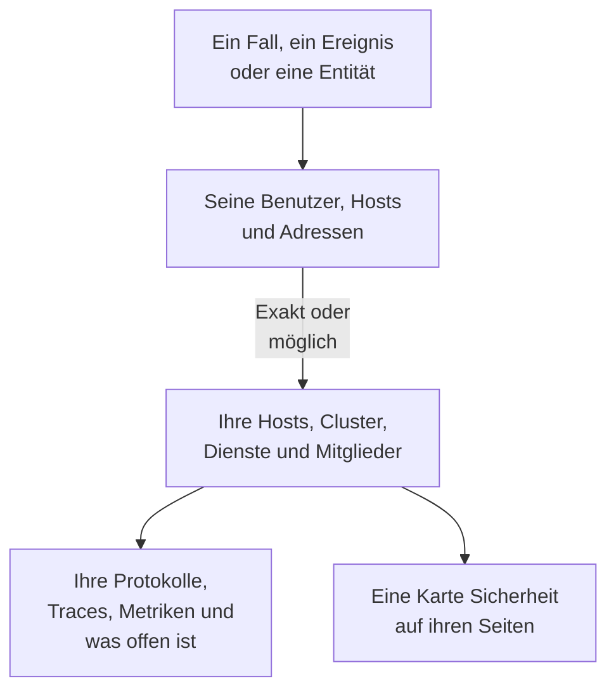

# Verbundene Signale

Ein Sicherheitsfall sagt, um welche Benutzer, Hosts und Adressen es geht. Verbundene Signale sagt, welche davon OneUptime bereits kennt - Ihre Hosts, Container-Hosts, Kubernetes-Cluster, Netzwerkgeräte, Dienste und Mitglieder - und was auf jedem davon rund um den Fall geschah: seine Protokolle, Traces und Metriken, die Vorfälle und Warnungen, die darauf offen sind, die Monitore, die ihn überwachen, und was sich daran geändert hat. Umgekehrt sagt die Seite eines Hosts, eines Clusters, eines Dienstes oder eines Mitglieds, was Sicherheitsereignisse darüber gefunden hat.

:::cards
- [Wo Sie es sehen](#wo-sie-es-sehen): Die Seite eines Falls, der Tab eines Ereignisses, die Seite einer Entität und die Seiten dessen, was sie nennen.
- [Wie ein Wert zugeordnet wird](#wie-ein-wert-zugeordnet-wird): Was als derselbe Datensatz zählt und was nur möglicherweise.
- [Was jeder Datensatz zeigt](#was-jeder-datensatz-zeigt): Seine Signale rund um den Fall und was darauf offen ist.
- [Wer was sieht](#wer-was-sieht): Jeder Datensatz wird mit der eigenen Rolle des Lesers gelesen.
:::

## So funktioniert es

OneUptime sucht jeden Wert unter den Datensätzen des Projekts, sagt, wie sicher jede Übereinstimmung ist, und zeigt, was auf jedem Datensatz rund um den Fall geschah.

## Bevor Sie beginnen

- Eingehende Sicherheitsereignisse, und Hosts, Kubernetes-Cluster, Dienste oder Mitglieder im Projekt, die sie nennen können. Siehe [Erste Schritte mit Sicherheit](/docs/telemetry/security-getting-started).
- Eine Rolle, die Sicherheitsereignisse lesen darf, und die Arten von Datensätzen, die Sie sehen möchten.

## Wo Sie es sehen

- **Verbundene Signale**, eine Seite jedes Sicherheitsfalls: Öffnen Sie einen Fall unter **Produkte → Sicherheitsereignisse → Sicherheitsfälle → Offene Fälle** und dann **Verbundene Signale** nach **Entitäten** in seinem Menü.
- **Verbunden**, ein Tab jedes Sicherheitsereignisses: Öffnen Sie ein Ereignis unter **Produkte → Sicherheitsereignisse → Ereignisse**. Er listet, was das Ereignis nennt, in der Stunde rund um das Ereignis.
- Die Seite einer Entität unter **Produkte → Sicherheitsereignisse → Entitätsrisiko**: wo OneUptime den Benutzer, den Host oder die Adresse kennt, rund um sein letztes Sicherheitsereignis.
- Eine Karte **Sicherheit** auf der Seite jedes Hosts, Docker-Hosts, Podman-Hosts, Kubernetes-Clusters, Netzwerkgeräts, Dienstes, Mitglieds und Inventarelements: die offenen Sicherheitsfälle, die ihn nennen, wie viele Sicherheitsereignisse und Befunde ihn in den letzten 7 Tagen genannt haben, der schwerste davon und sein Risiko. **In Sicherheitsereignissen öffnen** öffnet ihn dort.
- Eine Karte **Sicherheit** auf der Seite eines Vorfalls, wenn ein Sicherheitsfall den Vorfall gemeldet hat (**Gemeldet aus**) oder offene Fälle einen Host oder Cluster nennen, den er betrifft (**Offene Fälle, die nennen, was der Vorfall betrifft**).

## Wie ein Wert zugeordnet wird

Jeder Benutzer, jeder Host und jede Adresse, die ein Fall oder ein Ereignis nennt, wird unter den Datensätzen des Projekts gesucht:

| Was der Fall oder das Ereignis nennt | Zugeordnet zu | Wie sicher |
| --- | --- | --- |
| Ein Host- oder Domainname, der dem Namen entspricht, den ein Host, ein Container-Host, ein Cluster oder ein Netzwerkgerät meldet | Diesem Datensatz | Exakt |
| Derselbe Name, ohne Angabe, dass es ein Host ist | Diesem Datensatz | Möglich |
| Eine Kurz- oder Langform des Namens eines Datensatzes, etwa `web-1` und `web-1.acme.internal` | Diesem Datensatz | Möglich |
| Eine öffentliche IP-Adresse, die nur ein Datensatz hat | Diesem Datensatz | Exakt |
| Eine private IP-Adresse oder eine, die mehr als ein Datensatz hat | Jedem Datensatz, der sie hat | Möglich |
| Die E-Mail-Adresse eines Mitglieds | Diesem Mitglied | Exakt |
| Der Datensatz, unter dem eine Protokollzeile gesendet wurde, für die Ereignisse aus Ihren Protokollen | Diesem Host, Cluster oder Dienst | Exakt |
| Ein bloßer Benutzername, eine URL, ein Datei-Hash oder ein Prozess | Nichts: Kein Datensatz ist danach geschlüsselt | - |

- Eine mögliche Übereinstimmung zeigt **Mögliche Übereinstimmung** neben ihrem Namen und sagt, warum. Sie wird auf der Seite des Datensatzes nie gezählt, und ein Vorfall, den der Fall meldet, wird nie mit ihr verknüpft.
- Was gesucht wurde und kein Datensatz des Projekts ist, steht unter **Nicht in OneUptime**. Ein Wert steht dort nie, wenn eine Art von Datensatz, die er sein könnte, nicht gelesen werden konnte.
- Für einen Fall werden höchstens 10 Datensätze aufgeführt, die exakten zuerst.

## Was jeder Datensatz zeigt

- Seine Signale, jedes geöffnet auf dem Datensatz und dem Zeitraum des Falls: **Protokolle**, **Traces** und **Metriken**, die **Ausnahmen** eines Dienstes, die **Kubernetes-Ereignisse** eines Clusters, die **Topologie** des Datensatzes und sein Element im **Inventar**, wenn das Inventar eines hat.
- Die Vorfälle und Warnungen, die jetzt darauf offen sind, und die Monitore, die ihn überwachen, jeweils mit ihrer eigenen Seite.
- Was sich im Zeitraum daran geändert hat: die Deployments eines Dienstes, die Rollouts eines Clusters und die Behebungen eines Hosts.

| Wo | Zeitraum |
| --- | --- |
| Ein Fall | Von 30 Minuten vor seiner ersten Erkennung bis 30 Minuten nach seiner letzten, höchstens seine letzten 24 Stunden |
| Ein Ereignis | 30 Minuten davor und danach |
| Die Seite einer Entität | 30 Minuten vor und nach ihrem letzten Sicherheitsereignis |
| Die Karte **Sicherheit** eines Datensatzes | Die letzten 7 Tage |

## Wer was sieht

- Verbundene Signale und die Karte **Sicherheit** eines Datensatzes erfordern eine Rolle, die Sicherheitsereignisse lesen darf: Security Admin, Security Member, Security Viewer, Project Owner oder Project Admin. Alle anderen sehen auf keiner Seite Sicherheitsdaten. Siehe [Rollen](/docs/permissions/reference#rollen).
- Die Karte **Sicherheit** eines Vorfalls erfordert eine Rolle, die Sicherheitsfälle lesen darf.
- Jeder Datensatz wird mit Ihrer eigenen Rolle gelesen. Eine Art von Datensatz, die Ihre Rolle nicht lesen darf, wird weggelassen, und die Seite sagt das; eine, die gerade nicht gelesen werden konnte, sagt das ebenfalls, mit **Erneut versuchen**.
- Die Seite eines Datensatzes zeigt ihre Karte **Sicherheit** nur in einem Projekt, das Sicherheitsereignisse nutzt: einem, das in den letzten 7 Tagen ein Sicherheitsereignis erhalten hat.

## Vorfälle, die ein Fall meldet

**Vorfall melden** auf einem Fall oder ein Playbook-Schritt, der einen meldet, verknüpft den Vorfall mit den Hosts, Docker- und Podman-Hosts, Kubernetes-Clustern und Diensten, mit denen der Fall exakt verbunden ist. Der Vorfall erscheint auf ihren Seiten, die Regeln ihrer Besitzer gelten für ihn, und sein Feed nennt den Fall und das, womit er verknüpft wurde. Eine mögliche Übereinstimmung wird nie verknüpft.

## OneUptime AI

Die Triage eines Falls durch OneUptime AI liest seine verbundenen Signale: was offen ist und was sich an den Hosts, Diensten und Mitgliedern geändert hat, die der Fall nennt. Die Untersuchung eines Vorfalls liest den Sicherheitsfall, der ihn gemeldet hat, und die offenen Fälle, die nennen, was er betrifft. Siehe [OneUptime AI in der Sicherheit](/docs/telemetry/security-ai).

## Fehlerbehebung

:::details Ein Host, den der Fall nennt, wird nicht aufgeführt
Prüfen Sie, ob der Fall den Host so nennt, wie der Host sich selbst nennt, oder eine öffentliche Adresse nennt, die nur dieser Host hat. Ein Kurzname wie `web-1` für `web-1.acme.internal` wird als mögliche Übereinstimmung aufgeführt, und ein bloßer Benutzername, eine URL, ein Datei-Hash oder ein Prozess wird gar nicht gesucht.
:::

:::details Der richtige Host wird als mögliche Übereinstimmung aufgeführt
Eine mögliche Übereinstimmung wird nie gezählt oder verknüpft, damit ein Name, den zwei Rechner teilen, Ihnen nie etwas über den falschen sagt. Lassen Sie Ihre Protokolle und Erkennungen den Host mit dem Namen nennen, den er meldet.
:::

:::details Die Seite eines Hosts hat keine Karte Sicherheit
Die Karte wird einer Rolle gezeigt, die Sicherheitsereignisse lesen darf, in einem Projekt, das in den letzten 7 Tagen ein Sicherheitsereignis erhalten hat. Ein Host, den in dieser Zeit nichts genannt hat, zeigt eine Zeile, die das sagt.
:::

:::details Die Seite sagt, dass Ihre Rolle eine Art von Datensatz nicht sehen kann
Jeder Datensatz wird mit Ihrer eigenen Rolle gelesen. Bitten Sie einen Project Owner oder Project Admin um eine Rolle, die diese Art von Datensatz lesen darf.
:::

## Nächste Schritte

:::cards
- [Sicherheitsfälle und Playbooks](/docs/telemetry/security-cases): Einen Fall bearbeiten und daraus einen Vorfall melden.
- [Sicherheitsereignisse (SIEM)](/docs/telemetry/security-events): Die Ereignisse hinter einem Fall und die Protokolle, aus denen sie gelesen werden.
- [Entitätsrisiko (risikobasierte Alarmierung)](/docs/telemetry/security-entity-risk): Die Seite einer Entität, ihr Risiko und wo OneUptime sie kennt.
- [OneUptime AI in der Sicherheit](/docs/telemetry/security-ai): Wie eine Triage liest, was ein Fall nennt.
:::
