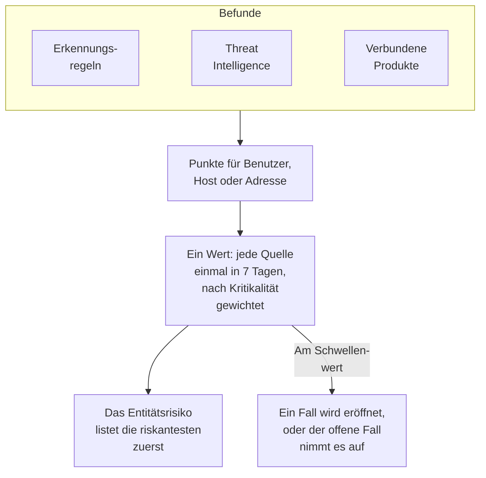

# Entitätsrisiko (risikobasierte Alarmierung)

Ein einzelner Befund sagt selten viel. Eine Reihe fehlgeschlagener Anmeldungen, ein erstes sudo auf einem Host und eine Anmeldung aus einem neuen Land sind jeweils einen Blick wert; dasselbe Konto in allen dreien innerhalb einer Woche ist einen Fall wert. Das Entitätsrisiko summiert, was Ihre Erkennungsregeln, Threat Intelligence und verbundenen Produkte zu jedem Benutzer, Host und jeder IP-Adresse finden, listet die riskantesten zuerst und eröffnet einen Fall zu einer Entität, deren Risiko den Schwellenwert des Projekts erreicht.

:::cards
- [So wird ein Wert gezählt](#so-wird-ein-wert-gezählt): Punkte nach Schweregrad, und jede Quelle einmal pro Woche.
- [Risikostufen und Fälle](#risikostufen-und-fälle): Wie ein Wert eingestuft wird, und wann ein Fall eröffnet wird.
- [Entitätskritikalität](#entitätskritikalität): Mehr zählen, was mehr zählt, und weniger, was weniger zählt.
- [Die Seite einer Entität](#die-seite-einer-entität): Warum sie riskant ist, ihr Monat und die Fälle dazu.
- [Risikopunkte einer Erkennungsregel](#risikopunkte-einer-erkennungsregel): Das eigene Gewicht einer Regel im Wert.
:::

## So funktioniert es

Öffnen Sie **Produkte → Sicherheitsereignisse → Entitätsrisiko**: jeder Benutzer, Host und jede IP-Adresse mit aktuellem Risiko, die riskantesten zuerst, mit Stufe, Wichtigkeit, was sie gefunden hat und wann. Jede Entität öffnet sich auf einer eigenen Seite.

## Bevor Sie beginnen

- Eingehende Sicherheitsereignisse, und Erkennungsregeln, Threat Intelligence oder verbundene Produkte, die darin etwas finden. Siehe [Erste Schritte mit Sicherheit](/docs/telemetry/security-getting-started).
- Erkennungsregeln, die nach einem Feld gruppieren, das jemanden nennt: **Nach Feld gruppieren**, etwa `principalUser`, `principalHost` oder `principalIp`, oder die Felder, nach denen eine Korrelation gruppiert. Eine Regel, die nach nichts gruppiert, fügt kein Risiko hinzu.
- Um **Risikobewertung** zu ändern: Project Owner oder Project Admin für den Schalter und den Schwellenwert, und eine Rolle, die Erkennungsregeln erstellen darf, für die Liste der Entitäten. Security Viewer liest alles davon. Siehe [Rollen](/docs/permissions/reference#rollen).

## So wird ein Wert gezählt

Jeder Befund gibt dem Benutzer, Host oder der IP-Adresse, um die es geht, Risikopunkte:

| Ein Befund mit Schweregrad | Fügt hinzu |
| --- | --- |
| Niedrig | 10 Punkte |
| Mittel | 25 Punkte |
| Hoch | 50 Punkte |
| Kritisch | 75 Punkte |

- Ein informativer Befund fügt nichts hinzu, und ein Befund mit unbekanntem Schweregrad zählt als Mittel.
- Die Punkte einer Erkennungsregel gehen an den Wert, nach dem sie gruppiert. Ein Threat-Intelligence-Treffer zählt für die IP-Adresse, die der Indikator nennt. Die Warnung eines verbundenen Produkts zählt für den Benutzer und den Host, die sie nennt, sonst für ihre IP-Adresse.
- Jede Quelle zählt einmal. Eine Erkennungsregel, ein Threat-Intelligence-Feed oder die Regel eines verbundenen Produkts zählt einmal in 7 Tagen, mit dem Höchsten, das sie beitrug, wie oft sie auch auslöst: Eine laute Regel kann eine Entität nie schlimmer aussehen lassen als drei verschiedene.
- Eine Quelle, die 7 Tage lang nichts gefunden hat, zählt nicht mehr, und der Wert sinkt. Die Werte werden alle 15 Minuten geprüft, sodass ein Wert pünktlich sinkt, auch ohne neuen Befund.

Der Wert einer Entität ist die Summe ihrer Quellen, gewichtet nach ihrer Kritikalität. Der Testangriff aus **Testangriff senden** und ein Fall, den jemand von Hand eröffnet, fügen kein Risiko hinzu.

## Risikostufen und Fälle

Jeder Wert wird gegenüber dem Schwellenwert des Projekts als Stufe eingestuft, 100, sofern Sie ihn nicht ändern:

| Risikowert | Gilt als | Was passiert |
| --- | --- | --- |
| 1 bis 49 | Niedrig | Unter Entitätsrisiko aufgeführt |
| 50 bis 99 | Mittel | Unter Entitätsrisiko aufgeführt |
| 100 bis 199 | Hoch | Ein Fall wird eröffnet, mit Hoch |
| 200 oder mehr | Kritisch | Ein Fall wird eröffnet, mit Kritisch |

Erreicht das Risiko einer Entität den Schwellenwert, wird eine Erkennung mit der Quelle Entitätsrisiko zu ihr ausgelöst. Sie schließt sich dem offenen Fall zur Entität an oder eröffnet einen nach ihr benannten Fall, etwa `High risk — k.morgan@acme-commerce.example`, und listet die Quellen auf, die am meisten zum Risiko beitrugen, bis zu 10, mit ihren Punkten, wie oft jede auslöste und wann zuletzt.

Sobald ein Fall zum Risiko einer Entität eröffnet ist, wird das, was dahinter steckte, nicht erneut gezählt: Ein weiterer Fall wird nur eröffnet, wenn seitdem neue Quellen wieder den Schwellenwert erreichen. Ein als erledigt geschlossener Fall wird durch dieselben Befunde nicht erneut eröffnet.

Ändern Sie den Schwellenwert unter **Produkte → Sicherheitsereignisse → Einstellungen → Risikobewertung → Risikoschwelle**: eine ganze Zahl von 10 bis 10000. Mittel beginnt bei der Hälfte, Kritisch beim Doppelten, auf jeder Seite.

### Risikofälle ein- oder ausschalten

**Risikofälle** unter **Einstellungen → Risikobewertung** entscheidet, ob Risiko Fälle eröffnet, und speichert beim Umschalten. Neue Projekte beginnen mit eingeschaltetem Schalter. Ein Projekt, das vor dem Entitätsrisiko erstellt wurde, lässt ihn aus, bis ihn jemand einschaltet, und **Entitätsrisiko** sagt es über seiner Liste. Risiko wird in jedem Fall bewertet und aufgeführt.

## Entitätskritikalität

Manche Entitäten zählen mehr als andere: ein Domänencontroller, das Konto einer Führungskraft, ein Zahlungsserver. Andere zählen weniger, etwa ein Schwachstellenscanner, dessen Scans erwartet werden. Führen Sie sie unter **Einstellungen → Risikobewertung → Entitätskritikalität** mit **Entität hinzufügen** auf:

| Kritikalität | Zählt ihr Risiko |
| --- | --- |
| Niedrig | ×0.5 |
| Nicht aufgeführt | ×1 |
| Hoch | ×1.5 |
| Extrem | ×2 |

Ein Eintrag ist ein Wert oder ein `*`-Muster, unabhängig von Groß- und Kleinschreibung: `dc-*` nennt jeden Domänencontroller und `*@contractors.example` jeden externen Mitarbeiter. **Typ** beschränkt ihn auf Benutzer, Hosts oder IP-Adressen; leer passt auf alle. Nennen mehrere Einträge eine Entität, zählt der genaueste: ein ausgeschriebener Wert vor einem Muster, und ein längeres Muster vor einem kürzeren. Eine Änderung erreicht den Wert jeder Entität innerhalb von Minuten.

## Die Seite einer Entität

Klicken Sie in einer Zeile von **Entitätsrisiko** auf **Anzeigen**, oder auf das Risiko neben einer Entität auf der Seite **Entitäten** eines Falls:

| Teil | Was er zeigt |
| --- | --- |
| Der Kopfbereich | Ihre Art und Kritikalität, ihr Wert und ihre Stufe, und wie der Wert zustande kommt |
| **Aktivität** | Ihre Sicherheitsereignisse und Befunde der letzten 7 Tage |
| **Was zu seinem Risiko beiträgt** | Jede Quelle, ihr Schweregrad, ihre Punkte, wie oft sie auslöste und wann zuletzt |
| **Risiko der letzten 30 Tage** | Ihr Wert am Ende jedes Tages, gefärbt nach ihrer Stufe |
| **Fälle dazu** | Die zu ihr eröffneten Sicherheitsfälle, die neuesten zuerst |

**In Korrelieren öffnen** zeichnet einen Graphen ihrer Ereignisse, und **Ereignisse durchsuchen** öffnet **Ereignisse** auf ihrer Woche. **Risiko zurücksetzen** löscht ihren Wert und ihre Quellen, etwa nach einem geplanten Test: Was danach gefunden wird, zählt ab null, und ihre Fälle bleiben unverändert. Zurücksetzen erfordert eine Rolle, die Sicherheitsdaten löschen darf, und das [Audit-Log](/docs/configuration/audit-logs) zeichnet es auf.

OneUptime AI liest das Risiko der Entitäten eines Falls, wenn es den Fall triagiert. Siehe [OneUptime AI in der Sicherheit](/docs/telemetry/security-ai).

## Risikopunkte einer Erkennungsregel

Eine Erkennungsregel fügt die Punkte ihrer Stufe hinzu, aus ihrem Sigma-`level`. Um ihr ein eigenes Gewicht zu geben, öffnen Sie das Formular der Regel, gehen zu **Bei Treffer**, öffnen **Weitere Felder** und setzen **Risikopunkte**, von 0, das kein Risiko hinzufügt, bis 100. Leer bleibt es bei den Punkten ihrer Stufe.

## Fehlerbehebung

:::details Eine Entität steht nicht unter Entitätsrisiko
Prüfen Sie, ob eine Erkennungsregel, ein Threat-Intelligence-Feed oder ein verbundenes Produkt in den letzten 7 Tagen etwas zu ihr gefunden hat, und ob die Regel nach einem Feld gruppiert, das sie nennt. Informative Befunde fügen nichts hinzu, und eine Quelle, die 7 Tage lang nichts gefunden hat, zählt nicht mehr.
:::

:::details Das Risiko einer Entität hat den Schwellenwert erreicht, und kein Fall wurde eröffnet
Prüfen Sie, ob **Risikofälle** unter **Einstellungen → Risikobewertung** eingeschaltet ist. Wurde schon ein Fall zum Risiko der Entität eröffnet, zählen für den nächsten nur seitdem neue Quellen.
:::

:::details Eine Regel löst immer wieder aus, und der Wert der Entität steigt nicht
So wird gezählt: Eine Quelle zählt einmal in 7 Tagen, mit dem Höchsten, das sie beitrug. Senken Sie die **Risikopunkte** einer lauten Regel, oder markieren Sie eine Entität, deren Befunde erwartet werden, mit niedriger Kritikalität.
:::

:::details Ein Wert entspricht nicht der Summe seiner Quellen
Die Kritikalität gewichtet ihn. Die Seite der Entität zeigt die Summe ihrer Quellen und das Gewicht, etwa 100 aus seinen Quellen × 2 = 200.
:::

## Nächste Schritte

:::cards
- [Sicherheitsfälle und Playbooks](/docs/telemetry/security-cases): Die Fälle bearbeiten, die Risiko eröffnet, und sie mit einer Bewertung schließen.
- [Sicherheitsereignisse (SIEM)](/docs/telemetry/security-events): Erkennungsregeln, Korrelieren und die Ereignisse hinter jedem Befund.
- [Threat Intelligence (STIX/TAXII)](/docs/telemetry/threat-intelligence): Die Treffer, die zum Risiko einer Adresse beitragen.
- [OneUptime AI in der Sicherheit](/docs/telemetry/security-ai): Wie eine Triage das Risiko der Entitäten eines Falls liest.
:::
