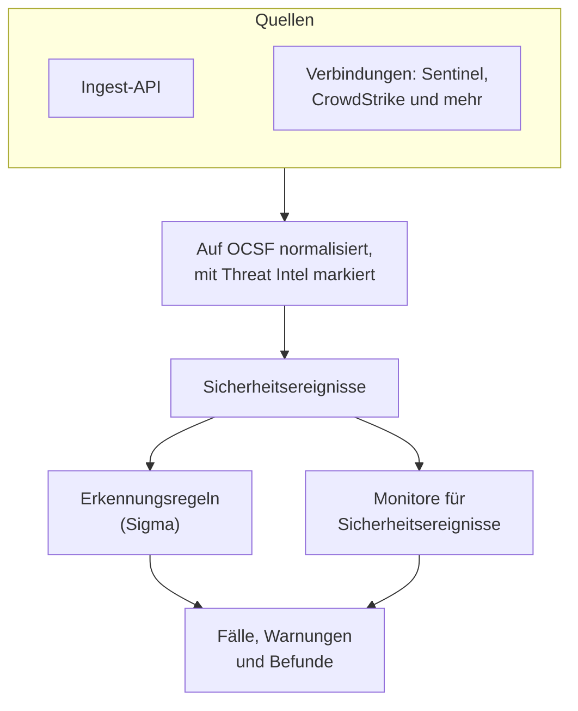
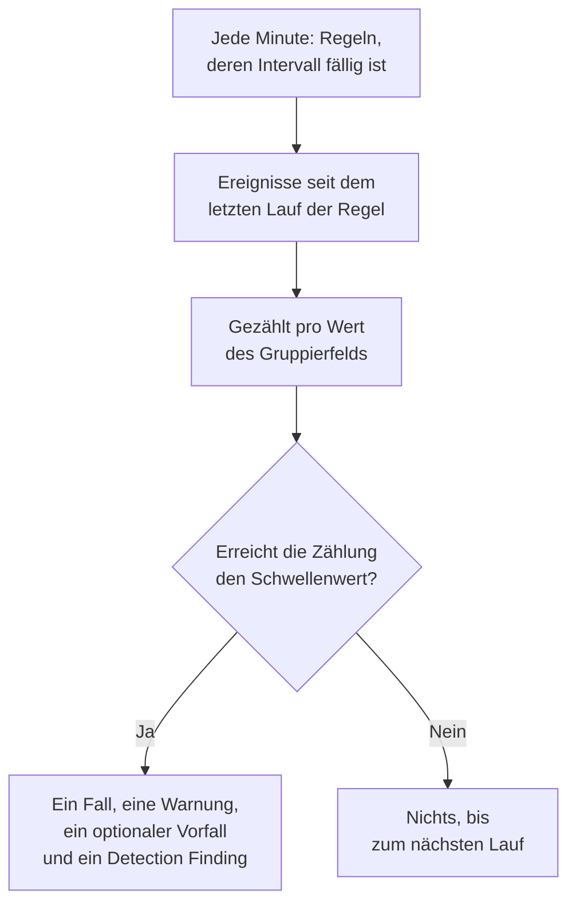

# Sicherheitsereignisse (SIEM)

OneUptime bewahrt Sicherheitsereignisse neben Ihren Logs, Traces und Metriken auf und gibt jedem dieselbe Form, [OCSF](https://schema.ocsf.io/) (das Open Cybersecurity Schema Framework), egal in welchem Format es ankam. Senden Sie Ereignisse aus jeder Quelle, durchsuchen Sie sie, und finden Sie die wichtigen mit Sigma-Erkennungsregeln, Threat Intelligence und Monitoren. Was diese finden, wird zu [Fällen](/docs/telemetry/security-cases), die Sie bearbeiten, und Playbooks reagieren darauf.

:::cards
- [Ereignisse senden](#sicherheitsereignisse-senden): Ein HTTPS-POST, eine Fluent-Bit-Ausgabe oder eine Verbindung zu einem Sicherheitsprodukt.
- [Suchen und korrelieren](#sicherheitsereignisse-erkunden): Der Explorer für Ereignisse und der Korrelationsgraph.
- [Bedrohungssuchen](#bedrohungssuchen): Gespeicherte Suchen, die nach einem Zeitplan laufen und Personen benachrichtigen, wenn sie etwas finden.
- [Erkennungsregeln](#erkennungsregeln): Sigma-Regeln, die Fälle und Warnungen öffnen.
- [Monitore](#monitore-für-sicherheitsereignisse): Zählungen über ein gleitendes Fenster, mit einem Status, der sich erholt.
:::

## So funktioniert es



Öffnen Sie **Produkte → Sicherheitsereignisse**, unter **Sicherheit**. Sein Menü hat einen Abschnitt für jeden Teil der Sicherheit und für jede Sache darin eine eigene Seite:

| Seite | Abschnitt | Wofür sie da ist |
| --- | --- | --- |
| **Übersicht** | Übersicht | Wie Sicherheit eingerichtet ist, was gerade Aufmerksamkeit braucht, und wie schnell Fälle bearbeitet werden |
| **Offene Fälle** | Sicherheitsfälle | Die Warteschlange: jeder noch nicht geschlossene Fall, gruppiert nach dem, worum es jeweils geht |
| **Mir zugewiesen** | Sicherheitsfälle | Die offenen Fälle, die Ihnen zugewiesen sind |
| **Nicht zugewiesen** | Sicherheitsfälle | Die offenen Fälle, die noch niemand übernommen hat |
| **Geschlossene Fälle** | Sicherheitsfälle | Die mit einem Urteil geschlossenen Fälle, die neuesten zuerst |
| **Alle Fälle** | Sicherheitsfälle | Jeder Fall, offen oder geschlossen |
| **Ereignisse** | Ereignisse | Jedes Ereignis suchen und filtern, und eines öffnen, um alle seine Felder zu sehen |
| **Bedrohungssuchen** | Ereignisse | Unter Ereignisse gespeicherte Suchen, mit einem Klick wieder geöffnet oder nach einem Zeitplan ausgeführt, der Personen benachrichtigt, wenn sie etwas finden |
| **Suchbibliothek** | Ereignisse | Fertige Bedrohungssuchen zum Ausprobieren unter Ereignisse oder zum Hinzufügen zu Ihren Bedrohungssuchen, jede mit den Ereignissen, die sie liest, und ob diese eingehen |
| **Kampagnen** | Ereignisse | Jede Adresse, die Angriffsanfragen gesendet hat, und ob eine ihrer Anfragen durchkam |
| **Entitätsrisiko** | Ereignisse | Jeder Benutzer, Host und jede Adresse, bewertet nach dem, was diese Woche dazu gefunden wurde, die riskantesten zuerst |
| **Korrelieren** | Ereignisse | Ein Graph der Ereignisse, die einen Host, einen Benutzer oder eine IP-Adresse teilen |
| **Erkennungsregeln** | Erkennungen | Sigma-Regeln, die nach Zeitplan laufen und Fälle eröffnen |
| **Regelausnahmen** | Erkennungen | Was Ihre Regeln absichtlich auslassen, etwa einen Scanner oder einen geplanten Test, jeweils mit dem, der es hinzugefügt hat, und dem Grund |
| **Beobachtungslisten** | Erkennungen | Die Listen, mit denen Ihre Regeln abgleichen, etwa VIP-Benutzer, kritische Hosts, bekannte schädliche Datei-Hashes und die Adressen, von denen sich Admins anmelden dürfen |
| **Regelbibliothek** | Erkennungen | Fertige Erkennungsregeln zum Hinzufügen, jede mit den Ereignissen, die sie liest, und ob sie eingehen, die empfohlenen markiert |
| **Threat Intel** | Erkennungen | STIX/TAXII-Feeds bekannter bösartiger Indikatoren |
| **ATT&CK-Abdeckung** | Erkennungen | Die Techniken von MITRE ATT&CK, die Ihre Regeln abdecken |
| **Playbooks** | Playbooks | Schritte, die auf Fällen laufen, von selbst oder per Hand |
| **Genehmigungen** | Playbooks | Die Playbook-Schritte, die darauf warten, dass jemand sie genehmigt oder ablehnt |
| **Ausführungen** | Playbooks | Was jedes Playbook getan hat, Schritt für Schritt |
| **Automatische Reaktion** | Playbooks | Die Richtlinien, die eine angreifende Adresse bei der Erkennung mit einer Challenge belegen oder sperren, jede mit ihrem Testlauf und ihren Leitplanken |
| **Sperrliste** | Playbooks | Die Adressen, die Ihr Projekt sperrt, bis wann, und wo jede Sperre durchgesetzt wird |
| **Sperrlisten-Feeds** | Playbooks | Die geheimen URLs, von denen Ihre Firewalls und Proxys die Sperrliste lesen, und ihre Abrufe |
| **Geschützte Entitäten** | Playbooks | Die Benutzer, Hosts und Adressen, die kein Playbook eindämmt und keine Sperre berührt |
| **Einstellungen** | KI | Ob OneUptime AI jeden neuen Fall triagiert |
| **Verbindungen** | Verbindungen | Ihre Logs, die Sicherheitsprodukte, die OneUptime abfragt, und die SIEMs, an die es sendet |
| **Einrichtungsanleitung** | Verbindungen | Snippets zum Senden von Ereignissen, mit Ihrem Ingestion-Schlüssel ausgefüllt |
| **Fallprioritäten** | Einstellungen | Wie dringend ein Fall ist: die eigenen Prioritäten des Projekts, die dringendste zuerst |
| **Reaktionsziele** | Einstellungen | Wie schnell ein Fall jeder Priorität übernommen und eingedämmt werden muss |
| **Fallstatus** | Einstellungen | Die Schritte, die ein Fall durchläuft, und wofür ein Fall in jedem zählt |
| **Benutzerdefinierte Felder** | Einstellungen | Die Felder, die Ihr Team in jedem Fall ausfüllt, etwa den Geschäftsbereich, um den es geht |
| **Notiz-Vorlagen** | Einstellungen | Fertige Texte für die Notizen, die Ihr Team zu seinen Fällen schreibt |
| **Nummerierung** | Einstellungen | Der Text vor den Fallnummern und die Nummer, die der nächste Fall erhält |
| **Risikobewertung** | Einstellungen | Ob das Risiko einer Entität einen Fall eröffnet, ab welchem Risiko, und wie wichtig jede Entität ist |
| **Löschanfragen** | Einstellungen | Personen, die auf Anfrage gelöscht wurden, und was jede Löschung geändert hat |

**Erkennungen**, **KI**, **Verbindungen** und **Einstellungen**, die man einmal einrichtet, bleiben eingeklappt, bis Sie sie öffnen. Neu bei Sicherheit? [Erste Schritte mit Sicherheit](/docs/telemetry/security-getting-started) richtet sie mit zwei Klicks ein.

## Bevor Sie beginnen

Sicherheitsdaten lesen nur die Rollen Projektinhaber und Projektadministrator sowie die drei Security-Rollen; andere Rollen sehen in Sicherheitsereignisse nichts. Siehe [Rollen](/docs/permissions/reference#rollen).

| Rolle | Was sie darf |
| --- | --- |
| Sicherheits-Administrator | Alles: Ereignisse, Fälle, Playbooks, Erkennungsregeln, Threat-Intel-Feeds und Verbindungen |
| Sicherheits-Mitglied | Ereignisse und Threat Intel lesen, Fälle bearbeiten, Playbooks ausführen und ihre Schritte genehmigen, Adressen sperren sowie Erkennungsregeln und Feeds erstellen, ändern und löschen. Sie kann keine Playbooks oder Verbindungen einrichten und keine Sicherheitsdaten löschen. |
| Sicherheits-Betrachter | Ereignisse, Fälle, Playbooks, die Sperrliste, Regeln, Feeds, Indikatoren und Verbindungen lesen |

## Sicherheitsereignisse senden

:::steps
### Einen Ingestion-Schlüssel erstellen

Öffnen Sie **Projekteinstellungen → Telemetrie & APM → Ingestion-Schlüssel** und klicken Sie auf **Ingestion-Schlüssel erstellen**. Sicherheitsereignisse nutzen dieselben Schlüssel wie der Rest Ihrer Telemetrie.

### Ihre Ereignisse senden

Senden Sie JSON an `/security-events/v1/ingest`, mit dem Schlüssel in `x-oneuptime-token`:

:::tabs
@tab OCSF
```bash
curl -X POST "https://oneuptime.com/security-events/v1/ingest?format=ocsf" \
  -H "Content-Type: application/json" \
  -H "x-oneuptime-token: YOUR_INGESTION_TOKEN" \
  -H "x-oneuptime-service-name: my-security-source" \
  -d '{ "events": [ { "class_uid": 3002, "severity_id": 4, "status": "Failure", "message": "Failed logon for alice", "actor": { "user": { "name": "alice" } }, "src_endpoint": { "ip": "203.0.113.7", "hostname": "laptop-alice" } } ] }'
```
@tab Google UDM
```bash
curl -X POST "https://oneuptime.com/security-events/v1/ingest?format=udm" \
  -H "Content-Type: application/json" \
  -H "x-oneuptime-token: YOUR_INGESTION_TOKEN" \
  -d '{ "events": [ { "metadata": { "event_type": "USER_LOGIN" }, "principal": { "hostname": "laptop-alice", "user": { "userid": "alice" }, "ip": ["203.0.113.7"] }, "security_result": [{ "severity": "HIGH", "action": ["BLOCK"] }] } ] }'
```
@tab Generic JSON
```bash
curl -X POST "https://oneuptime.com/security-events/v1/ingest" \
  -H "Content-Type: application/json" \
  -H "x-oneuptime-token: YOUR_INGESTION_TOKEN" \
  -d '{ "events": [ { "severity": "high", "event_type": "ssh_brute_force", "message": "12 failed SSH logins in 60s", "username": "root", "hostname": "web-01", "src_ip": "203.0.113.7" } ] }'
```
:::

Der Endpunkt antwortet mit `200`, sobald die Ereignisse in der Warteschlange stehen. Ein Ereignis ohne Zeitangabe, wie diese, wird auf den Moment seiner Ankunft gesetzt.

### Sie unter Ereignisse finden

Öffnen Sie **Produkte → Sicherheitsereignisse → Ereignisse**. Die Ereignisse erscheinen innerhalb weniger Sekunden, mit Schweregrad, Klasse, Benutzer, Host und IP-Adressen ausgefüllt.
:::

### Formate

| `format` | Was es liest | Ebenfalls akzeptiert |
| --- | --- | --- |
| `ocsf` | OCSF-Ereignis-JSON (`class_uid`, `severity_id` und so weiter) | Keine |
| `udm` | UDM-Ereignisse von Google SecOps (Chronicle) (`metadata.event_type` und so weiter) | `chronicle`, `google-secops` |
| `google-secops-alert` | Erkennungen und Warnungen von Google SecOps: SOAR-Webhooks und der Erkennungsstrom | `secops-alert`, `detection` |
| `crowdsec` | Warnungen von CrowdSec, wie sein `http`-Benachrichtigungs-Plugin sie sendet (siehe [CrowdSec](/docs/integrations/crowdsec)) | `crowdsec-alert` |
| `generic` | Jedes andere JSON, gelesen anhand gängiger Feldnamen | Keine |

Nennen Sie das Format mit `?format=`, mit dem Header `x-oneuptime-security-event-format` oder mit einem Feld `"format"` auf oberster Ebene. Lassen Sie es weg, wird das Format jedes Ereignisses einzeln ermittelt, sodass ein Webhook Erkennungen und rohe Ereignisse mischen kann.

- Der Body kann ein Ereignis sein, ein Array von Ereignissen oder `{ "events": [...] }`.
- Ein Batch kann mit gzip komprimiert und mit `Content-Encoding: gzip` gesendet werden: Er wird genauso gelesen wie derselbe Batch unkomprimiert. Die Ausgabe `http` von Fluent Bit komprimiert mit `compress gzip`, der Sink `http` von Vector mit `compression = "gzip"` und die Ausgabe `http` von Logstash mit `http_compression => true`. Komprimiert wird nur JSON gelesen: Ein komprimierter Body jedes anderen Typs wird mit `400` abgelehnt.
- Der Header `x-oneuptime-service-name` nennt den Telemetrie-Dienst, zu dem die Ereignisse gehören. Ohne ihn gehören sie zu dem Dienst, der nach Produkt oder Anbieter des ersten Ereignisses benannt ist, oder zu `Security Events`.
- Nichts geht verloren, weil es sich nicht zuordnen ließ: Jedes Feld der Quelle landet in den Attributen des Ereignisses.

### Felder von generischem JSON

Ein generisches Ereignis wird anhand gängiger Feldnamen gelesen:

| Feld des Ereignisses | Gelesen aus dem ersten von |
| --- | --- |
| `message` | `message`, `msg`, `summary`, `description`, `title` |
| `severityName` | `severity`, `severity_name`, `level`, `priority`, `risk_level` |
| `time` | `timestamp`, `time`, `@timestamp`, `event_time`, `created_at` |
| `principalUser` | `user`, `username`, `user_name`, `account`, `actor` |
| `principalHost` | `host`, `hostname`, `computer`, `device`, `machine` |
| `principalIp` | `source_ip`, `src_ip`, `client_ip`, `ip` |
| `targetIp` | `destination_ip`, `dest_ip`, `dst_ip`, `target_ip` |
| `className` | `event_type`, `category`, `type`, `action` |
| `ruleName` | `rule`, `rule_name`, `signature`, `detection` |
| `productName` | `product`, `product_name`, `source`, `log_source` |
| `processName` | `process_name`, `process.name`, `proc.name`, `comm` |
| `processPath` | `process_path`, `Image`, `NewProcessName`, `exe`, `process.executable` |
| `processCommandLine` | `command_line`, `CommandLine`, `cmdline`, `process.command_line`, `proc.cmdline`, `process` |
| `parentProcessName` | `parent_process_name`, `process.parent.name`, `proc.pname` |
| `parentProcessPath` | `parent_process_path`, `ParentImage`, `ParentProcessName`, `process.parent.executable` |
| `parentProcessCommandLine` | `parent_command_line`, `ParentCommandLine`, `process.parent.command_line`, `proc.pcmdline` |

Ein Schweregradwort wird zu einer OCSF-Stufe: `info` wird als Informational gelesen, `warning` als Low, `error` als Medium, `alert` als Critical und `emergency` als Fatal.

### Mit Fluent Bit weiterleiten

Um Sicherheitslogs zu senden, die Sie schon sammeln, etwa von auditd, syslog oder Falco, fügen Sie Fluent Bit eine Ausgabe `http` hinzu:

```ini title="fluent-bit.conf"
[OUTPUT]
    Name             http
    Match            security.*
    Host             oneuptime.com
    Port             443
    tls              On
    URI              /security-events/v1/ingest
    Format           json
    compress         gzip
    Json_date_key    timestamp
    Json_date_format iso8601
    Header           x-oneuptime-token YOUR_INGESTION_TOKEN
    Header           x-oneuptime-service-name my-security-source
    Retry_Limit      5
```

Die Seite **Einrichtungsanleitung**, unter **Verbindungen**, hat diese Snippets mit Ihrem eigenen Host und Schlüssel ausgefüllt.

### Sicherheitsereignisse in Ihren Logs finden

Die Karte **Ihre Protokolle** oben auf **Verbindungen** macht die Logs, die Sie bereits an OneUptime senden, zu einer Quelle. Ist **Sicherheitsereignisse in Ihren Protokollen finden** eingeschaltet, werden die neuen Logs des Projekts jede Minute gelesen, und jede SSH- oder Windows-Anmeldung, jeder sudo-Befehl, jeder Audit-Eintrag einer Cloud, jeder CEF- oder LEEF-Datensatz eines Sicherheitsprodukts, jeder Datensatz einer Firewall von Palo Alto Networks, FortiGate oder Cisco ASA, jeder Kubernetes-Audit-Eintrag, jeder Webangriff und jede Anfrage nach einer sensiblen Datei darin wird als Sicherheitsereignis gespeichert. Was jede Art abdeckt, steht unter [Erste Schritte mit Sicherheit](/docs/telemetry/security-getting-started#sicherheitsereignisse-in-ihren-logs-finden).

Jede Art erreicht OneUptime als gewöhnliche Logs:

| Art | Senden Sie sie von |
| --- | --- |
| SSH-Anmeldungen, sudo | Dem Journal oder Auth-Log eines Linux-Rechners, mit dem [OpenTelemetry Collector](/docs/telemetry/host-otel-collector) |
| Windows-Ereignisse | Dem Empfänger `windowseventlog` des Collectors auf dem Rechner, oder einem Weiterleiter, der jedes Ereignis als JSON schreibt, etwa NXLog oder Winlogbeat. Ein zu OneUptime hinzugefügter [Host](/docs/telemetry/hosts) liest außerdem Sysmon, Microsoft Defender und PowerShell, wo er sie hat |
| AWS CloudTrail | Einem Trail, der an CloudWatch Logs geliefert und vom Empfänger `awscloudwatch` des Collectors gelesen wird, oder, bei einem unter **Cloud** verbundenen Konto, über [Cloud-Audit-Protokolle](#die-audit-logs-ihrer-cloud-konten-lesen) |
| Google Cloud-Audit-Logs | Einer Log-Senke nach Pub/Sub, gelesen vom Empfänger `googlecloudpubsub` des Collectors mit `encoding: raw_text`, oder, bei einem unter **Cloud** verbundenen Projekt, über seinen [Stream](/docs/telemetry/cloud-streaming-google-cloud) oder [Cloud-Audit-Protokolle](#die-audit-logs-ihrer-cloud-konten-lesen) |
| Azure-Aktivitäts- und Entra-ID-Logs | Einer Diagnoseeinstellung, die an einen Event Hub streamt, gelesen vom Empfänger `azureeventhub` des Collectors mit `format: raw`, oder an den Event Hub des [Streams](/docs/telemetry/cloud-streaming-azure) eines verbundenen Abonnements, oder, für das Aktivitätsprotokoll eines unter **Cloud** verbundenen Abonnements, über [Cloud-Audit-Protokolle](#die-audit-logs-ihrer-cloud-konten-lesen) |
| Azure Key Vault-, Storage- und SQL-Protokolle | Der Diagnoseeinstellung einer Ressource, die an einen Event Hub streamt, gelesen vom Empfänger `azureeventhub` des Collectors mit `format: raw`, oder den Diagnoseeinstellungen des [Streams](/docs/telemetry/cloud-streaming-azure) eines verbundenen Abonnements, wenn er Logs streamt. Siehe [Die eigenen Audit-Logs von Azure-Ressourcen](#die-eigenen-audit-logs-von-azure-ressourcen) |
| OpenStack-Audit-Trail | Den Benachrichtigungen und dem Audit-Filter einer Cloud, die mit `driver = log` in deren Logs geschrieben und vom [Logs-Profil](/docs/telemetry/openstack#wer-was-getan-hat) des Agents gelesen werden |
| CEF, LEEF | Dem Syslog des Produkts, weitergeleitet von [rsyslog](/docs/telemetry/syslog) |
| Palo Alto Networks, FortiGate, Cisco ASA | Dem eigenen Syslog der Firewall, weitergeleitet von [rsyslog](/docs/telemetry/syslog) |
| Kubernetes-Audit-Logs | Der Audit-Log-Datei des API-Servers, gelesen vom Empfänger `filelog` des Collectors |
| Webangriffe | Dem Zugriffslog eines Webservers, gelesen vom Empfänger `filelog` des Collectors |

Auf **Ihre Protokolle** sagt jede Art, wann sie zuletzt gefunden wurde, und **Eine Protokollzeile prüfen** zeigt, was aus einer eingefügten Zeile wird, bevor eine ankommt. OneUptime liest die Zeile so, wie die Scans Ihre Logs lesen, mit Ihren [vertrauenswürdigen Proxys](#vertrauenswürdige-proxys) und den Einstellungen Ihrer Zugriffslogs, nennt also den Client, den auch das gespeicherte Ereignis nennen wird, und speichert nichts.

Eine Bedrohung, die ein Sicherheitsprodukt in Ihre Logs schreibt, etwa ein CEF- oder LEEF-Fund oder eine Bedrohung von Palo Alto Networks, FortiGate oder Cisco ASA, eröffnet einen [Fall](/docs/telemetry/security-cases), wie es die Warnung eines verbundenen Produkts tut, und erhöht das Risiko des Benutzers, Hosts oder der Adresse, die sie nennt. **Fälle eröffnen ab** auf **Ihre Protokolle** legt fest, ab welchem Schweregrad: **Hoch und höher**, sofern Sie keinen anderen wählen, oder **Nie**. Die Anmeldungen und blockierten Verbindungen des Produkts bleiben Ereignisse, die Ihre Regeln lesen.

Ein Datensatz, der OneUptime auf zwei Wegen erreicht, wird einmal gespeichert: eine Anmeldung in Microsoft Entra ID, die ihre Verbindung liest und die Azure auch in Ihre Logs exportiert, ein CloudTrail-Datensatz in Ihren Logs und im Audit-Log eines verbundenen AWS-Kontos, oder ein Audit-Eintrag, den der Stream eines Cloud-Kontos sendet und den auch **Cloud-Audit-Protokolle** liest.

#### Die eigenen Audit-Logs von Azure-Ressourcen

Ein Key Vault, ein Speicherkonto und eine Azure SQL-Datenbank führen jeweils ein eigenes Audit-Log, das jede Anfrage aufzeichnet. Nur was sich ein Sicherheitsteam ansieht, wird zum Sicherheitsereignis:

| Ressource | Was zum Sicherheitsereignis wird |
| --- | --- |
| Key Vault (`AuditEvent`) | Eine Anfrage, die der Vault abgelehnt hat; ein herausgegebenes Secret; das Löschen, endgültige Löschen oder Sichern eines Secrets, Schlüssels, Zertifikats oder des Vaults selbst; eine Änderung seiner Zugriffsrichtlinie; und eine Änderung an dem, was er enthält. Nicht die Antwort 401, die jeder Client eines Azure SDK bei seinem ersten Aufruf erhält, den er ohne Token macht, um den Mandanten zu erfahren: Key Vault protokolliert sie unter seiner Operation `Authentication` |
| Speicherkonto (`StorageRead`, `StorageWrite`, `StorageDelete`) | Eine Anfrage, die mangels Berechtigung abgelehnt wurde; eine, die ganz ohne Anmeldeinformationen bedient wurde, außer den Seiten einer statischen Website und einem CORS-Preflight; eine Änderung der Zugriffsliste eines Containers, einer Freigabe, einer Warteschlange oder einer Tabelle oder das Löschen eines solchen Objekts als Ganzes; und ein Schreiben oder Löschen, das eine Shared Access Signature (SAS) signiert hat. Kein erfolgreicher Lesezugriff, auch keiner per SAS |
| Azure SQL (`SQLSecurityAuditEvents`) | Eine fehlgeschlagene Anmeldung; eine Anmeldung über eine neue Verbindung, nicht die Wiederverwendung einer Verbindung aus dem Pool; eine erteilte, verweigerte oder entzogene Berechtigung, eine geänderte Rollenmitgliedschaft oder ein geändertes Passwort, ein Identitätswechsel und das Erstellen, Ändern oder Löschen eines Logins, Benutzers oder einer Rolle; und eine Aktion, deren Berechtigungsprüfung fehlgeschlagen ist. Kein Batch, der Großteil eines Audits |

Die erfolgreichen Lesezugriffe eines Speicherkontos sind das meiste, was es protokolliert: Über eine SAS geben die meisten Apps Dateien an Browser weiter. Sie bleiben ganz in den Logs, auf dem Tab **Protokolle** des Kontos: Suchen Sie dort nach `"type":"SAS"`, um zu sehen, was eine Shared Access Signature gelesen hat. Jedes Ereignis nennt seine Ressource mit ihrer ID, das eines Speicherdienstes auch dessen Konto, daher erscheint es auf der Seite **Sicherheitsereignisse** dieser Ressource, und ein Datensatz, der zweimal ankommt, wird einmal gespeichert.

### Die Audit-Logs Ihrer Cloud-Konten lesen

Ein AWS-Konto, Google Cloud-Projekt oder Azure-Abonnement, das [unter **Cloud** verbunden](/docs/telemetry/cloud-accounts) ist, braucht keine Log-Pipeline. Schalten Sie **Cloud-Audit-Protokolle** unter **Ihre OneUptime-Daten** auf **Verbindungen** ein, dann behält jeder Lesevorgang des Kontos sein Audit-Log als Sicherheitsereignisse:

| Cloud | Was gelesen wird |
| --- | --- |
| AWS | Die Verwaltungsereignisse von CloudTrail, die etwas ändern, in jeder Region, die das Konto nutzt: Anmeldungen an der Konsole, Änderungen und Aufrufe, die AWS abgelehnt hat |
| Google Cloud | Das Audit-Log Admin Activity: Änderungen an Ressourcen und daran, wer sie erreichen darf, und Aufrufe, die Google abgelehnt hat |
| Azure | Das Aktivitätsprotokoll: Änderungen im Abonnement, fehlgeschlagene Vorgänge, Ablehnungen durch Azure Policy und Warnungen von Defender for Cloud |

- Jeder Datensatz wird so gelesen, wie **Ihre Protokolle** ihn aus einer Pipeline liest, sodass die CloudTrail-, Google Cloud- und Azure-Regeln der Regelbibliothek auf ihn passen.
- Ein Ereignis erhält den Zeitpunkt, zu dem es gespeichert wird, und die eigene Zeit des Datensatzes steht in `oneuptime.cloud.record_time`: Ein Audit-Log erreicht OneUptime Minuten verspätet, und eine Regel liest Ereignisse nach ihrer Zeit.
- Mehr bringt der Lesevorgang des Kontos nicht: Datenereignisse, Data Access-Logs und die Logs von Microsoft Entra ID brauchen weiterhin **Ihre Protokolle** oder eine [Verbindung](/docs/integrations/microsoft-entra-id).
- Jedes Ereignis nennt die Cloud-Ressourcen, um die es in seinem Eintrag geht, mit ihren eigenen IDs - einem ARN, einer Azure-Ressourcen-ID, einem Ressourcennamen von Google Cloud -, daher erscheint es auf der Seite **Sicherheitsereignisse** jeder dieser Ressourcen und auf der einer Serverless-Funktion, sobald ihre Telemetrie `cloud.account.id` und `cloud.region` setzt.

### Die eigenen Sonden von OneUptime in Ihren Netzwerk-Flows

Schalten Sie **Netzwerk-Flows** unter **Ihre OneUptime-Daten** auf **Verbindungen** ein, dann werden die Flows, die Ihre Netzwerkgeräte exportieren, auf Port-Scans, Netzwerk-Sweeps, Datenverkehr mit bekannt bösartigen Adressen und große Übertragungen nach außen gelesen. Die eigene Arbeit einer Sonde sieht dort wie ein Scan aus: Wer 40 Geräte über SNMP abfragt, erreicht alle fünf Minuten Port 161 auf 40 Hosts. Deshalb wird Datenverkehr einer der eigenen Sonden von OneUptime, der genau das ist, wofür die Sonde eingerichtet ist, beiseitegelegt:

- die Netzwerkgeräte, die sie abfragt, per Ping und per SNMP auf ihrem Port;
- der Bereich jedes ihrer Erkennungsscans, solange der Scan läuft;
- die Hosts und Ports, die ihre Monitore prüfen.

Er wird als informatives Ereignis `oneuptime-probe-traffic` aufbewahrt, das die Sonde nennt, und keine Regel liest es. **Netzwerk-Flows** zeigt, wie viel am letzten Tag beiseitegelegt wurde, mit **Anzeigen**. Alles andere von der Adresse einer Sonde wird gezählt wie jeder andere Datenverkehr, und ein Sweep oder Scan über die Arbeit der Sonde hinaus wird gemeldet, mit dem Namen der Sonde. Eine Sonde wird an der Adresse erkannt, von der aus sie sich meldet, und an den Adressen ihrer eigenen Netzwerkschnittstellen, die sie bei jeder Meldung auflistet. Eine benutzerdefinierte Sonde ohne Host-Netzwerk, etwa ein Kubernetes-Pod oder ein Container in einem Docker-Bridge-Netzwerk, wird auch an den Adressen ihres Hosts erkannt, die ihr `PROBE_HOST_IP_ADDRESSES` mitteilt: Solange sie sie nicht hat, verlassen ihre Abfragen den Rechner über eine Adresse, an der sie nicht erkannt wird, und werden als Sweeps gemeldet. Siehe [Was eine Sonde bei ihrer Meldung sendet](/docs/probe/custom-probe#was-eine-sonde-bei-ihrer-meldung-sendet).

### Ein Sicherheitsprodukt verbinden

**Verbindungen** fragt ein Sicherheitsprodukt für Sie ab und importiert seine neuen Datensätze als Sicherheitsereignisse. Eine Verbindung enthält die Einstellungen des Produkts und verschlüsselte Zugangsdaten; ein Worker fragt sie in dem Intervall ab, das Sie festlegen, und überspringt bereits importierte Datensätze.

| Produkt | Importiert | Einrichtungsanleitung |
| --- | --- | --- |
| Google SecOps (Chronicle) | Regelerkennungen, kuratierte Erkennungen und Warnungen, als Detection Findings | [Google SecOps](/docs/integrations/google-secops) |
| Microsoft Sentinel | Vorfälle, als Incident Findings | [Microsoft Sentinel](/docs/integrations/microsoft-sentinel) |
| Microsoft Defender XDR | Warnungen, als Detection Findings | [Microsoft Defender XDR](/docs/integrations/microsoft-defender-xdr) |
| CrowdStrike Falcon | Warnungen, als Detection Findings | [CrowdStrike Falcon](/docs/integrations/crowdstrike-falcon) |
| Splunk Enterprise Security | Notable Events oder beliebige Suchen, als Detection Findings | [Splunk Enterprise Security](/docs/integrations/splunk) |
| Elastic Security | Erkennungswarnungen, als Detection Findings | [Elastic Security](/docs/integrations/elastic-security) |
| AWS Security Hub | Findings, als Detection und Compliance Findings | [AWS Security Hub](/docs/integrations/aws-security-hub) |
| Okta System Log | Anmelde-, MFA-, Konto- und Richtlinienereignisse | [Okta System Log](/docs/integrations/okta) |
| Microsoft Entra ID | Anmeldungen, Verzeichnisänderungen und Risikoerkennungen, auf Wunsch fehlgeschlagene Hintergrund- und App-Anmeldungen, und aus dem Microsoft 365-Audit-Protokoll Weiterleitungen von E-Mails, Freigaben und Phishing-Urteile | [Microsoft Entra ID](/docs/integrations/microsoft-entra-id) |
| Google Workspace | Anmeldungen, die eigenen Erkennungen von Google, Admin-Änderungen und App-Freigaben, und Freigaben in Drive | [Google Workspace](/docs/integrations/google-workspace) |
| Cloudflare | Was die Firewall am Edge blockiert, mit einer Challenge geprüft und protokolliert hat, als HTTP Activity | [Cloudflare](/docs/integrations/cloudflare) |
| CrowdSec | Die Warnungen, die sein Benachrichtigungs-Plugin sendet, als Detection Findings, und das Bannen der Adressen, die Sie sperren | [CrowdSec](/docs/integrations/crowdsec) |

- Die eigenen Warnungen des Produkts ab der Stufe, die in **Fälle eröffnen ab** eingestellt ist (**Hoch und höher**, sofern Sie keine andere Stufe wählen, oder **Nie**), eröffnen [Fälle](/docs/telemetry/security-cases), gruppiert nach dem Benutzer, dem Host oder der Adresse, um die es jeweils geht.
- Eine Verbindung liest Datensätze nach dem Zeitpunkt, zu dem das Produkt sie erstellt hat, nicht nach der Zeit der Aktivität, die sie beschreiben. Eine SIEM-Regel, die stündlich läuft, erstellt Erkennungen lange nach den Ereignissen, auf die sie passte, und diese werden trotzdem importiert.
- Die erste Abfrage blickt 24 Stunden zurück, sodass eine neue Verbindung sofort aktuelle Datensätze zeigt.
- Eine CrowdSec-Verbindung wird nie abgefragt: CrowdSec sendet jede Warnung, sobald sie ausgelöst wird, über die Benachrichtigung, die **Warnungen senden** in der Zeile der Verbindung liefert.
- **Verbindung testen** in der Zeile der Verbindung prüft den Zugriff auf das Produkt und ob die eigenen Worker von OneUptime laufen, und importiert nichts. **Jetzt ausführen** fragt sofort ab.

## Was ein Ereignis enthält

Jedes Ereignis wird mit typisierten Feldern und seinem Quell-Payload gespeichert:

| Gruppe | Felder |
| --- | --- |
| Klassifizierung | `categoryName`, `className`, `activityName`, `statusName`, mit ihren OCSF-IDs (`categoryUid`, `classUid`) |
| Schweregrad | `severityName`, einer von Unknown, Informational, Low, Medium, High, Critical, Fatal oder Other, und `severityId` |
| Wer es tat | `principalUser`, `principalHost`, `principalIp`, `principalProcess` |
| Was es berührte | `targetUser`, `targetHost`, `targetIp`, `targetPort`, `targetResource` |
| Der Prozess | `processName`, `processPath` und `processCommandLine`: bei Prozessaktivität der gestartete, geöffnete, injizierte oder beendete Prozess, sonst der handelnde Prozess. `parentProcessName`, `parentProcessPath` und `parentProcessCommandLine`: der Prozess, der ihn gestartet hat |
| Quelle | `productName`, `vendorName`, `ruleId`, `ruleName`, `eventUid` |
| Inhalt | `message`, `mitreTactics`, `mitreTechniques` und `observables`: jeder Benutzer, Host, jede IP-Adresse, Domain und jeder Hash aus dem Ereignis |
| Attribute | Der ganze Quell-Payload, auf Schlüssel mit Punkten abgeflacht |

Ereignisse, die vor OneUptime 14.0.84 gespeichert wurden, lassen die Prozessfelder leer und nennen ihren Prozess nur als `principalProcess`, den handelnden Prozess. Sie werden nicht nachträglich ergänzt: Sie behalten, womit sie gespeichert wurden, bis ihre Aufbewahrung endet.

### Welche Adresse ein Ereignis nennt

Ein Ereignis nennt die Adresse, von der eine Anfrage kam, nur dann, wenn der Absender der Anfrage sie nicht selbst hätte schreiben können. Diese Adresse ist verifiziert und wird zur **Quell-IP** des Ereignisses: Erkennungsregeln zählen sie, Threat Intelligence gleicht sie ab, und der **Reaktionsplan** eines Falls bietet an, sie zu sperren. Jede andere Adresse, die eine Anfrage nennt, ist nur behauptet: Das Ereignis behält sie als **Behauptete IP**, und nichts zählt oder sperrt sie.

- Die eigene Adresse der Verbindung ist verifiziert: die `network.peer.address` eines Server-Spans oder das erste Feld einer Zeile im Zugriffslog eines Webservers. Niemand kann sie in eine Anfrage schreiben.
- Hinter einem Proxy, dem Sie vertrauen, ist die Adresse der Verbindung die des Proxys, und der Client ist die Adresse, die der Proxy in `X-Forwarded-For` weitergegeben hat. Jeder Proxy hängt die Adresse an, von der er die Verbindung angenommen hat, daher liest OneUptime den Header von rechts und nimmt die erste Adresse, die kein Proxy ist, dem Sie vertrauen. Was ein Absender in den Header schreibt, landet links davon und bleibt eine Behauptung.
- Eine Adresse, die eine Anfrage über sich selbst nennt, ist behauptet: `client.address`, die die Instrumentierung aus dem linken Teil des Headers füllt, der Rest von `X-Forwarded-For` und `Forwarded`.

Eine behauptete Adresse wird nie aus einem Fall heraus gesperrt: Jeder kann `X-Forwarded-For: 192.0.2.44` senden, und eine Sperre würde treffen, wem auch immer 192.0.2.44 gehört. Ein Ereignis mit nur einer behaupteten Adresse hat einen **Reaktionsplan**, der Sie auffordert, die echte Adresse in den Logs Ihres Load Balancers oder Ihrer Firewall zu suchen.

Ein Ereignis, dessen Client ein Proxy weitergeleitet hat, dem Sie vertrauen, nennt als **Weitergeleitet von** die Proxys, über die es kam: in der Reihenfolge, in der `X-Forwarded-For` sie aufführt, die eigene Adresse der Verbindung zuletzt. Sie stehen in `oneuptime.request.forwarded_by`, und **Eine Protokollzeile prüfen** sagt, warum jedem von ihnen vertraut wird.

Zeichnen Sie zwei Dinge auf den Server-Spans Ihrer App auf, damit ihre Adressen verifiziert sind: die eigene Adresse der Verbindung, `network.peer.address`, die die HTTP-Instrumentierungen von OpenTelemetry setzen, und hinter einem Proxy den Header `X-Forwarded-For`, den sie als `http.request.header.x-forwarded-for` aufzeichnen, sobald Sie ihn in `OTEL_INSTRUMENTATION_HTTP_CAPTURE_HEADERS_SERVER_REQUEST` aufführen. Ein JSON-Zugriffslog wird genauso gelesen: Sein Client-Feld, etwa `remote_addr`, ist die Adresse der Verbindung, und sein Feld `http_x_forwarded_for` ist der Header.

#### Vertrauenswürdige Proxys

Sicherheitsereignisse glaubt einem Proxy, wer sein Client war, wenn seine Adresse eine der folgenden ist:

| Vertrauenswürdig | Warum |
| --- | --- |
| Unter **Vertrauenswürdige Proxys** aufgeführt | Sie haben sie aufgeführt |
| In den veröffentlichten Bereichen eines Edge, das Sie verbunden haben, etwa [Cloudflare](/docs/integrations/cloudflare) | Solange die Verbindung besteht |
| Einer Ihrer eigenen Application Load Balancer oder ein Nur-Proxy-Subnetz von Google Cloud, von dem sich nur Ihre Application Load Balancer verbinden | Sofern Sie **Ihre Load Balancer** nicht ausschalten |
| Eines der Front-Ends von Google, hinter Ihrem Google Cloud Application Load Balancer | Mit Ihren Load Balancern, es sei denn, auch ein TCP- oder SSL-Proxy-Load-Balancer von Ihnen verbindet sich von dort |
| Privat, Loopback oder Link-Local, etwa `10.0.0.5` | Solange **Private Adressen** eingeschaltet ist |

Den Adressen, von denen sich einer Ihrer auf TCP-Ebene arbeitenden Load Balancer verbindet, wird nie vertraut, auch wenn sie aufgeführt sind: siehe [Proxys, die auf TCP-Ebene arbeiten](#proxys-die-auf-tcp-ebene-arbeiten).

**Sicherheitsereignisse → Verbindungen → Weitere Einstellungen** enthält **Vertrauenswürdige Proxys**, die Liste, die Sie schreiben, und **Automatisch vertrauenswürdig**, das den Rest zeigt und warum. Führen Sie einen Proxy unter **Vertrauenswürdige Proxys** auf, eine Adresse oder einen Bereich pro Zeile, wenn ihm sonst nichts vertraut: ein CDN, das Sie nicht verbunden haben, ein Load Balancer, der Ihre App über das Internet erreicht, ein Reverse Proxy wie nginx auf einem Server mit öffentlicher Adresse vor Ihrer App oder, solange **Private Adressen** ausgeschaltet ist, ein HTTP-Proxy in Ihrem Netzwerk, etwa Ihr Ingress. Bis dahin wird jeder Angriff über ihn dem Proxy zugeschrieben. Ein Bereich, der breiter ist als der eines Proxys, etwa `0.0.0.0/0`, wird abgelehnt: Er würde jeder Adresse vertrauen, sodass jeder die Adresse wählen könnte, der ein Angriff zugeschrieben wird. Ein Projektinhaber, Projektadministrator oder Sicherheits-Administrator bearbeitet die Liste, und jede Änderung steht im [Audit-Log](/docs/configuration/audit-logs) des Projekts.

Ihre eigenen Application Load Balancer sind die, die Ihre [verbundenen Cloud-Konten](/docs/telemetry/cloud-accounts) aufführen: AWS Application Load Balancer, AWS Classic Load Balancer, deren Listener alle HTTP oder HTTPS sind, Google Cloud Application Load Balancer und Azure Application Gateways, mit ihren öffentlichen Adressen. Jeder hängt den Client, den er weiterleitet, an `X-Forwarded-For` an. Ein Load Balancer von Google Cloud hängt seine eigene Adresse nach der des Clients an, und ein Application Gateway erreicht ein öffentliches Backend von seiner eigenen Adresse aus, daher würde ohne sie jeder Angriff über einen von ihnen dem Load Balancer zugeschrieben. **Ihre Load Balancer** auf **Automatisch vertrauenswürdig** führt sie auf, und ein Projektinhaber, Projektadministrator oder Sicherheits-Administrator kann es ausschalten.

Hinter einem globalen externen Application Load Balancer von Google Cloud oder einem klassischen kommen die Verbindungen Ihrer App von den Front-Ends von Google, nicht von der eigenen Adresse des Load Balancers. Solange ein verbundenes Google-Cloud-Projekt einen solchen hat, vertraut Sicherheitsereignisse daher auch den Bereichen der Front-Ends: `35.191.0.0/16`, `130.211.0.0/22` und `2600:2d00:1:1::/64`, wie die [Firewallregeln für das Load Balancing](https://cloud.google.com/load-balancing/docs/firewall-rules) von Google sie aufführen. **Ihre Load Balancer** zeigt sie in der letzten Zeile der Liste, mit den Load Balancern, die sie mitbringen, und sein Schalter schaltet auch sie aus. Niemand außerhalb von Google verbindet sich aus diesen Bereichen, und ihnen zu vertrauen lässt niemanden einen Client nennen: Eine Anfrage über den Load Balancer eines anderen endet in ihrem `X-Forwarded-For` mit der Adresse dieses Load Balancers, die nicht Ihre ist, also nennt das Ereignis sie. Die TCP- und SSL-Proxy-Load-Balancer von Google verbinden sich jedoch aus denselben Bereichen und geben eine Anfrage so weiter, wie der Client sie gesendet hat. Solange einer davon Ihnen gehört oder nicht alle Load Balancer aufgeführt werden konnten, wird den Bereichen daher nicht vertraut, und die Zeile sagt, warum. Liegt ein solcher Load Balancer in einem Google-Cloud-Projekt, das Sie nicht verbunden haben, verbinden Sie es, oder schalten Sie **Ihre Load Balancer** aus. Ältere Fassungen dieser Dokumentation rieten, `35.191.0.0/16` und `130.211.0.0/22` unter **Vertrauenswürdige Proxys** aufzuführen: Solange sich ein TCP- oder SSL-Proxy-Load-Balancer von Ihnen von dort verbindet, wird ihnen auch aufgeführt nicht vertraut, und **Vertrauenswürdige Proxys** warnt bei jedem Ihrer Bereiche, der sie enthält. Sie können sie aus der Liste nehmen: **Ihre Load Balancer** vertraut ihnen, wenn es sicher ist.

Nichts anderes von Ihnen ist automatisch vertrauenswürdig: nicht Ihre Hosts, Kubernetes-Knoten, Sonden oder virtuellen Maschinen, kein NAT-Gateway und kein Network, Gateway oder Azure Load Balancer. Sie leiten niemanden weiter oder geben eine Anfrage so weiter, wie sie kam, daher könnte alles, was auf ihnen läuft, jeden beliebigen Client nennen: eine Anfrage, die ein Monitor mit eigenen Headern sendet, ein Pod, ein Laptop hinter dem Gateway. Ist einer davon Ihr Proxy, fügen Sie ihn zu **Vertrauenswürdige Proxys** hinzu. Einem Kubernetes-Ingress wird so vertraut wie dem Load Balancer, der er ist: Ein GKE-Ingress ist ein Google Cloud Application Load Balancer, ein AKS-Ingress für Application Gateway ein Application Gateway und ein EKS-Ingress der Klasse `alb` ein AWS Application Load Balancer. Ein Ingress-Controller in Ihrem Cluster leitet von einer privaten Adresse aus weiter, der vertraut wird, solange **Private Adressen** eingeschaltet ist; solange es ausgeschaltet ist, führen Sie seine Adressen auf.

Eine Änderung an einem davon wirkt innerhalb einer Minute, und einem neuen Load Balancer wird innerhalb von fünf vertraut.

#### Proxys, die auf TCP-Ebene arbeiten

Ein Proxy, der auf TCP-Ebene arbeitet, fügt `X-Forwarded-For` nichts hinzu: Er gibt den Header weiter, den der Client geschrieben hat, und Ihre App sieht die Verbindung vom Proxy kommen. Wäre er vertrauenswürdig, könnte ein Client wählen, wem ein Angriff zugeschrieben wird, und die Adresse eines anderen sperren lassen. Beispiele sind ein AWS Network Load Balancer ohne Client-IP-Beibehaltung, die Proxy Network Load Balancer von Google Cloud, HAProxy im `mode tcp`, das `stream`-Modul von nginx und ein Kubernetes-Service mit `externalTrafficPolicy: Cluster`, der Ihrem Ingress jede Verbindung von der Adresse eines Knotens übergibt.

OneUptime findet die, die Ihre [verbundenen Cloud-Konten](/docs/telemetry/cloud-accounts) auflisten, und vertraut den Adressen, von denen sie sich verbinden, nie, auch wenn **Vertrauenswürdige Proxys** sie aufführt:

- Ein regionaler oder regionsübergreifender Proxy Network Load Balancer von Google Cloud: das Nur-Proxy-Subnetz seiner Region und seines VPC-Netzwerks, das sich alle Load Balancer dort teilen. Solange nur Ihre Application Load Balancer ein Nur-Proxy-Subnetz nutzen, kann nichts anderes darin sein, und ihm wird als ihrem vertraut.
- Ein globaler externer oder klassischer Proxy Network Load Balancer von Google Cloud: die Front-Ends von Google.
- Ein AWS Network Load Balancer, der die eigene Adresse des Clients nicht beibehält, aus den Subnetzen, in denen er liegt: einer mit einer Zielgruppe aus Instanzen oder IP-Adressen über TCP oder TLS, deren Client-IP-Beibehaltung ausgeschaltet ist (IP-Ziele haben sie ausgeschaltet, sofern Sie sie nicht einschalten); ein Dual-Stack-Load-Balancer, der einen IPv6-Client von seiner eigenen Adresse aus an IPv4-Ziele übergibt; oder einer, dessen Zielgruppen OneUptime nicht lesen konnte.
- Ein AWS Classic Load Balancer mit einem TCP- oder SSL-Listener, aus den Subnetzen, in denen er liegt.

**Automatisch vertrauenswürdig** listet sie unter **Nicht vertrauenswürdig, auch wenn eingetragen** auf, jeden mit dem Grund. Halten Sie dahinter die eigene Adresse des Clients auf der Verbindung: Schalten Sie die Client-IP-Beibehaltung ein, oder stellen Sie einen Application Load Balancer davor. AWS-Load-Balancer werden gelesen, wenn das Inventar Ihres Cloud-Kontos gelesen wird, daher zeigt sich eine Änderung nach dem nächsten Lesen.

Für einen Proxy, den OneUptime nicht sehen kann, schalten Sie **Private Adressen** auf **Automatisch vertrauenswürdig** aus. Ausgeschaltet wird einer privaten Adresse nur vertraut, wenn sie unter **Vertrauenswürdige Proxys** aufgeführt ist oder zu Ihren Load Balancern gehört; führen Sie daher zuerst Ihre HTTP-Proxys in Ihrem Netzwerk auf: Bis dahin wird jeder Angriff über einen davon ihm zugeschrieben. Ein AWS Application Load Balancer und ein Azure Application Gateway erreichen Ihre App von privaten Adressen in ihren Subnetzen, die OneUptime noch nicht aufführt: Führen Sie diese Subnetze ebenfalls auf. Ein neues Projekt beginnt mit ausgeschaltetem **Private Adressen**. Ein Projekt von davor vertraut privaten Adressen weiterhin wie bisher, und **Automatisch vertrauenswürdig** sagt, was das riskiert. Ein Projektinhaber, Projektadministrator oder Sicherheits-Administrator schaltet es um, und jede Änderung steht im Audit-Log des Projekts.

Was Sie auch wählen, eine Adresse wird nie automatisch gesperrt, wenn sie über eine private Adresse kam, die weder aufgeführt ist noch zu Ihren Load Balancern gehört: Die [automatische Reaktion](/docs/telemetry/security-automatic-response) überlässt sie einer Person, und der Schritt **Adresse sperren** eines Playbooks wartet auf eine Genehmigung, auch einer, dessen Genehmigung ausgeschaltet ist, und nennt den Proxy, über den sie kam. Wer die Adresse über den **Reaktionsplan** eines Falls sperrt, entscheidet selbst. Liegt ein eigener privater HTTP-Proxy davor, führen Sie ihn unter **Vertrauenswürdige Proxys** auf, und die automatische Reaktion handelt bei dem, was er weiterleitet.

#### Zugriffslogs, die mit X-Forwarded-For enden

Hinter einem Load Balancer protokollieren viele Webserver die weitergeleitete Adresse zuletzt, wie es das eigene Format `main` von nginx tut:

```nginx
log_format main '$remote_addr - $remote_user [$time_local] "$request" '
                '$status $body_bytes_sent "$http_referer" '
                '"$http_user_agent" "$http_x_forwarded_for"';
```

Eine Zeile sagt nie, was ihre Felder sind, daher wird ihr letztes Feld erst dann als `X-Forwarded-For` gelesen, wenn Sie **Protokolle enden mit X-Forwarded-For** auf **Zugriffsprotokolle** unter **Weitere Einstellungen** einschalten, und dann nur:

- wenn das erste Feld der Zeile ein Proxy ist, dem Sie vertrauen: Eine Zeile von einem Client, der Ihren Webserver direkt erreicht hat, gehört diesem Client;
- im Format combined, mit genau einem Feld in Anführungszeichen nach dem User-Agent und nichts danach;
- wenn dieses Feld `-` ist oder eine Liste von Adressen, deren letzte keinen Port hat.

Lassen Sie es aus, wenn Ihr Format mit einem anderen Header endet, der eine Adresse enthält, etwa `X-Real-IP`, oder wenn Ihr Webserver Header schreibt, ohne ihre Anführungszeichen zu maskieren, wie es `morgan` von Express tut: Der eigene User-Agent einer Anfrage könnte dann ein Feld hinzufügen. Ein JSON-Zugriffslog braucht keinen Schalter, da seine Felder benannt sind.

#### Ihr eigenes Logformat

Schreiben Ihre Webserver `X-Forwarded-For` an eine andere Stelle als zuletzt, geben Sie ihr Format an: **Protokollformat** auf **Zugriffsprotokolle** unter **Weitere Einstellungen**. Fügen Sie Ihr nginx-`log_format` so ein, wie es in Ihrer `nginx.conf` steht, oder beginnen Sie mit einem bekannten Format, dem Format `main` von nginx oder `upstreaminfo` von ingress-nginx. Zum Beispiel ein Format, das nach dem Header protokolliert, wie lange jede Anfrage gedauert hat:

```nginx
log_format timed '$remote_addr - $remote_user [$time_local] "$request" '
                 '$status $body_bytes_sent "$http_referer" '
                 '"$http_user_agent" "$http_x_forwarded_for" $request_time';
```

Jede Zeile in Ihrem Format wird Feld für Feld gelesen: die Adresse, die sich verbunden hat, aus `$remote_addr` und `X-Forwarded-For` aus `$http_x_forwarded_for`, wo auch immer das Format es platziert. Es wird gelesen wie jedes `X-Forwarded-For`: nur wenn `$remote_addr` ein Proxy ist, dem Sie vertrauen, und von rechts. Kein anderes Feld wird je für eines der beiden genommen, und eine Zeile, die nicht in Ihrem Format ist, wird wie bisher gelesen, wobei **Protokolle enden mit X-Forwarded-For** über ihr letztes Feld entscheidet.

- nginx maskiert die Anführungszeichen, die ein Client sendet, als `\x22`, daher gehört jedes Anführungszeichen in einer Zeile zu Ihrem Format. Eine Zeile mit mehr Anführungszeichen als Ihr Format, wie sie ein Server schreibt, der sie nicht maskiert (`escape=none`, `morgan` von Express), ist keine Zeile Ihres Formats, und nichts darin wird als eine solche gelesen.
- **Protokollformat** lehnt ein Format ab, dessen `X-Forwarded-For` oder `$remote_addr` sich nicht von den Feldern daneben unterscheiden lässt, etwa einen Header ohne Anführungszeichen zwischen zwei Feldern, die ein Client schreibt, und sagt, ihn in Anführungszeichen zu setzen, als `"$http_x_forwarded_for"`.
- `upstreaminfo` von ingress-nginx protokolliert kein `X-Forwarded-For`, daher ist der Client jeder Zeile ihr `$remote_addr`. Steht ein Application Load Balancer oder ein anderer HTTP-Proxy davor, fügen Sie `"$http_x_forwarded_for"` zu Ihrem `log-format-upstream` hinzu, um den Client zu lesen, den er weitergeleitet hat. Hinter einem Network Load Balancer, der den Header weitergibt, den der Client geschrieben hat, tun Sie das nicht.
- Wenn nginx `$remote_addr` selbst aus `X-Forwarded-For` setzt, mit seinem Modul realip oder mit `use-forwarded-headers` von ingress-nginx, glaubt es jedem, den `set_real_ip_from` oder `proxy-real-ip-cidr` nennt, und die Voreinstellung von ingress-nginx nennt jeden. Protokollieren Sie die Adresse, die sich wirklich verbunden hat, `$realip_remote_addr`, neben `$http_x_forwarded_for`: Sicherheitsereignisse liest dann `$realip_remote_addr` als die Verbindung, `$remote_addr` nur als Behauptung, und entscheidet mit Ihren vertrauenswürdigen Proxys.

Ein Projektinhaber, Projektadministrator oder Sicherheits-Administrator gibt das Format an, und jede Änderung steht im Audit-Log des Projekts.

### Von einer Bereinigungsregel verborgen

Eine IP-Adressen-Regel, die Ihre Logs oder Traces schwärzt oder maskiert, verbirgt die Adresse, von der ein Angriff kam, bevor Sicherheitsereignisse sie liest. Das Ereignis wird trotzdem gespeichert, ohne Adresse, und überall, wo es die Adresse nennen würde, sagt es, dass eine Scrub-Regel sie verborgen hat:

- **Quell-IP** im Panel des Ereignisses nennt, wenn möglich, die Regel, die sie verborgen hat, als Link zu den **Scrub-Regeln** der Logs oder Traces. Der Filter daneben zeigt jedes Ereignis, dessen Adresse eine Scrub-Regel verborgen hat.
- **Ziel-IP** sagt dasselbe, wenn eine Regel verborgen hat, wohin eine Verbindung ging: das Ziel einer Firewall oder wohin Daten gesendet wurden. Der Filter daneben zeigt jedes Ereignis, dessen Zieladresse eine Scrub-Regel verborgen hat.
- **Was danach geschah** sagt, dass die Anfrage von einer Adresse kam, die eine Scrub-Regel verborgen hat, und **Kampagnen** fasst solche Anfragen in einer eigenen Zeile zusammen.
- Ein Fall, dessen Ereignisse alle ihre Adresse verloren haben, sagt das in seinem **Reaktionsplan**: Statt die Adresse zu sperren, fordert er Sie auf, sie in den Logs Ihres Load Balancers oder Ihrer Firewall zu suchen und dort zu sperren, mit **Scrub-Regeln öffnen**.
- Die **Übersicht** nennt die Regel, die die Adressen verbirgt, die Sicherheitsereignisse liest, ebenfalls mit **Scrub-Regeln öffnen**.

Eine Regel, die hasht, bewahrt die Adresse für Sicherheitsereignisse auf, sodass das Ereignis sie nennt, es sei denn, ihr Token ist älter als 30 Tage oder entstand, bevor Token einen Schlüssel hatten: siehe [Sensible Daten bereinigen](/docs/telemetry/drop-filters-and-scrub-rules#sensible-daten-bereinigen). Um diese Ereignisse zu finden, suchen Sie nach `@oneuptime.request.client_address_hidden:scrub-rule`. Was die Regel an der Stelle der Adresse hinterlassen hat, etwa `[REDACTED]`, steht in `oneuptime.request.client_address_scrubbed`. Für ein Ziel suchen Sie nach `@oneuptime.target_address_hidden:scrub-rule`.

Eine Erkennungsregel, die pro Adresse zählt, sollte wie die Regeln der Regelbibliothek pro `principalIp` oder `targetIp` zählen, denn diese Felder nennen die Adresse hinter dem Token einer Regel, die hasht. Das eigene Adressfeld eines Formats, etwa `openstack.audit.initiator_address` oder `asa.src_ip`, enthält nur eine Adresse, die das Log geschrieben hat, und bleibt daher überall leer, wo eine Scrub-Regel eine verborgen hat.

Eine Regel, die einen Benutzer schwärzt oder maskiert, verbirgt ihn genauso: Wo das Ereignis den Benutzer nennen würde, sagt **Quellbenutzer** oder **Zielbenutzer**, dass eine Scrub-Regel ihn verborgen hat. Wo Sicherheitsereignisse einen Benutzer liest, bewahrt eine Regel, die hasht, den Benutzer dafür auf: die `enduser.id` oder `user.id` einer Anfrage, den Benutzer eines KI-Aufrufs und einen Benutzer, den eine Logzeile nennt, etwa den Principal eines Cloud-Audit-Logs. So nennt das Ereignis den Benutzer hinter dem Token, ein Fall über ihn nennt das Konto, und ein Playbook kann darauf handeln wie bei jedem anderen Benutzer. Was die Regel hinterlassen hat, steht in `oneuptime.principal_user_hashed_as` oder `oneuptime.target_user_hashed_as`, damit Sie den Benutzer in Ihren Logs und Traces finden, die nur das Token enthalten. Ein Token, zu dem kein Benutzer aufbewahrt ist, etwa eines, das entstand, bevor Token einen Schlüssel hatten, bleibt der Benutzer des Ereignisses: Regeln zählen es als ein Konto, und kein Playbook handelt darauf.

Das Panel des Ereignisses sagt das unter dem Benutzer, den es in **Quellbenutzer** und **Zielbenutzer** nennt: „In Ihren Protokollen gehasht als …“, oder „In Ihren Traces gehasht als …“ bei einem Benutzer, der aus Ihren Traces gelesen wurde, wobei … für das Token steht. Das Token ist ein Link, der Ihre Logs oder Traces danach durchsucht, von einem Tag vor dem Ereignis bis zu einem Tag danach, in dem Feld, aus dem der Benutzer gelesen wurde: im Text einer Logzeile oder einem ihrer Attribute, oder in einem Attribut eines Spans, etwa `user.id` oder dem Benutzer eines KI-Aufrufs. Dieses Feld steht in `oneuptime.principal_user_hashed_field` oder `oneuptime.target_user_hashed_field`. Bei einem auf Anfrage gelöschten Benutzer steht stattdessen **Auf Anfrage gelöscht**, und das Ereignis zeigt sein Token: siehe [Eine Person löschen](#eine-person-löschen).

## Sicherheitsereignisse erkunden

**Ereignisse** ist ein Telemetrie-Explorer wie die Explorer für Logs und Traces: ein Diagramm der Ereignisse des Zeitfensters nach Schweregrad, eine Seitenleiste mit Facetten, die Liste und ein Panel mit jedem Feld und Attribut des Ereignisses, das Sie öffnen. Zeitfenster, Filter und Suche stehen alle in der URL, sodass sich eine gefilterte Ansicht teilen lässt und ein Neuladen übersteht.

### Suche

Die Suchleiste spricht dieselbe Sprache wie die anderen Telemetrie-Explorer (siehe [Suchsyntax](/docs/telemetry/search-syntax)):

| Syntax | Bedeutet | Beispiel |
| --- | --- | --- |
| Freitext | Die Nachricht enthält ihn | `failed logon` |
| `"quoted phrase"` | Die Wörter zusammenhalten | `"brute force"` |
| `<field>:<value>` | Ein typisiertes Feld | `severity:Critical` |
| `@<attribute>:<value>` | Ein Quellattribut | `@threat.matched:true` |
| `-<filter>` | Nicht das | `-severity:Informational` |
| `<field>:(a OR b)` | Einer dieser Werte | `severity:(High OR Critical)` |
| `<field>:a*` | `*` ist beliebiger Text, `?` ein Zeichen | `host:web-*` |
| `@<attribute>:*` | Das Attribut ist vorhanden | `@threat.indicator_id:*` |
| `@<attribute>:~text` | Das Attribut enthält den Text | `@finding_info.title:~ransom` |
| `<field>:%<watchlist>%` | Das Feld steht auf einer [Beobachtungsliste](#beobachtungslisten) | `user:%vip_users%` |

Ein Feld ist entweder ein Kurzname (`severity`, `class`, `category`, `activity`, `status`, `vendor`, `product`, `rule`, `user`, `host`, `ip`, `targetuser`, `targethost`, `targetip`, `processname`, `commandline`, `parentprocessname`, `observable`, `tactic`, `technique`, `requestoutcome`, `trace`, `session`) oder der eigene Name des Felds, etwa `severityName` oder `principalHost`. Jeder andere Name wird als Quellattribut gelesen. `observable:<value>` findet jedes Ereignis, das einen Wert erwähnt, egal auf welcher Seite der Aktivität er stand.

### Facetten

Die Seitenleiste zählt die Ereignisse des Zeitfensters nach **Quelle**, **Schweregrad**, **Anfrageergebnis**, **Ereignisklasse**, **Kategorie**, **Aktivität**, **Status**, **Anbieter**, **Produkt**, **Erkennungsregel**, **Quellbenutzer**, **Quell-Host**, **Prozess** und **Übergeordneter Prozess**. Klicken Sie auf einen Wert, um nur seine Ereignisse zu behalten, oder auf das Minus daneben, um sie auszuschließen. Ein erneuter Klick macht das rückgängig. Das Diagramm und jede Zählung beschreiben genau die Ereignisse in der Liste.

### Was danach geschah

Ein Ereignis aus einer Logzeile, die innerhalb einer getracten Anfrage geschrieben wurde, wird in diese Anfrage hinein verfolgt. Sein Panel zeigt, wie weit die Anfrage kam (**Abgelehnt**, **App erreicht**, **Fehlgeschlagen** oder **Datenbank erreicht**), wer sie gesendet hat, und verlinkt ihren Trace, ihre Ausnahme, ihre Sitzungswiedergabe und die Logzeile selbst. Auch eine Logzeile, ein Trace und eine Ausnahme, die Teil eines Angriffs sind, sagen das auf ihren eigenen Seiten.

### Eine sensible Datei, die Ihre Website ausgeliefert hat

Eine Anfrage nach einer Datei, die Geheimnisse enthält, etwa `/.env`, `/.git/config`, `/.aws/credentials` oder eine Kopie von `wp-config.php`, ist ein Leck, wenn Ihre Website sie mit der Datei selbst beantwortet hat: Wer sie angefordert hat, besitzt nun deren Passwörter, Schlüssel und Tokens. Eine Single-Page-App beantwortet jeden Pfad, den sie nicht hat, mit ihrer eigenen Seite und dem Status 200, daher verrät der Status 200 allein das nie. OneUptime liest, was die Antwort enthielt:

- Ein Typ, der keine Webseite ist, etwa `text/plain` oder `application/octet-stream`: die Datei selbst.
- Eine Webseite, oder JSON für eine Datei, die kein JSON ist: die eigene Seite Ihrer Website.
- Nichts darin: Es wurde nichts entwendet.
- Eine Größe und kein Typ, wie sie das Zugriffslog eines Webservers festhält: die Datei selbst, wenn kein anderer Pfad diese Größe erhielt und Ihre Website auf Pfade, die sie nicht hat, mit 404 antwortet, und die eigene Seite Ihrer Website, wenn zwei verschiedene Pfade eine Antwort derselben Größe erhielten. Eine Anfrage, neben der nichts steht, etwa ein einzelnes `/.env` eines Scanners, wird danach beurteilt, was Ihre Website im Lauf des letzten Tages geantwortet hat. Lässt sich nichts erkennen, ist die Anfrage kein Ereignis.

Eine ausgelieferte Datei hat den Schweregrad Kritisch, und die Regel **Sensitive file served** der Regelbibliothek eröffnet dazu einen Fall, mit Schritten, um die Datei vom Netz zu nehmen und zu rotieren, was sie enthält. Jede dieser Anfragen zählt auch für **Scanning for sensitive files**, auch eine, die eine Single-Page-App beantwortet hat. Eine Admin-Seite, die Ihre Website ausliefert, etwa die von WordPress, ist nie eine davon, und ein `wp-config.php`, das WordPress ausgeführt hat, ist die eigene Seite Ihrer Website. Die Firewall-Ereignisse von Cloudflare sagen nicht, was Ihr Ursprungsserver gesendet hat, daher zählt eine Anfrage, die Cloudflare durchgelassen hat, nur für das Scannen. Das Panel eines Ereignisses sagt unter **Was danach geschah**, was Ihre Website gesendet hat. Ein Projekt, das die empfohlenen Regeln eingeschaltet hat, bevor **Sensitive file served** dazugehörte, und alle anderen davon ausführt, hat die Regel beim Upgrade bekommen, und **Übersicht** sagt das.

### Campaigns

**Kampagnen** listet jede Adresse, die Angriffsanfragen gesendet hat, als eine Zeile, mit den Angriffsarten, den Werkzeugen und den Anfragen, die sie gesendet hat, und wie viele durchkamen. Die Adressen, deren Anfragen Ihre App erreicht haben, stehen zuerst. Eine Zeile, deren Adresse Ihre Sperrliste bereits enthält, sagt, bis wann sie gesperrt oder mit einer Challenge belegt ist, und nennt den Bereich oder das Netzwerk, das sie erfasst.

Um mehrere Angreifer auf einmal zu sperren, wählen Sie ihre Zeilen aus und klicken Sie auf **Adressen sperren**. Ein Dialog listet jede Adresse, die er sperrt, und jede, die er auslässt, mit dem Grund: bereits gesperrt, eine Ihrer eigenen oder eine geschützte, eine, die ein angemeldeter Benutzer in den letzten 30 Tagen verwendet hat, oder eine, die OneUptime nicht prüfen konnte. Er sperrt für 24 Stunden, sofern Sie keine andere Dauer wählen, oder belegt die Adressen mit **Stattdessen Challenge** mit einer Challenge, und jede Sperre kommt als Ihre auf Ihre [Sperrliste](/docs/telemetry/security-cases#sperrliste).

**Nach Netzwerk gruppieren** fasst die Adressen eines Netzwerks in einer Zeile zusammen: nach seiner ASN, wo die Ereignisse Ihrer [Cloudflare](/docs/integrations/cloudflare)-Verbindung eine nennen, sonst nach seinem /24 bei IPv4 oder seinem /48 bei IPv6. Die Zeile einer ASN listet die Bereiche, aus denen ihre Adressen gesendet haben. **Challenge für dieses Netzwerk** sagt, was es tun wird, wo und wie lange, bevor es das tut: 24 Stunden, sofern Sie keine andere Dauer wählen, und die nächste Stufe der Leiter für ein Netzwerk, das schon einmal eine Challenge erhalten hat. Cloudflare hält einen Bereich in seiner Challenge-Liste und eine ASN als IP Access Rule, die jeder Tarif hat. **Anfragen anzeigen** in der Zeile eines Netzwerks öffnet unter **Ereignisse**, was es gesendet hat: bei einer ASN nach der ASN, die ihre Cloudflare-Ereignisse tragen, und bei einem Bereich als Suche nach seinen Adressen, etwa `ip:203.0.113.*`, die Sie ändern können.

- Ein Netzwerk, das eine Adresse enthält, die ein angemeldeter Benutzer in den letzten 30 Tagen verwendet hat, oder eine Ihrer eigenen, erhält nie eine Challenge, und der Dialog nennt, wer oder was es ist.
- Ein Bereich, der größer als ein /24 ist (ein /48 bei IPv6), und eine ganze ASN erfordern einen Sicherheits-Administrator, einen Projektadministrator oder einen Projektinhaber. Die Zeile einer ASN bietet auch jeden ihrer Bereiche an, den jeder, der sperren darf, mit einer Challenge belegen kann.
- Wenn OneUptime nicht feststellen kann, wer ein Netzwerk nutzt, weil es eine ganze ASN ist oder eine Scrub-Regel Client-Adressen verbirgt, kann nur ein Sicherheits-Administrator, ein Projektadministrator oder ein Projektinhaber es mit einer Challenge belegen, nachdem er angehakt hat, dass ihm das bewusst ist.
- Solange Sicherheitsereignisse auf dem Server ausgeschaltet ist, wird nichts gesperrt oder mit einer Challenge belegt.

### Korrelieren

**Korrelieren** zeichnet die Ereignisse rund um einen Host, einen Benutzer oder eine IP-Adresse: ihre Ereignisklassen rund um das Gesuchte, markiert nach ihrem schlimmsten Schweregrad, und die anderen Werte aus denselben Ereignissen auf dem äußeren Ring. Klicken Sie auf eine Klasse, um ihre Ereignisse aufzulisten, oder auf einen Wert, um als Nächstes danach zu korrelieren. Jedes Observable im Panel eines Ereignisses unter **Ereignisse** öffnet **Korrelieren** dafür.

## Bedrohungssuchen

Eine Bedrohungssuche ist eine Suche über Ihre Sicherheitsereignisse, unter einem Namen gespeichert: der Text der Suchleiste, die Filter der Seitenleiste und wie weit sie zurückblickt. Öffnen Sie sie mit einem Klick wieder, lassen Sie sie nach einem Zeitplan laufen, der Personen benachrichtigt, wenn sie etwas findet, und bewahren Sie die gefundenen Ereignisse in einem Fall auf.

### Eine Suche als Bedrohungssuche speichern

Suchen und filtern Sie unter **Ereignisse**, bis die Liste zeigt, was Sie suchen, öffnen Sie dann **Bedrohungssuchen** in der Werkzeugleiste und wählen Sie **Als Bedrohungssuche speichern**. Geben Sie ihr einen Namen, wählen Sie, ob sie nach einem Zeitplan läuft, und ihre Seite öffnet sich. **Ereignisse → Bedrohungssuchen** listet die Bedrohungssuchen des Projekts, jede mit ihrer Suche, wie oft sie läuft, wen sie benachrichtigt und was ihr letzter Lauf gefunden hat; **Bedrohungssuche erstellen** nimmt dort die Suche so, wie Sie sie unter **Ereignisse** eingeben würden. Ein Projekt bewahrt bis zu 200 Bedrohungssuchen auf. Eine Suche kann eine [Beobachtungsliste](#beobachtungslisten) lesen, wie `user:%vip_users%` es tut, und eine Bedrohungssuche, die eine Liste liest, die das Projekt nicht hat, wird beim Speichern abgelehnt.

Die Seite einer Bedrohungssuche ist ihre Suche, im Explorer für Ereignisse geöffnet. Ändern Sie dort die Suche oder die Filter, dann bietet der Kopf der Bedrohungssuche **Änderungen speichern** und **Änderungen verwerfen** an. **Bearbeiten** ändert ihren Namen, ihre Suche, wie weit sie zurückblickt, ihren Zeitplan und wen sie benachrichtigt, und **Bedrohungssuche löschen** steht in ihrem Menü. Ab Sicherheits-Mitglied können Bedrohungssuchen gespeichert, geändert und gelöscht werden, und ein Sicherheits-Betrachter kann sie öffnen.

Eine Bedrohungssuche, die mit Filtern aus der Seitenleiste von Ereignisse gespeichert wurde, zeigt diese in **Bearbeiten** unter **Filter** so, wie Ereignisse sie darstellt, jeden mit einem x, um ihn zu entfernen. Filter fügen Sie auf der Seite der Bedrohungssuche über die Seitenleiste hinzu.

### Mit der Suchbibliothek beginnen

**Ereignisse → Suchbibliothek** listet fertige Bedrohungssuchen für das, wonach Sicherheitsteams am häufigsten suchen, etwa fehlgeschlagene Anmeldungen, codiertes PowerShell, das AWS-Root-Konto und in Kubernetes-Pods geöffnete Shells. Jede zeigt, was sie findet, ihre Suche so, wie Sie sie unter **Ereignisse** eingeben würden, und ob die Ereignisse eingehen, die sie liest, so wie die **Regelbibliothek** es für ihre Regeln tut. Grenzen Sie sie nach **Kategorie der Suche**, **Daten** und **Status** ein, oder durchsuchen Sie sie.

**Ausprobieren** öffnet die Suche unter **Ereignisse** über das Zeitfenster der Bedrohungssuche und speichert nichts. **Hinzufügen** speichert sie sofort als eine der Bedrohungssuchen des Projekts, benannt und beschrieben in Ihrer Sprache und ohne Zeitplan, wie jede neue Bedrohungssuche. Danach steht dort **Hinzugefügt**, und **Öffnen** öffnet sie, wo Sie ihr einen Zeitplan geben können.

### Eine Bedrohungssuche nach Zeitplan ausführen

| Zeitplan | Läuft |
| --- | --- |
| **Nicht geplant** | Nur, wenn Sie sie öffnen |
| **Jede Stunde**, **Alle 6 Stunden**, **Jeden Tag**, **Jede Woche** | Von selbst, so oft |

Eine geplante Bedrohungssuche benachrichtigt die Personen und Teams, die Sie unter **Benachrichtigen** wählen: mindestens eine Person oder ein Team und höchstens 50 insgesamt. Jeder Lauf:

- liest die Ereignisse, die nach dem vorherigen Lauf angekommen sind, bis vor zwei Minuten, wann immer sie geschehen sind, sodass jedes Ereignis einmal durchsucht wird, auch eines, das spät ankommt. Der erste Lauf liest ab dem Zeitpunkt, zu dem der Zeitplan festgelegt oder die Suche zuletzt geändert wurde, und nach einem Ausfall holt ein Lauf höchstens einen Tag mehr als sein Intervall nach. Ein Ereignis, das mehr als einen Tag nach seinem Geschehen ankommt, wird gespeichert und ist durchsuchbar, aber kein Lauf zählt es.
- zählt die Ereignisse, die seine Suche dort findet, genau so, wie **Ereignisse** sie auflisten würde, und liest nur, was die Person lesen darf, unter der er läuft.
- benachrichtigt, wenn er Ereignisse findet, die Personen, die die Bedrohungssuche nennt, und die Mitglieder der Teams, die sie nennt, sofern sie Bedrohungssuchen und Sicherheitsereignisse lesen dürfen.

Ein Lauf öffnet keinen Fall und löst keine Warnung aus: Schreiben Sie, was Fälle öffnen soll, als [Erkennungsregel](#erkennungsregeln). Ein Lauf, dessen Suche zu lange dauert oder der die Ereignisse nicht lesen kann, nennt den Grund bei der Bedrohungssuche und wird innerhalb einer Stunde erneut versucht, ab dort, wo er aufgehört hat.

Eine geplante Bedrohungssuche läuft unter der Person, die zuletzt ihren Zeitplan festgelegt, ihre Suche geändert oder sie mit **Bearbeiten** gespeichert hat. Ein API-Schlüssel kann keinen Zeitplan festlegen. Verlässt diese Person das Projekt oder darf sie keine Sicherheitsereignisse mehr lesen, zeigt die Bedrohungssuche das an: Öffnen Sie **Bearbeiten** und speichern Sie sie, damit sie unter Ihnen läuft.

### Ausführungsverlauf

Jeder geplante Lauf wird 90 Tage aufbewahrt. **Ausführungsverlauf**, am Ende der Zeile, die sagt, was die Läufe einer Bedrohungssuche gefunden haben, listet sie mit dem neuesten zuerst: wann jeder lief und wann die Ereignisse ankamen, die er durchsucht hat, dann wie viele er gefunden hat, mit **Anzeigen**, um genau diese Ereignisse auf der Seite der Bedrohungssuche zu öffnen; dass er nichts gefunden hat; oder warum er nicht laufen konnte. Wer eine Bedrohungssuche öffnen kann, kann auch ihre Läufe lesen.

### Wer benachrichtigt wird

Die Benachrichtigung **Bedrohungssuche hat Sicherheitsereignisse gefunden** nennt die Bedrohungssuche und ihre Suche, wie viele Ereignisse ihr Lauf gefunden hat und wann sie angekommen sind, und verlinkt auf die Seite der Bedrohungssuche mit genau diesen Ereignissen: der Filter **Angekommen** über dem Tag davor, den Sie entfernen können, um alles andere aus dieser Zeit zu sehen; kein Wortlaut eines Ereignisses steht darin. Alle erhalten sie per E-Mail und Push und wählen ihre Kanäle unter **Benutzereinstellungen → Benachrichtigungseinstellungen**. Wie andere Routine-E-Mails kann sie in einer [E-Mail-Zusammenfassung](/docs/emails/notification-rollup) zurückgehalten werden.

Um in Slack, Microsoft Teams oder Mattermost zu posten, was Bedrohungssuchen finden, fügen Sie unter **Produkte → Sicherheitsereignisse → Arbeitsbereich → Slack** (oder **Microsoft Teams** oder **Mattermost**) eine Regel zu **Regeln für Bedrohungssuchen** hinzu, unterhalb der Regeln, die [Sicherheitsfälle](/docs/telemetry/security-cases#in-kanäle-von-slack-microsoft-teams-und-mattermost-posten) posten. Eine Regel nennt die Kanäle, in die gepostet wird (und in Microsoft Teams die Chats), und, wenn Sie möchten, die Bedrohungssuchen, für die sie gilt, nach **Name der Bedrohungssuche**: ein Name, der Ihr Text ist, ihn enthält, mit ihm beginnt oder auf ihn endet. Jedes Mal, wenn ein geplanter Lauf Ereignisse findet, werden die Bedrohungssuche, ihre Suche, wie viele Ereignisse und wann mit einem Link zu ihnen gepostet, und keines der eigenen Worte eines Ereignisses. Eine Regel für Bedrohungssuchen richtet eine Rolle ein, die Sicherheits-Playbooks einrichten darf, etwa Projektinhaber, Projektadministrator oder Sicherheits-Administrator.

### Ereignisse in einem Fall aufbewahren

Wählen Sie Ereignisse unter **Ereignisse** oder auf der Seite einer Bedrohungssuche aus und wählen Sie **Massenaktionen → Zum Fall hinzufügen**, oder öffnen Sie ein Ereignis und wählen Sie **Zum Fall hinzufügen**. Wählen Sie einen offenen Fall nach Nummer oder Titel. Bis zu 100 Ereignisse gehen auf einmal.

OneUptime liest jedes Ereignis erneut als Sie und bewahrt es so, wie es war, auf der Seite **Belege** des Falls auf, sodass der Fall es auch nach dem Ende der Aufbewahrungsfrist des Ereignisses zeigt. Ein Ereignis, das Sie nicht lesen dürfen, wird nicht aufbewahrt, und eines, das der Fall bereits aufbewahrt, bleibt, wie es ist. Ein über eine Bedrohungssuche gefundenes Ereignis nennt die Bedrohungssuche, und **Ereignis anzeigen** öffnet es so, wie es aufbewahrt wurde.

Bedrohungssuchen haben dieselbe REST-API wie der Rest von OneUptime, unter `/security-hunt`, und `POST /security-case-evidence/add-events` bewahrt Ereignisse in einem Fall auf. Die Läufe einer Bedrohungssuche werden unter `/security-hunt-run` gelesen. Siehe [API-Referenz](/docs/api-reference/api-reference).

## Erkennungsregeln

Eine Erkennungsregel ist eine [Sigma](https://sigmahq.io/)-Regel, ein offenes YAML-Format zur Beschreibung verdächtiger Aktivität, die OneUptime nach Zeitplan gegen Ihre Ereignisse laufen lässt oder auf jedes Ereignis, sobald es eintrifft. Passt sie, eröffnet sie einen [Fall](/docs/telemetry/security-cases) oder ergänzt einen offenen, öffnet eine Warnung, wahlweise einen Vorfall, und schreibt einen Detection Finding zurück in die Ereignisse. Die **Regelbibliothek** bietet fertige Regeln als Ausgangspunkt.



### Eine Regel erstellen

:::steps
1. Öffnen Sie **Produkte → Sicherheitsereignisse → Erkennungen → Erkennungsregeln** und klicken Sie auf **Erkennungsregel erstellen**.
2. Fügen Sie unter **Sigma-Regel** das YAML der Regel in **Sigma-Regel (YAML)** ein. Es wird beim Speichern geparst, sodass ein Fehler im Formular erscheint.
3. Der **Name** füllt sich aus dem `title` der Regel: Überschreiben Sie ihn, um die Regel anders zu nennen. Eine neue Regel läuft; **Aktiviert** steht in ihrem Bearbeitungsformular.
4. Lassen Sie unter **Bei Treffer** die Option **Bei Treffer einen Fall eröffnen** eingeschaltet, um die Treffer der Regel nach dem Wert, nach dem sie gruppiert, zu Fällen zusammenzufassen.
5. Wählen Sie unter **Warnungen und Vorfälle**, was ein Treffer sonst noch auslöst: **Warnung erstellen** (Standard), **Vorfall melden**, **Beide** oder **Keines von beiden**, mit optionalem **Warnungsschweregrad** oder **Vorfallsschweregrad**.
6. **Weitere Felder** enthält die **Beschreibung**, **Bei Treffer Erkennungsbefund schreiben** (an), **In Echtzeit ausführen** (aus), wie Treffer gezählt werden, und **Reaktionsschritte**: was zu tun ist, wenn die Regel einen Fall eröffnet, jeder Schritt unter dem von Ihnen gewählten Teil des Reaktionsplans des Falls, höchstens 10. Ziehen Sie einen Schritt an seinem Griff oder verwenden Sie **Nach oben** und **Nach unten**: Der Plan des Falls zeigt die Schritte jedes Teils in der Reihenfolge, die Sie ihnen geben. Siehe [Auswertungseinstellungen](#auswertungseinstellungen).
:::

Eine erste Regel, die auf fehlgeschlagene Anmeldungen von außerhalb von `10.x.x.x` passt:

```yaml title="failed-logon-burst.yml"
title: Failed logon burst
description: Repeated authentication failures from one source.
level: high
tags:
  - attack.t1110
  - attack.ta0006
detection:
  selection:
    className: Authentication
    statusName: Failure
  filter_internal:
    principalIp|startswith: '10.'
  condition: selection and not filter_internal
```

### Was eine Regel ausdrücken kann

OneUptime führt den booleschen Kern von Sigma aus:

- Selektionen sind Feld-Maps (jedes Feld muss passen; eine Liste von Werten passt auf jeden davon) oder Schlüsselwortlisten, die überall in der Nachricht passen.
- Bedingungen verknüpfen Selektionen mit `and`, `or`, `not` und Klammern, oder mit `1 of selection_*`, `all of selection_*`, `any of them` und `all of them`.
- Feldmodifikatoren: `contains`, `startswith`, `endswith`, `all`, `re`, `cased`, `gt`, `gte`, `lt`, `lte`, `cidr`, `exists`, `windash` und `expand`, das eine [Beobachtungsliste](#beobachtungslisten) liest. Text wird ohne Beachtung der Groß- und Kleinschreibung verglichen, sofern Sie nicht `cased` hinzufügen.
- Ein Feld ist ein typisiertes Feld (`principalUser`), eine gängige Sigma-Schreibweise davon (`CommandLine`, `src_ip`, `Hostname`) oder ein beliebiger Attributschlüssel, so geschrieben wie im Ereignis (`threat.matched`).
- `Image` und `CommandLine` lesen den Prozess, um den es im Ereignis geht, beim Start eines Prozesses den gestarteten (`processPath`, `processCommandLine`), und `ParentImage` und `ParentCommandLine` den Prozess, der ihn gestartet hat (`parentProcessPath`, `parentProcessCommandLine`). `principalProcess` ist der handelnde Prozess, beim Start also der übergeordnete.
- `level` legt den Schweregrad fest: `informational`, `low`, `medium`, `high` oder `critical`, und `medium`, wenn es fehlt. ATT&CK-IDs in `tags` (`attack.t1110`, `attack.ta0006`) füllen die MITRE-Felder des Befunds.

Aggregationen wie `| count() by principalIp > 5` werden beim Speichern abgelehnt: Nutzen Sie stattdessen eine [Korrelationsregel](#korrelationsregeln) oder **Nach Feld gruppieren** und **Schwellenwert der Trefferanzahl**. `logsource` ist nur informativ und schränkt nichts ein: Setzen Sie diesen Filter in eine Selektion, etwa `className: Authentication`. Ein `timeframe` wird ignoriert, weil das Intervall der Regel ihr Fenster festlegt.

### Korrelationsregeln

Eine [Sigma-Korrelation](https://sigmahq.io/docs/meta/correlations.html) schlägt bei mehreren Ereignissen zusammen an statt bei einem. Fügen Sie sie mit den Regeln, die sie liest, in **Sigma-Regel (YAML)** ein, als YAML-Dokumente getrennt durch `---`, oder nennen Sie Regeln, die das Projekt schon hat, über ihren Sigma-`name` oder ihre `id`. Die **Regelbibliothek** hat fertige, etwa fehlgeschlagene Anmeldungen, auf die eine erfolgreiche folgt.

| Typ | Schlägt an, wenn | Angezeigt als |
| --- | --- | --- |
| `event_count` | Eine Gruppe innerhalb des `timespan` eine Anzahl von Ereignissen erreicht | Ereignisanzahl |
| `value_count` | Eine Gruppe innerhalb des `timespan` eine Anzahl verschiedener Werte eines Felds zeigt | Verschiedene Werte |
| `temporal` | Jede Regel innerhalb des `timespan` für dieselbe Gruppe trifft, in beliebiger Reihenfolge | Ereignisse zusammen |
| `temporal_ordered` | Die Regeln innerhalb des `timespan` in ihrer Reihenfolge für dieselbe Gruppe treffen | Reihenfolge |
| `new_value` | Eine Gruppe einen Wert eines Felds zeigt, den sie innerhalb des `timespan` nicht gezeigt hat | Zuerst gesehen |

```yaml title="failed-then-success.yml"
title: Failed sign-ins, then a success from the same address
level: high
correlation:
  type: temporal_ordered
  rules:
    - failed_sign_ins
    - successful_sign_in
  group-by:
    - principalIp
  timespan: 10m
---
title: Five failed sign-ins
name: failed_sign_ins
correlation:
  type: event_count
  rules:
    - failed_sign_in
  group-by:
    - principalIp
  timespan: 10m
  condition:
    gte: 5
---
title: Failed sign-in
name: failed_sign_in
detection:
  selection:
    className: Authentication
    statusName: Failure
  condition: selection
---
title: Successful sign-in
name: successful_sign_in
detection:
  selection:
    className: Authentication
    statusName: Success
  condition: selection
```

- Eine Gruppe ist der Wert der Felder in `group-by`, etwa eine Adresse. Die Zählung ist rollierend: Ein Schub, den zwei Läufe aufteilen, zählt innerhalb seines `timespan` trotzdem ganz, und der ist höchstens 24 Stunden lang.
- `new_value` ist ein eigener Typ von OneUptime, weil Sigma keine Korrelation „zuerst gesehen“ kennt: Er vergleicht mit bis zu 30 Tagen Verlauf. `value_sum`, `value_avg`, `value_percentile` und `value_median` werden beim Speichern abgelehnt.
- Die Spalte **Typ** in **Erkennungsregeln** nennt die Art jeder Regel, und das Formular sagt in einem Satz, wonach die Regel sucht.

### Auswertungseinstellungen

| Feld | Was es tut |
| --- | --- |
| **Auswertungsintervall (Minuten)** | Wie oft die Regel läuft: ganze Minuten, 1 bis 1440. Das Formular einer neuen Regel beginnt bei 5. In Echtzeit die Länge der Zeitfenster, die eine zählende Regel liest. |
| **In Echtzeit ausführen** | Bei einer neuen Regel aus. Ist es an, prüft die Regel jedes Ereignis beim Eintreffen statt in jedem Intervall; siehe [Echtzeitregeln](#echtzeitregeln). |
| **Nach Feld gruppieren** | Optional. Treffer, die den Wert dieses Felds teilen, etwa `principalHost`, werden gemeinsam gezählt, gemeldet und dedupliziert: eine Warnung pro Host statt Hunderten. |
| **Feld für eindeutige Zählung** | Optional. Die verschiedenen Werte dieses Felds zählen statt der passenden Ereignisse. Leere Werte zählen nicht. |
| **Schwellenwert der Trefferanzahl** | Eine Gruppe löst nur aus, wenn ihre Zählung diese Zahl innerhalb eines Zeitfensters des Regelintervalls erreicht: 1 bis 1000000, und 1 löst bei jedem Treffer aus. |

Gruppierung und eindeutige Zählung nehmen dieselben Feldnamen wie die Regel. Mit ihnen sagt der Schwellenwert „so viele, vom selben Ding, in einem Zeitfenster“, ohne Monitor obendrauf:

| Ziel | Nach Feld gruppieren | Feld für eindeutige Zählung | Schwellenwert |
| --- | --- | --- | --- |
| Bei jedem Treffer warnen | Leer | Leer | 1 |
| Eine Warnung pro Host | `principalHost` | Leer | 1 |
| Brute Force: 5 fehlgeschlagene Anmeldungen von einer IP | `principalIp` | Leer | 5 |
| Password Spraying: eine IP scheitert an 5 verschiedenen Konten | `principalIp` | `principalUser` | 5 |
| Portscan: eine IP erreicht 20 verschiedene Ports | `principalIp` | `targetPort` | 20 |

Eine Regel mit **Nach Feld gruppieren**, die mehr als ein Ereignis in einer Gruppe braucht, durch einen Schwellenwert über 1 oder ein **Feld für eindeutige Zählung**, lässt die Ereignisse aus, die keinen Wert für ihr Feld haben: Gezählt würden sie sich alle zu einem Wert summieren, jede fehlgeschlagene Anmeldung ohne Adresse zu einer IP-Adresse. Eine Regel, die bei jedem Ereignis auslöst, löst für sie weiter aus. **Erkennungsregeln** zeigt unter dem Namen einer Regel, wie viele der passenden Ereignisse des letzten Tages sie nicht zählen konnte, und die Zeile öffnet den Grund: wie viele keinen Wert hatten und wie viele davon eine Scrub-Regel verborgen hat, mit **Scrub-Regeln öffnen**. Eine Regel, die nichts von dem zählen konnte, worauf sie zutraf, kann nicht auslösen, und ihr **Status** sagt **Erfordert Aufmerksamkeit**. **Auf vergangene Ereignisse anwenden** sagt dasselbe für den Zeitraum, den es liest.

### Wann eine Regel läuft

OneUptime prüft jede Minute, welche aktivierten Regeln ihr Intervall seit ihrem letzten Lauf hinter sich haben. Jeder Lauf liest die Ereignisse, die zwischen dem vorigen Lauf und vor zwei Minuten bei OneUptime angekommen sind, gleich wann sie geschehen sind, und geht dann weiter. Die zwei Minuten lassen Ereignissen Zeit, die noch geschrieben werden:

- Eine zählende Regel und eine Korrelation zählen in Zeitfenstern so lang wie das Intervall, lückenlos nach der Uhr: Bei einem Intervall von 10 Minuten fallen Fehlschläge um 09:58 und 10:01 in verschiedene Zeitfenster und werden getrennt gezählt, also lassen Sie bei der Wahl eines Schwellenwerts Spielraum.
- Nach einer Lücke, etwa einem Worker-Ausfall oder einer wieder eingeschalteten Regel, deckt der nächste Lauf die ganze Lücke ab, bis zu den letzten 24 Stunden.
- Ein fehlgeschlagener Lauf, etwa einer, der zu lange dauert, lässt die Regel, wo sie war: Ihr **Status** zeigt **Ausführung fehlgeschlagen**, und sie wird beim nächsten Intervall erneut versucht, bei einem längeren Intervall innerhalb einer Stunde. Der Lauf, der gelingt, liest alles, was seit dem letzten gelungenen Lauf angekommen ist, wie lange das auch her ist, jeweils einen Tag. Ein Lauf, der angehalten wurde, nachdem er auf seine Treffer reagiert hat, wird wiederholt, ohne sie ihrem Fall ein zweites Mal hinzuzufügen.
- Ein Ereignis, das verspätet eintrifft, liest der nächste Lauf trotzdem, einmal, und zählt es in dem Zeitfenster, in dem es geschehen ist: Eine Gruppe löst aus, wenn ihr Zeitfenster die Zählung erreicht, und höchstens einmal pro Zeitfenster. Eines, das mehr als einen Tag nach seinem Geschehen eintrifft, wird gespeichert und ist durchsuchbar, aber die Läufe der Regel lesen es nicht; **Auf vergangene Ereignisse anwenden** tut es. Das ist Absicht, damit ein Nachladen von Verlaufsdaten keine Warnungen über die Vergangenheit öffnet: Ist in den letzten 7 Tagen ein Ereignis so spät eingetroffen, sagt ein Hinweis über den Regeln, wie viele, aus welchen Quellen und wann sie aufgetreten sind, und öffnet **Auf vergangene Ereignisse anwenden** über diesen Zeitraum.
- Jede Gruppe, die den Schwellenwert erreicht, wird zu einem Detection Finding, bis zu 10.000 pro Lauf. Warnungen, Vorfälle und Fälle öffnen sich für die 100 mit den höchsten Zählungen; die übrigen teilen sich einen Fall zur Regel, und **Letzter Fehler** der Regel nennt, wie viele Gruppen passten.

### Echtzeitregeln

Jede Regel außer einer mit dem Modifikator `re` kann in Echtzeit statt nach ihrem Intervall laufen: Schalten Sie **In Echtzeit ausführen** ein, unter **Weitere Felder** im Schritt **Bei Treffer**. Jedes Ereignis, das OneUptime aus irgendeiner Quelle erhält, wird dann beim Eintreffen gegen die Regel geprüft:

- Eine Regel, die bei einem einzelnen Ereignis auslöst, mit einem **Schwellenwert der Trefferanzahl** von 1 und ohne **Feld für eindeutige Zählung**, öffnet bei jedem Treffer innerhalb von Sekunden ihren Fall, ihre Warnung und ihren Befund und hat kein Intervall.
- Eine zählende Regel und eine Korrelation zählen in den Zeitfenstern, die ihr Zeitplan liest: lückenlos nach der Uhr, jedes so lang wie das **Auswertungsintervall (Minuten)**. Eine Gruppe löst in dem Moment aus, in dem ihr Zeitfenster die Zählung erreicht, auch wenn das Ereignis dafür verspätet eintrifft, und höchstens einmal pro Zeitfenster, sodass ein anhaltender Ausbruch im nächsten erneut auslöst. Die `timespan` einer Korrelation rollt weiterhin über Zeitfenster hinweg.
- Ein Projekt führt höchstens 50 Regeln in Echtzeit aus, da jedes Ereignis gegen jede geprüft wird.
- In **Erkennungsregeln** zeigt der **Status** einer Echtzeitregel **Echtzeit**, ebenso ihre Intervallspalte, bei einer zählenden Regel nach dem Intervall. Eine fehlgeschlagene Prüfung erscheint unter **Letzter Fehler**, wie bei einem Lauf.
- Eingeschaltet liest die Regel zuerst, was seit ihrem letzten Lauf eingetroffen ist, sodass zwischen Zeitplan und Echtzeit nichts verloren geht. Ausgeschaltet kehrt sie zu ihrem Intervall zurück, ab zwei Minuten davor.
- Deaktiviert und wieder aktiviert, liest eine Echtzeitregel zuerst die Zeit, in der sie aus war, bis zu den letzten 24 Stunden, wie eine geplante Regel.
- Ausnahmen und Beobachtungslisten gelten für sie wie für jede Regel, und **Auf vergangene Ereignisse anwenden** liest sie wie jede andere.

### Schweregrad

Das `level` einer Regel ist der Schweregrad ihrer Befunde: `informational`, `low`, `medium`, `high` und `critical` werden zu Informational, Low, Medium, High und Critical. Ihre Warnungen und Vorfälle nehmen einen der Schweregrade Ihres Projekts, in dieser Reihenfolge:

1. Der **Warnungsschweregrad** (oder **Vorfallsschweregrad**) der Regel, wenn gesetzt.
2. Ihr Schweregrad, der nach der Stufe benannt ist, etwa High, unabhängig von der Schreibweise.
3. Nach Rang: Regeln mit `critical` und `high` nehmen Ihren höchsten Schweregrad, die anderen Ihren niedrigsten.

> [!TIP]
> Benennen Sie Ihre Warnungsschweregrade nach den Sigma-Stufen (Critical, High, Medium, Low, Informational), und jede Regel landet ohne eigene Einstellung beim richtigen.

### Warnungen und Befunde

Jede auslösende Gruppe öffnet eine Warnung mit dem Titel `[Detection] <rule name> — <group value>`, oder `[Detection] <rule name>` bei einer Regel ohne Gruppierfeld. Solange sie offen ist, öffnen weitere Treffer dieser Gruppe keine neue. Eine Regel sieht nur Treffer und kann nicht erkennen, dass ein Angriff aufgehört hat, also bleiben ihre Warnungen offen, bis jemand sie behebt.

Ein Detection Finding ist ein Sicherheitsereignis der Klasse `Detection Finding` (OCSF-Klasse 2004) vom Produkt `OneUptime Detections`, mit den MITRE-Tags der Regel, dem Gruppenwert an erster Stelle in `observables` und diesen Attributen:

| Attribut | Wert |
| --- | --- |
| `oneuptime.detection.rule_id` | Die ID der Regel, die ausgelöst hat |
| `oneuptime.detection.rule_name` | Der Name der Regel |
| `oneuptime.detection.match_count` | Wie viele Ereignisse hinter dem Befund stehen |
| `oneuptime.detection.distinct_count` | Wie viele verschiedene Werte dahinter stehen, bei einer Regel mit eindeutiger Zählung |
| `oneuptime.detection.group_value` | Der Wert der Gruppe, bei einer Regel mit Gruppierfeld |
| `oneuptime.detection.sigma_id` | Die eigene `id` der Sigma-Regel |

Befunde sind gewöhnliche Ereignisse: Durchsuchen Sie sie unter **Ereignisse** und korrelieren Sie sie unter **Korrelieren**. Um eine neue Regel leise auszuprobieren, schalten Sie jede Aktion außer dem Befund ab, bis Sie ihr trauen.

### Ausnahmen

Eine Ausnahme ist etwas, das eine Regel auslässt, weil Sie es erwarten, etwa ein Schwachstellenscanner, ein nächtlicher Backup-Job oder ein geplanter Penetrationstest. Sie bringt die Regel für genau diese eine Sache zum Schweigen, ohne sie auszuschalten, und die übrigen Treffer der Regel lösen weiterhin aus. Jede Ausnahme steht unter **Produkte → Sicherheitsereignisse → Erkennungen → Regelausnahmen**: Fügen Sie dort eine mit **Regelausnahme hinzufügen** hinzu, mit **Ausnahme hinzufügen** in der Zeile einer Regel oder mit **Ausnahme hinzufügen** in der Zeile einer Erkennung in einem Fall, die mit der Regel der Erkennung und dem beginnt, wofür sie ausgelöst hat.

| Was die Regel auslässt | Was sie trifft |
| --- | --- |
| **Eine Entität** | Ein Benutzer, ein Host oder eine IP-Adresse, wo immer ein Ereignis sie nennt: als Handelnder (`principalUser`, `principalHost`, `principalIp`), als Ziel der Handlung (`targetUser`, `targetHost`, `targetIp`) oder unter seinen `observables` |
| **Ein Wert** | Der Wert eines Feldes, das Feld so benannt, wie eine Regel es benennt: `processName`, `principalUser` oder ein Attributschlüssel wie `http.user_agent` |
| **Ein Zeitfenster** | Jedes Ereignis von **Beginnt am** bis **Endet am**, höchstens 30 Tage auseinander |

- Werte passen unabhängig von Groß- und Kleinschreibung, und `*` steht für eine beliebige Zeichenfolge: `svc-*` lässt jedes Dienstkonto aus und `*.lab.example.com` jeden Host einer Domain. Eine IP-Adresse kann ein Bereich sein, etwa `10.20.0.0/16`. Ein Wert, der nur aus `*` besteht, wird abgelehnt: Um eine Regel zu stoppen, schalten Sie sie aus.
- Ereignisse aus dem eigenen Audit-Log von OneUptime nennen einen Projekt-API-Schlüssel in `principalUser` als `api-key:` gefolgt von seiner ID, sodass zwei Schlüssel mit demselben Namen zwei Handelnde sind und kein Playbook einen Schlüssel als Benutzer zum Sperren anbietet. Der Name des Schlüssels steht weiterhin in der Nachricht des Ereignisses und in `audit.api_key_name`. Eine Ausnahme für den Namen eines Schlüssels, als Benutzer oder als Wert von `principalUser`, lässt weiterhin jeden Schlüssel dieses Namens aus, und eine für `api-key:` gefolgt von der ID des Schlüssels lässt nur diesen Schlüssel aus.
- Jede Ausnahme sagt unter **Grund**, warum sie gilt, was jeder sieht, der die Liste liest, und hält fest, wer sie wann hinzugefügt hat. Für eine Entität oder einen Wert lässt sich **Läuft ab am** setzen, danach sieht die Regel sie wieder; ein Zeitfenster endet von selbst.
- **Status** zeigt, wo jede steht: **Aktiv**, **Bevorstehend** für ein Zeitfenster, das noch nicht begonnen hat, **Abgelaufen** oder **Beendet**. Unter dem Namen einer Regel in **Erkennungsregeln** zählt eine Zeile ihre aktiven Ausnahmen, und **Ausnahmen anzeigen** in der Zeile der Regel öffnet die Liste, auf sie gefiltert.
- Ausgelassene Ereignisse werden entfernt, bevor die Regel irgendetwas zählt, sodass sie nie zu ihrem **Schwellenwert der Trefferanzahl** zählen und keinen Fall, keine Warnung, keinen Vorfall und keinen Befund eröffnen. Ausnahmen gelten für jeden Lauf der Regel, Korrelationen eingeschlossen, und für **Auf vergangene Ereignisse anwenden**, aber nie für einen Testangriff, der prüft, dass Ereignisse ankommen.
- Eine Regel hat höchstens 100 Ausnahmen. Wer Erkennungsregeln bearbeiten darf, fügt sie hinzu, ändert und entfernt sie, jede Sicherheitsrolle kann sie lesen, und jede Änderung steht im Audit-Log des Projekts.

### Beobachtungslisten

Eine Beobachtungsliste ist eine Liste, die Ihr Team einmal pflegt und die jede Regel lesen kann, etwa VIP-Benutzer, kritische Hosts, bekannte schädliche Datei-Hashes oder die Adressen, von denen sich Admins anmelden dürfen. Jede Liste steht unter **Produkte → Sicherheitsereignisse → Erkennungen → Beobachtungslisten**: Erstellen Sie dort eine mit **Beobachtungsliste erstellen**, das nach ihrem Namen und ihrem Inhalt fragt, oder fügen Sie eine gängige unter **Mit einer gängigen Liste beginnen** hinzu. Die Seite einer Liste zeigt ihre Werte, und **Diese Liste verwenden** gibt eine Selektion, die die Liste liest, zum Kopieren in eine Regel, und die Suche, die sie unter **Ereignisse** oder in einer Bedrohungssuche liest.

Eine Regel liest eine Liste mit `expand` und dem Namen der Liste zwischen zwei `%`-Zeichen. Diese Regel löst aus, wenn sich ein Admin von einer Adresse anmeldet, die nicht auf der erlaubten Liste steht:

```yaml title="admin-sign-in-from-outside.yml"
title: Admin sign-in from outside the allowed addresses
detection:
  admin_sign_in:
    className: Authentication
    principalUser|expand: '%admins%'
  allowed:
    principalIp|expand: '%admin_addresses%'
  condition: admin_sign_in and not allowed
level: high
```

- Eine Liste enthält Benutzer, Hosts, IP-Adressen, Datei-Hashes, Domains, URLs, Prozesse oder andere Werte, gewählt beim Erstellen. Ein Wert passt unabhängig von Groß- und Kleinschreibung, und `*` steht für eine beliebige Zeichenfolge: `svc-*` passt auf jedes Dienstkonto. Eine Liste von IP-Adressen nimmt auch Bereiche wie `10.20.0.0/16` an, und eine Liste von Datei-Hashes MD5-, SHA-1-, SHA-256- und SHA-512-Hashes.
- Fügen Sie Werte einzeln mit **Wert hinzufügen** hinzu oder viele auf einmal mit **Werte importieren**: Fügen Sie sie ein oder wählen Sie eine `.txt`- oder `.csv`-Datei, ein Wert pro Zeile, mit einer optionalen Notiz nach einem Komma. **Zur Liste hinzufügen** behält die Werte, die schon darauf stehen, und **Liste ersetzen** entfernt die, die der Import nicht enthält.
- Ein Wert kann ein **Läuft ab am** haben: Ab dann liest ihn keine Regel, kein Monitor, keine Bedrohungssuche und keine Suche mehr, und OneUptime entfernt ihn innerhalb einer Minute von der Liste. Bleibt das Feld leer, bleibt der Wert, bis jemand ihn entfernt.
- **Werte exportieren** lädt die Werte einer Liste als CSV-Datei mit den Spalten `value`, `note` und `expires` herunter, die **Werte importieren** wieder einliest. Eine Datei, deren erste Zeile diese Spalten nennt, gibt jedem Wert seine Notiz und seinen Ablauf: ein Datum wie `2026-12-31` oder ein Datum mit Uhrzeit in UTC.
- Eine Liste kann stattdessen aus einer Datei unter einer https-Adresse gelesen werden, erneut **Jede Stunde**, **Alle 6 Stunden** oder **Jeden Tag**: Wählen Sie beim Erstellen **Eine Datei unter einer Adresse** unter **Weitere Felder**. Jeder Lesevorgang macht die Liste zu dem, was die Datei enthält, gelesen wie bei einem Import. Ein fehlgeschlagener Lesevorgang ändert keinen Wert, und die Seite der Liste sagt, warum; **Jetzt lesen** liest sie sofort.
- Statt Werte zu pflegen, kann eine Liste von IP-Adressen, Datei-Hashes, Domains oder URLs einem Threat-Intel-Feed folgen: Ihre Werte sind dann die aktiven Indikatoren des Feeds von der Art der Liste, aktuell gehalten, während der Feed gelesen wird.
- `expand` wird allein verwendet, da die Werte der Liste bestimmen, wie sie passen. Ein Feld mit mehreren Werten, etwa `observables`, passt, wenn einer davon auf der Liste steht. **Gelesen von** nennt die Regeln, Monitore für Sicherheitsereignisse und Bedrohungssuchen, die jede Liste lesen, und unter dem YAML einer Regel nennt ihr Formular die Listen, die die Regel liest.
- Eine Regel nennt eine Liste unabhängig von Groß- und Kleinschreibung. Eine Regel, ein Monitor oder eine Bedrohungssuche, die eine Liste nennen, die das Projekt nicht hat, werden beim Speichern abgelehnt, und eine Liste, die einer von ihnen liest, lässt sich erst umbenennen oder löschen, wenn nichts sie mehr liest.
- Eine Änderung an einer Liste erreicht jede Regel, die sie liest, bei deren nächstem Lauf. Auch Korrelationsregeln und **Auf vergangene Ereignisse anwenden** lesen Listen.
- Ein Monitor für Sicherheitsereignisse liest Listen unter **Nach Beobachtungslisten filtern**, und eine Suche unter **Ereignisse** oder in einer Bedrohungssuche liest eine als `user:%vip_users%`. Ein Minus davor, wie in `-ip:%admin_addresses%`, behält die Ereignisse, deren Feld nicht auf der Liste steht.
- Eine Liste enthält höchstens 5.000 Werte, davon höchstens 100 mit `*` und 100 Bereiche, und ein Projekt hat höchstens 200 Listen: Für eine längere Liste folgen Sie einem Threat-Intel-Feed. Wer Erkennungsregeln erstellen, bearbeiten oder löschen darf, darf dasselbe mit Listen tun, und wer Erkennungsregeln bearbeiten darf, fügt ihre Werte hinzu, ändert und entfernt sie. Jede Sicherheitsrolle kann sie lesen, und jede Änderung steht im Audit-Log des Projekts.

### Auf vergangene Ereignisse anwenden

**Auf vergangene Ereignisse anwenden** zeigt, was eine Regel gefunden hätte, wenn sie gelaufen wäre, ohne etwas zu eröffnen, zu senden oder zu schreiben. Es steht in der Zeile einer Regel, für die gespeicherte Regel, und unter **Sigma-Regel (YAML)** im Formular der Regel, für die Regel, wie sie dort gerade steht, bevor Sie sie speichern. Wählen Sie **Letzte 24 Stunden**, **Letzte 7 Tage** oder **Letzte 30 Tage**.

- Eine Regel wird so gezählt, wie ihre Läufe zählen: in Fenstern so lang wie ihr **Auswertungsintervall (Minuten)**, wobei eine Gruppe in einem Fenster auslöst, wenn ihre Anzahl dort den **Schwellenwert der Trefferanzahl** erreicht. Eine Korrelation wird über den ganzen Zeitraum gelesen und listet die Gruppen auf, die sie getroffen hätte, jede mit dem, was geschah.
- Die Antwort sagt, wie oft die Regel ausgelöst hätte, wie oft am Tag, für wie viele Benutzer, Hosts oder Adressen und wie viele Ereignisse passten. Die 50 Gruppen, die am häufigsten ausgelöst haben, werden aufgelistet, jede mit ihren Ereignissen und dem Zeitpunkt, zu dem sie zuletzt ausgelöst hat.
- Die Ausnahmen einer gespeicherten Regel gelten, und die Antwort sagt, wie viele Ereignisse sie ausgelassen und wie viele Auslösungen sie verhindert haben. Eine Regel, die nicht ausgelöst hätte, sagt, wie knapp es war: wie viele Ereignisse passten und welchen Schwellenwert keine Gruppe in einem Fenster erreichte.
- Eine Regel, die mehr als 20 Mal am Tag auslösen würde, löst öfter aus, als ein Mensch sich ansehen kann, und die Antwort sagt das, mit Wegen, sie ruhiger zu machen.
- Es liest nur die Quellen, die Sie lesen dürfen. Ein Lauf, der länger als 45 Sekunden dauert, wird angehalten und sagt das: Wählen Sie einen kürzeren Zeitraum.

## Monitore für Sicherheitsereignisse

Ein Monitor für Sicherheitsereignisse zählt die Ereignisse, die auf seine Filter passen, über ein gleitendes Fenster und wendet die üblichen Monitorkriterien auf die Zählung an: Er ändert den Status des Monitors, öffnet Warnungen oder Vorfälle und alarmiert die Bereitschaft. Erstellen Sie einen unter **Monitore → Monitor erstellen**, mit **Sicherheitsereignisse** als Typ; dort wird er mit Ihren anderen Monitoren aufgeführt.

Sein Formular zeigt **Ereignisse überwachen, die diesen Text enthalten**, **Sicherheitsereignisse überwachen für (Zeit)**, **Ereignisschweregrad** und **Ereignisklasse**. **Nach Dienst filtern**, **Nach Attributen filtern** und **Nach Beobachtungslisten filtern** warten unter **Weitere Felder**, dessen Kopf die zeigt, die ein Monitor nutzt. **Nach Beobachtungslisten filtern** behält die Ereignisse, deren Feld auf einer Ihrer [Beobachtungslisten](#beobachtungslisten) steht oder nicht steht. Seine Kriterien prüfen **Anzahl der Sicherheitsereignisse**.

| | Erkennungsregel | Monitor für Sicherheitsereignisse |
| --- | --- | --- |
| Passt auf | Eine Sigma-Regel | Filter auf Schweregrad, Klasse, Nachricht, Dienst, Attribute und Beobachtungslisten |
| Fenster | Lückenlos hintereinander, eines pro Lauf | Gleitend: die letzten 5 Sekunden bis 24 Stunden |
| Zählt pro Gruppe | Ja, mit **Nach Feld gruppieren** | Nein: eine Zählung für alles, was passt |
| Öffnet | Warnungen, Vorfälle und Befunde | Einen Status, Warnungen und Vorfälle |
| Erholt sich | Nein: Warnungen bleiben offen, bis sie behoben sind | Ja: Der Status kehrt zurück, wenn die Zählung es tut |

Schreiben Sie die Erkennung selbst als Regel, mit ihrem Schwellenwert. Nutzen Sie einen Monitor, wenn Sie ein gleitendes Fenster wollen, einen Status, der sich von selbst erholt, eine Statusseite oder unterschiedliche Bereitschaftsrichtlinien pro Kriterium.

### Ihre Erkennungen beobachten

Befunde sind Ereignisse, also kann ein Monitor die Regeln selbst beobachten:

- Stürme: ein Monitor auf die Klasse `Detection Finding`, der jeden Befund zählt. Zwanzig verschiedene Regeln, die in einer Stunde auslösen, sind ein Signal, das keine einzelne Regel sehen kann.
- Ratenänderungen: Filtern Sie auf die `oneuptime.detection.rule_id` einer Regel. Eine Regel, die wöchentlich auslöst und plötzlich fünfzigmal pro Stunde auslöst, braucht eine andere Reaktion.
- Stille: Befunde, die auf null fallen, wo Sie sonst ein paar sehen, bedeuten meist, dass eine Quelle nicht mehr sendet. Nutzen Sie ein Kriterium, das auf eine Zählung unter einer Zahl prüft.

Die Aktion **Monitor erstellen** in der Zeile einer Regel öffnet einen neuen Monitor, der schon so eingerichtet ist: die Klasse `Detection Finding`, die ID der Regel (nie ihr Name, den eine Umbenennung ändern würde) und die letzte Stunde. Ein solcher Monitor zählt Befunde, einen pro Gruppe und Lauf, nicht die Ereignisse dahinter. Um eine Anzahl von Ereignissen zu verlangen, bevor irgendetwas auslöst, nutzen Sie den **Schwellenwert der Trefferanzahl** der Regel.

## Threat Intelligence

**Threat Intel** abonniert STIX/TAXII-Feeds bekannter bösartiger IP-Adressen, Domains, URLs, E-Mail-Adressen und Datei-Hashes. Ereignisse, die einen davon erwähnen, werden beim Eintreffen mit `threat.*`-Attributen markiert, auf die Regeln und Monitore filtern können, und jede Minute werden aktuelle Ereignisse mit den Feeds abgeglichen und öffnen Warnungen und Befunde wie eine Regel. Siehe [Threat Intelligence](/docs/telemetry/threat-intelligence).

## Aufbewahrung und Abrechnung

Sicherheitsereignisse werden pro aufgenommenem GB abgerechnet, wie der Rest Ihrer Telemetrie, und für Ihre Telemetrie-Aufbewahrung behalten: die **Standardaufbewahrung (Tage)** des Projekts unter **Projekteinstellungen → Telemetrie & APM → Datenaufbewahrung**, oder eine Aufbewahrung, die am Telemetrie-Dienst festgelegt ist, zu dem sie gehören. Endet die Aufbewahrung eines Ereignisses, wird es gelöscht.

Alles, was in Sicherheitsereignissen vergangene Ereignisse liest, liest nur die noch aufbewahrten Ereignisse und sagt, wenn es mehr bräuchte:

- Eine Regel vom Typ **Zuerst gesehen**, deren Zeitspanne länger ist, als Ereignisse aufbewahrt werden, erkennt einen neuen Wert an den aufbewahrten Tagen: Mit einer Zeitspanne von 30 Tagen und 15 aufbewahrten Tagen sagen ihre Warnungen und Fälle `First awsRegion in 15 days`, und ein Wert, der zuletzt vor 20 Tagen gesehen wurde, gilt als neu. Ihre Zeile zeigt **Erfordert Aufmerksamkeit**, und **Fehler anzeigen** sagt, was zu ändern ist. Das Regelformular und die Details einer Regel in der Regelbibliothek sagen es, bevor sie gespeichert oder hinzugefügt wird. Eine Zählung oder eine Sequenz, deren Fenster länger ist, als Ereignisse aufbewahrt werden, zählt nur diese.
- **Auf vergangene Ereignisse anwenden** über einen Zeitraum, der vor den aufbewahrten Ereignissen beginnt, sagt, dass Sicherheitsereignisse 15 Tage lang aufbewahrt werden und es daher 15 Tage zurückgeblickt hat, und was es nicht gefunden hat, gilt nur für diese Tage. Ein Ereignis, das früher geschah, aber verspätet eintraf, bleibt aufbewahrt und wird weiterhin gelesen. Eine Regel vom Typ **Zuerst gesehen** sagt, wie viel der 30 Tage vor dem Zeitraum sie sehen konnte.
- Eine Bedrohungssuche, deren **Zeitbereich** länger ist, als Ereignisse aufbewahrt werden, findet nichts Älteres, und ihr Formular sagt das.

**Projekteinstellungen → Telemetrie & APM → Datenaufbewahrung** listet die aktivierten Regeln auf, die weiter zurückblicken als ihre **Standardaufbewahrung (Tage)**. Um sie abzudecken, bewahren Sie Ereignisse länger auf, mit **Aufbewahrung ändern** unter einer Regel, oder verkürzen Sie die Zeitspanne einer Regel auf das Aufbewahrte. OneUptime bewahrt 15 Tage auf, sofern Sie es nicht ändern, denn die Aufbewahrung bestimmt, was Ihre Telemetrie kostet und wie lange personenbezogene Daten in Ereignissen, etwa Adressen und Benutzernamen, aufbewahrt werden. Eine neue Aufbewahrung gilt für Ereignisse, die ab dann eintreffen, sodass Regeln weiter zurückblicken, je älter diese Ereignisse werden.

## Eine Person löschen

Wenn jemand Sie bittet, seine Daten zu löschen, etwa nach Artikel 17 DSGVO, löschen Sie die Person unter **Sicherheitsereignisse → Einstellungen → Löschanfragen**. Wählen Sie **Person löschen** und geben Sie ihre Benutzer-ID oder E-Mail-Adresse so ein, wie Ihre Logs sie enthielten, bevor Ihre Hash-Scrub-Regel sie verbarg, oder das Token, das ein Ereignis an ihrer Stelle zeigt. Eine E-Mail-Adresse wird auch in Kleinbuchstaben gelöscht. Tragen Sie unter **Referenz** Ihren eigenen Verweis ein, etwa die Ticketnummer der Anfrage, nie den Namen der Person.

Was die Anfrage bewirkt:

- Innerhalb einer Minute wird die Person nicht mehr genannt. Der Benutzertresor verweigert ab dann ihre Token, sodass kein Ereignis, kein Fall und kein Playbook sie wieder nennt, auch wenn ein späteres Ereignis dasselbe Token trägt: Dieses Ereignis behält das Token als seinen Benutzer, wie bei jedem Token, zu dem kein Benutzer aufbewahrt wird. Ein wiederkehrendes Token aufzubewahren würde die Person wieder nennen, und genau das sollen Sie auf ihren Wunsch beenden.
- Innerhalb weniger Minuten löscht sie die Einträge des Tresors zur Person und setzt das Token wieder an ihre Stelle in den Ereignissen, die sie über den Tresor nannten: **Quellbenutzer**, **Zielbenutzer**, die Observables und die Attribute. Dasselbe tut sie in den Detection Findings, die eine Erkennungsregel oder ein Threat-Intel-Feed über die Person geschrieben hat, in deren Nachricht, Observables und Attributen, und kennzeichnet jedes dieser Findings mit `oneuptime.finding_user_erased`. Sie entfernt die Person aus den Titeln, Entitäten und aufbewahrten Ereignissen von Fällen und Erkennungen sowie aus dem Entitätsrisiko, auch dort, wo eine Korrelation sie mit einem anderen Wert verbindet, etwa `alice@example.com / 203.0.113.7`.
- Auch die Fingerabdrücke dessen, worin die Person genannt wurde, ändern sich. Eine Erkennungsregel oder ein Threat-Intel-Feed bildet aus dem Wert, nach dem gruppiert wird, etwa einem Benutzer, einen Fingerabdruck mit einem Schlüssel Ihres Projekts, sodass niemand einen Fingerabdruck aus einer Vermutung errechnen kann. Die Fingerabdrücke der Person, in der Ereignis-ID eines Detection Findings, in Erkennungen und in den Warnungen und Vorfällen, die eine Erkennung geöffnet hat, werden zu denen des Tokens: zu dem Fingerabdruck, den eine Regel bei ihrem nächsten Treffer für die Person bildet, sodass eine offene Warnung diese Treffer weiterhin zusammenfasst. Das gilt auch für eine Korrelation, die keine Detection Findings schreibt und keine Fälle öffnet: Die Löschung liest ihre Werte aus den Titeln der Warnungen und Vorfälle, die sie geöffnet hat, und aus dem Risiko der anderen Entitäten ihrer Gruppe und behält nur die Werte, die durch ihre Fingerabdrücke belegt sind.
- Wenn ein Threat-Intel-Feed die E-Mail-Adresse der Person aufführt, verweist nichts mehr, was OneUptime über den Treffer geschrieben hat, auf den Indikator des Feeds. Im Detection Finding, in den Ereignissen, die zum Feed passten, in der Erkennung und dem Fall sowie in der Warnung oder dem Vorfall aus dem Treffer wird die ID des Indikators zu `[INDICATOR:…]`, einem Fingerabdruck des Tokens, und der Name und die Konfidenz des Indikators entfallen: `(email-addr, confidence 80)` wird zu `(email-addr)`. In einem kleinen Feed, dessen wenige Adressen jeweils eine eigene Konfidenz haben, könnte schon die Konfidenz auf eine Adresse zurückverweisen, und ebenso eine Stufe davon, deshalb bleibt keine erhalten. Aus demselben Grund erhalten das Detection Finding und die Erkennung den Schweregrad, den ein Treffer auf einen Indikator ohne Konfidenz hat, **Mittel**, unabhängig davon, wozu die Konfidenz des Indikators ihn gemacht hatte. Der Feed und der Typ des Indikators bleiben erhalten. Außerdem verlieren die Ereignisse die Adresse, die zum Feed passte: `threat.indicator_value` erhält stattdessen das Token.
- Ein Playbook-Lauf oder eine Aktion von OneUptime AI, die auf eine Genehmigung wartet, um auf die Person zu wirken, wird zurückgezogen und sagt, warum.

Jede Anfrage zeigt ihren Status, **In der Warteschlange**, **Wird gelöscht**, **Gelöscht** oder **Fehlgeschlagen**, und was sie geändert hat: die gelöschten Tresoreinträge, die Ereignisse und Fälle, die die Person nicht mehr nennen, und die zurückgezogenen Vorschläge. Solange sie **Wird gelöscht** zeigt, sagt eine Zeile darunter, wie weit sie ist: das Entfernen der Person aus Fällen und Ereignissen, das Warten darauf, dass diese Änderungen angewendet sind, das Lesen der Detection Findings (welcher Durchgang und bis zur Zeit welches Findings), wann die abschließende Prüfung beginnt, und die abschließende Prüfung selbst. Das Löschen beginnt zwei Minuten nach dem Stellen der Anfrage, sobald kein OneUptime-Server die Person mehr nennt, und eine Anfrage zeigt **Gelöscht** erst, wenn jede Änderung angewendet ist und ein letzter Lesedurchgang durch die Detection Findings des Projekts nichts mehr zu ändern findet. Dieser Durchgang wartet, bis keine Erkennung, die den Namen der Person gelesen hat, noch laufen kann, sodass eine Anfrage meist etwa 15 Minuten, nachdem sie gestellt wurde, **Gelöscht** zeigt. Ein Projekt mit mehr Detection Findings, als ein Lauf lesen kann, wird über mehrere Läufe gelesen, die jeweils dort weitermachen, wo der vorige aufgehört hat. Eine fehlgeschlagene Anfrage wird erneut versucht; nach fünf Versuchen zeigt sie **Fehlgeschlagen** mit dem Grund, und die Inhaber des Projekts erhalten eine E-Mail. Die Person wird weiterhin nicht genannt, und wenn Sie die Anfrage erneut stellen, wird es noch einmal versucht.

Was sie belässt:

- Was Menschen geschrieben haben: Notizen, Abschlussnotizen, Aufgaben, Beweise, benutzerdefinierte Felder und was OneUptime AI über einen Fall geschrieben hat.
- Ereignisse, die die Person nannten, weil Ihre Logs oder ein von Ihnen verbundenes Produkt sie im Klartext enthielten, und Ihre Logs und Traces selbst, die nur das Token enthalten.
- Bereits gesendete Benachrichtigungen, die Titel und Beschreibungen von Vorfällen und Warnungen, die eine Erkennung geöffnet hat (bis auf die Indikator-ID und die Konfidenz eines Threat-Intel-Feeds), die Aktivität eines Falls, Exporte, Backups und das Audit-Log.
- Die Priorität eines Falls und der Schweregrad einer Warnung oder eines Vorfalls, die ein Threat-Intel-Treffer geöffnet hat: Nach ihnen wurde alarmiert und eingestuft, und sie wurden seitdem womöglich geändert.
- Die eigenen Indikatoren eines Threat-Intel-Feeds. Der Feed führt die Adresse weiterhin auf, und seine Indikatoren bleiben so, wie der Feed sie hat. Welcher Feed getroffen hat, der Typ des Indikators und der Zeitpunkt bleiben ebenfalls, sodass ein Feed, der eine einzige E-Mail-Adresse aufführt oder jede seiner wenigen Adressen zu einer anderen Zeit, weiterhin auf die Person verweisen kann.
- Das Risiko, das eine Korrelation den anderen Entitäten ihrer Gruppe angerechnet hat, wenn die Korrelation auch nach einem Wert gruppiert, der kein Risiko trägt, etwa einem Prozess, und keine Warnung, keinen Vorfall und keinen Fall öffnet. Nichts Verbliebenes verrät, was dieser Wert war, daher bleibt der Fingerabdruck der Gruppe, wie er war.
- Bei einem selbst gehosteten OneUptime, dessen `ENCRYPTION_SECRET` sich geändert hat, die Token von vor der Änderung: Löschen Sie jedes über das Token, das ein Ereignis zeigt.

Die Anfrage bewahrt auf, wer sie wann gestellt hat, Ihren Verweis und die Token der Person, mit denen der Tresor sie weiterhin verweigert. Die Benutzer-ID oder E-Mail-Adresse und die Namen, unter denen die Löschung die Person findet, werden verschlüsselt gespeichert, wo keine Seite, kein Export und keine API sie lesen kann, und gelöscht, sobald die Löschung abgeschlossen ist; ClickHouse erhält immer nur die Token. Anfragen lassen sich weder bearbeiten noch löschen: Sie sind Ihr Nachweis der Löschung.

Projektinhaber, Projektadministratoren, Sicherheits-Administratoren und alle mit Create Security Erasure Request, etwa Ihr Datenschutzbeauftragter, können eine Anfrage stellen, auf der Seite oder über `/security-user-erasure-request` der API. Jede Sicherheitsrolle kann sie lesen.

## Fehlerbehebung

:::details Ereignisse erscheinen nicht
Prüfen Sie den Schlüssel in `x-oneuptime-token` und den Pfad, `/security-events/v1/ingest`. Prüfen Sie dann das Zeitfenster unter **Ereignisse**, standardmäßig der letzte Tag: Ein Ereignis wird an seiner eigenen Zeit eingeordnet, also fällt eines mit älterem Zeitstempel heraus.
:::

:::details Eine Regel passt nie
Prüfen Sie ihren **Status**: Steht dort **Deaktiviert**, läuft die Regel nicht, und steht dort **Ausführung fehlgeschlagen**, zeigt **Fehler anzeigen** in ihrer Zeile den Grund. Öffnen Sie ein Ereignis, auf das sie hätte passen sollen, und vergleichen Sie es Feld für Feld mit der Regel: Ein einfacher Wert muss dem ganzen Feld gleichen, also nutzen Sie `contains` oder `*` für einen Teil. Ein Attribut wird so benannt wie im Ereignis (`threat.matched`, nicht `attributes.threat.matched`). Bei einem Schwellenwert über 1 müssen die Treffer in einen Lauf fallen, bei einer Regel in Echtzeit in ein Zeitfenster.
:::

:::details In Echtzeit ausführen lässt sich nicht einschalten
Die Regel liest einen regulären Ausdruck, selbst oder in einer Regel, die ihre Korrelation liest, und das Formular sagt es: Verwenden Sie `contains`, `startswith` oder `endswith` statt `re`. Ein Projekt führt höchstens 50 Regeln in Echtzeit aus: Schalten Sie es zuerst bei einer anderen Regel aus.
:::

:::details Eine zählende Echtzeitregel hat bei einem langen Ausbruch nur einmal ausgelöst
Sie löst in dem Moment aus, in dem eine Gruppe in einem Zeitfenster ihre Zählung erreicht, und höchstens einmal pro Zeitfenster: Die Ereignisse danach im selben Zeitfenster ergeben keine neue Erkennung. Geht der Ausbruch weiter, löst das nächste Zeitfenster erneut aus. Nach ihrem Zeitplan hätte sie für dieses Zeitfenster ebenfalls einmal ausgelöst, Minuten später.
:::

:::details Eine Regel hat gepasst, aber keine Warnung geöffnet
**Warnungen und Vorfälle** steht auf **Vorfall melden** oder **Keines von beiden**, oder eine Warnung für dieselbe Regel und denselben Gruppenwert ist noch offen, und spätere Treffer fließen in sie ein. Ein Projekt braucht mindestens einen Warnungsschweregrad, damit Regeln Warnungen öffnen.
:::

:::details Eine Regel öffnet zu viele Warnungen
Jeder Wert von **Nach Feld gruppieren** bekommt seine eigene Warnung: Gruppieren Sie nach etwas Gröberem, heben Sie den Schwellenwert an oder fügen Sie eine eindeutige Zählung hinzu. Geht es Ihnen um die Rate statt um jeden Treffer, stellen Sie **Warnungen und Vorfälle** auf **Keines von beiden** und setzen Sie einen Monitor auf die Befunde der Regel.
:::

:::details Eine Regel löst bei etwas aus, das Sie erwarten
Fügen Sie dafür eine Ausnahme hinzu, statt die Regel auszuschalten: **Ausnahme hinzufügen** in der Zeile der Erkennung in ihrem Fall beginnt mit der Regel und dem, wofür sie ausgelöst hat. Um die Regel selbst zu ändern, zeigt **Auf vergangene Ereignisse anwenden** unter ihrem YAML, was die Änderung gefunden hätte, bevor Sie speichern.
:::

:::details Eine Ausnahme lässt nicht aus, was sie soll
Prüfen Sie ihren **Status** in **Regelausnahmen**: Eine Ausnahme mit dem Status **Abgelaufen** lässt nichts aus, und ein Zeitfenster lässt nur die Ereignisse zwischen seinen beiden Zeitpunkten aus. Eine Entität wird als Handelnder, als Ziel der Handlung und unter den `observables` des Ereignisses gesucht; um einen Wert eines anderen Feldes auszulassen, fügen Sie eine Ausnahme der Art **Ein Wert** hinzu, die das Feld nennt. Ohne `*` muss ein Wert dem ganzen Feld entsprechen: `svc-*` lässt `svc-backup` aus, `svc-` nicht.
:::

:::details Eine Regel, die eine Beobachtungsliste liest, trifft nicht
Öffnen Sie die Liste und prüfen Sie ihre Werte: Ein Wert ohne `*` muss dem ganzen Feld entsprechen, unabhängig von Groß- und Kleinschreibung, und eine Liste, die einem Threat-Intel-Feed folgt, enthält nur die aktiven Indikatoren des Feeds von ihrer Art. Prüfen Sie, ob die Regel das Feld liest, das Ihre Ereignisse füllen: **Diese Liste verwenden** beginnt mit dem Feld, in dem eine Liste ihrer Art meist steht. Eine Änderung an einer Liste erreicht eine Regel bei deren nächstem Lauf.
:::

:::details Eine Beobachtungsliste lässt sich nicht umbenennen oder löschen
Regeln, Monitore oder Bedrohungssuchen lesen sie noch über ihren Namen, und die Meldung nennt sie. Ändern Sie den Namen darin oder nehmen Sie die Liste aus ihnen heraus, und benennen Sie sie dann um oder löschen Sie sie.
:::

:::details Eine von einer Adresse gelesene Liste zeigt einen Fehler
Ihre Seite sagt unter **Von einer Adresse gelesen**, warum, mit dem, was die Adresse geantwortet hat, und die Liste behält die Werte ihres letzten erfolgreichen Lesevorgangs. Die Adresse muss mit `https` beginnen, ohne Anmeldung aus dem Internet antworten und eine Text- oder CSV-Datei von höchstens 4 MB herunterladen, keine Webseite. Korrigieren Sie sie unter **Bearbeiten** und wählen Sie dann **Jetzt lesen**.
:::

:::details „Auf vergangene Ereignisse anwenden“ findet nichts
Es liest nur den gewählten Zeitraum und die Quellen, die Sie lesen dürfen. Wenn Ereignisse passten, aber keine Gruppe in einem Fenster den **Schwellenwert der Trefferanzahl** erreichte, sagt die Antwort, wie viele passten: Senken Sie den Schwellenwert, oder zählen Sie über ein längeres **Auswertungsintervall (Minuten)**.
:::

## Nächste Schritte

:::cards
- [Threat Intelligence](/docs/telemetry/threat-intelligence): Ihre Ereignisse mit STIX/TAXII-Feeds abgleichen.
- [Sicherheitsfälle und Playbooks](/docs/telemetry/security-cases): Bearbeiten, was Ihre Regeln finden, und mit Playbooks darauf reagieren.
- [Google SecOps](/docs/integrations/google-secops): Die Erkennungen und Ereignisse von Chronicle hereinholen.
- [Suchsyntax](/docs/telemetry/search-syntax): Alles, was die Suchleiste versteht.
- [Berechtigungsreferenz](/docs/permissions/reference): Die Security-Rollen und was jede darf.
:::
