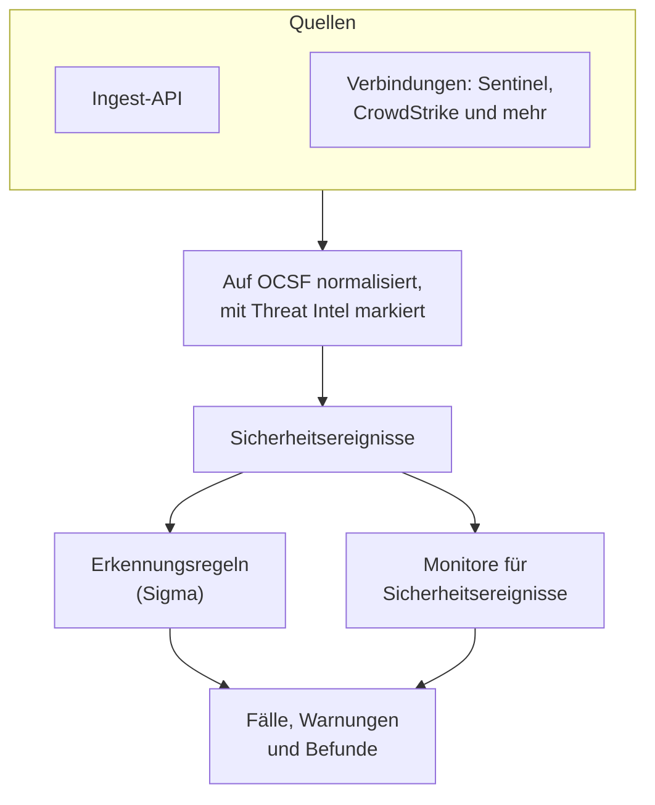
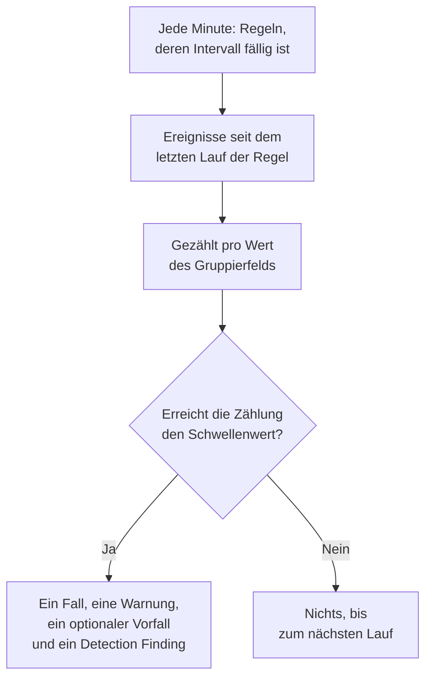

# Sicherheitsereignisse (SIEM)

OneUptime bewahrt Sicherheitsereignisse neben Ihren Logs, Traces und Metriken auf und gibt jedem dieselbe Form, [OCSF](https://schema.ocsf.io/) (das Open Cybersecurity Schema Framework), egal in welchem Format es ankam. Senden Sie Ereignisse aus jeder Quelle, durchsuchen Sie sie, und finden Sie die wichtigen mit Sigma-Erkennungsregeln, Threat Intelligence und Monitoren. Was diese finden, wird zu [Fällen](/docs/telemetry/security-cases), die Sie bearbeiten, und Playbooks reagieren darauf.

:::cards
- [Ereignisse senden](#sicherheitsereignisse-senden): Ein HTTPS-POST, eine Fluent-Bit-Ausgabe oder eine Verbindung zu einem Sicherheitsprodukt.
- [Suchen und korrelieren](#sicherheitsereignisse-erkunden): Der Explorer für Ereignisse und der Korrelationsgraph.
- [Bedrohungssuchen](#bedrohungssuchen): Gespeicherte Suchen, die nach einem Zeitplan laufen und Personen benachrichtigen, wenn sie etwas finden.
- [Erkennungsregeln](#erkennungsregeln): Sigma-Regeln, die Fälle und Warnungen öffnen.
- [Monitore](#monitore-für-sicherheitsereignisse): Zählungen über ein gleitendes Fenster, mit einem Status, der sich erholt.
:::

## So funktioniert es



Öffnen Sie **Produkte → Sicherheitsereignisse**, unter **Observability**. Sein Menü hat einen Abschnitt für jeden Teil der Sicherheit und für jede Sache darin eine eigene Seite:

| Seite | Abschnitt | Wofür sie da ist |
| --- | --- | --- |
| **Übersicht** | Übersicht | Wie Sicherheit eingerichtet ist, was gerade Aufmerksamkeit braucht, und wie schnell Fälle bearbeitet werden |
| **Offene Fälle** | Sicherheitsfälle | Die Warteschlange: jeder noch nicht geschlossene Fall, gruppiert nach dem, worum es jeweils geht |
| **Mir zugewiesen** | Sicherheitsfälle | Die offenen Fälle, die Ihnen zugewiesen sind |
| **Nicht zugewiesen** | Sicherheitsfälle | Die offenen Fälle, die noch niemand übernommen hat |
| **Geschlossene Fälle** | Sicherheitsfälle | Die mit einem Urteil geschlossenen Fälle, die neuesten zuerst |
| **Alle Fälle** | Sicherheitsfälle | Jeder Fall, offen oder geschlossen |
| **Ereignisse** | Ereignisse | Jedes Ereignis suchen und filtern, und eines öffnen, um alle seine Felder zu sehen |
| **Bedrohungssuchen** | Ereignisse | Unter Ereignisse gespeicherte Suchen, mit einem Klick wieder geöffnet oder nach einem Zeitplan ausgeführt, der Personen benachrichtigt, wenn sie etwas finden |
| **Campaigns** | Ereignisse | Jede Adresse, die Angriffsanfragen gesendet hat, und ob eine ihrer Anfragen durchkam |
| **Entitätsrisiko** | Ereignisse | Jeder Benutzer, Host und jede Adresse, bewertet nach dem, was diese Woche dazu gefunden wurde, die riskantesten zuerst |
| **Korrelieren** | Ereignisse | Ein Graph der Ereignisse, die einen Host, einen Benutzer oder eine IP-Adresse teilen |
| **Erkennungsregeln** | Erkennungen | Sigma-Regeln, die nach Zeitplan laufen und Fälle eröffnen |
| **Regelausnahmen** | Erkennungen | Was Ihre Regeln absichtlich auslassen, etwa einen Scanner oder einen geplanten Test, jeweils mit dem, der es hinzugefügt hat, und dem Grund |
| **Beobachtungslisten** | Erkennungen | Die Listen, mit denen Ihre Regeln abgleichen, etwa VIP-Benutzer, kritische Hosts, bekannte schädliche Datei-Hashes und die Adressen, von denen sich Admins anmelden dürfen |
| **Regelbibliothek** | Erkennungen | Fertige Erkennungsregeln zum Hinzufügen, jede mit den Ereignissen, die sie liest, und ob sie eingehen, die empfohlenen markiert |
| **Threat Intel** | Erkennungen | STIX/TAXII-Feeds bekannter bösartiger Indikatoren |
| **ATT&CK-Abdeckung** | Erkennungen | Die Techniken von MITRE ATT&CK, die Ihre Regeln abdecken |
| **Playbooks** | Playbooks | Schritte, die auf Fällen laufen, von selbst oder per Hand |
| **Genehmigungen** | Playbooks | Die Playbook-Schritte, die darauf warten, dass jemand sie genehmigt oder ablehnt |
| **Ausführungen** | Playbooks | Was jedes Playbook getan hat, Schritt für Schritt |
| **Geschützte Entitäten** | Playbooks | Die Benutzer und Hosts, die kein Playbook eindämmt |
| **Einstellungen** | KI | Ob OneUptime AI jeden neuen Fall triagiert |
| **Verbindungen** | Verbindungen | Ihre Logs, die Sicherheitsprodukte, die OneUptime abfragt, und die SIEMs, an die es sendet |
| **Einrichtungsanleitung** | Verbindungen | Snippets zum Senden von Ereignissen, mit Ihrem Ingestion-Schlüssel ausgefüllt |
| **Fallprioritäten** | Einstellungen | Wie dringend ein Fall ist: die eigenen Prioritäten des Projekts, die dringendste zuerst |
| **Reaktionsziele** | Einstellungen | Wie schnell ein Fall jeder Priorität übernommen und eingedämmt werden muss |
| **Fallstatus** | Einstellungen | Die Schritte, die ein Fall durchläuft, und wofür ein Fall in jedem zählt |
| **Risikobewertung** | Einstellungen | Ob das Risiko einer Entität einen Fall eröffnet, ab welchem Risiko, und wie wichtig jede Entität ist |

**Erkennungen**, **KI**, **Verbindungen** und **Einstellungen**, die man einmal einrichtet, bleiben eingeklappt, bis Sie sie öffnen. Neu bei Sicherheit? [Erste Schritte mit Sicherheit](/docs/telemetry/security-getting-started) richtet sie mit zwei Klicks ein.

## Bevor Sie beginnen

Sicherheitsdaten lesen nur die Rollen Project Owner und Project Admin sowie die drei Security-Rollen; andere Rollen sehen in Sicherheitsereignisse nichts. Siehe [Rollen](/docs/permissions/reference#rollen).

| Rolle | Was sie darf |
| --- | --- |
| Security Admin | Alles: Ereignisse, Fälle, Playbooks, Erkennungsregeln, Threat-Intel-Feeds und Verbindungen |
| Security Member | Ereignisse und Threat Intel lesen, Fälle bearbeiten, Playbooks ausführen und ihre Schritte genehmigen sowie Erkennungsregeln und Feeds erstellen, ändern und löschen. Sie kann keine Playbooks oder Verbindungen einrichten und keine Sicherheitsdaten löschen. |
| Security Viewer | Ereignisse, Fälle, Playbooks, Regeln, Feeds, Indikatoren und Verbindungen lesen |

## Sicherheitsereignisse senden

:::steps
### Einen Ingestion-Schlüssel erstellen

Öffnen Sie **Projekteinstellungen → Telemetrie & APM → Ingestion-Schlüssel** und klicken Sie auf **Aufnahmeschlüssel erstellen**. Sicherheitsereignisse nutzen dieselben Schlüssel wie der Rest Ihrer Telemetrie.

### Ihre Ereignisse senden

Senden Sie JSON an `/security-events/v1/ingest`, mit dem Schlüssel in `x-oneuptime-token`:

:::tabs
@tab OCSF
```bash
curl -X POST "https://oneuptime.com/security-events/v1/ingest?format=ocsf" \
  -H "Content-Type: application/json" \
  -H "x-oneuptime-token: YOUR_INGESTION_TOKEN" \
  -H "x-oneuptime-service-name: my-security-source" \
  -d '{ "events": [ { "class_uid": 3002, "severity_id": 4, "status": "Failure", "message": "Failed logon for alice", "actor": { "user": { "name": "alice" } }, "src_endpoint": { "ip": "203.0.113.7", "hostname": "laptop-alice" } } ] }'
```
@tab Google UDM
```bash
curl -X POST "https://oneuptime.com/security-events/v1/ingest?format=udm" \
  -H "Content-Type: application/json" \
  -H "x-oneuptime-token: YOUR_INGESTION_TOKEN" \
  -d '{ "events": [ { "metadata": { "event_type": "USER_LOGIN" }, "principal": { "hostname": "laptop-alice", "user": { "userid": "alice" }, "ip": ["203.0.113.7"] }, "security_result": [{ "severity": "HIGH", "action": ["BLOCK"] }] } ] }'
```
@tab Generic JSON
```bash
curl -X POST "https://oneuptime.com/security-events/v1/ingest" \
  -H "Content-Type: application/json" \
  -H "x-oneuptime-token: YOUR_INGESTION_TOKEN" \
  -d '{ "events": [ { "severity": "high", "event_type": "ssh_brute_force", "message": "12 failed SSH logins in 60s", "username": "root", "hostname": "web-01", "src_ip": "203.0.113.7" } ] }'
```
:::

Der Endpunkt antwortet mit `200`, sobald die Ereignisse in der Warteschlange stehen. Ein Ereignis ohne Zeitangabe, wie diese, wird auf den Moment seiner Ankunft gesetzt.

### Sie unter Ereignisse finden

Öffnen Sie **Produkte → Sicherheitsereignisse → Ereignisse**. Die Ereignisse erscheinen innerhalb weniger Sekunden, mit Schweregrad, Klasse, Benutzer, Host und IP-Adressen ausgefüllt.
:::

### Formate

| `format` | Was es liest | Ebenfalls akzeptiert |
| --- | --- | --- |
| `ocsf` | OCSF-Ereignis-JSON (`class_uid`, `severity_id` und so weiter) | Keine |
| `udm` | UDM-Ereignisse von Google SecOps (Chronicle) (`metadata.event_type` und so weiter) | `chronicle`, `google-secops` |
| `google-secops-alert` | Erkennungen und Warnungen von Google SecOps: SOAR-Webhooks und der Erkennungsstrom | `secops-alert`, `detection` |
| `generic` | Jedes andere JSON, gelesen anhand gängiger Feldnamen | Keine |

Nennen Sie das Format mit `?format=`, mit dem Header `x-oneuptime-security-event-format` oder mit einem Feld `"format"` auf oberster Ebene. Lassen Sie es weg, wird das Format jedes Ereignisses einzeln ermittelt, sodass ein Webhook Erkennungen und rohe Ereignisse mischen kann.

- Der Body kann ein Ereignis sein, ein Array von Ereignissen oder `{ "events": [...] }`.
- Der Header `x-oneuptime-service-name` nennt den Telemetrie-Dienst, zu dem die Ereignisse gehören. Ohne ihn gehören sie zu dem Dienst, der nach Produkt oder Anbieter des ersten Ereignisses benannt ist, oder zu `Security Events`.
- Nichts geht verloren, weil es sich nicht zuordnen ließ: Jedes Feld der Quelle landet in den Attributen des Ereignisses.

### Felder von generischem JSON

Ein generisches Ereignis wird anhand gängiger Feldnamen gelesen:

| Feld des Ereignisses | Gelesen aus dem ersten von |
| --- | --- |
| `message` | `message`, `msg`, `summary`, `description`, `title` |
| `severityName` | `severity`, `severity_name`, `level`, `priority`, `risk_level` |
| `time` | `timestamp`, `time`, `@timestamp`, `event_time`, `created_at` |
| `principalUser` | `user`, `username`, `user_name`, `account`, `actor` |
| `principalHost` | `host`, `hostname`, `computer`, `device`, `machine` |
| `principalIp` | `source_ip`, `src_ip`, `client_ip`, `ip` |
| `targetIp` | `destination_ip`, `dest_ip`, `dst_ip`, `target_ip` |
| `className` | `event_type`, `category`, `type`, `action` |
| `ruleName` | `rule`, `rule_name`, `signature`, `detection` |
| `productName` | `product`, `product_name`, `source`, `log_source` |
| `processName` | `process_name`, `process.name`, `proc.name`, `comm` |
| `processPath` | `process_path`, `Image`, `NewProcessName`, `exe`, `process.executable` |
| `processCommandLine` | `command_line`, `CommandLine`, `cmdline`, `process.command_line`, `proc.cmdline`, `process` |
| `parentProcessName` | `parent_process_name`, `process.parent.name`, `proc.pname` |
| `parentProcessPath` | `parent_process_path`, `ParentImage`, `ParentProcessName`, `process.parent.executable` |
| `parentProcessCommandLine` | `parent_command_line`, `ParentCommandLine`, `process.parent.command_line`, `proc.pcmdline` |

Ein Schweregradwort wird zu einer OCSF-Stufe: `info` wird als Informational gelesen, `warning` als Low, `error` als Medium, `alert` als Critical und `emergency` als Fatal.

### Mit Fluent Bit weiterleiten

Um Sicherheitslogs zu senden, die Sie schon sammeln, etwa von auditd, syslog oder Falco, fügen Sie Fluent Bit eine Ausgabe `http` hinzu:

```ini title="fluent-bit.conf"
[OUTPUT]
    Name             http
    Match            security.*
    Host             oneuptime.com
    Port             443
    tls              On
    URI              /security-events/v1/ingest
    Format           json
    Json_date_key    timestamp
    Json_date_format iso8601
    Header           x-oneuptime-token YOUR_INGESTION_TOKEN
    Header           x-oneuptime-service-name my-security-source
    Retry_Limit      5
```

Die Seite **Einrichtungsanleitung**, unter **Verbindungen**, hat diese Snippets mit Ihrem eigenen Host und Schlüssel ausgefüllt.

### Sicherheitsereignisse in Ihren Logs finden

Die Karte **Ihre Protokolle** oben auf **Verbindungen** macht die Logs, die Sie bereits an OneUptime senden, zu einer Quelle. Ist **Sicherheitsereignisse in Ihren Protokollen finden** eingeschaltet, werden die neuen Logs des Projekts jede Minute gelesen, und jede SSH- oder Windows-Anmeldung, jeder sudo-Befehl, jeder Audit-Eintrag einer Cloud, jeder CEF- oder LEEF-Datensatz eines Sicherheitsprodukts, jeder Kubernetes-Audit-Eintrag und jeder Webangriff darin wird als Sicherheitsereignis gespeichert. Was jede Art abdeckt, steht unter [Erste Schritte mit Sicherheit](/docs/telemetry/security-getting-started#sicherheitsereignisse-in-ihren-logs-finden).

Jede Art erreicht OneUptime als gewöhnliche Logs:

| Art | Senden Sie sie von |
| --- | --- |
| SSH-Anmeldungen, sudo | Dem Journal oder Auth-Log eines Linux-Rechners, mit dem [OpenTelemetry Collector](/docs/telemetry/host-otel-collector) |
| Windows-Ereignisse | Dem Empfänger `windowseventlog` des Collectors auf dem Rechner, oder einem Weiterleiter, der jedes Ereignis als JSON schreibt, etwa NXLog oder Winlogbeat |
| AWS CloudTrail | Einem Trail, der an CloudWatch Logs geliefert und vom Empfänger `awscloudwatch` des Collectors gelesen wird |
| Google Cloud-Audit-Logs | Einer Log-Senke nach Pub/Sub, gelesen vom Empfänger `googlecloudpubsub` des Collectors mit `encoding: raw_text` |
| Azure-Aktivitäts- und Entra-ID-Logs | Einer Diagnoseeinstellung, die an einen Event Hub streamt, gelesen vom Empfänger `azureeventhub` des Collectors mit `format: raw` |
| CEF, LEEF | Dem Syslog des Produkts, weitergeleitet von [rsyslog](/docs/telemetry/syslog) |
| Kubernetes-Audit-Logs | Der Audit-Log-Datei des API-Servers, gelesen vom Empfänger `filelog` des Collectors |
| Webangriffe | Dem Zugriffslog eines Webservers, gelesen vom Empfänger `filelog` des Collectors |

Auf **Ihre Protokolle** sagt jede Art, wann sie zuletzt gefunden wurde, und **Eine Protokollzeile prüfen** zeigt, was aus einer eingefügten Zeile wird, bevor eine ankommt.

### Ein Sicherheitsprodukt verbinden

**Verbindungen** fragt ein Sicherheitsprodukt für Sie ab und importiert seine neuen Datensätze als Sicherheitsereignisse. Eine Verbindung enthält die Einstellungen des Produkts und verschlüsselte Zugangsdaten; ein Worker fragt sie in dem Intervall ab, das Sie festlegen, und überspringt bereits importierte Datensätze.

| Produkt | Importiert | Einrichtungsanleitung |
| --- | --- | --- |
| Google SecOps (Chronicle) | Regelerkennungen, kuratierte Erkennungen und Warnungen, als Detection Findings | [Google SecOps](/docs/integrations/google-secops) |
| Microsoft Sentinel | Vorfälle, als Incident Findings | [Microsoft Sentinel](/docs/integrations/microsoft-sentinel) |
| Microsoft Defender XDR | Warnungen, als Detection Findings | [Microsoft Defender XDR](/docs/integrations/microsoft-defender-xdr) |
| CrowdStrike Falcon | Warnungen, als Detection Findings | [CrowdStrike Falcon](/docs/integrations/crowdstrike-falcon) |
| Splunk Enterprise Security | Notable Events oder beliebige Suchen, als Detection Findings | [Splunk Enterprise Security](/docs/integrations/splunk) |
| Elastic Security | Erkennungswarnungen, als Detection Findings | [Elastic Security](/docs/integrations/elastic-security) |
| AWS Security Hub | Findings, als Detection und Compliance Findings | [AWS Security Hub](/docs/integrations/aws-security-hub) |
| Okta System Log | Anmelde-, MFA-, Konto- und Richtlinienereignisse | [Okta System Log](/docs/integrations/okta) |
| Microsoft Entra ID | Anmeldungen und Verzeichnisänderungen, und aus dem Microsoft 365-Audit-Protokoll Weiterleitungen von E-Mails, Freigaben und Phishing-Urteile | [Microsoft Entra ID](/docs/integrations/microsoft-entra-id) |
| Google Workspace | Anmeldungen, die eigenen Erkennungen von Google, Admin-Änderungen und App-Freigaben, und Freigaben in Drive | [Google Workspace](/docs/integrations/google-workspace) |

- Die eigenen Warnungen des Produkts ab der Stufe, die in **Open Cases From** eingestellt ist (**Hoch und höher**, sofern Sie keine andere Stufe wählen, oder **Nie**), eröffnen [Fälle](/docs/telemetry/security-cases), gruppiert nach dem Benutzer, dem Host oder der Adresse, um die es jeweils geht.
- Eine Verbindung liest Datensätze nach dem Zeitpunkt, zu dem das Produkt sie erstellt hat, nicht nach der Zeit der Aktivität, die sie beschreiben. Eine SIEM-Regel, die stündlich läuft, erstellt Erkennungen lange nach den Ereignissen, auf die sie passte, und diese werden trotzdem importiert.
- Die erste Abfrage blickt 24 Stunden zurück, sodass eine neue Verbindung sofort aktuelle Datensätze zeigt.
- **Verbindung testen** in der Zeile der Verbindung prüft den Zugriff auf das Produkt und ob die eigenen Worker von OneUptime laufen, und importiert nichts. **Jetzt ausführen** fragt sofort ab.

## Was ein Ereignis enthält

Jedes Ereignis wird mit typisierten Feldern und seinem Quell-Payload gespeichert:

| Gruppe | Felder |
| --- | --- |
| Klassifizierung | `categoryName`, `className`, `activityName`, `statusName`, mit ihren OCSF-IDs (`categoryUid`, `classUid`) |
| Schweregrad | `severityName`, einer von Unknown, Informational, Low, Medium, High, Critical, Fatal oder Other, und `severityId` |
| Wer es tat | `principalUser`, `principalHost`, `principalIp`, `principalProcess` |
| Was es berührte | `targetUser`, `targetHost`, `targetIp`, `targetPort`, `targetResource` |
| Der Prozess | `processName`, `processPath` und `processCommandLine`: bei Prozessaktivität der gestartete, geöffnete, injizierte oder beendete Prozess, sonst der handelnde Prozess. `parentProcessName`, `parentProcessPath` und `parentProcessCommandLine`: der Prozess, der ihn gestartet hat |
| Quelle | `productName`, `vendorName`, `ruleId`, `ruleName`, `eventUid` |
| Inhalt | `message`, `mitreTactics`, `mitreTechniques` und `observables`: jeder Benutzer, Host, jede IP-Adresse, Domain und jeder Hash aus dem Ereignis |
| Attribute | Der ganze Quell-Payload, auf Schlüssel mit Punkten abgeflacht |

Ereignisse, die vor OneUptime 14.0.84 gespeichert wurden, lassen die Prozessfelder leer und nennen ihren Prozess nur als `principalProcess`, den handelnden Prozess. Sie werden nicht nachträglich ergänzt: Sie behalten, womit sie gespeichert wurden, bis ihre Aufbewahrung endet.

## Sicherheitsereignisse erkunden

**Ereignisse** ist ein Telemetrie-Explorer wie die Explorer für Logs und Traces: ein Diagramm der Ereignisse des Zeitfensters nach Schweregrad, eine Seitenleiste mit Facetten, die Liste und ein Panel mit jedem Feld und Attribut des Ereignisses, das Sie öffnen. Zeitfenster, Filter und Suche stehen alle in der URL, sodass sich eine gefilterte Ansicht teilen lässt und ein Neuladen übersteht.

### Suche

Die Suchleiste spricht dieselbe Sprache wie die anderen Telemetrie-Explorer (siehe [Suchsyntax](/docs/telemetry/search-syntax)):

| Syntax | Bedeutet | Beispiel |
| --- | --- | --- |
| Freitext | Die Nachricht enthält ihn | `failed logon` |
| `"quoted phrase"` | Die Wörter zusammenhalten | `"brute force"` |
| `<field>:<value>` | Ein typisiertes Feld | `severity:Critical` |
| `@<attribute>:<value>` | Ein Quellattribut | `@threat.matched:true` |
| `-<filter>` | Nicht das | `-severity:Informational` |
| `<field>:(a OR b)` | Einer dieser Werte | `severity:(High OR Critical)` |
| `<field>:a*` | `*` ist beliebiger Text, `?` ein Zeichen | `host:web-*` |
| `@<attribute>:*` | Das Attribut ist vorhanden | `@threat.indicator_id:*` |
| `@<attribute>:~text` | Das Attribut enthält den Text | `@finding_info.title:~ransom` |

Ein Feld ist entweder ein Kurzname (`severity`, `class`, `category`, `activity`, `status`, `vendor`, `product`, `rule`, `user`, `host`, `ip`, `targetuser`, `targethost`, `targetip`, `processname`, `commandline`, `parentprocessname`, `observable`, `tactic`, `technique`, `requestoutcome`, `trace`, `session`) oder der eigene Name des Felds, etwa `severityName` oder `principalHost`. Jeder andere Name wird als Quellattribut gelesen. `observable:<value>` findet jedes Ereignis, das einen Wert erwähnt, egal auf welcher Seite der Aktivität er stand.

### Facetten

Die Seitenleiste zählt die Ereignisse des Zeitfensters nach **Quelle**, **Schweregrad**, **Request Outcome**, **Ereignisklasse**, **Kategorie**, **Aktivität**, **Status**, **Anbieter**, **Produkt**, **Erkennungsregel**, **Quellbenutzer**, **Quell-Host**, **Prozess** und **Übergeordneter Prozess**. Klicken Sie auf einen Wert, um nur seine Ereignisse zu behalten, oder auf das Minus daneben, um sie auszuschließen. Ein erneuter Klick macht das rückgängig. Das Diagramm und jede Zählung beschreiben genau die Ereignisse in der Liste.

### Was danach geschah

Ein Ereignis aus einer Logzeile, die innerhalb einer getracten Anfrage geschrieben wurde, wird in diese Anfrage hinein verfolgt. Sein Panel zeigt, wie weit die Anfrage kam (**Abgelehnt**, **Reached App**, **Errored** oder **Reached Database**), wer sie gesendet hat, und verlinkt ihren Trace, ihre Ausnahme, ihre Sitzungswiedergabe und die Logzeile selbst. Auch eine Logzeile, ein Trace und eine Ausnahme, die Teil eines Angriffs sind, sagen das auf ihren eigenen Seiten.

### Campaigns

**Campaigns** listet jede Adresse, die Angriffsanfragen gesendet hat, als eine Zeile, mit den Angriffsarten, den Werkzeugen und den Anfragen, die sie gesendet hat, und wie viele durchkamen. Die Adressen, deren Anfragen Ihre App erreicht haben, stehen zuerst.

### Korrelieren

**Korrelieren** zeichnet die Ereignisse rund um einen Host, einen Benutzer oder eine IP-Adresse: ihre Ereignisklassen rund um das Gesuchte, markiert nach ihrem schlimmsten Schweregrad, und die anderen Werte aus denselben Ereignissen auf dem äußeren Ring. Klicken Sie auf eine Klasse, um ihre Ereignisse aufzulisten, oder auf einen Wert, um als Nächstes danach zu korrelieren. Jedes Observable im Panel eines Ereignisses unter **Ereignisse** öffnet **Korrelieren** dafür.

## Bedrohungssuchen

Eine Bedrohungssuche ist eine Suche über Ihre Sicherheitsereignisse, unter einem Namen gespeichert: der Text der Suchleiste, die Filter der Seitenleiste und wie weit sie zurückblickt. Öffnen Sie sie mit einem Klick wieder, lassen Sie sie nach einem Zeitplan laufen, der Personen benachrichtigt, wenn sie etwas findet, und bewahren Sie die gefundenen Ereignisse in einem Fall auf.

### Eine Suche als Bedrohungssuche speichern

Suchen und filtern Sie unter **Ereignisse**, bis die Liste zeigt, was Sie suchen, öffnen Sie dann **Bedrohungssuchen** in der Werkzeugleiste und wählen Sie **Als Bedrohungssuche speichern**. Geben Sie ihr einen Namen, wählen Sie, ob sie nach einem Zeitplan läuft, und ihre Seite öffnet sich. **Ereignisse → Bedrohungssuchen** listet die Bedrohungssuchen des Projekts, jede mit ihrer Suche, wie oft sie läuft, wen sie benachrichtigt und was ihr letzter Lauf gefunden hat; **Bedrohungssuche erstellen** nimmt dort die Suche so, wie Sie sie unter **Ereignisse** eingeben würden. Ein Projekt bewahrt bis zu 200 Bedrohungssuchen auf.

Die Seite einer Bedrohungssuche ist ihre Suche, im Explorer für Ereignisse geöffnet. Ändern Sie dort die Suche oder die Filter, dann bietet der Kopf der Bedrohungssuche **Änderungen speichern** und **Änderungen verwerfen** an. **Bearbeiten** ändert ihren Namen, ihre Suche, wie weit sie zurückblickt, ihren Zeitplan und wen sie benachrichtigt, und **Bedrohungssuche löschen** steht in ihrem Menü. Ab Security Member können Bedrohungssuchen gespeichert, geändert und gelöscht werden, und ein Security Viewer kann sie öffnen.

### Eine Bedrohungssuche nach Zeitplan ausführen

| Zeitplan | Läuft |
| --- | --- |
| **Nicht geplant** | Nur, wenn Sie sie öffnen |
| **Jede Stunde**, **Alle 6 Stunden**, **Jeden Tag**, **Jede Woche** | Von selbst, so oft |

Eine geplante Bedrohungssuche benachrichtigt die Personen und Teams, die Sie unter **Benachrichtigen** wählen: mindestens eine Person oder ein Team und höchstens 50 insgesamt. Jeder Lauf:

- liest die Ereignisse, deren Zeitpunkt nach dem vorherigen Lauf liegt, bis vor zwei Minuten, sodass jedes Ereignis einmal durchsucht wird. Der erste Lauf liest ab dem Zeitpunkt, zu dem der Zeitplan festgelegt oder die Suche zuletzt geändert wurde, und nach einem Ausfall holt ein Lauf höchstens einen Tag mehr als sein Intervall nach.
- zählt die Ereignisse, die seine Suche dort findet, genau so, wie **Ereignisse** sie auflisten würde, und liest nur, was die Person lesen darf, unter der er läuft.
- benachrichtigt, wenn er Ereignisse findet, die Personen, die die Bedrohungssuche nennt, und die Mitglieder der Teams, die sie nennt, sofern sie Bedrohungssuchen und Sicherheitsereignisse lesen dürfen.

Ein Lauf öffnet keinen Fall und löst keine Warnung aus: Schreiben Sie, was Fälle öffnen soll, als [Erkennungsregel](#erkennungsregeln). Ein Lauf, dessen Suche zu lange dauert oder der die Ereignisse nicht lesen kann, nennt den Grund bei der Bedrohungssuche und wird innerhalb einer Stunde erneut versucht, ab dort, wo er aufgehört hat.

Eine geplante Bedrohungssuche läuft unter der Person, die zuletzt ihren Zeitplan festgelegt, ihre Suche geändert oder sie mit **Bearbeiten** gespeichert hat. Ein API-Schlüssel kann keinen Zeitplan festlegen. Verlässt diese Person das Projekt oder darf sie keine Sicherheitsereignisse mehr lesen, zeigt die Bedrohungssuche das an: Öffnen Sie **Bearbeiten** und speichern Sie sie, damit sie unter Ihnen läuft.

### Wer benachrichtigt wird

Die Benachrichtigung **Bedrohungssuche hat Sicherheitsereignisse gefunden** nennt die Bedrohungssuche und ihre Suche, wie viele Ereignisse ihr Lauf gefunden hat und welches Zeitfenster er gelesen hat, und verlinkt auf die Seite der Bedrohungssuche mit diesen Ereignissen; kein Wortlaut eines Ereignisses steht darin. Alle erhalten sie per E-Mail und Push und wählen ihre Kanäle unter **Benutzereinstellungen → Benachrichtigungseinstellungen**. Wie andere Routine-E-Mails kann sie in einer [E-Mail-Zusammenfassung](/docs/emails/notification-rollup) zurückgehalten werden.

### Ereignisse in einem Fall aufbewahren

Wählen Sie Ereignisse unter **Ereignisse** oder auf der Seite einer Bedrohungssuche aus und wählen Sie **Massenaktionen → Zum Fall hinzufügen**, oder öffnen Sie ein Ereignis und wählen Sie **Zum Fall hinzufügen**. Wählen Sie einen offenen Fall nach Nummer oder Titel. Bis zu 100 Ereignisse gehen auf einmal.

OneUptime liest jedes Ereignis erneut als Sie und bewahrt es so, wie es war, auf der Seite **Belege** des Falls auf, sodass der Fall es auch nach dem Ende der Aufbewahrungsfrist des Ereignisses zeigt. Ein Ereignis, das Sie nicht lesen dürfen, wird nicht aufbewahrt, und eines, das der Fall bereits aufbewahrt, bleibt, wie es ist. Ein über eine Bedrohungssuche gefundenes Ereignis nennt die Bedrohungssuche, und **Ereignis anzeigen** öffnet es so, wie es aufbewahrt wurde.

Bedrohungssuchen haben dieselbe REST-API wie der Rest von OneUptime, unter `/security-hunt`, und `POST /security-case-evidence/add-events` bewahrt Ereignisse in einem Fall auf. Siehe [API-Referenz](/docs/api-reference/api-reference).

## Erkennungsregeln

Eine Erkennungsregel ist eine [Sigma](https://sigmahq.io/)-Regel, ein offenes YAML-Format zur Beschreibung verdächtiger Aktivität, die OneUptime nach Zeitplan gegen Ihre Ereignisse laufen lässt. Passt sie, eröffnet sie einen [Fall](/docs/telemetry/security-cases) oder ergänzt einen offenen, öffnet eine Warnung, wahlweise einen Vorfall, und schreibt einen Detection Finding zurück in die Ereignisse. Die **Regelbibliothek** bietet fertige Regeln als Ausgangspunkt.



### Eine Regel erstellen

:::steps
1. Öffnen Sie **Produkte → Sicherheitsereignisse → Erkennungen → Erkennungsregeln** und klicken Sie auf **Erkennungsregel erstellen**.
2. Fügen Sie unter **Sigma-Regel** das YAML der Regel in **Sigma-Regel (YAML)** ein. Es wird beim Speichern geparst, sodass ein Fehler im Formular erscheint.
3. Der **Name** füllt sich aus dem `title` der Regel: Überschreiben Sie ihn, um die Regel anders zu nennen. Eine neue Regel läuft; **Aktiviert** steht in ihrem Bearbeitungsformular.
4. Lassen Sie unter **Bei Treffer** die Option **Bei Treffer einen Fall eröffnen** eingeschaltet, um die Treffer der Regel nach dem Wert, nach dem sie gruppiert, zu Fällen zusammenzufassen.
5. Wählen Sie unter **Warnungen und Vorfälle**, was ein Treffer sonst noch auslöst: **Warnung erstellen** (Standard), **Vorfall melden**, **Beide** oder **Keines von beiden**, mit optionalem **Warnungsschweregrad** oder **Vorfallsschweregrad**.
6. **Weitere Felder** enthält die **Beschreibung**, **Bei Treffer Erkennungsbefund schreiben** (an) und wie Treffer gezählt werden; siehe [Auswertungseinstellungen](#auswertungseinstellungen).
:::

Eine erste Regel, die auf fehlgeschlagene Anmeldungen von außerhalb von `10.x.x.x` passt:

```yaml title="failed-logon-burst.yml"
title: Failed logon burst
description: Repeated authentication failures from one source.
level: high
tags:
  - attack.t1110
  - attack.ta0006
detection:
  selection:
    className: Authentication
    statusName: Failure
  filter_internal:
    principalIp|startswith: '10.'
  condition: selection and not filter_internal
```

### Was eine Regel ausdrücken kann

OneUptime führt den booleschen Kern von Sigma aus:

- Selektionen sind Feld-Maps (jedes Feld muss passen; eine Liste von Werten passt auf jeden davon) oder Schlüsselwortlisten, die überall in der Nachricht passen.
- Bedingungen verknüpfen Selektionen mit `and`, `or`, `not` und Klammern, oder mit `1 of selection_*`, `all of selection_*`, `any of them` und `all of them`.
- Feldmodifikatoren: `contains`, `startswith`, `endswith`, `all`, `re`, `cased`, `gt`, `gte`, `lt`, `lte`, `cidr`, `exists`, `windash` und `expand`, das eine [Beobachtungsliste](#beobachtungslisten) liest. Text wird ohne Beachtung der Groß- und Kleinschreibung verglichen, sofern Sie nicht `cased` hinzufügen.
- Ein Feld ist ein typisiertes Feld (`principalUser`), eine gängige Sigma-Schreibweise davon (`CommandLine`, `src_ip`, `Hostname`) oder ein beliebiger Attributschlüssel, so geschrieben wie im Ereignis (`threat.matched`).
- `Image` und `CommandLine` lesen den Prozess, um den es im Ereignis geht, beim Start eines Prozesses den gestarteten (`processPath`, `processCommandLine`), und `ParentImage` und `ParentCommandLine` den Prozess, der ihn gestartet hat (`parentProcessPath`, `parentProcessCommandLine`). `principalProcess` ist der handelnde Prozess, beim Start also der übergeordnete.
- `level` legt den Schweregrad fest: `informational`, `low`, `medium`, `high` oder `critical`, und `medium`, wenn es fehlt. ATT&CK-IDs in `tags` (`attack.t1110`, `attack.ta0006`) füllen die MITRE-Felder des Befunds.

Aggregationen wie `| count() by principalIp > 5` werden beim Speichern abgelehnt: Nutzen Sie stattdessen eine [Korrelationsregel](#korrelationsregeln) oder **Nach Feld gruppieren** und **Schwellenwert der Trefferanzahl**. `logsource` ist nur informativ und schränkt nichts ein: Setzen Sie diesen Filter in eine Selektion, etwa `className: Authentication`. Ein `timeframe` wird ignoriert, weil das Intervall der Regel ihr Fenster festlegt.

### Korrelationsregeln

Eine [Sigma-Korrelation](https://sigmahq.io/docs/meta/correlations.html) schlägt bei mehreren Ereignissen zusammen an statt bei einem. Fügen Sie sie mit den Regeln, die sie liest, in **Sigma-Regel (YAML)** ein, als YAML-Dokumente getrennt durch `---`, oder nennen Sie Regeln, die das Projekt schon hat, über ihren Sigma-`name` oder ihre `id`. Die **Regelbibliothek** hat fertige, etwa fehlgeschlagene Anmeldungen, auf die eine erfolgreiche folgt.

| Typ | Schlägt an, wenn | Angezeigt als |
| --- | --- | --- |
| `event_count` | Eine Gruppe innerhalb des `timespan` eine Anzahl von Ereignissen erreicht | Ereignisanzahl |
| `value_count` | Eine Gruppe innerhalb des `timespan` eine Anzahl verschiedener Werte eines Felds zeigt | Verschiedene Werte |
| `temporal` | Jede Regel innerhalb des `timespan` für dieselbe Gruppe trifft, in beliebiger Reihenfolge | Ereignisse zusammen |
| `temporal_ordered` | Die Regeln innerhalb des `timespan` in ihrer Reihenfolge für dieselbe Gruppe treffen | Reihenfolge |
| `new_value` | Eine Gruppe einen Wert eines Felds zeigt, den sie innerhalb des `timespan` nicht gezeigt hat | Zuerst gesehen |

```yaml title="failed-then-success.yml"
title: Failed sign-ins, then a success from the same address
level: high
correlation:
  type: temporal_ordered
  rules:
    - failed_sign_ins
    - successful_sign_in
  group-by:
    - principalIp
  timespan: 10m
---
title: Five failed sign-ins
name: failed_sign_ins
correlation:
  type: event_count
  rules:
    - failed_sign_in
  group-by:
    - principalIp
  timespan: 10m
  condition:
    gte: 5
---
title: Failed sign-in
name: failed_sign_in
detection:
  selection:
    className: Authentication
    statusName: Failure
  condition: selection
---
title: Successful sign-in
name: successful_sign_in
detection:
  selection:
    className: Authentication
    statusName: Success
  condition: selection
```

- Eine Gruppe ist der Wert der Felder in `group-by`, etwa eine Adresse. Die Zählung ist rollierend: Ein Schub, den zwei Läufe aufteilen, zählt innerhalb seines `timespan` trotzdem ganz, und der ist höchstens 24 Stunden lang.
- `new_value` ist ein eigener Typ von OneUptime, weil Sigma keine Korrelation „zuerst gesehen“ kennt: Er vergleicht mit bis zu 30 Tagen Verlauf. `value_sum`, `value_avg`, `value_percentile` und `value_median` werden beim Speichern abgelehnt.
- Die Spalte **Typ** in **Erkennungsregeln** nennt die Art jeder Regel, und das Formular sagt in einem Satz, wonach die Regel sucht.

### Auswertungseinstellungen

| Feld | Was es tut |
| --- | --- |
| **Auswertungsintervall (Minuten)** | Wie oft die Regel läuft: ganze Minuten, 1 bis 1440. Das Formular einer neuen Regel beginnt bei 5. |
| **Nach Feld gruppieren** | Optional. Treffer, die den Wert dieses Felds teilen, etwa `principalHost`, werden gemeinsam gezählt, gemeldet und dedupliziert: eine Warnung pro Host statt Hunderten. |
| **Feld für eindeutige Zählung** | Optional. Die verschiedenen Werte dieses Felds zählen statt der passenden Ereignisse. Leere Werte zählen nicht. |
| **Schwellenwert der Trefferanzahl** | Eine Gruppe löst nur aus, wenn ihre Zählung diese Zahl innerhalb eines Laufs erreicht: 1 bis 1000000, und 1 löst bei jedem Treffer aus. |

Gruppierung und eindeutige Zählung nehmen dieselben Feldnamen wie die Regel. Mit ihnen sagt der Schwellenwert „so viele, vom selben Ding, in einem Lauf“, ohne Monitor obendrauf:

| Ziel | Nach Feld gruppieren | Feld für eindeutige Zählung | Schwellenwert |
| --- | --- | --- | --- |
| Bei jedem Treffer warnen | Leer | Leer | 1 |
| Eine Warnung pro Host | `principalHost` | Leer | 1 |
| Brute Force: 5 fehlgeschlagene Anmeldungen von einer IP | `principalIp` | Leer | 5 |
| Password Spraying: eine IP scheitert an 5 verschiedenen Konten | `principalIp` | `principalUser` | 5 |
| Portscan: eine IP erreicht 20 verschiedene Ports | `principalIp` | `targetPort` | 20 |

### Wann eine Regel läuft

OneUptime prüft jede Minute, welche aktivierten Regeln ihr Intervall seit ihrem letzten Lauf hinter sich haben. Jeder Lauf liest die Ereignisse, deren Ereigniszeit zwischen dem vorigen Lauf und vor zwei Minuten liegt, und geht dann weiter. Die zwei Minuten lassen Ereignissen Zeit, die noch unterwegs sind, etwa einer Logzeile, die eine Minute nach dem Schreiben gelesen wird:

- Die Fenster liegen lückenlos hintereinander, sie gleiten nicht. Bei einem Intervall von 10 Minuten können Fehlschläge um 09:58 und 10:01 in verschiedene Läufe fallen und werden getrennt gezählt, also lassen Sie bei der Wahl eines Schwellenwerts Spielraum.
- Nach einer Lücke, etwa einem Worker-Ausfall oder einer wieder eingeschalteten Regel, deckt der nächste Lauf die ganze Lücke ab, bis zu den letzten 24 Stunden.
- Ein Ereignis, das mehr als zwei Minuten zu spät ankommt, nachdem ein Lauf seine Zeit schon abgedeckt hat, wird gespeichert und ist durchsuchbar, aber diese Regel liest es nie.
- Jede Gruppe, die den Schwellenwert erreicht, wird zu einem Detection Finding, bis zu 10.000 pro Lauf. Warnungen, Vorfälle und Fälle öffnen sich für die 100 mit den höchsten Zählungen; die übrigen teilen sich einen Fall zur Regel, und **Letzter Fehler** der Regel nennt, wie viele Gruppen passten.

### Schweregrad

Das `level` einer Regel ist der Schweregrad ihrer Befunde: `informational`, `low`, `medium`, `high` und `critical` werden zu Informational, Low, Medium, High und Critical. Ihre Warnungen und Vorfälle nehmen einen der Schweregrade Ihres Projekts, in dieser Reihenfolge:

1. Der **Warnungsschweregrad** (oder **Vorfallsschweregrad**) der Regel, wenn gesetzt.
2. Ihr Schweregrad, der nach der Stufe benannt ist, etwa High, unabhängig von der Schreibweise.
3. Nach Rang: Regeln mit `critical` und `high` nehmen Ihren höchsten Schweregrad, die anderen Ihren niedrigsten.

> [!TIP]
> Benennen Sie Ihre Warnungsschweregrade nach den Sigma-Stufen (Critical, High, Medium, Low, Informational), und jede Regel landet ohne eigene Einstellung beim richtigen.

### Warnungen und Befunde

Jede auslösende Gruppe öffnet eine Warnung mit dem Titel `[Detection] <rule name> — <group value>`, oder `[Detection] <rule name>` bei einer Regel ohne Gruppierfeld. Solange sie offen ist, öffnen weitere Treffer dieser Gruppe keine neue. Eine Regel sieht nur Treffer und kann nicht erkennen, dass ein Angriff aufgehört hat, also bleiben ihre Warnungen offen, bis jemand sie behebt.

Ein Detection Finding ist ein Sicherheitsereignis der Klasse `Detection Finding` (OCSF-Klasse 2004) vom Produkt `OneUptime Detections`, mit den MITRE-Tags der Regel, dem Gruppenwert an erster Stelle in `observables` und diesen Attributen:

| Attribut | Wert |
| --- | --- |
| `oneuptime.detection.rule_id` | Die ID der Regel, die ausgelöst hat |
| `oneuptime.detection.rule_name` | Der Name der Regel |
| `oneuptime.detection.match_count` | Wie viele Ereignisse hinter dem Befund stehen |
| `oneuptime.detection.distinct_count` | Wie viele verschiedene Werte dahinter stehen, bei einer Regel mit eindeutiger Zählung |
| `oneuptime.detection.group_value` | Der Wert der Gruppe, bei einer Regel mit Gruppierfeld |
| `oneuptime.detection.sigma_id` | Die eigene `id` der Sigma-Regel |

Befunde sind gewöhnliche Ereignisse: Durchsuchen Sie sie unter **Ereignisse** und korrelieren Sie sie unter **Korrelieren**. Um eine neue Regel leise auszuprobieren, schalten Sie jede Aktion außer dem Befund ab, bis Sie ihr trauen.

### Ausnahmen

Eine Ausnahme ist etwas, das eine Regel auslässt, weil Sie es erwarten, etwa ein Schwachstellenscanner, ein nächtlicher Backup-Job oder ein geplanter Penetrationstest. Sie bringt die Regel für genau diese eine Sache zum Schweigen, ohne sie auszuschalten, und die übrigen Treffer der Regel lösen weiterhin aus. Jede Ausnahme steht unter **Produkte → Sicherheitsereignisse → Erkennungen → Regelausnahmen**: Fügen Sie dort eine mit **Regelausnahme hinzufügen** hinzu, mit **Ausnahme hinzufügen** in der Zeile einer Regel oder mit **Ausnahme hinzufügen** in der Zeile einer Erkennung in einem Fall, die mit der Regel der Erkennung und dem beginnt, wofür sie ausgelöst hat.

| Was die Regel auslässt | Was sie trifft |
| --- | --- |
| **Eine Entität** | Ein Benutzer, ein Host oder eine IP-Adresse, wo immer ein Ereignis sie nennt: als Handelnder (`principalUser`, `principalHost`, `principalIp`), als Ziel der Handlung (`targetUser`, `targetHost`, `targetIp`) oder unter seinen `observables` |
| **Ein Wert** | Der Wert eines Feldes, das Feld so benannt, wie eine Regel es benennt: `processName`, `principalUser` oder ein Attributschlüssel wie `http.user_agent` |
| **Ein Zeitfenster** | Jedes Ereignis von **Beginnt am** bis **Endet am**, höchstens 30 Tage auseinander |

- Werte passen unabhängig von Groß- und Kleinschreibung, und `*` steht für eine beliebige Zeichenfolge: `svc-*` lässt jedes Dienstkonto aus und `*.lab.example.com` jeden Host einer Domain. Eine IP-Adresse kann ein Bereich sein, etwa `10.20.0.0/16`. Ein Wert, der nur aus `*` besteht, wird abgelehnt: Um eine Regel zu stoppen, schalten Sie sie aus.
- Jede Ausnahme sagt unter **Grund**, warum sie gilt, was jeder sieht, der die Liste liest, und hält fest, wer sie wann hinzugefügt hat. Für eine Entität oder einen Wert lässt sich **Läuft ab am** setzen, danach sieht die Regel sie wieder; ein Zeitfenster endet von selbst.
- **Status** zeigt, wo jede steht: **Aktiv**, **Bevorstehend** für ein Zeitfenster, das noch nicht begonnen hat, **Abgelaufen** oder **Beendet**. Unter dem Namen einer Regel in **Erkennungsregeln** zählt eine Zeile ihre aktiven Ausnahmen, und **Ausnahmen anzeigen** in der Zeile der Regel öffnet die Liste, auf sie gefiltert.
- Ausgelassene Ereignisse werden entfernt, bevor die Regel irgendetwas zählt, sodass sie nie zu ihrem **Schwellenwert der Trefferanzahl** zählen und keinen Fall, keine Warnung, keinen Vorfall und keinen Befund eröffnen. Ausnahmen gelten für jeden Lauf der Regel, Korrelationen eingeschlossen, und für **Auf vergangene Ereignisse anwenden**, aber nie für einen Testangriff, der prüft, dass Ereignisse ankommen.
- Eine Regel hat höchstens 100 Ausnahmen. Wer Erkennungsregeln bearbeiten darf, fügt sie hinzu, ändert und entfernt sie, jede Sicherheitsrolle kann sie lesen, und jede Änderung steht im Audit-Log des Projekts.

### Beobachtungslisten

Eine Beobachtungsliste ist eine Liste, die Ihr Team einmal pflegt und die jede Regel lesen kann, etwa VIP-Benutzer, kritische Hosts, bekannte schädliche Datei-Hashes oder die Adressen, von denen sich Admins anmelden dürfen. Jede Liste steht unter **Produkte → Sicherheitsereignisse → Erkennungen → Beobachtungslisten**: Erstellen Sie dort eine mit **Beobachtungsliste erstellen**, das nach ihrem Namen und ihrem Inhalt fragt, oder fügen Sie eine gängige unter **Mit einer gängigen Liste beginnen** hinzu. Die Seite einer Liste zeigt ihre Werte, und **In einer Regel verwenden** gibt eine Selektion, die die Liste liest, zum Kopieren in eine Regel.

Eine Regel liest eine Liste mit `expand` und dem Namen der Liste zwischen zwei `%`-Zeichen. Diese Regel löst aus, wenn sich ein Admin von einer Adresse anmeldet, die nicht auf der erlaubten Liste steht:

```yaml title="admin-sign-in-from-outside.yml"
title: Admin sign-in from outside the allowed addresses
detection:
  admin_sign_in:
    className: Authentication
    principalUser|expand: '%admins%'
  allowed:
    principalIp|expand: '%admin_addresses%'
  condition: admin_sign_in and not allowed
level: high
```

- Eine Liste enthält Benutzer, Hosts, IP-Adressen, Datei-Hashes, Domains, URLs, Prozesse oder andere Werte, gewählt beim Erstellen. Ein Wert passt unabhängig von Groß- und Kleinschreibung, und `*` steht für eine beliebige Zeichenfolge: `svc-*` passt auf jedes Dienstkonto. Eine Liste von IP-Adressen nimmt auch Bereiche wie `10.20.0.0/16` an, und eine Liste von Datei-Hashes MD5-, SHA-1-, SHA-256- und SHA-512-Hashes.
- Fügen Sie Werte einzeln mit **Wert hinzufügen** hinzu oder viele auf einmal mit **Werte importieren**: Fügen Sie sie ein oder wählen Sie eine `.txt`- oder `.csv`-Datei, ein Wert pro Zeile, mit einer optionalen Notiz nach einem Komma. **Zur Liste hinzufügen** behält die Werte, die schon darauf stehen, und **Liste ersetzen** entfernt die, die der Import nicht enthält.
- Statt Werte zu pflegen, kann eine Liste von IP-Adressen, Datei-Hashes, Domains oder URLs einem Threat-Intel-Feed folgen: Ihre Werte sind dann die aktiven Indikatoren des Feeds von der Art der Liste, aktuell gehalten, während der Feed gelesen wird.
- `expand` wird allein verwendet, da die Werte der Liste bestimmen, wie sie passen. Ein Feld mit mehreren Werten, etwa `observables`, passt, wenn einer davon auf der Liste steht. **Gelesen von** nennt die Regeln, die jede Liste lesen, und unter dem YAML einer Regel nennt ihr Formular die Listen, die die Regel liest.
- Eine Regel nennt eine Liste unabhängig von Groß- und Kleinschreibung. Eine Regel, die eine Liste nennt, die das Projekt nicht hat, wird beim Speichern abgelehnt, und eine Liste, die Regeln lesen, lässt sich erst umbenennen oder löschen, wenn keine Regel sie mehr liest.
- Eine Änderung an einer Liste erreicht jede Regel, die sie liest, bei deren nächstem Lauf. Auch Korrelationsregeln und **Auf vergangene Ereignisse anwenden** lesen Listen.
- Eine Liste enthält höchstens 5.000 Werte, davon höchstens 100 mit `*` und 100 Bereiche, und ein Projekt hat höchstens 200 Listen: Für eine längere Liste folgen Sie einem Threat-Intel-Feed. Wer Erkennungsregeln erstellen, bearbeiten oder löschen darf, darf dasselbe mit Listen tun, und wer Erkennungsregeln bearbeiten darf, fügt ihre Werte hinzu, ändert und entfernt sie. Jede Sicherheitsrolle kann sie lesen, und jede Änderung steht im Audit-Log des Projekts.

### Auf vergangene Ereignisse anwenden

**Auf vergangene Ereignisse anwenden** zeigt, was eine Regel gefunden hätte, wenn sie gelaufen wäre, ohne etwas zu eröffnen, zu senden oder zu schreiben. Es steht in der Zeile einer Regel, für die gespeicherte Regel, und unter **Sigma-Regel (YAML)** im Formular der Regel, für die Regel, wie sie dort gerade steht, bevor Sie sie speichern. Wählen Sie **Letzte 24 Stunden**, **Letzte 7 Tage** oder **Letzte 30 Tage**.

- Eine Regel wird so gezählt, wie ihre Läufe zählen: in Fenstern so lang wie ihr **Auswertungsintervall (Minuten)**, wobei eine Gruppe in einem Fenster auslöst, wenn ihre Anzahl dort den **Schwellenwert der Trefferanzahl** erreicht. Eine Korrelation wird über den ganzen Zeitraum gelesen und listet die Gruppen auf, die sie getroffen hätte, jede mit dem, was geschah.
- Die Antwort sagt, wie oft die Regel ausgelöst hätte, wie oft am Tag, für wie viele Benutzer, Hosts oder Adressen und wie viele Ereignisse passten. Die 50 Gruppen, die am häufigsten ausgelöst haben, werden aufgelistet, jede mit ihren Ereignissen und dem Zeitpunkt, zu dem sie zuletzt ausgelöst hat.
- Die Ausnahmen einer gespeicherten Regel gelten, und die Antwort sagt, wie viele Ereignisse sie ausgelassen und wie viele Auslösungen sie verhindert haben. Eine Regel, die nicht ausgelöst hätte, sagt, wie knapp es war: wie viele Ereignisse passten und welchen Schwellenwert keine Gruppe in einem Fenster erreichte.
- Eine Regel, die mehr als 20 Mal am Tag auslösen würde, löst öfter aus, als ein Mensch sich ansehen kann, und die Antwort sagt das, mit Wegen, sie ruhiger zu machen.
- Es liest nur die Quellen, die Sie lesen dürfen. Ein Lauf, der länger als 45 Sekunden dauert, wird angehalten und sagt das: Wählen Sie einen kürzeren Zeitraum.

## Monitore für Sicherheitsereignisse

Ein Monitor für Sicherheitsereignisse zählt die Ereignisse, die auf seine Filter passen, über ein gleitendes Fenster und wendet die üblichen Monitorkriterien auf die Zählung an: Er ändert den Status des Monitors, öffnet Warnungen oder Vorfälle und alarmiert die Bereitschaft. Erstellen Sie einen unter **Monitore → Monitor erstellen**, mit **Sicherheitsereignisse** als Typ; dort wird er mit Ihren anderen Monitoren aufgeführt.

Sein Formular zeigt **Ereignisse überwachen, die diesen Text enthalten**, **Sicherheitsereignisse überwachen für (Zeit)**, **Ereignisschweregrad** und **Ereignisklasse**. **Nach Telemetrie-Dienst filtern** und **Nach Attributen filtern** warten unter **Weitere Felder**, dessen Kopf die zeigt, die ein Monitor nutzt. Seine Kriterien prüfen **Security Event Count**.

| | Erkennungsregel | Monitor für Sicherheitsereignisse |
| --- | --- | --- |
| Passt auf | Eine Sigma-Regel | Filter auf Schweregrad, Klasse, Nachricht, Dienst und Attribute |
| Fenster | Lückenlos hintereinander, eines pro Lauf | Gleitend: die letzten 5 Sekunden bis 24 Stunden |
| Zählt pro Gruppe | Ja, mit **Nach Feld gruppieren** | Nein: eine Zählung für alles, was passt |
| Öffnet | Warnungen, Vorfälle und Befunde | Einen Status, Warnungen und Vorfälle |
| Erholt sich | Nein: Warnungen bleiben offen, bis sie behoben sind | Ja: Der Status kehrt zurück, wenn die Zählung es tut |

Schreiben Sie die Erkennung selbst als Regel, mit ihrem Schwellenwert. Nutzen Sie einen Monitor, wenn Sie ein gleitendes Fenster wollen, einen Status, der sich von selbst erholt, eine Statusseite oder unterschiedliche Bereitschaftsrichtlinien pro Kriterium.

### Ihre Erkennungen beobachten

Befunde sind Ereignisse, also kann ein Monitor die Regeln selbst beobachten:

- Stürme: ein Monitor auf die Klasse `Detection Finding`, der jeden Befund zählt. Zwanzig verschiedene Regeln, die in einer Stunde auslösen, sind ein Signal, das keine einzelne Regel sehen kann.
- Ratenänderungen: Filtern Sie auf die `oneuptime.detection.rule_id` einer Regel. Eine Regel, die wöchentlich auslöst und plötzlich fünfzigmal pro Stunde auslöst, braucht eine andere Reaktion.
- Stille: Befunde, die auf null fallen, wo Sie sonst ein paar sehen, bedeuten meist, dass eine Quelle nicht mehr sendet. Nutzen Sie ein Kriterium, das auf eine Zählung unter einer Zahl prüft.

Die Aktion **Monitor erstellen** in der Zeile einer Regel öffnet einen neuen Monitor, der schon so eingerichtet ist: die Klasse `Detection Finding`, die ID der Regel (nie ihr Name, den eine Umbenennung ändern würde) und die letzte Stunde. Ein solcher Monitor zählt Befunde, einen pro Gruppe und Lauf, nicht die Ereignisse dahinter. Um eine Anzahl von Ereignissen zu verlangen, bevor irgendetwas auslöst, nutzen Sie den **Schwellenwert der Trefferanzahl** der Regel.

## Threat Intelligence

**Threat Intel** abonniert STIX/TAXII-Feeds bekannter bösartiger IP-Adressen, Domains, URLs, E-Mail-Adressen und Datei-Hashes. Ereignisse, die einen davon erwähnen, werden beim Eintreffen mit `threat.*`-Attributen markiert, auf die Regeln und Monitore filtern können, und jede Minute werden aktuelle Ereignisse mit den Feeds abgeglichen und öffnen Warnungen und Befunde wie eine Regel. Siehe [Threat Intelligence](/docs/telemetry/threat-intelligence).

## Aufbewahrung und Abrechnung

Sicherheitsereignisse werden pro aufgenommenem GB abgerechnet, wie der Rest Ihrer Telemetrie, und für Ihre Telemetrie-Aufbewahrung behalten: die **Standardaufbewahrung (Tage)** des Projekts unter **Projekteinstellungen → Telemetrie & APM → Datenaufbewahrung**, oder eine Aufbewahrung, die am Telemetrie-Dienst festgelegt ist, zu dem sie gehören. Endet die Aufbewahrung eines Ereignisses, wird es gelöscht.

## Fehlerbehebung

:::details Ereignisse erscheinen nicht
Prüfen Sie den Schlüssel in `x-oneuptime-token` und den Pfad, `/security-events/v1/ingest`. Prüfen Sie dann das Zeitfenster unter **Ereignisse**, standardmäßig der letzte Tag: Ein Ereignis wird an seiner eigenen Zeit eingeordnet, also fällt eines mit älterem Zeitstempel heraus.
:::

:::details Eine Regel passt nie
Prüfen Sie ihren **Status**: Steht dort **Deaktiviert**, läuft die Regel nicht, und steht dort **Ausführung fehlgeschlagen**, zeigt **Fehler anzeigen** in ihrer Zeile den Grund. Öffnen Sie ein Ereignis, auf das sie hätte passen sollen, und vergleichen Sie es Feld für Feld mit der Regel: Ein einfacher Wert muss dem ganzen Feld gleichen, also nutzen Sie `contains` oder `*` für einen Teil. Ein Attribut wird so benannt wie im Ereignis (`threat.matched`, nicht `attributes.threat.matched`). Bei einem Schwellenwert über 1 müssen die Treffer in einen Lauf fallen.
:::

:::details Eine Regel hat gepasst, aber keine Warnung geöffnet
**Warnungen und Vorfälle** steht auf **Vorfall melden** oder **Keines von beiden**, oder eine Warnung für dieselbe Regel und denselben Gruppenwert ist noch offen, und spätere Treffer fließen in sie ein. Ein Projekt braucht mindestens einen Warnungsschweregrad, damit Regeln Warnungen öffnen.
:::

:::details Eine Regel öffnet zu viele Warnungen
Jeder Wert von **Nach Feld gruppieren** bekommt seine eigene Warnung: Gruppieren Sie nach etwas Gröberem, heben Sie den Schwellenwert an oder fügen Sie eine eindeutige Zählung hinzu. Geht es Ihnen um die Rate statt um jeden Treffer, stellen Sie **Warnungen und Vorfälle** auf **Keines von beiden** und setzen Sie einen Monitor auf die Befunde der Regel.
:::

:::details Eine Regel löst bei etwas aus, das Sie erwarten
Fügen Sie dafür eine Ausnahme hinzu, statt die Regel auszuschalten: **Ausnahme hinzufügen** in der Zeile der Erkennung in ihrem Fall beginnt mit der Regel und dem, wofür sie ausgelöst hat. Um die Regel selbst zu ändern, zeigt **Auf vergangene Ereignisse anwenden** unter ihrem YAML, was die Änderung gefunden hätte, bevor Sie speichern.
:::

:::details Eine Ausnahme lässt nicht aus, was sie soll
Prüfen Sie ihren **Status** in **Regelausnahmen**: Eine Ausnahme mit dem Status **Abgelaufen** lässt nichts aus, und ein Zeitfenster lässt nur die Ereignisse zwischen seinen beiden Zeitpunkten aus. Eine Entität wird als Handelnder, als Ziel der Handlung und unter den `observables` des Ereignisses gesucht; um einen Wert eines anderen Feldes auszulassen, fügen Sie eine Ausnahme der Art **Ein Wert** hinzu, die das Feld nennt. Ohne `*` muss ein Wert dem ganzen Feld entsprechen: `svc-*` lässt `svc-backup` aus, `svc-` nicht.
:::

:::details Eine Regel, die eine Beobachtungsliste liest, trifft nicht
Öffnen Sie die Liste und prüfen Sie ihre Werte: Ein Wert ohne `*` muss dem ganzen Feld entsprechen, unabhängig von Groß- und Kleinschreibung, und eine Liste, die einem Threat-Intel-Feed folgt, enthält nur die aktiven Indikatoren des Feeds von ihrer Art. Prüfen Sie, ob die Regel das Feld liest, das Ihre Ereignisse füllen: **In einer Regel verwenden** beginnt mit dem Feld, in dem eine Liste ihrer Art meist steht. Eine Änderung an einer Liste erreicht eine Regel bei deren nächstem Lauf.
:::

:::details Eine Beobachtungsliste lässt sich nicht umbenennen oder löschen
Regeln lesen sie noch über ihren Namen, und die Meldung nennt sie. Ändern Sie den Namen in diesen Regeln oder nehmen Sie die Liste aus ihnen heraus, und benennen Sie sie dann um oder löschen Sie sie.
:::

:::details „Auf vergangene Ereignisse anwenden“ findet nichts
Es liest nur den gewählten Zeitraum und die Quellen, die Sie lesen dürfen. Wenn Ereignisse passten, aber keine Gruppe in einem Fenster den **Schwellenwert der Trefferanzahl** erreichte, sagt die Antwort, wie viele passten: Senken Sie den Schwellenwert, oder zählen Sie über ein längeres **Auswertungsintervall (Minuten)**.
:::

## Nächste Schritte

:::cards
- [Threat Intelligence](/docs/telemetry/threat-intelligence): Ihre Ereignisse mit STIX/TAXII-Feeds abgleichen.
- [Sicherheitsfälle und Playbooks](/docs/telemetry/security-cases): Bearbeiten, was Ihre Regeln finden, und mit Playbooks darauf reagieren.
- [Google SecOps](/docs/integrations/google-secops): Die Erkennungen und Ereignisse von Chronicle hereinholen.
- [Suchsyntax](/docs/telemetry/search-syntax): Alles, was die Suchleiste versteht.
- [Berechtigungsreferenz](/docs/permissions/reference): Die Security-Rollen und was jede darf.
:::
