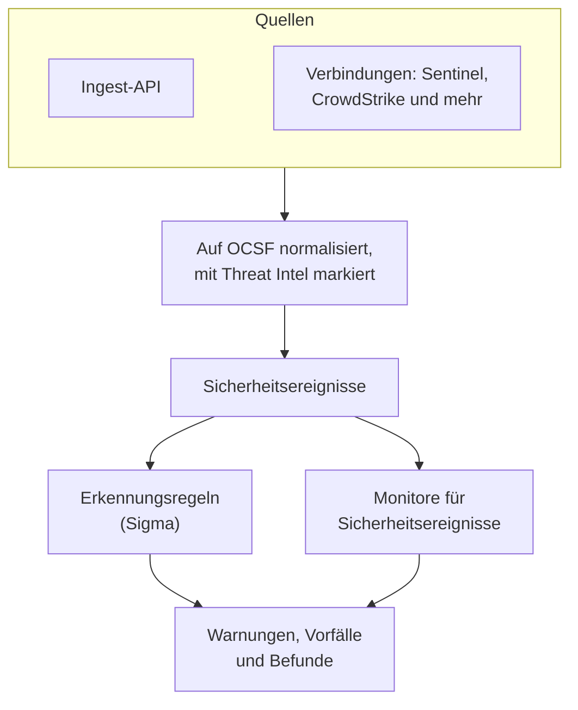
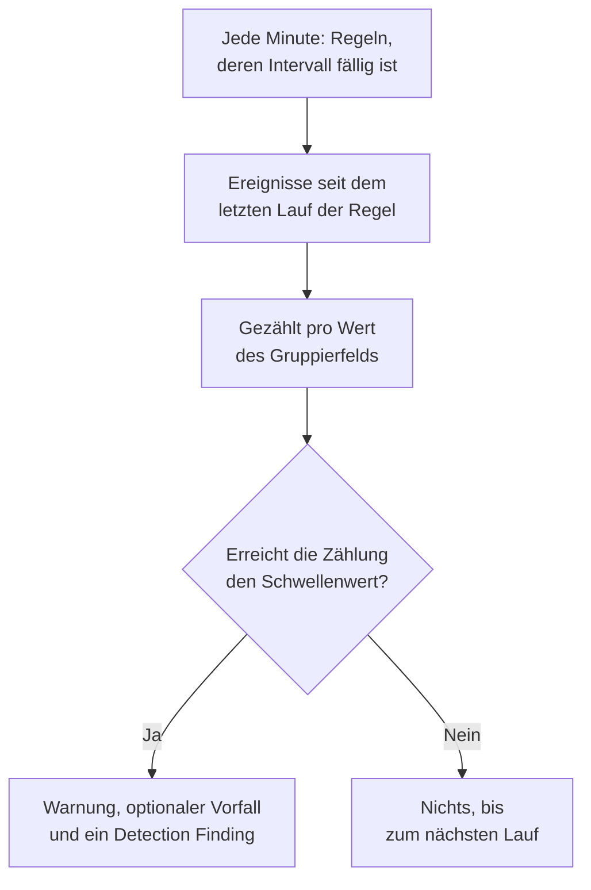

# Sicherheitsereignisse (SIEM)

OneUptime bewahrt Sicherheitsereignisse neben Ihren Logs, Traces und Metriken auf und gibt jedem dieselbe Form, [OCSF](https://schema.ocsf.io/) (das Open Cybersecurity Schema Framework), egal in welchem Format es ankam. Senden Sie Ereignisse aus jeder Quelle, durchsuchen Sie sie, und machen Sie die wichtigen mit Sigma-Erkennungsregeln, Threat Intelligence und Monitoren zu Warnungen.

:::cards
- [Ereignisse senden](#sicherheitsereignisse-senden): Ein HTTPS-POST, eine Fluent-Bit-Ausgabe oder eine Verbindung zu einem Sicherheitsprodukt.
- [Suchen und korrelieren](#sicherheitsereignisse-erkunden): Der Explorer für Ereignisse und der Korrelationsgraph.
- [Erkennungsregeln](#erkennungsregeln): Sigma-Regeln, die Warnungen öffnen.
- [Monitore](#monitore-für-sicherheitsereignisse): Zählungen über ein gleitendes Fenster, mit einem Status, der sich erholt.
:::

## So funktioniert es



Öffnen Sie **Produkte → Sicherheitsereignisse**, unter **Observability**. Seine Tabs:

| Tab | Wofür er da ist |
| --- | --- |
| **Ereignisse** | Jedes Ereignis suchen und filtern, und eines öffnen, um alle seine Felder zu sehen |
| **Korrelieren** | Ein Graph der Ereignisse, die einen Host, einen Benutzer oder eine IP-Adresse teilen |
| **Erkennungsregeln** | Sigma-Regeln, die nach Zeitplan laufen und Warnungen öffnen |
| **Threat Intel** | STIX/TAXII-Feeds bekannter bösartiger Indikatoren |
| **Monitore** | Die Monitore des Projekts für Sicherheitsereignisse |
| **Verbindungen** | Sicherheitsprodukte, die OneUptime nach neuen Datensätzen abfragt |
| **Einrichtungsanleitung** | Snippets zum Senden von Ereignissen, mit Ihrem Ingestion-Schlüssel ausgefüllt |

## Bevor Sie beginnen

Sicherheitsdaten lesen nur die Rollen Project Owner und Project Admin sowie die drei Security-Rollen; andere Rollen sehen in Sicherheitsereignisse nichts. Siehe [Rollen](/docs/permissions/reference#rollen).

| Rolle | Was sie darf |
| --- | --- |
| Security Admin | Alles: Ereignisse, Erkennungsregeln, Threat-Intel-Feeds und Verbindungen |
| Security Member | Ereignisse und Threat Intel lesen sowie Erkennungsregeln und Feeds erstellen, ändern und löschen. Sie kann keine Verbindungen einrichten und keine Sicherheitsdaten löschen. |
| Security Viewer | Ereignisse, Regeln, Feeds, Indikatoren und Verbindungen lesen |

## Sicherheitsereignisse senden

:::steps
### Einen Ingestion-Schlüssel erstellen

Öffnen Sie **Projekteinstellungen → Telemetrie & APM → Ingestion-Schlüssel** und klicken Sie auf **Aufnahmeschlüssel erstellen**. Sicherheitsereignisse nutzen dieselben Schlüssel wie der Rest Ihrer Telemetrie.

### Ihre Ereignisse senden

Senden Sie JSON an `/security-events/v1/ingest`, mit dem Schlüssel in `x-oneuptime-token`:

:::tabs
@tab OCSF
```bash
curl -X POST "https://oneuptime.com/security-events/v1/ingest?format=ocsf" \
  -H "Content-Type: application/json" \
  -H "x-oneuptime-token: YOUR_INGESTION_TOKEN" \
  -H "x-oneuptime-service-name: my-security-source" \
  -d '{ "events": [ { "class_uid": 3002, "severity_id": 4, "status": "Failure", "message": "Failed logon for alice", "actor": { "user": { "name": "alice" } }, "src_endpoint": { "ip": "203.0.113.7", "hostname": "laptop-alice" } } ] }'
```
@tab Google UDM
```bash
curl -X POST "https://oneuptime.com/security-events/v1/ingest?format=udm" \
  -H "Content-Type: application/json" \
  -H "x-oneuptime-token: YOUR_INGESTION_TOKEN" \
  -d '{ "events": [ { "metadata": { "event_type": "USER_LOGIN" }, "principal": { "hostname": "laptop-alice", "user": { "userid": "alice" }, "ip": ["203.0.113.7"] }, "security_result": [{ "severity": "HIGH", "action": ["BLOCK"] }] } ] }'
```
@tab Generic JSON
```bash
curl -X POST "https://oneuptime.com/security-events/v1/ingest" \
  -H "Content-Type: application/json" \
  -H "x-oneuptime-token: YOUR_INGESTION_TOKEN" \
  -d '{ "events": [ { "severity": "high", "event_type": "ssh_brute_force", "message": "12 failed SSH logins in 60s", "username": "root", "hostname": "web-01", "src_ip": "203.0.113.7" } ] }'
```
:::

Der Endpunkt antwortet mit `200`, sobald die Ereignisse in der Warteschlange stehen. Ein Ereignis ohne Zeitangabe, wie diese, wird auf den Moment seiner Ankunft gesetzt.

### Sie unter Ereignisse finden

Öffnen Sie **Produkte → Sicherheitsereignisse → Ereignisse**. Die Ereignisse erscheinen innerhalb weniger Sekunden, mit Schweregrad, Klasse, Benutzer, Host und IP-Adressen ausgefüllt.
:::

### Formate

| `format` | Was es liest | Ebenfalls akzeptiert |
| --- | --- | --- |
| `ocsf` | OCSF-Ereignis-JSON (`class_uid`, `severity_id` und so weiter) | Keine |
| `udm` | UDM-Ereignisse von Google SecOps (Chronicle) (`metadata.event_type` und so weiter) | `chronicle`, `google-secops` |
| `google-secops-alert` | Erkennungen und Warnungen von Google SecOps: SOAR-Webhooks und der Erkennungsstrom | `secops-alert`, `detection` |
| `generic` | Jedes andere JSON, gelesen anhand gängiger Feldnamen | Keine |

Nennen Sie das Format mit `?format=`, mit dem Header `x-oneuptime-security-event-format` oder mit einem Feld `"format"` auf oberster Ebene. Lassen Sie es weg, wird das Format jedes Ereignisses einzeln ermittelt, sodass ein Webhook Erkennungen und rohe Ereignisse mischen kann.

- Der Body kann ein Ereignis sein, ein Array von Ereignissen oder `{ "events": [...] }`.
- Der Header `x-oneuptime-service-name` nennt den Telemetrie-Dienst, zu dem die Ereignisse gehören. Ohne ihn gehören sie zu dem Dienst, der nach Produkt oder Anbieter des ersten Ereignisses benannt ist, oder zu `Security Events`.
- Nichts geht verloren, weil es sich nicht zuordnen ließ: Jedes Feld der Quelle landet in den Attributen des Ereignisses.

### Felder von generischem JSON

Ein generisches Ereignis wird anhand gängiger Feldnamen gelesen:

| Feld des Ereignisses | Gelesen aus dem ersten von |
| --- | --- |
| `message` | `message`, `msg`, `summary`, `description`, `title` |
| `severityName` | `severity`, `severity_name`, `level`, `priority`, `risk_level` |
| `time` | `timestamp`, `time`, `@timestamp`, `event_time`, `created_at` |
| `principalUser` | `user`, `username`, `user_name`, `account`, `actor` |
| `principalHost` | `host`, `hostname`, `computer`, `device`, `machine` |
| `principalIp` | `source_ip`, `src_ip`, `client_ip`, `ip` |
| `targetIp` | `destination_ip`, `dest_ip`, `dst_ip`, `target_ip` |
| `className` | `event_type`, `category`, `type`, `action` |
| `ruleName` | `rule`, `rule_name`, `signature`, `detection` |
| `productName` | `product`, `product_name`, `source`, `log_source` |

Ein Schweregradwort wird zu einer OCSF-Stufe: `info` wird als Informational gelesen, `warning` als Low, `error` als Medium, `alert` als Critical und `emergency` als Fatal.

### Mit Fluent Bit weiterleiten

Um Sicherheitslogs zu senden, die Sie schon sammeln, etwa von auditd, syslog oder Falco, fügen Sie Fluent Bit eine Ausgabe `http` hinzu:

```ini title="fluent-bit.conf"
[OUTPUT]
    Name             http
    Match            security.*
    Host             oneuptime.com
    Port             443
    tls              On
    URI              /security-events/v1/ingest
    Format           json
    Json_date_key    timestamp
    Json_date_format iso8601
    Header           x-oneuptime-token YOUR_INGESTION_TOKEN
    Header           x-oneuptime-service-name my-security-source
    Retry_Limit      5
```

Der Tab **Einrichtungsanleitung** hat diese Snippets mit Ihrem eigenen Host und Schlüssel ausgefüllt.

### Ein Sicherheitsprodukt verbinden

**Verbindungen** fragt ein Sicherheitsprodukt für Sie ab und importiert seine neuen Datensätze als Sicherheitsereignisse. Eine Verbindung enthält die Einstellungen des Produkts und verschlüsselte Zugangsdaten; ein Worker fragt sie in dem Intervall ab, das Sie festlegen, und überspringt bereits importierte Datensätze.

| Produkt | Importiert | Einrichtungsanleitung |
| --- | --- | --- |
| Google SecOps (Chronicle) | Regelerkennungen, kuratierte Erkennungen und Warnungen, als Detection Findings | [Google SecOps](/docs/integrations/google-secops) |
| Microsoft Sentinel | Vorfälle, als Incident Findings | [Microsoft Sentinel](/docs/integrations/microsoft-sentinel) |
| Microsoft Defender XDR | Warnungen, als Detection Findings | [Microsoft Defender XDR](/docs/integrations/microsoft-defender-xdr) |
| CrowdStrike Falcon | Warnungen, als Detection Findings | [CrowdStrike Falcon](/docs/integrations/crowdstrike-falcon) |
| Splunk Enterprise Security | Notable Events oder beliebige Suchen, als Detection Findings | [Splunk Enterprise Security](/docs/integrations/splunk) |
| Elastic Security | Erkennungswarnungen, als Detection Findings | [Elastic Security](/docs/integrations/elastic-security) |
| AWS Security Hub | Findings, als Detection und Compliance Findings | [AWS Security Hub](/docs/integrations/aws-security-hub) |
| Okta System Log | Anmelde-, MFA-, Konto- und Richtlinienereignisse | [Okta System Log](/docs/integrations/okta) |

- Eine Verbindung liest Datensätze nach dem Zeitpunkt, zu dem das Produkt sie erstellt hat, nicht nach der Zeit der Aktivität, die sie beschreiben. Eine SIEM-Regel, die stündlich läuft, erstellt Erkennungen lange nach den Ereignissen, auf die sie passte, und diese werden trotzdem importiert.
- Die erste Abfrage blickt 24 Stunden zurück, sodass eine neue Verbindung sofort aktuelle Datensätze zeigt.
- **Verbindung testen** in der Zeile der Verbindung prüft den Zugriff auf das Produkt und ob die eigenen Worker von OneUptime laufen, und importiert nichts. **Jetzt ausführen** fragt sofort ab.

## Was ein Ereignis enthält

Jedes Ereignis wird mit typisierten Feldern und seinem Quell-Payload gespeichert:

| Gruppe | Felder |
| --- | --- |
| Klassifizierung | `categoryName`, `className`, `activityName`, `statusName`, mit ihren OCSF-IDs (`categoryUid`, `classUid`) |
| Schweregrad | `severityName`, einer von Unknown, Informational, Low, Medium, High, Critical, Fatal oder Other, und `severityId` |
| Wer es tat | `principalUser`, `principalHost`, `principalIp`, `principalProcess` |
| Was es berührte | `targetUser`, `targetHost`, `targetIp`, `targetPort`, `targetResource` |
| Quelle | `productName`, `vendorName`, `ruleId`, `ruleName`, `eventUid` |
| Inhalt | `message`, `mitreTactics`, `mitreTechniques` und `observables`: jeder Benutzer, Host, jede IP-Adresse, Domain und jeder Hash aus dem Ereignis |
| Attribute | Der ganze Quell-Payload, auf Schlüssel mit Punkten abgeflacht |

## Sicherheitsereignisse erkunden

**Ereignisse** ist ein Telemetrie-Explorer wie die Explorer für Logs und Traces: ein Diagramm der Ereignisse des Zeitfensters nach Schweregrad, eine Seitenleiste mit Facetten, die Liste und ein Panel mit jedem Feld und Attribut des Ereignisses, das Sie öffnen. Zeitfenster, Filter und Suche stehen alle in der URL, sodass sich eine gefilterte Ansicht teilen lässt und ein Neuladen übersteht.

### Suche

Die Suchleiste spricht dieselbe Sprache wie die anderen Telemetrie-Explorer (siehe [Suchsyntax](/docs/telemetry/search-syntax)):

| Syntax | Bedeutet | Beispiel |
| --- | --- | --- |
| Freitext | Die Nachricht enthält ihn | `failed logon` |
| `"quoted phrase"` | Die Wörter zusammenhalten | `"brute force"` |
| `<field>:<value>` | Ein typisiertes Feld | `severity:Critical` |
| `@<attribute>:<value>` | Ein Quellattribut | `@threat.matched:true` |
| `-<filter>` | Nicht das | `-severity:Informational` |
| `<field>:(a OR b)` | Einer dieser Werte | `severity:(High OR Critical)` |
| `<field>:a*` | `*` ist beliebiger Text, `?` ein Zeichen | `host:web-*` |
| `@<attribute>:*` | Das Attribut ist vorhanden | `@threat.indicator_id:*` |
| `@<attribute>:~text` | Das Attribut enthält den Text | `@finding_info.title:~ransom` |

Ein Feld ist entweder ein Kurzname (`severity`, `class`, `category`, `activity`, `status`, `vendor`, `product`, `rule`, `user`, `host`, `ip`, `targetuser`, `targethost`, `targetip`, `observable`, `tactic`, `technique`) oder der eigene Name des Felds, etwa `severityName` oder `principalHost`. Jeder andere Name wird als Quellattribut gelesen. `observable:<value>` findet jedes Ereignis, das einen Wert erwähnt, egal auf welcher Seite der Aktivität er stand.

### Facetten

Die Seitenleiste zählt die Ereignisse des Zeitfensters nach **Quelle**, **Schweregrad**, **Ereignisklasse**, **Kategorie**, **Aktivität**, **Status**, **Anbieter**, **Produkt**, **Erkennungsregel**, **Quellbenutzer** und **Quell-Host**. Klicken Sie auf einen Wert, um nur seine Ereignisse zu behalten, oder auf das Minus daneben, um sie auszuschließen. Das Diagramm und jede Zählung beschreiben genau die Ereignisse in der Liste.

### Korrelieren

**Korrelieren** zeichnet die Ereignisse rund um einen Host, einen Benutzer oder eine IP-Adresse: ihre Ereignisklassen rund um das Gesuchte, markiert nach ihrem schlimmsten Schweregrad, und die anderen Werte aus denselben Ereignissen auf dem äußeren Ring. Klicken Sie auf eine Klasse, um ihre Ereignisse aufzulisten, oder auf einen Wert, um als Nächstes danach zu korrelieren. Jedes Observable im Panel eines Ereignisses unter **Ereignisse** öffnet **Korrelieren** dafür.

## Erkennungsregeln

Eine Erkennungsregel ist eine [Sigma](https://sigmahq.io/)-Regel, ein offenes YAML-Format zur Beschreibung verdächtiger Aktivität, die OneUptime nach Zeitplan gegen Ihre Ereignisse laufen lässt. Passt sie, öffnet sie eine Warnung, wahlweise einen Vorfall, und schreibt einen Detection Finding zurück in die Ereignisse.



### Eine Regel erstellen

:::steps
1. Öffnen Sie **Produkte → Sicherheitsereignisse → Erkennungsregeln** und klicken Sie auf **Erkennungsregel erstellen**.
2. Füllen Sie unter **Grundinformationen** das Feld **Name** aus, und lassen Sie **Aktiviert** eingeschaltet.
3. Fügen Sie unter **Sigma-Regel** das YAML der Regel in **Sigma-Regel (YAML)** ein. Es wird beim Speichern geparst, sodass ein Fehler im Formular erscheint.
4. Legen Sie unter **Auswertung** fest, wie oft sie läuft und wie viele Treffer sie braucht; siehe [Auswertungseinstellungen](#auswertungseinstellungen).
5. Wählen Sie unter **Bei Treffer**, was ein Treffer bewirkt: **Bei Treffer Warnung erstellen** (an), **Bei Treffer Vorfall erstellen** (aus) und **Bei Treffer Erkennungsbefund schreiben** (an), mit optionalem **Warnungsschweregrad** und **Vorfallsschweregrad**.
:::

Eine erste Regel, die auf fehlgeschlagene Anmeldungen von außerhalb von `10.x.x.x` passt:

```yaml title="failed-logon-burst.yml"
title: Failed logon burst
description: Repeated authentication failures from one source.
level: high
tags:
  - attack.t1110
  - attack.ta0006
detection:
  selection:
    className: Authentication
    statusName: Failure
  filter_internal:
    principalIp|startswith: '10.'
  condition: selection and not filter_internal
```

### Was eine Regel ausdrücken kann

OneUptime führt den booleschen Kern von Sigma aus:

- Selektionen sind Feld-Maps (jedes Feld muss passen; eine Liste von Werten passt auf jeden davon) oder Schlüsselwortlisten, die überall in der Nachricht passen.
- Bedingungen verknüpfen Selektionen mit `and`, `or`, `not` und Klammern, oder mit `1 of selection_*`, `all of selection_*`, `any of them` und `all of them`.
- Feldmodifikatoren: `contains`, `startswith`, `endswith`, `all`, `re`, `cased`, `gt`, `gte`, `lt`, `lte`, `cidr`, `exists` und `windash`. Text wird ohne Beachtung der Groß- und Kleinschreibung verglichen, sofern Sie nicht `cased` hinzufügen.
- Ein Feld ist ein typisiertes Feld (`principalUser`), eine gängige Sigma-Schreibweise davon (`CommandLine`, `src_ip`, `Hostname`) oder ein beliebiger Attributschlüssel, so geschrieben wie im Ereignis (`threat.matched`).
- `level` legt den Schweregrad fest: `informational`, `low`, `medium`, `high` oder `critical`, und `medium`, wenn es fehlt. ATT&CK-IDs in `tags` (`attack.t1110`, `attack.ta0006`) füllen die MITRE-Felder des Befunds.

Aggregationen wie `| count() by principalIp > 5` werden beim Speichern abgelehnt: Nutzen Sie stattdessen **Nach Feld gruppieren** und **Schwellenwert der Trefferanzahl**. `logsource` ist nur informativ und schränkt nichts ein: Setzen Sie diesen Filter in eine Selektion, etwa `className: Authentication`. Ein `timeframe` wird ignoriert, weil das Intervall der Regel ihr Fenster festlegt.

### Auswertungseinstellungen

| Feld | Was es tut |
| --- | --- |
| **Auswertungsintervall (Minuten)** | Wie oft die Regel läuft: ganze Minuten, 1 bis 1440. Das Formular einer neuen Regel beginnt bei 5. |
| **Nach Feld gruppieren** | Optional. Treffer, die den Wert dieses Felds teilen, etwa `principalHost`, werden gemeinsam gezählt, gemeldet und dedupliziert: eine Warnung pro Host statt Hunderten. |
| **Feld für eindeutige Zählung** | Optional. Die verschiedenen Werte dieses Felds zählen statt der passenden Ereignisse. Leere Werte zählen nicht. |
| **Schwellenwert der Trefferanzahl** | Eine Gruppe löst nur aus, wenn ihre Zählung diese Zahl innerhalb eines Laufs erreicht: 1 bis 1000000, und 1 löst bei jedem Treffer aus. |

Gruppierung und eindeutige Zählung nehmen dieselben Feldnamen wie die Regel. Mit ihnen sagt der Schwellenwert „so viele, vom selben Ding, in einem Lauf“, ohne Monitor obendrauf:

| Ziel | Nach Feld gruppieren | Feld für eindeutige Zählung | Schwellenwert |
| --- | --- | --- | --- |
| Bei jedem Treffer warnen | Leer | Leer | 1 |
| Eine Warnung pro Host | `principalHost` | Leer | 1 |
| Brute Force: 5 fehlgeschlagene Anmeldungen von einer IP | `principalIp` | Leer | 5 |
| Password Spraying: eine IP scheitert an 5 verschiedenen Konten | `principalIp` | `principalUser` | 5 |
| Portscan: eine IP erreicht 20 verschiedene Ports | `principalIp` | `targetPort` | 20 |

### Wann eine Regel läuft

OneUptime prüft jede Minute, welche aktivierten Regeln ihr Intervall seit ihrem letzten Lauf hinter sich haben. Jeder Lauf liest die Ereignisse, deren Ereigniszeit zwischen dem vorigen Lauf und jetzt liegt, und geht dann weiter:

- Die Fenster liegen lückenlos hintereinander, sie gleiten nicht. Bei einem Intervall von 10 Minuten können Fehlschläge um 09:58 und 10:01 in verschiedene Läufe fallen und werden getrennt gezählt, also lassen Sie bei der Wahl eines Schwellenwerts Spielraum.
- Nach einer Lücke, etwa einem Worker-Ausfall oder einer wieder eingeschalteten Regel, deckt der nächste Lauf die ganze Lücke ab, bis zu den letzten 24 Stunden.
- Ein Ereignis, das spät ankommt, mit einer Zeit vor dem letzten Lauf der Regel, wird gespeichert und ist durchsuchbar, aber diese Regel liest es nie.
- Pro Lauf lösen höchstens 100 Gruppen aus: die mit den höchsten Zählungen.

### Schweregrad

Das `level` einer Regel ist der Schweregrad ihrer Befunde: `informational`, `low`, `medium`, `high` und `critical` werden zu Informational, Low, Medium, High und Critical. Ihre Warnungen und Vorfälle nehmen einen der Schweregrade Ihres Projekts, in dieser Reihenfolge:

1. Der **Warnungsschweregrad** (oder **Vorfallsschweregrad**) der Regel, wenn gesetzt.
2. Ihr Schweregrad, der nach der Stufe benannt ist, etwa High, unabhängig von der Schreibweise.
3. Nach Rang: Regeln mit `critical` und `high` nehmen Ihren höchsten Schweregrad, die anderen Ihren niedrigsten.

> [!TIP]
> Benennen Sie Ihre Warnungsschweregrade nach den Sigma-Stufen (Critical, High, Medium, Low, Informational), und jede Regel landet ohne eigene Einstellung beim richtigen.

### Warnungen und Befunde

Jede auslösende Gruppe öffnet eine Warnung mit dem Titel `[Detection] <rule name> — <group value>`, oder `[Detection] <rule name>` bei einer Regel ohne Gruppierfeld. Solange sie offen ist, öffnen weitere Treffer dieser Gruppe keine neue. Eine Regel sieht nur Treffer und kann nicht erkennen, dass ein Angriff aufgehört hat, also bleiben ihre Warnungen offen, bis jemand sie behebt.

Ein Detection Finding ist ein Sicherheitsereignis der Klasse `Detection Finding` (OCSF-Klasse 2004) vom Produkt `OneUptime Detections`, mit den MITRE-Tags der Regel, dem Gruppenwert an erster Stelle in `observables` und diesen Attributen:

| Attribut | Wert |
| --- | --- |
| `oneuptime.detection.rule_id` | Die ID der Regel, die ausgelöst hat |
| `oneuptime.detection.rule_name` | Der Name der Regel |
| `oneuptime.detection.match_count` | Wie viele Ereignisse hinter dem Befund stehen |
| `oneuptime.detection.distinct_count` | Wie viele verschiedene Werte dahinter stehen, bei einer Regel mit eindeutiger Zählung |
| `oneuptime.detection.group_value` | Der Wert der Gruppe, bei einer Regel mit Gruppierfeld |
| `oneuptime.detection.sigma_id` | Die eigene `id` der Sigma-Regel |

Befunde sind gewöhnliche Ereignisse: Durchsuchen Sie sie unter **Ereignisse** und korrelieren Sie sie unter **Korrelieren**. Um eine neue Regel leise auszuprobieren, schalten Sie jede Aktion außer dem Befund ab, bis Sie ihr trauen.

## Monitore für Sicherheitsereignisse

Ein Monitor für Sicherheitsereignisse zählt die Ereignisse, die auf seine Filter passen, über ein gleitendes Fenster und wendet die üblichen Monitorkriterien auf die Zählung an: Er ändert den Status des Monitors, öffnet Warnungen oder Vorfälle und alarmiert die Bereitschaft. Erstellen Sie einen unter **Monitore → Monitor erstellen**, mit **Sicherheitsereignisse** als Typ; **Sicherheitsereignisse → Monitore** listet sie alle auf.

Sein Formular zeigt **Ereignisse überwachen, die diesen Text enthalten**, **Sicherheitsereignisse überwachen für (Zeit)**, **Ereignisschweregrad** und **Ereignisklasse**. **Nach Telemetrie-Dienst filtern** und **Nach Attributen filtern** warten unter **Weitere Felder**, dessen Kopf die zeigt, die ein Monitor nutzt. Seine Kriterien prüfen **Security Event Count**.

| | Erkennungsregel | Monitor für Sicherheitsereignisse |
| --- | --- | --- |
| Passt auf | Eine Sigma-Regel | Filter auf Schweregrad, Klasse, Nachricht, Dienst und Attribute |
| Fenster | Lückenlos hintereinander, eines pro Lauf | Gleitend: die letzten 5 Sekunden bis 24 Stunden |
| Zählt pro Gruppe | Ja, mit **Nach Feld gruppieren** | Nein: eine Zählung für alles, was passt |
| Öffnet | Warnungen, Vorfälle und Befunde | Einen Status, Warnungen und Vorfälle |
| Erholt sich | Nein: Warnungen bleiben offen, bis sie behoben sind | Ja: Der Status kehrt zurück, wenn die Zählung es tut |

Schreiben Sie die Erkennung selbst als Regel, mit ihrem Schwellenwert. Nutzen Sie einen Monitor, wenn Sie ein gleitendes Fenster wollen, einen Status, der sich von selbst erholt, eine Statusseite oder unterschiedliche Bereitschaftsrichtlinien pro Kriterium.

### Ihre Erkennungen beobachten

Befunde sind Ereignisse, also kann ein Monitor die Regeln selbst beobachten:

- Stürme: ein Monitor auf die Klasse `Detection Finding`, der jeden Befund zählt. Zwanzig verschiedene Regeln, die in einer Stunde auslösen, sind ein Signal, das keine einzelne Regel sehen kann.
- Ratenänderungen: Filtern Sie auf die `oneuptime.detection.rule_id` einer Regel. Eine Regel, die wöchentlich auslöst und plötzlich fünfzigmal pro Stunde auslöst, braucht eine andere Reaktion.
- Stille: Befunde, die auf null fallen, wo Sie sonst ein paar sehen, bedeuten meist, dass eine Quelle nicht mehr sendet. Nutzen Sie ein Kriterium, das auf eine Zählung unter einer Zahl prüft.

Die Aktion **Monitor erstellen** in der Zeile einer Regel öffnet einen neuen Monitor, der schon so eingerichtet ist: die Klasse `Detection Finding`, die ID der Regel (nie ihr Name, den eine Umbenennung ändern würde) und die letzte Stunde. Ein solcher Monitor zählt Befunde, einen pro Gruppe und Lauf, nicht die Ereignisse dahinter. Um eine Anzahl von Ereignissen zu verlangen, bevor irgendetwas auslöst, nutzen Sie den **Schwellenwert der Trefferanzahl** der Regel.

## Threat Intelligence

**Threat Intel** abonniert STIX/TAXII-Feeds bekannter bösartiger IP-Adressen, Domains, URLs, E-Mail-Adressen und Datei-Hashes. Ereignisse, die einen davon erwähnen, werden beim Eintreffen mit `threat.*`-Attributen markiert, auf die Regeln und Monitore filtern können, und jede Minute werden aktuelle Ereignisse mit den Feeds abgeglichen und öffnen Warnungen und Befunde wie eine Regel. Siehe [Threat Intelligence](/docs/telemetry/threat-intelligence).

## Aufbewahrung und Abrechnung

Sicherheitsereignisse werden pro aufgenommenem GB abgerechnet, wie der Rest Ihrer Telemetrie, und für Ihre Telemetrie-Aufbewahrung behalten: die **Standardaufbewahrung (Tage)** des Projekts unter **Projekteinstellungen → Telemetrie & APM → Datenaufbewahrung**, oder eine Aufbewahrung, die am Telemetrie-Dienst festgelegt ist, zu dem sie gehören. Endet die Aufbewahrung eines Ereignisses, wird es gelöscht.

## Fehlerbehebung

:::details Ereignisse erscheinen nicht
Prüfen Sie den Schlüssel in `x-oneuptime-token` und den Pfad, `/security-events/v1/ingest`. Prüfen Sie dann das Zeitfenster unter **Ereignisse**, standardmäßig der letzte Tag: Ein Ereignis wird an seiner eigenen Zeit eingeordnet, also fällt eines mit älterem Zeitstempel heraus.
:::

:::details Eine Regel passt nie
Prüfen Sie, dass sie **Aktiviert** ist, und lesen Sie **Zuletzt ausgewertet** und **Letzter Fehler** in ihrer Zeile. Öffnen Sie ein Ereignis, auf das sie hätte passen sollen, und vergleichen Sie es Feld für Feld mit der Regel: Ein einfacher Wert muss dem ganzen Feld gleichen, also nutzen Sie `contains` oder `*` für einen Teil. Ein Attribut wird so benannt wie im Ereignis (`threat.matched`, nicht `attributes.threat.matched`). Bei einem Schwellenwert über 1 müssen die Treffer in einen Lauf fallen.
:::

:::details Eine Regel hat gepasst, aber keine Warnung geöffnet
**Bei Treffer Warnung erstellen** ist aus, oder eine Warnung für dieselbe Regel und denselben Gruppenwert ist noch offen, und spätere Treffer fließen in sie ein. Ein Projekt braucht mindestens einen Warnungsschweregrad, damit Regeln Warnungen öffnen.
:::

:::details Eine Regel öffnet zu viele Warnungen
Jeder Wert von **Nach Feld gruppieren** bekommt seine eigene Warnung: Gruppieren Sie nach etwas Gröberem, heben Sie den Schwellenwert an oder fügen Sie eine eindeutige Zählung hinzu. Geht es Ihnen um die Rate statt um jeden Treffer, schalten Sie **Bei Treffer Warnung erstellen** aus und setzen Sie einen Monitor auf die Befunde der Regel.
:::

## Nächste Schritte

:::cards
- [Threat Intelligence](/docs/telemetry/threat-intelligence): Ihre Ereignisse mit STIX/TAXII-Feeds abgleichen.
- [Google SecOps](/docs/integrations/google-secops): Die Erkennungen und Ereignisse von Chronicle hereinholen.
- [Suchsyntax](/docs/telemetry/search-syntax): Alles, was die Suchleiste versteht.
- [Berechtigungsreferenz](/docs/permissions/reference): Die Security-Rollen und was jede darf.
:::
