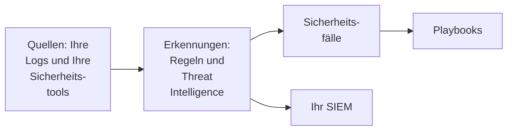

# Erste Schritte mit Sicherheit

OneUptime findet Bedrohungen in Daten, die Sie bereits haben - Ihren Logs, den Sicherheitstools, die Sie nutzen, und allem, was Sie senden -, fasst die Funde zu Fällen zusammen und reagiert mit Playbooks. Zwei Klicks richten alles ein, und es gibt nichts zu installieren.

:::cards
- [Einrichten](#einrichten): Schalten Sie ein, was die meisten Teams brauchen, und sehen Sie zu, wie ein Testangriff einen Fall eröffnet.
- [So funktioniert es](#so-funktioniert-es): Quellen, Erkennungen, Fälle und Playbooks, und was jedes davon tut.
- [Ihre Logs](#sicherheitsereignisse-in-ihren-logs-finden): Die Sicherheitsereignisse, die schon in den Logs stecken, die Sie an OneUptime senden.
- [Ihr SIEM](#an-ihr-siem-senden-was-oneuptime-findet): Senden Sie, was OneUptime findet, an Google SecOps.
:::

## Bevor Sie beginnen

Zum Einrichten von Sicherheit braucht es die Rolle Project Owner, Project Admin oder Security Admin. Die Rollen Security Member und Security Viewer lesen, was gefunden wird; siehe [Rollen](/docs/permissions/reference#rollen).

## Einrichten

:::steps
### Einschalten, was die meisten Teams brauchen

Öffnen Sie **Produkte → Sicherheitsereignisse**. Klicken Sie auf **Übersicht** auf **Empfohlenes aktivieren**. Damit werden drei Dinge auf einmal eingeschaltet: **Sicherheitsereignisse in Ihren Protokollen finden**, die empfohlenen Erkennungsregeln und **Enrich New Cases**, ein Playbook, das jeden neuen Fall mit Threat Intelligence abgleicht und eine Checkliste zur Einordnung darin hinterlässt.

### Einen Testangriff senden

Klicken Sie auf **Testangriff senden**. Ein Dutzend fehlgeschlagener Anmeldungen von einer Dokumentationsadresse durchläuft die echte Verarbeitung: Sie werden gespeichert, die Brute-Force-Regel erkennt sie, und ein Fall wird eröffnet. Niemand wird alarmiert, und kein SIEM erhält sie.

### Den Fall öffnen

Klicken Sie auf **Fall öffnen**. So sieht ein echter Fund aus: die Ereignisse dahinter, die Adresse, um die es geht, und was **Enrich New Cases** herausgefunden hat. Schließen Sie ihn als Test, wenn Sie fertig sind.
:::

Von da an zeigt **Übersicht** zuerst unter **Erfordert Aufmerksamkeit**, was jemanden braucht: Ihre offenen Fälle, die Fälle, die niemand übernommen hat, und die Playbook-Schritte, die auf eine Genehmigung warten. Gibt es nichts davon, steht dort **Alles ruhig**.

## So funktioniert es

| Teil | Wo | Was er tut |
| --- | --- | --- |
| **Quellen** | **Verbindungen** | Ihre Logs, die Sicherheitsprodukte, die OneUptime abfragt, und alles, was Sie senden |
| **Erkennungen** | **Erkennungen** | Sigma-Regeln und Threat-Intelligence-Feeds, die in jedem Ereignis nach Bedrohungen suchen |
| **Sicherheitsfälle** | **Sicherheitsfälle** | Was gefunden wurde, gruppiert nach dem Benutzer, dem Host oder der Adresse, um die es geht |
| **Playbooks** | **Playbooks** | Schritte, die auf neuen Fällen laufen: anreichern, benachrichtigen, einen Vorfall eröffnen oder eindämmen |

Oben auf **Übersicht**, unter dem, was jemanden braucht, zeigt jeder Teil seine Zahlen: die Quellen und ihre Ereignisse der letzten 24 Stunden, die eingeschalteten Regeln, die offenen Fälle und die Playbooks, die reagieren. Ein Teil, der nicht eingerichtet ist, sagt das und öffnet die Seite, auf der Sie ihn einrichten.

## Sicherheitsereignisse in Ihren Logs finden

Die Karte **Ihre Protokolle** oben auf **Verbindungen** braucht keine Installation. Ist **Sicherheitsereignisse in Ihren Protokollen finden** eingeschaltet, liest OneUptime jede Minute die neuen Logs des Projekts und macht aus den Zeilen, die es erkennt, Sicherheitsereignisse:

| Logs | Was zum Sicherheitsereignis wird |
| --- | --- |
| SSH-Anmeldungen | Fehlgeschlagene und erfolgreiche SSH-Anmeldungen aus dem Auth-Log, Journal oder Syslog eines Servers |
| sudo | Befehle, die als anderer Benutzer laufen, falsche sudo-Passwörter und Personen, die sudo nicht verwenden dürfen |
| Kubernetes-Audit-Logs | Änderungen am Cluster, in Pods geöffnete Shells, gelesene Secrets und abgelehnte Anfragen |
| AWS CloudTrail | Anmeldungen an der Konsole, Änderungen in Ihren AWS-Konten und Aufrufe, die AWS abgelehnt hat |
| Webangriffe | Anfragen im Zugriffslog eines Webservers, die SQL-Injection, Path Traversal oder Log4Shell versuchen |

Ihre Logs bleiben, wie sie sind. Nur die Zeilen, die für die Sicherheit zählen, werden zu Ereignissen: nie jede Seite, die ein Webserver ausgeliefert hat, oder jeder Lesezugriff auf eine API.

## An Ihr SIEM senden, was OneUptime findet

Arbeitet Ihr Team bereits in einem SIEM, sendet OneUptime seine Funde auch dorthin. Klicken Sie unter **Verbindungen → An Ihr SIEM senden** auf **Ziel hinzufügen**, tragen Sie Region, Instanz und Dienstkontoschlüssel Ihrer Google-SecOps-Instanz ein und klicken Sie vor dem Speichern auf **Testereignis senden**. Siehe [Sicherheitsereignisse an Google SecOps senden](/docs/integrations/google-secops#sicherheitsereignisse-an-google-secops-senden).

## Fehlerbehebung

:::details Turn on recommended ist ausgegraut
Ihre Rolle darf keine Erkennungsregeln, Playbooks oder die Log-Quelle hinzufügen. Wenden Sie sich an einen Project Owner, einen Project Admin oder einen Security Admin, oder lassen Sie sich von ihnen die Rolle Security Admin geben.
:::

:::details Turn on recommended konnte nicht alles einschalten
Die Karte nennt alles, was sie nicht einschalten konnte, und warum: Ihre Rolle, Ihr Tarif oder ein Fehler bei OneUptime. Alles andere ist eingeschaltet. Beheben Sie, was sie nennt, und klicken Sie dann auf **Erneut versuchen**: Es wird nur eingeschaltet, was noch fehlt, und nichts wird doppelt hinzugefügt.
:::

:::details Der Testangriff hat keinen Fall eröffnet
Meist ist der Fall schon offen, bevor die Schaltfläche antwortet; holt die Regel noch auf, sagt sie das, und der Fall öffnet sich innerhalb einer Minute. Sehen Sie noch einmal unter **Sicherheitsfälle** nach, und prüfen Sie unter **Erkennungen**, ob die Brute-Force-Regel eingeschaltet ist.
:::

:::details Aus meinen Logs kommt kein Sicherheitsereignis
Prüfen Sie, ob **Sicherheitsereignisse in Ihren Protokollen finden** eingeschaltet ist und die Karte **Ihre Protokolle** anzeigt, wann zuletzt geprüft wurde. Nur die Arten von Zeilen aus der Tabelle oben werden zu Ereignissen: Ein Server, der keine SSH-, sudo-, Audit-, CloudTrail- oder Zugriffslogs sendet, hat nichts zu finden.
:::

:::details Übersicht sagt, das letzte Sicherheitsereignis kam vor Tagen
Seitdem hat Security nichts erreicht. Öffnen Sie **Verbindungen** und prüfen Sie, ob **Ihre Protokolle** und jede Verbindung noch eingeschaltet sind und wann jede zuletzt geprüft hat.
:::

:::details Die Karte, die Security einschaltet, ist weg
Jemand hat sie mit **Ausblenden** weggelegt. Solange noch nichts auf Bedrohungen überwacht wird, bietet **Übersicht** **Security einrichten** an, womit sie zurückkommt.
:::

## Nächste Schritte

:::cards
- [Sicherheitsereignisse (SIEM)](/docs/telemetry/security-events): Ereignisse senden, durchsuchen und Erkennungsregeln schreiben.
- [Sicherheitsfälle und Playbooks (SOAR)](/docs/telemetry/security-cases): Die Fälle bearbeiten und mit Playbooks reagieren.
- [Threat Intelligence (STIX/TAXII)](/docs/telemetry/threat-intelligence): Ihre Ereignisse mit bekannten bösartigen Indikatoren abgleichen.
- [Google SecOps](/docs/integrations/google-secops): Erkennungen aus Google SecOps importieren und die Funde von OneUptime dorthin senden.
:::
