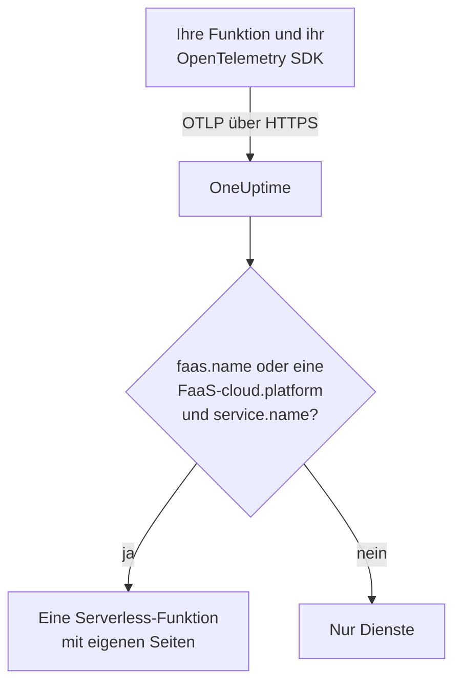

# Serverless-Funktionen

OneUptime erkennt eine Serverless-Funktion in dem Moment, in dem es OpenTelemetry-Daten von ihr empfängt, und führt sie unter **Serverless-Funktionen** mit ihren Traces, Logs und Metriken auf. Das funktioniert für AWS Lambda, Google Cloud Functions, Azure Functions, Cloudflare Workers und jede andere FaaS-Laufzeit, die OpenTelemetry senden kann. Von Hand ist nichts anzulegen: Instrumentieren Sie die Funktion mit dem OpenTelemetry SDK für ihre Laufzeit und richten Sie ihren OTLP-Exporter auf OneUptime.

:::cards
- [Wie OneUptime eine Funktion erkennt](#wie-oneuptime-eine-funktion-erkennt): `faas.name` oder eine FaaS-`cloud.platform` mit einem `service.name`.
- [Telemetrie einer Funktion senden](#telemetrie-einer-funktion-senden): Die Exporter-Einstellungen und der Lambda-Layer.
- [Azure Functions](#azure-functions): Eine Funktion pro Function App, vom Functions-Host.
- [Fehlerbehebung](#fehlerbehebung): Eine Funktion, die nicht erscheint oder deren Seiten leer sind.
:::

## So funktioniert es

OneUptime liest die Ressourcenattribute jedes Batches, sobald er eintrifft. Eine Ressource mit einem `faas.name` oder mit einer FaaS-`cloud.platform` wie `aws_lambda` oder `azure_functions` zusammen mit einem `service.name` ist eine Serverless-Funktion: OneUptime legt sie mit ihren ersten Daten an und ordnet ihr die Telemetrie zu.



## Bevor Sie beginnen

- Ein Ingestion-Schlüssel. Legen Sie ihn unter **Projekteinstellungen → Telemetrie & APM → Ingestion-Schlüssel** an und kopieren Sie seinen Wert.
- Das OpenTelemetry SDK oder eine Auto-Instrumentierungsschicht für die Sprache Ihrer Funktion.

## Wie OneUptime eine Funktion erkennt

OneUptime schlüsselt jede Funktion nach dem Ressourcenattribut `faas.name`. Die Ressourcendetektoren mancher Plattformen setzen es nie ([Azure Functions](#azure-functions) ist der übliche Fall). Hat eine Ressource also kein `faas.name`, ist ihre `cloud.platform` aber eine FaaS-Plattform, verwendet OneUptime stattdessen ihren `service.name` als Identität der Funktion und trägt diesen Wert als `faas.name` in jeden Span, jedes Log, jede Metrik und jedes Profil ein, das es speichert, damit die Seiten der Funktion ihre gesamte Telemetrie finden:

| Attribut | Erforderlich | Zweck |
| --- | --- | --- |
| `faas.name` | **ja**, sofern die nächsten beiden nicht gesetzt sind | Identität der Funktion (z. B. `checkout-handler`) |
| `cloud.platform` | mit `service.name`, wenn es kein `faas.name` gibt | `aws_lambda`, `gcp_cloud_functions`, `azure_functions`, `tencent_cloud_scf` oder `alibaba_cloud_fc` |
| `service.name` | auf einer FaaS-`cloud.platform` ohne `faas.name` | Identität der Funktion, als `faas.name` in die Telemetrie geschrieben |
| `faas.version` | nein | Wird in der Übersicht angezeigt |
| `faas.instance` | nein | Pro Instanz auf der Seite **Instanzen** erfasst |
| `cloud.provider` / `cloud.region` / `cloud.account.id` | nein | Wird in der Übersicht angezeigt |
| `process.runtime.name` / `process.runtime.version` | nein | Wird in der Übersicht als Laufzeit angezeigt |

Ein von Ihnen gesetzter `faas.name` wird nie ersetzt. Der Wert von `cloud.platform` muss wie aufgeführt geschrieben sein (das gepunktete `azure.functions`, das manche Azure-Detektoren senden, wird ebenfalls akzeptiert), und `service.name` muss ein Ressourcenattribut sein: Der Header `x-oneuptime-service-name` benennt einen Dienst, keine Funktion.

> [!NOTE]
> Eine Funktion, die auch `service.name` setzt, erscheint weiterhin auch unter **Dienste**. **Serverless-Funktionen** ist die für Funktionen gebaute Ansicht, eingegrenzt nach `faas.name`.

## Telemetrie einer Funktion senden

:::steps
### Die Umgebungsvariablen des OTLP-Exporters setzen

Die meisten Auto-Instrumentierungen der Sprachen lesen die Standard-Umgebungsvariablen von OpenTelemetry:

```bash
OTEL_EXPORTER_OTLP_ENDPOINT="https://oneuptime.com/otlp"
OTEL_EXPORTER_OTLP_HEADERS="x-oneuptime-token=YOUR_TELEMETRY_INGESTION_TOKEN"
OTEL_RESOURCE_ATTRIBUTES="faas.name=checkout-handler,faas.version=1.4.2"
```

Wenn Sie OneUptime selbst hosten, ersetzen Sie den Endpunkt durch `https://YOUR-ONEUPTIME-HOST/otlp`. Lassen Sie bei Azure Functions `faas.name` aus `OTEL_RESOURCE_ATTRIBUTES` weg – siehe [Azure Functions](#azure-functions).

> [!WARNING]
> Der Ingestion-Schlüssel ist ein Geheimnis. Verwenden Sie einen Ingestion-Schlüssel vom Typ **Server**, gesetzt als Umgebungsvariable der Funktion. Ein Schlüssel, der einen Browser erreicht, kann von jedem gelesen werden, der sich den Quelltext der Seite ansieht.

### Den OpenTelemetry-Lambda-Layer hinzufügen (AWS Lambda)

Bei AWS Lambda ist der [OpenTelemetry-Lambda-Layer](https://opentelemetry.io/docs/faas/lambda-auto/) der einfachste Weg. Hängen Sie den Layer für die Laufzeit Ihrer Funktion an und setzen Sie:

```bash
AWS_LAMBDA_EXEC_WRAPPER=/opt/otel-handler
OTEL_EXPORTER_OTLP_ENDPOINT=https://oneuptime.com/otlp
OTEL_EXPORTER_OTLP_HEADERS=x-oneuptime-token=YOUR_TELEMETRY_INGESTION_TOKEN
```

Der Layer setzt `faas.name` aus dem Namen der Funktion, und sein Ressourcendetektor füllt `cloud.platform`, `cloud.region` und `cloud.account.id` aus. Auf einer anderen Plattform überspringen Sie diesen Schritt.

### Die Funktion aufrufen und prüfen, ob sie ankommt

Prüfen Sie, ob OneUptime den Schlüssel annimmt:

```bash
curl -i https://oneuptime.com/otlp/v1/validate \
  -H "x-oneuptime-token: YOUR_TELEMETRY_INGESTION_TOKEN"
```

`200` mit `"valid": true` bedeutet, dass OneUptime den Schlüssel annimmt; `401` bedeutet, dass er unbekannt, widerrufen, deaktiviert oder abgelaufen ist. Rufen Sie dann die Funktion auf. Sobald sie einen Span, ein Log oder eine Metrik sendet, erscheint sie unter **Produkte → Infrastruktur → Serverlos → Alle Funktionen**.
:::

## Azure Functions

Der Azure-Functions-Host kann selbst OpenTelemetry senden, sodass eine Function App ihre Aufrufe (Traces, Logs und Metriken) ohne Codeänderungen meldet, in welcher Sprache sie auch geschrieben ist. Der Leitfaden von Microsoft ist [Use OpenTelemetry with Azure Functions](https://learn.microsoft.com/en-us/azure/azure-functions/opentelemetry-howto).

### Wie eine Function App erscheint

Die Ressourcendetektoren von Azure (der eigene des Functions-Hosts, der des isolierten .NET-Workers in `Microsoft.Azure.Functions.Worker.OpenTelemetry` und der für Node.js in `@opentelemetry/resource-detector-azure`) beschreiben die **Function App**, nicht eine einzelne Funktion, und keiner von ihnen setzt `faas.name`:

| Attribut | Wert |
| --- | --- |
| `service.name` | Der Name der Function App, aus `WEBSITE_SITE_NAME` |
| `cloud.provider` | `azure` |
| `cloud.platform` | `azure_functions`; der Node.js-Detektor schreibt `azure.functions`, was OneUptime umschreibt |
| `cloud.region` | Die Region der App, aus `REGION_NAME` |
| `cloud.resource_id` | `/subscriptions/<subscription>/resourceGroups/<group>/providers/Microsoft.Web/sites/<app>` |
| `faas.instance` | Die Instanz, aus `WEBSITE_INSTANCE_ID`: nur der Node.js-Detektor |

Also schlüsselt OneUptime die Funktion nach `service.name`, trägt den Namen der Function App als `faas.name` ein und zeigt **eine Serverless-Funktion pro Function App**. Die Ressource beschreibt die App, nicht eine ihrer Funktionen: Jede Instanz meldet dieselben Attribute auf App-Ebene, welche Funktion der App sie auch ausführt, und im Flex-Consumption-Plan skalieren manche Funktionen sogar auf eigenen Instanzen. Die einzelnen Funktionen stecken in der Telemetrie selbst:

- Der Host startet für jeden Aufruf einen Span, benannt nach der Funktion, die er ausgeführt hat: Durchsuchen Sie die Seite **Traces** der Funktion nach diesem Namen.
- Der Host zeichnet `faas.invoke_duration` auf, ein Histogramm in Sekunden, mit dem Namen der Funktion im Datenpunktattribut `faas.name`: Gruppieren Sie die Metrik auf der Seite **Metriken** oder in einem Dashboard danach, um die Latenz jeder Funktion zu sehen.

Fügen Sie `faas.name` bei einer Function App nicht zu `OTEL_RESOURCE_ATTRIBUTES` hinzu, wie es das allgemeine Beispiel im [ersten Schritt](#die-umgebungsvariablen-des-otlp-exporters-setzen) tut. Anwendungseinstellungen erreichen jeden Prozess der App, sodass die Telemetrie all ihrer Funktionen diesen einen Namen trüge, und OneUptime ersetzt nie einen `faas.name`, den es bekommt. Der Leitfaden von Microsoft sagt dasselbe: Legen Sie keine funktionsspezifischen Werte auf die Ressource. Lassen Sie ihn ungesetzt, dann wird die Funktion nach der App benannt.

Der Host und der isolierte .NET-Worker verwenden `OTEL_SERVICE_NAME` statt des App-Namens, wenn es gesetzt ist. Halten Sie jeden Prozess einer App auf demselben `service.name`: Der Host und der Sprach-Worker senden beide Telemetrie, und ein Worker, der einen zweiten Namen meldet, erzeugt eine zweite Serverless-Funktion. Ein Worker, dessen Ressource keine FaaS-`cloud.platform` hat, gehört zu gar keiner Serverless-Funktion – siehe [Ihren Funktionscode instrumentieren](#ihren-funktionscode-instrumentieren-optional).

:::steps
### OpenTelemetry im Functions-Host einschalten

Fügen Sie `"telemetryMode": "OpenTelemetry"` auf der obersten Ebene der `host.json` der App hinzu:

```json title="host.json"
{
  "version": "2.0",
  "telemetryMode": "OpenTelemetry"
}
```

Der Host sendet dann, unabhängig von der Sprache der App, seine eigenen Traces (einen Span pro Aufruf, dazu die Processor-Spans von Service Bus und Event Hubs hinter ausgelösten Funktionen), seine Logs und Metriken einschließlich `faas.invoke_duration`.

### Den Host auf OneUptime richten

Setzen Sie den Exporter als Anwendungseinstellungen:

```bash
az functionapp config appsettings set \
  --name my-function-app \
  --resource-group my-rg \
  --settings \
    OTEL_EXPORTER_OTLP_ENDPOINT=https://oneuptime.com/otlp \
    OTEL_EXPORTER_OTLP_PROTOCOL=http/protobuf \
    "OTEL_EXPORTER_OTLP_HEADERS=x-oneuptime-token=YOUR_TELEMETRY_INGESTION_TOKEN"
```

Wenn Sie OneUptime selbst hosten, ersetzen Sie den Endpunkt durch `https://YOUR-ONEUPTIME-HOST/otlp`. `OTEL_EXPORTER_OTLP_PROTOCOL=http/protobuf` ist wichtig: Der .NET-Exporter des Hosts verwendet standardmäßig gRPC, und mit `http/protobuf` sendet er an `/otlp/v1/traces`, `/otlp/v1/metrics` und `/otlp/v1/logs` unter dem Endpunkt. Der Host sendet OTLP nur, solange `OTEL_EXPORTER_OTLP_ENDPOINT` gesetzt ist.

> [!WARNING]
> Dieses Token ist ein Geheimnis: Verwenden Sie einen Ingestion-Schlüssel vom Typ **Server**. Anwendungseinstellungen werden im Ruhezustand verschlüsselt; um das Token stattdessen in Key Vault aufzubewahren, setzen Sie `OTEL_EXPORTER_OTLP_HEADERS` auf eine Key-Vault-Referenz wie `@Microsoft.KeyVault(SecretUri=https://my-vault.vault.azure.net/secrets/oneuptime-otlp-headers/)` und erteilen Sie der verwalteten Identität der App die Rolle **Key Vault Secrets User** für den Vault. Die Referenz wird zum Wert des Geheimnisses, wie er gespeichert ist; speichern Sie also den ganzen Header, `x-oneuptime-token=YOUR_TELEMETRY_INGESTION_TOKEN`, nicht nur das Token.

Behalten Sie `APPLICATIONINSIGHTS_CONNECTION_STRING`, wenn Sie Application Insights weiterhin nutzen möchten: Sind beide gesetzt, sendet der Host dieselben OpenTelemetry-Daten an Application Insights und an OneUptime. Entfernen Sie es, um nur an OneUptime zu senden.

### Ihren Funktionscode instrumentieren (optional)

Der Host verfolgt bereits jeden Aufruf. Um Spans und Logs aus Ihrem eigenen Code hinzuzufügen, verbunden mit denen des Hosts, schalten Sie OpenTelemetry auch im Sprach-Worker ein. Er sendet mit denselben `OTEL_EXPORTER_OTLP_*`-Einstellungen:

- **C# (isolated worker)**: Fügen Sie die NuGet-Pakete `Microsoft.Azure.Functions.Worker.OpenTelemetry`, `OpenTelemetry.Extensions.Hosting` und `OpenTelemetry.Exporter.OpenTelemetryProtocol` hinzu, dann in `Program.cs`: `builder.Services.AddOpenTelemetry().UseFunctionsWorkerDefaults().UseOtlpExporter();`
- **JavaScript / TypeScript**: `npm install @azure/functions-opentelemetry-instrumentation` neben dem OpenTelemetry Node.js SDK und seinen OTLP-Exportern, und registrieren Sie `AzureFunctionsInstrumentation` in einer Datei, die das Feld `main` von `package.json` einschließt.
- **Java**: Fügen Sie die Maven-Abhängigkeit `com.microsoft.azure.functions:azure-functions-java-opentelemetry` hinzu.
- **Python**: Setzen Sie die Anwendungseinstellung `PYTHON_ENABLE_OPENTELEMETRY=true`, fügen Sie die OpenTelemetry-Pakete, die Microsoft aufführt (darunter `opentelemetry-sdk` und `opentelemetry-exporter-otlp`), zu `requirements.txt` hinzu und konfigurieren Sie die Exporter in `function_app.py`.
- **PowerShell**: Setzen Sie die Anwendungseinstellung `OTEL_FUNCTIONS_WORKER_ENABLED=True` und laden Sie das Modul `AzureFunctions.PowerShell.OpenTelemetry.SDK` aus `profile.ps1`.

Der Leitfaden von Microsoft enthält den vollständigen Code für jede Sprache. Der .NET-Worker (über `UseFunctionsWorkerDefaults()`) und der Python-Worker (über `PYTHON_ENABLE_OPENTELEMETRY`) weisen den Host an, ihre Logs ihnen zu überlassen, sodass diese Logs nicht doppelt gesendet werden.

Die Spans und Logs eines Workers erreichen die Seiten der Funktion nur, wenn seine Ressource die App so beschreibt wie die des Hosts: derselbe `service.name` und eine FaaS-`cloud.platform`. Der isolierte .NET-Worker (über `UseFunctionsWorkerDefaults()`) und das Node.js-Beispiel von Microsoft (über die Azure-Detektoren, die `getResourceDetectors()` enthält) melden beides. Das Python-Beispiel von Microsoft baut seine Ressource ohne Azure-Detektor, meldet also von Haus aus keins von beiden, und seine Telemetrie erreicht die Funktion nie. Für Python oder jeden Worker, der ohne Azure-Functions-Ressourcendetektor eingerichtet ist, fügen Sie zwei weitere Anwendungseinstellungen hinzu. Jeder Prozess der App liest sie, der Host eingeschlossen, sodass alle dieselbe Identität melden:

```bash
az functionapp config appsettings set \
  --name my-function-app \
  --resource-group my-rg \
  --settings \
    OTEL_SERVICE_NAME=my-function-app \
    "OTEL_RESOURCE_ATTRIBUTES=cloud.provider=azure,cloud.platform=azure_functions"
```

Setzen Sie `OTEL_SERVICE_NAME` auf den eigenen Namen der Function App. Es ist der Name, den der Host und der Node.js-Detektor ohne diese Einstellung melden, sodass die Funktion die Identität behält, die sie bereits hat.
:::

### Einschränkungen

- **C#-In-Process-Apps** können OpenTelemetry nicht verwenden: Stellen Sie sie zuerst auf das Modell mit isoliertem Worker um.
- **Log-Streaming** im Azure-Portal funktioniert nicht, solange der Host im OpenTelemetry-Modus ist, und die Liste _Recent function invocations_ des Portals braucht die Telemetrie in Application Insights. Verwenden Sie stattdessen die Seiten **Protokolle** und **Traces** der Funktion in OneUptime.
- Der Abschnitt `logging.applicationInsights` von `host.json` gilt nicht mehr, sobald `telemetryMode` auf `OpenTelemetry` steht.
- **Instanzen** listet `faas.instance`-Werte auf. Von den Detektoren oben setzt nur der für Node.js ihn, daher bleibt die Seite für Telemetrie vom Host und vom .NET-Worker leer.

## Was Sie bekommen

Sobald die Funktion einen Span, ein Log oder eine Metrik sendet, erscheint sie unter **Serverless-Funktionen**. Ihre **Übersicht** zeigt:

- **Aufrufe**, **Fehlerrate** und **p95-Dauer**, berechnet aus Ihren Traces über einen von Ihnen gewählten Zeitraum, mit Trenddiagrammen.
- **Instanzen**: eine Live-Liste der `faas.instance`-Werte, die die Funktion meldet.
- Vollständige Seiten **Protokolle**, **Traces** und **Metriken**, auf diese Funktion eingegrenzt.

## Funktionen mit Labels versehen und Eigentümer zuweisen

Ein Ressourcenattribut, das mit `oneuptime.label.` beginnt, wird zu einem Projekt-Label an der Funktion: `oneuptime.label.team=payments` fügt das Label `team:payments` hinzu. Fügen Sie die Attribute zu `OTEL_RESOURCE_ATTRIBUTES` hinzu:

```bash
OTEL_RESOURCE_ATTRIBUTES="faas.name=checkout-handler,oneuptime.label.team=payments,oneuptime.label.env=production"
```

Um Funktionen stattdessen nach ihren Namen mit Labels zu versehen oder Eigentümer zuzuweisen, öffnen Sie **Produkte → Infrastruktur → Serverlos** und verwenden Sie **Beschriftungsregeln** und **Eigentümerregeln** im Seitenmenü. Regeln laufen, wenn eine Funktion angelegt wird, automatisch erkannte eingeschlossen. Um eine Regel auf die Funktionen anzuwenden, die Sie bereits haben, verwenden Sie ihr **Jetzt ausführen** (siehe [Regeln für bestehende Ressourcen ausführen](/docs/configuration/run-rules-now)).

## Fehlerbehebung

:::details Die Funktion erscheint nicht unter Serverless-Funktionen
Prüfen Sie der Reihe nach:

1. Die Funktion wurde aufgerufen, seit Sie die Variablen gesetzt haben: Sie sendet Telemetrie nur, während sie läuft.
2. Bei AWS Lambda ist der Layer für die Laufzeit der Funktion angehängt, und `AWS_LAMBDA_EXEC_WRAPPER` ist `/opt/otel-handler`: Ohne den Wrapper startet die Instrumentierung des Layers nie.
3. Anderswo lädt der Code der Funktion das OpenTelemetry SDK oder die Auto-Instrumentierung: Die Variablen allein senden nichts.
4. Die Ressource trägt `faas.name` oder eine FaaS-`cloud.platform` und einen `service.name`. Ohne sie wird die Telemetrie stattdessen unter **Dienste** abgelegt, als Dienst.
5. Die Funktion erreicht Ihre OneUptime-URL. Eine Funktion in einem privaten Netzwerk braucht einen Weg nach draußen dorthin, etwa ein NAT-Gateway.
:::

:::details Die Funktion ist aufgeführt, aber ihre Seiten sind leer
**Übersicht**, **Protokolle**, **Traces** und **Metriken** der Funktion zeigen Telemetrie, deren `faas.name` genau dem Namen der Funktion entspricht, einschließlich Groß- und Kleinschreibung. Eine Funktion, die über eine FaaS-`cloud.platform` und ihren `service.name` benannt ist, braucht keinen eigenen `faas.name`: OneUptime schreibt den `service.name` beim Eintreffen als `faas.name` in die Telemetrie. Telemetrie, die gespeichert wurde, bevor OneUptime begann, `faas.name` einzutragen, wird nicht aktualisiert und bleibt den Seiten fern: Rufen Sie die Funktion auf, um neue Telemetrie zu senden. Prüfen Sie auch den Zeitraum oben auf der Seite.
:::

:::details Die Funktion wird als getrennt angezeigt
Eine Funktion wird als getrennt angezeigt, wenn OneUptime 15 Minuten lang nichts von ihr empfangen hat; OneUptime prüft alle 5 Minuten, und Zeit, in der es selbst keine Daten empfing, zählt nicht. Eine Funktion, die nur hin und wieder läuft, ist zwischen den Läufen getrennt: Mit ihrer nächsten Telemetrie wird sie wieder als verbunden angezeigt.
:::

## Nächste Schritte

:::cards
- [OpenTelemetry](/docs/telemetry/open-telemetry): Traces, Logs und Metriken aus jeder Anwendung senden.
- [Warteschlangen](/docs/telemetry/queues): Die Warteschlangen und Topics, in die Ihre Funktionen veröffentlichen und aus denen sie konsumieren.
- [Traces-Überwachung](/docs/monitor/traces-monitor): Bei fehlgeschlagenen oder langsamen Aufrufen einer Funktion alarmieren.
:::
