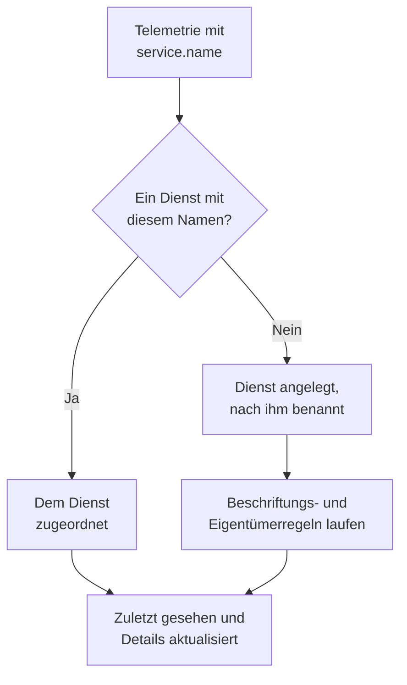

# Dienstkatalog

Der Dienstkatalog listet die Anwendungen und Microservices, die Sie betreiben. OneUptime legt einen Dienst an, sobald seine Telemetrie zum ersten Mal eintrifft, und führt dann seine Protokolle, Traces, Metriken, Ausnahmen, Vorfälle und Eigentümer auf einer Seite zusammen, sodass jeder sieht, was ein Dienst tut, wem er gehört und wie es ihm geht.

:::cards
- [Wie ein Dienst in den Katalog kommt](#wie-ein-dienst-in-den-katalog-kommt): Sein `service.name`, bei seiner ersten Telemetrie.
- [Einen Dienst finden](#einen-dienst-finden): Die Liste, ihre Filter und ihre Spalten.
- [Die Seiten eines Dienstes](#die-seiten-eines-dienstes): Alles über einen Dienst.
- [Einen Dienst archivieren oder löschen](#einen-dienst-archivieren-oder-löschen): Den Verlauf behalten oder ihn entfernen.
:::

## Wie ein Dienst in den Katalog kommt

Sie müssen keine Dienste anlegen. Jeder Telemetrie-Batch nennt den Dienst, der ihn gesendet hat, in seinem Ressourcenattribut `service.name`. OneUptime ordnet den Batch dem Dienst mit diesem Namen zu und legt den Dienst an, wenn das Projekt noch keinen hat.

- **Der Name ist die Identität des Dienstes.** Groß- und Kleinschreibung spielen beim Vergleich keine Rolle, `Checkout-API` und `checkout-api` sind also ein Dienst. Ein neuer `service.name` beginnt einen neuen Dienst.
- **Container benennen sich selbst.** Telemetrie der Docker- und Podman-Agenten benennt einen Dienst nach seinem Container, wenn sie keinen `service.name` hat.
- **Ein Ingestion-Schlüssel kann den Dienst festlegen.** OpenTelemetry-Daten, die mit einem Schlüssel gesendet werden, dessen **Festgelegter Dienstname** gesetzt ist, landen unter diesem Namen, egal was ihr `service.name` sagt. Siehe [Ingestion-Schlüssel](/docs/telemetry/ingestion-keys#einen-browser-schlüssel-absichern).
- **Browser und Telefone sind keine Dienste.** Telemetrie aus einem Browser oder einer mobilen App gehört stattdessen zu einer [RUM-Anwendung](/docs/rum/applications).
- **Beschriftungen können mit der Telemetrie kommen.** Ein Ressourcenattribut namens `oneuptime.label.<name>` gibt dem Dienst die Beschriftung `<name>:<value>`, etwa `oneuptime.label.team=payments` für `team:payments`.

Jedes Mal, wenn Telemetrie eintrifft, rückt **Zuletzt gesehen** des Dienstes vor, und seine Details werden aus den mitgelieferten Ressourcenattributen aufgefrischt:

| Detail | Aus dem Attribut |
| --- | --- |
| Dienstversion | `service.version` |
| Bereitstellungsumgebung | `deployment.environment.name` oder `deployment.environment` |
| Dienst-Namespace | `service.namespace` |
| Laufzeit | `process.runtime.name` und `process.runtime.version` |
| Technologie | `telemetry.sdk.language` oder die Laufzeit |
| Cloud | `cloud.provider`, `cloud.platform`, `cloud.region` und `cloud.account.id` |

## Bevor Sie beginnen

- **Eintreffende Telemetrie** mit einem `service.name`. Siehe [OpenTelemetry](/docs/telemetry/open-telemetry): `OTEL_SERVICE_NAME` setzt ihn.
- **Eine Rolle, die Dienste lesen darf.** Project Owner, Project Admin, Project Member, Viewer, Settings Admin, Settings Member oder Settings Viewer, oder eine eigene Rolle mit der Berechtigung Read Service. Dienste anlegen, ändern und löschen dürfen Project Owner, Project Admin, Project Member, Settings Admin oder Settings Member, oder Rollen mit den passenden Dienst-Berechtigungen.

## Einen Dienst finden

Öffnen Sie **Produkte → Ressourcen → Dienste**. **Alle Dienste** listet jeden Dienst mit **Name**, **Beschreibung**, **Technologie**, **Zuletzt gesehen**, **Beschriftungen** und **Eigentümer**.

- Suchen Sie nach Name oder Beschreibung, und filtern Sie über die Leiste über der Liste nach Eigentümer oder Beschriftung.
- Wählen Sie mehrere Dienste aus, um allen auf einmal Beschriftungen oder Eigentümer zu geben oder sie zu archivieren.
- Klicken Sie auf einen Dienst, um seine Seiten zu öffnen.

Um einen Dienst anzulegen, bevor seine Telemetrie eintrifft, etwa um zuerst seine Eigentümer festzulegen, klicken Sie auf **Dienst erstellen** und geben seinen **Name** genau so ein, wie sein `service.name` lauten wird. Beschriftungs- und Eigentümerregeln laufen auf ihm wie auf einem entdeckten Dienst. Sobald er gespeichert ist, öffnet sich die OpenTelemetry-Einrichtungsanleitung mit diesem Namen in jedem Snippet, und ihr letzter Schritt, **Auf die Verbindung warten**, meldet, wann die ersten Daten des Dienstes eintreffen.

## Die Seiten eines Dienstes

Das Seitenmenü eines Dienstes hat fünf Abschnitte:

| Abschnitt | Seiten |
| --- | --- |
| **Grundlegend** | **Übersicht**: Anfragen, Fehlerrate und p95-Latenz aus seinen Spans, Diagramme und seine Details. **Empfehlungen**: fertige Monitore für den Dienst, passend zu seiner Sprache. **Eigentümer**: die Personen und Teams, die für ihn verantwortlich sind. **Feed**: alles, was ihm passiert ist, von seiner Entstehung bis zu jeder Änderung seitdem. |
| **Telemetrie** | Seine **Protokolle**, **Traces**, **Metriken**, **Leistungsprofile**, **Ausnahmen** und **Source Maps**, bereits auf diesen Dienst gefiltert. |
| **Aktivität** | Die **Vorfälle**, **Warnungen** und Ereignisse der **Geplante Wartung**, die ihn betreffen. |
| **Entwickler** | **Terraform**, **API** und **KI-Assistenten**: der Dienst, aus Code verwaltet. Der Abschnitt ist zunächst eingeklappt. |
| **Erweitert** | **Einstellungen**, **Audit-Protokolle** und **Dienst löschen**. **Erweitert** ist anfangs eingeklappt: Klappen Sie es zuerst auf. |

Eigentümer zählen auch über die Seite hinaus: Eine Rolle mit dem Bereich Owned liest die Telemetrie der Dienste, die Ihnen oder Ihren Teams gehören. Siehe [Telemetrie](/docs/permissions/index#telemetrie).

## Einen Dienst ändern

:::steps
### Seine Einstellungen öffnen

Öffnen Sie den Dienst, klappen Sie im Seitenmenü **Erweitert** auf und klicken Sie auf **Einstellungen**.

### Umbenennen oder beschreiben

Klicken Sie bei **Dienstdetails** auf **Details bearbeiten**, um **Name**, **Beschreibung** oder **Beschriftungen** zu ändern. Der Name muss weiterhin zum `service.name` passen, den seine Telemetrie meldet: Ändern Sie ihn auch in Ihrer OpenTelemetry-Einrichtung, sonst legt die nächste Telemetrie einen neuen Dienst an.

### Farbe und Technologie-Stack wählen

Klicken Sie bei **Diensteinstellungen** auf **Einstellungen bearbeiten**. Die **Dienstfarbe** kennzeichnet den Dienst in Diagrammen und Listen; ein neuer Dienst bekommt eine eigene. **Technologie-Stack** ist optional: Lassen Sie ihn leer, um die aus seiner Telemetrie erkannte Sprache zu zeigen.
:::

Dieselbe Seite enthält die Aufbewahrung des Dienstes, eingeklappt unter **Weitere Einstellungen**. Die Karten **Aufbewahrung von Telemetriedaten** und **Aufbewahrung nach Telemetrietyp** bewahren seine Telemetrie länger oder kürzer auf als die Standardaufbewahrung des Projekts. Sie gehören zur [Enterprise Edition](/docs/self-hosted/enterprise) und auf OneUptime Cloud zum Scale-Tarif; ohne sie zeigt die Seite, was sie hinzufügen, und der Dienst behält die Aufbewahrung des Projekts.

## Beschriftungen und Eigentümer automatisch setzen

Regeln geben neuen Diensten bei ihrer Anlage Beschriftungen und Eigentümer, entdeckte Dienste eingeschlossen. Sie finden sie unter **Dienste → Einstellungen → Eigentümerregeln** und **Dienste → Einstellungen → Beschriftungsregeln**; **Einstellungen** ist im Seitenmenü anfangs eingeklappt. Siehe [Beschriftungs- und Eigentümerregeln](/docs/configuration/label-and-owner-rules).

## Einen Dienst archivieren oder löschen

Archivieren Sie einen Dienst, den Sie nicht mehr beobachten, dessen Verlauf Sie aber behalten möchten. Ein archivierter Dienst ist in **Alle Dienste** ausgeblendet, sammelt aber weiter Telemetrie. Archivieren Sie ihn auf seiner Seite **Einstellungen** oder wählen Sie mehrere in der Liste aus. Um einen zurückzuholen, öffnen Sie **Dienste → Erweitert → Archiviert**.

> [!WARNING]
> Wenn Sie einen Dienst löschen, werden auch seine Source Maps sowie die für ihn festgelegten Metrik-Pipeline-Regeln und LLM-Kostenbudgets gelöscht. Empfängt OneUptime weiterhin seine Telemetrie, wird der Dienst wieder angelegt, ohne die Beschriftungen, Eigentümer und Einstellungen, die Sie ihm gegeben haben. Um ihn von der Liste zu nehmen und alles zu behalten, archivieren Sie ihn stattdessen.

## Fehlerbehebung

:::details Ein Dienst erscheint doppelt
Zwei Werte für `service.name` haben OneUptime erreicht, etwa aus zwei Versionen Ihrer Einrichtung oder nach einer Umbenennung nur auf einer Seite. Telemetrie wird über den Namen zugeordnet: Sorgen Sie dafür, dass jede Instanz denselben `service.name` meldet, und archivieren oder löschen Sie dann den Dienst, den Sie nicht mehr brauchen.
:::

:::details Mein Dienst ist nicht im Katalog
Prüfen Sie, ob seine Telemetrie einen `service.name` trägt. Telemetrie aus einem Browser oder einer mobilen App geht stattdessen an Real User Monitoring, und ein Host oder Cluster ohne Dienstnamen wird unter diesem Host oder Cluster abgelegt.
:::

:::details Zuletzt gesehen hinkt hinterher
**Zuletzt gesehen** wird etwa einmal pro Minute aktualisiert, nicht bei jedem Batch, und kann der laufenden Telemetrie daher um etwa eine Minute hinterherhinken.
:::

## Nächste Schritte

:::cards
- [Protokoll-Explorer](/docs/telemetry/logs-explorer): Die Protokolle eines Dienstes durchsuchen.
- [Trace-Explorer](/docs/telemetry/traces-explorer): Seinen Anfragen folgen.
- [Ausnahmenverfolgung](/docs/telemetry/exceptions): Die Fehler sichten, die er wirft.
- [Beschriftungs- und Eigentümerregeln](/docs/configuration/label-and-owner-rules): Neuen Diensten Beschriftungen und Eigentümer geben.
:::
