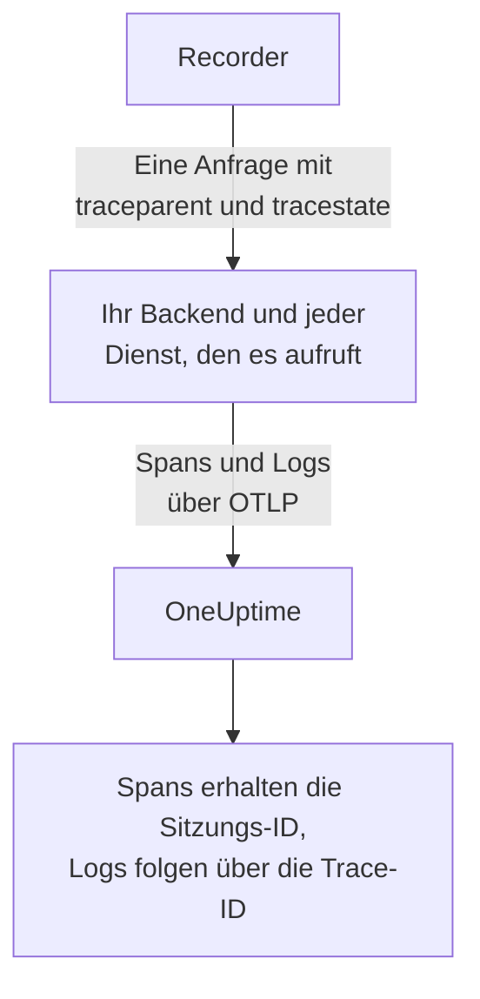
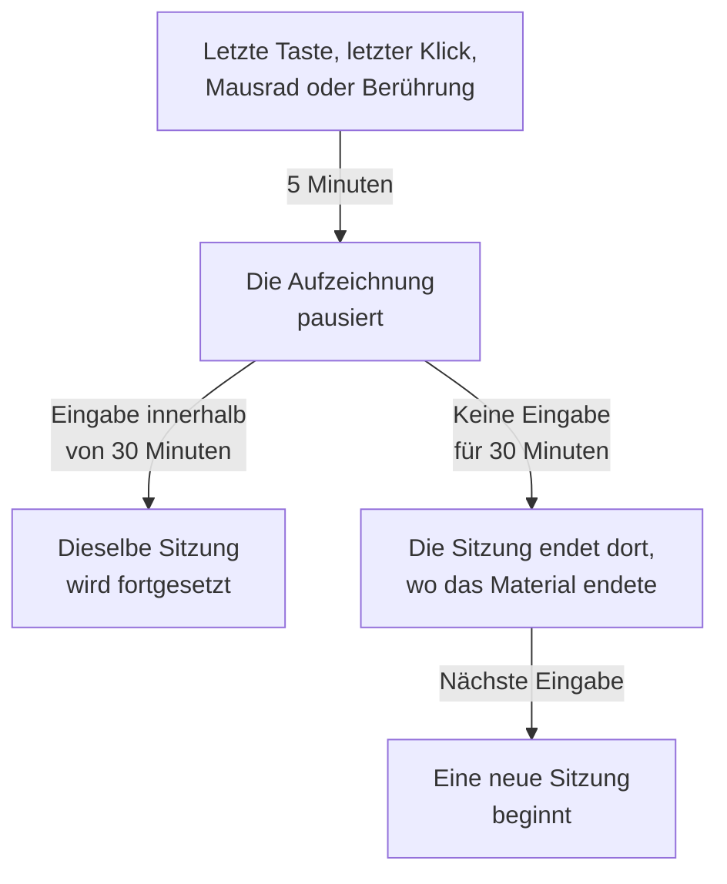

# Sitzungswiedergabe

Die Sitzungswiedergabe zeichnet auf, was echte Benutzer in Ihrer Web- oder React-Native-App gesehen haben, und spielt es neben den Fehlern, Traces und Logs derselben Sitzung ab. Sie fügen ein Script-Tag hinzu, legen fest, was maskiert wird, und sehen sich jede Sitzung in ihrer RUM-Anwendung an.

:::cards
- [So funktioniert es](#so-funktioniert-es): Ein Loader, eine Richtlinie und ein Recorder, der laufend hochlädt.
- [Installieren](#installieren): Ein Script-Tag auf jeder Seite oder das React-Native-SDK.
- [Datenschutz](#datenschutz): Was maskiert wird, die Einwilligung und wer Aufzeichnungen senden darf.
- [Mit Ihrer übrigen Telemetrie verknüpfen](#mit-ihrer-übrigen-telemetrie-verknüpfen): Backend-Traces, -Logs und -Fehler, verknüpft ohne Code.
- [Eine Sitzung ansehen](#eine-sitzung-ansehen): Die Sitzungsliste, die Benutzerseite, die Benutzerflüsse und der Player.
- [Aufzeichnungszustand](#aufzeichnungszustand): Warum nichts ankommt, und Alarme, bevor ein Budget aufgebraucht ist.
:::

## So funktioniert es

Das Skript auf Ihrer Seite ist ein kleiner Loader. Er prüft die Datenschutzsignale des Browsers, ruft die Richtlinie der Anwendung bei OneUptime ab und lädt erst dann den Recorder, der die Seite beim Aufzeichnen maskiert und sie in Chunks hochlädt, solange der Benutzer aktiv ist.

```mermaid title="Vom Seitenaufruf zu einer Aufzeichnung, die Sie ansehen können"
flowchart TB
    page["Ihre Seite lädt<br/>das Script-Tag"] --> dnt{"Do Not Track<br/>oder GPC-Signal?"}
    dnt -->|"Ja"| none["Nichts wird<br/>aufgezeichnet"]
    dnt -->|"Nein"| policy["Der Loader ruft<br/>die Richtlinie ab"]
    policy --> recorder["Der Recorder maskiert<br/>und zeichnet die Seite auf"]
    recorder -->|"Chunks, solange der<br/>Benutzer aktiv ist"| ingest["OneUptime"]
    ingest --> player["Sitzungsliste<br/>und Player"]
```

Standardmäßig wird jede Sitzung aufgezeichnet und laufend hochgeladen, nicht nur die fehlerhaften. In den Sitzungen, in denen nichts schiefging, finden Sie den Checkout, den niemand abgeschlossen hat, das Formular, das alle abgebrochen haben, und die Seite, die laut einem Kunden „falsch aussah“.

Um weniger zu speichern, wirken zwei Einstellungen der Richtlinie der Anwendung zusammen:

| Einstellung | Standard | Was sie ändert |
| --- | --- | --- |
| **Stichprobenanteil** | 100 | Wie viele Sitzungen überhaupt infrage kommen. Halbieren Sie ihn, halbieren Sie sowohl die gespeicherten Bytes als auch die gespeicherten Endbenutzerdaten. Die Entscheidung fällt einmal pro Sitzung anhand eines Hashs der Sitzungs-ID, daher wird eine Sitzung nie nur halb aufgezeichnet. |
| **Wann eine Aufzeichnung hochgeladen wird** | _Always_ | Auf _On error or frustration_ gesetzt, hält der Recorder einen rollierenden Puffer im Speicher und lädt nur hoch, wenn etwas schiefgeht. Dann gibt es für fast jede fehlgeschlagene Sitzung eine Aufzeichnung, bei etwa 15x geringeren Kosten als bei der Aufzeichnung aller Sitzungen, aber eine Sitzung ohne Fehler können Sie sich nicht ansehen. |

## Bevor Sie beginnen

- Eine RUM-Anwendung. Legen Sie eine unter **Produkte → Ressourcen → Real User Monitoring** an, oder lassen Sie sie von Ihrer Telemetrie anlegen: siehe [Anwendungen verwalten](/docs/rum/applications).
- Einen **Browser**-Ingestion-Schlüssel aus **Projekteinstellungen → Telemetrie & APM → Ingestion-Schlüssel**. Ein Browser-Schlüssel funktioniert nur von den Ursprüngen aus, die Sie darauf eintragen: siehe [Legen Sie Ihre zulässigen Ursprünge in Produktion fest](#legen-sie-ihre-zulässigen-ursprünge-in-produktion-fest).

Die Sitzungswiedergabe ist standardmäßig eingeschaltet. Ihre Einstellungen liegen an drei Stellen:

| Wo | Was dort ist |
| --- | --- |
| Die Seite **Wiedergaberichtlinie** der Anwendung | Die Richtlinie (Aufzeichnung, Maskierung, Einwilligung, Tracing und Limits), eine Übersicht **Aufzeichnungszustand**, die Karte **Was eine Aufzeichnung enthält**, das Panel **Ihre Installation testen** und **Die nächste Sitzung eines bestimmten Benutzers aufzeichnen**. |
| Die Seite **Integrität** der Anwendung | Ob Aufzeichnungen ankommen, und warum nicht, wenn sie es nicht tun. Siehe [Aufzeichnungszustand](#aufzeichnungszustand). |
| **Real User Monitoring → Einstellungen → Sitzungswiedergabe** | Der projektweite Schalter, der jede Anwendung auf einmal stoppt, und eine schreibgeschützte Liste der Richtlinien aller Anwendungen. |

## Installieren

Fügen Sie jeder Seite, die Sie aufzeichnen möchten, ein Script-Tag hinzu.

:::steps
### Einen Browser-Schlüssel erstellen

Klicken Sie unter **Projekteinstellungen → Telemetrie & APM → Ingestion-Schlüssel** auf **Aufnahmeschlüssel erstellen**, wählen Sie **Browser** als **Schlüsseltyp** und tragen Sie die Ursprünge Ihrer Site unter **Zulässige Ursprünge** ein. Kopieren Sie dann den Wert unter **Geheimer Schlüssel**. [Einrichtung für Browser](/docs/rum/browser-setup#einrichten) zeigt jeden Bildschirm.

### Das Script-Tag hinzufügen

Setzen Sie das Tag auf jede Seite, mit Ihrem Schlüssel und der Kennung Ihrer Anwendung:

```html
<script
  src="https://oneuptime.com/telemetry/session-replay/v1/recorder.js"
  data-oneuptime-token="YOUR_TELEMETRY_INGESTION_KEY"
  data-oneuptime-app-identifier="storefront-web"
  crossorigin="anonymous"
  async
></script>
```

`data-oneuptime-app-identifier` muss der Kennung der RUM-Anwendung entsprechen, demselben Wert, den Sie für `service.name` verwenden. Die Seite **Dokumentation** der Anwendung im Abschnitt **Sitzungswiedergabe** ihres Seitenmenüs zeigt dieses Snippet mit beiden Werten ausgefüllt, dazu Varianten für Next.js / React und Google Tag Manager.

### Prüfen, dass Aufzeichnungen ankommen

Öffnen Sie eine Ihrer Seiten und klicken Sie ein paar Sekunden lang herum. Nach etwa einer Minute steht die Sitzung auf der Seite **Sitzungswiedergabe** der Anwendung, markiert mit **Zeichnet jetzt auf**. Wenn nicht, sagt die Seite **Integrität** der Anwendung, warum: siehe [Aufzeichnungszustand](#aufzeichnungszustand).
:::

Das Skript unter `/v1/recorder.js` ist ein kleiner Loader. Er prüft Do Not Track, ruft die Richtlinie Ihrer Anwendung ab und lädt erst dann `/latest/recorder.js`. Richtlinie und Recorder werden beide mit `no-store` ausgeliefert, daher erreicht eine Änderung an einem von beiden den nächsten Seitenaufruf, ohne dass ein Browser-Cache ablaufen muss.

### Attribute des Script-Tags

| Attribut | Erforderlich | Was es bewirkt |
| --- | --- | --- |
| `data-oneuptime-token` | Ja | Ihr Telemetrie-Ingestion-Token. |
| `data-oneuptime-app-identifier` | Ja | Die Kennung der RUM-Anwendung. |
| `data-oneuptime-host` | Nein | Der OneUptime-Ursprung. Wird aus der eigenen `src` des Skripts abgeleitet, wenn er fehlt, daher brauchen Sie ihn nur, wenn Sie das Skript über Ihre eigene Domain ausliefern. |
| `data-oneuptime-user-ref` | Nein | Die beim Seitenaufruf bekannte Endbenutzer-Referenz (eine Benutzer-ID, nie eine E-Mail-Adresse, die nicht gespeichert werden soll). Dasselbe, was `identify()` später setzt; es ist die einzige Form, die für [Die nächste Sitzung eines bestimmten Benutzers aufzeichnen](#die-nächste-sitzung-eines-bestimmten-benutzers-aufzeichnen) funktioniert. |
| `data-oneuptime-respect-do-not-track` | Nein | Beachtet standardmäßig Do Not Track und Global Privacy Control. Setzen Sie es auf `"false"`, um unabhängig vom Signal aufzuzeichnen; siehe [Do Not Track](#do-not-track). |
| `data-oneuptime-debug` | Nein | `"true"` gibt die Entscheidungen des Recorders in der Konsole aus. Siehe [Fehlerbehebung bei der Sitzungswiedergabe](/docs/rum/session-replay-troubleshooting). |
| `data-oneuptime-offline-storage` | Nein | Setzen Sie es auf `"false"`, damit Chunks, die aufgezeichnet werden, während der Besucher offline ist, nur im Speicher bleiben statt zusätzlich in der IndexedDB des Browsers. Siehe [Offlinemodus](#offline-modus). |

Dieselben Optionen lassen sich statt im Tag in einem Global angeben, was Tag-Manager und gebündelte Installationen verwenden:

```js
window.__ONEUPTIME_SESSION_REPLAY__ = {
  host: "https://oneuptime.com",
  token: "YOUR_TELEMETRY_INGESTION_KEY",
  appIdentifier: "storefront-web",
  userRef: "user-123", // optional
  respectDoNotTrack: true, // optional
  debug: false, // optional
  offlineStorage: true, // optional; false keeps offline chunks in memory only
};
```

### So sieht eine gesunde Installation aus

Öffnen Sie DevTools → Network und filtern Sie nach `session-replay`. Eine funktionierende Seite stellt:

1. **Ein `GET .../session-replay/v1/config`** pro Seitenaufruf — den Abruf der Richtlinie.
2. **Ein `POST .../session-replay/v1/chunk` etwa alle 15 Sekunden, solange der Benutzer etwas tut**, oder früher, wenn sich 256 KB an Ereignissen angesammelt haben. Ein inaktiver Tab erzeugt keine Ereignisse und daher gar kein POST: Bewegen Sie die Maus oder klicken Sie, bevor Sie eine Installation anhand des Tabs „Netzwerk“ beurteilen.
3. Wenn der Tab ausgeblendet wird und noch einmal, wenn die Seite verlassen wird, ein `POST`, gesendet mit `keepalive`. Das Verlassen der Seite — der Tab wird geschlossen, neu geladen oder zu einer anderen Seite navigiert, oder die Seite kommt in den Back/Forward-Cache des Browsers (jedes `pagehide`) — markiert es als letztes, was OneUptime sagt, dass die Aufzeichnung dieses Tabs vorbei ist; eine Seite, die der Benutzer aus dem Back/Forward-Cache zurückholt, wird als neuer Tab derselben Sitzung weiter aufgezeichnet. Ein nur ausgeblendeter Tab bleibt offen, daher läuft die Aufzeichnung weiter, wenn der Benutzer zu ihm zurückkehrt. Sein gesamter Body bleibt unter 56 KB — dem Anteil des Recorders am keepalive-Kontingent des Browsers von 64 KB pro Ursprung — und er kann mehrere Chunks als Frames dieser einen Anfrage tragen: das abschließende Chunk, die Teile, in die ein großes abschließendes Chunk zerlegt wurde (höchstens 48 KB an Ereignissen je Teil, damit der Frame-Header noch passt), und jedes Chunk, das noch auf eine Wiederholung wartete. Ein Chunk, das schon größer als dieses Budget ist, wenn der Tab nur ausgeblendet wird, geht stattdessen auf dem normalen Weg hinaus, solange die Seite noch lebt, um es zu senden.

Mit dem Auslöser _On error or frustration_ findet Schritt 2 erst statt, wenn ein Auslöser feuert — siehe [Fehlerbehebung](#fehlerbehebung).

## In React Native installieren

Das React-Native-SDK zeichnet die native View-Hierarchie als rrweb-kompatible synthetische Ereignisse auf, sodass mobile Aufzeichnungen in derselben Sitzungsliste und demselben Player geöffnet werden wie Web-Aufzeichnungen. Es macht keine Screenshots. Der Player kennzeichnet jede Aufzeichnung als React-Native-App, und sein Tab **Wiedergabetreue** erklärt die nativen Oberflächen, die nicht dargestellt werden konnten.

:::steps
### Das SDK installieren

Das SDK unterstützt React-Native-Anwendungen für iOS und Android. Installieren Sie es mit seiner Peer-Abhängigkeit für den dauerhaften Postausgang:

```bash
npm install @oneuptime/react-native-replay @react-native-async-storage/async-storage
```

Führen Sie bei einem reinen iOS-Projekt nach dem Hinzufügen der Pakete Ihre übliche CocoaPods-Installation aus; aktuelle React-Native-Versionen verknüpfen Android automatisch, ohne manuelle Registrierung. Der Recorder hat zusätzlich zu Async Storage ein eigenes natives Modul für den View-Baum, daher müssen Expo-Projekte einen eigenen Entwicklungs- oder Produktions-Build verwenden (zum Beispiel EAS Build oder einen Prebuild). Expo Go kann dieses SDK nicht ausführen, weil keines der beiden nativen Module zur festen Expo-Go-Binärdatei hinzugefügt werden kann.

### Den Recorder starten und Ihre App umschließen

Starten Sie das Singleton einmal und setzen Sie dann den Provider über den Teil der App, den Sie aufzeichnen möchten:

```tsx
import {
  OneUptimeReplay,
  OneUptimeReplayProvider,
} from "@oneuptime/react-native-replay";

OneUptimeReplay.start({
  host: "https://oneuptime.com",
  token: "YOUR_TELEMETRY_INGESTION_KEY",
  appIdentifier: "storefront-mobile",
  mobileAppIdentifier: "com.example.storefront",
  appName: "Storefront", // optional, shown in session details
  appVersion: "4.2.0", // optional, shown in session details
});

export default function App() {
  return (
    <OneUptimeReplayProvider>
      <Navigation />
    </OneUptimeReplayProvider>
  );
}
```

`appIdentifier` ist die Kennung der RUM-Anwendung. `mobileAppIdentifier` ist die Android-Anwendungs-ID oder die iOS-Bundle-ID, die in der Binärdatei ausgeliefert wird, kein Anzeigename. Verwenden Sie denselben Wert in den [`app://`-Positivlisten](#legen-sie-ihre-zulässigen-ursprünge-in-produktion-fest). Das SDK ruft die Wiedergaberichtlinie der Anwendung von `host` ab; Sampling, Auslöser, Einwilligung, Aufbewahrung und Upload-Budgets bleiben serverseitig gesteuert.
:::

Der Provider besitzt eine nicht zusammenklappbare native Wurzel und zeichnet ihren View-Baum sowie Touch-Ereignisse für Beginn, Bewegung und Ende auf. Wenn Sie Recorder-Instanzen bereits selbst erzeugen, übergeben Sie eine mit `<OneUptimeReplayProvider recorder={recorder}>`. `MobileReplayRecorder` wird außerdem für isolierte oder Mehrmandanten-Integrationen exportiert; die meisten Apps sollten das Singleton verwenden.

### React-Native-API

Importieren Sie `OneUptimeReplay` direkt, oder rufen Sie unterhalb des Providers `useOneUptimeReplay()` auf. Das Singleton bietet:

| Methode | Was sie tut |
| --- | --- |
| `start(options)` | Ruft die Richtlinie ab und startet die Aufnahme. Erforderliche Optionen sind `host`, `token`, `appIdentifier` und `mobileAppIdentifier`; `appName` und `appVersion` sind optionale Anzeige-Metadaten, und `connectivity` ist eine optionale Quelle für den Netzwerkstatus im [Offlinemodus](#offline-modus). |
| `stop()` | Leert, was gesendet werden kann, stoppt die Aufnahme und löst die Lebenszyklus-Handler. |
| `identify(userRef, traits?)` | Hängt den angemeldeten Benutzer und optionale Merkmale an, abhängig von **Endbenutzeridentität erfassen**. |
| `setTags(tags)` / `addTag(key, value)` | Ersetzt alle durchsuchbaren Sitzungs-Tags oder fügt ein Tag hinzu, ohne die anderen zu ersetzen. |
| `track(name, properties?)` | Setzt ein Anwendungsereignis auf die Zeitleiste der Wiedergabe. |
| `setRoute(route)` | Hält nach einer Navigation einen bereinigten logischen Bildschirm oder eine Route fest. Rufen Sie es aus dem Routenwechsel-Callback Ihres Navigators auf. |
| `captureSession(reason?)` | Lädt unter _On error or frustration_ den rollierenden Puffer aus einem app-spezifischen Grund hoch, etwa wenn ein Benutzer auf „Problem melden“ tippt. |
| `captureError(error)` | Hält einen behandelten JavaScript-Fehler fest und aktiviert die fehlergesteuerte Aufnahme. |
| `grantConsent()` / `revokeConsent()` | Erlaubt Uploads, oder leert sofort den Puffer im Speicher, den gespeicherten Postausgang, die Sitzung und die Besucher-ID. Eine spätere Erlaubnis beginnt mit neuen Kennungen. |
| `getSessionId()` / `onSessionChange(listener)` | Liest die aktuelle Sitzungs-ID der Wiedergabe mit Einwilligung oder abonniert sie, für die Korrelation von Traces und Logs. Der Listener erhält auch `null`, wenn Aufnahme oder Einwilligung enden. |
| `getDiagnostics()` | Gibt den Zustand des Recorders und seine jüngsten Entscheidungen zurück, ohne aufgenommene View-Inhalte. |

Das SDK lauscht auf den React-Native-`AppState`: Beim Wechsel in den Hintergrund werden Ereignisse mit Einwilligung abgeschlossen und abgeschickt, während Material vor der Einwilligung nur im Speicher bleibt. Bevor die Aufnahme im Vordergrund fortgesetzt wird, aktualisiert das SDK die Richtlinie ohne zwischengespeicherte Antwort. Es aktualisiert die Richtlinie außerdem regelmäßig, solange es aktiv ist, damit Abschalten, Einwilligung, Sampling, Zielauswahl und Identitätsänderungen auch in einer lange laufenden App wirken. Rufen Sie `stop()` auf, wenn Ihre Integration endgültig abgebaut wird; für normale Bildschirmnavigation sollten Sie `setRoute()` verwenden, statt den Recorder zu stoppen und neu zu starten.

**Wenn eine mobile Sitzung im Leerlauf endet.** Fünf Minuten ohne Eingabe pausieren die Aufnahme bereits (siehe [Leerlaufzeit](#leerlaufzeit)). Dreißig Minuten ohne Berührung und ohne aufgezeichneten SDK-Aufruf (`track()`, `setTags()`, `identify()` und dergleichen, während die Aufnahme lief) beenden die Sitzung. Sie endet bei dieser letzten Aktivität, oder bei einer pausierten Sitzung bei der Pause, also dort, wo ihr Material endete — nicht, wenn die App zurückkommt oder der Recorder es bemerkt —, daher wird im Hintergrund oder pausiert verbrachte Zeit nie an das Ende einer Sitzung angehängt. Eine im Vordergrund offen gelassene App beginnt nicht jede halbe Stunde eine neue Sitzung. Die nächste Sitzung beginnt, wenn der Benutzer zurück ist: mit seiner ersten Berührung, dem Ein- oder Ausblenden der Bildschirmtastatur, der Rückkehr der App in den Vordergrund oder einem Aufruf von `captureSession()`. Sie beginnt mit einem frischen Snapshot des Bildschirms. Bis dahin gibt `getSessionId()` `null` zurück, und `onSessionChange()` wird mit `null` aufgerufen. Fehler, Navigation und `track()`-Aufrufe dazwischen werden nicht aufgezeichnet.

Um mobile Telemetrie mit einer Wiedergabe zu verknüpfen, abonnieren Sie `onSessionChange()` und setzen den gelieferten Wert als Attribut `session.id` in Ihrer OpenTelemetry-Instrumentierung. Ersetzen Sie dieses Attribut bei jedem Aufruf des Callbacks, auch indem Sie es leeren, wenn der Wert `null` ist. Das Wiedergabe-SDK patcht weder natives Networking noch verändert es selbst einen OpenTelemetry-Provider.

### Datenschutz und Maskierung in React Native

Die mobile Aufnahme ist bewusst strenger als die Maskierungsmodi im Web. Nativer UI-Text, Barrierefreiheitswerte, Eingabewerte und Bildpixel werden nie serialisiert; der Server erhält ein strukturelles Drahtgitter, auch wenn der Web-Maskierungsmodus der Anwendung lesbaren Text erlauben würde. Vom Aufrufer gelieferte Metadaten wie Benutzer-Referenzen, Ereignisnamen, Routen und durchsuchbare Tags folgen dem API-Vertrag, legen Sie also keine Geheimnisse in diese Felder. Umschließen Sie einen besonders sensiblen Teilbaum mit `<ReplayMask>`, um diesen Bereich durch einen Datenschutz-Platzhalter zu ersetzen und das umgebende Layout zu erhalten.

Die Einwilligung wird nicht aus einer Betriebssystemberechtigung oder Ihrem Einwilligungsbanner abgeleitet. Rufen Sie unter _Require explicit_ `grantConsent()` erst auf, wenn Ihre App die nötige Einwilligung hat. Ein Aufruf von `revokeConsent()` verwirft sowohl eingereihte als auch dauerhaft gespeicherte, noch nicht gesendete Daten sowie die Kennungen, die eine spätere Sitzung mit der widerrufenen verbinden könnten.

Der mobile Recorder erfasst Grenzen und Typen von Views, Touch-Positionen, logische Routen, eigene Ereignisse und JavaScript-Fehler. Diese Grenzen werden immer im Tab Wiedergabetreue des Players offengelegt:

- Native `Image`-Pixel sind undurchsichtig; nur der Rahmen wird dargestellt.
- `WebView`-Inhalte liegen außerhalb des React-Native-Baums. Installieren Sie den Web-Recorder in der eingebetteten Seite, wenn sie eine eigene Aufzeichnung braucht.
- Canvas, Skia, OpenGL, Karten, Kameravorschauen, Video und andere selbst gezeichnete Oberflächen sind undurchsichtig.
- Touch-Pfade innerhalb von `ReplayMask` oder einer undurchsichtigen Oberfläche werden nicht aufgezeichnet. Die native Brücke prüft das aktuelle Touch-Ziel und seine Vorfahren und unterdrückt die Geste, wenn diese Datenschutzprüfung nicht abgeschlossen werden kann.
- Reanimated-, native-driver- und UI-Thread-Animationen werden bei View-Baum-Snapshots abgetastet, nicht Bild für Bild wiedergegeben.
- Native Abstürze, die JavaScript beenden, bevor es leeren kann, brauchen ein natives Crash-SDK; `captureError()` deckt behandelte JavaScript-Fehler ab, keine Absturzabbilder auf Prozessebene.

## Ihre Benutzer identifizieren

Jede Sitzung ist anonym, bis Ihre Seite sagt, wem sie gehört. Ohne das kann die Liste die Sitzungen eines Browsers zwar unter einer anonymen Besucher-ID gruppieren (siehe [Anonyme Besucher](#anonyme-besucher) weiter unten), aber nichts nennt die Person oder verbindet ihren zweiten Browser mit dem ersten. Rufen Sie `identify()` auf, sobald Sie es wissen, oder reihen Sie den Aufruf ein, bevor das Skript geladen ist — in beiden Fällen wird er angewendet, bevor das erste Chunk hochgeladen wird, sodass die Sitzung ab ihrem Erscheinen nach Benutzer durchsuchbar ist:

```js
// After the script has loaded:
OneUptimeReplay.identify("user-123", { plan: "pro", tenant: "acme" });

// Or at any time, whether or not the script has loaded yet:
(window.OneUptimeReplayQueue = window.OneUptimeReplayQueue || []).push([
  "identify",
  "user-123",
  { plan: "pro", tenant: "acme" },
]);
```

- Die Referenz ist das, was die Sitzungsliste zeigt und worauf Suchen mit `user:` passen. Die Merkmale erscheinen in der Kopfzeile des Players und im Detailbereich der Sitzung.
- **Die Identität gehört zur Sitzung, nicht nur zur Seite.** Eine Sitzung umfasst jeden Seitenaufruf und jeden Tab des Besuchs, und sobald irgendeine ihrer Seiten `identify()` aufruft, gehört die ganze Sitzung diesem Benutzer — einschließlich der Seiten vor der Anmeldung, da sie zum selben Besuch gehören. Jede spätere Seite und jeder spätere Tab der Sitzung nennt den Benutzer ebenfalls, auch eine, die `identify()` selbst nie aufruft: die Zielseite der Weiterleitung nach der Anmeldung, ein in einem neuen Tab geöffneter Link. Solange **Endbenutzeridentität erfassen** eingeschaltet ist, merkt sich der Recorder in `localStorage` unter `oneuptime.replay.user`, wem die laufende Sitzung gehört — die Sitzungs-ID und die Referenz, sonst nichts, und unter der Einwilligung _Require explicit_ erst nach erteilter Einwilligung — und zwar nur für diese Sitzung: Die nächste Sitzung (nach 30 Minuten Inaktivität oder der 4-Stunden-Grenze) beginnt anonym, bis eine Seite sie identifiziert, es sei denn, die Seite, die sie begonnen hat, hatte den Benutzer selbst identifiziert. Rufen Sie `identify()` also bei jedem Seitenaufruf auf, bei dem Ihre App den Benutzer kennt, nicht nur direkt nach der Anmeldung.
- **Ein anderer Benutzer erhält eine eigene Sitzung.** Nennt `identify()` jemand anderen als den Benutzer, dem die Sitzung bereits gehört — eine Person hat sich abgemeldet und eine andere im selben Browser angemeldet, in diesem Tab oder einem anderen —, endet die laufende Sitzung, weiterhin dem ersten Benutzer zugeordnet, und für den zweiten beginnt eine neue. `onSessionChange`-Listener werden informiert, und der Player zeigt den Wechsel als Ende einer Aufzeichnung und Beginn der nächsten. Denselben Benutzer erneut zu identifizieren ändert nichts; Referenzen werden nach dem Entfernen von Leerraum verglichen und unterscheiden Groß- und Kleinschreibung, genau wie der Server sie abgleicht.
- Was `identify()` dem Recorder übergibt, wird nur dann mit der Aufzeichnung hochgeladen, solange **Endbenutzeridentität erfassen** für die Anwendung eingeschaltet ist (die Voreinstellung). Ist es aus, lässt der Recorder Referenz und Merkmale aus dem Chunk weg, und der Server speichert **gar nichts** über die Person — keine Referenz, keinen schlüsselbasierten Hash davon, keine Merkmale. Diese Sitzungen sind wirklich pseudonym, und der Preis dafür ist, dass sie sich nicht _pro Benutzer_ löschen lassen: Eine Löschanfrage hat nichts, worauf sie passen könnte, verwenden Sie also stattdessen `BySessionId`, `ByDateRange` oder `ByRumApplication` (siehe [Sitzungen löschen](#sitzungen-löschen)). Ist Ihnen das Erfüllen einer Löschanfrage pro Benutzer wichtiger, als keine Kennung zu speichern, lassen Sie den Schalter eingeschaltet — der gespeicherte Schlüssel ist ein schlüsselbasierter Einweg-Hash, also abgleichbar, aber nicht lesbar, und nur das separate Label trägt die Referenz selbst.
- Eine Referenz verlässt den Browser unabhängig von diesem Schalter, und zwar absichtlich: die, die Ihre Seite **beim Laden** über `data-oneuptime-user-ref` oder `userRef` im Init-Global liefert, reist als Anfrage-Header beim Abruf der Richtlinie jedes Seitenaufrufs mit, denn so gleicht [Die nächste Sitzung eines bestimmten Benutzers aufzeichnen](#die-nächste-sitzung-eines-bestimmten-benutzers-aufzeichnen) einen Besucher ab, bevor überhaupt ein Recorder existiert. Der Server vergleicht sie mit dem scharfgeschalteten Ziel und verwirft sie; sie wird nur dann in die Sitzung geschrieben, wenn die Identitätserfassung eingeschaltet ist und der Recorder sie erneut mit der Aufzeichnung sendet. Eine an `identify()` übergebene Referenz wird nie auf diesem Weg gesendet.
- Merkmale sind auf 20 Schlüssel, 40 Zeichen pro Schlüssel und 200 pro Wert begrenzt, werden in Strings umgewandelt und durchlaufen den Maskierungsmodus der Anwendung: Unter _Mask all text_ werden sie vor dem Upload maskiert.
- Die Identität im Dashboard zu lesen erfordert dieselbe Berechtigung wie das Ansehen der Aufzeichnung (siehe [Wer eine Aufzeichnung ansehen darf](#wer-eine-aufzeichnung-ansehen-kann)); andere Rollen sehen „Identity hidden“.

### Anonyme Besucher

Eine Seite, die `identify()` nie aufruft, braucht trotzdem gruppierbare Sitzungen, sonst kann Ihnen eine Liste mit vierzig Zeilen _Anonymous_ nicht sagen, ob eine Person denselben Fehler vierzigmal hatte oder vierzig Personen ihn einmal. Daher erzeugt der Recorder eine zufällige Besucher-ID pro Browserprofil und Ursprung — 32 kleingeschriebene Hex-Zeichen, abgelegt in `localStorage` unter `oneuptime.replay.visitor`, neben dem Sitzungseintrag, sodass eine Site, die unter zwei Hostnamen oder Ports läuft, als zwei Besucher erscheint und nur `identify()` sie verbindet — und sendet sie als `meta.visitorId` mit jedem Chunk, das Metadaten trägt: dem ersten Chunk, dem abschließenden Chunk und dem Chunk nach einem Aufruf von `identify()` oder `setTags()`. Der Server prüft die Form und speichert sie an der Sitzung, unter denselben Zugriffsregeln wie den Rest des Sitzungskopfs. Sie überdauert die Sitzungs-ID absichtlich: Der Wechsel nach 30 Minuten Inaktivität und die 4-Stunden-Grenze beginnen eine neue Sitzung, und die neue Sitzung trägt dieselbe Besucher-ID, sodass zwei Besuche aus demselben Browser im Abstand einer Woche auf der [Benutzerseite](#die-benutzerseite) und im Menü der anderen Sitzungen des Players beieinanderstehen (siehe [Der Player](#der-player)).

Seien Sie genau darin, was sie nicht ist:

- **Sie ist keine Identität.** Sie ist zufällig, wird im Browser erzeugt und aus nichts abgeleitet, was Ihre Seite liefert, und aus nichts über das Gerät. Zwei Browser auf einem Laptop, oder dieselbe Person auf einem Telefon und einem Desktop, sind zwei Besucher; nur `identify()` verbindet sie. Ein privates Fenster erhält eine neue ID, die mit dem Fenster verschwindet, und wo gar nicht gespeichert werden kann (privater Modus von Safari, blockierte Websitedaten), hält die ID einen Seitenaufruf lang.
- **Sie unterliegt nicht Endbenutzeridentität erfassen.** Dieser Schalter entscheidet, ob Referenz und Merkmale den Browser verlassen; die Besucher-ID wird so oder so gesendet, weil sie niemanden nennt. Soll gar keine ID erzeugt werden, ist die Antwort: kein Recorder. Schalten Sie die Sitzungswiedergabe für die Anwendung aus, oder lassen Sie [Do Not Track](#do-not-track) beachten.
- **Sie folgt den Einwilligungsregeln der Sitzungs-ID.** `revokeConsent()` entfernt sie zusammen mit der Sitzung aus dem Speicher, solange die Einwilligung widerrufen ist, wird nichts geschrieben, und ein späteres `grantConsent()` erzeugt eine neue — so wird ein Benutzer, der seine Einwilligung widerruft und zurückkommt, nicht mit den Sitzungen verbunden, die Sie vergessen sollten. Unter Do Not Track oder Global Privacy Control läuft kein Recorder, daher wird keine ID erzeugt.
- **Sie reist nie mit Ihren eigenen Anfragen.** Der Trace-Kontext, den der Recorder an Anfragen Ihrer Seite an ihren eigenen Ursprung anhängt, nennt die Sitzung, nie den Besucher (siehe [Was Ihre eigenen Anfragen tragen](#was-ihre-eigenen-anfragen-tragen)); die Besucher-ID geht nur an OneUptime, mit der Aufzeichnung.
- **Sie kann nicht Ziel einer Löschanfrage sein.** Die Anfragetypen sind unverändert (siehe [Sitzungen löschen](#sitzungen-löschen)); eine Suche mit `visitor:` beschränkt die Liste auf die Sitzungen eines Browsers, aus denen Sie die zu löschenden Sitzungs-IDs entnehmen.

`OneUptimeReplay.getVisitorId()` gibt die aktuelle ID zurück, oder einen leeren String, bevor der Recorder gestartet ist, nach `stop()` und zwischen einem `revokeConsent()` und dem nächsten `grantConsent()`. Recorder, die gebaut wurden, bevor es sie gab, sendeten keine, daher haben die von ihnen aufgezeichneten Sitzungen eine leere `visitorId`: Die Liste zeigt sie als _Anonymous_, und die Benutzerseite ordnet sie unter **Nicht verknüpfte Sitzungen** ein. Ein Recorder, der eine erzeugt, führt `visitor-id` unter seinen `capabilities` in `getDiagnostics()` und auf der Seite **Integrität**.

## JavaScript-API

Der Recorder veröffentlicht `window.OneUptimeReplay`. Weil er asynchron lädt, sollte alles, was Ihre Seite aufruft, bevor er da ist, stattdessen über die Befehlswarteschlange laufen — `window.OneUptimeReplayQueue` ist ein einfaches Array aus Einträgen `[command, ...arguments]`, das der Recorder in dem Moment abarbeitet, in dem er startet, und es nimmt jeden der unten stehenden Befehle über seinen Namen an:

```js
(window.OneUptimeReplayQueue = window.OneUptimeReplayQueue || []).push(
  ["grantConsent"],
  ["identify", "user-123", { plan: "pro" }],
  ["setTags", { build: "1.4.2" }],
  ["onSessionChange", (sessionId, tabId) => console.log(sessionId)],
);
```

`grantConsent`, `revokeConsent`, `stop`, `identify`, `setTags` und `addTag` werden angewendet, bevor der Recorder startet, daher entscheidet eine eingereihte Einwilligungsentscheidung, ob überhaupt etwas hochgeladen wird, und eine eingereihte Identität reist schon mit dem allerersten Chunk. `track`, `captureSession` und `onSessionChange` laufen direkt nach dem Start.

| Methode | Was sie tut |
| --- | --- |
| `identify(userRef, traits?)` | Hängt den Endbenutzer an die Sitzung — an jede Seite und jeden Tab davon, ab ihrem Beginn (siehe [Ihre Benutzer identifizieren](#ihre-benutzer-identifizieren)). `traits` ist ein Objekt mit String-, Zahlen- oder Boolean-Werten (≤ 20 Schlüssel, Schlüssel ≤ 40 Zeichen, Wert ≤ 200 Zeichen), unter _Mask all text_ maskiert und nur hochgeladen, wenn **Endbenutzeridentität erfassen** eingeschaltet ist. Ein erneuter Aufruf für denselben Benutzer sendet die Identität (und neue Merkmale) mit dem nächsten Chunk erneut; nennt er einen anderen Benutzer, endet die Sitzung, und für diesen beginnt eine neue. |
| `track(name, properties?)` | Hält ein Geschäftsereignis (`"checkout_failed"`) auf der Zeitleiste fest. `name` ≤ 64 Zeichen, ≤ 20 Eigenschaftsschlüssel mit denselben Wertgrenzen wie bei Merkmalen. Bis zu 50 pro 15-Sekunden-Chunk; darüber hinaus trägt das Chunk eine Markierung „events dropped“ mit der Anzahl. |
| `setTags(tags)` / `addTag(key, value)` | Tags pro Sitzung (`{ build: "1.4.2", experiment: "new-checkout" }`), ≤ 20 Tags, Schlüssel ≤ 32 Zeichen, Wert ≤ 128. In der Sitzungsliste mit `tag:key=value` durchsuchbar und in den Details der Sitzung angezeigt. `setTags` **ersetzt** die ganze Map, daher entfernt ein zweites `setTags({ experiment })` ein vom ersten gesetztes Tag `build`; `addTag` setzt einen Schlüssel und behält den Rest. Bauen Sie die Map in einem einzigen Aufruf von `setTags` auf, oder verwenden Sie `addTag`, sobald Sie jeden Wert kennen. |
| `captureSession(reason?)` | Erzwingt unter _On error or frustration_ das Hochladen dieser Sitzung ab ihrem rollierenden Puffer; unter _Always_ bewirkt es für das Hochladen nichts, aber der `reason` (≤ 80 Zeichen) wird trotzdem auf der Zeitleiste markiert. Verwenden Sie es von Ihrer eigenen Schaltfläche „Problem melden“ aus. |
| `onSessionChange(listener)` | `listener(sessionId, tabId)` wird sofort aufgerufen, wenn eine Sitzung existiert, und erneut, wann immer sich die ID ändert — wenn der Benutzer nach 30 Minuten Inaktivität zurückkommt, an der 4-Stunden-Grenze, wenn `identify()` einen anderen Benutzer nennt, oder wenn ein anderer Tab desselben Besuchers zuerst gewechselt hat. Gibt eine Funktion zum Abbestellen zurück. **Optional**: Anfragen an Ihren eigenen Ursprung verknüpfen die Spans, Logs und Ausnahmen Ihres Backends auch ohne sie mit der Aufzeichnung (siehe [Mit Ihrer übrigen Telemetrie verknüpfen](#mit-ihrer-übrigen-telemetrie-verknüpfen)). Verwenden Sie es, um `session.id` an Telemetrie zu setzen, die die Seite selbst erzeugt, etwa Spans aus dem OpenTelemetry-Browser-SDK; siehe [Die eigene Browser-Telemetrie Ihrer Seite](#die-eigene-browser-telemetrie-ihrer-seite). |
| `grantConsent()` | Erlaubt im Einwilligungsmodus _Require explicit_ Uploads. Davor wird nichts hochgeladen. |
| `revokeConsent()` | Verwirft alles Gepufferte und stoppt das Hochladen. Der Recorder läuft nur noch in den Speicher weiter, daher setzt ein späteres `grantConsent()` mit einer neuen Sitzungs-ID fort. |
| `getSessionId()` | Die aktuelle Sitzungs-ID, oder `null`, wenn nichts aufgezeichnet wird. Bevorzugen Sie `onSessionChange()`, das auch Wechsel verfolgt. |
| `getVisitorId()` | Die [anonyme Besucher-ID](#anonyme-besucher) — 32 Hex-Zeichen, eine pro Browserprofil, über Sitzungswechsel hinweg dieselbe — oder `""`, bevor der Recorder gestartet ist, nach `stop()` und solange die Einwilligung widerrufen ist. Zufällig und keine Identität; unterliegt nicht **Endbenutzeridentität erfassen**. |
| `stop()` | Lädt das letzte Chunk hoch, schließt die Sitzung ab und stoppt für den Rest des Lebens der Seite. |
| `setDebug(enabled)` | Gibt die Entscheidungen des Recorders ab jetzt in der Konsole aus. |
| `getDiagnostics()` | Alles, was der Recorder entschieden hat, ob die Diagnose eingeschaltet war oder nicht. Siehe unten. |

### `getDiagnostics()`

Das ist das Erste, was Sie in ein Support-Ticket einfügen. Es enthält konstruktionsbedingt keinen Seiteninhalt (siehe [Was die Diagnose nie enthält](/docs/rum/session-replay-troubleshooting#was-die-diagnose-nie-enthält)).

```js
copy(JSON.stringify(OneUptimeReplay.getDiagnostics(), null, 2));
```

| Feld | Bedeutung |
| --- | --- |
| `state` | `none` (kein Recorder wurde gebaut), `not-started`, `recording` (nur in den Speicher), `uploading`, `paused` (seit fünf Minuten hat niemand die Seite berührt, daher wird bis zur nächsten Eingabe nichts erfasst — siehe [Leerlaufzeit](#leerlaufzeit)), `not-sampled` oder `stopped`. |
| `stopReason` | Warum er gestoppt hat, falls ja: `api` (Ihr `stop()`), `server-directive`, `transport-failure` oder `chunk-cap`. |
| `bootstrapDecision` | Warum das Artefakt einen Recorder gebaut hat oder nicht: `started`, `privacy-signal`, `directive-stop`, `already-started`, `cancelled-before-start` (ein eingereihtes `revokeConsent`/`stop`) oder `not-started`. |
| `decisions` | Die Antwort jeder Schranke: `isSampled`, `captureTrigger`, `consentMode`, `consentState`, `uploadsAllowed`, `uploadBlockedBy` (`consent`, `transport` oder `null`), `lastDirective` mit seinem Grund und `startDecision` (`recording-and-uploading`, `recording-into-memory`, `not-sampled`, `not-started`). |
| `capabilities` | Was dieser Recorder-Build erfasst: `click-events`, `web-vitals`, `custom-events`, `traits`, `tags`, `visibility`, `visitor-id`. Die Seite **Integrität** des Dashboards zeigt dieselbe Liste für die neueste Sitzung, daher fällt eine Aufzeichnung von einer älteren, lange offenen Seite leicht auf. |
| `tags`, `hasTraits`, `triggerReason`, `isRecording`, `isUploading`, `sessionId`, `tabId`, `visitorId`, `version` | Der aktuelle Zustand der Sitzung. `isRecording` ist nur wahr, solange der Recorder tatsächlich aufzeichnet. `visitorId` ist `null`, bis ein Recorder existiert, und `""`, solange die Einwilligung widerrufen ist. |
| `records` | Die letzten 250 Entscheidungen mit stabilen Codes — einschließlich der des Loaders, aus der Zeit, bevor das Artefakt existierte. Jeder Code ist unter [Fehlerbehebung bei der Sitzungswiedergabe](/docs/rum/session-replay-troubleshooting#codes) erklärt. |

## Datenschutz

**Maskiert wird bei der Aufnahme, auf dem Gerät des Endbenutzers, bevor irgendetwas hochgeladen wird.** Der Server erhält nie, was maskiert wurde, daher lässt sich eine Maskierungsentscheidung nachträglich weder rückgängig machen noch rückwirkend anwenden. Im Web hängt vom Modus ab, was maskiert wird; React Native sendet immer das strengere strukturelle Drahtgitter, das unter [Datenschutz und Maskierung in React Native](#datenschutz-und-maskierung-in-react-native) beschrieben ist. Die Karte **Was eine Aufzeichnung enthält** auf der Seite **Wiedergaberichtlinie** der Anwendung fasst diese Entscheidungen für Ihre Konfiguration in einfachen Sätzen zusammen.

Die Datenschutzeinstellungen der Richtlinie, unter dem Namen, den **Richtlinie bearbeiten** jeder gibt:

| Einstellung | Standard | Was sie bewirkt |
| --- | --- | --- |
| **Sitzungen für diese Anwendung aufzeichnen** | Ein | Der eigene Schalter der Anwendung. Schalten Sie ihn aus, um die Aufzeichnung für diese Anwendung zu stoppen. |
| **Maskierungsmodus** | _Mask sensitive inputs only_ | Passwörter sowie Kartennummer- und Einmalcode-Felder werden maskiert. Der Rest der Seite, ihr statischer Text und gewöhnliche Eingabewerte, wird so aufgezeichnet, wie er aussah. Siehe [Wählen Sie einen Maskierungsmodus bewusst](#wählen-sie-einen-maskierungsmodus-bewusst). |
| **Einwilligung** | _Not required_ | Uploads beginnen sofort. Wählen Sie _Require explicit_, wenn Sie für jede Sitzung einen Einwilligungs-Handshake brauchen, was die meisten Deployments in der EU tun werden. |
| **Wann eine Aufzeichnung hochgeladen wird** | _Always_ | Jede gesampelte Sitzung lädt ab ihrem ersten Ereignis hoch. Wählen Sie _On error or frustration_, um nur hochzuladen, wenn etwas schiefgeht. |
| **Stichprobenanteil** | 100% | Der Anteil der Sitzungen, die für die Aufzeichnung infrage kommen, und die Einstellung für die Kosten. 0% zusammen mit _Always_ zeichnet gar nichts auf, und die Richtlinienseite warnt, wenn Sie das einstellen. |
| **Zulässige Ursprünge** | Leer: jeder Ursprung | Tragen Sie Ihre Domains ein, um einzuschränken, wer Aufzeichnungen senden darf. Siehe [Legen Sie Ihre zulässigen Ursprünge in Produktion fest](#legen-sie-ihre-zulässigen-ursprünge-in-produktion-fest). |
| **Endbenutzeridentität erfassen** | Ein | Die Endbenutzer-Referenz und die Merkmale, die Ihre Seite liefert, werden gespeichert, damit Sie die Sitzung eines bestimmten Kunden finden. Schalten Sie es aus, damit Aufzeichnungen pseudonym bleiben: Ausgeschaltet wird nichts über die Person gespeichert, auch nicht der Schlüssel, auf den eine Löschanfrage pro Benutzer passen müsste ([Ihre Benutzer identifizieren](#ihre-benutzer-identifizieren)). Es gilt nicht für die [anonyme Besucher-ID](#anonyme-besucher), die zufällig ist, niemanden nennt und so oder so gesendet wird. |
| **Same-Origin-Trace-Weitergabe** | Ein | Solange eine Sitzung hochlädt, tragen Anfragen Ihrer Seite an ihren eigenen Ursprung einen W3C-`traceparent` und einen `tracestate`, der die Sitzung nennt, sodass die Telemetrie Ihres Backends ohne Code mit der Aufzeichnung verknüpft wird. Das OpenTelemetry Ihres Backends gibt beide an jeden Dienst weiter, den es aufruft. Siehe [Was Ihre eigenen Anfragen tragen](#was-ihre-eigenen-anfragen-tragen). |
| **Land erfassen** | Ein | Nur das Land, nie eine IP-Adresse. |
| **Canvas-Inhalte aufzeichnen** | Aus | Canvas und WebGL werden nicht aufgezeichnet. |
| **Aufbewahrung** | 7 Tage | Absichtlich kürzer als bei anderer Telemetrie. Außerdem sind 1, 14, 30 und 90 Tage verfügbar. |
| **Monatsbudget (GB)** | Leer | Eine optionale Obergrenze für die pro Kalendermonat hochgeladenen Bytes dieser Anwendung. Leer oder 0 bedeutet keine Obergrenze. |

### Wählen Sie einen Maskierungsmodus bewusst

> [!WARNING]
> Der Standard zeichnet eine lesbare Seite auf, weil ein Drahtgitter selten zum Debuggen reicht. Alles, was auf Ihrer Seite dargestellt wird, steht in der Aufzeichnung: eine Bestellnummer, eine E-Mail-Adresse in einer Kopfzeile, ein Fehlerbanner, das Benutzerdaten zitiert. Ebenso alles, was in ein Feld getippt wird, das Ihr Markup nicht als sensibel kennzeichnet. Maskiert wird im Browser vor dem Upload, daher bereinigt ein späteres Verschärfen des Modus keine bereits erstellten Aufzeichnungen.

Die drei Modi, vom wenigsten zum meisten Datenschutz:

| Modus | Statischer Seitentext | Gewöhnliche Eingabewerte | Passwort-, Karten- und OTP-Felder |
| --- | --- | --- | --- |
| Mask sensitive inputs only *(Standard)* | aufgezeichnet | aufgezeichnet | maskiert |
| Mask inputs only | aufgezeichnet | maskiert | maskiert |
| Mask all text | maskiert | maskiert | maskiert |

Unter _Mask all text_ ist die Wiedergabe ein Drahtgitter: Textknoten, die Beschriftungen, die der Recorder an Klicks hängt, Merkmale aus `identify()` und Eigenschaften aus `track()` werden alle vor dem Upload maskiert, und der Player lädt keine Bilder oder Web-Schriften der Seite von ihren Adressen. Die Aufzeichnung enthält diese Adressen weiterhin, und eine in diesem Modus aufgezeichnete Sitzung wird ohne sie abgespielt, mit einer Ausnahme: Ein Bild, das die Seite als `data:` URL hielt, ist Teil der Aufzeichnung selbst und wird trotzdem angezeigt. Blockieren Sie Elemente, die auf diese Weise ein persönliches Bild zeigen können, etwa die Vorschau eines Dokuments, das der Benutzer hochlädt. Stylesheets werden weiterhin geladen, sodass das Layout seine Form behält (siehe [Bilder, Stile und Schriften bei der Wiedergabe](#bilder-stile-und-schriften-bei-der-wiedergabe)).

Stellen Ihre Seiten personenbezogene Daten dar, gehen Sie entweder einen Modus höher oder fügen Sie Masken- oder Block-Selektoren für die betreffenden Elemente hinzu: siehe [Eigene Inhalte kennzeichnen](#eigene-inhalte-kennzeichnen). Selektoren sind das richtige Werkzeug, wenn nur wenige Bereiche sensibel sind; ein strengerer Modus ist das richtige Werkzeug, wenn Sie sie nicht aufzählen können.

### Legen Sie Ihre zulässigen Ursprünge in Produktion fest

Die Sitzungswiedergabe funktioniert sofort mit einer leeren Ursprungs-Positivliste, die Aufzeichnungen von jedem Ursprung annimmt. Das ist bequem für den Anfang und falsch für die Produktion.

Ihr Ingestion-Token wird an den Client ausgeliefert — im JavaScript der Seite oder in der mobilen Binärdatei —, daher gibt es zwei Zäune, und sie wirken zusammen:

- **Am Schlüssel.** Legen Sie den Ingestion-Schlüssel mit **Browser** als **Schlüsseltyp** an. Tragen Sie für das Web seine **Zulässige Ursprünge** ein (`https://app.example.com`, oder `https://*.example.com` für eine Ebene von Subdomains). Fügen Sie für React Native die genaue Anwendungsidentität als `app://com.example.storefront` hinzu. Geben Sie dem Schlüssel auch ein **Läuft ab am**: Ein kopiertes Token funktioniert dann ab einem von Ihnen gewählten Datum nicht mehr, statt nie abzulaufen.
- **An der Anwendung.** **Wiedergaberichtlinie → Zulässige Ursprünge** schränkt ein, wer Aufzeichnungen in diese Anwendung schreiben darf, egal mit welchem Schlüssel. Tragen Sie hier dieselben Web-Ursprünge und genauen mobilen `app://`-Identitäten ein.

Ein `app://`-Eintrag ist das wörtliche Präfix plus die normalisierte Android-Anwendungs-ID oder iOS-Bundle-ID, die als `mobileAppIdentifier` geliefert wird. Der Abgleich ignoriert Groß- und Kleinschreibung, nachdem eine gültige Reverse-DNS-Kennung gekürzt und in Kleinbuchstaben umgewandelt wurde. Mobile Identitäten nehmen **keine** Platzhalter an: `app://*.example.com` ist ungültig. Das mobile SDK sendet keinen Browser-`Origin`; es sendet seine Recorder-Art und seine App-Identität in eigenen Headern. Trägt eine Anfrage doch einen echten `Origin`, gewinnt dieser Ursprung immer — mobile Header können nie dazu dienen, die Prüfung des Browser-Ursprungs zu umgehen.

Diese mobile Identität sind selbst behauptete HTTP-Metadaten, keine Plattform-Attestierung von Apple oder Google und kein Beweis, dass die Anfrage von Ihrer signierten Binärdatei kam. Wer das Client-Token extrahiert, kann eine Anfrage außerhalb eines Browsers mit demselben App-Identitäts-Header senden. Die genauen `app://`-Einträge verhindern trotzdem versehentliche Nutzung über Apps hinweg und trennen die mobilen Identitäten, die Sie annehmen wollen, aber nennen Sie sie keine Echtheitsgrenze. Setzen Sie ein Ablaufdatum, rotieren Sie offengelegte Schlüssel und lassen Sie die Raten- und Byte-Budgets eingeschaltet, um Missbrauch zu begrenzen; legen Sie nie ein Servergeheimnis in die App und behandeln Sie es als wiederherstellbaren Schutz.

Eine Anfrage muss beide Positivlisten passieren. Bei Web-Anfragen verhindert die vom Browser kontrollierte Prüfung des `Origin`, dass eine Website den Schlüssel einer anderen wiederverwendet; bei nativen Anfragen begrenzen und trennen die obigen Maßnahmen eine selbst behauptete Identität. Legen Sie beide Positivlisten fest, bevor Sie echten Verkehr auf einen der Recorder lenken; abgelehnte Uploads erscheinen auf der Seite **Integrität** als `origin-not-allowed`.

### Immer maskiert

Unabhängig vom Modus immer maskiert und nicht konfigurierbar:

- **Passwörter**, auch nach einem Umschalter „Passwort anzeigen“. Ein Feld, das einmal ein Passwortfeld war, bleibt maskiert, und der Typwechsel selbst wird unterdrückt.
- **Kartenfelder**, erkannt über `autocomplete` (`cc-number`, `cc-csc`, `cc-exp`), weil Karteneingaben `type="text"` sind und für eine typbasierte Maskierung sonst unsichtbar wären.
- **Einmalcodes** (`autocomplete="one-time-code"`).
- **Werte von Dateieingaben** — der Browser legt den echten Dateinamen offen, und Dateinamen sind oft persönlich.
- **Query-Strings und Fragmente** werden aus den Seiten-URLs, die die Aufzeichnung speichert, und aus der URL jeder Netzwerkanfrage entfernt, und Pfadsegmente, die wie Kennungen aussehen (UUIDs, E-Mail-Adressen, lange Ziffernfolgen, lange undurchsichtige Tokens), werden ersetzt. Das ist der eine Kanal, den die Textmaskierung nicht abdeckt: Ein Link zum Zurücksetzen des Passworts landete sonst in der Sitzungsliste. Die Adressen innerhalb der Seite sind eine andere Sache. Das Ziel eines Links wird nur unter _Mask all text_ auf dieselbe Weise bereinigt; in den beiden anderen Modi wird es wie der Rest der Seite aufgezeichnet. Adressen von Bildern, Stylesheets und Schriften bleiben in jedem Modus so erhalten, wie die Seite sie geschrieben hat, einschließlich des Query-Strings, weil die Wiedergabe sie von dort lädt (unter _Mask all text_ nur die Stylesheets; siehe [Bilder, Stile und Schriften bei der Wiedergabe](#bilder-stile-und-schriften-bei-der-wiedergabe)). Blockieren Sie ein Element, dessen Bildadresse etwas Sensibles trägt, etwa ein signiertes Token.
- **Zwischenablage-Ereignisse** werden nie aufgezeichnet.
- **Tastenanschlag-Zeiten** werden quantisiert, weil die Abstände zwischen Tastenanschlägen getippte Inhalte verraten, selbst wenn der Wert maskiert ist.
- **Anfrage- und Antwort-Bodys und -Header** werden nie aufgezeichnet. Eine Netzwerkzeile im Player enthält Methode, URL, Status, Zeiten, Byte-Zahlen und die Trace-ID — sonst nichts. (Der Recorder _fügt_ Anfragen an Ihren eigenen Ursprung allerdings Trace-Kontext hinzu; siehe [Was Ihre eigenen Anfragen tragen](#was-ihre-eigenen-anfragen-tragen).)
- **Klick-Beschriftungen** stammen aus dem `aria-label` oder dem sichtbaren Text eines Elements, nie aus dem Wert eines Formularelements, und entfallen innerhalb maskierter Bereiche ganz.

Maskierte Werte erhalten die Länge nicht. Ein maskiertes Feld ist ein Platzhalter fester Breite, daher lässt sich daraus nicht ableiten, wie lang ein Passwort oder eine Kartennummer war.

### Eigene Inhalte kennzeichnen

```html
<!-- Not recorded at all: the element and its subtree are omitted. -->
<div class="oneuptime-block">...</div>

<!-- Recorded, but all text inside is masked. -->
<div class="oneuptime-mask">...</div>

<!-- Recorded, but input events inside are dropped. -->
<div class="oneuptime-ignore">...</div>
```

Sie können außerdem auf der Seite **Wiedergaberichtlinie** Ihrer Anwendung **Zusätzliche Maskierungs-Selektoren** und **Blockierungs-Selektoren** hinzufügen, ohne Ihr Markup zu ändern. Im Standard-Maskierungsmodus sind sie das wichtigste Werkzeug, um Inhalte zu schützen, die Ihr Markup nicht als sensibel kennzeichnet.

### Was Ihre eigenen Anfragen tragen

Der Recorder zeichnet nie die Header oder den Body einer Anfrage auf, aber er **fügt** einigen eigenen Anfragen Ihrer Seite Trace-Kontext **hinzu**, und der geht an Ihr Backend statt an OneUptime. Das verknüpft Backend-Telemetrie mit einer Aufzeichnung (siehe [Mit Ihrer übrigen Telemetrie verknüpfen](#mit-ihrer-übrigen-telemetrie-verknüpfen)):

```text
traceparent: 00-<32 hex trace id>-<16 hex parent id>-01
tracestate:  oneuptime=sid:<32 hex session id>;p:<16 hex parent id>
```

- **Welche Anfragen.** `fetch`- und `XMLHttpRequest`-Aufrufe an den **eigenen Ursprung** der Seite, gestellt, während die Sitzung **hochlädt**, außer den eigenen OpenTelemetry-Exporten der Seite (`POST`-Anfragen an Pfade, die auf `/v1/traces`, `/v1/logs` oder `/v1/metrics` enden). Nichts wird hinzugefügt vor der Einwilligung unter _Require explicit_, nach `revokeConsent()`, unter _On error or frustration_, bis ein Auslöser feuert, in einer nicht gesampelten Sitzung, solange die Aufzeichnung [pausiert ist, weil niemand an der Seite ist](#leerlaufzeit), oder nach `stop()`. Ein `traceparent` oder `tracestate`, den die Anfrage bereits trägt, wird nie ersetzt: Sie behält ihren eigenen, und der Recorder fügt nur hinzu, was fehlt. `;p:` erscheint nur, wenn der Recorder den `traceparent` selbst erzeugt hat. Anfragen an andere Ursprünge erhalten nichts, solange Sie den Ursprung nicht in **Ursprünge für die Trace-Weitergabe** eintragen, und dann nur einen `traceparent`, der keine Sitzungs-ID trägt.
- **Was die Sitzungs-ID ist.** Dieselbe zufällige 32-stellige Hex-ID, unter der die Aufzeichnung abgelegt ist. Sie sagt nichts über die Person und bleibt für den ganzen Besuch gleich, bis 30 Minuten Inaktivität oder die 4-Stunden-Grenze die Sitzung beenden, `identify()` einen anderen Benutzer nennt oder ein `revokeConsent()` gefolgt von `grantConsent()` eine neue erzeugt. Eine im Leerlauf beendete Sitzung sendet gar keine ID, bis der Benutzer zurückkommt, was die nächste Sitzung beginnt. Die [anonyme Besucher-ID](#anonyme-besucher), die Benutzer-Referenz und die Merkmale reisen nie auf diesem Weg.
- **Wohin sie geht.** Das OpenTelemetry Ihres Backends behält `tracestate` beim Trace und gibt ihn bei jedem Aufruf weiter, den es macht, an Ihre anderen Dienste und an jede Drittanbieter-API, die es mit Trace-Kontext aufruft, genau wie die Trace-ID. OneUptime liest das Mitglied beim Ingest aus jedem Span, speichert die Sitzungs-ID in der Sitzungs-ID-Spalte des Spans und entfernt das Mitglied aus dem gespeicherten Trace-Status.
- **Was sie verknüpft.** Ein Backend-Span, -Log oder eine Ausnahme, die den Benutzer nennt (ein Attribut `enduser.id`, eine E-Mail-Adresse in einer Log-Zeile), ist nun einen Klick von der Aufzeichnung entfernt, auch wenn **Endbenutzeridentität erfassen** ausgeschaltet ist: Dieser Schalter entscheidet, was die Aufzeichnung speichert, nicht, was Ihr Backend protokolliert. Dürfen Aufzeichnungen nicht mit der Person verknüpfbar sein, schalten Sie auch **Same-Origin-Trace-Weitergabe** aus.
- **Wer sie behaupten kann.** Wie jeder Trace-Kontext wird das Mitglied vom Client geschrieben. Wer eine Sitzungs-ID kennt, könnte sie an Ihre API senden und die Spans seiner eigenen Anfragen unter dieser Sitzung ablegen lassen. Sitzungs-IDs sind zufällige 128-Bit-Werte, man bräuchte also zuerst die ID. Dasselbe gilt für den Trace, den ein Client nennt: Eine Anfrage, die einen `traceparent` für einen ihr bekannten Trace neben dem Mitglied ihrer eigenen Sitzung sendet, holt die Backend-Zeilen dieses Traces in die Leiste ihrer Sitzung und in den Bereich der Löschung dieser Sitzung. Die Löschung entfernt einen Trace nur dann ganz, wenn er allein den gelöschten Sitzungen gehört; aus einem mit anderen Sitzungen geteilten Trace entfernt sie nur die Zeilen, die mit den gelöschten IDs gestempelt sind (siehe [Sitzungen löschen](#sitzungen-löschen)).

Schalten Sie es pro Anwendung mit **Same-Origin-Trace-Weitergabe** auf der Seite **Wiedergaberichtlinie** aus; siehe [Automatische Verknüpfung ausschalten](#automatische-verknüpfung-ausschalten).

### Einwilligung

```js
// After the user accepts. Nothing is uploaded before this.
window.OneUptimeReplay.grantConsent();

// Drops everything buffered and stops uploading. A later grantConsent()
// continues on a fresh session.
window.OneUptimeReplay.revokeConsent();
```

Ihr Banner wird meist entschieden, bevor das Recorder-Skript geladen ist, reihen Sie die Entscheidung also ein, statt auf das Global zu warten:

```js
(window.OneUptimeReplayQueue = window.OneUptimeReplayQueue || []).push(["grantConsent"]);
```

Unter _Require explicit_ zeichnet der Recorder ab dem ersten Ereignis in den Speicher auf und lädt den ganzen Puffer hoch, sobald die Einwilligung eintrifft, sodass die Sekunden vor dem Akzeptieren des Banners nicht verloren gehen. Bis dahin zeigt die Seite **Integrität** „waiting for consent“, eine Antwort der Richtlinie und kein Fehler.

`revokeConsent()` vergisst drei Dinge, und ein späteres `grantConsent()` erzeugt die ersten beiden neu:

- Die Sitzungs-ID, sodass ein Benutzer, der seine Einwilligung widerruft und zurückkommt, nicht wieder mit derselben Sitzung verbunden wird.
- Die [anonyme Besucher-ID](#anonyme-besucher), zusammen mit der Sitzung aus dem Speicher entfernt. Solange die Einwilligung widerrufen ist, wird nichts geschrieben, und `getVisitorId()` antwortet bis zur nächsten Erlaubnis mit `""` — so werden die nach einer erneuten Erlaubnis aufgezeichneten Sitzungen miteinander gruppiert, nie mit denen, die Sie vergessen sollten.
- Wem die Sitzung gehörte (`oneuptime.replay.user`), zusammen mit der Sitzung aus dem Speicher entfernt. Eine Seite, die `identify()` aufgerufen hat, behält die Referenz im Speicher, und die Sitzung, die eine spätere Erlaubnis beginnt, gehört wieder diesem Benutzer; über den Benutzer der widerrufenen Sitzung bleibt nichts für eine spätere Seite übrig.

Dieselbe Schranke gilt für den [Trace-Kontext, den der Recorder Ihren eigenen Anfragen hinzufügt](#was-ihre-eigenen-anfragen-tragen): Vor `grantConsent()` oder nach `revokeConsent()` wird keine Sitzungs-ID gesendet, und nach einer neuen Erlaubnis tragen die Anfragen die ID der neuen Sitzung, nie die widerrufene.

### Do Not Track

`navigator.doNotTrack` und `navigator.globalPrivacyControl` werden beachtet, bevor die Konfigurationsanfrage gestellt wird: Eine Seite, deren Script-Tag nichts dazu sagt, zieht sich bei einem Benutzer zurück, der eines der beiden Signale sendet, ohne dass eine Anfrage über ihn gestellt wird, nur um herauszufinden, ob er aufgezeichnet worden wäre. Der Loader protokolliert `privacy-signal`, und sonst passiert nichts.

Die Regel hat eine Ausnahme. Setzen Sie `data-oneuptime-respect-do-not-track="false"` (oder `respectDoNotTrack: false` im Init-Global), um unabhängig vom Signal aufzuzeichnen, wenn Ihre Rechtsgrundlage wirklich nicht davon abhängt. Nur das eigene Markup der Seite kann das sagen: Nichts in der Richtlinie des Dashboards lockert es, und eine Seite, die nichts sagt, beachtet das Signal.

## Content Security Policy

> [!IMPORTANT]
> Sendet Ihre Site eine Content Security Policy, scheitert der Recorder lautlos, bis Sie ihn erlauben. Aus den Browsern Ihrer Benutzer erreicht OneUptime keine Fehlermeldung, daher ist das das Erste, was Sie prüfen sollten, wenn keine Aufzeichnungen erscheinen.

Fügen Sie den Ursprung von OneUptime zu den Direktiven hinzu, die Sie bereits haben. Ersetzen Sie sie nicht, sonst sperren Sie Ihre eigenen Skripte aus Ihrer Seite aus:

```text
script-src  'self' https://oneuptime.com;
connect-src 'self' https://oneuptime.com;
```

Wenn Sie OneUptime selbst hosten, verwenden Sie stattdessen Ihren eigenen Host.

Noch ein Detail rund um die CSP, das Stylesheets betrifft statt Ihrer Richtlinie: Der Recorder kann nur ein Stylesheet speichern, das er lesen kann. Ein Stylesheet von einem anderen Ursprung ist nur lesbar, wenn sein Server einen Header `Access-Control-Allow-Origin` sendet, der Ihre Site zulässt, **und** Ihr `<link>` `crossorigin="anonymous"` trägt. Sonst behält die Aufzeichnung nur seine Adresse, und die Wiedergabe lädt es im Browser des Betrachters von dort; siehe [Bilder, Stile und Schriften bei der Wiedergabe](#bilder-stile-und-schriften-bei-der-wiedergabe). Fügen Sie das Attribut erst hinzu, wenn der Header vorhanden ist: `crossorigin` ohne den Header lässt Ihre eigene Seite das Stylesheet ablehnen.

Verwenden Sie das Panel **Ihre Installation testen** auf der Seite **Wiedergaberichtlinie** der Anwendung, um Token, Schalter der Richtlinie und Ursprungs-Positivlisten von der Serverseite aus zu bestätigen. Ihre CSP kann es nicht prüfen: Eine CSP ist ein Header, den Ihre eigene Site an Ihre eigenen Besucher sendet, und nichts auf Serverseite sieht ihn je. Eine CSP-Blockade zeigt sich dort nur indirekt: `script-src` blockiert den Recorder, daher bleibt die Zeile _Recorder loaded on your site_ des Panels im Wartezustand; `connect-src` blockiert den Upload, daher wird diese Zeile grün, während die Zeile für die empfangene Aufzeichnung darunter wartet. In beiden Fällen protokolliert die Browserkonsole auf der blockierten Seite die Ablehnung, und das ist der einzige positive Beweis.

## Mit Ihrer übrigen Telemetrie verknüpfen

Den Recorder zu installieren reicht, um eine Aufzeichnung mit den Traces, Logs und Ausnahmen Ihres Backends zu verknüpfen. Sie müssen weder der Seite noch Ihren Diensten Code hinzufügen.



Solange eine Sitzung hochlädt, trägt jedes `fetch` und `XMLHttpRequest`, das Ihre Seite **an ihren eigenen Ursprung** stellt, den W3C-Trace-Kontext der Sitzung:

- einen `traceparent`, vom Recorder erzeugt, es sei denn, die Anfrage hat bereits einen oder ein anderer Tracing-Agent auf der Seite ist so eingerichtet, dass er sie tracet; dann überlässt der Recorder das dem Agenten;
- ein `tracestate`-Mitglied, `oneuptime=sid:<session id>`, es sei denn, die Anfrage trägt bereits einen `tracestate`.

Der Recorder überlässt den `traceparent` einem anderen Agenten nur, wenn dieser Agent so konfiguriert ist, dass er die Anfrage tracet: der fetch- oder XMLHttpRequest-Instrumentierung des OpenTelemetry-Browser-SDK; Datadog RUM, sobald es gestartet ist und die Sitzung verfolgt, wenn der erste Eintrag seiner `allowedTracingUrls`, der zur URL der Anfrage passt, den Propagator `tracecontext` verwendet (ein Eintrag ohne `propagatorTypes` tut das); einem aktiven Elastic-APM-RUM-Agenten mit eingeschaltetem verteiltem Tracing und seinem Standardnamen für den `traceparent`-Header (`distributedTracingHeaderName`); oder New Relic mit eingeschaltetem verteiltem Tracing. Sein `tracestate`-Mitglied fügt er trotzdem hinzu. Bei den ersten drei wird die Anfrage nur verknüpft, wenn dieser Agent wirklich einen W3C-`traceparent` mitsendet, und Datadog sendet einen nur in einer verfolgten, für Traces gesampelten Datadog-Sitzung. New Relic sendet mit seinem `traceparent` seinen eigenen `tracestate`, und der tritt an die Stelle des Mitglieds, daher werden die Anfragen von New Relic nie mit der Sitzung gestempelt und nur über die Trace-ID verknüpft (siehe [Was nicht automatisch verknüpft wird](#was-nicht-automatisch-verknüpft-wird)). Ein Agent, der nur geladen ist, hält den Recorder nicht davon ab, einen zu erzeugen: Datadog RUM ohne Eintrag in `allowedTracingUrls` für Ihren Ursprung, bevor es gestartet ist oder sein `trackingConsent` erteilt ist, oder in einer Sitzung, die es nicht verfolgt.

Anfragen an den gleichen Ursprung lösen keinen CORS-Preflight aus, daher verletzen diese Header nicht die CORS-Regeln Ihrer API; die einzige Ausnahme ist eine [Weiterleitung zu einem anderen Ursprung](#weiterleitungen-zu-einem-anderen-ursprung).

Das OpenTelemetry-SDK Ihres Backends liest beide Header aus, jeder Span, den es für die Anfrage aufzeichnet, erbt den Trace-Status, und jeder Aufruf, den es an einen anderen Dienst macht, gibt ihn weiter. So stempelt OneUptime beim Ingest die Sitzungs-ID auf die Spans **jedes Dienstes, der den W3C-Trace-Kontext fortführt**, und auf die Ausnahmen, die an diesen Spans aufgezeichnet werden. OTLP-Log-Einträge tragen keinen Trace-Status, daher werden Backend-Logs und über Logs gemeldete Ausnahmen beim Öffnen der Aufzeichnung **über die Trace-ID** mit ihr verknüpft. Hat der Recorder den `traceparent` erzeugt, trägt das Mitglied auch seine Eltern-ID (`;p:<parent id>`): Dieser Browser-Span wird nie exportiert, und der Ingest nutzt die ID, damit der Eingangs-Span Ihres Backends ein Wurzel-Span bleibt statt eines Spans mit fehlendem Elternteil. Ein Span, der sowohl das Mitglied als auch ein Attribut `session.id` trägt, wird unter der ID des Mitglieds abgelegt, weil `session.id` auch der Gesprächsschlüssel mehrerer LLM-SDKs ist.

Die Tabs **Protokolle**, **Traces** und **Fehler** des Players listen diese Zeilen dann auf der Uhr der Aufzeichnung auf, und die Zeile jeder Anfrage im Tab **Netzwerk** verlinkt auf ihren Backend-Trace. Was diese Header für den Datenschutz bedeuten, steht unter [Was Ihre eigenen Anfragen tragen](#was-ihre-eigenen-anfragen-tragen).

### APIs auf einem anderen Ursprung

Eine Anfrage an einen anderen Ursprung erhält standardmäßig nichts: Jeder hinzugefügte Header macht aus einer einfachen Cross-Origin-Anfrage eine mit Preflight, und eine API, die den Header nicht erlaubt, würde scheitern, nur weil Sie einen Recorder installiert haben. Um eine zu verknüpfen, tragen Sie ihren Ursprung auf der Seite **Wiedergaberichtlinie** im Schritt **Performance & Tracing** von **Richtlinie bearbeiten** unter **Ursprünge für die Trace-Weitergabe** ein. Tragen Sie nur einen Ursprung ein, dessen API `traceparent` in `Access-Control-Allow-Headers` erlaubt; genau deshalb ist es eine ausdrückliche Positivliste.

Anfragen an einen eingetragenen Ursprung erhalten nur einen `traceparent`, ohne `tracestate` und damit ohne Sitzungs-ID, und ihre Backend-Telemetrie wird **über die Trace-ID** mit der Aufzeichnung abgeglichen, über die Trace-IDs, die die Aufzeichnung beobachtet hat. Anfragen, die bereits einen `traceparent` tragen, und `fetch`-Aufrufe mit einem `Request`-Objekt statt einer URL bleiben auf diesem Weg unberührt.

### Sampling von im Browser gestarteten Traces

Der Recorder erzeugt seinen `traceparent` mit gesetztem Sampled-Flag (`-01`), weil ein Backend, das der Entscheidung seines Elternteils folgt, sonst jeden Span der Anfrage verwerfen würde. Die Kehrseite: Die Standard-Sampler `ParentBased` behalten jeden Trace, den der Recorder startet, auch wenn Ihr Backend seine eigenen Wurzel-Traces mit, sagen wir, 10% sampelt: die Anfragen an den gleichen Ursprung jeder hochladenden Sitzung und die Anfragen an Ursprünge in **Ursprünge für die Trace-Weitergabe** aus jeder Sitzung, in der der Recorder läuft, ob aufgezeichnet oder nicht. Trace-Volumen und Ingest-Kosten können steigen, sobald Ihre Seiten den Recorder ausführen. `OTEL_TRACES_SAMPLER=parentbased_traceidratio` verhält sich genauso: Seine Rate gilt nur für Wurzel-Spans.

Um für im Browser gestartete Traces ein Raten-Sampling zu behalten, geben Sie einen Raten-Sampler für gesampelte entfernte Eltern **nur dem Dienst bzw. den Diensten, die Ihre Seiten direkt aufrufen**. Lassen Sie den Standard-Sampler `ParentBased` auf jedem Dienst, den diese aufrufen, damit sie der Entscheidung des ersten Hops folgen:

:::tabs
@tab Node.js
```js
import {
  ParentBasedSampler,
  TraceIdRatioBasedSampler,
} from "@opentelemetry/sdk-trace-base";

const sampler = new ParentBasedSampler({
  root: new TraceIdRatioBasedSampler(0.1),
  remoteParentSampled: new TraceIdRatioBasedSampler(0.1),
});
```
@tab Java
```java
Sampler sampler = Sampler.parentBasedBuilder(Sampler.traceIdRatioBased(0.1))
    .setRemoteParentSampled(Sampler.traceIdRatioBased(0.1))
    .build();
```
@tab Python
```python
from opentelemetry.sdk.trace.sampling import ParentBased, TraceIdRatioBased

sampler = ParentBased(
    root=TraceIdRatioBased(0.1),
    remote_parent_sampled=TraceIdRatioBased(0.1),
)
```
@tab Go
```go
sampler := sdktrace.ParentBased(
    sdktrace.TraceIDRatioBased(0.1),
    sdktrace.WithRemoteParentSampled(sdktrace.TraceIDRatioBased(0.1)),
)
```
:::

Setzen Sie diesen Delegaten nicht auf die weiter hinten liegenden Dienste. `TraceIdRatioBased` hasht die Trace-ID in jedem Sprach-SDK anders: JavaScript verknüpft seine 32-Bit-Wörter per XOR, Go und Python verwenden ihre unteren 64 Bit, und Java verwendet den Betrag der vorzeichenbehafteten unteren 64 Bit. Ein nachgelagerter Dienst in einer anderen Sprache würde Spans aus Traces verwerfen, die der erste Hop behalten hat, und auch die Traces neu sampeln, die in Ihrem Backend beginnen. Die OpenTelemetry-Spezifikation empfiehlt diesen Sampler nur für Wurzel-Spans. Für eine einheitliche Sampling-Rate über Dienste hinweg verwenden Sie stattdessen Tail Sampling in einem OpenTelemetry Collector.

Ein Trace, den Ihr Backend dann verwirft, erreicht OneUptime nie und wird daher auch nicht verknüpft. Oder schalten Sie die [automatische Verknüpfung aus](#automatische-verknüpfung-ausschalten). Ein `traceparent`, den die eigene Instrumentierung der Seite setzt, trägt die Entscheidung dieser Instrumentierung, nicht die des Recorders.

### Automatische Verknüpfung ausschalten

**Same-Origin-Trace-Weitergabe**, auf der Seite **Wiedergaberichtlinie** neben **Ursprünge für die Trace-Weitergabe**, ist für jede Anwendung standardmäßig eingeschaltet. Ausgeschaltet fügt der Recorder ab dem nächsten Seitenaufruf Anfragen an den gleichen Ursprung nichts hinzu, und **Ursprünge für die Trace-Weitergabe** funktioniert weiter wie bisher, für jeden eingetragenen Ursprung. Haben Sie also Ihren eigenen Ursprung dort eingetragen (frühere Versionen dieser Seite rieten dazu), entfernen Sie ihn ebenfalls, sonst erhalten Ihre eigenen Anfragen weiterhin einen `traceparent`. Bei eingeschalteter Diagnose sagt der Recorder beim Start, was gilt: `same-origin-propagation`, mit `enabled` und einem `reason` (siehe [Fehlerbehebung bei der Sitzungswiedergabe](/docs/rum/session-replay-troubleshooting#codes)).

### Weiterleitungen zu einem anderen Ursprung

Eine Anfrage an den gleichen Ursprung, die Ihr Server zu einem anderen Ursprung umleitet (ein Download, der an eine vorsignierte URL von S3, GCS oder Azure Blob weitergeleitet wird, ein Avatar aus einem CDN), nimmt die hinzugefügten Header mit, und der Browser muss diesen Ursprung dann zuerst mit einem CORS-Preflight um Erlaubnis fragen. Erlaubt dieser Ursprung `traceparent` und `tracestate` nicht, scheitert die Anfrage.

Der Recorder bemerkt das. Scheitert eine Anfrage, der er Header hinzugefügt hat, auf Netzwerkebene, fügt er sie für den Rest des Seitenaufrufs nicht mehr hinzu und protokolliert `same-origin-propagation-tripped`. Ein `GET`- oder `HEAD`-`fetch` ohne Body wird einmal wiederholt, genau so, wie Ihre Seite es gestellt hat, und Ihre Seite erhält das Ergebnis der Wiederholung. Alles andere wird nicht wiederholt: Ein `XMLHttpRequest` lässt sich nicht wiederholen, ebenso wenig ein `fetch` mit einer anderen Methode oder mit Body, daher scheitert diese eine Anfrage. Um es dauerhaft zu beheben, erlauben Sie `traceparent` und `tracestate` in der CORS-Konfiguration des anderen Ursprungs (bei S3 die `AllowedHeaders` des Buckets), oder schalten Sie **Same-Origin-Trace-Weitergabe** aus und nehmen Sie Ihren eigenen Ursprung aus **Ursprünge für die Trace-Weitergabe** heraus, falls Sie ihn dort eingetragen haben.

### Was nicht automatisch verknüpft wird

- **Anfragen, die der Recorder nicht sieht:** Dokumentnavigationen und Formular-Posts, das serverseitige Rendern einer Seite, WebSocket und Server-Sent Events, `navigator.sendBeacon` sowie Anfragen aus Web Workers oder Service Workers.
- **Anfragen, bevor der Recorder startet**, bei jedem Seitenaufruf. Der Recorder lädt asynchron, oft nachdem die ersten Anfragen der Seite schon unterwegs sind.
- **Anfragen, während die Sitzung nicht hochlädt:** vor der Einwilligung unter _Require explicit_, nach `revokeConsent()`, vor einem Auslöser unter _On error or frustration_ (die gepufferten Sekunden vor dem Auslöser werden nur über einen `traceparent` verknüpft, den Ihre Seite selbst gesetzt hat) und in einer nicht gesampelten Sitzung.
- **Anfragen, die bereits einen `tracestate` tragen**, von Datadog RUM, Elastic RUM oder Ihrer eigenen Instrumentierung, und jede Anfrage, die New Relic tracet. Der Recorder schreibt nicht in den Header eines anderen Anbieters. Diese Anfragen werden trotzdem über die Trace-ID verknüpft, wenn die Aufzeichnung ihren `traceparent` beobachtet hat. New Relic sendet mit eingeschaltetem verteiltem Tracing mit jedem `traceparent`, den es hinzufügt, seinen eigenen `tracestate` anstelle des Mitglieds, daher wird keine seiner Anfragen mit der Sitzung gestempelt. Seine `XMLHttpRequest`-Aufrufe und seine mit einem `Request`-Objekt gestellten `fetch`-Aufrufe werden trotzdem über die Trace-ID verknüpft. Ein mit einer URL aufgerufenes `fetch` wird gar nicht verknüpft, wenn New Relic zuerst lädt (sein Snippet steht im `<head>` der Seite), weil New Relic seine Header dann einer Kopie der Optionen der Anfrage hinzufügt, die der Recorder nie sieht.
- **Anfragen ohne `traceparent`.** Trace-Status reist nur mit einem Trace, daher wird eine Anfrage, die Ihre eigene Instrumentierung absichtlich nicht tracet (eine URL in ihren `ignoreUrls`), nicht verknüpft.
- **Anfragen, die ein anderer Tracing-Agent tracen sollte, aber ohne W3C-`traceparent` gesendet hat.** Wenn Datadog RUM die Sitzung verfolgt und die URL in `allowedTracingUrls` führt, oder ein Elastic-APM-RUM-Agent mit eingeschaltetem verteiltem Tracing aktiv ist, überlässt der Recorder den `traceparent` diesem Agenten und fügt nur sein `tracestate`-Mitglied hinzu. Sendet der Agent dann keinen `traceparent`, verwirft Ihr Backend den einzelnen `tracestate`, und nichts wird verknüpft. Datadog sendet einen nur in den Sitzungen, die es für Traces sampelt: Mit einer `traceSampleRate` unter 100 und dem Standard `traceContextInjection: "sampled"` werden die Anfragen seiner übrigen Sitzungen nicht verknüpft. `traceSampleRate: 100` verknüpft jede Sitzung, die Datadog verfolgt. `traceContextInjection: "all"` lässt Datadog auch in diesen übrigen Sitzungen einen `traceparent` senden, aber als nicht gesampelt markiert, daher werden sie nur verknüpft, wenn Ihr Backend solche Traces behält (der Standard-Sampler `ParentBased` verwirft sie). Bei eingeschalteter Diagnose nennt `same-origin-propagation` mit `reason: "agent-stand-down"` den Agenten, wenn sich der Recorder in einem Seitenaufruf zum ersten Mal zurückzieht. Hat der Agent die Anfrage aus einem anderen Grund ausgelassen (bei Elastic `fetch` oder `xmlhttprequest` in seinen `disableInstrumentations`), konfigurieren Sie ihn so, dass er einen W3C-`traceparent` an Ihren eigenen Ursprung sendet.
- **Die eigenen OpenTelemetry-Exporte Ihrer Seite.** Ein `POST` an den gleichen Ursprung, dessen Pfad auf `/v1/traces`, `/v1/logs` oder `/v1/metrics` endet (der Browser-Exporter, der über einen Proxy an Ihrem eigenen Ursprung sendet), erhält auf dem Weg des Recorders für den gleichen Ursprung nichts, daher fügt das Exportieren Ihrer Browser-Telemetrie der Aufzeichnung nicht pro Batch einen Backend-Trace hinzu. Andere Anfragen an solche Pfade, etwa ein `GET /api/v1/logs` an Ihre eigene API, werden wie üblich verknüpft. Steht Ihr eigener Ursprung auch in **Ursprünge für die Trace-Weitergabe** (frühere Versionen dieser Seite rieten dazu), erhalten diese Exporte weiterhin den `traceparent` dieser Liste, entfernen Sie Ihren Ursprung also aus der Liste.
- **Backends, die den W3C-Trace-Kontext nicht fortführen:** ein Dienst, dessen Propagatoren W3C-`tracecontext` auslassen (das OpenTelemetry-SDK für Go gibt nichts weiter, bis Sie `otel.SetTextMapPropagator(propagation.TraceContext{})` aufrufen; Setups nur mit B3 oder nur mit X-Ray), sowie Proxys oder CDNs, die `traceparent` und `tracestate` entfernen, bevor Ihr Backend sie sieht.
- **APIs auf einem anderen Ursprung**, die Sie nicht in [Ursprünge für die Trace-Weitergabe](#apis-auf-einem-anderen-ursprung) eingetragen haben.
- **Seiten ohne echten eigenen Ursprung:** sandboxed iframes, `about:blank`-, `srcdoc`- und `file:`-Seiten.
- **React Native.** Das SDK instrumentiert kein Netzwerk, verknüpfen Sie mobile Telemetrie also selbst mit `onSessionChange()` (siehe [React-Native-API](#react-native-api)).

### Die eigene Browser-Telemetrie Ihrer Seite

Backend-Telemetrie braucht nichts davon. Läuft auf der Seite auch das [OpenTelemetry-Browser-SDK](/docs/rum/browser-setup), sind seine eigenen Spans (Dokumentladevorgänge, Routenwechsel, die Fehler, die Sie melden) separate Telemetrie, die die Header nicht berühren. Um auch sie unter der Aufzeichnung abzulegen, stempeln Sie `session.id` auf jeden Span, wenn er beginnt, mithilfe von `onSessionChange`, das sofort feuert, wenn eine Sitzung existiert, und erneut bei jedem Wechsel:

```js
let replaySessionId = null;

(window.OneUptimeReplayQueue = window.OneUptimeReplayQueue || []).push([
  "onSessionChange",
  (sessionId) => {
    replaySessionId = sessionId;
  },
]);

// Add to the spanProcessors of your WebTracerProvider.
const replaySessionSpanProcessor = {
  onStart: (span) => {
    if (replaySessionId) {
      span.setAttribute("session.id", replaySessionId);
    }
  },
  onEnd: () => {},
  forceFlush: () => Promise.resolve(),
  shutdown: () => Promise.resolve(),
};
```

Ein Span-Prozessor stempelt jeden Span mit der ID, die beim Start des Spans aktuell war. Die ID stattdessen in `resource.attributes` zu schreiben, würde Spans umbenennen, die beim Sitzungswechsel noch im Export-Batch warteten. Anders als bei den automatischen Headern erfährt der Listener die ID, sobald der Recorder startet, vor der Einwilligung oder einem Auslöser; machen Sie das Stempeln also von Ihrem eigenen Einwilligungsstatus abhängig, wenn das wichtig ist. [Einrichtung für Browser](/docs/rum/browser-setup#traces-mit-der-sitzungswiedergabe-verbinden) zeigt, wohin das in einer vollständigen Einrichtung gehört.

### Wo die Links sind

Eine Ausnahme im Dashboard zeigt eine Karte **Ansehen, was der Benutzer gesehen hat**, wenn es eine Aufzeichnung für eine Sitzung gibt, die auf diesen Fehler gestoßen ist, und öffnet den Player zehn Sekunden vor der Ausnahme mit ausgewähltem Tab Errors. Die Details eines Spans bieten **Watch session at this span**; die Details einer Log-Zeile bieten **View session replay** am Zeitpunkt der Zeile, wenn das Log selbst die Sitzungs-ID trägt, und ein über die Trace-ID verknüpftes Log erreicht die Aufzeichnung über seinen Trace. In der anderen Richtung verlinkt jede Netzwerk-, Log-, Trace- und Fehlerzeile im Player auf die Trace-Ansicht, den auf die Sitzung zu diesem Zeitpunkt beschränkten Log-Explorer oder die Ausnahmegruppe.

## Eine Sitzung ansehen

### Die Sitzungsliste

Die Seite **Sitzungswiedergabe** der Anwendung listet die Sitzungen im gewählten Zeitraum auf (standardmäßig die letzten 24 Stunden), die neuesten zuerst. Ob gerade Aufzeichnungen ankommen, und warum nicht, wenn nicht, steht auf der Seite **Integrität** der Anwendung (siehe [Aufzeichnungszustand](#aufzeichnungszustand)); ist die Liste leer, nennt ihr Leerzustand dieselbe Ursache.

Jede Zeile zeigt:

| Spalte | Was sie zeigt |
| --- | --- |
| **Sitzung** | Den Einstiegspfad und darunter bis zu drei der danach besuchten Seiten („→ /cart → /checkout → /pay +2“), dann wann sie begann und, wo Platz ist, die kurze Sitzungs-ID. Ein pulsierender Punkt markiert eine Sitzung, die noch aufzeichnet. |
| **Benutzer & Gerät** | Einen Avatar und einen Namen: die Referenz des identifizierten Benutzers; _Visitor a1b2c3_ (die ersten sechs Zeichen der [anonymen Besucher-ID](#anonyme-besucher)) für eine nicht identifizierte Sitzung eines aktuellen Recorders; _Anonymous_, wenn die Sitzung keines von beiden trägt; oder _Hidden_, wenn Ihre Rolle die Identität nicht lesen darf. Dann Browser, Betriebssystem, Gerätetyp und Land. Klicken Sie auf den Namen, um die Liste auf diese Person einzuschränken: ein Token `user:` für einen identifizierten Benutzer (es erscheint im Suchfeld), ein Token `visitor:` für einen Besucher und ein Filter auf den pseudonymen Schlüssel, wenn das Label für Sie ausgeblendet ist. |
| **Dauer** | Dauer, Seiten, Klicks und der Leerlaufanteil („idle 40%“). Zahlen erscheinen erst, wenn sie gemessen wurden; eine noch nicht finalisierte Sitzung zeigt „counting“. |
| **Signale** | Fehler, Wut-, tote und Fehlerklicks, Wut-Neuladen, Traces, Ausnahmegruppen und _Slow_ (ein Leistungsbudget hat ausgelöst). Jedes Abzeichen öffnet den Player auf dem passenden Tab der Leiste. Eine finalisierte Sitzung ohne Befund zeigt _Clean_; eine noch nicht finalisierte _Not counted yet_. |
| **Aufzeichnung** | Ein Abzeichen, das ehrlich sagt, ob es Material zum Ansehen gibt, dazu der Grund des Auslösers („Always-on“, „Sampled (25%)“, „Error“, „Frustration“, „Slow page“, „Manual“). |
| **Aktionen** | **Ansehen** ist die Schaltfläche der Zeile. Ihr Menü **⋯** enthält **ID anzeigen** mit der ganzen ID der Sitzung zum Kopieren und, wenn die Sitzung einen Fehler hatte, **Ab dem ersten Fehler ansehen**, das den Player beim ersten Fehler mit ausgewähltem Tab Errors öffnet. **Ansehen** wird nur angeboten, wo es Material gibt; sonst zeigt die Zeile _Signals only_. Klicken Sie irgendwo auf eine Zeile, um sie zu öffnen; Cmd/Strg-Klick öffnet einen neuen Tab. |

Die Zustände des Abzeichens Aufzeichnung:

| Abzeichen | Bedeutung |
| --- | --- |
| **Zeichnet jetzt auf** | Die Sitzung zeichnet womöglich noch auf; Material wird abgespielt, sobald es ankommt, und der Player aktualisiert sich alle 30 Sekunden. Etwa eine Minute, nachdem jeder Tab der Sitzung beendet ist, wechselt es zu _Recording ended_. Dauer, Seiten und Signale werden gezählt, wenn die Sitzung finalisiert wird (siehe unten). |
| **Aufzeichnung beendet** — wird finalisiert | Jeder Tab der Sitzung ist beendet, daher wird nichts mehr aufgezeichnet. Das Material lässt sich jetzt abspielen; Dauer, Seiten und Signale werden in Kürze gezählt, wenn die Sitzung finalisiert wird und die Zeile zu _Playable_ oder _Partial_ wird. |
| **Abspielbar** — läuft in 6d ab | Das Material ist gespeichert, mit dem Datum, an dem es die Aufbewahrung verlässt. |
| **Teilweise** — etwa 45s fehlen | Einige Chunks kamen nie an. Der Player überspringt die Löcher und markiert sie auf der Zeitleiste. |
| **Nur Metadaten** | Nur die Metadaten der Sitzung sind übrig — die Signale, das Gerät und die Seitenliste —, das Material ist nicht mehr gespeichert. |
| **Aufzeichnung verloren** | Eine Sitzung wurde geöffnet, aber ihr Material kam nie an oder lief ab, bevor es verarbeitet werden konnte. Die Signale und Zahlen stimmen trotzdem; es gibt nichts abzuspielen. |

```mermaid title="Wie sich das Abzeichen Aufzeichnung einer Sitzung einstellt"
flowchart TB
    now["Zeichnet jetzt auf"] -->|"Jeder Tab beendet,<br/>etwa eine Minute später"| ended["Aufzeichnung beendet"]
    ended -->|"Finalisiert"| final{"Kam jedes<br/>Chunk an?"}
    now -->|"Kein Signal vom Browser:<br/>10 bis 15 Minuten nach<br/>dem letzten Chunk"| final
    final -->|"Ja"| playable["Abspielbar"]
    final -->|"Nein"| partial["Teilweise"]
```

**Wenn eine Sitzung im Leerlauf endet.** Dreißig Minuten ohne Taste, Klick, Mausbewegung, Mausrad oder Berührung in einem Tab der Sitzung beenden sie — dort, wo ihr Material endete, nicht, wenn der Recorder es bemerkte —, daher wird eine auf dem Schreibtisch offen gelassene Seite so lange aufgeführt, wie tatsächlich jemand daran verbracht hat, und ihre Dauer passt zu dem Material, das Sie abspielen können. Die Aufzeichnung war für 25 dieser Minuten bereits [pausiert](#leerlaufzeit), daher wurde dafür nichts erfasst oder gespeichert. Der Tab zeichnet dann nichts auf, bis der Benutzer zurückkommt; sein erster Klick, Scroll oder Tastendruck beginnt eine neue Sitzung auf einem frischen Snapshot, unter derselben Besucher-ID. Ein über Nacht offen gelassener Tab erzeugt daher eine Sitzung, nicht eine pro halbe Stunde.

**Wann eine Sitzung finalisiert wird.** Dauer, Seiten und Signale einer Sitzung werden gezählt, und ihr Abzeichen stellt sich auf _Playable_ oder _Partial_ ein, sobald für sie nichts mehr ankommen wird. Ein Tab ist beendet, wenn seine Seite verlassen wurde — geschlossen, neu geladen, wegnavigiert oder in den Back/Forward-Cache gelegt — oder wenn er die Chunk-Obergrenze erreicht hat (480 Chunks, etwa zwei Stunden ununterbrochene Aufzeichnung), nach der OneUptime nichts mehr von ihm annimmt. Sobald jeder Tab einer Sitzung beendet ist, wartet OneUptime etwa eine Minute, falls die nächste Seite derselben App die Sitzung aufgreift; tut das keine, zeigt die Zeile **Aufzeichnung beendet**, und die Sitzung wird meist innerhalb einer weiteren Minute finalisiert. Sagt der Browser nie, dass der Tab beendet ist — ein mobiler Browser wurde weggewischt, der Browser stürzte ab oder verwarf einen Hintergrund-Tab —, wird die Sitzung stattdessen 10–15 Minuten nach ihrem letzten Chunk finalisiert und zeigt bis dahin **Zeichnet jetzt auf**. Ebenso eine Seite, auf der noch ein älterer Recorder als der von dieser OneUptime-Version veröffentlichte läuft, wenn sie in den Back/Forward-Cache geht: Ältere Recorder markierten das nicht als Ende.

Solange die Seite der Liste, auf der Sie sind, eine noch nicht finalisierte Sitzung zeigt, aktualisiert sich die Liste alle 30 Sekunden selbst und behält Ihre Filter und Seite — nur, solange ihr Browser-Tab sichtbar ist, und bis zu 10 Minuten, nachdem Sie die Liste zuletzt geladen haben oder zu ihrem Tab zurückgekehrt sind; danach liest **Aktualisieren** im Menü **⋯** sie erneut und startet die 10 Minuten neu. Eine Aktualisierung wartet, solange Ihr Zeiger über der Liste ist oder eine Zeile den Fokus hat, damit sich die Zeile, die Sie gleich öffnen, nicht unter Ihnen ändert.

Eine Reihe von Chips über der Liste grenzt sie ein, jeder Chip nach einem Feld. **Signal** behält eine Art von Sitzung: Errors, Frustration, Identified (die Seite hat `identify()` aufgerufen), Playable, Slow (Leistungsauslöser), Live (noch nicht finalisiert: zeichnet noch auf, oder beendet und wird noch gezählt) oder Traced (trägt mindestens eine Backend-Trace-ID). **Browser**, **Betriebssystem**, **Gerät**, **Land**, **Auslöser** und **Dauer** behalten je einen Wert; **Alle löschen** am Ende der Reihe leert sie alle. Der Abschnitt **Sortieren** im Menü **⋯** neben dem Suchfeld ordnet die Liste nach Neueste, Längste, Meiste Fehler oder Meiste Frustration. Die Seitengröße ist 20, 50 oder 100.

**Suche.** Das Suchfeld ist das Feld **Suchen…** im Kopf der Liste; `/` öffnet es von überall auf der Seite, und solange es leer ist, listet es die Tokens auf, die es annimmt. Es nimmt freien Text und Tokens an, und sie lassen sich kombinieren:

| Token | Findet |
| --- | --- |
| `user:jane@acme.com` | Die Referenz des identifizierten Benutzers. Wird nie in die URL geschrieben. |
| `visitor:<id>` | Jede Sitzung aus einem Browser, über seine vollständige [anonyme Besucher-ID](#anonyme-besucher). Ein Klick auf einen Namen _Visitor_ oder auf **Sitzungen** in einer Zeile der Benutzerseite setzt es für Sie; es wird als `visitor` in die URL geschrieben. |
| `url:/checkout` oder `page:/checkout` | Sitzungen, deren Einstiegs-URL oder eine besuchte Route mit dem Pfad beginnt (eine vollständige `https://`-URL funktioniert auch). |
| `tag:build=1.4.2` | Ein mit `setTags()` / `addTag()` gesetztes Tag. Wiederholen Sie das Token für mehrere Tags. |
| `browser:Chrome` `os:macOS` `device:mobile` `country:DE` | Gerätedaten. `device:` ist `desktop`, `mobile` oder `tablet`. |
| `trigger:error` | Der Grund des Auslösers: `error`, `frustration` (oder `rage`), `slow` (oder `performance`), `sampled` (oder `always`), `manual`. |
| `min:2m` | Mindestdauer: `90`, `90s`, `2m`, `1h30m` oder `1:30`. |
| `id:<sessionId>` | Beschränkt die Liste auf IDs mit diesem Präfix; `Enter` öffnet die Sitzung direkt. |

Reiner Text wird nach seiner Form zugeordnet: Was mit `/` oder `http` beginnt, ist ein URL-Präfix, was `@` enthält, ist eine Benutzer-Referenz, und alles andere ist eine Freitextsuche über das Präfix der Sitzungs-ID, Einstiegs- und Ausstiegs-URLs, besuchte Routen, exakte Trace-IDs und — wenn Ihre Rolle es lesen darf — das Benutzer-Label. Freitext ist auf 200 Zeichen und ein Fenster von 30 Tagen begrenzt; ein größerer Zeitraum antwortet mit „narrow the range“ statt mit einer leeren Liste. Setzen Sie einen Wert mit Leerzeichen in Anführungszeichen. Das Suchfeld behält, wonach Sie suchen, und die Chips zeigen den Rest: Ein Token `browser:`, `os:`, `device:`, `country:`, `trigger:` oder `min:` grenzt die Liste schon beim Tippen ein, und `Enter` verschiebt es in seinen Chip. **Filter** im Menü **⋯** öffnet dieselben Felder als Formular, dazu einen Filter für eine exakte Route, den das Suchfeld nicht abdeckt.

Die URL der Liste trägt den ganzen Zustand — `signal`, `browser`, `os`, `device`, `country`, `route`, `urlPrefix`, `tag` (wiederholbar), `minDuration`, `trigger`, `sort`, `q`, `visitor`, `userKey`, `range` oder ein absolutes Paar `startTime`/`endTime`, und `page` —, sodass sich eine gefilterte Ansicht aus einem Vorfall verlinken lässt. Die Benutzer-Referenz ist der eine Filter, der nie in die URL geschrieben wird. Die beiden Personenfilter, die geschrieben werden, nennen für sich allein niemanden: `visitor` ist die zufällige ID des Recorders, und `userKey` ist der pseudonyme Schlüssel, unter dem der Server einen identifizierten Benutzer speichert — der Filter, den die Liste anwendet, wenn Sie auf einen Namen klicken, den Ihre Rolle als _Hidden_ sieht. Der rohe Schlüssel wird nie angezeigt; sein Filter-Chip zeigt „pseudonymous key“.

Darf Ihre Rolle die Endbenutzeridentität nicht lesen, verwirft der Server einen Filter `user:`, und die Liste zeigt einen Hinweis **Benutzerfilter ignoriert**, statt stillschweigend für alle zu antworten. Die Filter `visitor:` und auf den pseudonymen Schlüssel sind nicht eingeschränkt, weil keines der beiden Tokens sagt, wer die Person ist.

**Wenn jede Sitzung anonym ist.** Ist jede Zeile der Seite nicht identifiziert, sagt ein dezenter Hinweis über der Liste das — _No session here is linked to a signed-in user_ — und erklärt, dass ein Aufruf von `OneUptimeReplay.identify()`, wenn Ihre Seite weiß, wer angemeldet ist, Sitzungen hier und im Player nach Person gruppiert und dass Sitzungen aus demselben Browser bis dahin nach Besucher-ID gruppiert werden. Er verlinkt auf die Einrichtungsanleitung und die Benutzerseite, und ihn wegzuklicken schaltet ihn für den Tab stumm. Er erscheint erst ab mindestens drei Zeilen und bleibt weg, wenn die Identität irgendeiner Zeile nur vor Ihrer Rolle verborgen ist, da diese Zeile durchaus eine identifizierte Person sein kann.

### Die Benutzerseite

Die Benutzerseite ist eine eigene Seite neben der Sitzungsliste: **Benutzer der Wiedergabe** im Abschnitt **Sitzungswiedergabe** des Seitenmenüs der Anwendung, unter `.../session-replay-users`, erreichbar über das `identify()`-Banner über der Sitzungsliste. Sie zeigt denselben Zeitraum nach Person zusammengefasst. Wo die Sitzungsliste beantwortet, „was passiert ist“, beantwortet die Benutzerseite, „wer Probleme hatte und wie oft“: eine Zeile pro identifiziertem Benutzer, eine pro [anonymem Besucher](#anonyme-besucher) und höchstens eine Zeile **Nicht verknüpfte Sitzungen** für Aufzeichnungen eines Recorders, der keine Besucher-ID sendete. Die Zeilen sind danach sortiert, wann die Person zuletzt gesehen wurde. Die Seite hat keine Such-, Sortier- oder Filtersteuerung, weil die Zusammenfassung keine davon annimmt; nur der Zeitraum gilt, und er ist das Einzige, was die beiden Seiten teilen — die URL trägt ihn unter denselben Schlüsseln `range` oder `startTime`/`endTime`, sodass ein Link auf eine der beiden Seiten die andere im selben Zeitfenster öffnet.

Eine Besucherzeile zählt nur die Sitzungen, in denen niemand identifiziert wurde; ihre Sitzungen zu öffnen zeigt jede Sitzung aus diesem Browser, auch die nach der Anmeldung der Person aufgezeichneten, daher kann die Liste mehr Zeilen enthalten, als die Zahl sagt.

| Spalte | Was sie zeigt |
| --- | --- |
| **Benutzer** | Avatar und Name nach denselben Regeln wie in der Sitzungsliste — die Referenz, _Visitor a1b2c3_ oder _Hidden_ —, mit Browser, Betriebssystem und Land der neuesten Sitzung der Person und, bei einem identifizierten Benutzer, wie viele Merkmale sie trug. |
| **Sitzungen** | Wie viele Sitzungen im Zeitraum, und wie viele noch aufzeichnen („2 live“) oder, wenn keine, wann die Person zuerst gesehen wurde. |
| **Zuletzt gesehen** | Wann ihre neueste Sitzung begann. |
| **Zeit** | Die über ihre Sitzungen summierte aufgezeichnete Zeit und die Gesamtzahl der Seiten. |
| **Signale** | Fehler- und Frustrationssummen über ihre Sitzungen (das Fehlerabzeichen sagt, in wie vielen Sitzungen sie auftraten); _Clean_, wenn es keine gibt. |
| **Aktionen** | **Sitzungen** öffnet die auf diese Person gefilterte Sitzungsliste im selben Zeitraum — bei einem identifizierten Benutzer zeigt die Liste `user:<reference>` im Suchfeld, bei einem Besucher `visitor:` und den pseudonymen Schlüssel, wenn das Label für Sie ausgeblendet ist. Die Referenz selbst reist nie in der URL: Der Link trägt nur den pseudonymen Schlüssel, und die Liste schlägt den Namen aus Ihrem eigenen Browser-Tab nach. **Neueste ansehen** öffnet ihre neueste Sitzung im Player — aus dem Menü **⋯** der Zeile, wenn **Sitzungen** angeboten wird, oder als eigener Link der Zeile, wenn nicht. |

Identifizierte Benutzer werden nach dem pseudonymen Schlüssel gruppiert, unter dem der Server die Referenz speichert, daher funktioniert die Zusammenfassung auch für Rollen, die die Identität nicht lesen dürfen; Label und Merkmale werden nur an Rollen gesendet, die es dürfen, und sonst zeigt die Zeile _Hidden_. Besucher werden nach Besucher-ID gruppiert. Das ist auch die ehrliche Grenze der Seite: Eine Person, die anonym gesurft und sich dann im selben Browser angemeldet hat, wird für die Sitzungen vor `identify()` unter ihrer Besucherzeile und danach unter ihrer Benutzerzeile gezählt. Das Menü der anderen Sitzungen im Player verbindet beides; die Zusammenfassung nicht. Die Zeile **Nicht verknüpfte Sitzungen** bietet keinen Filter **Sitzungen** — nichts an diesen Sitzungen kann sie als Gruppe auswählen —, doch **Neueste ansehen** öffnet trotzdem die neueste davon.

Die Zusammenfassung wird auf dem Server berechnet (`POST /telemetry/rum/session-replay/users`, mit denselben Berechtigungen wie die Liste), statt die Sitzungsliste im Browser zu gruppieren, weil die Liste per Keyset paginiert wird: Eine Seite mit 20 Sitzungen würde „3 Sitzungen“ für eine Person sagen, die 30 hatte, mit den übrigen 27 auf Seiten, die Sie nicht abgerufen haben. Der Server fasst den ganzen Zeitraum zusammen und paginiert stattdessen die Personen.

### Benutzerflüsse

**Benutzerflüsse** steht im Abschnitt **Sitzungswiedergabe** des Seitenmenüs der Anwendung, unter `.../user-flows`. Sie zeichnen, wie sich Menschen Seite für Seite durch Ihre Anwendung bewegen, aus den Aufzeichnungen im gewählten Zeitraum (standardmäßig eine Woche): wo sie landen, zu welcher Seite sie als Nächstes gehen, wo sie gehen und wo sie im Kreis laufen.

Die Flusskarte hat eine Spalte pro Schritt. Eine Seite ist ein Kasten, dessen Höhe die Zahl der Sitzungen in diesem Schritt ist, und ein Band zwischen zwei Kästen ist so dick wie die Zahl der Sitzungen, die diesen Wechsel machten. Ein roter Stummel an einem Kasten sind die Sitzungen, die die Anwendung dort verließen; ein grauer Verlauf bedeutet, dass die Reise hinter der letzten Spalte weitergeht. Ein bernsteinfarbenes Band ist eines, auf dem die meisten Sitzungen zu einer Seite zurückgingen, die sie schon gesehen hatten. Ein roter Punkt an einem Kasten bedeutet, dass Sitzungen auf dieser Seite auf einen Fehler stießen. Fahren Sie über einen Kasten oder ein Band, um seinem Verkehr durch die Karte zu folgen; klicken Sie darauf für den Detailbereich.

| Steuerelement | Was es tut |
| --- | --- |
| **Ab Sitzungsbeginn** | Schritt 1 ist die Einstiegsseite jeder Sitzung. |
| **Nach einer Seite** | Verankert die Karte an einer Seite und folgt Sitzungen ab dem ersten Erreichen — „wohin gehen Menschen nach `/pricing`?“ |
| **Vor einer Seite** | Folgt Sitzungen rückwärts ab dem ersten Erreichen einer Seite — „wie kommen Menschen zu `/checkout`?“ Der Anker wird rechts gezeichnet. |
| **Schritte** / **Pages per step** | Wie viele Spalten gezeichnet werden und wie viele Seiten eine Spalte nennt, bevor der Rest unter **Other pages** zusammengefasst wird (klicken Sie darauf, um zu sehen, was es enthält). |
| **Sitzungen** | Alle Sitzungen, nur Sitzungen mit Fehlern oder nur Sitzungen mit Frustrationssignalen (Wutklicks, tote Klicks, Fehlerklicks, Wut-Neuladen). |
| **Gerät** | Nur Desktop-, Mobil- oder Tablet-Sitzungen. |
| **Group IDs in URLs** | Standardmäßig ein: `/orders/1042` und `/orders/1043` sind eine Seite, `/orders/:id`. Zahlen, Hex-IDs und lange Tokens aus Buchstaben und Ziffern werden gruppiert, ebenso jedes Segment, das der Recorder bereits durch `[redacted]` ersetzt hat. |
| **Diese Seite ausblenden** | Im Detailbereich einer Seite. Entfernt die Seite aus jeder Reise, damit eine Anmelde- oder Einwilligungs-Zwischenseite Pfade nicht mehr zweiteilt; ausgeblendete Seiten werden über der Karte aufgeführt und lassen sich wieder anzeigen. |

Der Detailbereich einer Seite zeigt, wie viele Sitzungen sie in diesem Schritt erreichten, wie viele dort gingen, wie viele dort auf einen Fehler stießen, woher Besucher über den ganzen Zeitraum kamen und wohin sie als Nächstes gingen, bis zu fünf Sitzungen zum Ansehen und einen Link zur Sitzungsliste, gefiltert auf jede Sitzung, die die Seite besucht hat. Für ein Band zeigt er den Anteil jeder Seite und die Sitzungen, die genau diesen Wechsel machten.

Über der Karte nennen einige Befunde die Seiten, die einen ersten Blick wert sind: die Seite, auf der der größte Anteil der Besucher auf einen Fehler stieß, die Seite, an der die meisten Reisen enden, die irgendwohin unterwegs waren (Seiten, nach denen kaum jemand weitergeht, etwa eine Bestellbestätigung, gelten als natürliches Ende und werden nie genannt), die Seite mit der meisten Frustration und das Seitenpaar, zwischen dem Menschen hin- und herspringen (A → B → A). Jeder Befund braucht mindestens drei Sitzungen. Klicken Sie auf einen, um die Karte auf diese Seite zu richten. Unter der Karte listet **Häufigste Pfade** ganze Reisen danach, wie viele Sitzungen sie nahmen, **Seiten** zeigt Einstiege, Ausstiege, Ausstiegsrate, Fehler und Frustration für jede Seite, und **Hin und her** listet die Schleifen.

Jedes Steuerelement wird in der URL gehalten, daher ist eine Karte ein Link, den Sie teilen können.

Woraus die Karte gebaut wird: Jedes Aufzeichnungs-Chunk trägt die Seiten, die besucht wurden, solange es offen war, der Reihe nach, und Chunks werden über Tabs hinweg nach Zeit geordnet (der Recorder beginnt bei jedem vollständigen Seitenaufruf einen neuen Tab). Eine direkt wiederholte Seite — ein Neuladen oder zwei Chunks auf einer Seite — zählt einmal, und zwei Besuche derselben Seite innerhalb eines einzigen Chunks zählen ebenfalls einmal, daher zeigt die Karte Reisen statt exakter Seitenaufrufzahlen. Fehler und Frustration werden der Seite zugeordnet, von der ein Chunk abgeschickt wurde. Die Seite liest die neuesten 5.000 aufgezeichneten Sitzungen im Zeitraum und sagt es, wenn der Zeitraum mehr enthielt; nur aufgezeichnete Sitzungen erscheinen, daher prägen Sampling und Aufnahmeauslöser sie genauso wie die Sitzungsliste. Die Seite wird von `POST /telemetry/rum/session-replay/user-flow` bedient, mit denselben Berechtigungen und demselben Tarif wie die Sitzungsliste.

### Der Player

Der Player öffnet standardmäßig breit — das RUM-Seitenmenü tritt beiseite, damit Bühne und Ereignisleiste die Breite erhalten; drücken Sie `W` oder verwenden Sie **Breit** in der Kopfzeile, um es zurückzuholen. Die Kopfzeile ist eine kompakte Leiste statt einer Übersichtskarte, weil jede Zeile, die sie nicht belegt, der Aufzeichnung zugutekommt. Ihre erste Zeile enthält **All recordings** (zurück zur Liste mit erhaltenen Filtern), den Benutzer (oder _Visitor a1b2c3_ für eine anonyme Sitzung mit [Besucher-ID](#anonyme-besucher), _Anonymous_, wenn sie keine trägt, _Identity hidden_, wenn Ihre Rolle die Identität nicht lesen darf), die anderen Sitzungen dieser Person sowie die Schaltflächen **Link kopieren**, **Sitzungsdetails**, **Breit** und **Kinomodus**. Ihre zweite Zeile enthält Browser, Betriebssystem, Viewport und Land, wann die Sitzung aufgezeichnet wurde, die kurze Sitzungs-ID und den Abspielkopf als Versatz und als Uhrzeit, damit Sie mit dem Auge mit Dashboards abgleichen können.

Ab 1280px Breite richtet sich der Player nach dem Fenster: Die Bühne nimmt jedes Pixel, das Kopfzeile, Zeitleiste und Steuerleiste nicht brauchen, sodass die Aufzeichnung so groß gezeichnet wird, wie der Bildschirm erlaubt, statt in einem festen Kasten. Sie ist nie niedriger als 720px, daher scrollt die Seite in einem niedrigen Laptopfenster ein wenig, statt die Aufzeichnung in den Streifen zu quetschen, der nach den Bedienelementen übrig bleibt — die Signalspuren der Zeitleiste im Menü der Steuerleiste auszublenden gibt dem Bild noch etwa 90px zurück. Unterhalb dieser Breite fällt die Seite in den normalen Fluss zurück — die Bühne behält das Seitenverhältnis der Aufzeichnung, höchstens 70% der Fensterhöhe, und die Ereignisleiste liegt darunter.

**Die anderen Sitzungen dieser Person.** Neben der Identität sagt die Kopfzeile, wie viele Sitzungen es gibt, etwa _3 sessions_: jede Sitzung derselben Person in den 30 Tagen vor dieser bis jetzt — abgeglichen über den pseudonymen Benutzerschlüssel bei einem identifizierten Benutzer, sonst über die Besucher-ID, und über beide, wenn die Sitzung beide trägt, sodass auch die Sitzungen enthalten sind, die ein Benutzer vor der Anmeldung im selben Browser aufgezeichnet hat. Dreißig Tage sind ein festes Fenster, das die Abfrage günstig hält; die Aufbewahrung kann bis zu 90 Tage betragen, und ältere Sitzungen bleiben über die Filter `user:` und `visitor:` der Liste erreichbar. Die Zahl öffnet ein Dropdown, das sie mit der neuesten zuerst auflistet — wann, die Einstiegsseite, Browser und Gerät, Dauer, eine Fehlerzahl, ein roter Punkt für eine noch aufzeichnende und _Watching_ an der angezeigten —, und die Schaltflächen **Older** / **Newer** daneben blättern durch sie; `{` und `}` tun dasselbe über die Tastatur und stehen auf der Übersicht der Tastenkürzel unter `?`. Eine Sitzung ohne Geschwister im Fenster zeigt _Only session in 30 days_. Eine Sitzung, die weder einen Benutzerschlüssel noch eine Besucher-ID trägt — von einem älteren Recorder für eine Seite aufgezeichnet, die nie jemanden identifiziert hat —, zeigt _Not linked to other sessions_, weil es nichts gibt, worüber sich ihre Geschwister finden ließen. Spielt eine Aufzeichnung zu Ende und hat dieselbe Person eine neuere Sitzung, bietet die Endkarte über der Bühne **Next session by this user** neben **Watch again** an, was dieselbe Aufzeichnung öffnet wie `}`.

Über der Bühne zeigt eine URL-Leiste die Seite, auf der der Benutzer am Abspielkopf war, mit Schaltflächen zum Kopieren und Öffnen, und ein Chip zeigt den aufgezeichneten Viewport und den Maßstab, in dem er gezeichnet wird. Daneben hat die Bühnenanpassung drei Einstellungen: **Einpassen** skaliert die ganze Seite auf die Bühne, **Breite** füllt die Breite der Bühne und scrollt die Aufzeichnung vertikal — so lesen Sie eine hohe Seite in voller Detailtiefe statt als Vorschaubild —, und **1:1** zeichnet sie in aufgezeichneten Pixeln und scrollt in beide Richtungen (der Chip lässt den Prozentwert dort weg, da 1:1 per Definition 100% ist). `Z` schaltet durch die drei, und die Einstellung wird für die nächste geöffnete Aufzeichnung gemerkt. Mobile Aufzeichnungen werden in einem telefonförmigen Rahmen gezeichnet.

Verwenden Sie **Text auswählen** in dieser Leiste, um die Wiedergabe anzuhalten und sichtbaren Text der aufgezeichneten Seite in einen Fehlerbericht, eine Suche oder ein Terminal zu kopieren. Die Seite bleibt schreibgeschützt: Links navigieren nicht, Bedienelemente und Medien funktionieren nicht, und Bearbeiten, Einfügen, Ausschneiden, Ziehen und das Absenden von Formularen sind blockiert. Jedes Scrollen während der Untersuchung wird beim Verlassen zurückgesetzt; Abspielen, Springen oder das Wechseln aufgezeichneter Tabs verlässt zuerst den Auswahlmodus. Kopieren kann keine Inhalte offenlegen, die bei der Aufnahme maskiert oder blockiert wurden; Aufzeichnungen mit _Mask all text_ enthalten weiterhin Platzhalter statt der ursprünglichen Wörter.

Solange die Wiedergabe angehalten ist, bietet ein Screenshot-Dock in der unteren rechten Ecke der Bühne **Bild kopieren** und **Herunterladen** an. Beide nehmen das Bild auf der Bühne als PNG auf — in der aufgezeichneten Viewport-Größe oder bis zum Doppelten auf einem Bildschirm mit hoher Pixeldichte, mit dem Zeiger dort, wo die Bühne ihn zeichnet —, und ein Vorschaubild davon bestätigt, was aufgenommen wurde. **Bild kopieren** legt es in die Zwischenablage, bereit zum Einfügen in ein Issue oder einen Chat; **Herunterladen** speichert es als `session-replay-<session>-<offset>.png`, benannt nach der Sitzung und dem Abspielkopf (dazu der Tab, wenn die Sitzung mehrere hat). Das Bild wird in Ihrem Browser aus der Wiedergabe selbst neu gezeichnet, und dafür wird nichts abgerufen, daher kann es schlichter sein als die Bühne: Die meisten Bilder, die die Bühne von anderen Sites geladen hat, werden als graue Kästen derselben Größe gezeichnet, weil der Browser einer Seite das Lesen ihrer Pixel nicht erlaubt; CSS-Hintergrundbilder und Web-Schriften werden weggelassen, sodass Text in einer Ersatzschrift gezeichnet wird; und die Regeln eines Stylesheets einer anderen Site, das der Browser die Seite nicht lesen lässt, werden weggelassen, außer dass, was es mit `display: none` oder `visibility` ausblendet, ausgeblendet bleibt. Text nur für Bildschirmleser und alles andere, was ein solches Stylesheet beschneidet, transformiert oder aus dem Bildschirm schiebt, kann deshalb im Bild erscheinen, obwohl die Bühne es nicht zeigt. Ein Bild, das die Bühne nicht laden konnte, wird kaputt gezeichnet; eines, das noch lädt, bleibt leer, auch eines, dessen Adresse sich gerade geändert hat, während die Bühne noch das vorige Bild zeigt; und Inhalt, der bei der Aufnahme maskiert oder blockiert wurde, bleibt maskiert. Browser lassen nur eine sichere (`https`) Seite Bilder kopieren; bei einer Installation mit reinem http sagt **Bild kopieren** das und bietet stattdessen **Herunterladen** an. Das Dock tritt beiseite, solange **Text auswählen** aktiv ist.

Die Bedienelemente unter der Bühne liegen in einer Zeile: Abspielen/Pause, aktuelle Zeit und Dauer, −10s / +10s, ein Geschwindigkeitsmenü (0,25× bis 8×), **Leerlauf überspringen**, vorheriger / nächster Fehler, nächste Frustration, eine Schaltfläche **?**, die jedes Tastenkürzel auflistet, und ein Menü für die Mausspur, das Folgen der Leiste, die Signalspuren der Zeitleiste und ob die Wiedergabe über Tabs hinweg weiterläuft.

**Die Zeitleiste** zeigt, welches Material es gibt und was darin passiert ist:

- Die Spur ist danach eingefärbt, was geladen ist und was noch auf dem Server liegt. **Lücken** — Abschnitte, die der Recorder nie geliefert hat — sind bernsteinfarben schraffiert und beschriftet („18s missing“); die Wiedergabe springt mit einem zweisekündigen Hinweis darüber, statt Mutationen über ein Loch hinweg abzuspielen. **Leerlauf**-Abschnitte (fünf Sekunden oder mehr ohne Maus, Scrollen, Eingabe oder Klick) sind grau schraffiert und beschriftet; **Leerlauf überspringen** springt darüber hinweg, und ein Chip über der Bühne bietet denselben Sprung an, wann immer der Abspielkopf in einem liegt. Ein Abschnitt im Hintergrund-Tab (der Benutzer hat den Tab gewechselt) wird gepunktet gezeichnet. Ein Abschnitt **Aufzeichnung pausiert**, in dem der Recorder gestoppt hat, weil niemand die Seite berührt hat (siehe [Leerlaufzeit](#leerlaufzeit)), wird mit senkrechten Balken und einem gestrichelten Rand gezeichnet. Die Wiedergabe springt immer darüber hinweg, mit einem Hinweis wie _Skipped 23m: recording paused while the page was idle_, weil dort nichts aufgezeichnet wurde, und die Ereignisleiste markiert, wo die Aufzeichnung pausierte und wo sie fortgesetzt wurde.
- Die Aktivitätsspur zeigt, wie viel pro Chunk los war. Drei Markierungsspuren zeigen Fehler (Client-Fehler, Server-Ausnahmen und Fehler-Logs), Netzwerk / Traces (4xx-, 5xx- und gescheiterte Anfragen, langsame Anfragen, Fehler-Spans) und Navigation / Frustration (Routenwechsel, Wut-, tote und Fehlerklicks, Wut-Neuladen). Überlappende Markierungen werden zu einer Zahlen-Pille gebündelt. Hohl gezeichnete Markierungen sind ungefähr — das Chunk, zu dem sie gehören, ist noch nicht dekodiert — und werden ausgefüllt, sobald es lädt. **Signalspuren ausblenden** im Menü der Bedienelemente entfernt die drei Spuren und die Legende und gibt diese Höhe der Aufzeichnung zurück; die Spur behält ihre Färbung und die Markierungen, die warnen, dass ein Abschnitt nicht abspielbar ist, und die Wahl wird gemerkt.
- Fahren Sie darüber für eine Vorschau der Zeit, der nächstgelegenen Route und der Signale innerhalb von zwei Sekunden; klicken Sie auf eine Markierung, um eine Sekunde davor zu springen und sie in der Leiste auszuwählen; ziehen Sie zum Spulen; das Mausrad verschiebt um eine Sekunde.

**Tabs.** Eine Sitzung enthält eine Aufzeichnung pro Tab, und der Recorder beginnt bei jedem Seitenaufruf eine neue Tab-ID — ein Besucher, der durch vier Seiten gegangen ist, kommt also als vier „Tabs“ einer Sitzung an, und ein Besucher mit zwei offenen Fenstern fügt weitere hinzu. Der Umschalter in der Kopfzeile listet die noch offenen Tabs zuerst, jeder mit einem grünen Punkt, der bedeutet, dass er noch aufzeichnet, und danach die geschlossenen; jede Pille nennt die Seite, auf der er war, und wie lange er dauerte („Tab 3 · /checkout · 30s“), und eine Zeile darüber zählt sie („3 tabs · 1 open · 2 closed“). Das Umschalten lässt den Abspielkopf, wo er auf der Uhr der Sitzung steht. Pillen brechen in weitere Zeilen um, statt seitwärts zu scrollen, und ein Tab ohne gespeichertes Material ist deaktiviert und sagt das.

Ab sechs Tabs wächst die Leiste nicht weiter: Sie zeigt die offenen Tabs und den, den Sie ansehen, und _All 11 tabs_ öffnet eine Auswahl mit jedem davon. Die Auswahl gruppiert sie als offen, geschlossen oder ohne Material, mit einer Zahl an jeder Überschrift, filtert, während Sie eine Seite oder eine Tab-Nummer tippen, und gibt jeder Zeile die Seite, wann der Tab geöffnet wurde, wie lange er dauerte, seine Fehler und Frustrationssignale, einen Balken, der den Tab auf der Uhr der Sitzung einordnet, damit sich „der, der offen war, als es kaputtging“ über seine Lage finden lässt, und **Wird angesehen** am angezeigten Tab. Ist eine Sitzung beendet, ist nichts mehr offen, und die Überschriften fallen zu einer einzigen Liste zusammen.

**Einen ganzen Besuch abspielen.** Weil jeder Seitenaufruf ein weiterer Tab ist, würde die Wiedergabe sonst bei jeder Seite eines Besuchs anhalten. Das tut sie nicht: Spielt der Tab, den Sie ansehen, zu Ende und hat ein anderer späteres Material, wechselt der Player zu diesem Tab und spielt weiter und sagt, zu welchem er gegangen ist. So spielt ein Besuch über vier Seiten mit einem Druck auf Abspielen von Anfang bis Ende. Der Durchgang folgt der Uhr der Sitzung, betritt jeden Tab höchstens einmal und hält an, wenn nichts mehr folgt — dort bietet die Endkarte **Watch again** an und, wenn dieselbe Person eine hat, **Next session by this user**.

Er setzt sich nie über Sie hinweg. Ein Tab, an dessen Ende Sie angehalten haben, bleibt angehalten, und einen Tab selbst im Umschalter zu wählen gibt Ihnen den Durchgang für diesen Abschnitt zurück. Um einen Seitenaufruf nach dem anderen anzusehen, schalten Sie ihn mit **Am Ende jedes Tabs anhalten** im Überlaufmenü der Steuerleiste aus; die Wahl wird gemerkt, und der Chip _Continue in Tab 2_ in der Kopfzeile und auf der Endkarte ist dann der Weg weiter — ein Druck wechselt und spielt weiter. Den Chip erhalten Sie auch überall, wo der Durchgang Sie nicht weiterbewegt — beim oben genannten angehaltenen Stopp und bei einem Tab, in dem er schon einmal war. Eine Seite, zu der der Benutzer über den Back/Forward-Cache des Browsers zurückgekehrt ist, erscheint als eigener Tab.

**Live-Sitzungen.** Solange eine Sitzung noch aufzeichnet, zeigt die Kopfzeile eine rote Pille **Live**, und der Player ruft alle 30 Sekunden neues Material ab, ohne zusätzliche Einträge ins Zugriffsprotokoll zu schreiben. Die Pille erlischt etwa eine Minute, nachdem jeder Tab der Sitzung beendet ist; der Player prüft weiter alle 30 Sekunden, bis die Sitzung finalisiert ist, damit ihre Zahlen ohne Neuladen erscheinen.

**Kinomodus und Links.** `F` oder **Kinomodus** wechselt in den Vollbildmodus, mit der Leiste an der Seite; `Esc` verlässt ihn. **Link kopieren** (oder `C`) kopiert eine URL zum aktuellen Moment, einschließlich der ausgewählten Zeile und des Tabs der Leiste, sodass ein Teammitglied genau das öffnet, was Sie sehen. Die URL-Parameter sind `t` (Sekunden ab dem Beginn), `at` (eine absolute Zeit in Unix-Millisekunden — das verwenden Links aus Logs und Ausnahmen; es hat Vorrang vor `t`), `tab`, `rail`, `signal` und `q` (eine Suche in der Leiste).

**Sitzungsdetails** (`I`) öffnet einen Seitenbereich mit drei Tabs: **Sitzung** (die Fakten, die beobachteten Trace-IDs und Ausnahmegruppen, die Tags und Merkmale der Sitzung), **Datenschutz** (Maskierungsmodus, Einwilligungsstatus und Recorder-Version, unter denen die Sitzung aufgenommen wurde) und **Wiedergabetreue** (jeder Hinweis darauf, was die Aufzeichnung nicht erfassen konnte — ein Cross-Origin-Stylesheet, ein Canvas, ein iframe, ein zu großer Snapshot, Recorder-Fehler —, mit der Bedeutung für die Wiedergabe, und unter **Fehlende Assets** die Bilder und Stylesheets, die beim Ansehen in Ihrem Browser nicht geladen wurden).

### Die Ereignisleiste

Neben der Bühne listet die Leiste alles, was passiert ist, auf der Uhr der Aufzeichnung, mit einer haftenden Trennlinie „now“, die dem Abspielkopf folgt. Klicken Sie auf eine Zeile, um eine Sekunde davor zu springen; klappen Sie sie für das Detail auf. Jeder Tab zeigt eine Zahl, sobald er abgerufen wurde — nie eine behauptete Null. `R` blendet die Leiste in jeder Breite aus und wieder ein; ausgeblendet hinterlässt sie am Rand einen schmalen Streifen **Ereignisse**, der sie wieder öffnet. (Die Schaltfläche zum Einklappen in der eigenen Kopfzeile der Leiste ist für den Desktop gedacht, daher ist `R` auf einem schmalen Bildschirm der Weg.)

| Tab | Was er listet |
| --- | --- |
| **Alle** | Alles Folgende, zusammengeführt. |
| **Konsole** | Ausgaben von `console.error` und `console.warn`, mit flach serialisierten und maskierten Argumenten. |
| **Netzwerk** | Jedes `fetch` und XHR: Methode, URL, Status, Dauer, Anfrage- und Antwortbytes, Auslöser. Gibt es einen Backend-Trace für die Anfrage, zeigt die Zeile ihn direkt an: Wurzel-Span, Dienst, Dauer, Status, Zahl der Spans und alle Fehler-Logs auf diesem Trace. Der Recorder erfasst höchstens 500 Anfragen pro Sitzung. |
| **Nav** | Routenwechsel, vollständige Seitenaufrufe und Wiederherstellungen aus dem Back/Forward-Cache, mit dem LCP der Seite, wenn er gemessen wurde. |
| **Interagieren** | Klicks mit Selektor und Beschriftung des Elements, dazu Wut-, tote und Fehlerklicks und Wut-Neuladen. Aufzeichnungen aus der Zeit vor den Klick-Beschriftungen zeigen nur Koordinaten. |
| **Perf** | Web Vitals (LCP, CLS, INP, FCP, TTFB mit ihren Bewertungen) und die ausgelösten Ereignisse der Leistungsbudgets. |
| **Fehler** | Clientseitige Fehler aus der Aufzeichnung, zusammengeführt mit serverseitigen Ausnahmen, die mit der Sitzung verknüpft sind, entweder mit ihrer ID gestempelt oder auf einem ihrer Traces; ein Client-Fehler und eine Server-Ausnahme mit derselben Meldung innerhalb von zwei Sekunden werden aufeinander verwiesen, nie zusammengelegt. |
| **Protokolle** | Ihre Backend-Logs auf den Traces dieser Sitzung, über die Trace-ID verknüpft, dazu jedes Log, das die Sitzungs-ID selbst trägt, aus dem Log-Explorer. Siehe [Mit Ihrer übrigen Telemetrie verknüpfen](#mit-ihrer-übrigen-telemetrie-verknüpfen). |
| **Traces** | Ihre mit dieser Sitzung verknüpften Backend-Traces: beim Ingest mit ihrer ID gestempelte Spans und die Traces, die ihre Anfragen trugen. Eine Zeile pro Trace mit einem kleinen Wasserfall im Detail. |

Logs, Traces und die Server-Hälfte von Errors werden mit denselben Berechtigungen gelesen wie die Seiten Logs, Traces und Exceptions; eine Rolle ohne sie sieht einen gesperrten Tab, der die Berechtigung nennt. Vom Server gestempelte Zeilen werden auf der Uhr der Aufzeichnung platziert, indem sie an den Traces verankert werden, die die Aufzeichnung selbst beobachtet hat; die Leiste sagt, ob diese Verankerung gelang („server times anchored via 6 traces“) oder die Zeit der Zeile ungefähr ist.

Das Suchfeld der Leiste (`/`) nimmt freien Text und Tokens an: `status:500`, `status:>=400`, `status:5xx`, `status:failed`, `level:error`, `kind:network`, `trace:<id>`, `method:post`, `url:/api/orders`, `service:payment`. Ein Bereichsschalter beschränkt jeden Tab auf ±30 Sekunden um den Abspielkopf. Die Leiste folgt dem Abspielkopf, bis Sie in ihr scrollen; ein Chip **Folgen fortsetzen** (oder `M`) schaltet das Folgen wieder ein.

### Tastenkürzel

Drücken Sie im Player `?` für diese Liste. Tastenkürzel lösen nie aus, während Sie in einem Feld tippen.

| Tasten | Aktion |
| --- | --- |
| `Space`, `K` | Abspielen oder anhalten |
| `J` / `L` | 10 Sekunden zurück / vor |
| `ArrowLeft` / `ArrowRight` | 5 Sekunden zurück / vor |
| `Shift + ArrowLeft` / `Shift + ArrowRight` | 30 Sekunden zurück / vor |
| `,` / `.` | 1 Sekunde zurück / vor |
| `0` … `9` | Zu 0% bis 90% der Sitzung springen |
| `Home` / `End` | Zum Anfang / zum Ende springen |
| `<` / `>` | Langsamer / schneller |
| `S` | Den aktuellen Leerlaufabschnitt überspringen |
| `Shift + S` | Überspringen von Leerlauf ein- oder ausschalten |
| `E` / `Shift + E` | Nächster / vorheriger Fehler |
| `N` | Nächste Frustration |
| `[` / `]` | Vorherige / nächste Zeile im aktuellen Tab der Leiste |
| `{` / `}` | Ältere / neuere Sitzung dieses Benutzers |
| `J` / `K` (Leiste fokussiert) | Nächste / vorherige Zeile der Leiste |
| `Enter` (Leiste fokussiert) | Zur ausgewählten Zeile der Leiste springen |
| `Escape` | Die Auswahl aufheben oder einen Dialog schließen |
| `F` | Kinomodus |
| `W` | Breites Layout |
| `M` | Dem Abspielkopf in der Leiste folgen |
| `R` | Die Ereignisleiste ein- oder ausblenden |
| `Z` | Bühnenanpassung durchschalten (Einpassen, Breite, 1:1) |
| `/` | In der Leiste suchen |
| `C` | Einen Link zu diesem Moment kopieren |
| `I` | Sitzungsdetails |
| `?` | Übersicht der Tastenkürzel |

## Aufzeichnungszustand

Die Seite **Integrität** der Anwendung im Abschnitt **Sitzungswiedergabe** ihres Seitenmenüs beantwortet von der Serverseite aus die Frage „wird überhaupt etwas aufgezeichnet, und wenn nicht, warum?“, und die Seite **Wiedergaberichtlinie** wiederholt ihre einzeilige Diagnose über der Richtlinie. Die Diagnose nennt eine Ursache, beziffert sie und bietet eine Aktion an; sie sagt nie „disconnected“ ohne einen Grund. Die Zustände, in der Reihenfolge, in der sie geprüft werden:

| Zustand | Was er bedeutet | Was zu tun ist |
| --- | --- | --- |
| `disabled-project` | Der projektweite Hauptschalter ist aus. | Schalten Sie ihn unter **Real User Monitoring → Einstellungen → Sitzungswiedergabe** ein. |
| `disabled-app` | Die Sitzungswiedergabe ist für diese Anwendung ausgeschaltet. | Schalten Sie sie unter **Wiedergaberichtlinie** ein. |
| `budget-paused` | Das Monatsbudget der Anwendung oder das tägliche Byte-Limit des Deployments ist aufgebraucht; laufende Recorder wurden angewiesen aufzuhören. | Erhöhen Sie das Budget, oder warten Sie auf den nächsten Tag / Monat. Richten Sie [Alarme zum Speicherbudget](#alarme-zum-speicherbudget) ein, um davon zu erfahren, bevor es passiert. |
| `refusing` | Uploads kommen an und werden abgelehnt — die Diagnose nennt den häufigsten Grund und die Anzahl in den letzten 24 Stunden, zum Beispiel `origin-not-allowed` (212 Uploads von einem Ursprung, der nicht in Ihren zulässigen Ursprüngen steht) oder `not-sampled`. | Folgen Sie dem Grund: die zulässigen Ursprünge bearbeiten, den Stichprobenanteil erhöhen und so weiter. |
| `never-loaded` | Kein Browser hat je die Richtlinie dieser Anwendung abgerufen. Das Script-Tag ist nicht auf der Seite, oder die Kennung passt nicht. | Die Einrichtungsanleitung auf der Seite **Dokumentation** der Anwendung im Abschnitt **Sitzungswiedergabe** führt Sie hindurch. |
| `loaded-never-uploaded` | Der Recorder hat seine Richtlinie kürzlich abgerufen, aber es ist nie ein Chunk angekommen. Das Detail erklärt es anhand der Richtlinie: Das Sampling ist 0%, der Einwilligungsmodus ist _Require explicit_, und die Seite hat sie nicht erteilt, der Auslöser ist _On error or frustration_, und nichts hat gefeuert — oder bei gesunder Richtlinie lehnt eine CSP oder ein Werbeblocker die Ingest-URL ab. | Die Aktion passt zur Ursache. |
| `stale` | Recorder rufen die Richtlinie weiter ab, aber seit mehr als sechs Stunden ist kein Chunk angekommen. | Dieselben Ursachen wie oben, auf einer Seite, die früher funktioniert hat: Prüfen Sie, was sich geändert hat. |
| `healthy-quiet` | Seit mehr als sechs Stunden kein Chunk **und** auch in den letzten 24 Stunden hat keine Seite die Richtlinie abgerufen, ohne dass etwas ausgeschaltet, über dem Budget oder abgelehnt ist. Auf dieser Anwendung läuft gerade kein Recorder — eine App mit wenig Verkehr oder eine Staging-App, oder ein Snippet, das nicht mehr auf der Seite ist. Die Seite beziffert beide Stillen. | Werden Ihre Seiten ausgeliefert, prüfen Sie, ob das Script-Tag noch darauf ist; andernfalls nichts. |
| `healthy` | Chunks kommen an: Die Diagnose zeigt das Alter des letzten Chunks, die Sitzungen von heute und den Stichprobenanteil. | Nichts. |
| `unknown` | Der Status-Endpunkt ließ sich nicht lesen. | Erneut versuchen; prüfen Sie den Berechtigungsfehler, den die Seite zeigt. |

Unter der Diagnose legt die Seite eine Aufzeichnung in vier Stufen dar — **Recorder loaded**, **Recording allowed**, **Chunks received** und **Sessions in 24h** —, jede grün, bernsteinfarben oder rot markiert nach dem, was der Server darüber weiß, daher ist die erste bernsteinfarbene oder rote Stufe die, an der Aufzeichnungen hängen bleiben. Darunter listet sie am Eingang abgelehnte Uploads und nach der Annahme verworfene Chunks nach Grund, die heute und in diesem Monat verbrauchten Bytes gegenüber ihren Limits, die Richtlinie, wie der Recorder sie erhält, das Label des veröffentlichten Recorder-Artefakts und die Fähigkeiten des neuesten Recorders, der sich gemeldet hat. Zähler aus Valkey zeigen **unbekannt** — nie 0 —, wenn Valkey nicht erreichbar ist. Ganz unten nimmt **Den Browser fragen** die Ausgabe von `getDiagnostics()` entgegen und erklärt jeden Code darin.

### Alarme zum Speicherbudget

Die beiden Speicherbudgets — das tägliche Upload-Limit des Projekts und das optionale **Monatsbudget (GB)** einer Anwendung — werden still durchgesetzt: Ist eines aufgebraucht, werden die Recorder angewiesen aufzuhören, und Aufzeichnungen kommen einfach nicht mehr an. Damit jemand davon erfährt, am besten bevor es passiert, schreibt OneUptime alle 5 Minuten als Metriken, wie viel von jedem verbraucht ist, und gewöhnliche [Metriken-Monitore](/docs/monitor/metrics-monitor) alarmieren darauf.

**Einrichten.** Vier fertige Alarme überwachen diese Budgets, auf dem Tab **Empfehlungen** der Anwendung unter **Sitzungswiedergabe**:

| Empfehlung | Schweregrad | Alarmiert, wenn |
| --- | --- | --- |
| **Session Replay Daily Budget Nearly Spent** | Warnung | Das Projekt hat 80% des heutigen Limits verbraucht. |
| **Session Replay Daily Budget Spent** | Kritisch | Das Tageslimit des Projekts ist aufgebraucht: Jeder Recorder im Projekt wurde angewiesen, bis 00:00 UTC aufzuhören. |
| **Session Replay Monthly Budget Nearly Spent** | Warnung | Die Anwendung hat 80% ihres Monatsbudgets verbraucht. |
| **Session Replay Monthly Budget Spent** | Kritisch | Das Monatsbudget der Anwendung ist aufgebraucht: Ihre Recorder wurden angewiesen, bis zum 1. des nächsten Monats (UTC) oder bis zur Erhöhung des Budgets aufzuhören. |

Solange die Sitzungswiedergabe für die Anwendung eingeschaltet ist, wird das Tagespaar angeboten, sobald sie eine Wiedergabe aufgezeichnet hat, und das Monatspaar, sobald sie außerdem ein **Monatsbudget (GB)** auf ihrer Seite **Wiedergaberichtlinie** hat; fehlt eines bei einer Anwendung, auf der Sie die Sitzungswiedergabe nutzen, sagt der Tab, warum. Sobald das Tagespaar angeboten wird, öffnet **Warnungen einrichten** im Bereich **Speicherbudget** der Seite **Integrität** den Tab, gefiltert auf die Budget-Alarme, einschließlich der bereits angelegten. Jeder angelegte Alarm ist ein gewöhnlicher Metriken-Monitor an der Anwendung, und der Vorfall und Alarm, den er öffnet, sagt, was zu tun ist. Damit ein Budget länger reicht, senken Sie den **Stichprobenanteil**, laden Sie nur _On error or frustration_ hoch oder schränken Sie die **Zulässige Ursprünge** auf der **Wiedergaberichtlinie** ein — jedes davon stoppt einen Upload, bevor er gezählt wird —, oder erhöhen Sie das **Monatsbudget (GB)**. Das Tageslimit lässt sich nicht im Dashboard erhöhen; bei einer selbst gehosteten Installation ist es `SESSION_REPLAY_MAX_BYTES_PER_PROJECT_PER_DAY` (siehe [Hinweise zum Selbsthosting](#hinweise-zum-selbsthosting)).

**Ein Tages-Monitor deckt das Projekt ab.** Das Tageslimit gehört dem Projekt, nicht einer Anwendung: Alle seine Anwendungen verbrauchen es gemeinsam, und jede aufzeichnende Anwendung trägt den Wert des Projekts, daher wird das Tagespaar bei jeder von ihnen angeboten, und ein Tages-Monitor an irgendeiner von ihnen deckt alle ab. Legen Sie das Tagespaar an einer Anwendung an, einer, die die Sitzungswiedergabe eingeschaltet lässt (ihr Monitor sieht nur die für diese Anwendung geschriebenen Punkte), und verwerfen Sie die Tageskarten an den anderen; sonst alarmiert ein aufgebrauchter Tag einmal pro Anwendung. Das Monatspaar gehört jeder Anwendung selbst: Legen Sie es überall an, wo Sie ein Budget festlegen.

**Die Metriken.**

| Metrik | Einheit | Aggregation | Was sie enthält |
| --- | --- | --- | --- |
| `oneuptime.rum.session.replay.budget.project.daily.used.bytes` | `By` | Max | Upload-Bytes der Sitzungswiedergabe, die seit 00:00 UTC auf das Tageslimit des Projekts angerechnet wurden, alle seine Anwendungen zusammen, so wie die Recorder sie gesendet haben (meist komprimiert). |
| `oneuptime.rum.session.replay.budget.project.daily.used.percent` | `%` | Max | Dasselbe als Prozentsatz des Tageslimits. Ab 100 wird jeder Recorder im Projekt angewiesen, bis 00:00 UTC aufzuhören. |
| `oneuptime.rum.session.replay.budget.application.monthly.used.bytes` | `By` | Max | Upload-Bytes der Sitzungswiedergabe, die seit dem 1. des Monats (UTC) auf das Monatsbudget der Anwendung angerechnet wurden. |
| `oneuptime.rum.session.replay.budget.application.monthly.used.percent` | `%` | Max | Dasselbe als Prozentsatz ihres **Monatsbudget (GB)**. Ab 100 werden ihre Recorder angewiesen, bis zum 1. des nächsten Monats (UTC) oder bis zur Erhöhung des Budgets aufzuhören. |

Die Prozentsätze werden auf 0,01 abgerundet, daher bedeutet 100 oder mehr genau das, was die Upload-Schranke unter aufgebraucht versteht. Sie werden nicht gedeckelt: Der Upload, der ein Limit überschreitet, wird abgelehnt, bleibt aber angerechnet, daher kann ein aufgebrauchtes Budget etwas über 100 zeigen, und ein unter den bereits verbrauchten Wert gesenktes Monatsbudget deutlich darüber.

Jeder Punkt wird unter der RUM-Anwendung abgelegt, für die er geschrieben wurde; so überwacht ein aus einer Empfehlung angelegter Monitor nur seine eigene Anwendung. Der Tageswert des Projekts wird daher für jede aufzeichnende Anwendung einmal geschrieben, mit demselben Wert bei jeder: Aggregieren Sie ihn mit Max, addieren Sie ihn nie.

| Attribut | An | Wert |
| --- | --- | --- |
| `projectId` | Allen vier | ID des Projekts. |
| `rumApplicationId` | Dem Monatspaar | ID der Anwendung. Filtern Sie danach: Sie ändert sich nie. |
| `rumApplicationName` | Dem Monatspaar | Name der Anwendung, als der Punkt geschrieben wurde; entfällt, wenn er leer ist. |

Das Tagespaar trägt nur `projectId`: Sein Wert ist der des Projekts, und nichts in einem Tagespunkt sagt, welche Anwendung ihn verbraucht hat.

**Wenn kein Punkt geschrieben wird.** Ein fehlender Punkt ist eine Lücke im Diagramm, nie eine 0:

- Heute wurde noch kein Upload angerechnet, oder beim Monatspaar in diesem Monat — zum Beispiel zwischen 00:00 UTC und dem ersten Upload des Tages.
- Die Verbrauchszähler lassen sich nicht aus Valkey lesen. Ein unbekannter Wert wird nie als 0 geschrieben, so wie die Seite Integrität **unbekannt** statt 0 zeigt. Offene Alarme werden aufgelöst, sobald ihr Fenster keinen Punkt enthält, und öffnen sich erneut, mit erneuter Benachrichtigung, wenn die Zähler lesbar sind und das Budget noch über dem Schwellenwert liegt.
- Die Sitzungswiedergabe ist für die Anwendung (**Wiedergaberichtlinie**) oder für das ganze Projekt (**Real User Monitoring → Einstellungen → Sitzungswiedergabe**) ausgeschaltet.
- Die Anwendung hat noch nie eine Wiedergabe aufgezeichnet.
- Die Anwendung hat kein Monatsbudget: Auf ein nicht festgelegtes Budget wird nichts angerechnet, daher gibt es gar kein Monatspaar. Das Budget zu entfernen bringt seine Monats-Monitore zum Schweigen, und der Monatswert zählt nur Uploads, die bei festgelegtem Budget gemacht wurden: Eines, das zum ersten Mal mitten im Monat festgelegt wird, zählt ab diesem Moment, nicht ab dem 1., während eines, das im selben Monat entfernt und wieder festgelegt wird, die frühere Zählung dieses Monats übernimmt.

**Einen eigenen Monitor bauen.** Ein selbst gebauter [Metriken-Monitor](/docs/monitor/metrics-monitor) braucht dieselben Einstellungen wie die Empfehlungen:

- Sie finden die Metriken im Metrik-Explorer des Projekts (**Metriken** in der Hauptnavigation) und in der Metrikauswahl eines Monitors, sobald ihr erster Punkt geschrieben ist. Auf dem eigenen Tab **Metriken** der Anwendung erscheinen sie nicht.
- Setzen Sie das [rollierende Zeitfenster](/docs/monitor/metrics-monitor#gleitendes-zeitfenster) auf 15 Minuten oder mehr. Alle 5 Minuten kommt ein Punkt, daher kann ein kürzeres Fenster einen oder keinen Punkt enthalten, und ein leeres Fenster löst den Alarm auf: Ein verspäteter Durchlauf ließe ihn flattern.
- Setzen Sie die Aggregation der Abfrage auf **Max** und die des Kriteriums auf **Maximum Value**. **Summe** addiert Messwerte — die Kopien des Tageswerts, eine pro aufzeichnender Anwendung, und im Kriterium jeden Messwert im Fenster —, und **Anzahl** zählt die Messwerte, statt ihre Werte zu verwenden.
- Filtern Sie das Monatspaar nach `rumApplicationId`, um eine Anwendung zu überwachen, oder [gruppieren Sie danach](/docs/monitor/metrics-monitor#warnungen-pro-reihe-group-by) für einen Alarm pro Anwendung. Das Tagespaar braucht keinen Filter: Ein Monitor deckt das Projekt ab.
- Lassen Sie **Bei keinen Daten** (unter **Weitere Felder** des Kriteriums) auf **Ignore**. Lücken sind hier normal — vor dem ersten Upload des Tages oder Monats oder solange die Zähler nicht lesbar sind, wird nichts geschrieben —, und **Auslöser** würde bei jeder davon alarmieren.
- Alarmieren Sie auf den Prozentsatz, nicht auf die Bytes. Die Limits werden in binären Einheiten gezählt — das „GB“ der Seite Integrität sind 1024³ Bytes —, während Diagramme Bytes dezimal skalieren, daher zeigt ein Tag, der das Standardlimit von 1 GB aufbraucht, im Diagramm etwa 1,07 GB.

**Wann Alarme öffnen und sich auflösen.** Eine Überschreitung wird beim nächsten 5-Minuten-Durchlauf geschrieben, daher öffnet ein Alarm innerhalb von etwa 6 Minuten danach. Er löst sich 10–15 Minuten, nachdem der Wert wieder unter den Schwellenwert fällt, auf, sobald der letzte Messwert auf oder über ihm das 15-Minuten-Fenster verlassen hat: die Tagesalarme von selbst gegen 00:10–00:15 UTC, die Monatsalarme zur selben Zeit am 1. des Monats, oder 10–15 Minuten nach der Erhöhung des Budgets. Ein in den letzten Minuten vor 00:00 UTC aufgebrauchtes Tageslimit alarmiert womöglich gar nicht: Der Tag endet, bevor der nächste Durchlauf es schreiben kann.

**Aufbewahrung und Verbrauch.** Diese Reihen werden so lange aufbewahrt wie Monitor-Metriken: standardmäßig **30 Tage**, bei einer selbst gehosteten Installation festgelegt über **Aufbewahrung der Überwachungsmetriken (Tage)** in den Einstellungen **Datenaufbewahrung** des Admin Dashboards. Sie zählen nicht als Telemetrieverbrauch. Metriknamen, die mit `oneuptime.rum.session.replay.` beginnen, in beliebiger Groß- und Kleinschreibung, sind ihnen vorbehalten: Metriken, die Ihre eigenen Anwendungen unter einem solchen Namen senden oder mit einer Regel einer Metrik-Pipeline in einen solchen umbenennen, werden beim Ingest verworfen, und eine Aufzeichnungsregel lässt sich mit einem solchen Namen als Ausgabe nicht speichern.

## Auslöser für die Performance-Erfassung

Beim Standardauslöser _Always_ wird jede in die Stichprobe fallende Sitzung hochgeladen, daher ändern diese Budgets nichts daran, was aufgezeichnet wird — sie markieren nur die Ereignisse, die sie überschritten haben, auf der Zeitleiste und im Tab **Perf**. Ist der Auslöser _On error or frustration_, erweitern sie die Auslöser auf Sitzungen, die lediglich *langsam* waren. Legen Sie sie auf der Seite **Wiedergaberichtlinie** fest, im Schritt **Performance & Tracing** von **Richtlinie bearbeiten**:

| Budget | Löst aus, wenn | Empfohlener Ausgangswert |
| --- | --- | --- |
| **Budget für Largest Contentful Paint (ms)** | Der LCP der Seite überschreitet das Budget | 4000 — die Grenze zu einem „schlechten“ LCP |
| **Budget für lange Aufgaben (ms)** | Eine einzelne Aufgabe blockiert den Hauptthread mindestens so lange wie das Budget | 200+ — Browser melden nur Aufgaben über 50 ms |
| **Budget für langsame Anfragen (ms)** | Ein `fetch`/XHR ist erfolgreich, dauert aber mindestens so lange wie das Budget | Die Timeout-Erwartungen Ihrer API |

Jedes Budget ist bei `0` (dem Standard) aus. Auf diese Weise erfasste Sitzungen erscheinen mit dem Auslösegrund `performance` (_Slow_ in der Liste). Fehlgeschlagene und abgebrochene Anfragen werden hier nicht gezählt — ein 5xx oder ein Netzwerkfehler löst bereits über den Fehlerpfad aus.

Unabhängig von den Budgets meldet der Recorder die Core Web Vitals jeder Seite — LCP, CLS, INP, FCP und TTFB mit ihrer Bewertung gut / verbesserungsbedürftig / schlecht — als Zeilen im Tab **Perf**. Vitals lösen nie selbst einen Upload aus. CLS und INP decken die gesamte Lebensdauer der Seite ab: Wächst einer der beiden Werte, nachdem der Besucher zum Tab zurückgekehrt ist, wird er als neue Zeile erneut gemeldet, und die Details der beiden Zeilen verweisen aufeinander.

Der Recorder misst jeden Vital so, wie es Googles Bibliothek `web-vitals` tut, sodass eine Aufzeichnung für denselben Besuch dieselben Werte meldet wie Ihre eigene Web-Vitals-Telemetrie. Drei Arten von Seitenaufrufen werden anders gemessen als ein gewöhnlicher:

- Eine Seite, die der Browser vorab gerendert hat, bevor der Besucher sie öffnete — wie Chrome es mit einer Seite tut, die voraussichtlich aus der Adressleiste geöffnet wird —, wird ab dem Moment gemessen, in dem sie geöffnet wurde: Ihre FCP, LCP und TTFB lassen die Zeit weg, in der sie ungesehen wartete, und das LCP-Budget ebenso. Jeder ihrer Vitals nennt das in seinen Details.
- Eine Seite, die in einem Hintergrund-Tab geöffnet wurde, meldet weder FCP noch LCP noch CLS. Der Browser zeichnet eine verborgene Seite erst, wenn sie angezeigt wird, also würden diese Werte den Tab messen, nicht die Seite.
- Eine aus dem Back/Forward-Cache wiederhergestellte Seite meldet eigene Werte: TTFB 0, FCP und LCP bis zu ihrem ersten Frame zurück auf dem Bildschirm, danach CLS und INP für diesen Besuch. Jeder von ihnen nennt das in seinen Details.

INP wird pro Ansicht gemeldet, nicht pro Seitenaufruf. In einer Single-Page-App schließt jeder Routenwechsel (`pushState`, `replaceState`, Zurück/Vorwärts oder eine Hash-Route `#/`) die aktuelle Ansicht und beginnt eine neue, daher erhält ein Besuch über fünf Routen bis zu fünf INP-Zeilen, jede mit ihrer Route beschriftet. Eine Interaktion gehört zu der Ansicht, in der sie begann: Der Klick, der von `/products` nach `/cart` navigierte, zählt für `/products`, die Seite, die langsam reagiert hat. Jede INP-Zeile sagt außerdem, was die langsame Interaktion war — Zeiger oder Tastatur, das Element (ein struktureller Selektor wie `div#checkout > button.pay`, gebildet wie der eines Klicks und nie mit Text oder Attributwerten) und wie sich ihre Zeit auf Eingabeverzögerung, Verarbeitung und Darstellung aufteilte. Eine Ansicht wird etwa eine Sekunde, nachdem der Benutzer sie verlässt, gemeldet, oder wenn der Tab ausgeblendet wird.

Fehler können ein zu lauter Auslöser sein: Ein Skript eines Drittanbieters, das auf jeder Seite einen Fehler wirft, würde jede Sitzung hochladen. Listen Sie ihre Meldungen in **Ignorierte Fehlermuster** auf, im Schritt **Aufzeichnung** von **Richtlinie bearbeiten**, der das Feld nur unter _On error or frustration_ zeigt, dem einzigen Auslöser, den es ändert: ein JSON-Array mit bis zu 20 regulären Ausdrücken von jeweils bis zu 200 Zeichen, die mit der Meldung und der Quell-URL eines nicht abgefangenen Fehlers abgeglichen werden, zum Beispiel `["ResizeObserver loop"]`. Ein passender Fehler wird weiterhin in der Sitzung aufgezeichnet; er startet nur keinen Upload mehr. Das Rauschen `Script error.` ohne Stacktrace von fremden Ursprüngen wird automatisch ignoriert.

## Die nächste Sitzung eines bestimmten Benutzers aufzeichnen

Meldet ein namentlich bekannter Kunde ein Problem, das Sie nicht nachstellen können, schalten Sie ein einmaliges Ziel scharf, statt auf einen Fehler zu warten.

:::steps
### Die Richtlinie öffnen

Öffnen Sie die Seite **Wiedergaberichtlinie** der Anwendung und suchen Sie **Die nächste Sitzung eines bestimmten Benutzers aufzeichnen**.

### Das Ziel scharf schalten

Geben Sie dieselbe Endbenutzer-Referenz ein, die Ihre Seite liefert, und klicken Sie auf **Nächste Sitzung aufzeichnen**.

### Auf den Besuch warten

Der nächste Besuch dieses Benutzers zeichnet ab seinem ersten Ereignis auf, mit dem Auslösegrund `manual`.
:::

Seine Grenzen, damit „scharf geschaltet“ nicht als „garantiert“ gelesen wird:

- Ihre Seite muss die Referenz **beim Laden** liefern — das Attribut `data-oneuptime-user-ref` oder `userRef` im Init-Global —, weil das Ziel beim Abruf der Richtlinie abgeglichen wird, bevor das Recorder-Artefakt existiert. Eine später über `identify()` gesetzte Referenz kommt für diesen Seitenaufruf zu spät, macht die Sitzung aber weiterhin über `user:` durchsuchbar.
- Die Einwilligung gilt weiterhin. Eine Zielsitzung im Modus _Require explicit_ lädt nichts hoch, bis Ihre Seite die Einwilligung erteilt.
- Das Ziel läuft nach 24 Stunden ab, wird vom ersten passenden Seitenaufruf verbraucht, und serverseitig wird nur ein mit einem Schlüssel gebildeter Hash der Referenz gespeichert.

## Leerlaufzeit

Ein Tab, den niemand benutzt, kostet nach fünf Minuten nichts mehr.



- **Was als Anwesenheit zählt.** Ein Tastendruck, eine Maustaste, eine Mausbewegung, das Mausrad oder eine Berührung der Seite. Was die Seite von sich aus tut, zählt nicht, wie sehr es die Seite auch verändert: ein Dashboard, das sich nach einer Abfrage neu zeichnet, eine tickende Uhr, ein Karussell, das von selbst scrollt, ein Framework, das in ein Eingabefeld schreibt, eine Animation, ein laufendes Video.
- **Die ersten fünf Minuten werden wie gewohnt aufgezeichnet.** Niemand kann wissen, dass ein Benutzer gegangen ist, bevor er eine Weile weg war, daher wird die Seite bis dahin wie jeder andere Moment aufgezeichnet. Eine Seite, die sich nicht ändert, lädt in dieser Zeit nichts hoch, weil der Recorder nur Änderungen sendet; eine, die sich von selbst ändert, lädt diese Änderungen hoch.
- **Nach fünf Minuten ohne Eingabe pausiert die Aufzeichnung.** Der Recorder setzt eine Markierung _Recording paused_ ans Ende des Materials, sendet, was er noch hielt, und hört auf, die Seite zu beobachten: keine DOM-Änderungen, keine Snapshots, keine Erfassung von Konsole, Netzwerk oder Fehlern, keine Uploads, nichts gespeichert und keine Arbeit auf Ihrer Seite. Anfragen Ihrer Seite an ihren eigenen Ursprung tragen während der Pause keine Sitzungs-ID. Ein Fehler oder 5xx im Hintergrund zählt weder gegen die Sitzung, noch startet er unter _On error or frustration_ einen Upload, und ein Aufruf von `track()` wird verworfen. Vor der Pause meldet der Recorder die Web Vitals der Seite so, wie er es beim Ausblenden des Tabs tut, daher hat ein Tab, den jemand nach dem Weggehen erst später schließt, sie trotzdem.
- **Die nächste Eingabe setzt dieselbe Sitzung fort.** Innerhalb von 30 Minuten nach der letzten Eingabe setzt die nächste Taste, der nächste Klick, Scroll oder die nächste Berührung des Benutzers die Aufzeichnung in derselben Sitzung und demselben Tab fort, auf einem frischen Snapshot der Seite, wie sie dann ist, gefolgt von einer Markierung _Recording resumed_. Nach 30 Minuten ist die Sitzung beendet, am Ende ihres Materials, und diese Eingabe beginnt eine neue Sitzung unter derselben Besucher-ID. In beiden Fällen zeigt der erste Snapshot nach der Pause die Seite so, wie der Benutzer sie bei seiner Rückkehr vorfand. Was sich änderte, während niemand da war, wird nicht aufgezeichnet.
- **Die Dauer zählt Material, nicht Abwesenheit.** Eine Sitzung, die während der Pause endet, endet an ihrer Markierung _Recording paused_, ob der Tab geschlossen, `stop()` aufgerufen wird oder die 30 Minuten ablaufen, daher wird ein über die Mittagspause offen gelassener Tab nicht als eine Stunde lang aufgeführt. Eine fortgesetzte Sitzung wird von ihrem ersten bis zu ihrem letzten Material aufgeführt, mit der pausierten Strecke darin, und der Leerlaufanteil der Liste zählt diese Strecke als Leerlauf.
- **Die Wiedergabe überspringt die pausierte Strecke.** Der Player zeichnet sie auf der Zeitleiste als _Recording paused_ und springt von selbst darüber, mit einem Hinweis, unabhängig von der Einstellung **Leerlauf überspringen**, weil es nichts Aufgezeichnetes anzusehen gibt. Gewöhnliche Leerlaufstrecken, also Material, in dem nichts geschah, folgen wie bisher **Leerlauf überspringen**.
- **Speicher und Kosten.** Während der Pause wird nichts hochgeladen, daher fügt Leerlaufzeit nach den ersten fünf Minuten den gespeicherten Bytes, Ihren Tages- und Monatsbudgets und den Daten, die die Browser Ihrer Benutzer senden, nichts hinzu. Die Aufbewahrung läuft ab dem Beginn der Sitzung und hängt nicht von der Leerlaufzeit ab.
- **Keine Einstellung.** Die fünf Minuten und die 30 Minuten sind fest. Fünf Minuten liegen weit über der längsten Zeit, die jemand einen Bildschirm liest, ohne zu scrollen oder die Maus zu bewegen, und was eine Seite danach tut, ohne dass jemand zusieht, ist nicht das, wofür eine Wiedergabe da ist. Um einen Moment aufzuzeichnen, während niemand an der Seite ist, rufen Sie `OneUptimeReplay.captureSession()` auf. Das setzt die Aufzeichnung sofort fort, und sie pausiert bei der nächsten Prüfung erneut, wenn immer noch niemand da ist.
- **React Native** pausiert genauso. Nach fünf Minuten ohne Berührung stoppt das Abtasten des View-Baums (`getDiagnostics().status` zeigt `paused`), bis die nächste Berührung, das Ein- oder Ausblenden der Bildschirmtastatur oder die Rückkehr der App in den Vordergrund es in derselben Sitzung fortsetzt. Es pausiert nie, solange die Bildschirmtastatur offen ist, weil Tippen darauf keine View erreicht, die das SDK sehen kann.

Seiten übernehmen das beim nächsten Laden. Ein Tab, der seit vor der Aktualisierung Ihres OneUptime offen ist, zeichnet Leerlaufzeit weiter auf, bis er neu geladen wird.

## Offline-Modus

Beide Recorder zeichnen weiter auf, wenn das Gerät seine Verbindung verliert, und laden alles Aufgezeichnete hoch, in Reihenfolge und unter derselben Sitzung, sobald sie zurückkommt. Es muss nichts konfiguriert werden.

- **Ein Ausfall ist kein Fehler.** Eine Anfrage, die OneUptime nie erreicht, zählt weder gegen den Schutzschalter des Recorders noch gegen das Chunk, wie lange der Ausfall auch dauert. Drosselungen durch den Server werden ebenso abgewartet. (Der Browser-Recorder zählt einen Fehler vor seinem allerersten erfolgreichen Upload weiterhin, weil ein Werbeblocker, der die Upload-URL ablehnt, genauso aussieht.)
- **Er lädt hoch, sobald er kann.** Der Browser-Recorder sendet nichts, solange der Browser sich als offline meldet, und leert den Rückstand beim Ereignis `online` des Browsers; das React Native SDK versucht es mit sanftem Backoff erneut, nochmals, wenn die App in den Vordergrund zurückkehrt, und sofort, wenn Sie eine Quelle `connectivity` wie NetInfo übergeben: `connectivity: { subscribe: (listener) => NetInfo.addEventListener((state) => listener(state.isConnected)) }`.
- **Ein geschlossener Tab oder eine beendete App verliert nichts.** Der Browser-Recorder schreibt außerdem, was er in der Warteschlange hat, in die IndexedDB des Browsers (Datenbank `oneuptime-session-replay`), einschließlich der letzten Sekunden eines offline geschlossenen Tabs, und die nächste Seite Ihrer Anwendung, die mit Verbindung lädt, lädt es hoch. Das React Native SDK hält seine Warteschlange komprimiert in AsyncStorage und lädt sie beim nächsten Start hoch. Eine ohne Verbindung gestartete App zeichnet unter der letzten Richtlinie auf, die sie erhalten hat (höchstens drei Tage alt), und ruft eine frische ab, sobald sie kann.
- **Aufzeichnungen behalten ihre echte Zeit.** Eine auf einem Flug aufgezeichnete und nach der Landung hochgeladene Sitzung erscheint in der Sitzungsliste zu der Zeit, zu der sie geschah, nicht zu der, zu der sie ankam.
- **Begrenzt und privat.** Die Browser-Warteschlange fasst bis zu 240 Chunks oder 4 MB, der Postausgang der Mobil-App 240 Chunks oder 3 MB komprimiert; darüber hinaus werden die ältesten Chunks verworfen, und der Player zeigt die Lücke. Gespeichert wird derselbe maskierte Inhalt, der hochgeladen worden wäre; er wird nach drei Tagen gelöscht, wenn er nie gesendet wurde, und sofort durch `revokeConsent()`. Eine Seite ohne erteilte Einwilligung lädt nichts hoch, was eine frühere Seite gespeichert hat. Setzen Sie `data-oneuptime-offline-storage="false"`, um Chunks in der Warteschlange nur im Arbeitsspeicher zu halten.

Eine Webseite, die offline _geladen_ wird, zeichnet nicht auf: Der Recorder muss die Richtlinie Ihrer Anwendung von OneUptime abrufen, bevor er startet.

## Was nicht aufgezeichnet wird

Die meisten davon nennt der Tab **Wiedergabetreue** des Players, statt sie stillschweigend leer zu lassen, und die Liste **Fehlende Assets** desselben Tabs nennt die Bilder und Stylesheets, die beim Ansehen nicht geladen wurden:

| Nicht erfasst | Warum |
| --- | --- |
| Canvas / WebGL | Standardmäßig aus. Pro Anwendung zuschaltbar; es ist aufwendig und kann gerenderte Benutzerdaten erfassen. |
| Iframes von fremden Ursprüngen | Zahlungs-Iframes bleiben Blackboxen. Das ist beabsichtigt. |
| Geschlossene Shadow Roots | Nicht durchlaufbar, daher nicht aufgezeichnet statt unmaskiert aufgezeichnet. |
| Bilder | Als Adressen statt als Dateien behalten und beim Ansehen von der ursprünglichen Site geladen — nie unter _Mask all text_. Ein als `data:`-URL eingebettetes Bild ist Teil der Aufzeichnung und erscheint in jedem Modus. Siehe [Bilder, Stile und Schriften bei der Wiedergabe](#bilder-stile-und-schriften-bei-der-wiedergabe). |
| Webschriften | Zu groß zum Aufzeichnen. Die Wiedergabe lädt sie von ihren ursprünglichen Adressen, wenn der Server der Schrift das erlaubt — nie unter _Mask all text_ —, und weicht sonst auf eine Systemschrift aus. Siehe [Bilder, Stile und Schriften bei der Wiedergabe](#bilder-stile-und-schriften-bei-der-wiedergabe). |
| `<video>` / `<audio>` | Sie spielen in der Wiedergabe nicht ab: Ihre Quellen sind oft signierte URLs, die ablaufen, und die Wiedergabeposition lässt sich nicht synchronisieren. Ein Posterbild erscheint, wo die Seite eines gesetzt hat (nicht unter _Mask all text_); eine relativ zur Seite geschriebene Posteradresse wird zuerst gegen die Adresse der aufgezeichneten Seite aufgelöst, daher wird sie bei Ihrer Site angefragt, nie bei OneUptime. |
| Stylesheets von fremden Ursprüngen | Nicht aufgezeichnet, außer sie werden mit `Access-Control-Allow-Origin` ausgeliefert und mit `crossorigin` verlinkt. Die Wiedergabe lädt sie stattdessen von ihren ursprünglichen Adressen, und ein Hinweis sagt das. Siehe [Ein Stylesheet von einem anderen Ursprung aufzeichnen](#ein-stylesheet-von-einem-anderen-ursprung-aufzeichnen). |
| Ein sehr großer DOM-Snapshot | Ein Snapshot, den der Recorder nicht speichern konnte, wird gemeldet, und die Wiedergabe beginnt mit dem nächsten. |
| Signale über einer Obergrenze | Konsolenausgabe, Netzwerkanfragen und Klicks sind pro Sitzung oder pro Chunk begrenzt; die Leiste markiert, wo die Erfassung aufhörte. |
| Eine vorab gerenderte Seite, bevor sie geöffnet wird | Chrome kann eine Seite, die voraussichtlich als Nächstes geöffnet wird, laden und ausführen, bevor jemand sie öffnet, ebenso die Speculation Rules einer Website. Die Aufzeichnung beginnt, wenn der Besucher die Seite öffnet, mit dem, was er dann sieht, und eine Seite, die nie geöffnet wird, zeichnet nichts auf. |
| Bildpixel unter React Native | Der Bildrahmen bleibt als undurchsichtiger Platzhalter erhalten; Benutzerfotos und heruntergeladene Pixel werden nicht kopiert. |
| WebViews unter React Native | Außerhalb des nativen View-Baums. Zeichnen Sie die eingebettete Seite bei Bedarf separat mit dem Web-Recorder auf. |
| Canvas und eigenes Zeichnen unter React Native | Skia, OpenGL, Karten, Kamera-/Videovorschauen und ähnliche Flächen sind undurchsichtige Platzhalter. |
| Animationsframes unter React Native | Native Bewegung und Bewegung im UI-Thread werden bei Snapshots abgetastet statt Frame für Frame wiedergegeben. |

## Bilder, Stile und Schriften bei der Wiedergabe

Eine Aufzeichnung behält die Struktur, den Text und die Stile der Seite, aber nicht die Dateien, die die Seite geladen hat. Bei einem Bild behält sie die Adresse — `src`, `srcset`, das `poster` eines Videos, eine `url()` im CSS der Seite — und nie das Bild selbst. Ein Stylesheet, das der Recorder lesen kann, wird vollständig in die Aufzeichnung kopiert; eines, das er nicht lesen kann, ein Stylesheet von einem anderen Ursprung, das nicht per CORS mit Ihrer Seite geteilt wird, wird nur als seine Adresse behalten. Webschriften werden als die Adressen behalten, die ihre `@font-face`-Regeln nennen. Der Recorder lädt nie ein Bild oder eine Schrift herunter, um sie zu speichern (ein Bild, das Ihre Seite als `data:`-URL einbettet, ist Teil des Markups und wird mit ihm aufgezeichnet).

**Die Wiedergabe lädt diese Dateien von ihren ursprünglichen Adressen, in Ihrem Browser, während Sie zusehen.** Bilder (einschließlich `srcset`-Kandidaten, Videoposter und CSS-Hintergrundbilder), die Stylesheets, die der Recorder nicht lesen konnte, und Webschriften werden bei den Sites angefragt, von denen Ihre Seite sie geladen hat, so wie der Browser Ihres Benutzers sie angefragt hat, nur dass die Anfrage von Ihrem Browser und vom OneUptime-Ursprung kommt. Ein Videoposter, dessen Adresse Ihre Seite relativ zu sich selbst geschrieben hat (`poster="/media/hero.jpg"`), wird so aufgezeichnet, daher löst der Player es vor der Wiedergabe gegen die Adresse der aufgezeichneten Seite auf, wie die Aufzeichnung sie behält (Ursprung und Pfad): Es geht ebenfalls an Ihre Site, nie an OneUptime, und wo der Player keine Seitenadresse hat, gegen die er es auflösen kann, wird das Poster weggelassen. Das funktioniert für die Aufzeichnungen, die Sie bereits haben, auch für solche, die entstanden, bevor OneUptime diese Dateien bei der Wiedergabe lud: Nichts in einer Aufzeichnung muss sich ändern, denn der Player ist es, der sie lädt.

Alles andere bleibt in der Wiedergabe blockiert: Skripte, `fetch`-, XHR- und WebSocket-Verbindungen, das Laden einer Seite in einen Frame, `<object>` und `<embed>`, Video und Audio sowie das Absenden von Formularen. Eine aufgezeichnete Seite kann keinen Code ausführen, keine Verbindung öffnen, keine andere Seite einbetten und kein Formular senden, während Sie sie ansehen.

Unter _Mask all text_ lädt der Player weder Bilder noch Webschriften von ihren Adressen. Die Aufzeichnung behält diese Adressen, aber die Wiedergabe bleibt das Drahtgitter, das dieser Modus verspricht, und ein Erfassungshinweis unter dem Player sagt _Images and web fonts are not loaded_. Stylesheets laden weiterhin, damit das Layout seine Form behält, und Ihr Browser kontaktiert weiterhin die Sites, von denen sie kommen (siehe [Was das Ansehen einer Wiedergabe preisgibt](#was-das-ansehen-einer-wiedergabe-preisgibt)). Ein Bild, das Ihre Seite als `data:`-URL hielt, ist die Ausnahme: Es ist Teil der Aufzeichnung statt einer Adresse, daher erscheint es weiterhin, in diesem Modus wie in den anderen. Blockieren Sie ein Element, das auf diese Weise ein persönliches Bild zeigen kann, etwa die Vorschau eines Dokuments, das der Benutzer hochlädt (siehe [Eigene Inhalte kennzeichnen](#eigene-inhalte-kennzeichnen)).

Eine Sitzung, deren Maskierungsmodus nicht gemeldet wurde oder einer ist, den dieses Dashboard nicht kennt, wird zur Sicherheit ebenfalls ohne ihre Bilder und Webschriften wiedergegeben; ihr Text wird so wiedergegeben, wie er aufgezeichnet wurde. Der Player richtet sich nach dem Maskierungsmodus, den die Sitzung meldet, also dem Modus ihres letzten Seitenaufrufs: Eine Sitzung, deren Richtlinie während der Aufzeichnung gelockert wurde, wird im gelockerten Modus wiedergegeben und lädt ihre Bilder.

### Was eine Datei braucht, um in der Wiedergabe zu erscheinen

Weil die Anfrage von Ihrem Browser statt von dem Ihres Benutzers kommt, und vom OneUptime-Ursprung statt von dem Ihrer Site, erscheint eine Datei nur, wenn:

- **Sie keine Anmeldung braucht.** Ihr Browser hat nichts von der Sitzung Ihres Benutzers, daher lädt eine Datei, die nur ein angemeldeter Benutzer abrufen kann — ein privater Avatar, ein Anhang, ein Bild hinter einem Login —, nicht.
- **Sie nicht auf einem `Referer` von Ihrer Site besteht.** Bild- und Stylesheet-Anfragen aus der Wiedergabe tragen keinen `Referer`, und Anfragen aus dem CSS der Seite (Hintergrundbilder, Schriften) tragen in Chrome und Edge Ihren OneUptime-Ursprung, daher lehnt ein Hotlink-Schutz, der nur die Adresse Ihrer eigenen Site akzeptiert, sie ab. Lassen Sie ihn Anfragen ohne `Referer` und Anfragen akzeptieren, deren `Referer` Ihr OneUptime-Ursprung ist.
- **Der Server sie anderen Sites erlaubt.** `Cross-Origin-Resource-Policy: same-origin` oder `same-site` lehnt jede andere Site ab, die Wiedergabe eingeschlossen; senden Sie bei statischen Dateien `cross-origin` oder keinen solchen Header. Webschriften und Bilder, die Ihre Seite mit einem Attribut `crossorigin` lädt, brauchen außerdem `Access-Control-Allow-Origin` mit `*` oder Ihrem OneUptime-Ursprung.
- **Sie noch existiert.** Die Wiedergabe fragt nach der Datei, wie sie jetzt ist. Ein Deploy, der seine gehashten Dateien umbenannt hat, ein gelöschtes Bild oder ein abgelaufener signierter Link hinterlässt eine Lücke, wo Ihr Benutzer die Datei sah. Die Dateien des vorherigen Deploys so lange online zu halten, wie Sie Aufzeichnungen behalten, vermeidet das.
- **Ihr Browser sie erreichen kann.** Dateien in einem Intranet, hinter einem VPN oder hinter einer IP-Positivliste laden nur in einem Netzwerk, das sie erreichen kann.
- **Sie über `https` ausgeliefert wird, wenn das Dashboard es wird.** Auf einem `https`-Dashboard blockiert der Browser `http://`-Stylesheets, Schriften, `srcset`-Kandidaten und Bilder in `<picture>` als gemischte Inhalte und stuft andere `http://`-Bilder (ein schlichtes ``, ein Videoposter, ein CSS-Hintergrund) auf `https://` hoch, was scheitert, wo der Host nicht über `https` antwortet.
- **Nichts in Ihrem eigenen Browser sie ablehnt.** Ein Werbe- oder Tracker-Blocker oder eine andere Erweiterung lehnt die Dateien der Hosts auf ihren Listen in einer Wiedergabe genauso ab wie überall sonst, selbst wo Ihr Benutzer sie gesehen hat.

Symbole aus einer SVG-Sprite-Datei (`<use href="/icons.svg#close">`) werden nie dargestellt. Browser lassen `<use>` nur auf eine Datei am eigenen Ursprung der Seite zeigen, und der Ursprung der Wiedergabe ist der von OneUptime, daher ist auch ein Sprite auf Ihrer eigenen Domain unerreichbar. Ein in die Seite eingebettetes Sprite (`<use href="#close">`) funktioniert.

**Selbst gehostet:** Fügt ein Reverse Proxy vor OneUptime dem Dashboard einen Header `Content-Security-Policy` hinzu, gilt diese Richtlinie auch in der Wiedergabe. Ihre `img-src`, `style-src` und `font-src` müssen die Sites erlauben, von denen Ihre aufgezeichneten Seiten Dateien laden (`https:` deckt sie ab), sonst erscheinen diese Dateien nicht.

### Ein Stylesheet von einem anderen Ursprung aufzeichnen

Ein Stylesheet, das der Recorder lesen konnte, ist Teil der Aufzeichnung, daher werden seine Regeln wiedergegeben, unabhängig davon, was der Browser des Betrachters erreichen kann (die Bilder und Schriften, die es nennt, laden weiterhin von ihren Adressen). Damit eines von einem anderen Ursprung aufgezeichnet wird, liefern Sie es mit einem Header `Access-Control-Allow-Origin` aus, der Ihre Site zulässt (`*` oder den Ursprung Ihrer Site), **und** fügen Sie seinem `<link>` `crossorigin="anonymous"` hinzu:

```html
<link rel="stylesheet" href="https://cdn.example.com/app.css" crossorigin="anonymous" />
```

Richten Sie zuerst den Header ein, und fügen Sie das Attribut nie allein hinzu: Mit `crossorigin` und ohne Header lehnt Ihre eigene Seite das Stylesheet ab, für Ihre Benutzer wie in der Wiedergabe.

### Was das Ansehen einer Wiedergabe preisgibt

Das Laden dieser Dateien lässt Ihren Browser die Sites kontaktieren, die die aufgezeichnete Seite verwendet hat:

- Diese Sites sehen Ihre IP-Adresse und Ihren User-Agent sowie, wann Sie zugesehen haben.
- Bild- und Stylesheet-Anfragen tragen keinen `Referer`. Der Player entfernt außerdem die eigenen Referrer-Einstellungen der aufgezeichneten Seite — ein Attribut `referrerpolicy`, ein `<meta name="referrer">` — aus der Aufzeichnung, bevor sie abgespielt wird, daher kann nichts in der Seite einen zurückbringen. Anfragen aus dem CSS der aufgezeichneten Seite — ihre Hintergrundbilder und Schriften — tragen in Chrome und Edge Ihren OneUptime-Ursprung (`https://oneuptime.com/` oder Ihren eigenen Host), und die Anfragen, die ein von seiner eigenen Adresse geladenes Stylesheet stellt, tragen höchstens die Adresse dieses Stylesheets, wie auf Ihrer Site. Keine Anfrage an eine andere Site trägt die URL der Wiedergabe oder die Sitzungs-ID. Eine Anfrage, die das CSS der Seite an den OneUptime-Host selbst zurückstellt, ist die Ausnahme: Chrome und Edge senden sie mit der vollständigen Adresse des Players.
- Ein ``, dessen Attribute `width` und `height` beide 1 oder kleiner sind, wie Tracking- und Conversion-Pixel es meist sind, wird bei der Wiedergabe nie angefragt. Jedes andere Bild, das Ihre Seite als Tracker verwendet (eines, das zum Beispiel per CSS skaliert oder versteckt ist), wird bei jedem Ansehen der Wiedergabe erneut angefragt, von Ihrem Browser, und kann in diesem Dienst einen weiteren Seitenaufruf, eine Conversion oder einen Verkauf zählen, gesendet mit den Cookies, die Ihr Browser dafür hält. Halten Sie solche Elemente mit **Blockierungs-Selektoren** oder `.oneuptime-block` aus der Aufzeichnung heraus.
- Adressen werden so geladen, wie die Seite sie geschrieben hat, einschließlich Query-String, daher funktioniert ein noch gültiger signierter Link. Um die Adressen eines Elements ganz aus der Aufzeichnung herauszuhalten, blockieren Sie es mit `.oneuptime-block` oder einem Eintrag in **Blockierungs-Selektoren** (siehe [Eigene Inhalte kennzeichnen](#eigene-inhalte-kennzeichnen)): Ein blockiertes Element wird gar nicht aufgezeichnet. Das Blockieren erreicht keine Adresse, die in einem Stylesheet steht: Sie ist Teil des Stylesheets, nicht des Elements.

### Wenn eine Datei nicht lädt

Der Player sagt es Ihnen. Wenn Bilder oder Stylesheets in Ihrem Browser nicht laden, sagt es der erste Erfassungshinweis unter dem Player — _2 images didn't load in this replay_, mit den Sites, von denen sie kamen, und was eine Datei aufhalten kann, von der Anmeldung Ihres Benutzers bis zu einem Werbe- oder Tracker-Blocker in Ihrem eigenen Browser —, und **Sitzungsdetails** (`I`) → **Wiedergabetreue** → **Fehlende Assets** listet jede Adresse auf. Beide decken jeden Tab ab, den der Player abgespielt hat, seit Sie die Sitzung geöffnet haben, nicht nur die Seite auf der Bühne. Die Liste behält die ersten 200 Adressen: Darüber hinaus sagt der Hinweis das, zum Beispiel _At least 200 images didn't load in this replay_, und die Liste endet mit _More failed than this; only the first 200 are listed._ Beide verlinken auf [Bilder, Symbole oder Stile fehlen in der Wiedergabe](/docs/rum/session-replay-troubleshooting#bilder-symbole-oder-stile-fehlen-in-der-wiedergabe), wo die Ursachen und was zu ändern ist durchgegangen werden. Die Liste deckt ``-Bilder und `<link>`-Stylesheets ab. Ein CSS-Hintergrundbild oder eine Schrift, die scheitert, wird nicht aufgeführt, ebenso wenig etwas in einem Shadow Root oder einem Frame, daher suchen Sie diese in den Entwicklertools Ihres Browsers. Ein Bild, das Ihre Seite im Browser erzeugt hat (eine `blob:`-Adresse, wie es Upload-Vorschauen und mit einem Token abgerufene Bilder oft sind), lädt in einer Wiedergabe nie, weil die Adresse nur im Tab Ihres Benutzers etwas bedeutet, und wird ebenfalls nicht aufgeführt.

## Aufbewahrung und Löschung

Aufzeichnungen werden standardmäßig 7 Tage aufbewahrt; 1, 14, 30 und 90 Tage sind pro Anwendung ebenfalls verfügbar. Der Ablauf wird ab dem Beginn der Sitzung berechnet, nicht ab dem Eintreffen jedes Chunks, daher läuft eine Sitzung als Ganzes ab, statt zuerst ihre späteren Minuten zu verlieren. Die Sitzungsliste zeigt den Ablauf in jeder Zeile („expires in 6d“).

Beachten Sie, dass die Sitzungszeile mit ihrem Material abläuft: Fehlerzahlen, Frustrationssignale, Gerätedaten und die übrigen Metadaten teilen die Aufbewahrung der Aufzeichnung und sind weg, wenn sie es ist. Die mit der Sitzungs-ID gestempelten Spans und Ausnahmen folgen stattdessen der Telemetrie-Aufbewahrung der Anwendung und bleiben in ihren eigenen Explorern nach Sitzungs-ID durchsuchbar; über die Trace-ID verknüpfte Backend-Logs bleiben nach dieser Trace-ID durchsuchbar. Das Entfernen läuft im Hintergrund, daher kann eine Sitzung kurz nach dem Ablauf noch aufgeführt sein, während der Player erklärt, dass ihr Material abgelaufen ist; sobald die Zeile weg ist, antwortet ein gespeicherter Link mit „expired on ⟨date⟩ under the application's N-day retention“.

### Sitzungen löschen

Um eine Löschanfrage zu erfüllen, stellen Sie über die OneUptime-API eine Löschanfrage — die Ressource `/rum-session-erasure-request`; ein Dashboard-Formular dafür gibt es noch nicht. Eine Anfrage braucht `CreateRumSessionErasureRequest` (oder einen Projekteigentümer / Admin) und nimmt:

| Feld | Werte |
| --- | --- |
| `requestType` | `BySessionId`, `ByIdentifiedUserKey`, `ByDateRange` oder `ByRumApplication`. |
| `targetValue` | Die Sitzungs-ID, der Endbenutzer-Schlüssel, wie er an der Sitzung gespeichert ist (die Einweg-Ableitung der Referenz — die rohe Referenz wird absichtlich nie angenommen), oder die Anwendungs-ID. Für einen Zeitraum ungenutzt. |
| `startDate` / `endDate` | Das Fenster für `ByDateRange`. |
| `rumApplicationId` | Die Anwendung, für die die Anfrage gilt. |

Zwei ehrliche Grenzen bei `ByIdentifiedUserKey`. Der Schlüssel wird nirgends im Dashboard angezeigt: Er kommt als `identifiedUserKey` in jeder Zeile der Sitzungslisten-API (`POST /telemetry/rum/session-replay/list`) zurück, daher beginnt eine Löschung nach Benutzer heute mit einer Suche `user:` dort und einer Kopie dieses Felds. Und eine Sitzung, die aufgezeichnet wurde, während **Endbenutzeridentität erfassen** aus war, hat gar keinen Schlüssel — über die Person wurde nichts gespeichert —, daher ist sie nur über Sitzungs-ID, Zeitraum oder Anwendung erreichbar.

Jede Anfrage hält ihren `status` (`Pending`, `InProgress`, `Completed`, `Failed`), die Zähler `sessionsDeleted` und `chunksDeleted` und einen etwaigen `failureReason` fest; mit `ReadRumSessionErasureRequest` kann jemand sie prüfen. Die Löschung entfernt die Aufzeichnung und die mit diesen Sitzungen verknüpfte Telemetrie, und eine Aufzeichnung, die beim Abschluss der Anfrage noch unterwegs ist, wird verworfen statt geschrieben. Ein Link zu einer gelöschten Sitzung antwortet mit „erased“ statt „not found“. Die verknüpfte Telemetrie ist:

- jeder Span und jede Ausnahme mit der ID der Sitzung, einschließlich der Backend-Spans, die [automatisch](#mit-ihrer-übrigen-telemetrie-verknüpfen) in jedem Dienst gestempelt wurden, der den Trace-Kontext weitergab, und jedes Log, das die ID selbst trägt;
- die Logs, Ausnahmen und Spans jedes Traces, der allein den gelöschten Sitzungen gehört: Jeder gestempelte Span im Trace trägt eine ihrer IDs, und nichts im Trace begann mehr als zehn Minuten vor dem ersten oder nach dem letzten dieser Spans. Das umfasst die Backend-Logs der Anfragen, die Ihre Seiten an ihren eigenen Ursprung gestellt haben und die eine Trace-ID mit diesen gestempelten Spans teilen.

Die Löschung folgt einer Trace-ID nicht weiter, daher lässt sie stehen:

- Telemetrie, die der Player der Aufzeichnung nur über eine von der Aufzeichnung beobachtete Trace-ID zugeordnet hat, weil nichts in diesem Trace die Sitzungs-ID trägt: Anfragen an APIs auf einem anderen Ursprung, die in [Ursprünge für die Trace-Weitergabe](#apis-auf-einem-anderen-ursprung) aufgeführt sind, Anfragen, die bereits einen `tracestate` trugen, und andere Trace-IDs, die Ihre Seite auf Anfragen ohne Sitzungs-ID gesetzt hat;
- den Rest eines Traces, der mit anderen Sitzungen geteilt wird, oder eines, der mehr als zehn Minuten vor seinem ersten gestempelten Span begann oder mehr als zehn Minuten nach seinem letzten weiterlief (eine Trace-ID, die Ihre Seite über Besucher hinweg wiederverwendet, ein lang laufender Trace, dem die Anfrage beitrat): Nur seine mit einer gelöschten ID gestempelten Zeilen werden entfernt, weil die anderen anderen Menschen gehören können;
- den Rest eines Traces, der nur von gelöschten Sitzungen geteilt wird, die die Löschung in verschiedenen Stapeln behandelt. Die Löschung beurteilt die Zugehörigkeit pro Stapel von bis zu 1.000 Sitzungen, daher kann bei einer Löschung, die mehr Sitzungen umfasst (typischerweise nach Anwendung oder nach Zeitraum), ein Trace, den zwei von ihnen teilen, in jedem Stapel als geteilt gelten, und nur seine mit einer gelöschten ID gestempelten Zeilen werden entfernt.

Löschen Sie diese Telemetrie selbst nach Trace-ID, oder lassen Sie die Telemetrie-Aufbewahrung sie entfernen. Die Löschung entfernt nur Zeilen in diesem Projekt. Und ein Tab, der noch offen ist, wenn seine Sitzung gelöscht wird, sendet die gelöschte ID weiter mit seinen Anfragen, bis diese Sitzung endet (30 Minuten Leerlauf oder die Obergrenze von 4 Stunden), daher werden nach der Löschung gestempelte Backend-Spans nicht entfernt; die Telemetrie-Aufbewahrung entfernt sie.

Weil das Stempeln jeden Dienst erreicht, den eine Browser-Anfrage durchlaufen hat, entfernt eine Löschung nach Anwendung oder nach Zeitraum auch die Backend-Spans, Logs und Ausnahmen dieses Browser-Verkehrs, innerhalb der obigen Grenzen, was bei einer stark genutzten Anwendung sehr viele Zeilen sind. Eine Löschung nach Benutzerschlüssel, Zeitraum oder Anwendung findet ihre Sitzungen über die Sitzungsliste, die mit dem Material abläuft (siehe oben); ist eine Aufzeichnung abgelaufen, löschen Sie ihre Telemetrie mit `BySessionId`, da die ID an den gestempelten Spans steht, oder lassen Sie die Telemetrie-Aufbewahrung sie entfernen.

## Wer eine Aufzeichnung ansehen kann

Eine Aufzeichnung anzusehen ist eine eigene Berechtigung, getrennt vom Auflisten der Sitzungen, und keine von beiden gewährt die projektweite Viewer-Rolle. Projekteigentümer und -administratoren haben sie alle.

| Berechtigung | Erlaubt |
| --- | --- |
| `ReadRumSessionReplay` (_List Session Replays_) | Die Sitzungsliste, die Seite Benutzer und die Metadaten jeder Sitzung: Zähler, Signale, Gerät, die Besucher-ID — aber nicht die Aufzeichnung und nicht, wer der Benutzer war. Ein Support-Mitarbeiter kann einordnen, welche Sitzungen Fehler hatten, ohne den Bildschirm von jemandem abzuspielen. |
| `ReadRumSessionReplayPayload` (_Watch Session Replays_) | Eine Aufzeichnung abspielen und die Referenz und Merkmale des identifizierten Benutzers in der Liste, im Player und im Filter `user:` lesen. |
| `ReadRumSessionReplayAudit` (_Read Session Replay Audit_) | Das **Zugriffsprotokoll der Wiedergaben** — wer was angesehen hat. |
| `DeleteRumSessionReplay` (_Delete Session Replays_) | Aufzeichnungen löschen. |
| `CreateRumSessionErasureRequest` / `ReadRumSessionErasureRequest` | Löschanfragen stellen und prüfen. |

Beschriftungsbasierter Zugriff gilt: Ein auf bestimmte Beschriftungen beschränktes Mitglied erreicht nur Anwendungen, die eine davon tragen, und die Identitätsschranke beachtet denselben Umfang. Ein Mitglied, dessen Berechtigung auf **Owned** beschränkt ist, erreicht die Anwendungen, die ihm oder einem seiner Teams gehören, und eine Sperre mit Beschriftungen auf einer dieser Berechtigungen nimmt die Anwendungen mit diesen Beschriftungen weg, was immer das Mitglied sonst hat. Siehe [Telemetrie](/docs/permissions/index) unter Benutzer, Teams & Berechtigungen.

Jede Wiedergabe wird in einem Prüfprotokoll auf der Seite **Zugriffsprotokoll der Wiedergaben** der Anwendung festgehalten: wer welche Sitzung angesehen hat, wann, von welcher IP-Adresse und mit welchem User-Agent, wie lange (in 15-Sekunden-Schritten gemeldet, solange der Player tatsächlich abspielt, daher bedeutet „< 15s“, dass er geöffnet und geschlossen wurde), und der Grund — der Vorfall oder die Ausnahme, von der der Betrachter kam, wenn es eine gab. Das Aktualisieren einer Live-Sitzung fügt keine Einträge hinzu; jedes Öffnen des Players fügt einen hinzu.

## Fehlerbehebung

Beim Standardauslöser _Always_ sendet eine funktionierende Seite etwa alle 15 Sekunden ein Chunk, solange der Benutzer etwas tut; eine Seite im Leerlauf sendet nichts, also interagieren Sie mit ihr, bevor Sie entscheiden, dass die Installation defekt ist. Unter _On error or frustration_ stellt eine gesunde Seite pro Seitenaufruf genau eine Anfrage an OneUptime, den Abruf der Konfiguration, und sendet sonst nichts, bis ein Fehler, ein 5xx, ein Frustrationssignal oder eine Überschreitung eines Leistungsbudgets eintritt. Im Tab „Netzwerk“ sieht das genauso aus wie eine Installation, die nicht funktioniert.

Zwei Dinge sagen Ihnen, was Sie vor sich haben:

- **Von der Serverseite** die Seite **Integrität** der Anwendung (siehe [Aufzeichnungszustand](#aufzeichnungszustand)) und das Panel **Ihre Installation testen** auf der **Wiedergaberichtlinie**.
- **Von der Browserseite** die eigene Diagnose des Recorders. Schalten Sie sie ein und laden Sie neu:

  ```js
  localStorage.setItem("oneuptime.sessionReplay.debug", "true");
  // then reload the page
  ```

  Jede Entscheidung des Recorders wird dann mit einem stabilen Code ausgegeben, und `OneUptimeReplay.getDiagnostics()` gibt die letzten 250 davon mit `state`, `decisions` und `capabilities` des Recorders zurück, ob die Diagnose eingeschaltet war, als sie fielen, oder nicht. Sie enthält keine Seiteninhalte, kann also gefahrlos in ein Support-Ticket eingefügt werden, und die Seite **Integrität** hat ein Feld, das sie für Sie erklärt.

[Fehlerbehebung bei der Sitzungswiedergabe](/docs/rum/session-replay-troubleshooting) erklärt jeden Code und was dagegen zu tun ist. Kommen Aufzeichnungen an und spielen ab, fehlen darin aber Bilder, Symbole oder Stile, siehe [Bilder, Symbole oder Stile fehlen in der Wiedergabe](/docs/rum/session-replay-troubleshooting#bilder-symbole-oder-stile-fehlen-in-der-wiedergabe).

## Hinweise zum Selbsthosting

- Die Sitzungswiedergabe ist auf Deployment-Ebene standardmäßig an. Setzen Sie `SESSION_REPLAY_ENABLED_BY_DEFAULT=false`, um sie für die ganze Instanz auszuschalten — bereits auf Kundenseiten laufende Recorder hören dann auf aufzuzeichnen, nicht nur hochzuladen.
- Setzen Sie `SESSION_REPLAY_MAX_BYTES_PER_PROJECT_PER_DAY`, um den Plattenverbrauch zu begrenzen. Die Wiedergabe ist die größte Tabelle im System, und eine unbegrenzte Konfiguration kann ClickHouse in die Kapazitätsbereinigung treiben. Ist das Limit aufgebraucht, zeigt die Seite **Integrität** „Uploads paused for today“. Die App setzt das Limit durch, und der Hintergrund-Worker berechnet die Prozentsätze hinter den [Alarmen zum Speicherbudget](#alarme-zum-speicherbudget) aus seiner eigenen Kopie der Variable, daher brauchen beide denselben Wert. Bei Docker Compose setzen Sie sie in `config.env`: Ein `app`-Container betreibt beide. Bei Helm setzen Sie sie im chartweiten `extraEnv` und außerdem in `app.extraEnv` oder `worker.extraEnv`, falls Sie eines davon setzen, weil eine Komponente, die ihr eigenes `extraEnv` setzt, die chartweite Liste ersetzt, statt sie zu ergänzen. Die Verbrauchszähler liegen in Valkey, das standardmäßig ohne Persistenz läuft, daher setzt ein Neustart von Valkey sie zurück: Der Verbrauch des Tages und der Monat jeder Anwendung beginnen wieder bei 0.
- Aufzeichnungen werden in ClickHouse gespeichert. Ein Objektspeicher ist nicht nötig.
- Ein Header `Content-Security-Policy`, den ein Reverse Proxy dem OneUptime-Dashboard hinzufügt, gilt auch in der Wiedergabe, daher müssen seine `img-src`, `style-src` und `font-src` die Sites erlauben, von denen Ihre aufgezeichneten Seiten Bilder, Stylesheets und Schriften laden. Siehe [Bilder, Stile und Schriften bei der Wiedergabe](#bilder-stile-und-schriften-bei-der-wiedergabe).
- `SESSION_REPLAY_DEBUG=true` lässt jeden Recorder, den dieses Deployment ausliefert, seine Entscheidungen in der Browserkonsole ausgeben. Es ist der einzige Diagnoseschalter, für den niemand am fehlschlagenden Browser sitzen muss, daher ist er nützlich, wenn ein Kunde „es passiert nichts“ auf einer Seite meldet, auf der Sie keine Konsole öffnen können. Er ändert keine Richtlinie — weder Sampling noch Maskierung noch Einwilligung —, protokolliert aber auf jeder Seite, auf der irgendein Recorder läuft, also schalten Sie ihn ein, sammeln Sie ein Neuladen und schalten Sie ihn wieder aus.

## Nächste Schritte

:::cards
- [Fehlerbehebung bei der Sitzungswiedergabe](/docs/rum/session-replay-troubleshooting): Jeder Recorder-Code, und was zu tun ist.
- [Einrichtung für Browser](/docs/rum/browser-setup): OpenTelemetry-Traces, Logs und Core Web Vitals auf denselben Seiten hinzufügen.
- [Anwendungen verwalten](/docs/rum/applications): Aufbewahrung, Beschriftungen und wer Aufzeichnungen ansehen darf.
- [Metriken-Überwachung](/docs/monitor/metrics-monitor): Auf die Metriken des Speicherbudgets alarmieren, oder auf alles andere, was Ihre App sendet.
:::
