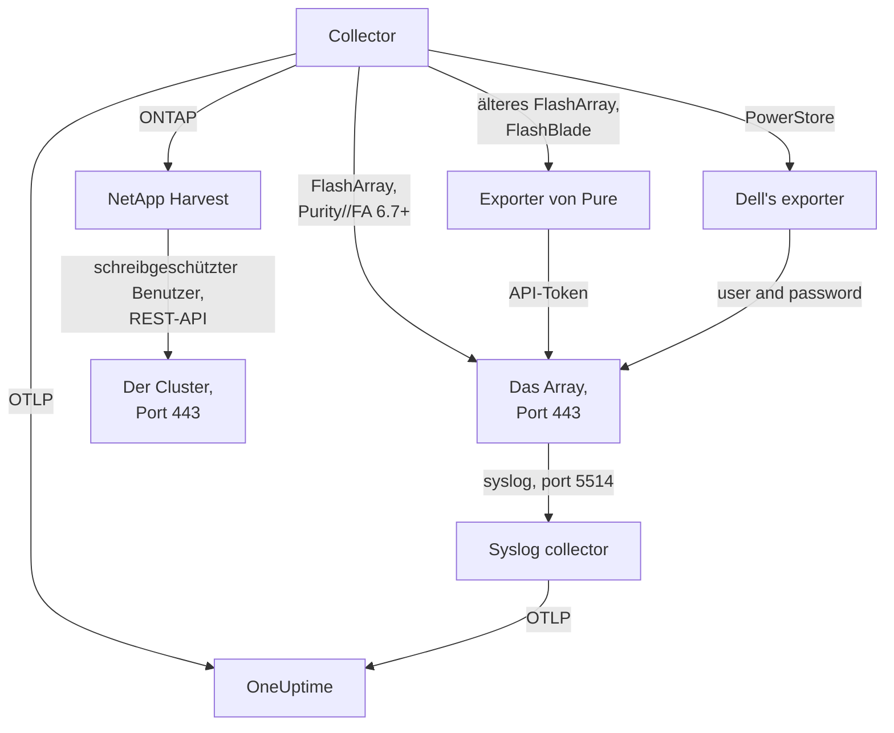

# Speicher-Array-Agent

Der OneUptime-Storage-Array-Agent überwacht Storage-Arrays: Kapazität und Datenreduktion, Latenz, IOPS und Bandbreite, Volumes, Hosts, Pods und Replikation, Hardware-Zustand, Dateisysteme und Buckets sowie bei NetApp ONTAP seine Aggregate, SVMs, LUNs und SnapMirror-Beziehungen. Er ist ein unveränderter OpenTelemetry Collector, der die OpenMetrics-Endpunkte des Arrays mit dem API-Token eines schreibgeschützten Benutzers scrapt (bei ONTAP stattdessen den eigenen Exporter von NetApp, Harvest, der neben ihm läuft), jede Metrik mit der Identität Ihres Arrays versieht und sie an OneUptime sendet. [Storage-Array-Monitore](/docs/monitor/storage-array-monitor) alarmieren anhand dessen, was ankommt.

:::cards
- [Agent installieren](#agent-installieren): Ein schreibgeschützter Benutzer, dann das Installationsskript oder Docker Compose.
- [Dell PowerScale](#dell-powerscale): SNMP auf dem Cluster, jeder Knoten abgefragt, und was seine Seiten zeigen.
- [Was der Agent erfasst](#was-der-agent-erfasst): Jeder Endpunkt und die Seiten, die daraus entstehen.
- [Mehrere Arrays überwachen](#mehrere-arrays-überwachen): Ein Agent pro Array, auf einem Rechner.
- [Dell PowerMax](#dell-powermax): Kein Agent: Eine Sonde liest jedes Array hinter Unisphere.
- [Fehlerbehebung](#fehlerbehebung): Ein Diagnoseskript und die üblichen Probleme.
:::

## So funktioniert es

Storage Arrays ist ein Produkt, das für jeden Hersteller gleich funktioniert. Es unterstützt:

| Array | `storage.system` | Wie der Agent es liest | Collector-Konfiguration |
| --- | --- | --- | --- |
| **Pure Storage FlashArray**, Purity//FA 6.7 und neuer | `purestorage.flasharray` | Der eigene OpenMetrics-Endpunkt des Arrays (`https://<array>/metrics/...?namespace=purefa`): Neben dem Collector läuft nichts | `otel-collector-config.yaml` (der Standard) |
| **Pure Storage FlashArray**, älteres Purity//FA | `purestorage.flasharray` | Der FlashArray-OpenMetrics-Exporter von Pure, den dieselbe Compose-Datei als Dienst `pure-fa-exporter` ausführt | `otel-collector-config.flasharray-exporter.yaml` |
| **Pure Storage FlashBlade** | `purestorage.flashblade` | Der FlashBlade-OpenMetrics-Exporter von Pure, den dieselbe Compose-Datei als Dienst `pure-fb-exporter` ausführt | `otel-collector-config.flashblade.yaml` |
| **Dell PowerStore** | `dell.powerstore` | Der PowerStore Metrics Exporter von Dell, den dieselbe Compose-Datei als Dienst `powerstore-exporter` baut und ausführt; die Warnungen des Clusters kommen per Syslog bei ihrem Dienst `powerstore-syslog` an | `otel-collector-config.powerstore.yaml` |
| **NetApp ONTAP** 9.12.1 und neuer (AFF, FAS, ASA, ONTAP Select, Cloud Volumes ONTAP) sowie **Amazon FSx for NetApp ONTAP** | `netapp.ontap` | [NetApp Harvest](https://github.com/NetApp/harvest) 26.11, das dieselbe Compose-Datei als Dienst `netapp-harvest` ausführt: Es meldet sich mit einem schreibgeschützten Benutzer und dessen Passwort an der REST-API des Clusters an | `otel-collector-config.netapp-ontap.yaml` |
| **Dell PowerScale** (Isilon), OneFS 8.0 und neuer | `dell.powerscale` | Jeder Knoten über SNMP (die ISILON-MIB von Dell), mit dem eigenen SNMP-Receiver des Collectors: Neben dem Collector läuft nichts | `otel-collector-config.powerscale.yaml` |

ONTAP hat keinen eigenen Metrik-Endpunkt, daher betreibt der Agent neben dem Collector den Open-Source-Exporter von NetApp, Harvest. Harvest liest die REST-API des Clusters und stellt das Gelesene im Compose-Netzwerk bereit, jede Serie mit dem Namen `netapp_<object>_<counter>`; der Collector scrapt Harvest und sendet die Daten weiter. Harvest schreibt nie auf den Cluster, und sein AutoSupport-Bericht an NetApp ist ausgeschaltet.

**Dell PowerMax** (`dell.powermax`) braucht keinen Agent: Eine OneUptime-Sonde liest mit einem Konto mit Lesezugriff jedes Array, das ein Unisphere for PowerMax verwaltet. Siehe [Dell PowerMax](#dell-powermax).

Pure Storage hat sich im Februar 2026 in **Everpure** umbenannt. FlashArray, FlashBlade und Purity behielten ihre Namen, ebenso die Metriken `purefa_*` und `purefb_*`; alles auf dieser Seite gilt daher für Arrays, die unter dem einen oder dem anderen Namen verkauft werden.

Ein Cluster von **Dell PowerScale** wird anders gelesen: Der Agent fragt jeden seiner Knoten über SNMP ab, mit einer Nur-Lese-Community oder einem SNMPv3-Benutzer und ohne API-Token. [Dell PowerScale](#dell-powerscale) führt vom Einschalten von SNMP bis zu dem, was seine Seiten zeigen; die Installationsschritte unten sind die für Pure Storage.



Ein Agent überwacht ein Array: Führen Sie einen Agent pro Array aus (siehe [Mehrere Arrays überwachen](#mehrere-arrays-überwachen)). Das Array registriert sich mit seinen ersten Daten unter dem Namen, den der Agent als `storage.array.name` an jede Metrik hängt.

## Bevor Sie beginnen

- Docker Engine 20.10 oder neuer mit dem Plugin Docker Compose v2, auf einem Rechner, der die Management-Schnittstelle des Arrays per HTTPS (TCP 443) erreicht.
- Ein Administratorkonto auf dem Array, um einen Benutzer mit der eingebauten Rolle **readonly** und ein API-Token für ihn anzulegen. Bei ONTAP ein Cluster-Administrator (bei Amazon FSx for NetApp ONTAP `fsxadmin`), um einen schreibgeschützten REST-Benutzer mit Passwort anzulegen.
- Für einen Dell PowerStore ein x86-64-Rechner (Dell baut seinen Exporter nur für x86-64) und ein PowerStore-Benutzer für den Agent: siehe [Dell PowerStore](#dell-powerstore).
- Ein Ingestion-Schlüssel. Legen Sie ihn unter **Projekteinstellungen → Telemetrie & APM → Ingestion-Schlüssel** an und kopieren Sie seinen Wert.

### Wo der Agent laufen sollte

Der Agent spricht per HTTPS mit der Management-Schnittstelle des Arrays; er kann daher auf jedem Rechner mit Docker und einer Route ins Managementnetz auf TCP 443 laufen: einem Monitoring-Host oder einer kleinen Management-VM. Bevorzugen Sie einen Rechner, dessen eigener Speicher nicht auf dem überwachten Array liegt: Fällt das Array aus, sollte Ihr Monitoring nicht mit ihm ausfallen. Der optionale Syslog-Listener setzt außerdem voraus, dass das Array den Agent auf dem Syslog-Port erreicht (siehe [Das Syslog des Arrays senden](#optional-das-syslog-des-arrays-senden)).

## Agent installieren

:::steps
### Den schreibgeschützten Benutzer und das API-Token anlegen

Der Agent liest immer nur. Geben Sie ihm einen eigenen Benutzer mit der eingebauten Rolle **readonly**, niemals einen Administrator, und ein API-Token für diesen Benutzer. Legen Sie das Token **ohne Ablaufdatum** an, sonst hört der Agent an dem Tag auf, an dem das Token abläuft.

:::tabs
@tab Purity CLI
Melden Sie sich per SSH als Administrator am FlashArray an. Der erste Befehl fragt nach dem Passwort des neuen Benutzers; der zweite gibt sein API-Token aus, eine UUID:

```bash
pureadmin create --role readonly oneuptime
pureadmin create --api-token oneuptime
```
@tab FlashArray GUI
1. Öffnen Sie _Settings → Users and Policies_ (_Settings → Access_ in älteren Releases).
2. Wählen Sie im ⋮-Menü des Bereichs **Users** den Eintrag **Create User…**, nennen Sie den Benutzer `oneuptime` und geben Sie ihm die Rolle readonly.
3. Wählen Sie im ⋮-Menü des neuen Benutzers **Create API Token…**, lassen Sie **Expires In** leer und kopieren Sie das Token.
@tab FlashBlade
Legen Sie auf dieselbe Weise einen Benutzer mit der Rolle **readonly** und ein API-Token für ihn an: in den Benutzereinstellungen der FlashBlade-GUI oder mit `pureadmin` in der Purity//FB-CLI. In einem Release ohne lokale Benutzer verwenden Sie ein Konto eines Verzeichnisdienstes (LDAP oder Active Directory), dessen Gruppe auf die Rolle readonly abgebildet ist. FlashBlade-API-Tokens beginnen mit `T-`.
@tab ONTAP CLI
Melden Sie sich per SSH als Administrator an der Cluster-Management-Adresse an. Der erste Befehl legt eine REST-Rolle an, die jede API lesen darf und sonst nichts; der zweite legt einen HTTP-Benutzer mit dieser Rolle an und fragt nach seinem Passwort:

```bash
security login rest-role create -role oneuptime-readonly -api /api -access readonly
security login create -user-or-group-name oneuptime -application http -authentication-method password -role oneuptime-readonly
```

Der Agent meldet sich mit diesem Benutzer und diesem Passwort an. Ein API-Token ist nicht beteiligt.
@tab ONTAP System Manager
1. Öffnen Sie _Cluster → Settings → Users and Roles_.
2. Wählen Sie unter **Roles** den Eintrag **Add**, nennen Sie die Rolle `oneuptime-readonly`, geben Sie `/api` als **REST API path** ein und wählen Sie den Zugriff **Read-Only**.
3. Wählen Sie unter **Users** den Eintrag **Add**, nennen Sie den Benutzer `oneuptime`, geben Sie ihm die neue Rolle, fügen Sie die Anmeldemethode **HTTP** mit **Password** hinzu und legen Sie das Passwort fest.
@tab Amazon FSx for NetApp ONTAP
Melden Sie sich per SSH am Management-Endpunkt des Dateisystems (sein DNS-Name oder seine IP, aus der FSx-Konsole) als `fsxadmin` an und legen Sie den Benutzer mit der vordefinierten schreibgeschützten Rolle von FSx an. Der Befehl fragt nach seinem Passwort:

```bash
security login create -user-or-group-name oneuptime -application http -authentication-method password -role fsxadmin-readonly
```

AWS betreibt die Hardware des Dateisystems, daher beantwortet FSx niemandem Fragen zu Datenträgern, Shelfs oder Sensoren: Die Seite **Hardware** des Arrays listet seine Knoten und Ports auf und sagt das.
:::

### Prüfen, ob das FlashArray seine eigenen Metriken liefert

Pure dokumentiert den nativen OpenMetrics-Endpunkt für **Purity//FA 6.7.0 und neuer** (der Abkündigungshinweis zum FlashArray-Exporter von Pure nennt 6.6.11 und neuer). Am schnellsten erfahren Sie es, indem Sie das Array fragen, von dem Rechner aus, auf dem der Agent laufen wird:

```bash
curl -k 'https://<array>/metrics/array?namespace=purefa' --header 'Authorization: Bearer <api-token>' | grep purefa_info
```

Eine Zeile `purefa_info{...} 1` bedeutet, dass das Array seine Metriken nativ liefert: Verwenden Sie die Standardkonfiguration. Ein `404` bedeutet, dass es das nicht tut: Verwenden Sie die Exporter-Konfiguration, die den Exporter von Pure neben dem Collector ausführt. Pure hat diesen Exporter abgekündigt; wechseln Sie daher zur nativen Konfiguration, sobald das Array aktualisiert ist. Ein FlashBlade läuft immer über den FlashBlade-Exporter von Pure und ein ONTAP-Cluster über NetApp Harvest; überspringen Sie diesen Schritt für sie.

### Den Agent installieren und starten

Jede OneUptime-Instanz stellt das Installationsskript und die Dateien des Agents für ihr eigenes Release bereit: Die Befehle unten laden sie von `https://oneuptime.com` herunter; ersetzen Sie diese Adresse bei einer selbst gehosteten Instanz durch Ihre URL. Das Installationsskript wird zuerst als `install.sh` gespeichert, sodass Sie es lesen können, bevor Sie es ausführen.

:::tabs
@tab install.sh
Laden Sie das Installationsskript herunter und führen Sie es auf dem Rechner aus, auf dem der Agent laufen soll:

```bash
curl -fsSL https://oneuptime.com/install/storage-array-agent -o install.sh
bash install.sh
```

Das Skript fragt, um welches Array es sich handelt (ein FlashArray mit nativen Metriken, ein FlashArray mit älterem Purity//FA, ein FlashBlade oder ein NetApp-ONTAP-Cluster), dann nach Ihrer OneUptime-URL, dem Ingestion-Schlüssel, einem Namen für das Array, der Management-Adresse des Arrays und dem API-Token des schreibgeschützten Benutzers, bei ONTAP nach Name und Passwort des schreibgeschützten Benutzers (ohne Echo gelesen). Es installiert nach `/opt/oneuptime-storage-array-agent`, lädt die Compose-Datei, jede Collector-Konfiguration und die vier Dateien von Harvest herunter, schreibt eine mit `0600` geschützte `.env`-Datei mit der passenden Konfiguration und dem passenden Compose-Profil und startet den Agent mit Docker Compose. Es setzt jeden Wert so für Docker Compose in Anführungszeichen, wie Sie ihn eingegeben haben. Ein erneuter Lauf verwendet alles in einer vorhandenen `.env` wieder, statt erneut zu fragen, und bewahrt eine von Ihnen bearbeitete Datei als `<file>.bak.<timestamp>` auf, bevor er sie ersetzt.
@tab Docker Compose
Laden Sie `docker-compose.yml` und die drei Dateien `otel-collector-config*.yaml` von Ihrem OneUptime in einen neuen Ordner herunter:

```bash
curl -fsSLO https://oneuptime.com/install/storage-array-agent/docker-compose.yml
curl -fsSLO https://oneuptime.com/install/storage-array-agent/otel-collector-config.yaml
curl -fsSLO https://oneuptime.com/install/storage-array-agent/otel-collector-config.flasharray-exporter.yaml
curl -fsSLO https://oneuptime.com/install/storage-array-agent/otel-collector-config.flashblade.yaml
```

Legen Sie daneben eine Datei `.env` an. Sie enthält das API-Token; schützen Sie sie daher mit `chmod 600 .env`. Für ein FlashArray mit nativen Metriken:

```bash title=".env"
ONEUPTIME_URL=YOUR_ONEUPTIME_URL
ONEUPTIME_TELEMETRY_INGESTION_KEY=YOUR_TELEMETRY_INGESTION_TOKEN
STORAGE_ARRAY_NAME=my-storage-array
STORAGE_SYSTEM=purestorage.flasharray
STORAGE_ARRAY_COLLECTOR_CONFIG=otel-collector-config.yaml
COMPOSE_PROFILES=
PURE_FA_ENDPOINT=fa-prod-01.example.com
PURE_FA_API_TOKEN=YOUR_READ_ONLY_API_TOKEN
PURE_FB_ENDPOINT=
PURE_FB_API_TOKEN=
POWERSCALE_ENDPOINT=
POWERSCALE_SNMP_COMMUNITY=
STORAGE_ARRAY_INSECURE_SKIP_VERIFY=true
POWERSTORE_ENDPOINT=
POWERSTORE_PASSWORD=
POWERSTORE_USERNAME=
POWERSTORE_BULK_METRICS=
POWERSTORE_API_VERSION=
POWERSTORE_REQUEST_LIMIT=
POWERSTORE_SYSLOG_PORT=
STORAGE_ARRAY_AGENT_CONTAINER_NAME=oneuptime-storage-array-agent
```

Laden Sie für einen Dell PowerStore außerdem `otel-collector-config.powerstore.yaml`, `powerstore-exporter.Dockerfile` und `powerstore-syslog.yaml` herunter, setzen Sie `STORAGE_SYSTEM=dell.powerstore`, `STORAGE_ARRAY_COLLECTOR_CONFIG=otel-collector-config.powerstore.yaml` und `COMPOSE_PROFILES=powerstore` und tragen Sie `POWERSTORE_ENDPOINT`, `POWERSTORE_USERNAME` und `POWERSTORE_PASSWORD` ein, das Passwort in einfachen Anführungszeichen.

Für ein FlashArray mit älterem Purity//FA setzen Sie `STORAGE_ARRAY_COLLECTOR_CONFIG=otel-collector-config.flasharray-exporter.yaml` und `COMPOSE_PROFILES=flasharray-exporter`. Für ein FlashBlade setzen Sie `STORAGE_SYSTEM=purestorage.flashblade`, `STORAGE_ARRAY_COLLECTOR_CONFIG=otel-collector-config.flashblade.yaml` und `COMPOSE_PROFILES=flashblade` und füllen `PURE_FB_ENDPOINT` und `PURE_FB_API_TOKEN` statt des Paars `PURE_FA_*` aus.

Laden Sie für einen NetApp-ONTAP-Cluster oder Amazon FSx for NetApp ONTAP außerdem die ONTAP-Konfiguration und die vier Dateien von Harvest herunter:

```bash
curl -fsSLO https://oneuptime.com/install/storage-array-agent/otel-collector-config.netapp-ontap.yaml
curl -fsSLO https://oneuptime.com/install/storage-array-agent/netapp-harvest.yml
curl -fsSLO https://oneuptime.com/install/storage-array-agent/netapp-harvest-rest.yaml
curl -fsSLO https://oneuptime.com/install/storage-array-agent/netapp-harvest-keyperf.yaml
curl -fsSLO https://oneuptime.com/install/storage-array-agent/netapp-harvest-restperf.yaml
```

und verwenden Sie diese `.env`. Setzen Sie das Passwort wie hier in einfache Anführungszeichen: Dann liest Docker Compose es genau so, wie es geschrieben ist, was immer es enthält. Ein Passwort mit einem `'` darin kommt stattdessen in doppelte Anführungszeichen, mit `\"`, `\\` und `$$` für ein `"`, ein `\` und ein `$`:

```bash title=".env"
ONEUPTIME_URL=YOUR_ONEUPTIME_URL
ONEUPTIME_TELEMETRY_INGESTION_KEY=YOUR_TELEMETRY_INGESTION_TOKEN
STORAGE_ARRAY_NAME=ontap-prod-01
STORAGE_SYSTEM=netapp.ontap
STORAGE_ARRAY_COLLECTOR_CONFIG=otel-collector-config.netapp-ontap.yaml
COMPOSE_PROFILES=netapp-ontap
NETAPP_ONTAP_ENDPOINT=ontap-prod-01.example.com
NETAPP_ONTAP_USERNAME=oneuptime
NETAPP_ONTAP_PASSWORD='YOUR_READ_ONLY_USER_PASSWORD'
STORAGE_ARRAY_INSECURE_SKIP_VERIFY=true
STORAGE_ARRAY_AGENT_CONTAINER_NAME=oneuptime-storage-array-agent
```

Starten Sie den Agent:

```bash
docker compose up -d
```
:::

### Prüfen, ob der Agent läuft

```bash
docker compose ps
docker logs -f oneuptime-storage-array-agent
```

`docker compose ps` listet den Collector (`oneuptime-storage-array-agent`) und, bei einer Exporter-Konfiguration, den Exporter (`pure-fa-exporter`, `pure-fb-exporter` oder `netapp-harvest`) auf. Sobald der Collector gestartet ist, sollten seine Logs diese Zeile zeigen:

```text
Everything is ready. Begin running and processing data.
```

### Das Array in OneUptime finden

Öffnen Sie **Produkte → Infrastruktur → Speicher-Arrays → Alle Speicher-Arrays**. Nach dem ersten Scrape (etwa einer Minute) ist das Array mit seiner Kapazität, Leistung, offenen Warnungen und Hardware da. Volumes, Hosts und Pods folgen innerhalb von 2 Minuten, die Dateisysteme und Buckets eines FlashBlade innerhalb von 5 und FlashArray-Verzeichnisse innerhalb von 30. Ein ONTAP-Cluster erscheint, sobald Harvest ihn gelesen hat, und sein ganzes Inventar innerhalb von etwa 3 Minuten, dem Intervall, in dem Harvest seine Konfiguration abfragt. Die Seite **Topologie** des Arrays zeichnet seine Hosts, Volumes, Dateisysteme und Hardware als eine Karte: siehe [Topologie](/docs/telemetry/topology#die-eigene-karte-einer-ressource-öffnen).
:::

## Dell PowerStore

Der Agent liest einen PowerStore-Cluster über den PowerStore Metrics Exporter von Dell, Release `powerstore-metrics-exporter_v1.0.3`. Dell veröffentlicht ihn als Binärdatei, nicht als Image, daher baut der Dienst `powerstore-exporter` beim ersten Start das von Dell dokumentierte Image aus `powerstore-exporter.Dockerfile` und prüft dabei die SHA-256 der Binärdatei; dieser Build braucht einmal `quay.io` und `github.com`.

Der Exporter von Dell meldet sich mit Benutzername und Passwort an, denn PowerStore hat keine API-Token. Legen Sie im PowerStore Manager unter _Settings → Users_ einen lokalen Benutzer nur für den Agent an, mit der Rolle **Storage Operator**: Der Exporter liest die Leistung aus dem Fünf-Minuten-Bulk-Metrikarchiv von PowerStore, das er selbst einschaltet und das PowerStoreOS 4.1 und neuer verlangen, und laut der README von Dell kann die Rolle Operator es nicht einschalten. Auf einem älteren PowerStoreOS genügt die schreibgeschützte Rolle **Operator** mit `POWERSTORE_BULK_METRICS=false`. Nur der Exporter liest das Passwort, aus `.env`.

Der Exporter von Dell liest keine Warnungen, daher sendet der Cluster seine eigenen: Der Dienst `powerstore-syslog` nimmt sein Remote-Syslog auf Port 5514 per TCP und UDP an und legt jede Zeile auf der Seite **Protokolle** des Arrays ab, mit dem Datensatz von PowerStore in Attributen (`powerstore.alert.id`, `powerstore.alert.state`, `powerstore.event.code`) und einem Schweregrad aus den Ereigniscodes von Dell (`powerstore.alert.severity`). Öffnen Sie im PowerStore Manager _Settings → Security → Remote Logging_, fügen Sie diesen Rechner auf Port 5514 hinzu und öffnen Sie den Port in seiner Firewall. Syslog über TLS auf Port 6514 beschreibt `powerstore-syslog.yaml`.

Der Exporter von Dell meldet keine Hosts und keine Replikationssitzungen, daher hat diese Version keine.

## Umgebungsvariablen

Das Installationsskript schreibt diese nach `/opt/oneuptime-storage-array-agent/.env`; eine Docker-Compose-Installation liest sie aus der `.env` neben `docker-compose.yml`. Nachdem Sie einen Wert geändert haben, führen Sie in diesem Ordner `docker compose up -d` aus.

| Variable | Erforderlich | Beschreibung |
| --- | --- | --- |
| `ONEUPTIME_URL` | Ja | Ihre OneUptime-URL, etwa `https://oneuptime.com` oder Ihre selbst gehostete Instanz. Verwenden Sie `http://` und ihren Port, wenn die Instanz nur HTTP spricht. |
| `ONEUPTIME_TELEMETRY_INGESTION_KEY` | Ja | Der Ingestion-Schlüssel aus **Projekteinstellungen → Telemetrie & APM → Ingestion-Schlüssel**. |
| `STORAGE_ARRAY_NAME` | Ja | Der Name, unter dem sich das Array in OneUptime registriert, an jede Metrik als Ressourcenattribut `storage.array.name` gehängt. Halten Sie ihn stabil: Eine spätere Änderung registriert ein zweites Array. Ohne ihn startet der Collector nicht. |
| `STORAGE_SYSTEM` | Nein | Die Plattform, angehängt als Ressourcenattribut `storage.system`: `purestorage.flasharray`, `purestorage.flashblade` oder `netapp.ontap`. Standard ist `purestorage.flasharray`. |
| `STORAGE_ARRAY_COLLECTOR_CONFIG` | Nein | Welche mitgelieferte Collector-Konfiguration läuft: `otel-collector-config.yaml` (FlashArray, nativ: der Standard), `otel-collector-config.flasharray-exporter.yaml` (älteres FlashArray), `otel-collector-config.flashblade.yaml` (FlashBlade) oder `otel-collector-config.netapp-ontap.yaml` (ONTAP). |
| `COMPOSE_PROFILES` | Nein | Startet den Exporter, den die gewählte Konfiguration scrapt: leer für die native FlashArray-Konfiguration, `flasharray-exporter`, `flashblade` oder `netapp-ontap` für die anderen. |
| `PURE_FA_ENDPOINT` | FlashArray | Die Management-Adresse des FlashArray: ein Hostname oder eine IP, ohne `https://`. |
| `PURE_FA_API_TOKEN` | FlashArray | Das API-Token des FlashArray-Benutzers mit der Rolle readonly. |
| `PURE_FB_ENDPOINT` | FlashBlade | Die Management-Adresse des FlashBlade: ein Hostname oder eine IP, ohne `https://`. |
| `PURE_FB_API_TOKEN` | FlashBlade | Das API-Token des FlashBlade-Benutzers mit der Rolle readonly. |
| `POWERSTORE_ENDPOINT` | PowerStore | Die Management-Adresse des PowerStore-Clusters: ein Hostname oder eine IP, ohne `https://`. |
| `POWERSTORE_USERNAME` | PowerStore | Der PowerStore-Benutzer, mit dem sich der Exporter von Dell anmeldet. |
| `POWERSTORE_PASSWORD` | PowerStore | Das Passwort dieses Benutzers. Nur der Exporter liest es. |
| `POWERSTORE_BULK_METRICS` | Nein | `true` liest die Leistung aus dem Bulk-Metrikarchiv von PowerStore; `false` liest jedes Objekt einzeln. Standard ist `true`. |
| `POWERSTORE_API_VERSION` | Nein | `v3` für PowerStoreOS 3.6 und neuer, oder `v1`. Standard ist `v3`. |
| `POWERSTORE_REQUEST_LIMIT` | Nein | Wie viele Anfragen der Exporter gleichzeitig an den Cluster sendet. Standard ist `16`. |
| `POWERSTORE_SYSLOG_PORT` | Nein | Der Port, auf dem dieser Rechner das Syslog des Clusters annimmt, per TCP und UDP. Standard ist `5514`. |
| `NETAPP_ONTAP_ENDPOINT` | ONTAP | Die Cluster-Management-Adresse (bei FSx der Management-Endpunkt des Dateisystems): ein Hostname oder eine IP, ohne `https://`. |
| `NETAPP_ONTAP_USERNAME` | ONTAP | Der schreibgeschützte REST-Benutzer, etwa `oneuptime`. |
| `NETAPP_ONTAP_PASSWORD` | ONTAP | Sein Passwort. Nur Harvest liest es, genau so, wie es geschrieben ist. |
| `POWERSCALE_NODES` | PowerScale | Die Adressen aller Knoten, durch Kommas getrennt, nie der Name der SmartConnect-Zone. Das Installationsskript schreibt daraus die Abfragen darunter. |
| `POWERSCALE_ENDPOINT` | PowerScale | Der Knoten, über den Zustand, Kapazität und Kontingente des Clusters selbst gelesen werden: der erste in `POWERSCALE_NODES`. |
| `POWERSCALE_SNMP_RECEIVERS` | PowerScale | Die Abfragen, die der Collector ausführt: `snmp/cluster`, `snmp/quotas`, dann `snmp/node-1` und so weiter, eine pro Knoten. |
| `POWERSCALE_NODE_<n>` | PowerScale | Die Adresse von Knoten `<n>`, von `1` bis `252`. Eine IPv6-Adresse steht in eckigen Klammern, etwa `[fd00::11]`. |
| `POWERSCALE_SNMP_VERSION` | Nein | `v2c` oder `v3`. Standard ist `v2c`. |
| `POWERSCALE_SNMP_COMMUNITY` | SNMP v2c | Die Nur-Lese-Community des Clusters. |
| `POWERSCALE_SNMP_USER` | SNMPv3 | Der SNMPv3-Nur-Lese-Benutzer des Clusters. |
| `POWERSCALE_SNMP_SECURITY_LEVEL` | Nein | `auth_priv`, `auth_no_priv` oder `no_auth_no_priv`. Standard ist `auth_priv`. |
| `POWERSCALE_SNMP_AUTH_PROTOCOL` | Nein | `MD5`, `SHA`, `SHA224`, `SHA256`, `SHA384` oder `SHA512`, wie `isi snmp settings view` es anzeigt. Standard ist `SHA`. |
| `POWERSCALE_SNMP_AUTH_PASSWORD` | SNMPv3 | Das Authentifizierungspasswort des SNMPv3-Benutzers. |
| `POWERSCALE_SNMP_PRIVACY_PROTOCOL` | Nein | `DES`, `AES`, `AES192`, `AES256`, `AES192C` oder `AES256C`. Standard ist `AES`. |
| `POWERSCALE_SNMP_PRIVACY_PASSWORD` | SNMPv3 | Das Verschlüsselungspasswort des SNMPv3-Benutzers, auf der Stufe `auth_priv`. |
| `STORAGE_ARRAY_INSECURE_SKIP_VERIFY` | Nein | `true` akzeptiert am nativen Endpunkt und in Harvest das selbstsignierte Zertifikat des Arrays; `false` prüft es. Standard ist `true`. Die Exporter von Pure prüfen das Zertifikat des Arrays nie, daher gilt die Einstellung für sie nicht. |
| `STORAGE_ARRAY_AGENT_CONTAINER_NAME` | Nein | Der Containername des Agents. Standard ist `oneuptime-storage-array-agent`. Der Agent eines zweiten Arrays auf demselben Rechner braucht einen eigenen, siehe [Mehrere Arrays überwachen](#mehrere-arrays-überwachen). Das Installationsskript benennt einen neuen Agent nach seinem Ordner, sofern Sie ihn nicht setzen, und behält ihn bei, wenn Sie das Skript erneut ausführen. |

## Wie der Agent scrapt

- **Ein Scrape-Job pro Endpunkt, jeder so oft gelesen, wie es sich lohnt.** FlashArray: `/metrics/array` alle 60 Sekunden; `/metrics/volumes`, `/metrics/hosts` und `/metrics/pods` alle 2 Minuten; `/metrics/directories` alle 30 Minuten, wie Pure selbst rät, weil der Platz von Verzeichnissen für das Array aufwendig zu berechnen ist. FlashBlade: `/metrics/array` alle 60 Sekunden; `/metrics/filesystems` und `/metrics/objectstore` alle 5 Minuten, wieder nach dem Rat von Pure, die Endpunkte für Dateisysteme und Objektspeicher seltener zu lesen als das Array.
- **Jeder Job versieht seine Serien mit dem Label `scrape_endpoint: <endpoint>`.** Jeder Endpunkt exportiert außerdem `purefa_info` oder `purefb_info`; so weiß OneUptime, von welchen Familien ein Batch die vollständige Liste ist: Auf diese Weise verlässt ein gelöschtes Volume, ein Host, ein Pod, ein Dateisystem oder ein Bucket das Inventar, statt darin hängen zu bleiben. Behalten Sie die Labels wie ausgeliefert.
- **Die Latenz pro Volume und pro Host behält drei Dimensionen.** Jedes Volume und jeder Host exportiert seine Latenz in bis zu sechzehn `dimension`s. Eine Regel `metric_relabel_configs` behält `usec_per_read_op`, `usec_per_write_op` und `usec_per_mirrored_write_op` und verwirft die Aufschlüsselung nach QoS-Ratenlimit, Warteschlange, SAN und Servicezeit, die die Serien eines großen Arrays vervielfacht. Die arrayweite Aufschlüsselung auf `purefa_array_performance_latency_usec` bleibt erhalten. Löschen Sie die Regel, um auch die Aufschlüsselung pro Volume zu behalten.
- **Das API-Token ist ein Bearer-Token.** Die native Konfiguration sendet es an das Array selbst; die Exporter-Konfigurationen senden es nur über das Compose-Netzwerk an den Exporter, und die Ports der Exporter werden nie veröffentlicht.
- **Ein PowerStore alle 5 Minuten.** Der Exporter von Dell stellt jeden Teil des Clusters unter `/metrics/<cluster>/<part>` bereit: Die Konfiguration liest `cluster` alle 60 Sekunden, seinen Heartbeat, und `appliance`, `capacity`, `hardware`, `port`, `volume`, `volumeGroup`, `nas` und `file` alle 5 Minuten, da PowerStore sie in Fünf-Minuten-Stichproben berechnet.
- **Kein `send_batch_max_size`.** OneUptime baut das Inventar aus einem ganzen Scrape pro Anfrage neu auf; der mitgelieferte Processor `batch` teilt einen Scrape daher nie auf mehrere Exporte auf. Behalten Sie die Batch-Einstellungen wie ausgeliefert.
- **ONTAP: Harvest fragt den Cluster ab, der Collector scrapt Harvest.** Harvest liest Konfiguration und Zustand des Clusters alle 3 Minuten, seine Leistung jede Minute (Latenzen in Mikrosekunden pro Operation, Operationen und Bytes pro Sekunde) und seine EMS-Ereignisse alle 3 Minuten und stellt jeweils den neuesten Stand unter `netapp-harvest:12990` bereit, das der Collector alle 60 Sekunden mit dem Label `scrape_endpoint: harvest` scrapt. Die drei Dateien `netapp-harvest-*.yaml` beschränken Harvest auf das, was OneUptime liest. Die eigenen Serien `netapp_metadata_*` von Harvest sagen, welche Objekte es vollständig aufgelistet hat; so verlässt ein gelöschtes Volume das Inventar, während ein Objekt, das Harvest nicht lesen konnte, seine letzte Anzahl behält. Der Collector verwirft die Messungen, die Harvest über sich selbst macht, und die Leistungsserien pro Datenträger und macht aus dem Zeitplan jeder SnapMirror-Beziehung `netapp_snapmirror_schedule_seconds` (ein stündlicher Zeitplan ist 3600), womit SnapMirror Behind Schedule den Rückstand vergleicht.

## Was der Agent erfasst

Die semantischen Konventionen von Pure gelten gleichermaßen für den nativen FlashArray-Endpunkt und beide Exporter; die von ONTAP sind die von Harvest, beschrieben nach der Tabelle. Jeder Wert ist ein Gauge, den das Array selbst berechnet (Latenzen in Mikrosekunden pro Operation, Durchsatz pro Sekunde), daher müssen keine Raten berechnet werden, und Objekte werden über **Datenpunkt-Labels** benannt: `name` für Volumes, Pods, Verzeichnisse, Dateisysteme und Buckets, `host` für Hosts, `component_name` für FlashArray-Hardware. Der Agent hängt die Ressourcenattribute `storage.array.name` und `storage.system` an, sodass OneUptime alles unter Ihrem Array ablegt:

| Endpunkt | Metrikfamilien | Was OneUptime daraus baut |
| --- | --- | --- |
| FlashArray `/metrics/array` | `purefa_info`, `purefa_alerts_open`, `purefa_array_space_*`, `purefa_array_performance_*`, `purefa_hw_component_status`, `purefa_hw_component_temperature_celsius`, `purefa_hw_controller_info`, `purefa_drive_capacity_bytes`, `purefa_network_interface_*` | Name, Purity-Version und System-ID des Arrays; Kapazität, belegter Platz und Datenreduktion; Anzahl offener Warnungen; der Zustand des Arrays; die Seite **Hardware** (Komponenten, Laufwerke, Controller, Netzwerkschnittstellen) |
| FlashArray `/metrics/volumes` | `purefa_volume_performance_*`, `purefa_volume_space_*`, `purefa_volume_qos_*` | Die Seite **Volumes**: bereitgestellte und physische Größe, Datenreduktion, Lese- und Schreiblatenz, IOPS und Bandbreite pro Volume |
| FlashArray `/metrics/hosts` | `purefa_host_connectivity_info`, `purefa_host_connections_info`, `purefa_host_performance_*`, `purefa_host_space_*` | Die Seite **Hosts**: Konnektivität (redundante Pfade oder nicht), verbundene Volumes, Latenz, IOPS und Bandbreite pro Host |
| FlashArray `/metrics/pods` | `purefa_pod_performance_*`, `purefa_pod_space_*`, `purefa_pod_replica_links_*`, `purefa_pod_mediator_status` | Die Seite **Replikation**: ActiveCluster- und ActiveDR-Pods, Status und Verzögerung der Replikatverbindungen |
| FlashArray `/metrics/directories` | `purefa_directory_performance_*`, `purefa_directory_space_*` | Die Seite **Verzeichnisse** (FlashArray File Services) |
| FlashBlade `/metrics/array` | `purefb_info`, `purefb_alerts_open`, `purefb_array_space_*`, `purefb_array_performance_*`, `purefb_hardware_health` | Name, Purity-Version und System-ID des FlashBlade; Kapazität und Datenreduktion; Anzahl offener Warnungen; der Zustand des Arrays; die Seite **Hardware** |
| FlashBlade `/metrics/filesystems` | `purefb_file_systems_space_*`, `purefb_file_systems_performance_*` | Die Seite **Dateisysteme**: bereitgestellter und belegter Platz, Datenreduktion, Latenz, IOPS und Bandbreite pro Dateisystem |
| FlashBlade `/metrics/objectstore` | `purefb_buckets_space_*`, `purefb_buckets_quota_space_bytes`, `purefb_buckets_object_count`, `purefb_buckets_performance_*`, `purefb_object_store_accounts_*` | Die Seite **Buckets**: Platz, Kontingent, Objektanzahl und Leistung pro Bucket, nach Konto gruppiert |
| PowerStore `cluster`, `appliance`, `capacity` | `powerstore_cluster`, `powerstore_metro_*`, `powerstore_appliance`, `powerstore_perf_*`, `powerstore_cap_*` | Name und Zustand des Clusters; die Seite **Appliances**: Kapazität, Datenreduktion, Latenz, IOPS und Bandbreite jeder Appliance |
| PowerStore `hardware`, `port` | `powerstore_hardware_*`, `powerstore_wear_metrics_by_drive`, `powerstore_fc_port_*`, `powerstore_eth_port_*`, `powerstore_metricFcPort_*`, `powerstore_metricEthPort_*` | Die Seite **Hardware**: Knoten, Lüfter, Netzteile, Batterien, Laufwerke und Front-End-Ports, jeweils mit ihrer Appliance |
| PowerStore `volume`, `volumeGroup`, `nas`, `file` | `powerstore_volume_*`, `powerstore_metricVolume_*`, `powerstore_volumegroup_*`, `powerstore_metricVg_*`, `powerstore_nas_server_operational_status`, `powerstore_metricNas_*`, `powerstore_filesystem_*`, `powerstore_metricFilesystem_*` | Die Seiten **Volumes**, **Volume-Gruppen**, **NAS-Server** und **Dateisysteme** |
| ONTAP, über Harvest | `netapp_cluster_*`, `netapp_node_*`, `netapp_aggr_*`, `netapp_svm_*`, `netapp_volume_*`, `netapp_lun_*`, `netapp_snapmirror_*` | Name, Release und UUID des Clusters; seine Kapazität (die Summe seiner Datenaggregate) und Datenreduktion; die Seite **Volumes**; die Seiten **Aggregate**, **SVMs**, **LUNs** und **SnapMirror**, eine Seite pro Objekt |
| ONTAP-Hardware, über Harvest | `netapp_disk_*`, `netapp_shelf_*`, `netapp_environment_sensor_*`, `netapp_net_port_*`, `netapp_nic_*`, `netapp_fcp_*` | Die Seite **Hardware**: Knoten, Datenträger, Shelfs, deren Netzteile, Lüfter, Module und Sensoren, die Sensoren der Knoten sowie Ethernet- und Fibre-Channel-Ports |
| Offene Probleme und Ereignisse von ONTAP | `netapp_health_*`, `netapp_ems_events` | Die Anzahl offener Warnungen und die Karte **Aktive Warnungen** (defekte Datenträger, Shelf-Fehler, HA-Takeover, ausgefallene Ports, Systemzustandswarnungen) sowie die EMS-Vorlagen |
| PowerScale `snmp/cluster` | `powerscale_cluster_*`, `powerscale_ifs_*` | Name, OneFS-Version, Zustand und Knotenzahlen des Clusters; die Kapazität von `/ifs`; Durchsatz, Netzwerk und CPU über den ganzen Cluster |
| PowerScale `snmp/quotas` | `powerscale_quota_*` | Die Seite **Kontingente**: die Belegung jedes Kontingents, seine Limits und wie nah es ihnen ist |
| PowerScale `snmp/node-<n>` | `powerscale_node_*`, `powerscale_protocol_*`, `powerscale_drive_*`, `powerscale_fan_*`, `powerscale_temperature_*`, `powerscale_power_sensor_*`, `powerscale_interface_*`, `powerscale_chassis_*` | Die Seite **Knoten**: Zustand, CPU, Durchsatz und Protokollleistung jedes Knotens; die Seite **Hardware**: seine Laufwerke, Sensoren und Ports |

Bei ONTAP stammt jede Serie von Harvest: Ein Objekt wird über seine Labels benannt (`volume` innerhalb seiner `svm`, `aggr`, `lun`, `node`, `disk`, `shelf`, `destination_location` für eine SnapMirror-Beziehung), ein Zustand ist ein `netapp_*_new_status` von 1 oder 0 oder eine Serie `netapp_*_labels`, deren Labels ihn nennen, und jedes offene Problem ist eine Serie `netapp_health_*_alerts`, die existiert, solange es besteht.

Die Spalte **Integrität** unter **Alle Speicher-Arrays** liest die eigenen Warnungen und die Hardware des Arrays aus seinen neuesten Daten: **Kritisch**, solange es eine offene kritische Warnung meldet oder eine Hardwarekomponente, ein Laufwerk oder einen Controller, die kritisch, ausgefallen, fehlend oder fehlerhaft sind; **Warnung**, solange es einen offenen Warnalarm oder eine beeinträchtigte oder unbekannte Komponente meldet; andernfalls **OK**; und **Unbekannt**, solange der Agent getrennt ist. Die **Übersicht** des Arrays beurteilt mehr, wie der nächste Abschnitt zeigt. In Monitorkriterien erhalten die Attribute des Arrays das Präfix `resource.` (`resource.storage.array.name`, `resource.storage.system`), während die Datenpunkt-Labels ohne Präfix bleiben (`name`, `host`, `dimension`, `space`).

Der Zustand eines PowerStore ist der seiner Hardware, da seine Warnungen als Protokolle ankommen. Der Agent berechnet `powerstore_cap_physical_used_percent` und `powerstore_filesystem_logical_used_percent` selbst und liest den Zustand eines Knotens als 1, solange er Healthy ist.

## Was die Seiten des Arrays zeigen

Die **Übersicht** des Arrays nennt seinen Zustand, **Fehlerfrei**, **Beeinträchtigt** oder **Fehlerhaft**, danach, was Aufmerksamkeit braucht, und listet das unter **Erfordert Aufmerksamkeit** auf, das Dringendste zuerst, jedes einen Schritt von der Stelle, an der man nachsieht:

- **Das Array selbst.** Eine offene Warnung, den das Array mit kritischem Schweregrad ausgelöst hat, ist kritisch, und einer mit dem Schweregrad Warnung braucht einen Blick. Über 80 % seiner nutzbaren Kapazität braucht es einen Blick und über 90 % ist es kritisch, dort, wo die Warnungen Capacity Above 80% und Capacity Above 90% auslösen. Ein FlashArray mit einer durchschnittlichen Lese- oder Schreiblatenz über 5 ms oder ein FlashBlade, dessen Lesevorgänge länger als 10 ms dauern, braucht einen Blick.
- **Hardware.** Eine Komponente, ein Laufwerk, ein Controller oder eine Netzwerkschnittstelle, die das Array als kritisch, ausgefallen, fehlend oder fehlerhaft meldet, ist kritisch: Die Redundanz ist weg, bis das Teil ersetzt ist. Eine, die es als beeinträchtigt, unbekannt, nicht erkannt oder nicht bereit meldet, braucht einen Blick. Nicht installierte, ausgeschaltete oder ungenutzte Teile werden nie aufgelistet.
- **Hosts.** Ein Host, der das Array nicht mehr über beide Controller erreicht, braucht einen Blick, mit dem Grund: nur über einen Controller, über ungleiche Pfade oder ganz ohne Pfad.
- **Pods.** Ein Pod, dessen Replikatverbindung das Array als fehlerhaft meldet, ist kritisch, und einer, der mehr als eine Minute im Rückstand ist, braucht einen Blick.
- **Dateisysteme.** Ein FlashBlade-Dateisystem, dem weniger als 10 % seiner bereitgestellten Größe bleiben, braucht einen Blick.
- **Die eigenen Objekte eines ONTAP-Clusters.** Volumes, Aggregate und LUNs, die ONTAP als offline meldet, defekte Datenträger, Shelf-Teile mit einem Fehler, Knotensensoren jenseits ihrer kritischen Schwelle und ausgefallene Ports sind kritisch; gestoppte SVMs, Knoten mit einem ausgefallenen Lüfter oder Netzteil und Sensoren jenseits ihrer Warnschwelle brauchen einen Blick, mit dem Grund in den eigenen Worten von ONTAP. Eine SnapMirror-Beziehung, die ONTAP als fehlerhaft meldet, ist kritisch, und eine, die mehr als anderthalb Zeitplanintervalle im Rückstand ist, braucht einen Blick.

Die Listen **Hosts**, **Replikation** und **Dateisysteme** nennen den Zustand jedes Teils nach denselben Regeln, mit dem Grund darunter, und ebenso die Listen **Volumes**, **Aggregate**, **SVMs**, **LUNs** und **SnapMirror** eines ONTAP-Clusters, in denen jede Zeile eine eigene Seite öffnet: mit dem Zustand des Objekts, dem, was Aufmerksamkeit braucht, dem, was darauf offen ist, den Warnungen des Clusters, die es überwachen, dem, was ONTAP darüber meldet, und seinen Diagrammen. Die Seiten jeder Plattform sprechen deren eigene Sprache: Ein ONTAP-Volume nennt seine SVM, sein Aggregat und wie voll es ist, und seine Seite zeigt die Serien von ONTAP als Diagramme. Bei Amazon FSx for NetApp ONTAP listet die Seite **Hardware** die Knoten und Ports auf und sagt, warum es keine Datenträger oder Shelfs gibt. Die eigene Seite eines Hosts und eines Dateisystems sagt, was daran Aufmerksamkeit braucht und welche Warnungen des Arrays es überwachen, mit einem Schritt, um die übrigen einzuschalten, und die Seite jedes Teils, auch eines Volumes und eines Buckets, sagt, was darauf offen ist. Solange der Agent getrennt ist, lautet der Zustand **Integrität unbekannt**: Die letzte Meldung des Arrays ist nicht mehr die Wahrheit. Jede Linie oben ist die, bei der ihre Warnungsvorlage auslöst, wie der [Speicher-Array-Monitor](/docs/monitor/storage-array-monitor) sie auflistet.

Auf einem PowerStore listen die Tabs **Appliances**, **Volume-Gruppen** und **NAS-Server** die Teile, die nur ein PowerStore hat, und die Seite **Hardware** nennt die Appliance jedes Teils, da jede Appliance ihre Teile gleich benennt.

## Optional — Das Syslog des Arrays senden

Der Syslog-Collector eines PowerStore läuft so, wie er ausgeliefert wird (siehe [Dell PowerStore](#dell-powerstore)): Dieser Abschnitt gilt für die Arrays von Pure.

Standardmäßig sendet der Agent nur Metriken, daher bleibt die Seite **Protokolle** des Arrays leer. Arrays leiten ihre Warnungen und Audit-Ereignisse als Syslog weiter, und jede mitgelieferte Collector-Konfiguration enthält ein auskommentiertes Receiver-Paar `syslog` (TCP und UDP auf Port 5514, RFC 3164), verbunden mit einer auskommentierten Pipeline `logs`, die `storage.array.name` anhängt, damit die Logs bei Ihrem Array landen.

:::steps
### Die Receiver einschalten

Kommentieren Sie die beiden Receiver `syslog/*` und die Pipeline `logs` in der verwendeten Collector-Konfiguration ein. Zeitstempel nach RFC 3164 tragen keine Zeitzone: Setzen Sie `location` auf die Zeitzone des Arrays, sofern seine Uhr nicht auf UTC läuft.

### Den Port öffnen

Kommentieren Sie den Block `ports:` in `docker-compose.yml` ein, damit der Rechner `5514/tcp` und `5514/udp` veröffentlicht, und führen Sie dann `docker compose up -d` aus. Öffnen Sie den Port in der Firewall des Rechners für das Managementnetz des Arrays.

### Das Array auf den Agent verweisen

Tun Sie dies als Administrator, nicht als schreibgeschützter Monitoring-Benutzer. Öffnen Sie auf einem FlashArray _Settings → System → Syslog Servers_, fügen Sie `udp://<agent-host>:5514` (oder `tcp://<agent-host>:5514`) hinzu und senden Sie eine Testnachricht. Fügen Sie auf einem FlashBlade in dessen Syslog-Einstellungen einen Syslog-Server mit derselben URI hinzu. Beide Arrays nehmen die Form `PROTOCOL://HOST:PORT` an, auch über ihre REST-APIs (`syslog-servers`).
:::

Ein Syslog-Receiver lauscht nur auf einem Transport, deshalb sind TCP und UDP zwei Receiver: Lassen Sie einen auskommentiert, wenn Sie nur den anderen brauchen. Das Standard-Image des Collectors liest Syslog unverändert: Es ist kein eigenes Image nötig.

## Das Array mit Projekt-Labels versehen

Ein Ressourcenattribut, das mit `oneuptime.label.` beginnt, wird zu einem Projekt-Label am Storage-Array: `oneuptime.label.<dimension>=<value>` ist das Label `<dimension>:<value>`. Fügen Sie die Attribute dem Processor `resource` in der verwendeten Collector-Konfiguration hinzu, neben `storage.array.name`:

```yaml
processors:
  resource:
    attributes:
      # ...existing attributes...
      - key: oneuptime.label.team
        value: storage
        action: upsert
      - key: oneuptime.label.env
        value: production
        action: upsert
```

Der Collector liest seine Konfiguration nur beim Start: Führen Sie `docker compose restart oneuptime-storage-array-agent` aus. Das Array zeigt dann die Labels `team:storage` und `env:production`. Labels werden ohne Rücksicht auf Groß- und Kleinschreibung verglichen, daher wird ein vorhandenes Label `Production` wiederverwendet statt dupliziert, und der Agent entfernt nie ein Label, das jemand in OneUptime hinzugefügt hat.

## Mehrere Arrays überwachen

Ein Agent liest ein Array. Um mehrere vom selben Rechner aus zu überwachen, installieren Sie jeden in einen eigenen Ordner mit eigener `.env` und eigenem Containernamen, denn zwei Container können sich keinen Namen teilen: `INSTALL_DIR=/opt/oneuptime-storage-array-agent-fa02 STORAGE_ARRAY_AGENT_CONTAINER_NAME=oneuptime-storage-array-agent-fa02 bash install.sh`. Ohne `STORAGE_ARRAY_AGENT_CONTAINER_NAME` benennt das Skript den Container nach dem Ordner, was hier denselben Namen ergibt. Es hinterlegt den Namen in der `.env` dieses Agents, sodass ihn ein erneuter Aufruf des Skripts zum Aktualisieren des Agents ebenfalls beibehält, und ein Agent, dessen `container_name` Sie einmal in `docker-compose.yml` bearbeitet haben, behält diesen Namen. Setzen Sie bei Docker Compose stattdessen `STORAGE_ARRAY_AGENT_CONTAINER_NAME` in der `.env` jedes Agents. Übergeben Sie den Ordner mit `-d` an das Diagnoseskript.

Ein zweiter PowerStore-Agent braucht außerdem einen eigenen Syslog-Port: Setzen Sie `POWERSTORE_SYSLOG_PORT`, etwa `5515`, in seiner `.env`.

## Als systemd-Dienst ausführen

Um den Agent mit dem Rechner zu starten und bei einem Fehler neu zu starten, installieren Sie seine systemd-Unit. Sie geht davon aus, dass der Agent in `/opt/oneuptime-storage-array-agent` liegt, wo das Installationsskript ihn ablegt:

```bash
sudo curl -fsSL https://oneuptime.com/install/storage-array-agent/systemd/oneuptime-storage-array-agent.service -o /etc/systemd/system/oneuptime-storage-array-agent.service
sudo systemctl daemon-reload
sudo systemctl enable --now oneuptime-storage-array-agent
```

## Agent aktualisieren

Der Agent meldet die Collector-Version, die seine Dateien festlegen, als seine **Agent-Version**. Ist sie älter als die Version, die dieses OneUptime-Release festlegt, erscheint daneben auf der Seite **Übersicht** des Arrays ein Warnzeichen. Wählen Sie es aus, um diese Befehle zu sehen. Ein Agent, der installiert wurde, bevor seine Dateien eine Version meldeten, zeigt keine an, bis er auf diese Weise aktualisiert wurde.

Das Collector-Image ist in `docker-compose.yml` festgelegt, und seine Konfigurationen sind Dateien daneben; ein Pull allein bringt den Agent daher nicht voran. Führen Sie `install.sh` erneut aus: Es verwendet jeden Wert Ihrer vorhandenen `.env` wieder (es wird nichts erneut abgefragt), erneuert `docker-compose.yml`, jede Collector-Konfiguration und die Dateien von Harvest (eine von Ihnen bearbeitete Datei wird als `<file>.bak.<timestamp>` aufbewahrt) und erstellt den Agent neu, damit der Collector seine neue Konfiguration liest. Ein Agent, der außerhalb von `/opt/oneuptime-storage-array-agent` installiert ist, braucht seinen Ordner: `INSTALL_DIR=<folder> bash install.sh`. Er behält seinen Containernamen.

```bash
curl -fsSL https://oneuptime.com/install/storage-array-agent -o install.sh
bash install.sh
```

Haben Sie stattdessen mit Docker Compose installiert? Laden Sie im Ordner des Agents die Compose-Datei und die Collector-Konfigurationen erneut herunter (bei ONTAP auch die ONTAP-Konfiguration und die vier Dateien von Harvest, und nehmen Sie Ihre Änderungen daran erneut vor), ziehen Sie dann die Images und erstellen Sie den Agent neu:

```bash
curl -fsSLO https://oneuptime.com/install/storage-array-agent/docker-compose.yml
curl -fsSLO https://oneuptime.com/install/storage-array-agent/otel-collector-config.yaml
curl -fsSLO https://oneuptime.com/install/storage-array-agent/otel-collector-config.flasharray-exporter.yaml
curl -fsSLO https://oneuptime.com/install/storage-array-agent/otel-collector-config.flashblade.yaml
curl -fsSLO https://oneuptime.com/install/storage-array-agent/otel-collector-config.powerscale.yaml
docker compose pull
docker compose up -d --force-recreate
```

Ein PowerStore-Agent lädt auch `otel-collector-config.powerstore.yaml`, `powerstore-exporter.Dockerfile` und `powerstore-syslog.yaml` erneut herunter; `docker compose up` baut das Image des Exporters erneut, wenn ein neues Release sein Tag verschiebt.

## Agent deinstallieren

```bash
cd /opt/oneuptime-storage-array-agent
docker compose down
```

Löschen Sie dann den schreibgeschützten Benutzer und sein API-Token auf dem Array, wenn Sie sie nicht mehr brauchen. Führen Sie bei ONTAP `security login delete -user-or-group-name oneuptime -application http -authentication-method password` aus, dann `security login rest-role delete -role oneuptime-readonly -api /api`.

Führen Sie auf einem PowerStore `docker compose --profile powerstore down` aus, damit auch der Exporter und der Syslog-Collector anhalten.

## Dell PowerMax

Ein Dell PowerMax braucht keinen Agent. Eine OneUptime-Sonde meldet sich alle 5 Minuten mit einem Konto mit Lesezugriff an der REST API von Unisphere for PowerMax an und liest jedes Array, das dieses Unisphere verwaltet. Jedes Array erscheint unter **Speicher-Arrays** mit seiner Symmetrix ID, etwa `000220200269`, die Sie umbenennen können. Das Passwort wird verschlüsselt gespeichert, nie wieder angezeigt und nur an die Sonde gesendet, die Sie auswählen.

- **Unisphere for PowerMax 10.1 oder neuer**, das Arrays mit PowerMaxOS 10 oder 5978 verwaltet. Ab Unisphere 10.3 sieht ein Konto mit Lesezugriff auch Ports und SRDF-Gruppen.
- **Eine Sonde, die Unisphere über TCP 8443 erreicht**, meist eine [benutzerdefinierte Sonde](/docs/probe/custom-probe) im Netzwerk von Unisphere. In OneUptime Cloud erhält eine gemeinsam genutzte Sonde nie ein Speicher-Passwort, wählen Sie also eine eigene Sonde Ihres Projekts.
- **Ein Unisphere-Benutzer mit der Rolle Monitor** auf jedem Array, das er lesen soll, und der Rolle **PerfMonitor** für Leistungsdaten. Mehr braucht er nicht: OneUptime ändert das Array nie.

:::steps
### Den Benutzer mit Lesezugriff anlegen

Legen Sie in Unisphere for PowerMax unter **Settings → Users and Groups** einen lokalen Benutzer an oder wählen Sie einen Verzeichnisbenutzer. Berechtigen Sie ihn auf jedem Array mit der Rolle **Monitor** und für Leistungsdaten mit **PerfMonitor**.

### Prüfen, ob Unisphere Leistungsdaten erfasst

Prüfen Sie unter **Settings → Performance → System Registrations**, ob die Erfassung **Diagnostic** für jedes Array eingeschaltet ist: Ohne sie listet OneUptime Inventar und Warnungen des Arrays auf, zeichnet aber keine Leistungsdaten. Um eine Speichergruppe alle 5 Sekunden zu sehen, registrieren Sie sie dort auch für **Real Time**, bis zu 100 pro Array.

### Unisphere verbinden

Gehen Sie zu **Produkte → Infrastruktur → Speicher-Arrays → Verbindungen** und klicken Sie auf **Unisphere verbinden**. Geben Sie die Adresse ein, unter der Sie Unisphere öffnen, etwa `https://unisphere.example.com:8443`, dazu Benutzername und Passwort, und wählen Sie die Sonde.

### Die Verbindung testen

**Verbindung testen** lässt die Sonde sich anmelden und lesen, was das Konto sehen kann: jedes Array, seine Speichergruppen und Volumes und ob Unisphere seine Leistungsdaten erfasst. Unisphere signiert sein Zertifikat standardmäßig selbst: Der Test zeigt es, und **Diesem Zertifikat vertrauen** trägt seinen SHA-256-Fingerabdruck in das Formular ein. Gleichen Sie den Fingerabdruck zuerst mit dem von Unisphere ab, zum Beispiel mit `openssl s_client -connect unisphere.example.com:8443` auf dem Rechner der Sonde.

### Benennen und verbinden

Geben Sie der Verbindung einen Namen oder behalten Sie den Hostnamen, und klicken Sie auf **Verbinden**. Ihre Seite zeigt innerhalb weniger Minuten die erste Erfassung und jedes gefundene Array, jeweils verlinkt mit seiner Seite unter **Speicher-Arrays**.
:::

Die Sonde liest die dokumentierten REST-Endpunkte von Unisphere: die klassische `/univmax/restapi` für Arrays, Kapazität, Zustand, Warnungen und Pools und die Bulk-API `/univmax/rest/v1` für Speichergruppen, Volumes, Director, Ports, SRDF-Gruppen und Leistungsdaten. Jeder Aufruf liest nur. Was sie liest, sendet sie als die folgenden Serien, mit den Millisekunden von Unisphere als Mikrosekunden und seinen MB pro Sekunde als Bytes pro Sekunde:

| Serien | Was sie enthalten |
| --- | --- |
| `powermax_array_*` | Das Array: Modell und Microcode, nutzbare, belegte und zugesagte Kapazität, Datenreduktion, Integritätsbewertungen, ob Unisphere seine Leistungsdaten erfasst, sowie seine 5-Minuten-Werte für Antwortzeiten, IOPS, Durchsatz, Cache und Auslastung |
| `powermax_alert_open` | Eine Serie pro Warnung, die Unisphere für das Array offen hat, ab Minor, bis jemand sie bestätigt oder löscht |
| `powermax_storage_group_*` | Jede Speichergruppe: ihre Kapazität und Volumes, ihre 5-Minuten-Werte für Antwortzeiten, IOPS und Durchsatz und ihre 5-Sekunden-Werte, wenn sie für Echtzeit registriert ist |
| `powermax_volume_*` | Jedes Volume in einer Speichergruppe: seine Kapazität und seine Werte, wenn seine Speichergruppe für Echtzeit registriert ist |
| `powermax_srp_*` | Jeder Speicherressourcenpool: seine Kapazität und Antwortzeit |
| `powermax_director_*` | Jeder Director: seine Rolle, sein Status und seine Auslastung sowie `powermax_director_offline`, solange er nicht online ist |
| `powermax_port_*` | Jeder Port: sein Protokoll, seine Geschwindigkeit, Lichtpegel und Auslastung sowie `powermax_port_offline`, solange ein Port, auf den sich jemand verlässt, ausgefallen ist |
| `powermax_srdf_group_*` | Jede SRDF-Gruppe: ihr Remote-Array und ihre Modi, ihre Verzögerung und ihr Durchsatz sowie `powermax_srdf_group_not_healthy`, solange sie angehalten oder offline ist |

- **Alle 5 Minuten** oder alle 10, um ein ausgelastetes Unisphere zu schonen (**Weitere Felder** im Formular der Verbindung): Unisphere berechnet Leistungsdaten alle 5 Minuten.
- **Nur die Arrays, die Unisphere selbst verwaltet.** Die Remote-Arrays, die es über SRDF sieht, werden auf der Seite der Verbindung aufgelistet und vom Unisphere an ihrem eigenen Standort gelesen: Verbinden Sie auch dieses.
- **Bis zu 5,000 Speichergruppen und 10,000 Volumes pro Array** und 200 neue Warnungen pro Erfassung (der Rest folgt mit den nächsten). Ist eine Liste gekürzt, sagt die Seite der Verbindung das.
- **Unisphere 10.1 und 10.2** listen einem Konto mit Lesezugriff keine Ports oder SRDF-Gruppen auf: Die Sonde liest die Director einzeln, entnimmt die SRDF-Gruppen den Speichergruppen und weist darauf hin.

## Dell PowerScale

Der Agent liest einen Dell-PowerScale-Cluster (Isilon) über SNMP, aus der ISILON-MIB von Dell, mit dem eigenen SNMP-Receiver des Collectors: kein API-Token, und neben dem Collector läuft nichts. Ein Cluster ist ein Storage-Array, und seine Knoten, Kontingente, Laufwerke, Sensoren und Ports sind sein Inventar.

- **Jeder Knoten wird an seiner eigenen Adresse abgefragt.** Ein Knoten beantwortet SNMP nur für seine eigenen Laufwerke, Sensoren und Ports; der Agent fragt daher jeden Knoten über seine Adresse in dem Netzwerk ab, das der Agent erreicht, nie über den Namen der SmartConnect-Zone, die jede Abfrage an einen Knoten ihrer Wahl weitergibt. Ein Cluster hat bis zu 252 Knoten.
- **Die Objekte des Clusters selbst werden einmal gelesen, über den ersten Knoten:** sein Zustand, seine Kapazität, sein Durchsatz, seine CPU und seine Knotenzahlen alle 60 Sekunden (`snmp/cluster`) und seine SmartQuotas alle 5 Minuten (`snmp/quotas`). Zustand, CPU, Protokollleistung (NFS, SMB, S3, HDFS und die übrigen), Laufwerke, Sensoren und Ports jedes Knotens werden alle 60 Sekunden vom Knoten selbst gelesen (`snmp/node-<n>`).
- **Messwerte, die OneFS als Text oder in anderen Einheiten liefert** (Sensormesswerte, CPU in Zehntelprozent, Durchsatz in Bits), wandelt der Collector vor dem Senden in Zahlen um, sodass jedes Diagramm und jede Vorlage einen einfachen Gauge liest.

### SNMP auf dem Cluster einschalten

Melden Sie sich per SSH als Administrator an einem beliebigen Knoten an: OneFS wendet SNMP-Einstellungen auf den ganzen Cluster an. Beantwortet der Cluster SNMP bereits für ein anderes Tool, geben Sie dem Agent dieselbe Nur-Lese-Community oder denselben SNMPv3-Benutzer und überspringen Sie diesen Schritt. Andernfalls schalten Sie den SNMP-Dienst und SNMP v2c mit einer eigenen Nur-Lese-Community ein, nicht mit der Standard-Community `I$ilonpublic` von OneFS:

```bash
isi snmp settings modify --service yes
isi snmp settings modify --snmp-v1-v2c-access yes -c '<read-only-community>'
```

Oder schalten Sie SNMPv3 ein, das jede Abfrage authentifiziert und verschlüsselt. OneFS hat einen SNMPv3-Nur-Lese-Benutzer, `general`, bis Sie ihn umbenennen: Geben Sie ihm Passwörter mit mindestens acht Zeichen, ohne Leerzeichen:

```bash
isi snmp settings modify --service yes
isi snmp settings modify --snmp-v3-access yes -u '<read-only-user>' --snmp-v3-password '<authentication-password>' --snmp-v3-priv-password '<privacy-password>'
```

`isi snmp settings view` zeigt die Einstellungen an, mit den Authentifizierungs- und Verschlüsselungsprotokollen des Benutzers. Erlauben Sie UDP 161 vom Rechner des Agents zu jedem Knoten, und listen Sie die Adressen der Knoten mit `isi network interfaces list` auf.

### Den Agent auf einem PowerScale-Cluster installieren

Führen Sie das Installationsskript mit der PowerScale-Konfiguration aus:

```bash
curl -fsSL https://oneuptime.com/install/storage-array-agent -o install.sh
STORAGE_ARRAY_COLLECTOR_CONFIG=otel-collector-config.powerscale.yaml bash install.sh
```

Das Skript fragt nach Ihrer OneUptime-URL, dem Ingestion-Schlüssel und einem Namen für den Cluster, dann nach den Adressen aller Knoten, durch Kommas getrennt, und der SNMP-Version, dann nach der Nur-Lese-Community oder dem SNMPv3-Benutzer und seinen beiden Passwörtern, jeweils ohne Echo gelesen. Ein Benutzer, dessen Protokolle nicht SHA und AES sind, braucht `POWERSCALE_SNMP_AUTH_PROTOCOL` und `POWERSCALE_SNMP_PRIVACY_PROTOCOL` vor `bash install.sh`, ein Benutzer ohne Verschlüsselung `POWERSCALE_SNMP_SECURITY_LEVEL=auth_no_priv`. Das Skript schreibt eine Abfrage pro Knoten in `.env`:

```bash title=".env"
STORAGE_SYSTEM=dell.powerscale
STORAGE_ARRAY_COLLECTOR_CONFIG=otel-collector-config.powerscale.yaml
POWERSCALE_ENDPOINT='10.20.0.11'
POWERSCALE_SNMP_COMMUNITY='YOUR_READ_ONLY_COMMUNITY'
POWERSCALE_SNMP_VERSION='v2c'
POWERSCALE_NODES='10.20.0.11,10.20.0.12,10.20.0.13'
POWERSCALE_SNMP_RECEIVERS='[snmp/cluster, snmp/quotas, snmp/node-1, snmp/node-2, snmp/node-3]'
POWERSCALE_NODE_1='10.20.0.11'
POWERSCALE_NODE_2='10.20.0.12'
POWERSCALE_NODE_3='10.20.0.13'
```

Kommt ein Knoten zum Cluster hinzu, fügen Sie seine Adresse zu `POWERSCALE_NODES` in `.env` hinzu und führen Sie `install.sh` erneut aus: Es schreibt die Abfrage des Knotens und erstellt den Agent neu. Mit Docker Compose laden Sie `docker-compose.yml` und `otel-collector-config.powerscale.yaml` herunter und setzen diese Zeilen in die `.env` aus dem Schnellstart, anstelle ihrer Zeilen `STORAGE_SYSTEM`, `STORAGE_ARRAY_COLLECTOR_CONFIG` und `POWERSCALE_*`. `troubleshoot.sh` fragt jeden Knoten mit `snmpget` nach dem Namen des Clusters, wenn der Rechner es hat.

### Was die Seiten eines PowerScale zeigen

Die **Übersicht** des Clusters übernimmt den Zustand, den OneFS selbst meldet, zählt seine Knoten und Kontingente und zeichnet Latenz und Last jedes Protokolls, den Durchsatz, die am stärksten ausgelasteten Knoten und die belegte Kapazität. **Knoten** listet jeden Knoten mit seinem Zustand, Modell, seiner OneFS-Version, CPU und seinem Durchsatz auf; **Kontingente** listet jedes Kontingent damit auf, wie viel seines Limits es belegt, das größte zuerst; **Hardware** listet die Laufwerke jedes Knotens, seine Lüfter und seine Temperatur- und Stromsensoren mit ihren Messwerten sowie seine Ports auf. Die Kapazität ist die von `/ifs`, und der Platz, den OneFS für virtuelle Hot Spares zurückhält, zählt als belegt: Er steht für Schreibvorgänge nicht zur Verfügung.

### Was der Agent noch nicht liest

- **Die Ereignisse von OneFS und seine Speicherpools.** SNMP überträgt keines von beiden: Sie kommen aus der OneFS-API, die eine OneUptime-Sonde lesen wird ([#11249](https://github.com/OneUptime/oneuptime/issues/11249)). Senden Sie die Ereignisse bis dahin als SNMP-Traps an eine [benutzerdefinierte Sonde](/docs/probe/custom-probe) und fügen Sie ihr die Knoten des Clusters als [Netzwerkgeräte](/docs/monitor/network-device-monitor) hinzu: Die Traps kommen auf UDP 162 an, und die Kriterien **SNMP-Trap empfangen (Trap-OID)** warnen darauf. Für SNMPv3-Traps geben Sie den Netzwerkgeräten den SNMPv3-Benutzer des Clusters ([SNMPv3-Traps und -Informs](/docs/monitor/network-device-monitor#snmpv3-traps-und-informs)). Legen Sie auf dem Cluster den Kanal an und senden Sie eine Warnung an ihn:

```bash
isi event channels create oneuptime snmp --host <probe-address> --community '<trap-community>' --use-snmp-trap true
isi event alerts modify <alert> --channel oneuptime
```

- Die **Datenreduktion**, die OneFS nur über seine API meldet, kommt mit derselben Sonde.

## Fehlerbehebung

:::details Zuerst das Diagnoseskript ausführen
Der Agent bringt ein Skript mit, [`troubleshoot.sh`](https://oneuptime.com/install/storage-array-agent/troubleshoot.sh), das die ganze Kette prüft: die Container-Laufzeit; den Endpunkt des Arrays genau so, wie der Collector ihn erreicht (den nativen Endpunkt oder den Exporter von Pure: DNS, TLS, ob ein FlashArray überhaupt den nativen Endpunkt hat und ob das Array das API-Token akzeptiert, das das Skript curl über stdin übergibt); den an jede Metrik gehängten Array-Namen; die Form des Tokens; die eigenen Metriken des Collectors; und ob OneUptime den Ingestion-Schlüssel akzeptiert. Diese letzte Prüfung zählt am meisten. OneUptime lehnt einen falschen Schlüssel mit `401` ab (`422` für einen deaktivierten Schlüssel oder einen Browser-Schlüssel), und der Collector behandelt beides als dauerhaft: Er verwirft den Batch und protokolliert einen Fehler `Exporting failed`, der leicht zu übersehen ist, während der Container gesund bleibt. Das Skript fragt `GET <url>/otlp/v1/validate` aus dem Netzwerk des Agents ab, um direkt `200` (gültig) oder `401` (ungültig) zu erhalten, und weicht auf älteren Servern auf `POST /fluentd/v1/logs` aus.

```bash
curl -fsSL https://oneuptime.com/install/storage-array-agent/troubleshoot.sh -o troubleshoot.sh
bash troubleshoot.sh    # add -d <dir> if you installed outside /opt/oneuptime-storage-array-agent
```

Es endet mit einem Urteil, das die wahrscheinlichste Ursache nennt.
:::

:::details Es erscheint kein Array in OneUptime
1. Lesen Sie die Logs des Collectors: `docker logs oneuptime-storage-array-agent`. `server returned HTTP status 401` bedeutet, dass das Array das API-Token abgelehnt hat, `404`, dass das FlashArray keinen nativen Endpunkt hat, `x509`, dass die TLS-Prüfung gegen das selbstsignierte Zertifikat des Arrays eingeschaltet ist, `no such host` oder `connection refused` einen falschen `PURE_FA_ENDPOINT` oder `PURE_FB_ENDPOINT`, und ein `401` beim Export einen falschen Ingestion-Schlüssel.
2. Fragen Sie das Array aus dem Netzwerk des Agents. Das Collector-Image hat weder Shell noch curl; fragen Sie daher aus einem Container in seinem Netzwerk: `docker run --rm --network container:oneuptime-storage-array-agent curlimages/curl -sk -H 'Authorization: Bearer <api-token>' 'https://<array>/metrics/array?namespace=purefa'` sollte `purefa_*`-Zeilen ausgeben.
3. Prüfen Sie, ob `STORAGE_ARRAY_NAME` gesetzt ist: Das Array wird über sein Ressourcenattribut `storage.array.name` gefunden, und ohne ihn startet der Collector nicht.
:::

:::details Das Array wird als getrennt angezeigt
Ein Array wird als getrennt angezeigt, wenn OneUptime 15 Minuten lang nichts von ihm empfangen hat; OneUptime prüft alle 5 Minuten, und Zeit, in der es selbst keine Daten empfing, zählt nicht. Prüfen Sie, ob der Collector läuft (`docker compose ps`), ob seine Logs keine Scrape- oder Exportfehler zeigen und ob der Rechner das Array und Ihre OneUptime-URL noch erreicht. Mit seinen nächsten Daten wird das Array wieder als verbunden angezeigt.
:::

:::details Das FlashArray antwortet mit 404
Sein Purity//FA hat keinen nativen OpenMetrics-Endpunkt. Führen Sie `install.sh` erneut aus und wählen Sie die Option für älteres Purity, oder setzen Sie `STORAGE_ARRAY_COLLECTOR_CONFIG=otel-collector-config.flasharray-exporter.yaml` und `COMPOSE_PROFILES=flasharray-exporter` in `.env` und führen Sie `docker compose up -d` aus. Wechseln Sie nach dem Upgrade des Arrays auf Purity//FA 6.7 oder neuer zurück zur nativen Konfiguration und entfernen Sie das Profil.
:::

:::details Das Array lehnt das API-Token ab
Prüfen Sie, ob Sie das API-Token eingefügt haben und nicht das Passwort des Benutzers; ob der Benutzer noch existiert und die Rolle readonly hat; und ob das Token nicht abgelaufen ist. Legen Sie ein neues Token an (`pureadmin create --api-token oneuptime` auf einem FlashArray), tragen Sie es in `.env` ein und führen Sie `docker compose up -d` aus. Über die Exporter von Pure erscheint ein abgelehntes Token im Log des Collectors als HTTP-`400` vom Exporter, dessen Body `failed to login` lautet.
:::

:::details x509- oder TLS-Fehler
Arrays legen standardmäßig ein selbstsigniertes Zertifikat vor, dem kein Docker-Image vertraut. Setzen Sie entweder `STORAGE_ARRAY_INSECURE_SKIP_VERIFY=true` (die praktische Wahl in einem privaten Managementnetz), oder installieren Sie auf dem Array ein Zertifikat von einer CA, der das Collector-Image vertraut.
:::

:::details pure-fa-exporter, pure-fb-exporter oder netapp-harvest wird nicht aufgelöst
Der Exporter läuft nicht: `COMPOSE_PROFILES` muss zu `STORAGE_ARRAY_COLLECTOR_CONFIG` passen (`flasharray-exporter` für die FlashArray-Exporter-Konfiguration, `flashblade` für die FlashBlade-Konfiguration, `netapp-ontap` für die ONTAP-Konfiguration). Korrigieren Sie `.env` und führen Sie `docker compose up -d` aus; `docker compose ps` listet dann den Exporter auf.
:::

:::details ONTAP: Harvest kann sich nicht anmelden, oder ein Objekt fehlt
Lesen Sie das Log von Harvest: `docker compose logs netapp-harvest`. Ein `401` oder `Unauthorized` bedeutet, dass der Cluster den Benutzer oder sein Passwort abgelehnt hat: Prüfen Sie, ob der Benutzer die Anmeldemethode **http** und die schreibgeschützte REST-Rolle hat (`security login show -user-or-group-name oneuptime`), korrigieren Sie `.env` und führen Sie `docker compose up -d` aus. Ein `403` oder `not authorized` bei einem Objekt bedeutet, dass die Rolle diese API nicht erreicht; die Rolle oben erreicht ganz `/api`. Bei Amazon FSx for NetApp ONTAP antwortet FSx so bei Datenträgern, Shelfs und Sensoren, wer auch immer fragt: Das ist zu erwarten, und die Seite **Hardware** sagt es. `connection refused` oder `no such host` bedeutet einen falschen `NETAPP_ONTAP_ENDPOINT`: Er ist die Cluster-Management-Adresse (bei FSx der Management-Endpunkt), nicht die eines Knotens oder einer SVM. Das Diagnoseskript prüft all das ebenfalls.
:::

:::details Ein PowerStore sendet nichts
Lesen Sie das Log des Exporters mit `docker compose logs powerstore-exporter`: Ein `401` bedeutet einen falschen Benutzernamen oder ein falsches Passwort, und ein `403` auf `latest_five_min_metrics` bedeutet, dass die Rolle des Benutzers das Bulk-Metrikarchiv nicht einschalten kann (geben Sie ihm **Storage Operator**, oder setzen Sie `POWERSTORE_BULK_METRICS=false` auf einem PowerStoreOS älter als 4.1). Der Exporter braucht nach dem Start eine Minute, bevor er antwortet. Keine Warnungen auf der Seite **Protokolle**: Prüfen Sie die Einstellungen _Remote Logging_ des Clusters, die Firewall auf Port 5514 und `docker compose logs powerstore-syslog`.
:::

:::details Ein PowerScale-Cluster oder -Knoten sendet nichts
`Error scraping metrics` mit `request timeout` im Log des Collectors nennt einen Knoten, der vom Rechner des Agents aus nicht auf SNMP antwortet: SNMP ist für die Version, die der Agent verwendet, ausgeschaltet, die Community oder der SNMPv3-Benutzer gehört nicht zum Cluster, oder UDP 161 ist blockiert. `bash troubleshoot.sh` fragt jeden Knoten mit `snmpget` ab. Ein Knoten, der antwortet, aber unter **Knoten** fehlt, steht nicht in `POWERSCALE_NODES`: Fügen Sie ihn hinzu und führen Sie `install.sh` erneut aus.
:::

:::details Gelöschte Volumes oder Hosts bleiben im Inventar
OneUptime entfernt ein Objekt, wenn ein vollständiger Scrape seines Endpunkts es nicht mehr enthält, was es am Label `scrape_endpoint` erkennt. Haben Sie die mitgelieferte Collector-Konfiguration durch Ihre eigene ersetzt, behalten Sie die Labels `scrape_endpoint` an ihren Scrape-Jobs; andernfalls verlassen Objekte das Inventar erst, wenn sie veralten.
:::

:::details Metriken landen beim falschen Array
OneUptime registriert ein Storage-Array über sein `storage.array.name`, das der Agent aus `STORAGE_ARRAY_NAME` nimmt. Eine Änderung nach den ersten Daten legt ein zweites Array an, statt das erste umzubenennen.
:::

:::details Metriken ohne den Agent senden
Der Agent ist eine einzige unveränderte Collector-Konfiguration; Collectors, die Sie bereits betreiben, können daher dieselbe Aufgabe übernehmen: Kopieren Sie die Scrape-Jobs und den Processor `resource` aus der mitgelieferten Konfiguration in Ihre eigene. Das Ressourcenattribut `storage.array.name` registriert das Array in OneUptime, und das Löschen von `service.name` / `service.instance.id` verhindert, dass die Daten unter einem Service abgelegt werden: Behalten Sie beides, und behalten Sie die Labels `scrape_endpoint`.
:::

:::details Der Verbindungstest meldet, dass dem Zertifikat von Unisphere nicht vertraut wird
Unisphere for PowerMax signiert sein Zertifikat selbst, sofern niemand eines von einer Zertifizierungsstelle installiert hat. Gleichen Sie den Fingerabdruck, den der Test zeigt, mit dem von Unisphere ab, klicken Sie dann auf **Diesem Zertifikat vertrauen** und testen Sie erneut. Wird das Zertifikat von Unisphere erneuert, stoppt die Erfassung mit **Das Zertifikat des Servers hat sich geändert**, bis Sie dem neuen vertrauen: Vorher wird nichts an Unisphere gesendet.
:::

:::details Der Verbindungstest meldet, dass das Konto die Arrays nicht lesen darf
Unisphere antwortet mit `403` für ein Konto ohne Rolle auf dem Array. Berechtigen Sie den Benutzer auf jedem Array mit der Rolle **Monitor** unter **Settings → Users and Groups** und für Leistungsdaten mit **PerfMonitor**. Ein Array, auf dem das Konto keine Rolle hat, wird auf der Seite der Verbindung mit dem Grund aufgelistet, und die anderen werden gelesen.
:::

:::details Ein PowerMax zeigt keine Antwortzeiten oder IOPS
Unisphere erfasst keine Leistungsdaten für das Array, oder dem Konto fehlt **PerfMonitor**: Die Seite der Verbindung sagt, was davon zutrifft. Schalten Sie die Erfassung **Diagnostic** unter **Settings → Performance → System Registrations** ein. Die Werte eines Volumes und die 5-Sekunden-Werte einer Speichergruppe setzen voraus, dass die Speichergruppe dort auch für **Real Time** registriert ist.
:::

## Nächste Schritte

:::cards
- [Speicher-Array-Überwachung](/docs/monitor/storage-array-monitor): Alarmieren bei Warnungen, Kapazität, Latenz, Hardware, Hostpfaden, Replikation und Dateisystemen.
- [VMware-Agent](/docs/telemetry/vmware): Läuft VMware auf dem Array? Sehen Sie auch seine Datastores und VMs.
- [Host-OpenTelemetry-Collector](/docs/telemetry/host-otel-collector): Die Sicht des Betriebssystems auf die Rechner, die das Array nutzen.
:::
