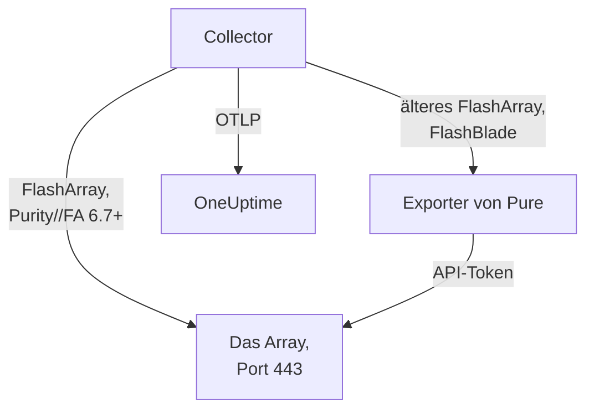

# Speicher-Array-Agent

Der OneUptime-Storage-Array-Agent überwacht Storage-Arrays: Kapazität und Datenreduktion, Latenz, IOPS und Bandbreite, Volumes, Hosts, Pods und Replikation, Hardware-Zustand, Dateisysteme und Buckets. Er ist ein unveränderter OpenTelemetry Collector, der die OpenMetrics-Endpunkte des Arrays mit dem API-Token eines schreibgeschützten Benutzers scrapt, jede Metrik mit der Identität Ihres Arrays versieht und sie an OneUptime sendet. [Storage-Array-Monitore](/docs/monitor/storage-array-monitor) alarmieren anhand dessen, was ankommt.

:::cards
- [Agent installieren](#agent-installieren): Ein schreibgeschützter Benutzer, dann das Installationsskript oder Docker Compose.
- [Was der Agent erfasst](#was-der-agent-erfasst): Jeder Endpunkt und die Seiten, die daraus entstehen.
- [Mehrere Arrays überwachen](#mehrere-arrays-überwachen): Ein Agent pro Array, auf einem Rechner.
- [Fehlerbehebung](#fehlerbehebung): Ein Diagnoseskript und die üblichen Probleme.
:::

## So funktioniert es

Storage Arrays ist ein Produkt, das für jeden Hersteller gleich funktioniert. Es unterstützt:

| Array | Wie der Agent es liest | Collector-Konfiguration |
| --- | --- | --- |
| **Pure Storage FlashArray**, Purity//FA 6.7 und neuer | Der eigene OpenMetrics-Endpunkt des Arrays (`https://<array>/metrics/...?namespace=purefa`): Neben dem Collector läuft nichts | `otel-collector-config.yaml` (der Standard) |
| **Pure Storage FlashArray**, älteres Purity//FA | Der FlashArray-OpenMetrics-Exporter von Pure, den dieselbe Compose-Datei als Dienst `pure-fa-exporter` ausführt | `otel-collector-config.flasharray-exporter.yaml` |
| **Pure Storage FlashBlade** | Der FlashBlade-OpenMetrics-Exporter von Pure, den dieselbe Compose-Datei als Dienst `pure-fb-exporter` ausführt | `otel-collector-config.flashblade.yaml` |

Pure Storage hat sich im Februar 2026 in **Everpure** umbenannt. FlashArray, FlashBlade und Purity behielten ihre Namen, ebenso die Metriken `purefa_*` und `purefb_*`; alles auf dieser Seite gilt daher für Arrays, die unter dem einen oder dem anderen Namen verkauft werden.



Ein Agent überwacht ein Array: Führen Sie einen Agent pro Array aus (siehe [Mehrere Arrays überwachen](#mehrere-arrays-überwachen)). Das Array registriert sich mit seinen ersten Daten unter dem Namen, den der Agent als `storage.array.name` an jede Metrik hängt.

## Bevor Sie beginnen

- Docker Engine 20.10 oder neuer mit dem Plugin Docker Compose v2, auf einem Rechner, der die Management-Schnittstelle des Arrays per HTTPS (TCP 443) erreicht.
- Ein Administratorkonto auf dem Array, um einen Benutzer mit der eingebauten Rolle **readonly** und ein API-Token für ihn anzulegen.
- Ein Ingestion-Schlüssel. Legen Sie ihn unter **Projekteinstellungen → Telemetrie & APM → Ingestion-Schlüssel** an und kopieren Sie seinen Wert.

### Wo der Agent laufen sollte

Der Agent spricht per HTTPS mit der Management-Schnittstelle des Arrays; er kann daher auf jedem Rechner mit Docker und einer Route ins Managementnetz auf TCP 443 laufen: einem Monitoring-Host oder einer kleinen Management-VM. Bevorzugen Sie einen Rechner, dessen eigener Speicher nicht auf dem überwachten Array liegt: Fällt das Array aus, sollte Ihr Monitoring nicht mit ihm ausfallen. Der optionale Syslog-Listener setzt außerdem voraus, dass das Array den Agent auf dem Syslog-Port erreicht (siehe [Das Syslog des Arrays senden](#optional-das-syslog-des-arrays-senden)).

## Agent installieren

:::steps
### Den schreibgeschützten Benutzer und das API-Token anlegen

Der Agent liest immer nur. Geben Sie ihm einen eigenen Benutzer mit der eingebauten Rolle **readonly**, niemals einen Administrator, und ein API-Token für diesen Benutzer. Legen Sie das Token **ohne Ablaufdatum** an, sonst hört der Agent an dem Tag auf, an dem das Token abläuft.

:::tabs
@tab Purity CLI
Melden Sie sich per SSH als Administrator am FlashArray an. Der erste Befehl fragt nach dem Passwort des neuen Benutzers; der zweite gibt sein API-Token aus, eine UUID:

```bash
pureadmin create --role readonly oneuptime
pureadmin create --api-token oneuptime
```
@tab FlashArray GUI
1. Öffnen Sie _Settings → Users and Policies_ (_Settings → Access_ in älteren Releases).
2. Wählen Sie im ⋮-Menü des Bereichs **Users** den Eintrag **Create User…**, nennen Sie den Benutzer `oneuptime` und geben Sie ihm die Rolle readonly.
3. Wählen Sie im ⋮-Menü des neuen Benutzers **Create API Token…**, lassen Sie **Expires In** leer und kopieren Sie das Token.
@tab FlashBlade
Legen Sie auf dieselbe Weise einen Benutzer mit der Rolle **readonly** und ein API-Token für ihn an: in den Benutzereinstellungen der FlashBlade-GUI oder mit `pureadmin` in der Purity//FB-CLI. In einem Release ohne lokale Benutzer verwenden Sie ein Konto eines Verzeichnisdienstes (LDAP oder Active Directory), dessen Gruppe auf die Rolle readonly abgebildet ist. FlashBlade-API-Tokens beginnen mit `T-`.
:::

### Prüfen, ob das FlashArray seine eigenen Metriken liefert

Pure dokumentiert den nativen OpenMetrics-Endpunkt für **Purity//FA 6.7.0 und neuer** (der Abkündigungshinweis zum FlashArray-Exporter von Pure nennt 6.6.11 und neuer). Am schnellsten erfahren Sie es, indem Sie das Array fragen, von dem Rechner aus, auf dem der Agent laufen wird:

```bash
curl -k 'https://<array>/metrics/array?namespace=purefa' --header 'Authorization: Bearer <api-token>' | grep purefa_info
```

Eine Zeile `purefa_info{...} 1` bedeutet, dass das Array seine Metriken nativ liefert: Verwenden Sie die Standardkonfiguration. Ein `404` bedeutet, dass es das nicht tut: Verwenden Sie die Exporter-Konfiguration, die den Exporter von Pure neben dem Collector ausführt. Pure hat diesen Exporter abgekündigt; wechseln Sie daher zur nativen Konfiguration, sobald das Array aktualisiert ist. Ein FlashBlade läuft immer über den FlashBlade-Exporter von Pure; überspringen Sie diesen Schritt dafür.

### Den Agent installieren und starten

:::tabs
@tab install.sh
Laden Sie das Installationsskript herunter und führen Sie es auf dem Rechner aus, auf dem der Agent laufen soll:

```bash
curl -sSL https://raw.githubusercontent.com/OneUptime/oneuptime/master/agents/StorageArrayAgent/install.sh -o install.sh
bash install.sh
```

Das Skript fragt, um welches Array es sich handelt (ein FlashArray mit nativen Metriken, ein FlashArray mit älterem Purity//FA oder ein FlashBlade), dann nach Ihrer OneUptime-URL, dem Ingestion-Schlüssel, einem Namen für das Array, der Management-Adresse des Arrays und dem API-Token des schreibgeschützten Benutzers (ohne Echo gelesen). Es installiert nach `/opt/oneuptime-storage-array-agent`, lädt die Compose-Datei und alle drei Collector-Konfigurationen herunter, schreibt eine mit `0600` geschützte `.env`-Datei mit der passenden Konfiguration und dem passenden Compose-Profil und startet den Agent mit Docker Compose. Es setzt jeden Wert so für Docker Compose in Anführungszeichen, wie Sie ihn eingegeben haben. Ein erneuter Lauf verwendet alles in einer vorhandenen `.env` wieder, statt erneut zu fragen, und bewahrt eine von Ihnen bearbeitete Datei als `<file>.bak.<timestamp>` auf, bevor er sie ersetzt.
@tab Docker Compose
Laden Sie `docker-compose.yml` und die drei Dateien `otel-collector-config*.yaml` aus dem [Verzeichnis StorageArrayAgent](https://github.com/OneUptime/oneuptime/tree/master/agents/StorageArrayAgent) in einen neuen Ordner herunter:

```bash
curl -fsSLO https://raw.githubusercontent.com/OneUptime/oneuptime/master/agents/StorageArrayAgent/docker-compose.yml
curl -fsSLO https://raw.githubusercontent.com/OneUptime/oneuptime/master/agents/StorageArrayAgent/otel-collector-config.yaml
curl -fsSLO https://raw.githubusercontent.com/OneUptime/oneuptime/master/agents/StorageArrayAgent/otel-collector-config.flasharray-exporter.yaml
curl -fsSLO https://raw.githubusercontent.com/OneUptime/oneuptime/master/agents/StorageArrayAgent/otel-collector-config.flashblade.yaml
```

Legen Sie daneben eine Datei `.env` an. Sie enthält das API-Token; schützen Sie sie daher mit `chmod 600 .env`. Für ein FlashArray mit nativen Metriken:

```bash title=".env"
ONEUPTIME_URL=YOUR_ONEUPTIME_URL
ONEUPTIME_TELEMETRY_INGESTION_KEY=YOUR_TELEMETRY_INGESTION_TOKEN
STORAGE_ARRAY_NAME=my-storage-array
STORAGE_SYSTEM=purestorage.flasharray
STORAGE_ARRAY_COLLECTOR_CONFIG=otel-collector-config.yaml
COMPOSE_PROFILES=
PURE_FA_ENDPOINT=fa-prod-01.example.com
PURE_FA_API_TOKEN=YOUR_READ_ONLY_API_TOKEN
PURE_FB_ENDPOINT=
PURE_FB_API_TOKEN=
STORAGE_ARRAY_INSECURE_SKIP_VERIFY=true
```

Für ein FlashArray mit älterem Purity//FA setzen Sie `STORAGE_ARRAY_COLLECTOR_CONFIG=otel-collector-config.flasharray-exporter.yaml` und `COMPOSE_PROFILES=flasharray-exporter`. Für ein FlashBlade setzen Sie `STORAGE_SYSTEM=purestorage.flashblade`, `STORAGE_ARRAY_COLLECTOR_CONFIG=otel-collector-config.flashblade.yaml` und `COMPOSE_PROFILES=flashblade` und füllen `PURE_FB_ENDPOINT` und `PURE_FB_API_TOKEN` statt des Paars `PURE_FA_*` aus. Starten Sie den Agent:

```bash
docker compose up -d
```
:::

### Prüfen, ob der Agent läuft

```bash
docker compose ps
docker logs -f oneuptime-storage-array-agent
```

`docker compose ps` listet den Collector (`oneuptime-storage-array-agent`) und, bei einer Exporter-Konfiguration, den Exporter (`pure-fa-exporter` oder `pure-fb-exporter`) auf. Sobald der Collector gestartet ist, sollten seine Logs diese Zeile zeigen:

```text
Everything is ready. Begin running and processing data.
```

### Das Array in OneUptime finden

Öffnen Sie **Produkte → Infrastruktur → Storage Arrays → All Storage Arrays**. Nach dem ersten Scrape (etwa einer Minute) ist das Array mit seiner Kapazität, Leistung, offenen Alarmen und Hardware da. Volumes, Hosts und Pods folgen innerhalb von 2 Minuten, die Dateisysteme und Buckets eines FlashBlade innerhalb von 5 und FlashArray-Verzeichnisse innerhalb von 30.
:::

## Umgebungsvariablen

Das Installationsskript schreibt diese nach `/opt/oneuptime-storage-array-agent/.env`; eine Docker-Compose-Installation liest sie aus der `.env` neben `docker-compose.yml`. Nachdem Sie einen Wert geändert haben, führen Sie in diesem Ordner `docker compose up -d` aus.

| Variable | Erforderlich | Beschreibung |
| --- | --- | --- |
| `ONEUPTIME_URL` | Ja | Ihre OneUptime-URL, etwa `https://oneuptime.com` oder Ihre selbst gehostete Instanz. Verwenden Sie `http://` und ihren Port, wenn die Instanz nur HTTP spricht. |
| `ONEUPTIME_TELEMETRY_INGESTION_KEY` | Ja | Der Ingestion-Schlüssel aus **Projekteinstellungen → Telemetrie & APM → Ingestion-Schlüssel**. |
| `STORAGE_ARRAY_NAME` | Ja | Der Name, unter dem sich das Array in OneUptime registriert, an jede Metrik als Ressourcenattribut `storage.array.name` gehängt. Halten Sie ihn stabil: Eine spätere Änderung registriert ein zweites Array. Ohne ihn startet der Collector nicht. |
| `STORAGE_SYSTEM` | Nein | Die Plattform, angehängt als Ressourcenattribut `storage.system`: `purestorage.flasharray` oder `purestorage.flashblade`. Standard ist `purestorage.flasharray`. |
| `STORAGE_ARRAY_COLLECTOR_CONFIG` | Nein | Welche mitgelieferte Collector-Konfiguration läuft: `otel-collector-config.yaml` (FlashArray, nativ: der Standard), `otel-collector-config.flasharray-exporter.yaml` (älteres FlashArray) oder `otel-collector-config.flashblade.yaml` (FlashBlade). |
| `COMPOSE_PROFILES` | Nein | Startet den Exporter, den die gewählte Konfiguration scrapt: leer für die native FlashArray-Konfiguration, `flasharray-exporter` oder `flashblade` für die anderen beiden. |
| `PURE_FA_ENDPOINT` | FlashArray | Die Management-Adresse des FlashArray: ein Hostname oder eine IP, ohne `https://`. |
| `PURE_FA_API_TOKEN` | FlashArray | Das API-Token des FlashArray-Benutzers mit der Rolle readonly. |
| `PURE_FB_ENDPOINT` | FlashBlade | Die Management-Adresse des FlashBlade: ein Hostname oder eine IP, ohne `https://`. |
| `PURE_FB_API_TOKEN` | FlashBlade | Das API-Token des FlashBlade-Benutzers mit der Rolle readonly. |
| `STORAGE_ARRAY_INSECURE_SKIP_VERIFY` | Nein | `true` akzeptiert am nativen Endpunkt das selbstsignierte Zertifikat des Arrays; `false` prüft es. Standard ist `true`. Die Exporter von Pure prüfen das Zertifikat des Arrays nie, daher gilt die Einstellung für sie nicht. |

## Wie der Agent scrapt

- **Ein Scrape-Job pro Endpunkt, jeder so oft gelesen, wie es sich lohnt.** FlashArray: `/metrics/array` alle 60 Sekunden; `/metrics/volumes`, `/metrics/hosts` und `/metrics/pods` alle 2 Minuten; `/metrics/directories` alle 30 Minuten, wie Pure selbst rät, weil der Platz von Verzeichnissen für das Array aufwendig zu berechnen ist. FlashBlade: `/metrics/array` alle 60 Sekunden; `/metrics/filesystems` und `/metrics/objectstore` alle 5 Minuten, wieder nach dem Rat von Pure, die Endpunkte für Dateisysteme und Objektspeicher seltener zu lesen als das Array.
- **Jeder Job versieht seine Serien mit dem Label `scrape_endpoint: <endpoint>`.** Jeder Endpunkt exportiert außerdem `purefa_info` oder `purefb_info`; so weiß OneUptime, von welchen Familien ein Batch die vollständige Liste ist: Auf diese Weise verlässt ein gelöschtes Volume, ein Host, ein Pod, ein Dateisystem oder ein Bucket das Inventar, statt darin hängen zu bleiben. Behalten Sie die Labels wie ausgeliefert.
- **Die Latenz pro Volume und pro Host behält drei Dimensionen.** Jedes Volume und jeder Host exportiert seine Latenz in bis zu sechzehn `dimension`s. Eine Regel `metric_relabel_configs` behält `usec_per_read_op`, `usec_per_write_op` und `usec_per_mirrored_write_op` und verwirft die Aufschlüsselung nach QoS-Ratenlimit, Warteschlange, SAN und Servicezeit, die die Serien eines großen Arrays vervielfacht. Die arrayweite Aufschlüsselung auf `purefa_array_performance_latency_usec` bleibt erhalten. Löschen Sie die Regel, um auch die Aufschlüsselung pro Volume zu behalten.
- **Das API-Token ist ein Bearer-Token.** Die native Konfiguration sendet es an das Array selbst; die Exporter-Konfigurationen senden es nur über das Compose-Netzwerk an den Exporter, und die Ports der Exporter werden nie veröffentlicht.
- **Kein `send_batch_max_size`.** OneUptime baut das Inventar aus einem ganzen Scrape pro Anfrage neu auf; der mitgelieferte Processor `batch` teilt einen Scrape daher nie auf mehrere Exporte auf. Behalten Sie die Batch-Einstellungen wie ausgeliefert.

## Was der Agent erfasst

Die semantischen Konventionen von Pure gelten gleichermaßen für den nativen FlashArray-Endpunkt und beide Exporter. Jeder Wert ist ein Gauge, den das Array selbst berechnet (Latenzen in Mikrosekunden pro Operation, Durchsatz pro Sekunde), daher müssen keine Raten berechnet werden, und Objekte werden über **Datenpunkt-Labels** benannt: `name` für Volumes, Pods, Verzeichnisse, Dateisysteme und Buckets, `host` für Hosts, `component_name` für FlashArray-Hardware. Der Agent hängt die Ressourcenattribute `storage.array.name` und `storage.system` an, sodass OneUptime alles unter Ihrem Array ablegt:

| Endpunkt | Metrikfamilien | Was OneUptime daraus baut |
| --- | --- | --- |
| FlashArray `/metrics/array` | `purefa_info`, `purefa_alerts_open`, `purefa_array_space_*`, `purefa_array_performance_*`, `purefa_hw_component_status`, `purefa_hw_component_temperature_celsius`, `purefa_hw_controller_info`, `purefa_drive_capacity_bytes`, `purefa_network_interface_*` | Name, Purity-Version und System-ID des Arrays; Kapazität, belegter Platz und Datenreduktion; Anzahl offener Alarme; der Zustand des Arrays; die Seite **Hardware** (Komponenten, Laufwerke, Controller, Netzwerkschnittstellen) |
| FlashArray `/metrics/volumes` | `purefa_volume_performance_*`, `purefa_volume_space_*`, `purefa_volume_qos_*` | Die Seite **Volumes**: bereitgestellte und physische Größe, Datenreduktion, Lese- und Schreiblatenz, IOPS und Bandbreite pro Volume |
| FlashArray `/metrics/hosts` | `purefa_host_connectivity_info`, `purefa_host_connections_info`, `purefa_host_performance_*`, `purefa_host_space_*` | Die Seite **Hosts**: Konnektivität (redundante Pfade oder nicht), verbundene Volumes, Latenz, IOPS und Bandbreite pro Host |
| FlashArray `/metrics/pods` | `purefa_pod_performance_*`, `purefa_pod_space_*`, `purefa_pod_replica_links_*`, `purefa_pod_mediator_status` | Die Seite **Replikation**: ActiveCluster- und ActiveDR-Pods, Status und Verzögerung der Replikatverbindungen |
| FlashArray `/metrics/directories` | `purefa_directory_performance_*`, `purefa_directory_space_*` | Die Seite **Directories** (FlashArray File Services) |
| FlashBlade `/metrics/array` | `purefb_info`, `purefb_alerts_open`, `purefb_array_space_*`, `purefb_array_performance_*`, `purefb_hardware_health` | Name, Purity-Version und System-ID des FlashBlade; Kapazität und Datenreduktion; Anzahl offener Alarme; der Zustand des Arrays; die Seite **Hardware** |
| FlashBlade `/metrics/filesystems` | `purefb_file_systems_space_*`, `purefb_file_systems_performance_*` | Die Seite **File Systems**: bereitgestellter und belegter Platz, Datenreduktion, Latenz, IOPS und Bandbreite pro Dateisystem |
| FlashBlade `/metrics/objectstore` | `purefb_buckets_space_*`, `purefb_buckets_quota_space_bytes`, `purefb_buckets_object_count`, `purefb_buckets_performance_*`, `purefb_object_store_accounts_*` | Die Seite **Buckets**: Platz, Kontingent, Objektanzahl und Leistung pro Bucket, nach Konto gruppiert |

Der Zustand des Arrays auf seiner Seite **Übersicht** ist **Kritisch**, solange es einen offenen kritischen Alarm meldet oder eine Hardwarekomponente, ein Laufwerk oder einen Controller, die kritisch, ausgefallen, fehlend oder fehlerhaft sind; **Warnung**, solange es einen offenen Warnalarm oder eine beeinträchtigte oder unbekannte Komponente meldet; und andernfalls **OK**. In Monitorkriterien erhalten die Attribute des Arrays das Präfix `resource.` (`resource.storage.array.name`, `resource.storage.system`), während die Datenpunkt-Labels ohne Präfix bleiben (`name`, `host`, `dimension`, `space`).

## Optional — Das Syslog des Arrays senden

Standardmäßig sendet der Agent nur Metriken, daher bleibt die Seite **Protokolle** des Arrays leer. Arrays leiten ihre Alarme und Audit-Ereignisse als Syslog weiter, und jede mitgelieferte Collector-Konfiguration enthält ein auskommentiertes Receiver-Paar `syslog` (TCP und UDP auf Port 5514, RFC 3164), verbunden mit einer auskommentierten Pipeline `logs`, die `storage.array.name` anhängt, damit die Logs bei Ihrem Array landen.

:::steps
### Die Receiver einschalten

Kommentieren Sie die beiden Receiver `syslog/*` und die Pipeline `logs` in der verwendeten Collector-Konfiguration ein. Zeitstempel nach RFC 3164 tragen keine Zeitzone: Setzen Sie `location` auf die Zeitzone des Arrays, sofern seine Uhr nicht auf UTC läuft.

### Den Port öffnen

Kommentieren Sie den Block `ports:` in `docker-compose.yml` ein, damit der Rechner `5514/tcp` und `5514/udp` veröffentlicht, und führen Sie dann `docker compose up -d` aus. Öffnen Sie den Port in der Firewall des Rechners für das Managementnetz des Arrays.

### Das Array auf den Agent verweisen

Tun Sie dies als Administrator, nicht als schreibgeschützter Monitoring-Benutzer. Öffnen Sie auf einem FlashArray _Settings → System → Syslog Servers_, fügen Sie `udp://<agent-host>:5514` (oder `tcp://<agent-host>:5514`) hinzu und senden Sie eine Testnachricht. Fügen Sie auf einem FlashBlade in dessen Syslog-Einstellungen einen Syslog-Server mit derselben URI hinzu. Beide Arrays nehmen die Form `PROTOCOL://HOST:PORT` an, auch über ihre REST-APIs (`syslog-servers`).
:::

Ein Syslog-Receiver lauscht nur auf einem Transport, deshalb sind TCP und UDP zwei Receiver: Lassen Sie einen auskommentiert, wenn Sie nur den anderen brauchen. Das Standard-Image des Collectors liest Syslog unverändert: Es ist kein eigenes Image nötig.

## Das Array mit Projekt-Labels versehen

Ein Ressourcenattribut, das mit `oneuptime.label.` beginnt, wird zu einem Projekt-Label am Storage-Array: `oneuptime.label.<dimension>=<value>` ist das Label `<dimension>:<value>`. Fügen Sie die Attribute dem Processor `resource` in der verwendeten Collector-Konfiguration hinzu, neben `storage.array.name`:

```yaml
processors:
  resource:
    attributes:
      # ...existing attributes...
      - key: oneuptime.label.team
        value: storage
        action: upsert
      - key: oneuptime.label.env
        value: production
        action: upsert
```

Der Collector liest seine Konfiguration nur beim Start: Führen Sie `docker compose restart oneuptime-storage-array-agent` aus. Das Array zeigt dann die Labels `team:storage` und `env:production`. Labels werden ohne Rücksicht auf Groß- und Kleinschreibung verglichen, daher wird ein vorhandenes Label `Production` wiederverwendet statt dupliziert, und der Agent entfernt nie ein Label, das jemand in OneUptime hinzugefügt hat.

## Mehrere Arrays überwachen

Ein Agent liest ein Array. Um mehrere vom selben Rechner aus zu überwachen, installieren Sie jeden in einen eigenen Ordner mit eigener `.env`, etwa `INSTALL_DIR=/opt/oneuptime-storage-array-agent-fa02 bash install.sh`, und geben Sie jedem einen eigenen `container_name` in seiner `docker-compose.yml` (etwa `oneuptime-storage-array-agent-fa02`): Zwei Container können sich keinen Namen teilen. Übergeben Sie den Ordner mit `-d` an das Diagnoseskript.

## Als systemd-Dienst ausführen

Um den Agent mit dem Rechner zu starten und bei einem Fehler neu zu starten, installieren Sie seine systemd-Unit. Sie geht davon aus, dass der Agent in `/opt/oneuptime-storage-array-agent` liegt, wo das Installationsskript ihn ablegt:

```bash
sudo curl -fsSL https://raw.githubusercontent.com/OneUptime/oneuptime/master/agents/StorageArrayAgent/systemd/oneuptime-storage-array-agent.service -o /etc/systemd/system/oneuptime-storage-array-agent.service
sudo systemctl daemon-reload
sudo systemctl enable --now oneuptime-storage-array-agent
```

## Agent aktualisieren

Der Agent meldet die Collector-Version, die seine Dateien festlegen, als seine **Agent-Version**. Ist sie älter als die Version, die dieses OneUptime-Release festlegt, erscheint daneben auf der Seite **Übersicht** des Arrays ein Warnzeichen. Wählen Sie es aus, um diese Befehle zu sehen. Ein Agent, der installiert wurde, bevor seine Dateien eine Version meldeten, zeigt keine an, bis er auf diese Weise aktualisiert wurde.

Das Collector-Image ist in `docker-compose.yml` festgelegt, und seine Konfigurationen sind Dateien daneben; ein Pull allein bringt den Agent daher nicht voran. Führen Sie `install.sh` erneut aus: Es verwendet jeden Wert Ihrer vorhandenen `.env` wieder (es wird nichts erneut abgefragt), erneuert `docker-compose.yml` und die drei Collector-Konfigurationen (eine von Ihnen bearbeitete Datei wird als `<file>.bak.<timestamp>` aufbewahrt) und erstellt den Agent neu, damit der Collector seine neue Konfiguration liest. Ein Agent, der außerhalb von `/opt/oneuptime-storage-array-agent` installiert ist, braucht seinen Ordner: `INSTALL_DIR=<folder> bash install.sh`.

```bash
curl -sSL https://raw.githubusercontent.com/OneUptime/oneuptime/master/agents/StorageArrayAgent/install.sh -o install.sh
bash install.sh
```

Haben Sie stattdessen mit Docker Compose installiert? Laden Sie im Ordner des Agents die Compose-Datei und die drei Collector-Konfigurationen erneut herunter (und nehmen Sie Ihre Änderungen daran erneut vor), ziehen Sie dann die Images und erstellen Sie den Agent neu:

```bash
curl -fsSLO https://raw.githubusercontent.com/OneUptime/oneuptime/master/agents/StorageArrayAgent/docker-compose.yml
curl -fsSLO https://raw.githubusercontent.com/OneUptime/oneuptime/master/agents/StorageArrayAgent/otel-collector-config.yaml
curl -fsSLO https://raw.githubusercontent.com/OneUptime/oneuptime/master/agents/StorageArrayAgent/otel-collector-config.flasharray-exporter.yaml
curl -fsSLO https://raw.githubusercontent.com/OneUptime/oneuptime/master/agents/StorageArrayAgent/otel-collector-config.flashblade.yaml
docker compose pull
docker compose up -d --force-recreate
```

## Agent deinstallieren

```bash
cd /opt/oneuptime-storage-array-agent
docker compose down
```

Löschen Sie dann den schreibgeschützten Benutzer und sein API-Token auf dem Array, wenn Sie sie nicht mehr brauchen.

## Fehlerbehebung

:::details Zuerst das Diagnoseskript ausführen
Der Agent bringt ein Skript mit, [`troubleshoot.sh`](https://github.com/OneUptime/oneuptime/blob/master/agents/StorageArrayAgent/troubleshoot.sh), das die ganze Kette prüft: die Container-Laufzeit; den Endpunkt des Arrays genau so, wie der Collector ihn erreicht (den nativen Endpunkt oder den Exporter von Pure: DNS, TLS, ob ein FlashArray überhaupt den nativen Endpunkt hat und ob das Array das API-Token akzeptiert, das das Skript curl über stdin übergibt); den an jede Metrik gehängten Array-Namen; die Form des Tokens; die eigenen Metriken des Collectors; und ob OneUptime den Ingestion-Schlüssel akzeptiert. Diese letzte Prüfung zählt am meisten. OneUptime lehnt einen falschen Schlüssel mit `401` ab (`422` für einen deaktivierten Schlüssel oder einen Browser-Schlüssel), und der Collector behandelt beides als dauerhaft: Er verwirft den Batch und protokolliert einen Fehler `Exporting failed`, der leicht zu übersehen ist, während der Container gesund bleibt. Das Skript fragt `GET <url>/otlp/v1/validate` aus dem Netzwerk des Agents ab, um direkt `200` (gültig) oder `401` (ungültig) zu erhalten, und weicht auf älteren Servern auf `POST /fluentd/v1/logs` aus.

```bash
curl -sSL https://raw.githubusercontent.com/OneUptime/oneuptime/master/agents/StorageArrayAgent/troubleshoot.sh -o troubleshoot.sh
bash troubleshoot.sh    # add -d <dir> if you installed outside /opt/oneuptime-storage-array-agent
```

Es endet mit einem Urteil, das die wahrscheinlichste Ursache nennt.
:::

:::details Es erscheint kein Array in OneUptime
1. Lesen Sie die Logs des Collectors: `docker logs oneuptime-storage-array-agent`. `server returned HTTP status 401` bedeutet, dass das Array das API-Token abgelehnt hat, `404`, dass das FlashArray keinen nativen Endpunkt hat, `x509`, dass die TLS-Prüfung gegen das selbstsignierte Zertifikat des Arrays eingeschaltet ist, `no such host` oder `connection refused` einen falschen `PURE_FA_ENDPOINT` oder `PURE_FB_ENDPOINT`, und ein `401` beim Export einen falschen Ingestion-Schlüssel.
2. Fragen Sie das Array aus dem Netzwerk des Agents. Das Collector-Image hat weder Shell noch curl; fragen Sie daher aus einem Container in seinem Netzwerk: `docker run --rm --network container:oneuptime-storage-array-agent curlimages/curl -sk -H 'Authorization: Bearer <api-token>' 'https://<array>/metrics/array?namespace=purefa'` sollte `purefa_*`-Zeilen ausgeben.
3. Prüfen Sie, ob `STORAGE_ARRAY_NAME` gesetzt ist: Das Array wird über sein Ressourcenattribut `storage.array.name` gefunden, und ohne ihn startet der Collector nicht.
:::

:::details Das Array wird als getrennt angezeigt
Ein Array wird als getrennt angezeigt, wenn OneUptime 15 Minuten lang nichts von ihm empfangen hat; OneUptime prüft alle 5 Minuten, und Zeit, in der es selbst keine Daten empfing, zählt nicht. Prüfen Sie, ob der Collector läuft (`docker compose ps`), ob seine Logs keine Scrape- oder Exportfehler zeigen und ob der Rechner das Array und Ihre OneUptime-URL noch erreicht. Mit seinen nächsten Daten wird das Array wieder als verbunden angezeigt.
:::

:::details Das FlashArray antwortet mit 404
Sein Purity//FA hat keinen nativen OpenMetrics-Endpunkt. Führen Sie `install.sh` erneut aus und wählen Sie die Option für älteres Purity, oder setzen Sie `STORAGE_ARRAY_COLLECTOR_CONFIG=otel-collector-config.flasharray-exporter.yaml` und `COMPOSE_PROFILES=flasharray-exporter` in `.env` und führen Sie `docker compose up -d` aus. Wechseln Sie nach dem Upgrade des Arrays auf Purity//FA 6.7 oder neuer zurück zur nativen Konfiguration und entfernen Sie das Profil.
:::

:::details Das Array lehnt das API-Token ab
Prüfen Sie, ob Sie das API-Token eingefügt haben und nicht das Passwort des Benutzers; ob der Benutzer noch existiert und die Rolle readonly hat; und ob das Token nicht abgelaufen ist. Legen Sie ein neues Token an (`pureadmin create --api-token oneuptime` auf einem FlashArray), tragen Sie es in `.env` ein und führen Sie `docker compose up -d` aus. Über die Exporter von Pure erscheint ein abgelehntes Token im Log des Collectors als HTTP-`400` vom Exporter, dessen Body `failed to login` lautet.
:::

:::details x509- oder TLS-Fehler
Arrays legen standardmäßig ein selbstsigniertes Zertifikat vor, dem kein Docker-Image vertraut. Setzen Sie entweder `STORAGE_ARRAY_INSECURE_SKIP_VERIFY=true` (die praktische Wahl in einem privaten Managementnetz), oder installieren Sie auf dem Array ein Zertifikat von einer CA, der das Collector-Image vertraut.
:::

:::details pure-fa-exporter oder pure-fb-exporter wird nicht aufgelöst
Der Exporter läuft nicht: `COMPOSE_PROFILES` muss zu `STORAGE_ARRAY_COLLECTOR_CONFIG` passen (`flasharray-exporter` für die FlashArray-Exporter-Konfiguration, `flashblade` für die FlashBlade-Konfiguration). Korrigieren Sie `.env` und führen Sie `docker compose up -d` aus; `docker compose ps` listet dann den Exporter auf.
:::

:::details Gelöschte Volumes oder Hosts bleiben im Inventar
OneUptime entfernt ein Objekt, wenn ein vollständiger Scrape seines Endpunkts es nicht mehr enthält, was es am Label `scrape_endpoint` erkennt. Haben Sie die mitgelieferte Collector-Konfiguration durch Ihre eigene ersetzt, behalten Sie die Labels `scrape_endpoint` an ihren Scrape-Jobs; andernfalls verlassen Objekte das Inventar erst, wenn sie veralten.
:::

:::details Metriken landen beim falschen Array
OneUptime registriert ein Storage-Array über sein `storage.array.name`, das der Agent aus `STORAGE_ARRAY_NAME` nimmt. Eine Änderung nach den ersten Daten legt ein zweites Array an, statt das erste umzubenennen.
:::

:::details Metriken ohne den Agent senden
Der Agent ist eine einzige unveränderte Collector-Konfiguration; Collectors, die Sie bereits betreiben, können daher dieselbe Aufgabe übernehmen: Kopieren Sie die Scrape-Jobs und den Processor `resource` aus der mitgelieferten Konfiguration in Ihre eigene. Das Ressourcenattribut `storage.array.name` registriert das Array in OneUptime, und das Löschen von `service.name` / `service.instance.id` verhindert, dass die Daten unter einem Service abgelegt werden: Behalten Sie beides, und behalten Sie die Labels `scrape_endpoint`.
:::

## Nächste Schritte

:::cards
- [Speicher-Array-Überwachung](/docs/monitor/storage-array-monitor): Alarmieren bei Alarmen, Kapazität, Latenz, Hardware, Hostpfaden, Replikation und Dateisystemen.
- [VMware-Agent](/docs/telemetry/vmware): Läuft VMware auf dem Array? Sehen Sie auch seine Datastores und VMs.
- [Host-OpenTelemetry-Collector](/docs/telemetry/host-otel-collector): Die Sicht des Betriebssystems auf die Rechner, die das Array nutzen.
:::
