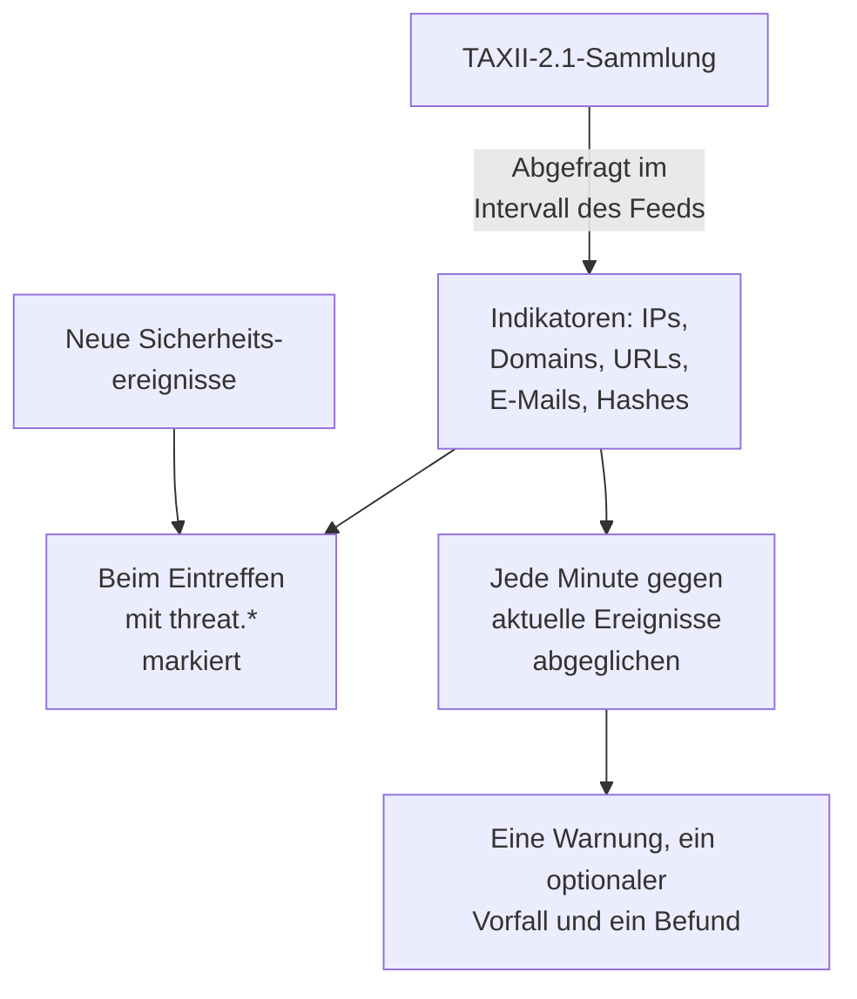

# Threat Intelligence (STIX/TAXII)

Ein Threat-Intel-Feed bringt bekannte bösartige IP-Adressen, Domains, URLs, E-Mail-Adressen und Datei-Hashes in OneUptime und sagt Ihnen, wenn Ihre [Sicherheitsereignisse](/docs/telemetry/security-events) eine davon erwähnen. Jeder Feed abonniert eine TAXII-2.1-Sammlung von STIX-2.1-Indikatoren: Ihren eigenen MISP-, OpenCTI- oder OpenTAXII-Server oder die Sammlung eines Anbieters. OneUptime liefert keine eigenen Feed-Inhalte: Sie bringen die Sammlungen mit, so wie Sie die Sigma-Regeln mitbringen.

:::cards
- [Einen Feed abonnieren](#einen-feed-abonnieren): Ein TAXII-Server, eine Sammlung und die Art der Anmeldung.
- [Was aufgenommen wird](#was-aufgenommen-wird): Die Indikatormuster, die OneUptime behält, und wie lange.
- [Wie Treffer gefunden werden](#wie-treffer-gefunden-werden): Beim Eintreffen der Ereignisse markiert und jede Minute abgeglichen.
- [Bedrohungsstufen](#bedrohungsstufen): Wie die Konfidenz eines Indikators zu einem Schweregrad wird.
:::

## So funktioniert es



## Bevor Sie beginnen

- Ein TAXII-2.1-Server, der STIX-2.1-Objekte vom Typ `indicator` veröffentlicht, und die ID der abzufragenden Sammlung. Ein Feed meldet sich anonym, mit einem Bearer-Token oder mit HTTP-Basic-Auth an.
- Server, die ein TLS-Client-Zertifikat verlangen (Mutual TLS), wie CISA AIS, werden nicht unterstützt. Der öffentliche ATT&CK-Server von MITRE veröffentlicht Techniken und Gruppen statt Indikatoren, also bleibt ein Feed, der auf ihn zeigt, leer.
- Eine Rolle, die Feeds erstellen darf: Project Owner, Project Admin, Security Admin oder Security Member. Security Viewer kann Feeds und Indikatoren lesen. Siehe [Rollen](/docs/permissions/reference#rollen).

## Einen Feed abonnieren

:::steps
### Threat Intel öffnen

Öffnen Sie **Produkte → Sicherheitsereignisse → Threat Intel**.

### Den Feed erstellen

Klicken Sie auf **Threat-Intel-Feed erstellen** und füllen Sie seine vier Schritte aus: **Grundinformationen**, **TAXII-Server**, **Authentifizierung** und **Bei Treffer**. Die Felder stehen in der Tabelle unten.

### Die erste Abfrage prüfen

Innerhalb von ein, zwei Minuten zeigt die Zeile des Feeds **Zuletzt abgefragt**, und **Zusammenfassung der letzten Abfrage** sagt, was die Abfrage geholt hat. Indikatoren erscheinen in der Tabelle **Indikatoren** unter den Feeds.
:::

| Feld | Was Sie eintragen |
| --- | --- |
| **TAXII-API-Root-URL** | Der TAXII-2.1-API-Root des Servers, etwa `https://taxii.example.com/api1/`. Sammlungen werden darunter adressiert. |
| **Sammlungs-ID** | Die Sammlung, die die Indikatoren veröffentlicht. |
| **Abfrageintervall (Minuten)** | Wie oft neue Objekte geholt werden: 1 bis 1440 Minuten, standardmäßig 60. |
| **Mindestkonfidenz** | Indikatoren mit niedrigerer STIX-`confidence` werden übersprungen: 0 bis 100, 0 behält alles. Indikatoren ohne Konfidenz kommen immer durch. |
| **API-Token** | Ein Bearer-Token, für eine Sammlung, die eines verlangt. |
| **Basic-Auth-Benutzername** und **Basic-Auth-Passwort** | Für eine Sammlung mit HTTP-Basic-Auth. Lassen Sie beide und das Token für eine öffentliche Sammlung leer. |
| **Bei Treffer Warnung erstellen** | Standardmäßig an: Jeder getroffene Indikator öffnet eine Warnung. |
| **Warnungsschweregrad** | Der Schweregrad jeder Warnung, die dieser Feed öffnet. Lassen Sie ihn leer, um die Bedrohungsstufe jedes Indikators zu nehmen. |
| **Bei Treffer Vorfall erstellen** | Standardmäßig aus. Vorfälle steuern Bereitschaftseskalation, SLAs und Statusseiten, und für Indikatortreffer reichen meist Warnungen. |
| **Vorfallsschweregrad** | Wie **Warnungsschweregrad**, für Vorfälle. |
| **Bei Treffer Erkennungsbefund schreiben** | Standardmäßig an: Jeder Treffer schreibt einen Befund in den Ereignisstrom. |

Tokens und Passwörter werden verschlüsselt und nach dem Speichern nie wieder angezeigt. Um sie zu ändern, wählen Sie **Anmeldedaten aktualisieren** in der Zeile des Feeds und dann **API-Token (Bearer)**, **Basic Auth** oder **Anonym (gespeicherte Anmeldedaten löschen)**: Ihre Wahl ersetzt die Anmeldung des Feeds, also löscht das Speichern eines Tokens ein gespeichertes Passwort, und umgekehrt.

### Wie ein Feed abgefragt wird

Jede Abfrage verlangt die seit der vorigen hinzugefügten Objekte, über den TAXII-Cursor `added_after`, und liest bis zu 10 Seiten zu 500 Objekten. Eine große Sammlung synchronisiert daher über mehrere Abfragen: **Zusammenfassung der letzten Abfrage** sagt, wenn noch Seiten übrig sind. Um eine große erste Synchronisierung früher abzuschließen, senken Sie das **Abfrageintervall (Minuten)**, bis auf 1, bis sie aufgeholt hat.

Abfragen geben sich mit dem User-Agent `OneUptime/<version> (+https://oneuptime.com)` zu erkennen. Antwortet die Firewall des Anbieters mit `403`, bitten Sie ihn, ihn zuzulassen: Viele Firewalls blockieren Anfragen, die wie ein namenloses Skript aussehen.

Ein deaktivierter Feed wird weder abgefragt noch abgeglichen. Die Indikatoren, die er schon hat, markieren weiter neue Ereignisse, bis sie ablaufen.

## Was aufgenommen wird

OneUptime behält STIX-Objekte vom Typ `indicator`, deren Muster eine einfache Gleichheit auf einem dieser Typen ist:

| Typ | Beispielmuster |
| --- | --- |
| IPv4-Adresse (`ipv4-addr`) | `[ipv4-addr:value = '198.51.100.7']` |
| IPv6-Adresse (`ipv6-addr`) | `[ipv6-addr:value = '2001:db8::7']` |
| Domainname (`domain-name`) | `[domain-name:value = 'evil.example']` |
| URL (`url`) | `[url:value = 'http://evil.example/payload']` |
| E-Mail-Adresse (`email-addr`) | `[email-addr:value = 'billing@evil.example']` |
| Datei-Hash, SHA-256 (`file-hash-sha256`) | `[file:hashes.'SHA-256' = 'e3b0…b855']` |
| Datei-Hash, SHA-1 (`file-hash-sha1`) | `[file:hashes.'SHA-1' = 'da39…0709']` |
| Datei-Hash, MD5 (`file-hash-md5`) | `[file:hashes.MD5 = 'd41d…427e']` |

Mit `OR` verknüpfte Vergleiche, innerhalb eines `[...]` oder über mehrere hinweg, sind in Ordnung, und jeder Wert wird zu einem eigenen Indikator:

```text
[domain-name:value = 'evil.example' OR domain-name:value = 'evil2.example']
[ipv4-addr:value = '198.51.100.7'] OR [url:value = 'http://evil.example/x']
```

Jedes andere Muster, mit `AND`, `FOLLOWEDBY`, `NOT`, `LIKE`, `MATCHES`, einer Zeitbedingung wie `WITHIN` oder einem anderen Objekttyp, wird vollständig übersprungen und in **Zusammenfassung der letzten Abfrage** als nicht unterstützt gezählt. Nur einen Teil eines `AND`-Musters zu übersetzen, würde weit mehr treffen, als der Autor des Feeds meinte.

### Wie lange ein Indikator aktiv bleibt

- Ein Indikator trifft von seinem `valid_from` bis zu seinem `valid_until`. Ohne `valid_until` bleibt er 365 Tage ab `valid_from` aktiv, und erneutes Abfragen verlängert das nicht.
- Ein widerrufener Indikator oder einer, der mit einem `valid_until` in der Vergangenheit aktualisiert wurde, trifft nicht mehr, sobald die Aktualisierung abgefragt ist. Ebenso ein Wert, den der Anbieter aus einem aktualisierten Muster entfernt.
- Werte werden in Kleinbuchstaben gespeichert und unabhängig von ihrer Schreibweise abgeglichen.

Die Tabelle **Indikatoren** listet Indikatoren so, wie sie gespeichert sind, mit einem **Status** von **Aktiv**, **Abgelaufen** oder **Widerrufen**. Ein erneut abgefragter Indikator kann eine Zeit lang doppelt erscheinen, und eine abgelaufene oder widerrufene Zeile bleibt gelistet, bis die Speicherbereinigung sie entfernt, bis zu etwa einem Monat nach ihrem Ablauf. Der Abgleich prüft immer Gültigkeit und Widerruf, also trifft eine solche Zeile nie.

## Wie Treffer gefunden werden

### Beim Eintreffen markiert

Jedes eingehende Sicherheitsereignis, ob von der Ingest-API oder einer Verbindung, wird vor dem Speichern mit Ihren aktiven Indikatoren abgeglichen. Gleicht eines seiner Observables (die IPs, Hosts, Domains, Hashes und Benutzer aus dem Ereignis) dem Wert eines Indikators, erhält das Ereignis diese Attribute:

| Attribut | Wert |
| --- | --- |
| `threat.matched` | Bei einem markierten Ereignis immer `"true"` |
| `threat.indicator_id` | Die ID des STIX-Indikators |
| `threat.indicator_type` | Der Typ des Indikators, etwa `ipv4-addr` oder `file-hash-sha256` |
| `threat.indicator_value` | Der getroffene Wert, in Kleinbuchstaben |
| `threat.feed` / `threat.feed_id` | Der Feed, aus dem der Indikator kam |
| `threat.confidence` | Die STIX-Konfidenz des Indikators |
| `threat.match_count` | Wie viele Observables des Ereignisses einen Indikator getroffen haben |

Treffen mehrere Indikatoren ein Ereignis, füllt der mit der höchsten Konfidenz diese Werte. Es sind gewöhnliche Attribute, also können Sie unter **Ereignisse** danach suchen, Monitore für Sicherheitsereignisse damit filtern und sie in Erkennungsregeln nutzen:

```yaml title="threat-intel-logon.yml"
title: High-confidence indicator in a successful logon
level: critical
detection:
  selection:
    threat.matched: 'true'
    threat.confidence|gte: 80
    className: Authentication
    statusName: Success
  condition: selection
```

Die Markierung kennt nur die Indikatoren, die beim Eintreffen eines Ereignisses existieren: Ereignisse werden später nie erneut markiert.

### Jede Minute abgeglichen

Jede Minute werden die aktiven Indikatoren jedes aktivierten Feeds mit den Ereignissen abgeglichen, deren Ereigniszeit seit der vorigen Prüfung des Feeds liegt. Das erwischt Intel, die ankam, nachdem ein Ereignis markiert wurde.

- Die erste Prüfung deckt die letzten 15 Minuten ab. Nach einem Ausfall holt die nächste Prüfung höchstens die letzten 24 Stunden nach.
- Jedes Fenster wird einmal geprüft. Intel, die ankommt, nachdem ihr Fenster geprüft wurde, gilt nur für spätere Ereignisse.
- Ein Ereignis, das spät ankommt, mit einer Zeit vor der vorigen Prüfung, wird beim Eintreffen noch markiert, aber nicht abgeglichen.
- Jede Prüfung gleicht höchstens 100 Indikatorwerte pro Feed ab: die in den meisten Ereignissen gesehenen.

### Was ein Treffer bewirkt

- Eine Warnung mit dem Titel `[Threat Intel] <feed name> — <indicator value>`, eine pro Feed und Wert, solange sie offen ist. Ist sie behoben, öffnet der nächste Treffer eine neue. Warnungen werden nicht automatisch behoben.
- Ein Vorfall, nur mit **Bei Treffer Vorfall erstellen**, auf dieselbe Weise dedupliziert.
- Ein Threat-Intel-Befund, mit **Bei Treffer Erkennungsbefund schreiben**: ein Ereignis `Detection Finding` (OCSF-Klasse 2004) vom Produkt `OneUptime Threat Intel`, mit der Bedrohungsstufe des Indikators als Schweregrad und diesen Attributen:

| Attribut | Wert |
| --- | --- |
| `oneuptime.threat.feed_id` / `oneuptime.threat.feed_name` | Der Feed |
| `oneuptime.threat.indicator_id` | Die ID des STIX-Indikators |
| `oneuptime.threat.indicator_type` / `oneuptime.threat.indicator_value` | Was getroffen hat |
| `oneuptime.threat.confidence` | Die Konfidenz des Indikators |
| `oneuptime.threat.match_count` | Wie viele Ereignisse hinter diesem Befund stehen |

Befunde werden selbst nie abgeglichen, also kann ein Treffer keinen weiteren auslösen.

## Bedrohungsstufen

Indikatoren haben keine Sigma-Stufe: Ihre STIX-`confidence` legt stattdessen eine Bedrohungsstufe fest.

| Konfidenz des Indikators | Bedrohungsstufe |
| --- | --- |
| 90 bis 100 | Critical |
| 70 bis 89 | High |
| 40 bis 69 | Medium |
| 1 bis 39 | Low |
| Nicht bewertet (0 oder fehlend) | Medium |

Ein nicht bewerteter Indikator zählt als Medium: Jemand hat ihn trotzdem in einen Feed aufgenommen. Die Bedrohungsstufe ist der Schweregrad des Befunds und wählt den Schweregrad der Warnung aus den Schweregraden Ihres Projekts, in dieser Reihenfolge:

1. Der **Warnungsschweregrad** (oder **Vorfallsschweregrad**) des Feeds, wenn gesetzt: Er gilt für jeden Treffer aus dem Feed.
2. Ihr Schweregrad, der nach der Bedrohungsstufe benannt ist, etwa High, unabhängig von der Schreibweise.
3. Nach Rang: Critical und High nehmen Ihren höchsten Schweregrad, Medium und Low Ihren niedrigsten.

Die Bedrohungsstufe gehört zu jedem Indikator, nicht zum Feed, also kann ein Feed in derselben Minute eine Warnung Critical und eine Low öffnen. **Mindestkonfidenz** filtert auf dieselbe Zahl: Ein Minimum von 70 behält nur Indikatoren High und Critical, plus nicht bewertete, die immer durchkommen.

## Die Treffer eines Feeds beobachten

Die Aktion **Monitor erstellen** in der Zeile eines Feeds öffnet einen neuen Monitor für Sicherheitsereignisse, der die Befunde des Feeds zählt: Ereignisklasse `Detection Finding`, gefiltert nach der ID des Feeds in `oneuptime.threat.feed_id` (nie nach seinem Namen, den eine Umbenennung ändern würde), über die letzte Stunde. Nutzen Sie ihn für einen plötzlichen Schwall von Treffern oder für einen sonst geschäftigen Feed, der verstummt.

## Aufbewahrung und Abrechnung

Indikatoren sind Konfiguration, keine Telemetrie, und werden nicht als aufgenommene Daten abgerechnet. Die Befunde, die ein Treffer schreibt, sind gewöhnliche Sicherheitsereignisse, die wie der Rest abgerechnet und aufbewahrt werden: Siehe [Sicherheitsereignisse](/docs/telemetry/security-events#aufbewahrung-und-abrechnung).

## Fehlerbehebung

:::details Nach einer Abfrage ist Letzter Fehler gesetzt
`401` oder `403`: Die Zugangsdaten sind falsch oder fehlen; ersetzen Sie sie mit **Anmeldedaten aktualisieren**. Ein `403` kann auch die Firewall des Anbieters sein, die den User-Agent blockiert. `404`: Prüfen Sie die **TAXII-API-Root-URL**, die meist auf einen Pfad wie `/api1/` endet, und die **Sammlungs-ID**. Der Fehler verschwindet bei der nächsten erfolgreichen Abfrage.
:::

:::details Der Feed wird abgefragt, aber keine Indikatoren erscheinen
Lesen Sie **Zusammenfassung der letzten Abfrage**. Keine Objekte geholt: Die Sammlung ist leer oder veröffentlicht keine Indikatoren. Nicht unterstützte Muster: Der Anbieter nutzt Musterfunktionen, die diese Seite als übersprungen nennt. Unter der Mindestkonfidenz: Senken Sie die **Mindestkonfidenz**. Bereits inaktiv: Der Anbieter hat Indikatoren gesendet, die schon widerrufen oder abgelaufen waren.
:::

:::details Indikatoren existieren, aber nichts trifft
Der Abgleich vergleicht den Wert eines Indikators mit den Observables eines Ereignisses, nicht mit jedem Feld: Öffnen Sie unter **Ereignisse** ein Ereignis, das hätte treffen sollen, und prüfen Sie, dass seine Observables den Wert enthalten. Nur Indikatoren mit dem Status **Aktiv** treffen. Prüfen Sie **Letzter Treffer-Fehler** am Feed.
:::

:::details Ein Treffer hat keine Warnung geöffnet
**Bei Treffer Warnung erstellen** ist aus, oder eine Warnung für denselben Feed und Wert ist noch offen, und spätere Treffer fließen in sie ein. Ein Projekt braucht mindestens einen Warnungsschweregrad, damit ein Feed Warnungen öffnet.
:::

## Nächste Schritte

:::cards
- [Sicherheitsereignisse](/docs/telemetry/security-events): Ereignisse senden, durchsuchen und Erkennungsregeln schreiben.
- [Google SecOps](/docs/integrations/google-secops): Die Erkennungen und Ereignisse von Chronicle hereinholen.
- [Berechtigungsreferenz](/docs/permissions/reference): Die Security-Rollen und was jede darf.
:::
