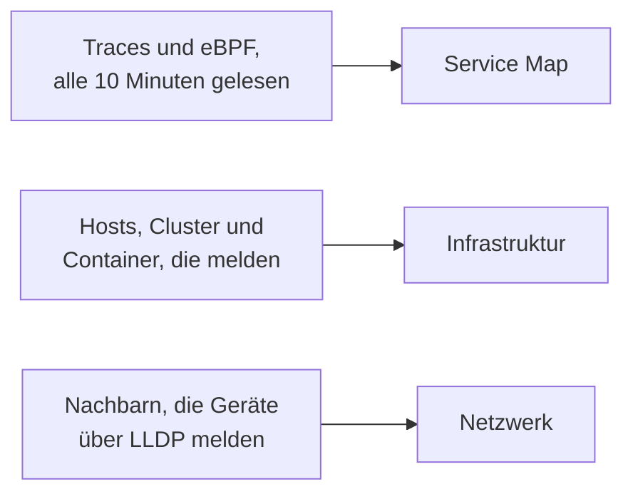

# Topologie

Die Topologie zeichnet, wie Ihre Systeme zusammenhängen: welche Dienste welche aufrufen, was wo läuft und wie Ihre Netzwerkgeräte verkabelt sind. OneUptime baut sie aus der Telemetrie, die Sie ohnehin senden, Sie müssen also nichts von Hand zeichnen, und sie zeigt auf einen Blick, wo Fehler und Vorfälle sitzen.

:::cards
- [Die Topologie öffnen](#die-topologie-öffnen): Drei Ansichten auf einer Seite.
- [Die Dienstkarte lesen](#die-dienstkarte-lesen): Wer wen aufruft, und wie gesund die Aufrufe sind.
- [Ihre Infrastruktur erkunden](#ihre-infrastruktur-erkunden): Wo jeder Dienst läuft.
- [Die eigene Karte einer Ressource öffnen](#die-eigene-karte-einer-ressource-öffnen): Ein vCenter, Cluster oder Host im Detail.
- [Ihr Netzwerk sehen](#ihr-netzwerk-sehen): Geräte und ihre Verbindungen, live.
:::

## Wie die Karte entsteht

Jede Ansicht der Topologie entsteht aus einer anderen Art von Telemetrie:

- **Gezeichnet wird nur, was aktiv war.** Eine Ansicht zeigt die Dienste und Ressourcen, die im Zeitraum gemeldet haben, und die Verbindungen, die darin gesehen wurden. Schalten Sie **Inaktive anzeigen** ein, um auch die stillen zu zeichnen.
- **Aufrufe werden über ein aktuelles Fenster gezählt.** OneUptime sucht alle 10 Minuten nach Aufrufen zwischen Diensten, und die Verkehrszahlen umfassen die letzten 15 Minuten, nicht den ganzen Zeitraum.
- **Die Netzwerkansicht ist live.** Sie zeigt Ihre Geräte so, wie sie gerade verbunden sind, und hat daher keinen Zeitraum.

## Bevor Sie beginnen

- **Telemetrie, die ankommt.** Die Dienstkarte braucht Traces: siehe [OpenTelemetry](/docs/telemetry/open-telemetry). Die Infrastrukturansicht braucht einen Host oder einen Cluster, der meldet: siehe den [Kubernetes-Agent](/docs/telemetry/kubernetes-agent). Die Netzwerkansicht braucht Netzwerkgeräte: siehe [Netzwerkgeräte-Überwachung](/docs/monitor/network-device-monitor).
- **Eine Rolle, die Telemetrie lesen darf.** Project Owner, Project Admin, Project Member, Viewer, Telemetry Admin, Telemetry Member oder Telemetry Viewer, oder eine eigene Rolle mit der Berechtigung Read Telemetry Service.

## Die Topologie öffnen

Gehen Sie zu **Produkte → Observability → Topologie**. **Inventar → Topologiekarte** öffnet dieselbe Seite. Sie öffnet sich auf der **Service Map**, für den Zeitraum **Letzter Tag**.

| Ansicht | Die Frage, die sie beantwortet |
| --- | --- |
| **Service Map** | Welche Dienste hängen voneinander ab? |
| **Infrastruktur** | Was läuft wo in Ihrer Infrastruktur? |
| **Netzwerk** | Wie sind Ihre Netzwerkgeräte verbunden? |

Neben der Zeitauswahl fügt **Inaktive anzeigen** hinzu, was im Zeitraum nicht gemeldet hat, und die Schaltfläche zum Aktualisieren lädt die Ansicht neu. **Was angezeigt wird · Über diese Daten** erklärt, was die Ansicht zeichnet und wie oft sie berechnet wird. Die Adresszeile behält die Ansicht, in der Sie sind, sodass ein geteilter Link dieselbe Ansicht öffnet.

## Die Dienstkarte lesen

Die **Service Map** zeichnet jeden Dienst, der gemeldet hat, und die Datenbanken, APIs und Message Broker, die er aufruft, auch wenn diese selbst keine Telemetrie senden. Pfeile zeigen vom Aufrufer zum Aufgerufenen, und dickere Linien tragen mehr Anfragen. Die Zahlen darüber sagen, wie viele Dienste, Abhängigkeiten und Verbindungen sie zeichnet und wie viele Aufmerksamkeit brauchen.

Jeder Dienst zeigt seinen Status, berechnet aus den Aufrufen, die er in den letzten 15 Minuten empfangen hat:

| Status | Wann |
| --- | --- |
| **Fehlerfrei** | Höchstens 1 % der empfangenen Aufrufe sind fehlgeschlagen. |
| **Some errors** | Mehr als 1 % und weniger als 5 % sind fehlgeschlagen. |
| **High error rate** | 5 % oder mehr sind fehlgeschlagen. |
| **Entry point** | Er hat keine Aufrufe empfangen, aber selbst welche gemacht: ein Web-Frontend oder ein geplanter Job. |
| **No calls observed** | Er hat weder Aufrufe gemacht noch empfangen. |

Ein Dienst mit einem aktiven Vorfall oder einer aktiven Warnung zeigt stattdessen deren Anzahl, und wie ein Dienst mit **Some errors** oder einer **High error rate** zählt er als Dienst, der Aufmerksamkeit braucht.

:::steps
### Die Dienste finden, die Aufmerksamkeit brauchen

Klicken Sie auf **Erfordert Aufmerksamkeit**, um nur diese Dienste und ihre direkten Verbindungen zu behalten, oder suchen Sie im Feld über der Karte nach einem Namen.

### Einen Dienst öffnen

Klicken Sie auf einen Dienst, um seine Anfragen, Fehler und durchschnittliche Latenz der letzten 15 Minuten zu sehen, dazu **Aktive Vorfälle** und **Aktive Warnungen** sowie Links zu **Traces für diesen Dienst** und **Inventardetails**.

### Eine Verbindung öffnen

Klicken Sie auf einen Pfeil, um seine Anfragerate, Fehlerrate und durchschnittliche Latenz zu sehen. Zwischen zwei Diensten, die Sie instrumentieren, gibt es auch einen **Verlauf** der Aufrufe, Fehler und Latenz.
:::

**Verbindungsbeschriftungen** schreibt eine Zahl an jeden Pfeil: **Anfragerate**, **Fehlerrate** oder **Durchschnittliche Latenz**, oder keine, bis Sie darüberfahren. **Tabelle** listet dieselben Dienste mit ihren **Anfragen**, **Fehlerrate**, **Ø Latenz** und **Verbindungen**, und **Auf Karte anzeigen** zeichnet einen davon.

## Ihre Infrastruktur erkunden

**Infrastruktur** zeigt, wo Ihre Dienste laufen: Cluster, Hosts, Pods, Container und die anderen Ressourcen, die melden. Replikate eines Workloads werden zu einem Eintrag gruppiert, und Sie können alles öffnen, um hineinzusehen.

- **Durchsuchen Sie sie, wie Sie wollen.** Zeigen Sie sie als **Liste** oder **Karte**, von Ihrer gesamten Infrastruktur bis zu einem einzelnen Pod. Die Zahlen darüber sagen, wie viele Ressourcen und Workloads sie zeichnet, wie viele Dienste sie zuordnen kann und wie viele stille Ressourcen sie weglässt.
- **Eine Ressource finden.** Suchen Sie sie nach Namen und klicken Sie auf **Details anzeigen**, um ihre Seite zu öffnen.
- **Zwischen den Ansichten wechseln.** Ein Dienst, der bei einer Ressource aufgeführt ist, öffnet sich auf der **Service Map**, und die Ressourcen, auf denen ein Dienst läuft, öffnen sich in **Infrastruktur**.

## Die eigene Karte einer Ressource öffnen

Ein vCenter, ein Kubernetes-Cluster, ein Host, ein Docker- oder Podman-Host, ein Docker-Swarm-, Proxmox- oder Ceph-Cluster und ein Storage-Array haben jeweils eine eigene Seite **Topologie**. Sie zeichnet diese eine Ressource im Detail, aus ihrem eigenen Inventar: was worin liegt, jeden Teil gefärbt nach seinem Zustand, und jeden offenen Vorfall und Alarm an dem Teil, den er betrifft.

- **Als Baum lesen.** Die Ressource steht oben, und die Teile jedes Teils stehen rechts daneben, mit ihm verbunden durch eine Linie, die rot oder orange wird, wo etwas Aufmerksamkeit erfordert. Teile mit einem Problem darin öffnen sich von selbst, die runde Schaltfläche an einem Teil öffnet oder schließt ihn, und die Pfeiltasten bewegen sich durch die Karte.
- **Finden, was Aufmerksamkeit erfordert.** **Erfordert Aufmerksamkeit** behält nur die Teile mit Problemen und den Weg zu jedem, und die Suche findet einen Teil überall in der Ressource.
- **Genauer hinsehen.** Klicken Sie auf einen Teil, um zu sehen, was er ist, mit einem Link zu seiner eigenen Seite, und auf **Darauf fokussieren**, um nur diesen Teil zu zeichnen, was darin liegt und womit er in Beziehung steht.
- **In beide Richtungen.** **In der Topologie öffnen** öffnet die Ressource in **Infrastruktur**, und ihre Schaltfläche **vCenter-Topologie öffnen**, **Cluster-Topologie öffnen**, **Host-Topologie öffnen** oder **Storage-Array-Topologie öffnen** führt zurück.

## Ihr Netzwerk sehen

**Netzwerk** ist die Live-Karte Ihrer Netzwerkgeräte, gebaut aus den Nachbarn, die sie über LLDP melden, und über CDP bei Cisco-Geräten. Sie hat keine Zeitauswahl: Verbindungen aktualisieren sich von selbst.

Wenn Sie Geräte zu Standorten gruppieren, öffnet sich die Ansicht auf Ihren Standorten: Wählen Sie einen aus oder wechseln Sie zu **Alle Geräte**. **Kartenoptionen** ordnet die Karte an und legt fest, was sie enthält, und **PDF exportieren** speichert die Karte, die Sie sehen. Die Seiten der Netzwerkgeräte zeichnen dieselbe Karte: siehe [Netzwerktopologie](/docs/monitor/network-device-monitor#netzwerktopologie).

## Fehlerbehebung

:::details Die Dienstkarte zeigt Dienste, aber keine Verbindungen
OneUptime sucht alle 10 Minuten in Ihren Traces nach Aufrufen zwischen Diensten. Es erkennt einen, wenn eine Anfrage Trace-Kontext, den Header `traceparent`, von einem instrumentierten Dienst zum nächsten trägt, wie es die HTTP- und gRPC-Instrumentierungen von OpenTelemetry tun; wenn ein Dienst Client-Spans für die Datenbanken und APIs meldet, die er aufruft; oder wenn der Kubernetes-Agent mit eBPF läuft.
:::

:::details Ein Dienst, den ich entfernt habe, ist noch auf der Karte
Er hat innerhalb des Zeitraums gemeldet. Wählen Sie einen kürzeren Zeitraum, oder warten Sie, bis seine letzte Telemetrie aus dem Zeitraum fällt. Mit **Inaktive anzeigen** zeichnet die Karte auch, was aufgehört hat zu melden.
:::

:::details Die Karte sagt, dass nur ein Teil gezeigt wird
Ein sehr großes Projekt erreicht die Grenzen der Karte, und ein Hinweis sagt, wie viele Ressourcen oder Verbindungen sie zeigt. Suchen Sie nach einem Dienst, oder nutzen Sie **Auf Karte anzeigen** in der Tabelle, um einen lesbaren Teil zu zeichnen.
:::

## Nächste Schritte

:::cards
- [Dienstkatalog](/docs/telemetry/services): Alles über einen Dienst.
- [Trace-Explorer](/docs/telemetry/traces-explorer): Die Anfragen hinter jedem Pfeil.
- [Inventar – Übersicht](/docs/inventory/overview): Jede Ressource, die die Karte zeichnet.
- [Netzwerkgeräte-Überwachung](/docs/monitor/network-device-monitor): Ihr Netzwerk auf die Karte bringen.
:::
