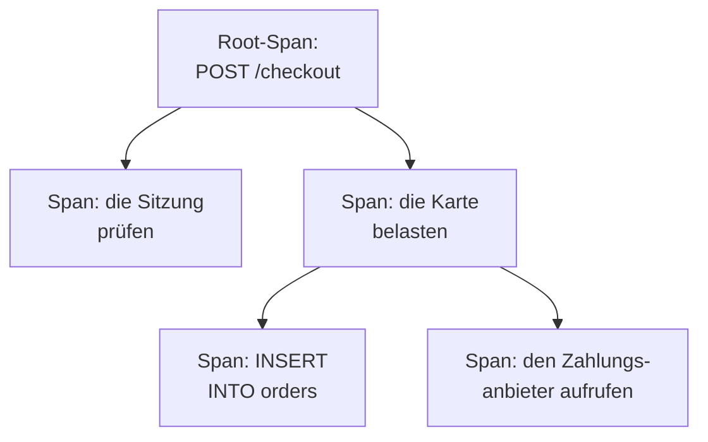

# Trace-Explorer

Der Trace-Explorer findet die Anfragen, die durch Ihre Dienste gelaufen sind: die langsamen, die fehlgeschlagenen, die, die das Konto eines bestimmten Kunden berührt haben. Durchsuchen und filtern Sie die Spans, die Ihre Dienste senden, und öffnen Sie dann einen Trace, um jeden Schritt der Anfrage als Wasserfall, Flame-Graph oder Dienstkarte zu sehen.

:::cards
- [Eine Anfrage finden](#eine-anfrage-finden): Spans durchsuchen, dann nach Dienst, Status oder Art filtern.
- [Einen Trace lesen](#einen-trace-lesen): Wohin die Zeit ging und welcher Schritt fehlschlug.
- [Ihre Spans in Diagrammen darstellen](#ihre-spans-in-diagrammen-darstellen): Anfragezahlen und Antwortzeiten, nach Ihren Vorgaben gruppiert.
- [Trace-Einblicke](#trace-einblicke): Fehlerraten, Latenz und die langsamsten Anfragen.
- [Langsame und fehlschlagende Vorgänge mit KI finden und beheben](#langsame-und-fehlschlagende-vorgänge-mit-ki-finden-und-beheben): Pull Requests, die sie beheben und das Tracing ergänzen, das einem Trace fehlt.
:::

## Traces und Spans

Ein Trace ist eine Anfrage auf ihrem Weg durch Ihr System. Jeder Schritt, den sie macht, etwa ein HTTP-Handler, eine Datenbankabfrage oder ein Aufruf eines anderen Dienstes, ist ein Span, und Spans liegen in den Spans, die sie gestartet haben. Der erste Span eines Traces, ohne Eltern-Span, ist sein Root-Span: der Einstiegspunkt der Anfrage.

Jede Zeile des Explorers ist ein Span, daher füllt ein vielbeschäftigter Dienst die Liste mit seinen Datenbankabfragen und internen Aufrufen. Um eine Zeile pro Anfrage zu listen, wählen Sie in der Seitenleiste **Root spans** unter **Span-Typ**.

Der Explorer hat fünf Tabs:

| Tab | Wofür er da ist |
| --- | --- |
| **Betrachter** | Spans suchen und filtern und ihre Traces öffnen. Er öffnet mit der letzten Stunde, neueste zuerst, 50 Spans pro Seite. |
| **Einblicke** | Anfrageraten, Fehlerraten und Latenz pro Dienst, und die Anfragen, die einen Blick wert sind. |
| **KI** | Die langsamen und fehlschlagenden Vorgänge und das fehlende Tracing, die OneUptime in Ihren Traces findet, und was OneUptime AI dagegen getan hat. Siehe [Langsame und fehlschlagende Vorgänge mit KI finden und beheben](#langsame-und-fehlschlagende-vorgänge-mit-ki-finden-und-beheben). |
| **Einrichtungsanleitung** | Wie Sie Traces mit OpenTelemetry senden, mit einem Ihrer [Aufnahmeschlüssel](/docs/telemetry/ingestion-keys). |
| **Einstellungen** | Was mit Spans beim Eintreffen geschieht: **Pipelines**, **Drop-Filter**, **Scrub-Regeln** und **Aufzeichnungsregeln**. |

## Bevor Sie beginnen

- **Eintreffende Traces.** Instrumentieren Sie Ihre Dienste mit [OpenTelemetry](/docs/telemetry/open-telemetry). Der Tab **Einrichtungsanleitung** zeigt den Code für Ihre Sprache.
- **Eine Rolle, die Telemetrie lesen darf.** Project Owner, Project Admin, Project Member, Viewer, Telemetry Admin, Telemetry Member oder Telemetry Viewer, oder eine eigene Rolle mit der Berechtigung Read Telemetry Service Traces. Ihr Bereich entscheidet, wessen Spans Sie sehen: siehe [Telemetrie](/docs/permissions/index#telemetrie).

## Eine Anfrage finden

:::steps
### Den Betrachter öffnen

Öffnen Sie **Produkte → Observability → Traces**. Der **Betrachter** listet die Spans der letzten Stunde, neueste zuerst, jeweils mit Status, Dienst, Name und Dauer.

### Den Zeitraum wählen

Wählen Sie einen Zeitraum in der Zeitauswahl, oder ziehen Sie über das Diagramm über der Liste, um in eine Spitze hineinzuzoomen. Ein Doppelklick auf das Diagramm zoomt wieder heraus. Siehe [In einen Zeitraum zoomen](/docs/telemetry/charts-and-time-ranges).

### Suchen

Geben Sie eine Abfrage ein und drücken Sie Enter, zum Beispiel `service:checkout status:error duration:>500`. Freie Wörter durchsuchen Span-Namen, und `@key:value` durchsucht ein Attribut wie `@http.route:/orders`. Siehe [Suchsyntax](/docs/telemetry/search-syntax#traces).

### Mit Filtern eingrenzen

Klicken Sie auf einen Wert in der Seitenleiste **Filter**, um ihn als Chip hinzuzufügen. Die Seitenleiste filtert nach **Dienst**, nach dem Host, Cluster oder der anderen Ressource, die den Span gesendet hat, nach **Status**, **Span-Typ**, **Hat Ausnahme**, **Span-Art**, **Span-Name**, **Dienstinstanz** und **Host-Name**.

### Einen Span öffnen

Klicken Sie auf eine Zeile, um sie aufzuklappen: ihre Attribute und die Protokolle und Ausnahmen, die sie aufgezeichnet hat. Klicken Sie auf **See full trace**, um ihren ganzen Trace zu öffnen.
:::

Ihre Suche, Ihre Chips und der Zeitraum stehen in der Adresse der Seite, sodass ein Neuladen, ein Lesezeichen oder ein geteilter Link dieselben Spans öffnet.

## Einen Trace lesen

Die Seite eines Traces beginnt mit den Zahlen der Anfrage:

| Zahl | Was sie ist |
| --- | --- |
| Dauer | Wie lange die ganze Anfrage gedauert hat. |
| Spans | Wie viele Spans der Trace hat. |
| Dienste | Durch wie viele Dienste die Anfrage gelaufen ist. |
| Fehler | Wie viele Spans mit einem Fehlerstatus endeten. Klicken Sie darauf, um nur diese zu zeigen. |
| Tiefe | Die tiefste Kette verschachtelter Spans. |

Darunter wählen Sie eine von vier Ansichten:

| Ansicht | Was sie zeigt |
| --- | --- |
| **Wasserfall** | Jeden Span auf einer Zeitachse, eingerückt unter dem Span, der ihn gestartet hat. Schalten Sie **Critical path** ein, um die Kette von Spans hervorzuheben, die bestimmt hat, wie lange die Anfrage dauerte. |
| **Flame-Graph** | Denselben Baum als gestapelte Balken, wobei die breitesten Balken am längsten gedauert haben. |
| **Dienstkarte** | Die Dienste, durch die die Anfrage gelaufen ist, und die Aufrufe zwischen ihnen. |
| **Vorgänge** | Eine Zeile pro Dienst und Span-Name, mit seinen Aufrufen, Fehlern, seiner Eigenzeit und Gesamtzeit. Ein Vorgang, der 10 oder mehr Male von einem Eltern-Span aus aufgerufen wird, ist markiert: oft eine N+1-Abfrage oder eine Schleife, die man bündeln könnte. |

Klicken Sie in einer beliebigen Ansicht auf einen Span, um sein Fenster zu öffnen, mit Tabs für seine Attribute, Ereignisse, Protokolle, Ausnahmen und Links sowie sein Profil oder seinen LLM-Aufruf, wenn er eines hat. Durchsuchen Sie die Spans des Traces nach Name, ID oder Dienst mit dem Suchfeld neben den Ansichten (drücken Sie `/`), und schalten Sie **Errors only** ein, um nur die fehlgeschlagenen Spans zu behalten.

Ein großer Trace lädt 500 Spans auf einmal. Klicken Sie auf die Schaltfläche unten im Trace, um weitere oder alle zu laden.

> [!TIP]
> **Mit KI beschleunigen** erscheint nur bei einem Trace, der eine Korrektur lohnt: mit einer N+1-Abfrage, mit Aufrufen nacheinander, die parallel laufen könnten, oder mit einem Aufruf, der den Großteil der Anfrage beansprucht, wenn das spürbar Zeit kostet (zusammen 100 ms oder mehr für die Aufrufe, 500 ms oder mehr für einen einzelnen Aufruf und mindestens ein Zehntel der Anfrage). Es nennt, was es gefunden hat, etwa „Dieselbe Datenbankabfrage lief 40-mal in ReportService.build“, und startet eine KI-Aufgabe, die einen Pull Request mit der Korrektur öffnet. Hat eine Korrektur für den Trace ihre Arbeit bereits getan, verlinkt der Trace deren Aufgabe, statt eine zweite anzubieten. Hält etwas anderes die KI auf, etwa der Tarif, aufgebrauchtes KI-Guthaben oder kein Runner, der online ist, sagt der Trace, was es ist, mit dem Link, der es behebt. Siehe [Code](/docs/ai/ai-agent).

## Ihre Spans in Diagrammen darstellen

Das Diagramm über der Liste zeigt die Anzahl der Spans im Zeitverlauf, aufgeteilt nach Status. Wählen Sie im Kopf des Diagramms ein anderes Maß, um stattdessen ihre durchschnittliche, mediane (P50) oder P95-Antwortzeit zu zeigen.

Für mehr schalten Sie die Liste von **Spans** auf **Analysen** um. Wählen Sie eine Zeitreihe, eine Top-Liste oder eine Tabelle; messen Sie Anfragezahlen, Fehlerzahlen oder Antwortzeiten (Durchschnitt, P50, P90, P95, P99, Minimum oder Maximum); und gruppieren Sie nach Span-Name, Dienst, Status, Span-Art oder einem beliebigen Attribut, dann nach einem zweiten Feld. Eine Top-Liste oder eine Tabelle zeigt die obersten 5 bis 100 Gruppen.

## Verfolgen, speichern und teilen

- Klicken Sie über der Liste auf **Pausiert**, um Live-Aktualisierungen einzuschalten. Die Schaltfläche zeigt dann **Live**, und die Liste sucht alle 10 Sekunden nach neuen Spans. Klicken Sie erneut darauf, um zu pausieren.
- **Gespeicherte Ansichten** behält eine Suche, ihre Filter und den Zeitraum unter einem Namen, für alle im Projekt. Gespeicherte Ansichten funktionieren wie im [Protokoll-Explorer](/docs/telemetry/logs-explorer#eine-ansicht-speichern).
- Die Schaltflächen **Protokolle** und **Metriken** öffnen diese Explorer für dasselbe Zeitfenster, mit so viel von Ihrer Filterung, wie sie nutzen können. Zeigen Sie auf eine Schaltfläche, um zu sehen, was sie nicht übernehmen kann.

## Trace-Einblicke

Der Tab **Einblicke** fasst die Anfragen eines Zeitraums zusammen:

- die Zahl der Anfragen, die Fehlerrate und die Latenz P50, P95 und P99;
- eine Gesundheitstabelle Ihrer Dienste, nach Fehlerrate sortiert, sodass die Dienste, die Aufmerksamkeit brauchen, zuerst kommen;
- die jüngsten fehlgeschlagenen Anfragen und die langsamsten.

Beschränken Sie ihn mit der Auswahlliste neben der Zeitauswahl auf bestimmte Dienste.

## Langsame und fehlschlagende Vorgänge mit KI finden und beheben

Jede Stunde durchsucht OneUptime die Traces jedes Dienstes aus der letzten Stunde nach Vorgängen, die langsam sind, die fehlschlagen oder deren Traces nicht zeigen, warum, und legt seine Befunde mit den Belegen als KI-Einblicke an. OneUptime AI untersucht dann jeden Befund und öffnet einen Pull Request, der ihn behebt. Nichts wird je zusammengeführt: Ihr Team prüft jeden Pull Request.

Ein Vorgang sind die Spans eines Dienstes mit demselben Namen, etwa `GET /orders`. OneUptime liest einen Dienst, sobald er in der letzten Stunde mindestens 100 Spans gesendet hat, und legt drei Arten von Befunden an:

| Befund | Wann OneUptime ihn anlegt | Der Pull Request |
| --- | --- | --- |
| **Langsamer Vorgang** | Das P99 des Vorgangs liegt bei 1 Sekunde oder mehr über mindestens 20 Spans, und seine langsamste Anfrage wiederholt ein Muster, das echte Zeit kostet: derselbe Aufruf immer wieder, Aufrufe nacheinander, die parallel laufen könnten, oder ein Aufruf, der den Großteil der Anfrage beansprucht. | Macht den Vorgang schneller. |
| **Fehlschlagender Vorgang** | Mindestens 20 Spans des Vorgangs sind fehlgeschlagen, 5 % oder mehr davon, und die jüngsten Fehlschläge sagen, warum, mit einer Ausnahme oder einer Fehlermeldung. | Behebt, warum er fehlschlägt. |
| **Fehlendes Tracing** | Die Traces zeigen nicht, warum: Jeder der 500 oder mehr Spans eines Dienstes war die Wurzel seines Traces, ohne einen Span des Dienstes darunter, eine langsame Anfrage verbrachte 60 % oder mehr ihrer Zeit (und 500 ms oder mehr) in einem Span, unter dem nichts aufgezeichnet ist, oder die Fehlschläge eines Vorgangs haben weder eine Fehlermeldung noch eine Ausnahme aufgezeichnet. | Ergänzt das fehlende Tracing. |

OneUptime AI öffnet den Pull Request für einen fehlschlagenden Vorgang nur dann selbstständig, wenn es den schuldigen Code findet. Ein Fehler, der von anderswo kommt, etwa von einer ausgefallenen Abhängigkeit, bekommt keinen Pull Request, es sei denn, jemand fordert ihn mit **Mit KI beheben** an.

### Einschalten

**Traces → KI → Einstellungen** enthält den Schalter **Langsame und fehlschlagende Vorgänge finden und beheben**, der für neue Projekte eingeschaltet ist. Ist **KI aktivieren** aus, werden langsame und fehlschlagende Vorgänge weiterhin gefunden, aber OneUptime AI tut nichts damit. Um Pull Requests zu öffnen, braucht OneUptime AI ein in [Code](/docs/ai/ai-agent) verbundenes Repository: Die Seite sagt, was zuerst fehlt. Der Code eines Repositorys wird auf dem Runner geändert, den das Repository in Code auswählt.

OneUptime AI öffnet von sich aus höchstens 5 Pull Requests pro Tag (UTC), einen pro Befund, und nie mehr, als ein Repository an offenen KI-Pull-Requests zulässt.

### KI-Regeln

Ohne Regel untersucht OneUptime AI jedes Problem, das es in Ihren Traces findet, sofort und öffnet für jedes, das es beheben kann, einen Pull Request. Die **KI-Regeln** unter **Weitere Einstellungen** schränken das in drei Schritten ein:

| Schritt | Was er entscheidet |
| --- | --- |
| **Übereinstimmung** | Welche Dienste: die ausgewählten, die mit bestimmten Labels oder die, deren Namen zu einem Muster passen. |
| **Untersuchen** | **Sofort** oder **Nur falls nach einer Wartezeit noch gefunden**: Ein Problem, das während der Wartezeit verschwindet, wird nicht untersucht. |
| **Behebung** | **Nicht beheben**, **Vor dem Beheben fragen** oder **Ohne Nachfrage beheben**. Wer zuerst fragt, überlässt den Pull Request einer Person: Der Befund bietet **Mit KI beheben** an. |

Unter **Weitere Felder** wählt eine Regel die Code-Repositories, die MCP-Server und den LLM-Anbieter, die OneUptime AI für sie verwenden darf. Ist nichts ausgewählt, darf es alle verwenden, und den Standard-LLM-Anbieter des Projekts.

### Sehen, was es getan hat

- **Traces → KI → Einblicke** listet, was OneUptime gefunden hat, jeden Befund mit seinen Belegen und **In Traces öffnen**, das die betroffenen Spans aus der Stunde, in der er gefunden wurde, im **Betrachter** öffnet. Bei einem fehlschlagenden Vorgang richtet **Monitor erstellen** einen Traces-Monitor auf seine fehlgeschlagenen Spans ein.
- **Traces → KI → Protokolle** listet jede Untersuchung und jeden Pull Request, das Neueste zuerst, jeweils mit ihrem Stand und dem, was jede Untersuchung gefunden hat.
- In Code sagt die Aufgabe, dass OneUptime sie gestartet hat, mit einem Link zu ihrem Befund, und der Pull Request sagt, warum er geöffnet wurde.

## Was mit Spans beim Eintreffen geschieht

Der Tab **Einstellungen** enthält die Regeln, die OneUptime auf Spans beim Eintreffen anwendet, wie bei Protokollen. Sie wirken auf die Spans, die danach eintreffen, nicht auf gespeicherte. Wie lange jeder Span aufbewahrt wird, wird ebenfalls bei seiner Ankunft festgelegt: siehe [Datenaufbewahrung](/docs/telemetry/data-retention).

| Regel | Was sie tut |
| --- | --- |
| **Drop-Filter** | Spans verwerfen, die Sie nicht behalten möchten, oder nur eine Stichprobe davon behalten. Siehe [Datensätze verwerfen oder Stichproben nehmen](/docs/telemetry/drop-filters-and-scrub-rules#datensätze-verwerfen-oder-stichproben-nehmen). |
| **Scrub-Regeln** | Sensible Daten in Span-Attributen maskieren. Siehe [Sensible Daten bereinigen](/docs/telemetry/drop-filters-and-scrub-rules#sensible-daten-bereinigen). |
| **Pipelines** | Spans ändern und anreichern: Jede Pipeline erfasst Spans über einen Filter und führt dann ihre Prozessoren der Reihe nach aus. |
| **Aufzeichnungsregeln** | Span-Anzahlen, Fehlerzahlen und Dauern jede Minute in neue Metriken umwandeln. Siehe [Aufzeichnungsregeln für Protokolle](/docs/telemetry/log-recording-rules). |

## Fehlerbehebung

:::details Ein Trace meldet, dass keine Spans gefunden wurden
Spans treffen meist innerhalb einer Minute nach dem Ende der Anfrage ein. Klicken Sie auf der Seite des Traces auf **Aktualisieren**, um erneut nachzusehen.
:::

:::details Einige Spans stehen auf der obersten Ebene des Wasserfalls
Sie nennen einen Eltern-Span, den OneUptime nicht erhalten hat, oft weil der Dienst, der den Eltern-Span geschrieben hat, noch keine Traces an OneUptime sendet. Instrumentieren Sie auch diesen Dienst.
:::

:::details Die Liste zeigt viel mehr Zeilen als Anfragen
Jede Zeile ist ein Span, keine Anfrage. Wählen Sie in der Seitenleiste **Root spans** unter **Span-Typ**, um eine Zeile pro Anfrage zu listen.
:::

## Nächste Schritte

:::cards
- [Suchsyntax](/docs/telemetry/search-syntax): Jeder Filter, den das Suchfeld versteht.
- [Traces-Überwachung](/docs/monitor/traces-monitor): Bei fehlgeschlagenen oder langsamen Anfragen benachrichtigt werden.
- [Ausnahmenverfolgung](/docs/telemetry/exceptions): Die Fehler sichten, die Ihre Spans aufzeichnen.
- [Protokoll-Explorer](/docs/telemetry/logs-explorer): Die Protokollzeilen lesen, die eine Anfrage geschrieben hat.
:::
