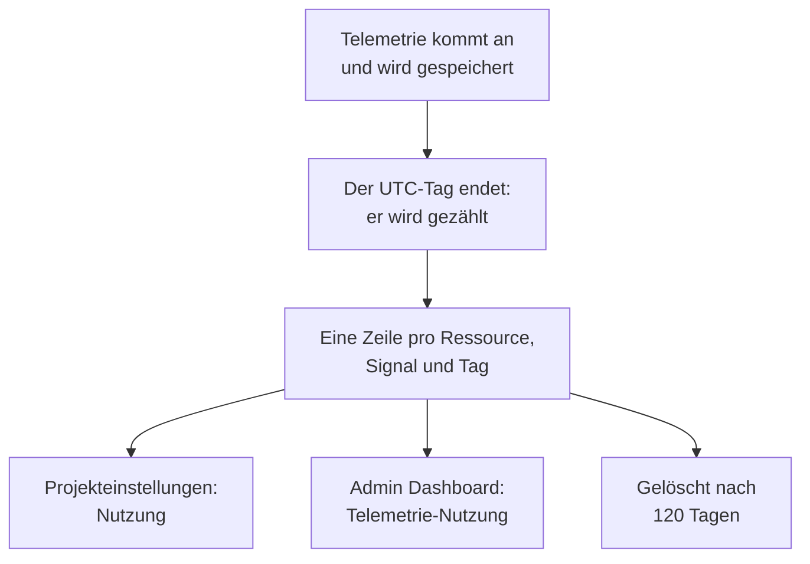

# Telemetrie-Nutzung

Sehen Sie, wie viel Telemetrie jedes Projekt und jeder Dienst oder jede Ressource darin sendet: Protokolle, Metriken, Traces und ihre Ausnahmen, Profile, Sitzungswiedergaben und Sicherheitsereignisse. Die Nutzung wird auf jeder OneUptime-Installation gezählt, mit oder ohne Abrechnung, sodass Sie finden, was Ihren Speicher füllt, ohne ClickHouse abzufragen.

:::cards
- [Wie die Nutzung gezählt wird](#wie-die-nutzung-gezählt-wird): Einmal am Tag, für jede Ressource und jedes Signal.
- [Die Nutzung eines Projekts ansehen](#die-nutzung-eines-projekts-ansehen): Projekteinstellungen → Telemetrie & APM → Nutzung.
- [Die Nutzung aller Projekte ansehen](#die-nutzung-aller-projekte-ansehen): Das Admin Dashboard, für den Instanzadministrator.
- [Wie lange die Nutzung aufbewahrt wird](#wie-lange-die-nutzung-aufbewahrt-wird): 120 Tage, sofern Sie das nicht ändern.
:::

## Wie die Nutzung gezählt wird

Einmal am Tag, nachdem ein Tag in UTC zu Ende ist, zählt OneUptime, was jede Ressource jedes Projekts an diesem Tag gesendet hat, für jedes Signal, und bewahrt die Zählung als eine Zeile pro Ressource, Signal und Tag auf.



- **Ein Tag wird gezählt, sobald er vorbei ist.** Jeder Tag ist bis etwa 08:00 UTC am nächsten Tag gezählt, die heutige Nutzung erscheint also morgen. Ein Tag, der nicht gezählt werden konnte, wird eine Woche lang erneut versucht.
- **Die Größe ist die gespeicherte Größe.** Jedes Signal wird als die Größe der Zeilen gezählt, in denen es gespeichert ist, vor der Komprimierung. Sitzungswiedergaben werden als die Bytes gezählt, die die Rekorder hochgeladen haben.
- **Traces enthalten ihre Ausnahmen und Profile ihre Samples.**
- **Die eigene Telemetrie von OneUptime wird nicht gezählt.** Messwerte von Monitoren, Warnungen, Vorfällen und SLOs, Messwerte von Data Observability und die Budgetmetriken der Sitzungswiedergabe schreibt OneUptime selbst.
- **In OneUptime Cloud wird Telemetrie nach diesen Zeilen abgerechnet.** Auf einer Installation ohne Abrechnung wird die Nutzung kostenlos gezählt, und es wird nichts dafür berechnet, auch wenn die Abrechnung später eingeschaltet wird.

## Bevor Sie beginnen

- **Eine Rolle, die die Telemetrie des Projekts lesen darf.** Projektinhaber, Projektadministrator, Projektmitglied, Betrachter, Telemetrie-Administrator, Telemetrie-Mitglied oder Telemetrie-Betrachter, oder eine der Abrechnungsrollen. Die Rolle muss das ganze Projekt umfassen: Eine, die auf einige Labels beschränkt ist, zeigt keine Nutzung.
- **Telemetrie im Projekt.** Gezählt wird die Telemetrie, die die [Ingestion-Schlüssel](/docs/telemetry/ingestion-keys) des Projekts senden.

## Die Nutzung eines Projekts ansehen

:::steps
### Nutzung öffnen

Gehen Sie zu **Projekteinstellungen → Telemetrie & APM → Nutzung**. **Telemetrie & APM** ist im Seitenmenü anfangs eingeklappt: Klicken Sie darauf, um es zu öffnen.

### Einen Zeitraum wählen

Die Seite öffnet mit **Letzte 30 Tage**. Wählen Sie **Letzte 7 Tage** oder **Letzte 90 Tage** im Feld oben rechts auf der Karte **Telemetrie-Nutzung**. Ein Zeitraum endet mit gestern, dem neuesten Tag, der gezählt wurde.

### Finden, was gewachsen ist

Die Karte **Nutzung nach Ressource** listet jeden Dienst und jede Ressource, die im Zeitraum etwas gesendet hat, die größten zuerst. Klicken Sie auf den Titel einer Spalte, um danach zu sortieren, und auf den Namen einer Ressource, um ihre Seite zu öffnen.
:::

Die Seite hat drei Karten:

| Karte | Was sie zeigt |
| --- | --- |
| **Telemetrie-Nutzung** | Den Wert **Gesamt** des Zeitraums, eine Summe für jedes Signal und ein Diagramm jedes Tages mit seinen Signalen gestapelt. |
| **Nutzung nach Ressource** | Jede **Ressource** mit ihrer Art, eine Spalte für jedes Signal, **Gesamt** und unter **Aufbewahrung**, wie lange ihre Telemetrie aufbewahrt wird. |
| **Telemetrie-Nutzungsverlauf** | Eine Zeile pro Signal, Ressource und Tag, mit Filtern für **Produkt**, **Tag** und **Dienst**. |

Telemetrie, die keinen Dienst genannt hat, wird als **Unbekannter Dienst** aufgeführt. Eine Ressource, die inzwischen gelöscht wurde oder deren Art Ihre Rolle nicht liest, wird mit ihrer Art und dem Anfang ihrer ID aufgeführt.

## Wer was sieht

| Rolle | Sieht |
| --- | --- |
| Projektinhaber, Projektadministrator, Abrechnungs-Administrator, Abrechnungs-Mitglied, Abrechnungs-Betrachter, Manage Billing | Wie viel jede Ressource gesendet hat und wie lange das aufbewahrt wird, und in OneUptime Cloud, was es gekostet hat |
| Projektmitglied, Betrachter, Telemetrie-Administrator, Telemetrie-Mitglied, Telemetrie-Betrachter | Wie viel jede Ressource gesendet hat und wie lange das aufbewahrt wird |

Was die Nutzung gekostet hat, wird nur in OneUptime Cloud angezeigt: Eine Installation ohne Abrechnung berechnet nichts dafür. Die Preise finden Sie unter [Abrechnung & Nutzung](/docs/configuration/billing#nutzungsverlauf).

## Die Nutzung aller Projekte ansehen

Auf einer selbst gehosteten Installation sieht der Instanzadministrator die Nutzung aller Projekte im Admin Dashboard:

:::steps
### Telemetrie-Nutzung öffnen

Öffnen Sie im Admin Dashboard das Menü und klicken Sie auf **Telemetrie-Nutzung**. Die Liste zeigt jedes Projekt, das im Zeitraum etwas gesendet hat, die größten zuerst, mit einer Spalte für jedes Signal und **Gesamt**.

### Die größten Projekte finden

Wählen Sie oben rechts auf der Karte einen Zeitraum und klicken Sie auf den Titel einer Spalte, um danach zu sortieren: **Gesamt**, ein Signal oder **Projekt** für den Namen.

### Ein Projekt öffnen

Klicken Sie auf den Namen eines Projekts. Seine Seite **Telemetrie-Nutzung**, unter **Projekte** im Admin Dashboard, zeigt seine Nutzung nach Tag, Signal und Ressource, so wie seine Mitglieder sie sehen.
:::

## Wie lange die Nutzung aufbewahrt wird

Die Nutzung wird 120 Tage aufbewahrt, sofern Sie das nicht ändern, mit oder ohne Abrechnung. So lange werden die Nutzungszählungen aufbewahrt, nicht die Telemetrie selbst: Dafür siehe [Datenaufbewahrung](/docs/telemetry/data-retention).

:::steps
### Datenaufbewahrung öffnen

Gehen Sie im Admin Dashboard zu **Einstellungen → Datenaufbewahrung**.

### Die Anzahl der Tage festlegen

Klicken Sie auf der Karte **Aufbewahrung der Telemetrie-Nutzung** auf **Aufbewahrung der Telemetrie-Nutzung bearbeiten**, geben Sie **Aufbewahrung der Telemetrie-Nutzung (Tage)** von 30 bis 1095 ein und klicken Sie auf **Änderungen speichern**. Lassen Sie das Feld für 120 Tage leer.
:::

Ältere Nutzung wird einmal am Tag gelöscht. Die Aufbewahrung ist nie kürzer als 30 Tage: Ein gezählter Tag wird nie gelöscht und dann noch einmal gezählt.

## Die Nutzung über die API lesen

`GET /api/telemetry-usage/project` antwortet mit der Nutzung eines Projekts über einen Zeitraum von UTC-Tagen, so wie die Seite sie zeigt. Rufen Sie es mit einem [API-Schlüssel](/docs/permissions/index#api-schlüssel) auf, der eine der Rollen oben hat:

```bash
curl 'https://oneuptime.com/api/telemetry-usage/project?startDay=2026-10-01&endDay=2026-10-31' \
  -H "ApiKey: $ONEUPTIME_API_KEY"
```

`startDay` und `endDay` sind Tage im Format `YYYY-MM-DD`, beide eingeschlossen, und ein Zeitraum kann bis zu 1095 Tage lang sein. Die Antwort enthält die Summen, jeden Tag nach Signal und jede Ressource nach Signal, in GB, mit den Kosten nur dort, wo die Abrechnung aktiv ist und der Schlüssel die Abrechnung liest.

## Fehlerbehebung

:::details Die Seite Nutzung zeigt „Noch keine Telemetrie-Nutzung“
Ein Tag wird gezählt, sobald er in UTC zu Ende ist, bis etwa 08:00 UTC am nächsten Tag: Ein Projekt, das heute zu senden begonnen hat, zeigt seinen ersten Tag morgen. Prüfen Sie, ob das Projekt in den Explorern Telemetrie empfängt.
:::

:::details Die Zahlen sind größer als meine ClickHouse-Festplatte
Die Nutzung ist die Größe der Zeilen vor der Komprimierung. ClickHouse komprimiert, was es speichert, sodass der belegte Speicherplatz um ein Mehrfaches kleiner ist.
:::

:::details Eine Ressource wird mit ihrer Art und einer ID aufgeführt
Die Ressource wurde gelöscht, nachdem sie die Telemetrie gesendet hat, oder Ihre Rolle liest diese Art von Ressource nicht. Ihre Nutzung wird trotzdem gezählt.
:::

## Nächste Schritte

:::cards
- [Drop-Filter & Scrub-Regeln](/docs/telemetry/drop-filters-and-scrub-rules): Die Telemetrie, die Sie nicht brauchen, gar nicht erst speichern.
- [Datenaufbewahrung](/docs/telemetry/data-retention): Telemetrie so lange aufbewahren, wie Sie sie brauchen, und nicht länger.
- [Abrechnung & Nutzung](/docs/configuration/billing): Was Telemetrie in OneUptime Cloud kostet.
- [Ingestion-Schlüssel](/docs/telemetry/ingestion-keys): Telemetrie in Ihr Projekt senden.
:::
