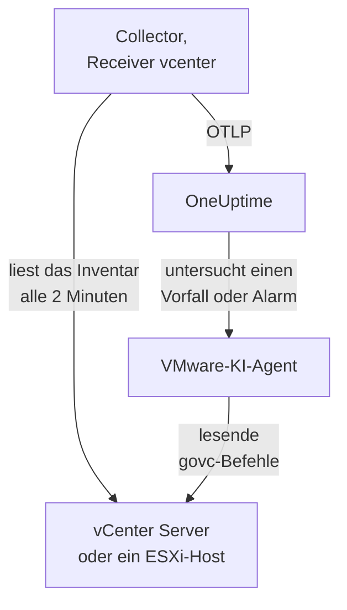

# VMware-Agent

Der OneUptime-VMware-Agent überwacht VMware vSphere: vCenter Server, ESXi-Hosts, virtuelle Maschinen, Datastores, Cluster, Ressourcenpools und vSAN. Er ist ein unveränderter OpenTelemetry Collector, dessen [Receiver `vcenter`](https://github.com/open-telemetry/opentelemetry-collector-contrib/tree/main/receiver/vcenterreceiver) die vSphere-API mit einem schreibgeschützten Benutzer liest, jede Metrik mit dem Namen Ihres vCenter versieht und sie an OneUptime sendet: kein Plugin auf dem vCenter und nichts innerhalb der VMs. [VMware-Monitore](/docs/monitor/vmware-monitor) alarmieren anhand dessen, was ankommt.

:::cards
- [Agent installieren](#agent-installieren): Ein schreibgeschützter Benutzer, dann das Installationsskript, Docker Compose oder systemd.
- [Was der Agent erfasst](#was-der-agent-erfasst): Jedes vSphere-Objekt, seine Identität und seine Metriken.
- [KI-Agent](#ki-agent): OneUptime AI das vCenter lesen lassen, während sie untersucht.
- [Fehlerbehebung](#fehlerbehebung): Ein Diagnoseskript und die üblichen Probleme.
:::

## So funktioniert es

Ein Agent überwacht einen vSphere-Endpunkt: einen **vCenter Server**, der jedes Rechenzentrum, jeden Cluster und jeden Host abdeckt, den er verwaltet, oder einen **eigenständigen ESXi-Host**, den kein vCenter verwaltet. Führen Sie einen Agent pro vCenter aus. Der Collector durchläuft das gesamte Inventar einmal pro Erfassung (standardmäßig alle 2 Minuten) und sendet eine Ressource pro Objekt. Dieselbe Compose-Datei führt daneben den VMware-KI-Agent für OneUptime AI aus. Lieber ohne Docker? Derselbe Collector läuft mit derselben Konfiguration auch als systemd-Dienst auf jedem Linux-Rechner.



Das vCenter registriert sich mit seinen ersten Daten unter dem Namen, den der Agent als `vmware.vcenter.name` an jede Metrik hängt. Um ein vCenter ganz ohne Agent zu überwachen, siehe [VMware ohne Agent](/docs/telemetry/vmware-agentless): Eine Ihrer Probes erfasst dieselben Daten mit einem schreibgeschützten Konto.

## Bevor Sie beginnen

- Docker Engine 20.10 oder neuer mit dem Plugin Docker Compose v2 oder, für eine Installation ohne Docker, ein Linux-Rechner (x86_64 oder arm64) mit systemd 235 oder neuer. In beiden Fällen muss der Rechner das vCenter per HTTPS (TCP 443) erreichen.
- vCenter Server oder ESXi 7.0 oder neuer: Der Receiver unterstützt vSphere 7 und 8.
- Ein Konto, das einen vSphere-Benutzer anlegen und ihm eine Rolle auf dem obersten vCenter-Objekt zuweisen kann.
- Ein Ingestion-Schlüssel. Legen Sie ihn unter **Projekteinstellungen → Telemetrie & APM → Ingestion-Schlüssel** an und kopieren Sie seinen Wert.

### Wo der Agent laufen sollte

Der Agent spricht per HTTPS mit dem vCenter; er muss also nicht in dessen Nähe laufen und sollte idealerweise weder auf der vCenter Server Appliance noch in einer VM auf dem Cluster laufen, den er überwacht: Fällt dieser Cluster aus, fällt Ihr Monitoring mit ihm aus. Eine kleine Management-VM auf separater Hardware, ein Monitoring-Host oder jeder Rechner, auf dem Docker läuft (oder, ohne Docker, jeder Linux-Rechner mit systemd) und der das vCenter auf TCP 443 erreicht, ist der richtige Ort. Der optionale Syslog-Listener setzt außerdem voraus, dass die ESXi-Hosts den Agent auf dem Syslog-Port erreichen (siehe [ESXi-Syslog senden](#optional-esxi-syslog-senden)).

## Agent installieren

:::steps
### Den schreibgeschützten vSphere-Benutzer anlegen

Der Agent liest immer nur: das Inventar, Leistungszähler und vSAN-Statistiken. Geben Sie ihm ein eigenes Konto mit der eingebauten Rolle **Read-Only**, niemals einen Administrator.

:::tabs
@tab vSphere Client
1. Legen Sie das Konto an: Öffnen Sie _Menu → Administration → Single Sign On → Users and Groups_, wählen Sie die Domain `vsphere.local` (oder Ihre Identitätsquelle), klicken Sie auf **Add**, nennen Sie den Benutzer `oneuptime` und setzen Sie ein Passwort. Der Benutzer ist dann `oneuptime@vsphere.local`.
2. Weisen Sie die Rolle zu: Wählen Sie im Inventar _Hosts and Clusters_ das oberste Objekt **vCenter Server**, öffnen Sie den Tab **Permissions**, klicken Sie auf **Add**, wählen Sie den Benutzer, setzen Sie die Rolle auf **Read-Only** und aktivieren Sie **Propagate to children**.
@tab govc
Von einem Rechner mit Administrator-Zugangsdaten:

```bash
govc sso.user.create -p 'a-strong-password' -R ReadOnly oneuptime
govc permissions.set -principal oneuptime@vsphere.local -role ReadOnly -propagate=true /
```
@tab PowerCLI
Aus einer Sitzung, die als Administrator mit dem vCenter verbunden ist:

```powershell
New-SsoPersonUser -UserName oneuptime -Password 'a-strong-password'
New-VIPermission -Entity (Get-Folder -NoRecursion) -Principal 'VSPHERE.LOCAL\oneuptime' -Role ReadOnly -Propagate:$true
```
@tab ESXi Host Client
Für einen eigenständigen ESXi-Host (ohne vCenter) legen Sie den Benutzer unter _Host → Manage → Security & Users → Users_ an und geben ihm die Rolle Read-Only unter _Host → Manage → Security & Users → Permissions_. Oder führen Sie in der Shell des Hosts `esxcli system account add` aus, dann `esxcli system permission set --id oneuptime --role ReadOnly`.
:::

> [!IMPORTANT]
> Die Weitergabe ist der Teil, den man übersieht. Der Receiver durchläuft Rechenzentren, Cluster, Hosts, VMs, Datastores und Ressourcenpools, und jedes Objekt, das der Benutzer nicht sehen kann, wird stillschweigend ausgelassen. Eine Rolle Read-Only, die auf dem vCenter-Objekt _ohne_ Weitergabe zugewiesen ist, ergibt ein Inventar ohne Inhalt und ein Dashboard voller Nullen.

### Den Agent installieren und starten

:::tabs
@tab install.sh
Laden Sie das Installationsskript herunter und führen Sie es auf dem Rechner aus, auf dem der Agent laufen soll:

```bash
curl -sSL https://raw.githubusercontent.com/OneUptime/oneuptime/master/agents/VMwareAgent/install.sh -o install.sh
bash install.sh
```

Das Skript fragt nach Ihrer OneUptime-URL, dem Ingestion-Schlüssel, einem Namen für das vCenter, dem vCenter-Endpunkt und den schreibgeschützten Zugangsdaten (das Passwort liest es ohne Echo) sowie danach, ob der KI-Agent Korrekturen anwenden darf (und wenn ja, nach einem eigenen vSphere-Benutzer für ihn und den VMs, die er nie ändern darf). Es installiert nach `/opt/oneuptime-vmware-agent`, schreibt eine mit `0600` geschützte `.env`-Datei und startet den Agent mit Docker Compose. Es setzt jeden Wert so für Docker Compose in Anführungszeichen, wie Sie ihn eingegeben haben, sodass ein Passwort mit `$`, `#`, Leerzeichen oder Anführungszeichen so funktioniert, wie Sie es eingegeben haben. Ein erneuter Lauf des Skripts verwendet alles in einer vorhandenen `.env` wieder, statt erneut zu fragen; so [aktualisieren Sie den Agent](#agent-aktualisieren).
@tab Docker Compose
Laden Sie `docker-compose.yml` und `otel-collector-config.yaml` aus dem [Verzeichnis VMwareAgent](https://github.com/OneUptime/oneuptime/tree/master/agents/VMwareAgent) in einen neuen Ordner herunter und legen Sie daneben eine Datei `.env` an. Sie enthält ein Passwort; schützen Sie sie daher mit `chmod 600 .env`:

```bash title=".env"
ONEUPTIME_URL=YOUR_ONEUPTIME_URL
ONEUPTIME_TELEMETRY_INGESTION_KEY=YOUR_TELEMETRY_INGESTION_TOKEN
VMWARE_VCENTER_NAME=my-vcenter
VCENTER_ENDPOINT=https://vcsa.example.com
VCENTER_USERNAME=oneuptime@vsphere.local
VCENTER_PASSWORD=a-strong-password
VCENTER_INSECURE_SKIP_VERIFY=true
VCENTER_COLLECTION_INTERVAL=2m
```

Ein Passwort mit `$`, `#`, Leerzeichen oder Anführungszeichen gehört in einfache Anführungszeichen (siehe [vCenter lehnt die Anmeldung ab](#fehlerbehebung)). Starten Sie den Agent:

```bash
docker compose up -d
```
@tab systemd
Der Agent braucht kein Docker: Er besteht aus einem OpenTelemetry-Collector-Binary und einer Konfigurationsdatei. Auf einem Linux-Rechner (x86_64 oder arm64) mit systemd 235 oder neuer (Ubuntu 18.04, Debian 10, RHEL 8 oder neuer) führen Sie das Release von `otelcol-contrib`, das der Agent festlegt, mit derselben `otel-collector-config.yaml` als systemd-Dienst aus. Die Unit, die der Agent dafür mitbringt, [`oneuptime-vmware-agent-native.service`](https://github.com/OneUptime/oneuptime/blob/master/agents/VMwareAgent/systemd/oneuptime-vmware-agent-native.service), führt den Collector als kurzlebigen, unprivilegierten Benutzer ohne Capabilities aus, der nirgends schreiben kann.

Laden Sie den Collector, die Konfiguration und die Unit herunter und installieren Sie sie nach `/opt/oneuptime-vmware-agent`:

```bash
cd "$(mktemp -d)"
VERSION=0.161.0   # the collector release the agent pins
ARCH=$(uname -m | sed 's/x86_64/amd64/;s/aarch64/arm64/')
curl -fL -o otelcol-contrib.tar.gz \
  https://github.com/open-telemetry/opentelemetry-collector-releases/releases/download/v${VERSION}/otelcol-contrib_${VERSION}_linux_${ARCH}.tar.gz
curl -fsSLO https://raw.githubusercontent.com/OneUptime/oneuptime/master/agents/VMwareAgent/otel-collector-config.yaml
curl -fsSL -o oneuptime-vmware-agent.service \
  https://raw.githubusercontent.com/OneUptime/oneuptime/master/agents/VMwareAgent/systemd/oneuptime-vmware-agent-native.service

sudo install -d -m 0755 /opt/oneuptime-vmware-agent
sudo tar --no-same-owner --preserve-permissions -xzf otelcol-contrib.tar.gz -C /opt/oneuptime-vmware-agent otelcol-contrib
sudo install -m 0644 otel-collector-config.yaml /opt/oneuptime-vmware-agent/otel-collector-config.yaml
sudo install -m 0644 oneuptime-vmware-agent.service /etc/systemd/system/oneuptime-vmware-agent.service
```

Die Einstellungen kommen in `/opt/oneuptime-vmware-agent/.env`: dieselben Variablen wie in der `.env` der Docker-Installation. Sie enthält ein Passwort; machen Sie sie daher nur für root lesbar, bevor Sie sie öffnen:

```bash
sudo touch /opt/oneuptime-vmware-agent/.env
sudo chmod 600 /opt/oneuptime-vmware-agent/.env
sudoedit /opt/oneuptime-vmware-agent/.env
```

Tragen Sie Folgendes ein:

```bash
ONEUPTIME_URL=YOUR_ONEUPTIME_URL
ONEUPTIME_TELEMETRY_INGESTION_KEY=YOUR_TELEMETRY_INGESTION_TOKEN
VMWARE_VCENTER_NAME=my-vcenter
VCENTER_ENDPOINT=https://vcsa.example.com
VCENTER_USERNAME="oneuptime@vsphere.local"
VCENTER_PASSWORD="a-strong-password"
VCENTER_INSECURE_SKIP_VERIFY=true
VCENTER_COLLECTION_INTERVAL=2m
```

systemd liest diese Datei, keine Shell: Setzen Sie Benutzername und Passwort in doppelte Anführungszeichen, wobei jedes `\` als `\\` und jedes `"` als `\"` geschrieben wird — `DOMAIN\user` ist `"DOMAIN\\user"` —, während `$`, `#`, `'` und Leerzeichen unverändert hineinkommen. Das ist die Form, die jede systemd-Version gleich liest; ältere Versionen (etwa die von RHEL 8) verwerfen einen Backslash sogar in einfachen Anführungszeichen. Starten Sie dann den Agent und lassen Sie ihn bei jedem Booten starten:

```bash
sudo systemctl daemon-reload
sudo systemctl enable oneuptime-vmware-agent
sudo systemctl restart oneuptime-vmware-agent
```

Diese Installation führt nur den Collector aus: Der [KI-Agent](#ki-agent) wird nur als Container-Image ausgeliefert. Führen Sie einen Agent pro vCenter aus: Wenn Sie von der Docker-Installation wechseln, führen Sie dort zuerst `docker compose down` aus, sonst kommt jede Metrik doppelt an.
:::

### Die Installation prüfen

Prüfen Sie, ob der Agent läuft, und lesen Sie die Logs des Collectors:

```bash
docker compose ps
docker logs -f oneuptime-vmware-agent
```

Mit systemd installiert? Prüfen Sie stattdessen den Dienst und sein Journal:

```bash
systemctl status oneuptime-vmware-agent --no-pager
sudo journalctl -u oneuptime-vmware-agent -f
```

Sobald der Collector gestartet ist, sollten seine Logs diese Zeile zeigen:

```text
Everything is ready. Begin running and processing data.
```

### Das vCenter in OneUptime finden

Es wird nichts gesendet, bis der erste vollständige Durchlauf des Inventars abgeschlossen ist; warten Sie also ein Erfassungsintervall ab (standardmäßig 2 Minuten). Öffnen Sie dann **Produkte → Infrastruktur → VMware → Alle vCenter**: Das vCenter ist da, mit seinen Rechenzentren, Clustern, ESXi-Hosts, virtuellen Maschinen, Datastores und Ressourcenpools.
:::

## Umgebungsvariablen

Docker Compose liest diese aus der `.env` neben `docker-compose.yml`; die systemd-Installation liest sie aus `/opt/oneuptime-vmware-agent/.env`, und ihre Unit setzt dieselben Standardwerte.

| Variable | Erforderlich | Beschreibung |
| --- | --- | --- |
| `ONEUPTIME_URL` | Ja | Ihre OneUptime-URL, etwa `https://oneuptime.com` oder Ihre selbst gehostete Instanz. Verwenden Sie `http://` und ihren Port, wenn die Instanz nur HTTP spricht. |
| `ONEUPTIME_TELEMETRY_INGESTION_KEY` | Ja | Der Ingestion-Schlüssel aus **Projekteinstellungen → Telemetrie & APM → Ingestion-Schlüssel**. |
| `VMWARE_VCENTER_NAME` | Ja | Der Name des vCenter in OneUptime, an jede Metrik als Ressourcenattribut `vmware.vcenter.name` gehängt. Halten Sie ihn stabil: Eine spätere Änderung registriert ein zweites vCenter. Standard ist `vmware-vcenter`. |
| `VCENTER_ENDPOINT` | Ja | Schema und Host des vCenter Server oder eines eigenständigen ESXi-Hosts, **ohne** `/sdk`, etwa `https://vcsa.example.com`. |
| `VCENTER_USERNAME` | Ja | Der vSphere-Benutzer mit der Rolle Read-Only, etwa `oneuptime@vsphere.local` (oder `DOMAIN\user` für eine Active-Directory-Identitätsquelle). |
| `VCENTER_PASSWORD` | Ja | Das Passwort dieses Benutzers. Enthält es `$`, `#`, Leerzeichen oder Anführungszeichen, setzen Sie es in der `.env` der Docker-Installation in einfache Anführungszeichen (`install.sh` erledigt das für Sie) und in der der systemd-Installation in doppelte (siehe [Fehlerbehebung](#fehlerbehebung)). |
| `VCENTER_INSECURE_SKIP_VERIFY` | Nein | `true` akzeptiert das standardmäßige selbstsignierte (VMCA-)Zertifikat des vCenter; `false` lässt die TLS-Prüfung eingeschaltet. Standard ist `false`. |
| `VCENTER_COLLECTION_INTERVAL` | Nein | Wie oft das gesamte Inventar gelesen wird. Erhöhen Sie es bei sehr großen vCenter auf `5m` oder `10m`. Standard ist `2m`. |

Die eigenen Einstellungen des KI-Agents stehen unter [KI-Agent](#ki-agent).

## Was der Agent erfasst

Bei jedem `VCENTER_COLLECTION_INTERVAL` durchläuft der Receiver das gesamte vSphere-Inventar und sendet eine OpenTelemetry-Ressource pro Objekt. Die Identität jedes Objekts steckt in seinen **Ressourcenattributen** — `vcenter.datacenter.name`, `vcenter.cluster.name`, `vcenter.host.name`, `vcenter.vm.name` / `vcenter.vm.id`, `vcenter.datastore.name`, `vcenter.resource_pool.name` / `vcenter.resource_pool.inventory_path` —, und der Agent fügt `vmware.vcenter.name` hinzu, sodass OneUptime alles unter Ihrem vCenter ablegt:

| vSphere-Objekt | Identität (Ressourcenattribute) | Metriken |
| --- | --- | --- |
| Rechenzentrum | `vcenter.datacenter.name` | `vcenter.datacenter.cluster.count`, `vcenter.datacenter.host.count`, `vcenter.datacenter.vm.count`, `vcenter.datacenter.datastore.count`, `vcenter.datacenter.disk.space`, `vcenter.datacenter.cpu.limit`, `vcenter.datacenter.memory.limit` |
| Cluster | + `vcenter.cluster.name` | `vcenter.cluster.cpu.effective`, `vcenter.cluster.cpu.limit`, `vcenter.cluster.memory.effective`, `vcenter.cluster.memory.limit`, `vcenter.cluster.host.count`, `vcenter.cluster.vm.count`, `vcenter.cluster.vm_template.count`, `vcenter.cluster.vsan.*` (Durchsatz, Operationen, Latenz, Überlastungen) |
| ESXi-Host | + `vcenter.host.name` (und `vcenter.cluster.name`, wenn der Host in einem Cluster ist) | `vcenter.host.cpu.usage` / `.capacity` / `.utilization` / `.reserved`, `vcenter.host.memory.usage` / `.utilization` / `.capacity`, `vcenter.host.disk.latency.avg` / `.latency.max` / `.throughput`, `vcenter.host.network.usage` / `.throughput` / `.packet.rate` / `.packet.drop.rate` / `.packet.error.rate`, `vcenter.host.vsan.*` |
| Virtuelle Maschine | + `vcenter.host.name`, `vcenter.vm.name`, `vcenter.vm.id` (Instanz-UUID); `vcenter.resource_pool.*` oder `vcenter.virtual_app.*` | `vcenter.vm.disk.usage`, `vcenter.vm.disk.utilization`, `vcenter.vm.memory.usage` / `.utilization` / `.ballooned` / `.swapped` / `.swapped_ssd`; nur eingeschaltete VMs: `vcenter.vm.cpu.usage`, `vcenter.vm.cpu.readiness`, `vcenter.vm.cpu.utilization`, `vcenter.vm.disk.latency.avg` / `.latency.max` / `.throughput`, `vcenter.vm.network.*`, `vcenter.vm.vsan.*` |
| VM-Vorlage | `vcenter.vm_template.name`, `vcenter.vm_template.id` | nur `vcenter.vm.disk.usage` |
| Datastore | + `vcenter.datastore.name` | `vcenter.datastore.disk.usage`, `vcenter.datastore.disk.utilization` |
| Ressourcenpool | + `vcenter.resource_pool.name`, `vcenter.resource_pool.inventory_path` | `vcenter.resource_pool.cpu.usage` / `.cpu.shares`, `vcenter.resource_pool.memory.usage` / `.memory.shares` / `.memory.ballooned` / `.memory.swapped` / `.memory.granted` |

Zähl- und Kapazitätsmetriken fächern sich über **Datenpunktattribute** auf, und genau danach filtern und gruppieren Sie in Monitorkriterien:

| Attribut | Werte | Getragen von |
| --- | --- | --- |
| `direction` | `read` / `write` für Festplatten, `transmitted` / `received` für das Netzwerk | Festplattenlatenz und -durchsatz, Netzwerkdurchsatz und Paketraten |
| `disk_state` | `available` / `used` | `vcenter.datastore.disk.usage`, `vcenter.vm.disk.usage`, `vcenter.datacenter.disk.space` |
| `status` | `red` / `yellow` / `green` / `gray` (der Gesamtstatus des Objekts in vSphere) | `vcenter.datacenter.cluster.count` / `.host.count` / `.vm.count` |
| `power_state` | Hosts: `on` / `off` / `standby` / `unknown`; VMs: `on` / `off` / `suspended` / `unknown` | `vcenter.datacenter.host.count` / `.vm.count`, `vcenter.cluster.vm.count` |
| `effective` | `true` / `false` (als Strings gespeichert) | `vcenter.cluster.host.count` |
| `object` | Die NIC-, Festplatten- oder vCPU-Instanz (etwa `vmnic0`) | Festplatten- und Netzwerkserien pro Gerät von Hosts und VMs |
| `cpu_reservation_type` | `total` / `used` | `vcenter.host.cpu.reserved` |
| `type` | Speicher: `guest` / `host` / `overhead`, `private` / `shared`; vSAN: `read` / `write` / `unmap` | Speicherserien von Ressourcenpools, vSAN-Latenz und -Operationen |

Die Einheiten sind die eigenen OTLP-Einheiten des Receivers, die OneUptime für die Anzeige skaliert: `MHz` für CPU-Nutzung und -Kapazität, `%` für Auslastung und CPU-Readiness, `MiBy` für den Speicher von Hosts, VMs und Ressourcenpools, `By` für den Speicher von Clustern und Rechenzentren und für allen Festplattenplatz, `ms` für die Festplattenlatenz von Hosts und VMs und `us` (Mikrosekunden) für die vSAN-Latenz. In Monitorkriterien erhalten die Identitätsattribute das Präfix `resource.` (`resource.vcenter.host.name`, `resource.vmware.vcenter.name`), während Datenpunktattribute ohne Präfix bleiben (`disk_state`, `power_state`, `status`).

`vcenter.host.memory.capacity` ist upstream standardmäßig aus; die mitgelieferte Konfiguration schaltet es ein, weil OneUptime für die Speicherauslastung der Hosts dadurch teilt. Ein Kommentar in `otel-collector-config.yaml` listet die anderen optionalen Metriken auf (`vcenter.vm.cpu.time`, `vcenter.vm.memory.granted`, `vcenter.host.memory.active`, `vcenter.host.memory.ballooned`, `vcenter.host.memory.granted`, `vcenter.vm.network.broadcast.packet.rate`, `vcenter.vm.network.multicast.packet.rate`): Schalten Sie jede davon auf dieselbe Weise ein.

### Betriebszustand von VMs

Der Receiver sendet keine Metrik für den Betriebszustand einer VM. Er sendet `vcenter.vm.cpu.*` **nur für eingeschaltete VMs**; OneUptime leitet den Zustand daher aus dem ab, was in jeder Erfassung ankam: Eine VM, die CPU-Metriken gemeldet hat, ist **Eingeschaltet**; eine, die nur Speicher- und Festplattennutzung gemeldet hat, ist **Ausgeschaltet** (oder angehalten: vSphere unterscheidet die beiden hier nicht). VM-Vorlagen haben keinen Betriebszustand. Dies liest **eine ganze Erfassung auf einmal**, weshalb der mitgelieferte Processor `batch` eine große `send_batch_size` und mit Absicht kein `send_batch_max_size` hat: Eine auf zwei Exporte verteilte Erfassung würde die Inventarzählwerte auf null setzen und VMs „aus“ schalten. Behalten Sie die Batch-Einstellungen bei, wie sie ausgeliefert werden.

## Das vCenter in OneUptime


Die **Übersicht** beantwortet zuerst die Frage, ob dieses vCenter gesund ist: die effektiven Hosts, Host-CPU und -Speicher nach Kapazität gewichtet, den vollsten Datastore und die schlechteste CPU-Ready-Zeit einer VM. Ist etwas beeinträchtigt, nennt sie das verantwortliche Objekt, sodass Sie nicht suchen müssen.

### ESXi-Hosts


### Virtuelle Maschinen


Ausgeschaltete virtuelle Maschinen und Vorlagen werden ebenfalls aufgeführt. vCenter meldet CPU-Zähler nur für eingeschaltete VMs, daher zeigen ihre CPU-Spalten N/A statt einer irreführenden Null.

### Datastores


## Optional — ESXi-Syslog senden

Standardmäßig sendet der Agent nur Metriken, daher bleibt die Seite **Protokolle** des vCenter leer. ESXi-Hosts (und das vCenter selbst) können ihr Syslog an jeden Listener weiterleiten, und die mitgelieferte `otel-collector-config.yaml` enthält ein auskommentiertes Receiver-Paar `syslog` (TCP und UDP auf Port 5514, RFC 3164: das eigene Format von ESXi), verbunden mit einer auskommentierten Pipeline `logs`, die `vmware.vcenter.name` anhängt, damit die Logs bei Ihrem vCenter landen.

:::steps
### Die Receiver einschalten

Kommentieren Sie die beiden Receiver `syslog/*` und die Pipeline `logs` in `otel-collector-config.yaml` ein.

### Den Port öffnen

Kommentieren Sie den Block `ports:` in `docker-compose.yml` ein, damit der Rechner `5514/tcp` und `5514/udp` veröffentlicht, und führen Sie dann `docker compose up -d` aus. Mit systemd gibt es keinen Port zu veröffentlichen, da der Collector direkt auf dem Rechner lauscht: Führen Sie stattdessen `sudo systemctl restart oneuptime-vmware-agent` aus. Öffnen Sie den Port in der Firewall des Rechners für das ESXi-Managementnetz.

### Jeden ESXi-Host auf den Agent verweisen

Wählen Sie im vSphere Client den Host, öffnen Sie _Configure → System → Advanced System Settings_, bearbeiten Sie `Syslog.global.logHost` und setzen Sie es auf `udp://<agent-host>:5514` (oder `tcp://<agent-host>:5514`; trennen Sie mehrere Ziele durch Kommas). Erlauben Sie dann den ausgehenden Verkehr unter _Configure → System → Firewall → Edit → syslog_. Oder auf jedem Host mit `esxcli`:

```bash
esxcli system syslog config set --loghost='udp://<agent-host>:5514'
esxcli system syslog reload
esxcli network firewall ruleset set --ruleset-id=syslog --enabled=true
```

Mit PowerCLI für einen ganzen Cluster: `Get-VMHost | Get-AdvancedSetting -Name Syslog.global.logHost | Set-AdvancedSetting -Value 'udp://<agent-host>:5514' -Confirm:$false`.
:::

Ein Syslog-Receiver lauscht nur auf einem Transport, deshalb sind TCP und UDP zwei Receiver: Lassen Sie einen auskommentiert, wenn Sie nur den anderen brauchen. TLS-Syslog (`ssl://`) beenden Sie vor dem Agent; der Receiver selbst spricht einfaches TCP und UDP. Das Standard-Image des Collectors liest Syslog unverändert: Es ist kein eigenes Image nötig.

## Das vCenter mit Projekt-Labels versehen

Ein Ressourcenattribut, das mit `oneuptime.label.` beginnt, wird zu einem Projekt-Label am vCenter: `oneuptime.label.<dimension>=<value>` ist das Label `<dimension>:<value>`. Fügen Sie die Attribute dem Processor `resource` in `otel-collector-config.yaml` hinzu, neben `vmware.vcenter.name`:

```yaml
processors:
  resource:
    attributes:
      # ...existing attributes...
      - key: oneuptime.label.team
        value: platform
        action: upsert
      - key: oneuptime.label.env
        value: production
        action: upsert
```

Der Collector liest seine Konfiguration nur beim Start: Führen Sie `docker compose restart oneuptime-vmware-agent` aus, oder mit systemd `sudo systemctl restart oneuptime-vmware-agent`. Das vCenter zeigt dann die Labels `team:platform` und `env:production`. Labels werden ohne Rücksicht auf Groß- und Kleinschreibung verglichen, daher wird ein vorhandenes Label `Production` wiederverwendet statt dupliziert, und der Agent entfernt nie ein Label, das jemand in OneUptime hinzugefügt hat.

## Als systemd-Dienst ausführen

Auch die Docker-Installation kann unter systemd laufen, damit sie mit dem Rechner startet und bei einem Fehler neu startet. Ihre Unit umschließt Docker Compose und geht davon aus, dass der Agent in `/opt/oneuptime-vmware-agent` liegt, wo das Installationsskript ihn ablegt:

```bash
sudo curl -fsSL https://raw.githubusercontent.com/OneUptime/oneuptime/master/agents/VMwareAgent/systemd/oneuptime-vmware-agent.service -o /etc/systemd/system/oneuptime-vmware-agent.service
sudo systemctl daemon-reload
sudo systemctl enable --now oneuptime-vmware-agent
```

Die Installation ohne Docker ist bereits ein systemd-Dienst, mit einer eigenen Unit.

## Agent aktualisieren

Der Agent meldet die Collector-Version, die seine Dateien festlegen, als seine **Agent-Version**. Ist sie älter als die Version, die dieses OneUptime-Release festlegt, erscheint daneben ein Warnzeichen, auf der Seite **Übersicht** des vCenter und in der Liste **Alle vCenter**. Wählen Sie es aus, um diese Befehle zu sehen. Ein Agent, der installiert wurde, bevor seine Dateien eine Version meldeten, zeigt keine an, bis er auf diese Weise aktualisiert wurde.

Der Collector ist in `docker-compose.yml` festgelegt (oder, ohne Docker, durch das heruntergeladene Release), und seine Konfiguration ist eine Datei daneben; ein Pull allein bringt den Agent daher nicht voran:

:::tabs
@tab install.sh
Führen Sie `install.sh` erneut aus: Es verwendet jeden Wert Ihrer vorhandenen `.env` wieder (es wird nichts erneut abgefragt), erneuert `docker-compose.yml` und `otel-collector-config.yaml` und erstellt den Agent neu, damit der Collector seine neue Konfiguration liest.

```bash
curl -sSL https://raw.githubusercontent.com/OneUptime/oneuptime/master/agents/VMwareAgent/install.sh -o install.sh
bash install.sh
```
@tab Docker Compose
Laden Sie im Ordner des Agents beide Dateien erneut herunter (und nehmen Sie Ihre Änderungen daran erneut vor), ziehen Sie dann die Images und erstellen Sie den Agent neu:

```bash
curl -fsSLO https://raw.githubusercontent.com/OneUptime/oneuptime/master/agents/VMwareAgent/docker-compose.yml
curl -fsSLO https://raw.githubusercontent.com/OneUptime/oneuptime/master/agents/VMwareAgent/otel-collector-config.yaml
docker compose pull
docker compose up -d --force-recreate
```
@tab systemd
Führen Sie die Installationsbefehle erneut aus: Sie laden das Release, das dieses OneUptime festlegt, mit der neuesten `otel-collector-config.yaml` und Unit herunter und lassen Ihre `.env` unverändert (nehmen Sie Ihre Änderungen an der Konfiguration erneut vor). Starten Sie dann den Dienst neu:

```bash
cd "$(mktemp -d)"
VERSION=0.161.0   # the collector release the agent pins
ARCH=$(uname -m | sed 's/x86_64/amd64/;s/aarch64/arm64/')
curl -fL -o otelcol-contrib.tar.gz \
  https://github.com/open-telemetry/opentelemetry-collector-releases/releases/download/v${VERSION}/otelcol-contrib_${VERSION}_linux_${ARCH}.tar.gz
curl -fsSLO https://raw.githubusercontent.com/OneUptime/oneuptime/master/agents/VMwareAgent/otel-collector-config.yaml
curl -fsSL -o oneuptime-vmware-agent.service \
  https://raw.githubusercontent.com/OneUptime/oneuptime/master/agents/VMwareAgent/systemd/oneuptime-vmware-agent-native.service

sudo install -d -m 0755 /opt/oneuptime-vmware-agent
sudo tar --no-same-owner --preserve-permissions -xzf otelcol-contrib.tar.gz -C /opt/oneuptime-vmware-agent otelcol-contrib
sudo install -m 0644 otel-collector-config.yaml /opt/oneuptime-vmware-agent/otel-collector-config.yaml
sudo install -m 0644 oneuptime-vmware-agent.service /etc/systemd/system/oneuptime-vmware-agent.service
sudo systemctl daemon-reload
sudo systemctl restart oneuptime-vmware-agent
```
:::

## Agent deinstallieren

:::tabs
@tab Docker Compose
```bash
cd /opt/oneuptime-vmware-agent
docker compose down
```
@tab systemd
```bash
sudo systemctl disable --now oneuptime-vmware-agent
sudo rm /etc/systemd/system/oneuptime-vmware-agent.service
sudo systemctl daemon-reload
sudo rm -r /opt/oneuptime-vmware-agent
```
:::

Entfernen Sie dann die Berechtigung des Benutzers `oneuptime` im vCenter, wenn Sie sie nicht mehr brauchen, und den eigenen Benutzer des KI-Agents, falls Sie einen angelegt haben.

## KI-Agent

Die `docker-compose.yml` des Agents führt außerdem den **VMware-KI-Agent** aus, `oneuptime-vmware-ai-agent` (Image `oneuptime/resource-ai-agent:release`). Während OneUptime AI einen Vorfall oder Alarm auf diesem vCenter untersucht, führt sie darüber lesende `govc`-Befehle aus — `govc vm.info web-01`, `govc events -n 50 /DC/vm/web-01`, `govc metric.sample -n 12 /DC/vm/web-01 cpu.usage.average` — und wendet, nur wenn Sie es erlauben, Korrekturen an, etwa eine VM wieder einzuschalten. Er registriert sich wie der Collector als das vCenter namens `VMWARE_VCENTER_NAME` und erscheint in OneUptime auf der Seite **KI → KI-Agent** des vCenter.

- **KI-Untersuchungen sind standardmäßig aktiviert.** Sobald der Agent verbunden ist, untersucht OneUptime AI Vorfälle und Alarme auf diesem vCenter mit ihm, und die Seite **Übersicht** des vCenter zeigt den Status des Agents an. Zum Beenden setzen Sie `ONEUPTIME_AI_INVESTIGATION=false` dort, wo der Agent läuft (**Ändern** unter **Was die KI tun darf** auf der Seite des KI-Agents zeigt, wie), oder lassen den Agent weg.
- **Die vSphere-Rolle ist die harte Grenze.** Untersuchungen melden sich als der Benutzer **Read-Only** des Collectors an (`VCENTER_USERNAME` / `VCENTER_PASSWORD`), der lesen kann und sonst nichts. Korrekturen brauchen einen eigenen Benutzer des KI-Agents, dessen Rolle VMs ein- und ausschalten und zurücksetzen darf (`VirtualMachine.Interact.PowerOn`, `PowerOff` und `Reset`), nur auf den Ordnern zugewiesen, die die KI korrigieren darf, und gesetzt als `ONEUPTIME_AI_VCENTER_USERNAME` / `ONEUPTIME_AI_VCENTER_PASSWORD`.
- Er ist **schreibgeschützt**, sofern Sie nicht `ONEUPTIME_AI_ALLOW_WRITES=true` setzen; `ONEUPTIME_AI_WRITE_TARGETS` (VM- und Hostnamen oder Inventarpfade) begrenzt, was eine Korrektur antasten darf. Er ändert nie die VM, die nach dem Host in `VCENTER_ENDPOINT` benannt ist — normalerweise die vCenter-Appliance —, und kennt die Appliance nur unter diesem Namen: Ist `VCENTER_ENDPOINT` eine IP-Adresse oder hat die VM der Appliance einen anderen Namen, tragen Sie diese VM in `ONEUPTIME_AI_PROTECTED_TARGETS` ein, zusammen mit der VM, auf der der Agent läuft. `ONEUPTIME_AI_FIXES` in derselben `.env` legt fest, wie Korrekturen ablaufen — `ask-for-approval` (ein Mensch genehmigt jede), `automatic` oder `bypass-approval` —, und die Seite des KI-Agents zeigt es schreibgeschützt an ([Was die KI tun darf, vom Agent festgelegt](/docs/ai/infrastructure-ai-agents#what-ai-may-do-set-by-the-agent)).
- Um das Zertifikat des vCenter zu prüfen, statt die Prüfung zu überspringen, hängen Sie seine CA in den Container ein und setzen `VCENTER_CA_FILE`; bei einem vCenter mit mehreren Rechenzentren setzen Sie `GOVC_DATACENTER`.
- Er läuft als UID 1000 ohne Capabilities und führt nie Gastoperationen, Snapshots, `esxcli` oder irgendetwas aus, das eine VM erstellt oder zerstört. Löschen Sie den Dienst `oneuptime-vmware-ai-agent` aus `docker-compose.yml`, wenn Sie OneUptime AI nicht verwenden.
- Die Installation ohne Docker hat keinen KI-Agent: Er wird nur als Container-Image ausgeliefert. Um einen hinzuzufügen, führen Sie ihn mit Docker auf einem beliebigen Rechner aus, der das vCenter erreicht — laden Sie `docker-compose.yml` herunter, schreiben Sie daneben eine `.env` mit den Einstellungen aus `/opt/oneuptime-vmware-agent/.env`, in einfachen Anführungszeichen, wie Docker Compose sie verlangt, und starten Sie den KI-Agent allein mit `docker compose up -d oneuptime-vmware-ai-agent` (nicht den Collector, der bereits läuft).

Was er ausführen darf, wie Korrekturen funktionieren und wie Sie Fehler beheben: [Infrastructure AI Agents](/docs/ai/infrastructure-ai-agents#vmware-vcenter). Das README des Agents enthält die genauen Befehle für die Rolle für Korrekturen.

## Fehlerbehebung

:::details Zuerst das Diagnoseskript ausführen
Der Agent bringt ein Skript mit, [`troubleshoot.sh`](https://github.com/OneUptime/oneuptime/blob/master/agents/VMwareAgent/troubleshoot.sh), das die ganze Kette prüft: die Container-Laufzeit, ob das vCenter antwortet und die Zugangsdaten akzeptiert, den an jede Metrik gehängten vCenter-Namen, die Form des Tokens, die eigenen Metriken des Collectors und ob OneUptime den Ingestion-Schlüssel akzeptiert. Diese letzte Prüfung zählt am meisten. OneUptime lehnt einen falschen Schlüssel mit `401` ab (`422` für einen deaktivierten Schlüssel oder einen Browser-Schlüssel), und der Collector behandelt beides als dauerhaft: Er verwirft den Batch und protokolliert einen Fehler `Exporting failed`, der leicht zu übersehen ist, während der Container gesund bleibt. Das Skript fragt `GET <url>/otlp/v1/validate` aus dem Netzwerk des Agents ab, um direkt `200` (gültig) oder `401` (ungültig) zu erhalten, weicht auf älteren Servern auf `POST /fluentd/v1/logs` aus und fragt `<VCENTER_ENDPOINT>/sdk/vimServiceVersions.xml` auf dieselbe Weise ab, sodass DNS-, Firewall- und TLS-Fehler genau so erscheinen, wie der Collector auf sie trifft.

```bash
curl -sSL https://raw.githubusercontent.com/OneUptime/oneuptime/master/agents/VMwareAgent/troubleshoot.sh -o troubleshoot.sh
bash troubleshoot.sh    # add -d <dir> if you installed outside /opt/oneuptime-vmware-agent
```

Es endet mit einem Urteil, das die wahrscheinlichste Ursache nennt.
:::

:::details Ohne Docker installiert
Das Diagnoseskript braucht Docker. Ohne Docker läuft der Collector direkt auf dem Rechner; prüfen Sie dieselbe Kette daher direkt: den Dienst und sein Log, die API des vCenter auf dem Netzwerkweg des Collectors, ob OneUptime den Ingestion-Schlüssel akzeptiert (`"valid":true` mit `"keyType":"Server"`) und die eigenen Zähler des Collectors, die er auf `127.0.0.1:8890` statt auf `8888` bereitstellt, damit er neben einem anderen Collector laufen kann:

```bash
systemctl status oneuptime-vmware-agent --no-pager
sudo journalctl -u oneuptime-vmware-agent -n 100 --no-pager
curl -sk https://<vcenter-host>/sdk/vimServiceVersions.xml
curl -s -H "x-oneuptime-token: <key>" https://<oneuptime-host>/otlp/v1/validate
curl -s http://127.0.0.1:8890/metrics | grep -E 'otelcol_(receiver_accepted|exporter_sent|exporter_send_failed)_metric_points'
```

Das Log liest sich wie das des Containers, daher gelten die Einträge unten. Ein Dienst, der ständig neu startet, protokolliert den Grund: `Failed with result 'resources'` bedeutet, dass systemd `/opt/oneuptime-vmware-agent/.env` nicht lesen kann, und `cannot unmarshal the configuration` oder `requires positive value` bedeutet, dass ein Wert darin keiner ist, den der Collector annimmt. systemd liest `.env` nach eigenen Regeln, und ältere Versionen (etwa die von RHEL 8) verwerfen einen Backslash sogar in einfachen Anführungszeichen: Setzen Sie Benutzername und Passwort in doppelte Anführungszeichen, wobei jedes `\` als `\\` und jedes `"` als `\"` geschrieben wird – die eine Form, die jede Version so liest, wie sie geschrieben ist. Da der Collector dem CA-Speicher des Rechners vertraut, können Sie die TLS-Prüfung eingeschaltet lassen: Legen Sie das Stammzertifikat des vCenter (die `.0`-Dateien unter `certs/lin/` in `https://<vcenter>/certs/download.zip`) in `/usr/local/share/ca-certificates/`, mit einem `.crt`-Namen, und führen Sie unter Debian und Ubuntu `update-ca-certificates` aus, oder in `/etc/pki/ca-trust/source/anchors/` und führen Sie unter RHEL `update-ca-trust` aus; starten Sie dann den Dienst neu.
:::

:::details Es erscheint kein vCenter in OneUptime
1. Lesen Sie die Logs des Collectors: `docker logs oneuptime-vmware-agent`. Ein Anmeldefehler (`incorrect user name or password`, `InvalidLogin`) bedeutet falsche Zugangsdaten, `x509: certificate signed by unknown authority` bedeutet, dass die TLS-Prüfung gegen ein selbstsigniertes Zertifikat eingeschaltet ist, `connection refused` oder `no such host` bedeutet einen falschen `VCENTER_ENDPOINT`, und ein `401` beim Export bedeutet einen falschen Ingestion-Schlüssel.
2. Prüfen Sie, ob das vCenter aus dem Netzwerk des Agents antwortet. Das Collector-Image hat weder Shell noch curl; fragen Sie daher aus einem Container in seinem Netzwerk: `docker run --rm --network container:oneuptime-vmware-agent curlimages/curl -sk https://<vcenter-host>/sdk/vimServiceVersions.xml` sollte ein XML-Dokument ausgeben, das `urn:vim25` nennt.
3. Prüfen Sie, ob `VMWARE_VCENTER_NAME` gesetzt ist: Das vCenter wird über sein Ressourcenattribut `vmware.vcenter.name` gefunden.
4. Warten Sie ein Erfassungsintervall ab: Es wird nichts gesendet, bis der erste vollständige Durchlauf des Inventars abgeschlossen ist.
:::

:::details Das vCenter wird als getrennt angezeigt
Ein vCenter wird als getrennt angezeigt, wenn OneUptime 15 Minuten lang nichts von ihm empfangen hat; OneUptime prüft alle 5 Minuten, und Zeit, in der es selbst keine Daten empfing, zählt nicht. Prüfen Sie, ob der Collector läuft, ob seine Logs keine Exportfehler zeigen und ob eine Erfassung innerhalb von `VCENTER_COLLECTION_INTERVAL` abgeschlossen wird (siehe den Eintrag zu großen Inventaren unten). Mit seinen nächsten Daten wird das vCenter wieder als verbunden angezeigt.
:::

:::details x509- oder TLS-Fehler
vCenter-Appliances legen ein Zertifikat vor, das ihre eigene VMCA ausgestellt hat und dem kein Docker-Image vertraut. Setzen Sie entweder `VCENTER_INSECURE_SKIP_VERIFY=true` (die praktische Wahl in einem privaten Managementnetz), oder ersetzen Sie das Maschinenzertifikat des vCenter durch eines von einer CA, der das Collector-Image vertraut. Verweisen Sie den Endpunkt **nicht** auf eine `http://`-URL: vCenter liefert seine API nur über HTTPS.
:::

:::details vCenter lehnt die Anmeldung ab (401 oder InvalidLogin)
Verwenden Sie den vollständigen Principal — `oneuptime@vsphere.local` oder `DOMAIN\user` / `user@domain.example` für eine Active-Directory-Identitätsquelle — und prüfen Sie, wie das Passwort in `.env` geschrieben ist. Docker Compose v2 expandiert `$VAR`-Verweise in Werten ohne und mit doppelten Anführungszeichen und liest ein Leerzeichen gefolgt von `#` als Beginn eines Kommentars; ein Passwort, das `$`, `#`, Leerzeichen oder Anführungszeichen enthält, muss daher in einfachen Anführungszeichen stehen — `VCENTER_PASSWORD='p@ss$word'` —, und genau das schreibt `install.sh`. Ein Passwort, das selbst ein einfaches Anführungszeichen enthält, kommt in doppelte Anführungszeichen, wobei jedes `$` als `$$` geschrieben und `"` / `\` mit einem Backslash maskiert wird. Ein gesperrtes Konto (zu viele Fehlversuche) lehnt auch ein korrektes Passwort ab: Prüfen Sie _Administration → Single Sign On → Users and Groups_.
:::

:::details Hosts erscheinen, aber keine VMs, Datastores oder Cluster (NoPermission)
Die Rolle Read-Only wurde auf dem vCenter-Objekt ohne **Propagate to children** zugewiesen oder auf einem engeren Objekt als der vCenter-Wurzel. Objekte, die der Benutzer nicht sehen kann, werden stillschweigend ausgelassen. Korrigieren Sie die Berechtigung auf dem obersten vCenter-Objekt mit eingeschalteter Weitergabe; die nächste Erfassung füllt das Inventar.
:::

:::details Jede VM wird als ausgeschaltet angezeigt
Der Betriebszustand einer VM wird aus `vcenter.vm.cpu.*`-Datenpunkten abgeleitet, die in derselben Erfassung ankommen wie ihre Speicher- und Festplatten-Datenpunkte (siehe [Betriebszustand von VMs](#betriebszustand-von-vms)). Haben Sie den Processor `batch` geändert und ein `send_batch_max_size` hinzugefügt, wird ein großes Inventar auf mehrere Exporte verteilt, und die CPU-Datenpunkte landen in einer anderen Anfrage als der Rest: Stellen Sie die mitgelieferten Batch-Einstellungen wieder her.
:::

:::details Große Inventare: langsame Erfassungen, Fehler mit vpxd.stats.maxQueryMetrics
Jede Erfassung durchläuft das gesamte Inventar und stellt eine Leistungsabfrage pro Objekt-Batch. Für vCenter mit Tausenden von VMs:

- Erhöhen Sie `VCENTER_COLLECTION_INTERVAL` auf `5m` oder `10m`. Eine Erfassung, die länger als das Intervall dauert, wird übersprungen, nicht überlappt; ein zu kurzes Intervall hinterlässt also nur Lücken.
- Der Receiver fragt bis zu `max_query_metrics: 256` Entitäten pro Leistungsabfrage an. vCenter begrenzt das mit `vpxd.stats.maxQueryMetrics` (in vCenter 7 und 8 standardmäßig 256). Hat ein Administrator den Wert gesenkt, protokolliert der Collector `The maximum number of performance metrics per query exceeded`: Senken Sie `max_query_metrics` in `otel-collector-config.yaml` entsprechend, oder erhöhen Sie die vCenter-Einstellung unter _vCenter → Configure → Advanced Settings_.
- Behalten Sie den Speicher des Collectors im Blick: Der mitgelieferte `memory_limiter` erlaubt 512 MiB. Meldet das Log, dass der Limiter Daten verwirft, erhöhen Sie `limit_mib` (und geben Sie dem Container mehr Speicher).
:::

:::details Einen eigenständigen ESXi-Host überwachen (ohne vCenter)
Verweisen Sie `VCENTER_ENDPOINT` auf den Host selbst (`https://esxi01.example.com`), mit einem lokalen ESXi-Benutzer, der die Rolle Read-Only hat. Alles, was ein Host weiß, wird erfasst: der Host, seine VMs, Datastores und Ressourcenpools. Ein eigenständiger Host hat kein Rechenzentrums- oder Cluster-Objekt, daher bleiben diese Seiten leer, und er hat keine vCenter-REST-API, daher meldet das Diagnoseskript die Prüfung der Zugangsdaten als nicht eindeutig (das Log des Collectors hat dort die Antwort).
:::

:::details Metriken landen beim falschen vCenter
OneUptime registriert ein vCenter über sein `vmware.vcenter.name`, das der Agent aus `VMWARE_VCENTER_NAME` nimmt. Eine Änderung nach den ersten Daten legt ein zweites vCenter an, statt das erste umzubenennen.
:::

:::details Metriken ohne den Agent senden
vSphere hat keinen eigenen OpenTelemetry-Push; der Agent (oder ein beliebiger OpenTelemetry Collector mit dem Receiver `vcenter`) ist daher der Weg hinein. Betreiben Sie bereits Collectors, fügen Sie den Receiver `vcenter` einem davon hinzu, statt diesen Agent zu betreiben: Kopieren Sie den Receiver `vcenter` und den Processor `resource` aus der mitgelieferten `otel-collector-config.yaml` in Ihre eigene Konfiguration. Das Ressourcenattribut `vmware.vcenter.name` registriert das vCenter in OneUptime, und das Löschen von `service.name` / `service.instance.id` verhindert, dass die Daten unter einem Service abgelegt werden: Behalten Sie beides.
:::

## Nächste Schritte

:::cards
- [VMware-Überwachung](/docs/monitor/vmware-monitor): Alarmieren bei Hosts, VMs, Datastores, Clustern, Rechenzentren und vSAN.
- [VMware ohne Agent](/docs/telemetry/vmware-agentless): Stattdessen eine Probe das vCenter erfassen lassen.
- [Infrastructure AI Agents](/docs/ai/infrastructure-ai-agents): Was der VMware-KI-Agent ausführen darf und wie Korrekturen funktionieren.
- [Host-OpenTelemetry-Collector](/docs/telemetry/host-otel-collector): Die Sicht des Betriebssystems innerhalb der VMs oder auf den Rechner des Agents.
:::
