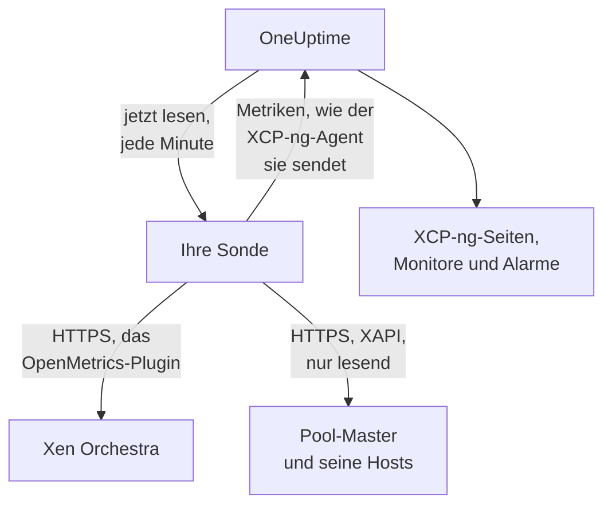

# XCP-ng ohne Agent

Überwachen Sie XCP-ng-Pools, ohne etwas zu installieren: Eine OneUptime-Sonde liest sie, entweder über das Xen Orchestra, das sie verwaltet, oder bei einem Pool ohne Xen Orchestra direkt aus der XAPI auf dem Master des Pools. Jeder Pool erhält dieselben Seiten, [XCP-ng-Monitore](/docs/monitor/xcp-ng-monitor) und Vorlagen wie ein Pool, den der [XCP-ng-Agent](/docs/telemetry/xcp-ng) sendet. Es gibt keinen Agent, den Sie installieren, aktualisieren oder am Laufen halten müssen.

:::cards
- [Bevor Sie beginnen](#bevor-sie-beginnen): Eine Sonde, die Xen Orchestra oder den Pool erreicht, und Lesezugriff.
- [Xen Orchestra verbinden](#xen-orchestra-verbinden): Jeder Pool, den es verwaltet, über eine einzige Verbindung.
- [Einen Pool ohne Xen Orchestra verbinden](#einen-pool-ohne-xen-orchestra-verbinden): Ein Pool, gelesen von seinem Master.
- [Fehlerbehebung](#fehlerbehebung): Was jede Meldung bedeutet und was sie behebt.
:::

## So funktioniert es

Jede Minute liest die Sonde jede Verbindung und sendet, was sie gelesen hat, an OneUptime:

- **Xen Orchestra**: Die Sonde liest das OpenMetrics-Plugin von Xen Orchestra mit dem Geheimnis des Plugins, genau wie der XCP-ng-Agent, sodass jeder Pool, den Xen Orchestra verwaltet, mit denselben Serien ankommt.
- **Die XAPI eines Pools**: Die Sonde meldet sich beim Pool-Master an und führt die Lesevorgänge aus, die das Plugin von Xen Orchestra selbst ausführt: die Datensätze des Pools und die Metriken jedes laufenden Hosts von diesem Host. Sie macht daraus dieselben Serien, die das Plugin liefert, sodass der Pool genau so gelesen wird wie über Xen Orchestra. Außerdem stellt sie die XAPI-Nachrichten des Pools, etwa eine abgestürzte VM oder einen Host, den HA verloren hat, in den Feed des Pools.

Jeder Pool registriert sich mit seinem ersten Lesevorgang anhand seiner UUID, wie die Pools des Agents, und erscheint unter **XCP-ng → Alle Pools**.

## Welcher Weg der richtige ist

| | Xen Orchestra, von einer Sonde | Die XAPI eines Pools, von einer Sonde | Der XCP-ng-Agent |
|---|---|---|---|
| Was Sie betreiben | Eine Sonde, die Sie bereits betreiben, oder eine neue | Eine Sonde, die Sie bereits betreiben, oder eine neue | Den Agent, auf einem eigenen Rechner |
| Was gelesen wird | Jeder Pool, den Xen Orchestra verwaltet | Ein Pool | Jeder Pool, den Xen Orchestra verwaltet |
| Was nötig ist | Das Geheimnis des OpenMetrics-Plugins und optional ein API-Token mit Lesezugriff | Ein Konto des Pools: root oder ein Active-Directory-Benutzer mit der Rolle read-only | Das Geheimnis des OpenMetrics-Plugins |
| Wo die Geheimnisse liegen | Verschlüsselt in OneUptime, nur an die Sonde gesendet | Verschlüsselt in OneUptime, nur an die Sonde gesendet | In der Datei `.env` des Agents |
| XAPI-Nachrichten im Feed des Pools | Nicht enthalten | Enthalten | Nicht enthalten |

Alle drei senden dieselben Serien. Ein Pool wird jeweils von genau einem von ihnen gelesen, damit sein Verlauf eine Linie bleibt, egal wer ihn liest.

## Bevor Sie beginnen

- **Eine Sonde, die die Adresse über TCP 443 erreicht.** Das ist meist eine [benutzerdefinierte Sonde](/docs/probe/custom-probe) im selben Netzwerk. In OneUptime Cloud erhalten die gemeinsam genutzten Sonden nie XCP-ng-Geheimnisse, fügen Sie also eine eigene Sonde hinzu. Auf einer selbst gehosteten Instanz können auch die eigenen Sonden der Instanz lesen.
- **Für Xen Orchestra:** Xen Orchestra 6.9 oder neuer mit eingeschaltetem OpenMetrics-Plugin: Folgen Sie [OpenMetrics-Plugin einschalten](/docs/telemetry/xcp-ng#das-openmetrics-plugin-einschalten) und kopieren Sie sein Geheimnis. Optional ein API-Token eines Xen-Orchestra-Benutzers mit der integrierten Rolle **Read only**: OneUptime prüft, dass es nur liest, und warnt Sie vor seinem Ablauf.
- **Für einen Pool ohne Xen Orchestra:** XCP-ng 8.2 oder neuer und die Adresse seines Masters. Die Rollen von XAPI gelten nur für Active-Directory-Benutzer, daher kann sein einziges lokales Konto, `root`, alles im Pool ändern. Für Lesezugriff nehmen Sie den Pool in Active Directory auf und geben einem Benutzer die Rolle `read-only`.

> [!IMPORTANT]
> Verbinden Sie einen Pool über Xen Orchestra oder über seine XAPI, nicht über beide: Die zweite Verbindung, die einen Pool liest, überlässt ihn der ersten.

## Xen Orchestra verbinden

:::steps
### Verbindungen öffnen
Öffnen Sie in OneUptime **XCP-ng → Verbindungen** und klicken Sie auf **XCP-ng verbinden**.

### Xen Orchestra wählen
Wählen Sie unter **Was gelesen wird** die Option **Xen Orchestra**. Geben Sie die **Adresse von Xen Orchestra** ein, unter der Sie es im Browser öffnen, etwa `https://xo.example.com`, und wählen Sie die Sonde, die es erreicht.

### Das Geheimnis des Plugins eingeben
Fügen Sie das **OpenMetrics-Geheimnis** ein. Fügen Sie ein **API-Token** des Benutzers mit Lesezugriff hinzu, falls Sie eines haben.

### Die Verbindung testen und dem Zertifikat vertrauen
Klicken Sie auf **Verbindung testen**. Xen Orchestra signiert sein Zertifikat selbst, daher zeigt der Test es an: Prüfen Sie seinen Fingerabdruck und klicken Sie dann auf **Diesem Zertifikat vertrauen**. Das Ergebnis listet die Pools auf, die Xen Orchestra liefert, mit ihren Hosts, VMs und Speicher-Repositorys.

### Benennen und verbinden
Der Name ist standardmäßig der Hostname von Xen Orchestra, und jeder Pool, den es liest, zeigt ihn an. Klicken Sie auf **XCP-ng verbinden**, und die Seite der Verbindung öffnet sich.
:::

## Einen Pool ohne Xen Orchestra verbinden

:::steps
### Von den Verbindungen aus beginnen
Öffnen Sie in OneUptime **XCP-ng → Verbindungen** und klicken Sie auf **XCP-ng verbinden**.

### Den Pool wählen
Wählen Sie unter **Was gelesen wird** die Option **Ein Pool ohne Xen Orchestra**. Geben Sie die **Adresse des Pool-Masters** ein, etwa `https://10.0.0.10`, und wählen Sie die Sonde, die ihn erreicht.

### Das Konto eingeben
Geben Sie **Benutzername** und **Passwort** ein: `root` oder einen Active-Directory-Benutzer mit der Rolle read-only, mit seiner Domäne geschrieben, etwa `EXAMPLE\oneuptime`.

### Die Verbindung testen und dem Zertifikat des Masters vertrauen
Klicken Sie auf **Verbindung testen**. Jeder XCP-ng-Host signiert sein Zertifikat selbst, daher zeigt der Test das des Masters an: Prüfen Sie seinen Fingerabdruck und klicken Sie dann auf **Diesem Zertifikat vertrauen**. Das Ergebnis nennt die XCP-ng-Version des Masters und was das Konto lesen kann, und warnt Sie, wenn das Konto den Pool ändern kann.

### Den Pool benennen und verbinden
Klicken Sie auf **XCP-ng verbinden**, und die Seite der Verbindung öffnet sich.
:::

Die Seite der Verbindung zeigt, wie es um ihr Lesen steht. Sie zeigt **Wird geprüft** bis zum ersten Lesevorgang, der innerhalb einer Minute beginnt, dann **Wird erfasst**, und die gelesenen Pools erscheinen unter **Gelesene Pools**.

Kommt 20 Minuten lang keine Sonde für die Verbindung, weil sie offline oder zu alt ist, zeigt die Seite **Wird nicht erfasst** und sagt das. Darf keine Sonde die Verbindung lesen, zeigt sie sofort **Wird nicht erfasst** und sagt, was zu ändern ist: Ein Geheimnis, ein Benutzername oder ein Passwort fehlt, keine Sonde ist zum Lesen festgelegt, ihre Sonde darf sie nicht lesen (eine gemeinsam genutzte Sonde in OneUptime Cloud oder die eines anderen Projekts), oder ihre Sonde ist getrennt.

## Pools, die der Agent bereits sendet

Ein Pool, den der XCP-ng-Agent registriert hat, wird von der ersten Verbindung übernommen, die ihn liest: Sein Verlauf läuft als eine Linie weiter, und der Feed des Pools sagt, dass der Agent gestoppt werden kann.

> [!WARNING]
> Stoppen Sie den XCP-ng-Agent, sobald eine Sonde seine Pools liest. Solange beide laufen, kommt jede Metrik doppelt an.

Um zurückzuwechseln, öffnen Sie die Seite **Einstellungen** des Pools. Ihre Karte **Datenerfassung** bietet **XCP-ng-Agent verwenden** für einen Pool, den eine Sonde liest, und **Mit einer Sonde erfassen** für einen Pool, den der Agent sendet. Ein Pool, der zum Agent zurückgewechselt ist, bleibt bei ihm, egal was die Verbindung liest.

## Zertifikate

Die Sonde überspringt nie die Prüfung von Zertifikaten. Jede Verbindung durchläuft einen vollständigen TLS-Handshake, und dann:

- ohne vertrauenswürdiges Zertifikat muss das Zertifikat von einer Stelle stammen, der der Rechner der Sonde vertraut, für die eingegebene Adresse;
- mit einem vertrauenswürdigen Zertifikat muss die Adresse genau dieses Zertifikat vorlegen, erkannt an seinem SHA-256-Fingerabdruck, egal welchen Namen das Zertifikat trägt. Das eigene Zertifikat von Xen Orchestra nennt keine Adresse und wird auf diese Weise vertraut.

Um einen Fingerabdruck zu prüfen, führen Sie `openssl s_client -connect xo.example.com:443 </dev/null | openssl x509 -noout -fingerprint -sha256` auf dem Rechner der Sonde aus und vergleichen Sie ihn mit dem Zertifikat selbst: auf einem Pool-Master `openssl x509 -noout -fingerprint -sha256 -in /etc/xensource/xapi-ssl.pem`.

Bei einem Pool vertrauen Sie dem Zertifikat des Masters. Der Pool listet selbst das Zertifikat auf, das jeder seiner Hosts verwendet, und die Sonde liest jeden anderen Host, festgelegt auf dieses Zertifikat. Wird ein anderer Host Master, folgt ihm die Sonde nur zu einem Host, für den sich der Pool bei seinem letzten Lesevorgang verbürgt hat. Ändert sich ein Zertifikat, stoppt das Lesen mit **Das Zertifikat hat sich geändert**, und das neue Zertifikat wird angezeigt: Nichts wird gesendet, bis Sie ihm auf der Seite der Verbindung vertrauen.

## Die gespeicherten Geheimnisse

Das Geheimnis, das Token und das Passwort sind verschlüsselt und nur schreibbar: Niemand kann sie zurücklesen, und die API gibt sie nie zurück. Sie werden nur an die Sonde gesendet, die die Verbindung liest, und diese hält sie im Speicher.

Ein gespeichertes Geheimnis wird nur an die Adresse, über die Sonde und an das Zertifikat gesendet, für die es eingegeben wurde. Wer unter **Verbindung bearbeiten** die Adresse, die Sonde oder das vertrauenswürdige Zertifikat ändert, muss es erneut eingeben, sodass niemand, der die Verbindung bearbeiten darf, es anderswohin senden kann, und ein gespeichertes API-Token, das nicht erneut eingegeben wird, wird vergessen. Dem Zertifikat zu vertrauen, das die Sonde an der gespeicherten Adresse gefunden hat, behält sie. **API-Token entfernen** löscht das Token aus OneUptime: Widerrufen Sie es auch in Xen Orchestra.

## Das API-Token

Ein API-Token ist optional: Die Metriken kommen über das Geheimnis des Plugins. Mit einem Token prüft jeder Lesevorgang es höchstens einmal pro Stunde:

- **Es liest nur.** Ein Token, dessen Benutzer Administrator ist oder dessen Rolle etwas ändern darf, besteht den Test nicht und wird auf der Seite der Verbindung als Problem angezeigt. OneUptime speichert nur Token mit Lesezugriff.
- **Es liest, was OneUptime braucht.** Xen Orchestra beantwortet eine Liste, die ein Benutzer nicht lesen darf, mit einer leeren Liste, daher muss das Token Alarme, Nachrichten und Sicherungsprotokolle lesen. Die integrierte Rolle **Read only** liest alle drei.
- **Wann es abläuft.** Xen Orchestra vergisst ein Token in dem Moment, in dem es abläuft. Zwei Wochen vorher sagen das die Seite der Verbindung und der Feed jedes Pools, den sie liest. Erstellen Sie ein neues Token für denselben Benutzer und geben Sie es unter **Verbindung bearbeiten** ein.

## Referenz

| Einstellung | Standard | Hinweise |
|---|---|---|
| Lesen alle | 1 Minute | Von 1 bis 60 Minuten. Jede Minute entspricht dem XCP-ng-Agent; lesen Sie ein großes Xen Orchestra seltener, um es zu schonen. |
| Lesevorgänge gleichzeitig | 4 pro Sonde | Ein Lesevorgang, der langsamer als sein Intervall ist, wird übersprungen, nie gestapelt. |
| Größter Lesevorgang | Etwa 48 MiB | Größere Xen Orchestras brauchen den XCP-ng-Agent. |
| XAPI-Nachrichten | 200 pro Lesevorgang | Ab dem Moment, in dem der Pool verbunden ist, jede einmal zugestellt, die älteste zuerst. |
| Verbindungstest | 90 Sekunden bis zum Start | Ein Test, den keine Sonde rechtzeitig übernimmt oder der länger als 150 Sekunden läuft, wird als fehlgeschlagen beantwortet. |

## Fehlerbehebung

:::details Das Zertifikat ist nicht vertrauenswürdig
Xen Orchestra und XCP-ng-Hosts signieren ihre Zertifikate standardmäßig selbst. Vergleichen Sie den angezeigten Fingerabdruck mit dem Zertifikat und klicken Sie dann auf **Diesem Zertifikat vertrauen**.
:::

:::details Das Zertifikat hat sich geändert
Nichts wird gesendet, bis Sie dem neuen Zertifikat vertrauen. Wenn Sie es erneuert haben, prüfen Sie den neuen Fingerabdruck, vertrauen Sie ihm und geben Sie die Geheimnisse unter **Verbindung bearbeiten** erneut ein.
:::

:::details Xen Orchestra hat das Geheimnis abgelehnt
Kopieren Sie das Geheimnis erneut aus **Settings → Plugins → openmetrics** in Xen Orchestra und geben Sie es unter **Verbindung bearbeiten** ein.
:::

:::details Das OpenMetrics-Plugin antwortet nicht
Laden Sie **openmetrics** unter **Settings → Plugins** in Xen Orchestra und schalten Sie **Auto-load** ein, damit es nach einem Neustart zurückkommt.
:::

:::details Dieses Xen Orchestra hat kein OpenMetrics-Plugin
Das Plugin braucht Xen Orchestra 6.9 oder neuer und auf einer Xen Orchestra Appliance eine Premium-Lizenz. Ohne sie verbinden Sie jeden Pool stattdessen über seine XAPI.
:::

:::details Kein Pool ist verbunden
Xen Orchestra meldet keinen verbundenen Pool. Fügen Sie Ihre Pools in Xen Orchestra hinzu oder verbinden Sie sie erneut, und testen Sie dann noch einmal.
:::

:::details Das API-Token kann Xen Orchestra ändern
OneUptime speichert nur Token mit Lesezugriff. Erstellen Sie eines für einen Benutzer, der eine Kopie der integrierten Rolle **Read only** hat und keine andere Rolle.
:::

:::details Das API-Token kann keine Alarme, Nachrichten oder Sicherungen lesen
Geben Sie dem Benutzer des Tokens eine Kopie der integrierten Rolle **Read only** von Xen Orchestra, die alle drei liest.
:::

:::details Das API-Token ist abgelaufen
Erstellen Sie in Xen Orchestra ein neues Token für den Benutzer mit Lesezugriff und geben Sie es unter **Verbindung bearbeiten** ein. Die Metriken kommen in der Zwischenzeit weiter an.
:::

:::details XAPI hat die Anmeldung abgelehnt
Prüfen Sie Benutzername und Passwort. Ein Active-Directory-Benutzer wird mit seiner Domäne geschrieben, etwa `EXAMPLE\oneuptime`.
:::

:::details Dieser Host ist nicht der Pool-Master
Ein Mitglied des Pools antwortet mit der Adresse seines Masters, die die Meldung nennt. Geben Sie diese Adresse ein und testen Sie erneut.
:::

:::details Das Konto kann den Pool nicht lesen
Geben Sie dem Active-Directory-Benutzer die Rolle read-only für den Pool, oder verwenden Sie ein Konto, das sie hat.
:::

:::details Die Sonde erhält keine Antwort
Das Netzwerk der Sonde kann die Adresse über TCP 443 nicht erreichen. Erlauben Sie es in der Firewall oder wählen Sie eine Sonde im selben Netzwerk.
:::

:::details Die Sonde hat dies nicht übernommen
Die Sonde ist offline oder läuft mit einer OneUptime-Version, die älter ist als das Lesen von XCP-ng. Prüfen Sie in der Tabelle **Benutzerdefinierte Sonden**, ob sie verbunden ist, und aktualisieren Sie sie.
:::

:::details Diese Verbindung ist zu groß, um von einer Sonde gelesen zu werden
Ihre Metriken sind größer, als ein Upload einer Sonde sein darf. Verwenden Sie dafür den [XCP-ng-Agent](/docs/telemetry/xcp-ng).
:::

## Nächste Schritte

:::cards
- [XCP-ng-Monitor](/docs/monitor/xcp-ng-monitor): Alarmieren Sie bei Pools, Hosts, VMs und Speicher-Repositorys.
- [Benutzerdefinierte Sonde](/docs/probe/custom-probe): Betreiben Sie eine Sonde im Netzwerk der Pools.
- [XCP-ng-Agent](/docs/telemetry/xcp-ng): Lesen Sie Xen Orchestra stattdessen mit dem Agent.
:::
