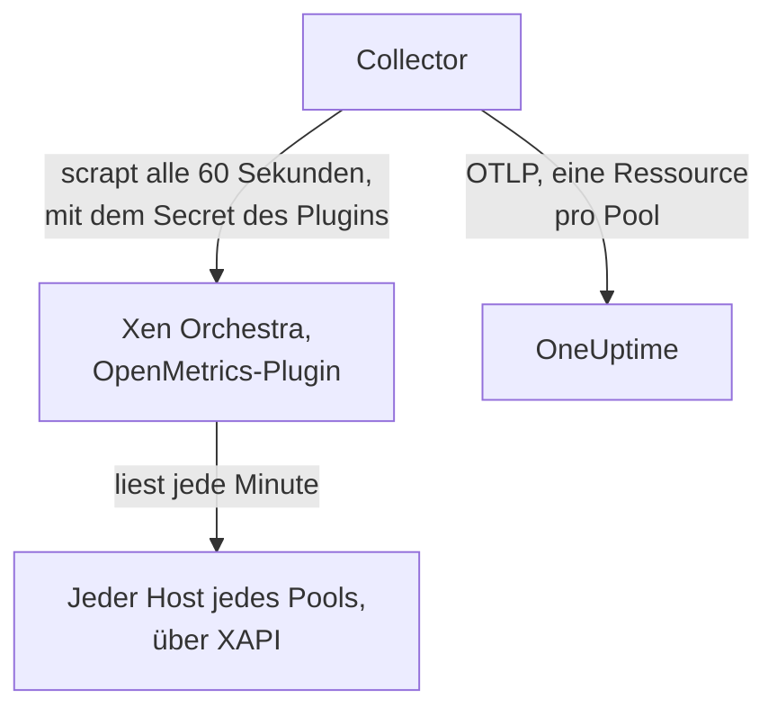

# XCP-ng-Agent

Der OneUptime-XCP-ng-Agent überwacht die XCP-ng-Pools, die ein Xen Orchestra verwaltet: ihre Hosts, VMs, Speicher-Repositorys und virtuellen Datenträger. Er ist ein unveränderter OpenTelemetry Collector, der das eigene OpenMetrics-Plugin von Xen Orchestra mit dem Secret des Plugins liest und das Gelesene an OneUptime sendet, wo jeder Pool mit seinem Inventar erscheint. Kein Passwort eines Pools oder von Xen Orchestra erreicht je den Agent. [XCP-ng-Monitore](/docs/monitor/xcp-ng-monitor) alarmieren anhand dessen, was ankommt. Um dieselben Pools ohne Installation von einer OneUptime-Sonde lesen zu lassen, siehe [XCP-ng ohne Agent](/docs/telemetry/xcp-ng-agentless).

:::cards
- [Agent installieren](#agent-installieren): Das Plugin einschalten, dann das Installationsskript oder Docker Compose.
- [Das Zertifikat von Xen Orchestra](#das-zertifikat-von-xen-orchestra): Wie der Agent Xen Orchestra vertraut, nie durch Überspringen der Prüfung.
- [Was der Agent erfasst](#was-der-agent-erfasst): Jede Serie des Plugins und die Zähler, die eigentlich Raten sind.
- [Fehlerbehebung](#fehlerbehebung): Ein Diagnoseskript und die üblichen Probleme.
:::

## Was Sie davon haben

- **Jeder Pool für sich.** Jeder Pool, den das Xen Orchestra verwaltet, wird in OneUptime zu einem XCP-ng-Pool, erkannt an seiner XAPI-UUID und so benannt, wie Xen Orchestra ihn nennt. Zwei Pools hinter einem Xen Orchestra sind zwei Pools, und einen Pool in OneUptime umzubenennen ist unbedenklich: Telemetrie wird über seine UUID zugeordnet.
- **Sein Inventar.** Die Hosts, VMs, Speicher-Repositorys und virtuellen Datenträger des Pools, mit ihrem Zustand und ihren Metriken. Steuerdomänen (dom0) melden sich als VMs, und die Seiten des Pools blenden sie aus, solange Sie sie nicht anfordern.
- **Ein Agent pro Xen Orchestra.** Das Plugin liefert jeden Pool, mit dem sein Xen Orchestra verbunden ist; ein Agent liest daher alle, und ein später verbundener Pool erscheint mit dem nächsten Lesevorgang.

## So funktioniert es

Der Agent ist ein Container, den Sie mit Docker Compose auf einem Rechner ausführen: ein unveränderter OpenTelemetry Collector, ohne eigenes Image von OneUptime. Alle 60 Sekunden fragt er Xen Orchestra nach `/openmetrics/metrics`, mit dem Secret des Plugins als Bearer-Token, über die eigene Adresse und das eigene Zertifikat von Xen Orchestra. Das Plugin liest die Metriken jedes Hosts über XAPI in 60-Sekunden-Auflösung. Der Collector behält die Serien der Pools, gruppiert sie nach Pool und sendet sie per OTLP an OneUptime.



Jeder Pool registriert sich mit seinen ersten Daten, unter der UUID, die der Agent als `xcp_ng.pool.id` an seine Serien hängt, und dem Namen, den Xen Orchestra ihm gibt, `xcp_ng.pool.name`. Ein Pool ohne Namen in Xen Orchestra heißt „Pool“ und trägt den Anfang seiner UUID, bis Sie ihn umbenennen.

## Bevor Sie beginnen

- Xen Orchestra 6.9 oder neuer, verbunden mit den Pools, die Sie überwachen möchten, mit seinem OpenMetrics-Plugin. Auf einer Xen Orchestra Appliance (XOA) braucht das Plugin eine Premium-Lizenz; ein aus den Quellen gebautes Xen Orchestra enthält es.
- Docker Engine 20.10 oder neuer mit dem Docker-Compose-v2-Plugin, `curl` und `openssl`, auf einem Rechner, der Xen Orchestra per HTTPS erreicht.
- Ein Zertifikat auf Xen Orchestra, das die Adresse nennt, mit der sich der Agent verbindet. Das selbstsignierte Zertifikat, das Xen Orchestra für sich selbst erzeugt, nennt keine, daher kann kein aktueller TLS-Client es prüfen, und ein aus den Quellen gebautes Xen Orchestra spricht reines HTTP, bis Sie ihm eines geben: siehe [Das Zertifikat von Xen Orchestra](#das-zertifikat-von-xen-orchestra).
- Ein Ingestion-Schlüssel. Legen Sie ihn unter **Projekteinstellungen → Telemetrie & APM → Ingestion-Schlüssel** an und kopieren Sie seinen Wert.
- Ausgehendes HTTPS von diesem Rechner zu Ihrer OneUptime-URL.

### Unterstützte Versionen

| | Unterstützt | Warum |
| --- | --- | --- |
| Xen Orchestra | 6.9 oder neuer, mit dem OpenMetrics-Plugin `xo-server-openmetrics` 1.9 | Sein Plugin behält sein Secret, wenn Xen Orchestra neu startet, enthält die Korrekturen für die Speicherlecks beim Scrapen und liefert jede Serie, die die Seiten des Pools lesen: den Status der Hosts und VMs, Speicher-Repositorys und virtuelle Datenträger. Ein älteres Plugin konnte bei einem Neustart ein neues Secret erzeugen, was den Agent aussperrte, bis jemand es erneut kopierte. |
| XCP-ng | 8.3 LTS | Von Vates bis zum 30. November 2028 unterstützt. XCP-ng 8.2 hat sein Lebensende am 16. September 2025 erreicht. |
| XenServer | Noch nicht getestet | Xen Orchestra meldet einen XenServer-Pool, den es verwaltet, mit denselben Serien; er sollte also funktionieren, aber noch niemand hat einen mit OneUptime getestet. |

### Wo der Agent laufen sollte

Der Agent spricht per HTTPS mit Xen Orchestra; er kann daher auf jedem Rechner mit Docker und einer Route dorthin laufen: auf dem Rechner von Xen Orchestra selbst, einem Monitoring-Host oder einer kleinen Management-VM. Bevorzugen Sie einen Rechner, dessen VM nicht auf den überwachten Pools läuft: Fällt ein Pool aus, sollte Ihr Monitoring nicht mit ihm ausfallen. Ein Agent liest ein Xen Orchestra; für mehrere siehe [Mehrere Xen Orchestras lesen](#mehrere-xen-orchestras-lesen).

## Das OpenMetrics-Plugin einschalten

Der Agent liest jeden Pool über das OpenMetrics-Plugin von Xen Orchestra, mit dem Secret des Plugins.

:::steps
### Das Plugin einschalten

Öffnen Sie in Xen Orchestra *Settings → Plugins*, suchen Sie **openmetrics** und schalten Sie es ein. Beim ersten Start erzeugt es ein Secret, und Xen Orchestra behält es über Neustarts hinweg.

### Sein Secret kopieren

Öffnen Sie die Einstellungen des Plugins und kopieren Sie sein **Prometheus secret**: Sie geben es im nächsten Schritt dem Agent. Sie können dort auch ein eigenes Secret eingeben und speichern. Halten Sie es geheim: Wer es hat, kann die Metriken jedes Pools lesen.

### Prüfen, ob es antwortet

Das Plugin antwortet unter der eigenen Adresse und mit dem eigenen Zertifikat von Xen Orchestra, unter `/openmetrics/metrics`, und nur auf eine Anfrage, die sein Secret mitbringt. Seine Zustandsprüfung braucht keines, daher darf diese eine Anfrage die Zertifikatsprüfung mit `-k` überspringen; der Agent tut das nie:

```bash
curl -k https://xo.example.com/openmetrics/health
```

Sie antwortet `{"status":"ok"}`, solange das Plugin läuft. Ein `404` bedeutet, dass das Plugin nicht eingeschaltet ist.
:::

## Agent installieren

:::steps
### Den Agent installieren und starten

Jede OneUptime-Instanz stellt das Installationsskript und die Dateien des Agents für ihr eigenes Release bereit: Die Befehle unten laden sie von `https://oneuptime.com` herunter; ersetzen Sie diese Adresse bei einer selbst gehosteten Instanz durch Ihre URL. Das Installationsskript wird zuerst als `install.sh` gespeichert, sodass Sie es lesen können, bevor Sie es ausführen.

:::tabs
@tab install.sh
Laden Sie das Installationsskript herunter und führen Sie es auf dem Rechner aus, auf dem der Agent laufen soll:

```bash
curl -fsSL https://oneuptime.com/install/xcp-ng-agent -o install.sh
bash install.sh
```

Das Skript fragt nach Ihrer OneUptime-URL, dem Ingestion-Schlüssel, der Adresse von Xen Orchestra, wie Sie sie im Browser öffnen (etwa `https://xo.example.com` oder `https://10.0.0.5:8443`), dem Secret des Plugins (beim Tippen nicht angezeigt) und danach, wie dieses Xen Orchestra in OneUptime heißen soll. Dann liest es das Zertifikat von Xen Orchestra: Ein Zertifikat, dem dieser Rechner bereits vertraut, wird gegen sein CA-Bundle geprüft; jedes andere wird mit seinem SHA-256-Fingerabdruck angezeigt, und Sie antworten **y**, um diesem Zertifikat und nichts anderem zu vertrauen, sobald Sie den Fingerabdruck mit dem auf dem Rechner von Xen Orchestra verglichen haben. Die Prüfung schaltet es nie ab. Zuletzt fragt es das Plugin mit dem Secret nach seinen Metriken und nennt die Pools, die Xen Orchestra meldet, bevor es irgendetwas installiert. Es installiert nach `/opt/oneuptime-xcp-ng-agent`, schreibt mit den Rechten `0600` eine `.env`-Datei sowie `xo-ca.pem`, die Zertifikate, denen der Agent für Xen Orchestra vertraut, und startet den Agent mit Docker Compose. Ein erneuter Aufruf des Skripts verwendet alles in dieser `.env` wieder, statt erneut zu fragen; so [aktualisieren Sie den Agent](#agent-aktualisieren).
@tab Docker Compose
Laden Sie `docker-compose.yml` und `otel-collector-config.yaml` von Ihrem OneUptime in einen neuen Ordner herunter:

```bash
mkdir oneuptime-xcp-ng-agent && cd oneuptime-xcp-ng-agent
curl -fsSLO https://oneuptime.com/install/xcp-ng-agent/docker-compose.yml
curl -fsSLO https://oneuptime.com/install/xcp-ng-agent/otel-collector-config.yaml
```

Legen Sie daneben eine `.env`-Datei an. Sie enthält das Secret des Plugins; halten Sie sie daher mit `chmod 600 .env` privat:

```bash title=".env"
ONEUPTIME_URL=YOUR_ONEUPTIME_URL
ONEUPTIME_TELEMETRY_INGESTION_KEY=YOUR_TELEMETRY_INGESTION_TOKEN
XO_SCHEME=https
XO_ADDRESS=xo.example.com
XO_OPENMETRICS_SECRET='your-plugin-secret'
XO_NAME='Xen Orchestra'
XO_TLS_SERVER_NAME=
```

`XO_ADDRESS` ist `host` oder `host:port` von Xen Orchestra, ohne `https://`. Setzen Sie das Secret des Plugins in einfache Anführungszeichen und schreiben Sie jedes `$` darin als `$$`: Der Collector liest den Wert noch einmal und hielte ein `$` für den Anfang einer Variable. Ein Secret mit einem `'` darin kann nicht zwischen einfachen Anführungszeichen stehen: Lassen Sie es vom Installationsskript schreiben, oder wählen Sie in Xen Orchestra ein anderes Secret.

Speichern Sie dann das Zertifikat von Xen Orchestra als `xo-ca.pem` neben `docker-compose.yml`: Der Agent prüft Xen Orchestra gegen diese Datei und nichts anderes. Um dem eigenen Zertifikat von Xen Orchestra zu vertrauen, lesen Sie es aus und vergleichen Sie seinen Fingerabdruck mit dem auf dem Rechner von Xen Orchestra, bevor Sie es verwenden:

```bash
openssl s_client -connect xo.example.com:443 -servername xo.example.com </dev/null 2>/dev/null \
  | openssl x509 -out xo-ca.pem
openssl x509 -in xo-ca.pem -noout -fingerprint -sha256
```

Hat eine eigene CA das Zertifikat ausgestellt, kopieren Sie stattdessen das Zertifikat dieser CA nach `xo-ca.pem`; hat es eine öffentliche CA ausgestellt, kopieren Sie das CA-Bundle dieses Rechners (`cp /etc/ssl/certs/ca-certificates.crt xo-ca.pem`). Starten Sie den Agent:

```bash
docker compose up -d
```
:::

### Prüfen, ob der Agent läuft

```bash
docker compose ps
docker logs -f oneuptime-xcp-ng-agent
```

`docker compose ps` listet den Collector, `oneuptime-xcp-ng-agent`. Sobald er gestartet ist, sollten seine Logs diese Zeile zeigen:

```text
Everything is ready. Begin running and processing data.
```

### Die Pools in OneUptime finden

Öffnen Sie **Produkte → Infrastruktur → XCP-ng → Alle Pools**. Jeder Pool, den Xen Orchestra meldet, erscheint etwa eine Minute nach dem ersten Scrape unter dem Namen, den Xen Orchestra ihm gibt, mit seinen Hosts, VMs und seinem Speicher. Seine Seite **Topologie** zeichnet sie als eine Karte: siehe [Topologie](/docs/telemetry/topology#die-eigene-karte-einer-ressource-öffnen).
:::

## Das Zertifikat von Xen Orchestra

Der Agent prüft das Zertifikat von Xen Orchestra bei jedem Lesen, gegen `xo-ca.pem` und nichts anderes, und überspringt die Prüfung nie: Das Secret des Plugins reist in jeder Anfrage mit. `xo-ca.pem` enthält eines von drei Dingen:

- **Das eigene Zertifikat von Xen Orchestra**, festgelegt über seinen SHA-256-Fingerabdruck (`XO_TLS_FINGERPRINT`): Der Agent vertraut diesem Zertifikat und keinem anderen.
- **Die CA, die es ausgestellt hat** (`XO_CA_FILE`), für ein Zertifikat einer eigenen CA.
- **Das CA-Bundle dieses Rechners**, für ein Zertifikat, dem dieser Rechner bereits vertraut, etwa eines einer öffentlichen CA.

In jedem Fall muss das Zertifikat die Adresse nennen, mit der sich der Agent verbindet. Der Agent prüft die Namen, auf die ein Zertifikat ausgestellt ist, seine alternativen Antragstellernamen (Subject Alternative Names), wie es jeder aktuelle TLS-Client tut, und nie seinen Antragsteller. Das selbstsignierte Zertifikat, das Xen Orchestra für sich selbst erzeugt, nennt keine; der Agent kann ihm daher nicht vertrauen, ob festgelegt oder nicht, und scheitert mit `x509: certificate is not valid for any names`; das Installationsskript hält bei einem solchen Zertifikat an und sagt, warum.

### Xen Orchestra ein Zertifikat geben, das seine Adresse nennt

Verwenden Sie ein Zertifikat Ihrer eigenen oder einer öffentlichen CA, oder erzeugen Sie auf dem Rechner von Xen Orchestra ein selbstsigniertes, das die Adresse von Xen Orchestra nennt, mit seinem Namen und seiner Adresse in seinen alternativen Antragstellernamen:

```bash
sudo mkdir -p /etc/ssl/xo
sudo openssl req -x509 -newkey rsa:2048 -nodes -days 825 \
  -subj "/CN=xo.example.com" \
  -addext "subjectAltName=DNS:xo.example.com,IP:10.0.0.5" \
  -keyout /etc/ssl/xo/key.pem -out /etc/ssl/xo/cert.pem
```

Verweisen Sie den HTTPS-Listener von xo-server auf die beiden Dateien, die der Benutzer, unter dem xo-server läuft (standardmäßig root), lesen können muss, in einer eigenen Konfigurationsdatei: `/etc/xo-server/config.httpscert.toml` auf einer XOA oder neben der `config.toml` von xo-server bei einem aus den Quellen gebauten Xen Orchestra. Die Listener von Xen Orchestra sind nummeriert, und der zweite, `http.listen.1`, ist sein HTTPS-Listener:

```toml
[http.listen.1]
port = 443
cert = '/etc/ssl/xo/cert.pem'
key = '/etc/ssl/xo/key.pem'
```

Starten Sie xo-server dann mit `systemctl restart xo-server` neu und installieren Sie den Agent, oder führen Sie das Installationsskript erneut aus: Es liest das neue Zertifikat und zeigt seinen Fingerabdruck zur Prüfung. Oder lassen Sie Xen Orchestra selbst ein Let's-Encrypt-Zertifikat anfordern, wie es eine XOA kann (siehe die Dokumentation von Xen Orchestra): Es ist öffentlich vertrauenswürdig, der Agent braucht also keine Einstellung. Nennt ein Zertifikat Xen Orchestra unter einem anderen Namen als der Adresse in `XO_ADDRESS`, setzen Sie `XO_TLS_SERVER_NAME` auf diesen Namen; das Installationsskript trägt ihn aus dem Zertifikat ein, wenn es kann.

Wird ein festgelegtes Zertifikat erneuert, hört der Agent auf, Xen Orchestra zu lesen, bis er dem neuen vertraut. Führen Sie das Installationsskript erneut aus: Es zeigt den neuen Fingerabdruck und hält an, ohne etwas zu ändern. Prüfen Sie diesen Fingerabdruck auf dem Rechner von Xen Orchestra, und führen Sie das Skript dann noch einmal damit aus: `XO_TLS_FINGERPRINT=<new fingerprint> bash install.sh`. Bei einer Installation mit Docker Compose schreiben Sie `xo-ca.pem` neu und führen `docker compose up -d --force-recreate` aus.

## Umgebungsvariablen

Das Installationsskript schreibt diese nach `/opt/oneuptime-xcp-ng-agent/.env`; eine Docker-Compose-Installation liest sie aus der `.env` neben `docker-compose.yml`. Nachdem Sie einen Wert geändert haben, führen Sie in diesem Ordner `docker compose up -d` aus.

| Variable | Erforderlich | Beschreibung |
| --- | --- | --- |
| `ONEUPTIME_URL` | Ja | Ihre OneUptime-URL, etwa `https://oneuptime.com` oder Ihre selbst gehostete Instanz. Verwenden Sie `http://` und ihren Port, wenn die Instanz nur HTTP spricht. |
| `ONEUPTIME_TELEMETRY_INGESTION_KEY` | Ja | Der Ingestion-Schlüssel aus **Projekteinstellungen → Telemetrie & APM → Ingestion-Schlüssel**. |
| `XO_URL` | Installationsskript | Die Adresse von Xen Orchestra, wie Sie sie im Browser öffnen, etwa `https://xo.example.com` oder `https://10.0.0.5:8443`. Das Installationsskript leitet `XO_SCHEME` und `XO_ADDRESS` daraus ab. |
| `XO_SCHEME` | Nein | `https`, der Standard. `http` nur im Labor: Das Secret geht dann im Klartext über das Netz. |
| `XO_ADDRESS` | Ja | `host` oder `host:port` von Xen Orchestra, ohne Schema. |
| `XO_OPENMETRICS_SECRET` | Ja | Das Secret des OpenMetrics-Plugins, als Bearer-Token gesendet. Jedes `$` darin wird als `$$` geschrieben. |
| `XO_NAME` | Nein | Wie dieses Xen Orchestra in OneUptime heißen soll, als `xen_orchestra.name` an jeden Pool gehängt, den es liest, und in den **Einstellungen** jedes Pools angezeigt. Standard ist die Adresse von Xen Orchestra. |
| `XO_TLS_FINGERPRINT` | Installationsskript | Der SHA-256-Fingerabdruck des eigenen Zertifikats von Xen Orchestra, wie `openssl x509 -fingerprint -sha256` ihn ausgibt, Doppelpunkte optional, wenn der Agent diesem Zertifikat und nichts anderem vertraut. Das Installationsskript lehnt ein Zertifikat ab, das nicht dazu passt. |
| `XO_CA_FILE` | Installationsskript | Ein CA-Bundle, das das Zertifikat von Xen Orchestra ausgestellt hat; das Installationsskript prüft das Zertifikat dagegen und kopiert es nach `xo-ca.pem`. |
| `XO_TLS_SERVER_NAME` | Nein | Der Name, gegen den das Zertifikat von Xen Orchestra geprüft wird, wenn `XO_ADDRESS` eine Adresse ist, die das Zertifikat nicht aufführt. Leer: der Host von `XO_ADDRESS`. |

## Was der Agent erfasst

Jede Minute liest der Agent das Plugin, das die Round-Robin-Datenbanken jedes Hosts über XAPI in 60-Sekunden-Auflösung liest. Er behält die Serien `xcp_*` und verschiebt den Pool jeder Serie an die Ressource, auf der er sie sendet, als `xcp_ng.pool.id` (die UUID des Pools, die sich nie ändert) und `xcp_ng.pool.name`:

| Kategorie | Serien |
| --- | --- |
| Pool | `xcp_pool_connected`, vorhanden, solange Xen Orchestra mit dem Pool verbunden ist |
| Hosts | `xcp_host_status` (sein Betriebszustand und ob er aktiviert ist), `xcp_host_uptime_seconds`, `xcp_host_cpu_average`, `xcp_host_cpu_core_usage`, `xcp_host_load`, `xcp_host_load_average`, `xcp_host_memory_*`, `xcp_host_running_vcpus`, `xcp_host_network_*` pro physischer Schnittstelle, `xcp_host_disk_*` pro Speicher-Repository, `xcp_host_power_consumption_watts` |
| VMs | `xcp_vm_status`, `xcp_vm_uptime_seconds`, `xcp_vm_cpu_usage`, `xcp_vm_cpu_core_usage`, `xcp_vm_runstate_*` (CPU-Konkurrenz), `xcp_vm_memory_*`, `xcp_vm_network_*` pro Schnittstelle, `xcp_vm_disk_*` pro Datenträger, `xcp_vm_power_consumption_watts` |
| Speicher | `xcp_sr_physical_size_bytes`, `xcp_sr_physical_usage_bytes`, `xcp_sr_virtual_size_bytes`, `xcp_vdi_virtual_size_bytes`, `xcp_vdi_physical_usage_bytes` |
| XOSTOR | `xcp_xostor_*`, auf Pools, die XOSTOR betreiben |

Steuerdomänen melden sich als VMs mit `is_control_domain="true"`. Jede Serie von Xen Orchestra behält ihren Namen und ihre Labels, etwa `uuid`, `host_name`, `vm_name`, `sr_name` und `tags`; die [XCP-ng-Überwachung](/docs/monitor/xcp-ng-monitor#erfasste-metriken) führt jede auf.

### Die Zähler, die Raten sind

Xen Orchestra typisiert acht Durchsatzserien als Zähler und nennt sie `_total`, obwohl jede die Rate pro Sekunde von XAPI enthält: `xcp_host_network_receive_bytes_total`, `xcp_host_network_transmit_bytes_total`, `xcp_vm_network_receive_bytes_total`, `xcp_vm_network_transmit_bytes_total`, `xcp_vm_network_receive_errors_total`, `xcp_vm_network_transmit_errors_total`, `xcp_vm_disk_read_bytes_total` und `xcp_vm_disk_write_bytes_total`. Als Zähler gelesen, wäre jedes Netzwerk- und Datenträgerdurchsatz-Diagramm falsch: Eine sinkende Rate liest sich wie ein Zähler-Reset. Der Prozessor `transform/xcp-ng-rates` des Agents macht sie zu Gauges, mit unveränderten Namen und Werten, sodass OneUptime sie als die Raten speichert, die sie sind, in Bytes oder Fehlern pro Sekunde. OneUptime wandelt außerdem jede um, die noch als Zähler ankommt, etwa von einem Collector, den Sie selbst konfiguriert haben.

### Was OneUptime hinzufügt

OneUptime leitet für jeden Pool beim Eintreffen seiner Daten vier 0/1-Serien ab, die die Warnungsvorlagen lesen:

| Serie | 1, solange |
| --- | --- |
| `xcp_ng.host.running` | Xen Orchestra den Host als Running meldet; 0, solange er Halted ist oder sein Zustand Unknown |
| `xcp_ng.host.enabled` | der Host aktiviert ist; 0 im Wartungsmodus oder während er evakuiert wird, wenn XAPI keine VM auf ihm startet |
| `xcp_ng.vm.running` | die VM Running ist; 0, solange sie Halted, Paused oder Suspended ist |
| `xcp_ng.vm.stopped_after_running` | eine VM, die in den letzten 24 Stunden lief, Halted oder Paused ist |

Mit einer Sonde, die mit Xen Orchestra oder der XAPI des Pools verbunden ist, leitet OneUptime außerdem diese aus dem ab, was die Sonde über die Metriken hinaus liest; der Agent liest nichts davon:

| Serie | Wert |
| --- | --- |
| `xcp_ng.pool.ha.enabled` | 1, solange die HA des Pools eingeschaltet ist, sonst 0 |
| `xcp_ng.pool.ha.can_tolerate_host_failure` | 1, solange HA einen Hostausfall noch übersteht, sonst 0: der eigene Plan von HA über XAPI, über Xen Orchestra ein laufender und aktivierter Host neben dem, der ausfällt |
| `xcp_ng.pool.ha.host_failures_to_tolerate` | wie viele Hostausfälle HA verkraften soll (nur über XAPI) |
| `xcp_ng.pool.ha.plan_exists_for` | wie viele Hostausfälle der aktuelle Plan abdeckt (nur über XAPI) |
| `xcp_ng.vm.backup_overdue` | 1, solange eine VM, die ein geplanter Backup-Job umfasst, innerhalb ihres Intervalls und eines weiteren Viertels, mindestens einer Stunde, kein erfolgreiches Backup hatte (nur über Xen Orchestra) |
| `xcp_ng.host.missing_patches` | wie viele Patches einem Host fehlen, alle sechs Stunden geprüft (nur über Xen Orchestra) |

Außerdem versieht es jeden Messpunkt mit `xcp_ng.scope` (`pool`, `host`, `vm`, `sr`, `vdi` oder `xostor`) und `xcp_ng.id` (der UUID dieses Objekts), nach denen Monitore und Dashboards filtern: siehe [Ressourcenidentität](/docs/monitor/xcp-ng-monitor#ressourcenidentität).

### Was der Agent nicht behält

- Die eigenen Prozessserien von Xen Orchestra (`xo_*`), die zu keinem Pool gehören, und die eigenen Scrape-Serien des Collectors.
- Die Leistungsaufnahme eines Hosts, die Xen Orchestra über IPMI liest: Das Plugin sendet diesen Wert ohne seinen Pool, er gehört also ebenfalls zu keinem Pool. Der geschätzte Anteil jeder VM daran, `xcp_vm_power_consumption_watts`, wird behalten.

## Was die Seiten eines Pools zeigen

Öffnen Sie einen Pool unter **Produkte → Infrastruktur → XCP-ng → Alle Pools**. Sein Menü enthält:

| Seite | Was sie zeigt |
| --- | --- |
| **Übersicht** | Den Zustand des Pools und was Aufmerksamkeit braucht, seine Hosts, VMs und seinen Speicher, seine am stärksten ausgelasteten VMs und Hosts sowie das Xen Orchestra, aus dem er gelesen wird, mit der Version des Agents. |
| **Hosts**, **VMs**, **Speicher** | Jeden Host, jede VM und jedes Speicher-Repository, jeweils mit einer eigenen Seite und ihren Diagrammen. **VMs** blendet Steuerdomänen aus, solange Sie sie nicht anfordern, und die Seite eines Speicher-Repositorys listet seine virtuellen Datenträger. |
| **Topologie** | Den Pool, seine Hosts, die VMs auf jedem und die Speicher-Repositorys, die sie nutzen, als eine Karte. |
| **Ressourcennutzung** | Diagramme der Hosts, VMs, des Speichers, der Datenträger und des Netzwerks des Pools im Zeitverlauf, eine Linie pro Host, VM oder Speicher-Repository. |
| **Empfehlungen** | Die [Warnungsvorlagen](/docs/monitor/xcp-ng-monitor#fertige-warnungsvorlagen) zum Einschalten, je ein Monitor. |
| **Metriken**, **Protokolle** | Jede Serie des Pools in den Explorern, auf ihn eingegrenzt. Der Agent sendet nur Metriken; **Protokolle** listet daher nur Logs, die Sie mit der `xcp_ng.pool.id` des Pools senden. |
| **Vorfälle**, **Warnungen**, **Geplante Wartung** | Diejenigen, die den Pool nennen. |
| **Feed** | Was mit dem Pool in OneUptime geschah: wann er hinzugefügt, geändert, archiviert oder wiederhergestellt wurde, wer seine Eigentümer sind und welche Eigentümer- und Beschriftungsregeln auf ihm liefen. |
| **Eigentümer** | Wer über ihn informiert wird, von Hand oder durch Eigentümerregeln. |
| **Einstellungen** | Sein Name, das Xen Orchestra, aus dem er gelesen wird, sein Name dort und die Version des Agents, dazu wie lange seine Telemetrie aufbewahrt wird. |
| **Dokumentation** | Diese Einrichtung, mit Ihrer URL und Ihrem Schlüssel ausgefüllt. |

Die **Übersicht** des Pools nennt seinen Zustand, **Fehlerfrei**, **Beeinträchtigt** oder **Fehlerhaft**, abgeleitet aus dem, was Aufmerksamkeit braucht, und listet dies unter **Erfordert Aufmerksamkeit**, das Dringendste zuerst:

- **Kritisch:** ein Host, der Halted ist oder in einem Zustand, den Xen Orchestra nicht bestimmen kann (Unknown); ein Speicher-Repository, das zu mehr als 95 % voll ist, wo VMs nicht mehr schreiben können.
- **Braucht einen Blick:** ein deaktivierter Host, im Wartungsmodus oder in der Evakuierung; eine VM, die Halted oder Paused ist und in den letzten 24 Stunden lief; ein Speicher-Repository, das zu mehr als 90 % voll ist, wo die Warnung Storage Repository Near Full auslöst, oder das durch Thin Provisioning über seine Größe hinaus belegt ist.

Eine angehaltene VM (Suspended) wurde absichtlich angehalten und zählt nie, ebenso wenig eine VM, die einen Tag lang niemand laufen sah, oder eine Steuerdomäne. ISO-Bibliotheken und Wechselmedien enthalten keine VM-Datenträger; die Speicherzahlen des Pools lassen sie daher aus.

Wenn Xen Orchestra einen Pool 15 Minuten lang nicht mehr meldet, wird der Pool **Getrennt**, und seine Seiten behalten, was zuletzt gemeldet wurde. Ein Host, eine VM, ein Speicher-Repository oder ein virtueller Datenträger, der in den Meldungen von Xen Orchestra nicht mehr erscheint, verlässt das Inventar 15 Minuten später; das Anhalten einer VM entfernt sie nie.

## Die Pools mit Projekt-Beschriftungen versehen

Ein Ressourcenattribut, das mit `oneuptime.label.` beginnt, wird zu einer Projekt-Beschriftung an jedem Pool, den der Agent liest: `oneuptime.label.<dimension>=<value>` ist die Beschriftung `<dimension>:<value>`. Fügen Sie die Attribute dem Prozessor `resource` in `otel-collector-config.yaml` hinzu, neben `oneuptime.agent.version`:

```yaml
processors:
  resource:
    attributes:
      # ...existing attributes...
      - key: oneuptime.label.team
        value: platform
        action: upsert
      - key: oneuptime.label.env
        value: production
        action: upsert
```

Der Collector liest seine Konfiguration nur beim Start: Führen Sie `docker compose restart oneuptime-xcp-ng-agent` aus. Die Pools zeigen dann die Beschriftungen `team:platform` und `env:production`. Beschriftungen werden ohne Rücksicht auf Groß- und Kleinschreibung abgeglichen, daher wird eine vorhandene Beschriftung `Production` wiederverwendet statt verdoppelt, und der Agent entfernt nie eine Beschriftung, die jemand in OneUptime hinzugefügt hat. Ein erneuter Aufruf des Installationsskripts ersetzt eine bearbeitete `otel-collector-config.yaml` und bewahrt Ihre daneben als `otel-collector-config.yaml.bak.<timestamp>` auf.

## Mehrere Xen Orchestras lesen

Ein Agent liest ein Xen Orchestra und jeden Pool, den es verwaltet. Um ein zweites Xen Orchestra vom selben Rechner aus zu lesen, installieren Sie einen zweiten Agent in einen eigenen Ordner mit eigener `.env`, etwa `INSTALL_DIR=/opt/oneuptime-xcp-ng-agent-lab bash install.sh`, und geben Sie ihm einen eigenen `container_name` in seiner `docker-compose.yml` (etwa `oneuptime-xcp-ng-agent-lab`): Zwei Container können keinen Namen teilen. Geben Sie jedem einen eigenen `XO_NAME`, damit die **Einstellungen** jedes Pools sagen, welches Xen Orchestra ihn liest, und übergeben Sie den Ordner dem Diagnoseskript mit `-d`.

Lassen Sie nie zwei Agents denselben Pool lesen, über zwei Xen Orchestras, die ihn beide verwalten: Er ist ein Pool in OneUptime, über seine UUID, und würde doppelt gemeldet.

## Als systemd-Dienst ausführen

Damit der Agent mit dem Rechner startet und bei einem Fehler neu startet, installieren Sie seine systemd-Unit. Sie geht davon aus, dass der Agent in `/opt/oneuptime-xcp-ng-agent` liegt, wohin das Installationsskript ihn legt:

```bash
sudo curl -fsSL https://oneuptime.com/install/xcp-ng-agent/systemd/oneuptime-xcp-ng-agent.service -o /etc/systemd/system/oneuptime-xcp-ng-agent.service
sudo systemctl daemon-reload
sudo systemctl enable --now oneuptime-xcp-ng-agent
```

## Agent aktualisieren

Der Agent meldet die Collector-Version, die seine Dateien festlegen, als seine **Agent-Version**, in der **Übersicht** und den **Einstellungen** jedes Pools. Ist sie älter als die Version, die dieses OneUptime-Release festlegt, erscheint daneben ein Warnzeichen. Wählen Sie es aus, um diese Befehle zu sehen.

Das Collector-Image ist in `docker-compose.yml` festgelegt, und seine Konfiguration ist eine Datei daneben; ein Pull allein bringt den Agent daher nicht voran. Führen Sie `install.sh` erneut aus: Es verwendet jeden Wert Ihrer vorhandenen `.env` wieder (es wird nichts erneut abgefragt), prüft das Zertifikat von Xen Orchestra auf dieselbe Weise, erneuert `docker-compose.yml` und `otel-collector-config.yaml` (eine von Ihnen bearbeitete Datei wird als `<file>.bak.<timestamp>` aufbewahrt), zieht das Image und erstellt den Agent neu, damit der Collector seine neue Konfiguration liest. Ein Agent, der außerhalb von `/opt/oneuptime-xcp-ng-agent` installiert ist, braucht seinen Ordner: `INSTALL_DIR=<folder> bash install.sh`.

```bash
curl -fsSL https://oneuptime.com/install/xcp-ng-agent -o install.sh
bash install.sh
```

Mit Docker Compose installiert? Laden Sie im Ordner des Agents beide Dateien erneut herunter (und nehmen Sie Ihre Änderungen daran erneut vor), ziehen Sie dann das Image und erstellen Sie den Agent neu. Ihre `.env` und `xo-ca.pem` bleiben:

```bash
curl -fsSLO https://oneuptime.com/install/xcp-ng-agent/docker-compose.yml
curl -fsSLO https://oneuptime.com/install/xcp-ng-agent/otel-collector-config.yaml
docker compose pull
docker compose up -d --force-recreate
```

## Agent deinstallieren

```bash
cd /opt/oneuptime-xcp-ng-agent
docker compose down
```

Schalten Sie danach das OpenMetrics-Plugin in Xen Orchestra aus, wenn nichts anderes es liest.

## Fehlerbehebung

:::details Zuerst das Diagnoseskript ausführen
Der Agent bringt ein Skript mit, [`troubleshoot.sh`](https://oneuptime.com/install/xcp-ng-agent/troubleshoot.sh), das die ganze Kette in der Reihenfolge prüft, in der die Daten sie durchlaufen: den Container; die Adresse von Xen Orchestra aus dem eigenen Netzwerk des Agents; die Zustandsprüfung des Plugins; das Zertifikat von Xen Orchestra gegen `xo-ca.pem`, und ob ein festgelegtes noch das ist, das es vorlegt; das Secret des Plugins; die Pools, die Xen Orchestra meldet; die Form des Ingestion-Schlüssels; die eigenen Metriken des Collectors; und ob OneUptime den Ingestion-Schlüssel akzeptiert. Diese letzte Prüfung zählt am meisten. OneUptime lehnt einen falschen Schlüssel mit `401` ab (`422` für einen deaktivierten Schlüssel oder einen Browser-Schlüssel), und der Collector behandelt beides als dauerhaft: Er verwirft den Batch und protokolliert einen Fehler `Exporting failed`, der leicht zu übersehen ist, während der Container gesund bleibt. Das Skript fragt `GET <url>/otlp/v1/validate` aus dem Netzwerk des Agents ab, um direkt `200` (gültig) oder `401` (ungültig) zu erhalten, und weicht auf älteren Servern auf `POST /fluentd/v1/logs` aus. Es gibt nie das Secret oder den Schlüssel aus.

```bash
curl -fsSL https://oneuptime.com/install/xcp-ng-agent/troubleshoot.sh -o troubleshoot.sh
bash troubleshoot.sh    # add -d <dir> if you installed outside /opt/oneuptime-xcp-ng-agent
```

Es endet mit einem Urteil, das die wahrscheinlichste Ursache nennt.
:::

:::details Xen Orchestra lehnt das Secret ab (401)
Der Collector protokolliert `server returned HTTP status 401 Unauthorized`. Kopieren Sie das Secret erneut aus *Settings → Plugins → openmetrics*, setzen Sie `XO_OPENMETRICS_SECRET` in `.env` darauf, zwischen einfachen Anführungszeichen und mit jedem `$` als `$$` geschrieben, und führen Sie im Ordner des Agents `docker compose up -d` aus. Vor 6.8 konnte Xen Orchestra bei einem Neustart ein neues Secret erzeugen: Aktualisieren Sie es.
:::

:::details Das Plugin antwortet nicht (404, 500, 502 oder 503)
Xen Orchestra antwortet, aber sein OpenMetrics-Plugin nicht. Schalten Sie das Plugin unter *Settings → Plugins → openmetrics* ein und prüfen Sie, dass Xen Orchestra 6.9 oder neuer ist. Eine XOA braucht für das Plugin eine Premium-Lizenz. `/openmetrics/health` antwortet ohne Secret `{"status":"ok"}`, solange das Plugin läuft.
:::

:::details Zertifikatsfehler
- `x509: certificate is not valid for any names`: Das Zertifikat nennt keine Adresse, wie das eigene selbstsignierte von Xen Orchestra. [Geben Sie Xen Orchestra ein Zertifikat, das seine Adresse nennt](#xen-orchestra-ein-zertifikat-geben-das-seine-adresse-nennt).
- `x509: certificate is valid for <names>, not <address>`: Verbinden Sie sich mit einem dieser Namen, oder setzen Sie `XO_TLS_SERVER_NAME` auf einen davon.
- `x509: cannot validate certificate for <IP> because it doesn't contain any IP SANs`: `XO_ADDRESS` ist eine IP-Adresse, die das Zertifikat nicht aufführt. Setzen Sie `XO_TLS_SERVER_NAME` auf einen Namen, den es aufführt, oder führen Sie das Installationsskript erneut aus, das dies tut.
- `x509: certificate signed by unknown authority`: `xo-ca.pem` enthält weder dieses Zertifikat noch die CA, die es ausgestellt hat. Das Zertifikat wurde erneuert, oder die Datei enthält ein anderes: Prüfen Sie den neuen Fingerabdruck auf dem Rechner von Xen Orchestra, und führen Sie das Installationsskript damit aus, `XO_TLS_FINGERPRINT=<new fingerprint> bash install.sh`, oder schreiben Sie die Datei neu.
- `unable to read CA cert`: `xo-ca.pem` fehlt oder kann nicht gelesen werden. Führen Sie das Installationsskript erneut aus.
:::

:::details Der Scrape läuft in eine Zeitüberschreitung (context deadline exceeded)
Xen Orchestra brauchte länger als 50 Sekunden, die Grenze des Agents, um die Metriken zu sammeln, daher sendet dieser Lesevorgang nichts: Meist antwortet ihm ein Host eines seiner Pools nicht. Prüfen Sie die Hosts der Pools in Xen Orchestra; der Agent liest eine Minute später erneut.
:::

:::details Ein Pool wird als Getrennt angezeigt
OneUptime markiert einen Pool als Getrennt, wenn 15 Minuten lang nichts für ihn gelesen wurde; OneUptime prüft alle 5 Minuten, und Zeit, in der es selbst keine Daten empfing, zählt nicht.

1. Sind alle Pools dieses Xen Orchestra getrennt, prüfen Sie den Agent: `docker compose ps` und `docker logs oneuptime-xcp-ng-agent`, im Ordner des Agents.
2. Ist es nur einer, meldet Xen Orchestra ihn nicht mehr: Unter *Settings → Servers* in Xen Orchestra muss der Server des Pools verbunden sein. Hosts, VMs und Speicher des Pools bleiben so, wie Xen Orchestra sie zuletzt gemeldet hat.
:::

:::details Ein Pool fehlt
Xen Orchestra meldet nur die Pools, mit denen es verbunden ist, und der Agent liest nur dieses Xen Orchestra. Verbinden Sie den Server des Pools unter *Settings → Servers* in Xen Orchestra; der Pool erscheint mit dem nächsten Lesevorgang in OneUptime. Ein Pool, den ein anderes Xen Orchestra verwaltet, braucht einen eigenen Agent neben diesem Xen Orchestra.
:::

:::details Durchsatzdiagramme sehen falsch aus
Die acht Serien `_total`, die Raten enthalten, müssen OneUptime als Gauges erreichen. Haben Sie die mitgelieferte `otel-collector-config.yaml` durch Ihre eigene ersetzt, behalten Sie deren Prozessor `transform/xcp-ng-rates`. Lesen Sie sie so, wie sie sind, in Bytes oder Fehlern pro Sekunde: Eine Rate pro Sekunde davon wäre eine Rate einer Rate.
:::

:::details Metriken ohne den Agent senden
Der Agent ist eine unveränderte Collector-Konfiguration; ein Collector, den Sie bereits betreiben, kann daher dieselbe Aufgabe übernehmen: Kopieren Sie den Scrape-Job und die Prozessoren aus der mitgelieferten Konfiguration in Ihre eigene. Das Ressourcenattribut `xcp_ng.pool.id` registriert jeden Pool in OneUptime, der Prozessor `groupbyattrs` macht jeden Pool zu einer Ressource, und das Löschen von `service.name` und `service.instance.id` verhindert, dass die Daten unter einem Dienst abgelegt werden: Behalten Sie alle drei, und `transform/xcp-ng-rates`.
:::

## Was das Plugin noch nicht abdeckt

Das OpenMetrics-Plugin von Xen Orchestra liefert Metriken; manches, worauf Sie bei einem XCP-ng-Pool achten, steckt daher noch nicht darin:

- **Alarme**, außer denen von XOSTOR, der **HA-Zustand**, der **Pool-Master**, **fehlende Patches** und **Backups**: Eine OneUptime-Sonde liest sie aus der REST-API von Xen Orchestra oder aus der XAPI des Pools ([#10997](https://github.com/OneUptime/oneuptime/issues/10997)), siehe [XCP-ng ohne Agent](/docs/telemetry/xcp-ng-agentless).
- Die **Snapshots** jeder VM und der **Link-Status** der physischen Schnittstellen eines Hosts (PIFs), die auch noch keine Sonde liest ([#11328](https://github.com/OneUptime/oneuptime/issues/11328)).
- **Pools ohne Xen Orchestra** oder hinter einer XOA ohne die Premium-Lizenz, die das Plugin braucht: Eine OneUptime-Sonde liest sie direkt über XAPI ([#10999](https://github.com/OneUptime/oneuptime/issues/10999)), siehe [XCP-ng ohne Agent](/docs/telemetry/xcp-ng-agentless).
- **Verbinden ohne Agent**: Eine OneUptime-Sonde liest das Plugin von Xen Orchestra selbst, wie es bei VMware geht ([#10996](https://github.com/OneUptime/oneuptime/issues/10996)), auf derselben Seite.

## Nächste Schritte

:::cards
- [XCP-ng-Überwachung](/docs/monitor/xcp-ng-monitor): Warnungen zu Pools, Hosts, VMs und Speicher-Repositorys.
- [Proxmox-Agent](/docs/telemetry/proxmox): Proxmox-VE-Cluster auf dieselbe Weise überwachen.
- [Host-OpenTelemetry-Collector](/docs/telemetry/host-otel-collector): Die Sicht des Betriebssystems in Ihren VMs.
:::
