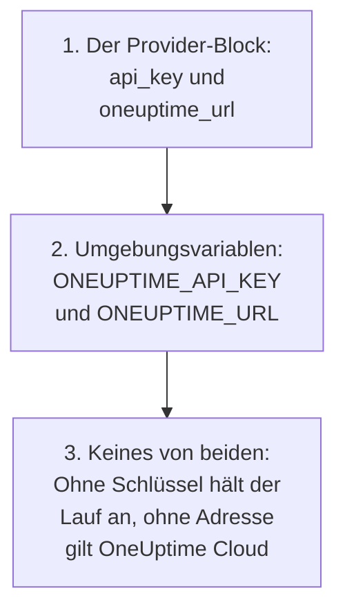

# Vollständige Anleitung

Diese Anleitung behandelt, was nach Ihrem ersten Apply kommt: wie der Provider seinen API-Schlüssel findet, wie Sie eine Konfiguration für ein Projekt oder mehrere aufbauen, wie Ressourcen aufeinander verweisen, wie Sie Datensätze lesen, die Sie nicht verwalten, wie Sie den State schützen und wie Sie aktualisieren. Neu beim Provider? Beginnen Sie mit dem [Schnellstart](/docs/terraform/quick-start).

:::cards
- [Den Provider konfigurieren](#den-provider-konfigurieren): Der API-Schlüssel und die Adresse, und wo der Provider sie liest.
- [Eine Konfiguration aufbauen](#eine-konfiguration-aufbauen): Dateien, Projekte und viele Ressourcen aus einem Block.
- [Lesen, was schon existiert](#lesen-was-schon-existiert): Datenquellen, und wie eine Suche passt.
- [Den State schützen](#den-state-schützen): Ein Remote-Backend, und was Sie nie committen.
:::

## Den Provider konfigurieren

Der Provider nimmt zwei Einstellungen. Jede kommt aus dem Provider-Block oder sonst aus einer Umgebungsvariablen:

| Einstellung | Umgebungsvariable | Wenn keines gesetzt ist |
| --- | --- | --- |
| `api_key` | `ONEUPTIME_API_KEY` | Der Provider hält an, bevor etwas geplant wird: `Missing API Key` |
| `oneuptime_url` | `ONEUPTIME_URL` | `https://oneuptime.com`, also OneUptime Cloud |



`oneuptime_url` ist die Adresse Ihrer OneUptime-Instanz, ohne `/api`: Der Provider fügt `https://` hinzu, wenn die Adresse kein Schema hat, und `/api` am Ende. `api_key` ist sensibel, daher gibt Terraform den Wert nie aus.

Der Schlüssel muss ein API-Schlüssel des Projekts sein, das Sie verwalten, und jede Art von Datensatz Ihrer Konfiguration anlegen, lesen, ändern und löschen dürfen: siehe [Einen API-Schlüssel des Projekts anlegen](/docs/terraform/quick-start#einen-api-schlüssel-des-projekts-anlegen). Der Master-API-Schlüssel einer selbst gehosteten OneUptime-Instanz gehört zu keinem Projekt, daher scheitert ein Anlegen damit mit `ProjectId required`.

### Dem Provider seinen Schlüssel geben

:::tabs
@tab Umgebungsvariable
```bash
export ONEUPTIME_API_KEY="<your-api-key>"
# Only on a self-hosted OneUptime:
export ONEUPTIME_URL="https://oneuptime.example.com"
```

```hcl title="main.tf"
provider "oneuptime" {}
```
@tab Terraform-Variable
```hcl title="variables.tf"
variable "oneuptime_api_key" {
  description = "API key of the OneUptime project"
  type        = string
  sensitive   = true
}

provider "oneuptime" {
  api_key = var.oneuptime_api_key
}
```

```hcl title="terraform.tfvars"
oneuptime_api_key = "<your-api-key>"
```
:::

Eine Umgebungsvariable hält den Schlüssel aus jeder Datei heraus. Eine Variablendatei ist auf Ihrem eigenen Rechner praktisch: Nehmen Sie `terraform.tfvars` in `.gitignore` auf. In einer Pipeline setzen Sie `TF_VAR_oneuptime_api_key`, statt die Datei zu schreiben.

### In CI/CD ausführen

Geben Sie dem Job den Schlüssel als Geheimnis in der Umgebungsvariablen `ONEUPTIME_API_KEY`:

:::tabs
@tab GitHub Actions
```yaml title=".github/workflows/oneuptime.yml"
name: OneUptime
on:
  push:
    branches: [main]

jobs:
  apply:
    runs-on: ubuntu-latest
    env:
      ONEUPTIME_API_KEY: ${{ secrets.ONEUPTIME_API_KEY }}
    steps:
      - uses: actions/checkout@v4
      - uses: hashicorp/setup-terraform@v3
      - run: terraform init -input=false
      - run: terraform plan -input=false -out=tfplan
      - run: terraform apply -input=false tfplan
```
@tab GitLab CI
```yaml title=".gitlab-ci.yml"
apply:
  image:
    name: hashicorp/terraform:latest
    entrypoint: [""]
  rules:
    - if: $CI_COMMIT_BRANCH == $CI_DEFAULT_BRANCH
  script:
    - terraform init -input=false
    - terraform plan -input=false -out=tfplan
    - terraform apply -input=false tfplan
```
:::

In GitHub fügen Sie das Geheimnis unter **Settings → Secrets and variables → Actions** hinzu; in GitLab eine maskierte CI/CD-Variable gleichen Namens. Halten Sie den State in einem [Remote-Backend](#den-state-schützen), damit jeder Lauf mit dem State beginnt, den der letzte hinterlassen hat.

## Eine Konfiguration aufbauen

Ein Aufbau, der sich bewährt:

```text
oneuptime/
├── main.tf          # the terraform and provider blocks
├── variables.tf     # input variables
├── outputs.tf       # the IDs other configurations need
├── shared.tf        # labels, teams and monitor statuses
├── monitors.tf      # monitors and monitor groups
├── status-pages.tf  # status pages and their domains
└── on-call.tf       # on-call policies and escalation rules
```

- **Eine Konfiguration für jedes Projekt.** Ein API-Schlüssel gehört zu einem Projekt, also verwaltet eine Konfiguration naturgemäß eines.
- **Gemeinsame Datensätze einmal.** Legen Sie Beschriftungen, Teams und Monitor-Status in einer Datei an und verweisen Sie überall sonst über ihre Adresse darauf.

### Mehrere Projekte verwalten

Um mehr als ein Projekt aus einer Konfiguration zu verwalten, geben Sie dem Provider für jedes einen Alias, jeweils mit dem Schlüssel dieses Projekts. Eine Ressource nennt mit `provider` den Alias, den sie nutzt:

```hcl
provider "oneuptime" {
  alias   = "production"
  api_key = var.production_api_key
}

provider "oneuptime" {
  alias   = "staging"
  api_key = var.staging_api_key
}

resource "oneuptime_label" "staging_critical" {
  provider = oneuptime.staging

  name  = "critical"
  color = "#FF5733"
}
```

Deklarieren Sie `production_api_key` und `staging_api_key` als Variablen, die als `sensitive` markiert sind, wie oben.

### Viele Ressourcen aus einem Block

`for_each` legt für jeden Eintrag einer Map eine Ressource an. Diese Monitore teilen ihre Kriterien und unterscheiden sich nur in Name und Adresse:

```hcl
variable "websites" {
  type = map(string)
  default = {
    homepage = "https://example.com"
    docs     = "https://docs.example.com"
  }
}

resource "oneuptime_monitor" "website" {
  for_each = var.websites

  name                = "Website: ${each.key}"
  monitor_type        = "Website"
  monitoring_interval = "*/5 * * * *"

  monitor_steps = [{
    monitor_destination      = each.value
    monitor_destination_type = "URL"

    criteria = [
      {
        name                  = "Offline"
        filter_condition      = "Any"
        change_monitor_status = true
        monitor_status_id     = data.oneuptime_monitor_status.offline.id

        filters = [
          {
            check_on    = "Is Online"
            filter_type = "False"
          }
        ]
      }
    ]
  }]
}
```

Fügen Sie der Map eine Website hinzu, und das nächste Apply legt ihren Monitor an. Entfernen Sie eine, und es löscht ihn.

## Auf andere Ressourcen verweisen

Eine Ressource, die ein Attribut einer anderen nennt, hängt von ihr ab, und Terraform ordnet die Arbeit nach diesen Verweisen. Hier wird die Beschriftung zuerst angelegt und zuletzt gelöscht, weil der Monitor und die Statusseite sie nennen:

```mermaid title="Terraform legt zuerst an, worauf eine Ressource verweist"
flowchart TB
    L["oneuptime_label<br/>payments"] --> M["oneuptime_monitor<br/>checkout_api"]
    L --> SP["oneuptime_status_page<br/>payments"]
    M --> R["oneuptime_status_page_resource<br/>checkout_api"]
    SP --> R
```

```hcl
resource "oneuptime_label" "payments" {
  name        = "payments"
  description = "Payment infrastructure"
  color       = "#2ECC71"
}

resource "oneuptime_monitor" "checkout_api" {
  name         = "Checkout API"
  description  = "Availability of the checkout API"
  monitor_type = "Manual"
  labels       = [oneuptime_label.payments.id]
}

resource "oneuptime_status_page" "payments" {
  name                  = "Payments Status"
  page_title            = "Payments Status"
  is_public_status_page = true
  labels                = [oneuptime_label.payments.id]
}

resource "oneuptime_status_page_resource" "checkout_api" {
  status_page_id = oneuptime_status_page.payments.id
  monitor_id     = oneuptime_monitor.checkout_api.id
  display_name   = "Checkout API"
}
```

`depends_on` brauchen Sie selten: Fügen Sie es nur für eine Reihenfolge hinzu, die Terraform nicht an den Attributen sehen kann. Listen von IDs wie `labels` sind Mengen, also ändert eine neue Reihenfolge nichts.

## Lesen, was schon existiert

Jede Ressource hat eine Datenquelle gleichen Namens. Eine Datenquelle liest einen Datensatz, den diese Konfiguration nicht verwaltet, angelegt im Dashboard oder von einer anderen Konfiguration, sodass Sie darauf verweisen können, ohne ihn zu übernehmen.

```hcl
data "oneuptime_label" "critical" {
  name = "critical"
}

data "oneuptime_monitor_status" "offline" {
  is_offline_state = true
}

data "oneuptime_status_page" "main" {
  id = "5f8a1b2c-3d4e-4f6a-8b9c-0d1e2f3a4b5c"
}

resource "oneuptime_monitor" "database" {
  name         = "Database Health"
  monitor_type = "Manual"
  labels       = [data.oneuptime_label.critical.id]
}
```

Wie eine Suche passt:

| Sie setzen | Sie findet | Fehler |
| --- | --- | --- |
| `id` | Den Datensatz mit dieser ID | `Not Found`, wenn kein Datensatz sie hat |
| Beliebige andere einfache Argumente, eines oder mehrere | Den einen Datensatz, der auf alle passt | `Not Found`, wenn keiner passt, `Ambiguous Match`, wenn mehr als einer passt |
| `id` und ein weiteres Argument, oder nichts | Nichts | `Invalid Lookup` |

Einfache Argumente sind Text, Zahlen und wahr oder falsch: ein Name, eine Priorität, ein Schalter wie `is_offline_state`. Nach Listen, JSON-Werten, Zeitstempeln und Geheimnissen kann nicht gesucht werden. Um einen Datensatz zu übernehmen, statt ihn nur zu lesen, [importieren Sie ihn](/docs/terraform/importing-resources) stattdessen.

## Den State schützen

Der State von Terraform enthält die IDs und Attribute von allem, was es verwaltet, Geheimnisse eingeschlossen. Halten Sie ihn in einem Remote-Backend, das ihn sperrt, damit ein Team einen State teilt und nie zwei Läufe gleichzeitig hineinschreiben. Jedes Standard-Backend funktioniert, zum Beispiel ein S3-Bucket:

```hcl
terraform {
  backend "s3" {
    bucket       = "my-terraform-state"
    key          = "oneuptime/production.tfstate"
    region       = "us-east-1"
    encrypt      = true
    use_lockfile = true
  }
}
```

`use_lockfile` braucht Terraform 1.10 oder OpenTofu 1.10 oder neuer. Davor sperrt das S3-Backend mit einer DynamoDB-Tabelle (`dynamodb_table`).

- **Bearbeiten Sie den State nie von Hand.** Verwenden Sie `terraform state mv` und `terraform state rm`.
- **Committen Sie nie `terraform.tfstate` oder eine `.tfvars`-Datei mit einem Geheimnis darin.**

## Drift, und was keine verursacht

`terraform plan` vergleicht OneUptime mit Ihrer Konfiguration und listet, was abweicht. Manche Abweichungen werden nie angezeigt:

- **Zeiten werden als Zeitpunkte verglichen.** `2030-06-01T02:00:00Z` und die Schreibweise des Servers für denselben Zeitpunkt sind gleich.
- **Standardwerte, die der Server ergänzt**, in den Schritten eines Monitors oder in einem JSON-Wert, sind keine Abweichung von dem, was Sie geschrieben haben.
- **Was der Server aktuell hält**, etwa der aktuelle Status eines Monitors, ist ebenfalls keine Abweichung.

Ein Wert, den Sie bei jedem Lauf berechnen, ist es dagegen schon: `timestamp()` liefert bei jedem Lauf eine neue Zeit, also zeigt ein Plan sie immer an. Schreiben Sie stattdessen feste Zeiten:

```hcl
resource "oneuptime_scheduled_maintenance_event" "database_upgrade" {
  title       = "Database upgrade"
  description = "Planned PostgreSQL upgrade"
  starts_at   = "2030-06-01T02:00:00Z"
  ends_at     = "2030-06-01T04:00:00Z"
}
```

## Den Provider aktualisieren

:::steps
### Die Versionshinweise lesen

Die [Terraform Registry](https://registry.terraform.io/providers/oneuptime/oneuptime) und die [GitHub-Releases des Providers](https://github.com/OneUptime/terraform-provider-oneuptime/releases) listen, was sich geändert hat.

### Die Versionseinschränkung anheben

`{{TERRAFORM_PROVIDER_VERSION}}` nimmt bereits jedes Release {{TERRAFORM_PROVIDER_MAJOR}}.x. Eine neue Hauptversion braucht eine neue Einschränkung.

### Die neue Version herunterladen

```bash
terraform init -upgrade
```

### Planen, bevor Sie anwenden

Führen Sie `terraform plan` aus, und wenden Sie nur an, wenn der Plan leer ist oder die Änderungen zeigt, die Sie erwarten.
:::

Bei einer selbst gehosteten OneUptime-Instanz aktualisieren Sie zuerst OneUptime und danach den Provider: Der Provider darf nicht neuer sein als Ihre OneUptime-Instanz. Siehe [Selbst gehostete Einrichtung](/docs/terraform/self-hosted).

## Nächste Schritte

:::cards
- [Monitor-Schritte](/docs/terraform/monitor-steps): Festlegen, was ein Monitor prüft und was jedes Ergebnis bedeutet.
- [Beispiele](/docs/terraform/examples): Fertige Konfigurationen für die gängigen Ressourcen.
- [Ressourcen importieren](/docs/terraform/importing-resources): Was Sie im Dashboard angelegt haben, unter Terraform bringen.
- [Fehlerbehebung](/docs/terraform/troubleshooting): Häufige Fehler und wie Sie sie beheben.
:::
