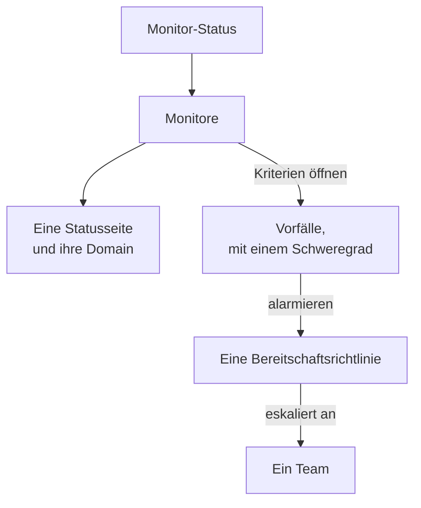

# Beispiele

Fertige Konfigurationen für die Ressourcen, mit denen die meisten Projekte beginnen. Jeder Block lässt sich so, wie er ist, auf die Provider-Einrichtung unten anwenden, und die meisten stammen aus den End-to-End-Tests des Providers, die sie bei jeder Änderung auf eine echte OneUptime-Instanz anwenden.

:::cards
- [Monitore](#monitore): Website-, API-, Ping-, Port-, SSL-Zertifikat-, Heartbeat- und manuelle Monitore.
- [Statusseiten](#statusseiten): Eine Statusseite mit einer Gruppe und einem Monitor, und eine eigene Domain.
- [Teams und Bereitschaft](#teams-und-bereitschaft): Ein Team und eine Bereitschaftsrichtlinie, die es alarmiert.
- [Vorfälle und Wartung](#vorfälle-und-wartung): Schweregrade, Status, ein erklärter Vorfall und ein Wartungsfenster.
:::



## Einrichtung des Providers

Jedes Beispiel setzt diese Einrichtung voraus, mit dem API-Schlüssel in der Umgebungsvariablen `ONEUPTIME_API_KEY`:

```hcl title="main.tf"
terraform {
  required_providers {
    oneuptime = {
      source  = "oneuptime/oneuptime"
      version = "{{TERRAFORM_PROVIDER_VERSION}}"
    }
  }
}

provider "oneuptime" {
  # On a self-hosted OneUptime, add your OneUptime's address:
  # oneuptime_url = "https://oneuptime.example.com"
}
```

## Beschriftungen

Beschriftungen ordnen und filtern Datensätze. Die meisten Ressourcen nehmen in `labels` eine Menge von Beschriftungs-IDs:

```hcl
resource "oneuptime_label" "production" {
  name        = "production"
  description = "Production infrastructure"
  color       = "#FF5733"
}
```

## Monitore

Die Monitore unten setzen ihren Status mit drei der Status, mit denen jedes Projekt beginnt, gelesen über Datenquellen:

```hcl
data "oneuptime_monitor_status" "operational" {
  name = "Operational"
}

data "oneuptime_monitor_status" "degraded" {
  name = "Degraded"
}

data "oneuptime_monitor_status" "offline" {
  name = "Offline"
}
```

Die `monitor_steps` jedes Monitors sagen, was er prüft und wie jedes Ergebnis beurteilt wird: [Monitor-Schritte](/docs/terraform/monitor-steps) erklärt jedes Attribut.

### Website-Monitor

Offline, wenn die Website nicht antwortet, online, wenn sie mit 200 antwortet. Der End-to-End-Test `35-monitor-with-steps` wendet einen Monitor mit diesen Prüfungen an:

```hcl
resource "oneuptime_monitor" "website" {
  name                = "Website"
  description         = "Homepage availability and status code"
  monitor_type        = "Website"
  monitoring_interval = "*/5 * * * *"
  labels              = [oneuptime_label.production.id]

  monitor_steps = [{
    monitor_destination      = "https://example.com"
    monitor_destination_type = "URL"
    request_type             = "GET"

    criteria = [
      {
        name                  = "Offline"
        description           = "The website does not respond"
        filter_condition      = "Any"
        change_monitor_status = true
        monitor_status_id     = data.oneuptime_monitor_status.offline.id

        filters = [
          {
            check_on    = "Is Online"
            filter_type = "False"
          }
        ]
      },
      {
        name                  = "Online"
        description           = "The website responds with 200"
        filter_condition      = "All"
        change_monitor_status = true
        monitor_status_id     = data.oneuptime_monitor_status.operational.id

        filters = [
          {
            check_on    = "Is Online"
            filter_type = "True"
          },
          {
            check_on    = "Response Status Code"
            filter_type = "Equal To"
            value       = "200"
          }
        ]
      }
    ]
  }]
}
```

### API-Monitor

Ein `POST` mit Headern und einem JSON-Body, eingeschränkt, wenn die Antwort langsam ist. Der End-to-End-Test `35-monitor-with-steps` wendet einen ähnlichen API-Monitor an:

```hcl
resource "oneuptime_monitor" "orders_api" {
  name         = "Orders API"
  description  = "Health check of the orders API"
  monitor_type = "API"

  monitor_steps = [{
    monitor_destination      = "https://api.example.com/v1/health"
    monitor_destination_type = "URL"
    request_type             = "POST"
    request_headers = {
      "Content-Type" = "application/json"
      "Accept"       = "application/json"
    }
    request_body = jsonencode({ check = "health" })

    criteria = [
      {
        name                  = "Offline"
        description           = "The API does not answer, or answers with an error"
        filter_condition      = "Any"
        change_monitor_status = true
        monitor_status_id     = data.oneuptime_monitor_status.offline.id

        filters = [
          {
            check_on    = "Is Online"
            filter_type = "False"
          },
          {
            check_on    = "Response Status Code"
            filter_type = "Greater Than Or Equal To"
            value       = "500"
          }
        ]
      },
      {
        name                  = "Slow"
        description           = "The API takes more than two seconds"
        filter_condition      = "All"
        change_monitor_status = true
        monitor_status_id     = data.oneuptime_monitor_status.degraded.id

        filters = [
          {
            check_on    = "Response Time (in ms)"
            filter_type = "Greater Than"
            value       = "2000"
          }
        ]
      },
      {
        name                  = "Online"
        description           = "The API answers in time"
        filter_condition      = "All"
        change_monitor_status = true
        monitor_status_id     = data.oneuptime_monitor_status.operational.id

        filters = [
          {
            check_on    = "Is Online"
            filter_type = "True"
          }
        ]
      }
    ]
  }]
}
```

### Ping-Monitor

Ein Ping-Monitor nimmt einen Hostnamen oder eine IP-Adresse statt einer URL:

```hcl
resource "oneuptime_monitor" "gateway" {
  name         = "Gateway"
  description  = "The gateway answers ping"
  monitor_type = "Ping"

  monitor_steps = [{
    monitor_destination      = "gateway.example.com"
    monitor_destination_type = "Hostname"

    criteria = [
      {
        name                  = "Unreachable"
        filter_condition      = "Any"
        change_monitor_status = true
        monitor_status_id     = data.oneuptime_monitor_status.offline.id

        filters = [
          {
            check_on    = "Is Online"
            filter_type = "False"
          }
        ]
      },
      {
        name                  = "Reachable"
        filter_condition      = "All"
        change_monitor_status = true
        monitor_status_id     = data.oneuptime_monitor_status.operational.id

        filters = [
          {
            check_on    = "Is Online"
            filter_type = "True"
          }
        ]
      }
    ]
  }]
}
```

### Port-Monitor

Ein Port-Monitor fügt den zu prüfenden `port` hinzu, als Zahl:

```hcl
resource "oneuptime_monitor" "database_port" {
  name         = "Database port"
  description  = "PostgreSQL accepts connections"
  monitor_type = "Port"

  monitor_steps = [{
    monitor_destination      = "db.example.com"
    monitor_destination_type = "Hostname"
    port                     = 5432

    criteria = [
      {
        name                  = "Closed"
        filter_condition      = "Any"
        change_monitor_status = true
        monitor_status_id     = data.oneuptime_monitor_status.offline.id

        filters = [
          {
            check_on    = "Is Online"
            filter_type = "False"
          }
        ]
      },
      {
        name                  = "Open"
        filter_condition      = "All"
        change_monitor_status = true
        monitor_status_id     = data.oneuptime_monitor_status.operational.id

        filters = [
          {
            check_on    = "Is Online"
            filter_type = "True"
          }
        ]
      }
    ]
  }]
}
```

### SSL-Zertifikat-Monitor

Offline, wenn das Zertifikat nicht gültig ist, eingeschränkt, wenn es in 14 Tagen oder weniger abläuft, so wie ein neuer SSL-Zertifikat-Monitor im Dashboard:

```hcl
resource "oneuptime_monitor" "certificate" {
  name         = "example.com certificate"
  description  = "The TLS certificate of example.com"
  monitor_type = "SSL Certificate"

  monitor_steps = [{
    monitor_destination      = "https://example.com"
    monitor_destination_type = "URL"

    criteria = [
      {
        name                  = "Not valid"
        description           = "Expired, self-signed, untrusted or not reachable"
        filter_condition      = "Any"
        change_monitor_status = true
        monitor_status_id     = data.oneuptime_monitor_status.offline.id

        filters = [
          {
            check_on    = "Is Not A Valid Certificate"
            filter_type = "True"
          }
        ]
      },
      {
        name                  = "Expires soon"
        description           = "Valid, and expires in 14 days or less"
        filter_condition      = "All"
        change_monitor_status = true
        monitor_status_id     = data.oneuptime_monitor_status.degraded.id

        filters = [
          {
            check_on    = "Is Valid Certificate"
            filter_type = "True"
          },
          {
            check_on    = "Expires In Days"
            filter_type = "Less Than Or Equal To"
            value       = "14"
          }
        ]
      },
      {
        name                  = "Valid"
        filter_condition      = "All"
        change_monitor_status = true
        monitor_status_id     = data.oneuptime_monitor_status.operational.id

        filters = [
          {
            check_on    = "Is Valid Certificate"
            filter_type = "True"
          }
        ]
      }
    ]
  }]
}
```

### Manueller Monitor

Ein manueller Monitor prüft nichts: Sie setzen seinen Status selbst. Er braucht keine `monitor_steps`:

```hcl
resource "oneuptime_monitor" "payment_provider" {
  name         = "Payment provider"
  description  = "Set by hand during the provider's incidents"
  monitor_type = "Manual"
}
```

### Heartbeat-Monitor

Ein Monitor für eingehende Anfragen wartet auf Anfragen, statt sie zu senden: hier ein Backup-Job, der sich jede Nacht meldet. Er geht offline, wenn 25 Stunden lang keine Anfrage gekommen ist:

```hcl
resource "oneuptime_monitor" "nightly_backup" {
  name         = "Nightly backup"
  description  = "The backup job sends a heartbeat when it finishes"
  monitor_type = "Incoming Request"

  monitor_steps = [{
    criteria = [
      {
        name                  = "No heartbeat"
        filter_condition      = "Any"
        change_monitor_status = true
        monitor_status_id     = data.oneuptime_monitor_status.offline.id

        filters = [
          {
            check_on    = "Incoming Request"
            filter_type = "Not Recieved In Minutes"
            value       = "1500"
          }
        ]
      },
      {
        name                  = "Heartbeat received"
        filter_condition      = "All"
        change_monitor_status = true
        monitor_status_id     = data.oneuptime_monitor_status.operational.id

        filters = [
          {
            check_on    = "Incoming Request"
            filter_type = "Recieved In Minutes"
            value       = "1500"
          }
        ]
      }
    ]
  }]
}

output "nightly_backup_heartbeat_key" {
  value     = oneuptime_monitor.nightly_backup.incoming_request_secret_key
  sensitive = true
}
```

Der Job sendet seine Anfrage an `https://oneuptime.com/heartbeat/YOUR_SECRET_KEY`, mit dem Schlüssel, den `terraform output -raw nightly_backup_heartbeat_key` ausgibt: siehe [Eingehende-Anfrage-Überwachung](/docs/monitor/incoming-request-monitor). Der Agent eines Server-Monitors meldet sich genauso an, mit `server_monitor_secret_key`.

### Monitor-Gruppe

Eine Monitor-Gruppe zeigt eine Menge von Monitoren mit einem Status:

```hcl
resource "oneuptime_monitor_group" "storefront" {
  name        = "Storefront"
  description = "Everything the shop needs"
}

resource "oneuptime_monitor_group_resource" "website" {
  monitor_group_id = oneuptime_monitor_group.storefront.id
  monitor_id       = oneuptime_monitor.website.id
}

resource "oneuptime_monitor_group_resource" "orders_api" {
  monitor_group_id = oneuptime_monitor_group.storefront.id
  monitor_id       = oneuptime_monitor.orders_api.id
}
```

## Statusseiten

### Eine Statusseite mit einer Gruppe und einem Monitor

Eine Statusseite zeigt Ressourcen und kann sie in Gruppen ordnen. Der End-to-End-Test `42-status-page-resources` wendet diese Einrichtung an:

```hcl
resource "oneuptime_status_page" "public" {
  name                  = "Public Status"
  description           = "Customer-facing status page"
  page_title            = "System Status"
  page_description      = "Check our system status and incident history"
  is_public_status_page = true
}

resource "oneuptime_status_page_group" "services" {
  status_page_id = oneuptime_status_page.public.id
  name           = "Services"
}

resource "oneuptime_status_page_resource" "website" {
  status_page_id       = oneuptime_status_page.public.id
  status_page_group_id = oneuptime_status_page_group.services.id
  monitor_id           = oneuptime_monitor.website.id
  display_name         = "Website"
}
```

### Eine eigene Domain

Drei Ressourcen arbeiten zusammen: eine Domain Ihres Projekts, die Statusseite und die Domain der Statusseite, die beide verbindet. Der Server füllt `full_domain` und das CNAME-Verifizierungstoken aus: Setzen Sie sie nicht. Die End-to-End-Tests `12-status-page-domain` und `25-status-page-with-domain` wenden diese Einrichtung an:

```hcl
resource "oneuptime_domain" "company" {
  domain = "example.com"
}

resource "oneuptime_status_page_domain" "status" {
  domain_id      = oneuptime_domain.company.id
  status_page_id = oneuptime_status_page.public.id
  subdomain      = "status"
}

output "status_page_address" {
  # The subdomain and the domain, such as status.example.com.
  value = oneuptime_status_page_domain.status.full_domain
}
```

Eine neue Domain muss die DNS-Verifizierung bestehen, bevor die Statusseite darauf antwortet.

## Teams und Bereitschaft

### Ein Team und seine Mitglieder

```hcl
resource "oneuptime_team" "sre" {
  name        = "SRE"
  description = "Site reliability engineering"
}

variable "alice_user_id" {
  description = "Alice's user ID, the last part of the address of her page under Users"
  type        = string
}

resource "oneuptime_team_member" "alice" {
  team_id = oneuptime_team.sre.id
  user_id = var.alice_user_id
}
```

Eine Person, die schon im Projekt ist, kommt sofort ins Team. Alle anderen werden eingeladen und sind im Team, sobald sie annehmen. Der End-to-End-Test `33-team-crud` wendet das Team an.

### Eine Bereitschaftsrichtlinie, die ein Team alarmiert

Die erste Regel der Richtlinie alarmiert das Team, und die Richtlinie beginnt bis zu zweimal von vorn, wenn niemand bestätigt:

```hcl
resource "oneuptime_on_call_policy" "primary" {
  name                                             = "Primary on-call"
  description                                      = "First line for production incidents"
  repeat_policy_if_no_one_acknowledges             = true
  repeat_policy_if_no_one_acknowledges_no_of_times = 2
}

resource "oneuptime_escalation_rule" "first_line" {
  on_call_duty_policy_id    = oneuptime_on_call_policy.primary.id
  name                      = "Page the SRE team"
  description               = "Moves on after 5 minutes without an acknowledgement"
  order                     = 1
  escalate_after_in_minutes = 5
}

resource "oneuptime_team_on_call_duty_escalation_rule" "sre" {
  on_call_duty_policy_id                 = oneuptime_on_call_policy.primary.id
  on_call_duty_policy_escalation_rule_id = oneuptime_escalation_rule.first_line.id
  team_id                                = oneuptime_team.sre.id
}
```

Die Kriterien eines Monitors alarmieren die Richtlinie über `on_call_policy_ids` an den Vorfällen, die sie öffnen: siehe [Vorfälle und Warnungen](/docs/terraform/monitor-steps#vorfälle-und-warnungen).

## Vorfälle und Wartung

### Schweregrade und Status

Schweregrade ordnen die Auswirkung eines Vorfalls ein, und Status sind die Stationen seines Lebens. `order` ist die Stelle, an der jeder aufgeführt wird:

```hcl
resource "oneuptime_incident_severity" "sev1" {
  name        = "SEV-1"
  description = "Full outage, all hands"
  color       = "#E74C3C"
  order       = 1
}

resource "oneuptime_incident_state" "mitigated" {
  name        = "Mitigated"
  description = "Impact contained, fix in progress"
  color       = "#F39C12"
  order       = 3
}
```

`oneuptime_alert_severity` und `oneuptime_alert_state` funktionieren für Warnungen genauso. Die End-to-End-Tests `03-incident-severity` und `04-incident-state` wenden sie an.

### Einen Vorfall erklären

Meist öffnen Monitore Vorfälle, aber ein Vorfall ist auch eine Ressource, was zu einem Game Day passt. Es ist ein echter Vorfall, halten Sie eine Übung also von Ihren Statusseiten fern:

```hcl
resource "oneuptime_incident" "drill" {
  title                     = "Disaster recovery drill"
  description               = "A game day: we fail over the database"
  incident_severity_id      = oneuptime_incident_severity.sev1.id
  is_visible_on_status_page = false

  should_status_page_subscribers_be_notified_on_incident_created = false
}
```

Der End-to-End-Test `28-incident-crud` wendet einen Vorfall an.

### Geplante Wartung

Ein Wartungsfenster mit festen Zeiten, angezeigt auf Ihren Statusseiten:

```hcl
resource "oneuptime_scheduled_maintenance_event" "database_upgrade" {
  title                       = "Database maintenance"
  description                 = "Planned PostgreSQL upgrade: writes pause briefly"
  starts_at                   = "2030-06-01T02:00:00Z"
  ends_at                     = "2030-06-01T04:00:00Z"
  is_visible_on_status_page   = true
  monitors                    = [oneuptime_monitor.website.id]
  change_monitor_status_to_id = data.oneuptime_monitor_status.degraded.id
}
```

Zeiten folgen RFC 3339, und derselbe Zeitpunkt in anderer Schreibweise ist keine Änderung. Der End-to-End-Test `30-scheduled-maintenance-crud` wendet Wartungsereignisse an.

Um die Monitore des Ereignisses während seiner Dauer in einen Status zu versetzen, hängen Sie sie mit `monitors` an und setzen `change_monitor_status_to_id` auf einen Ihrer Monitor-Status: Die Monitore wechseln zu Beginn des Ereignisses in diesen Status und zu seinem Ende zurück auf Betriebsbereit. Terraform ändert `change_monitor_status_to_id` an Ort und Stelle, bis das Ereignis beginnt. Hat das Ereignis begonnen, sind seine Monitore schon in diesem Status, und ein Apply, das ihn ändert, scheitert mit „Change Monitor Status to can no longer be changed: this event has already started.“

## Probes

Eine eigene Probe führt Prüfungen aus Ihrem Netzwerk aus. Ihr Schlüssel ist das Geheimnis, mit dem sich die Probe anmeldet, also übergeben Sie ihn in einer Variablen:

```hcl
variable "probe_key" {
  description = "The key the probe signs in with"
  type        = string
  sensitive   = true
}

resource "oneuptime_probe" "eu_west" {
  key           = var.probe_key
  name          = "EU West"
  description   = "Probe in our eu-west-1 network"
  probe_version = "1.0.0"

  should_auto_enable_probe_on_new_monitors = true
}
```

Starten Sie die Probe mit `PROBE_ID` auf die `id` der Probe und `PROBE_KEY` auf den Schlüssel gesetzt: siehe [Benutzerdefinierte Probes](/docs/probe/custom-probe). Der End-to-End-Test `23-probe-crud` wendet Probes an.

## Nächste Schritte

:::cards
- [Monitor-Schritte](/docs/terraform/monitor-steps): Jedes Attribut der Prüfungen und Kriterien eines Monitors.
- [Ressourcen importieren](/docs/terraform/importing-resources): Was Sie im Dashboard angelegt haben, unter Terraform bringen.
- [Vollständige Anleitung](/docs/terraform/complete-guide): Datenquellen, State, CI/CD und Upgrades.
:::
