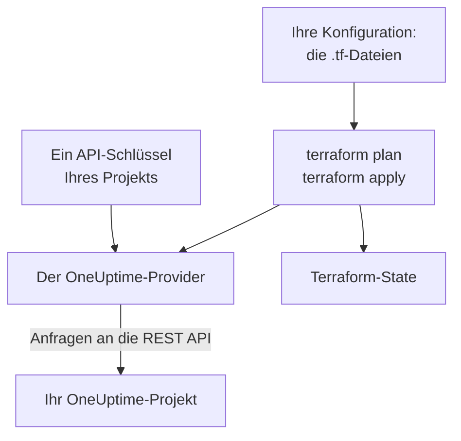

# Terraform – Übersicht

Der Terraform-Provider von OneUptime verwaltet Ihr OneUptime-Projekt als Code. Beschreiben Sie Monitore, Statusseiten, Bereitschaftsrichtlinien, Teams, Beschriftungen und die anderen Datensätze Ihres Projekts in `.tf`-Dateien, sehen Sie mit `terraform plan`, was sich ändern wird, und nehmen Sie die Änderung mit `terraform apply` vor. Er funktioniert mit OneUptime Cloud und mit einer selbst gehosteten OneUptime-Instanz, und mit OpenTofu ebenso wie mit Terraform.

:::cards
- [Wie der Provider arbeitet](#wie-der-provider-arbeitet): Ihre Konfiguration, der Plan und die API-Anfragen dahinter.
- [Den Provider installieren](#den-provider-installieren): Der Provider-Block und die Version, die Sie wählen.
- [Vom Dashboard schreiben lassen](#vom-dashboard-schreiben-lassen): Konfiguration und Import-Blöcke für das, was Sie schon haben.
- [Was Sie verwalten können](#was-sie-verwalten-können): Ressourcen, Datenquellen und wie ihre Attribute geschrieben werden.
:::

## Wie der Provider arbeitet

Der Provider ist ein Plugin, das Terraform aus einer Registry lädt. Bei `terraform apply` macht er aus jeder Änderung des Plans eine Anfrage an die REST API von OneUptime, gestellt mit einem API-Schlüssel Ihres Projekts. Terraform hält in seinem State fest, was es angelegt hat, sodass der nächste Plan nur zeigt, was sich seitdem geändert hat.



Ein API-Schlüssel gehört zu einem Projekt und entscheidet, was Terraform darin lesen und ändern darf, also verwaltet eine Konfiguration ein Projekt. Um mehrere zu verwalten, geben Sie dem Provider für jedes einen [Alias](/docs/terraform/complete-guide#mehrere-projekte-verwalten).

## Bevor Sie beginnen

- **Terraform 1.5 oder neuer, oder OpenTofu 1.6 oder neuer.** Die `import`-Blöcke, die das Dashboard schreibt, brauchen diese Versionen.
- **Ein API-Schlüssel Ihres Projekts.** Der [Schnellstart](/docs/terraform/quick-start#einen-api-schlüssel-des-projekts-anlegen) zeigt, wie Sie einen unter **Projekteinstellungen → Erweitert → API-Schlüssel** anlegen.
- **In OneUptime Cloud der Tarif Growth oder höher.** Die API-Schlüssel eines Projekts funktionieren nur dort.

## Den Provider installieren

Fügen Sie den Provider in eine `.tf`-Datei ein. `terraform init` lädt ihn aus der Terraform Registry, `tofu init` aus der OpenTofu Registry:

```hcl title="main.tf"
terraform {
  required_providers {
    oneuptime = {
      source  = "oneuptime/oneuptime"
      version = "{{TERRAFORM_PROVIDER_VERSION}}"
    }
  }
}

provider "oneuptime" {
  # The API key comes from the ONEUPTIME_API_KEY environment variable.
  # On a self-hosted OneUptime, add your OneUptime's address:
  # oneuptime_url = "https://oneuptime.example.com"
}
```

Halten Sie den Schlüssel aus Ihren Dateien heraus: Exportieren Sie ihn, bevor Sie Terraform ausführen, oder übergeben Sie ihn in einer als `sensitive` markierten Variablen. Die [Vollständige Anleitung](/docs/terraform/complete-guide#den-provider-konfigurieren) zeigt alle Wege, dem Provider seinen Schlüssel und seine Adresse zu geben.

### Eine Version wählen

Die Versionen des Providers folgen denen von OneUptime: Provider {{TERRAFORM_PROVIDER_MAJOR}}.x wird aus OneUptime {{TERRAFORM_PROVIDER_MAJOR}}.x erzeugt. Die Einschränkung oben, `{{TERRAFORM_PROVIDER_VERSION}}`, nimmt das neueste Release {{TERRAFORM_PROVIDER_MAJOR}}.x, was für OneUptime Cloud richtig ist. Bei einer selbst gehosteten OneUptime-Instanz nehmen Sie den neuesten Provider, der nicht neuer als Ihre OneUptime-Instanz ist: [Selbst gehostete Einrichtung](/docs/terraform/self-hosted) zeigt, wie Sie ihn festlegen.

## Vom Dashboard schreiben lassen

Eine Ressource, die Sie schon haben, müssen Sie nicht von Hand schreiben. Jede Ressource im OneUptime-Dashboard (ein Monitor, eine Statusseite, ein Workflow, eine Bereitschaftsrichtlinie und die anderen) hat im Seitenmenü einen Bereich **Entwickler**, der eingeklappt ist, bis Sie ihn öffnen. Seine Seite **Terraform** schreibt die Konfiguration für Sie, ausgefüllt aus Ihrem eigenen Projekt.

:::steps
### Die Ressource öffnen

Öffnen Sie den Monitor, die Statusseite oder die andere Ressource, die Terraform verwalten soll.

### Ihre Terraform-Seite öffnen

Öffnen Sie im Seitenmenü **Entwickler** und dann **Terraform**.

### Die Konfiguration kopieren

Die Seite schreibt die Konfiguration der Ressource aus ihren aktuellen Einstellungen, mit einem `import`-Block. Ein Kommentar nach jeder ID nennt den Datensatz, auf den sie zeigt (`incident_severity_id = "..." # Critical Incident`).

### Planen und anwenden

Führen Sie `terraform plan` aus: Der Plan zeigt, dass die Ressource importiert wird und nichts zu ändern ist. Wenden Sie ihn an, und Terraform verwaltet die Ressource von da an.
:::

Unter der Konfiguration steht unter **Darauf aufbauen**, was man oft neben der Ressource anlegt, mit Verweis auf ihre Adresse: ein Eigentümerteam für einen Vorfall, eine Gruppe von Monitoren für eine Statusseite, eine Eskalationsregel für eine Bereitschaftsrichtlinie.

Die Listenseiten (zum Beispiel **Vorfälle** oder **Monitore**) haben denselben Bereich. Dort schreibt die Seite **Terraform** eine neue Ressource mit den Feldern, die die meisten setzen, aus den eigenen Datensätzen Ihres Projekts: einen Vorfall mit einem Ihrer Schweregrade, einen Monitor mit den Kriterien, die ein neuer Monitor im Dashboard bekommt, verbunden mit Ihren Status. Sie bietet fertige **Gängige Konfigurationen** (eine Statusseite mit einer Gruppe und einem Monitor, eine Bereitschaftsrichtlinie, die ein Team alarmiert, eine wöchentliche Bereitschaftsrotation) und einen `import`-Block für jede Ressource, die Sie schon haben (die ersten 100), bereit für `terraform plan -generate-config-out`. Beide Seiten geben auch den Provider-Block für Ihre OneUptime-Instanz: die richtige `oneuptime_url` und eine Versionseinschränkung, die zu Ihrer Instanz passt.

Geheimnisse werden auf diesen Seiten nie angezeigt. Braucht die Konfiguration eines (zum Beispiel den `Authorization`-Header eines Monitors), liest sie es aus einer als `sensitive` markierten Terraform-Variablen. Geheimnisse, die sie nicht braucht, bleiben weg, und Terraform lässt sie in OneUptime, wie sie sind.

Derselbe Bereich hat eine Seite **API** mit `curl`-Befehlen für die Ressource und eine Seite **KI-Assistenten**, die Claude, GitHub Copilot oder Cursor mit dem [MCP-Server](/docs/ai/mcp-server) verbindet.

## Was Sie verwalten können

Der Provider hat für jede Art von Datensatz, die Sie über die OneUptime-API anlegen können, eine Ressource namens `oneuptime_<name>`. Mit diesen beginnen die meisten Konfigurationen:

| Ressource | Was sie ist |
| --- | --- |
| `oneuptime_monitor` | Ein Monitor: Website, API, Ping, Port, SSL-Zertifikat, Server, eingehende Anfrage, manuell und jeder andere Typ |
| `oneuptime_monitor_status` | Ein Monitor-Status, etwa Operational, Degraded oder Offline |
| `oneuptime_monitor_group` | Eine Gruppe von Monitoren, angezeigt mit einem Status |
| `oneuptime_status_page` | Eine öffentliche oder private Statusseite |
| `oneuptime_status_page_domain` | Eine eigene Domain einer Statusseite |
| `oneuptime_domain` | Eine Domain Ihres Projekts, verifiziert für Statusseiten |
| `oneuptime_label` | Eine Beschriftung, um Datensätze zu ordnen und zu filtern |
| `oneuptime_team`, `oneuptime_team_member` | Ein Team, und wer darin ist |
| `oneuptime_on_call_policy`, `oneuptime_escalation_rule` | Eine Bereitschaftsrichtlinie und die Regeln, die sie der Reihe nach alarmiert |
| `oneuptime_incident`, `oneuptime_incident_severity`, `oneuptime_incident_state` | Vorfälle, ihre Schweregrade und ihre Status |
| `oneuptime_alert`, `oneuptime_alert_severity`, `oneuptime_alert_state` | Warnungen, ihre Schweregrade und ihre Status |
| `oneuptime_scheduled_maintenance_event` | Ein geplantes Wartungsfenster |
| `oneuptime_probe` | Eine eigene Probe, die aus Ihrem Netzwerk prüft |

Die [Terraform Registry](https://registry.terraform.io/providers/oneuptime/oneuptime/latest/docs) listet jede Ressource mit jedem ihrer Attribute.

### Lesen, was schon existiert

Jede Ressource hat eine Datenquelle gleichen Namens, etwa `data "oneuptime_label"`. Eine Datenquelle liest einen Datensatz, den diese Konfiguration nicht verwaltet, zum Beispiel einen im Dashboard angelegten. Suchen Sie ihn über seine `id` oder über seine anderen einfachen Argumente: Jedes, das Sie setzen, muss passen, und genau ein Datensatz darf auf alle passen.

```hcl
data "oneuptime_monitor_status" "offline" {
  name = "Offline"
}

# Any plain argument works. Set several, and all of them must match.
data "oneuptime_monitor_status" "offline_state" {
  is_offline_state = true
}
```

Kein Treffer oder mehr als einer ist ein Fehler statt einer leeren oder beliebigen Antwort. Die [Vollständige Anleitung](/docs/terraform/complete-guide#lesen-was-schon-existiert) enthält die Regeln.

### Umbenannte Ressourcen

Ressourcennamen lassen Wörter wie IoT und vCenter ganz: `oneuptime_iot_fleet` und `oneuptime_vcenter`, wo ältere Provider `oneuptime_io_t_fleet` und `oneuptime_v_center` hatten (und ebenso für ihre Beschriftungsregeln, Eigentümer und Feeds). Die alten Namen funktionieren weiter als veraltete Aliase, und ein Plan, der einen benutzt, sagt das. Zum Wechseln benennen Sie die Ressource in Ihrer Konfiguration um und fügen einen `moved`-Block hinzu, dann behält Terraform die bestehende Ressource, statt sie zu ersetzen:

```hcl
# Was: resource "oneuptime_io_t_fleet" "factory"
resource "oneuptime_iot_fleet" "factory" {
  name = "Factory floor"
}

moved {
  from = oneuptime_io_t_fleet.factory
  to   = oneuptime_iot_fleet.factory
}
```

Eine Ressource in einen anderen Typ zu verschieben braucht Terraform 1.8 oder neuer. Mit einer älteren Engine behalten Sie den alten Namen vorerst: Er funktioniert weiter.

## Wie Attribute geschrieben werden

Attribute folgen der OneUptime-API, in snake_case:

| Art des Werts | Wie Sie ihn schreiben | Beispiel |
| --- | --- | --- |
| Text, Zahlen, wahr oder falsch | So, wie sie sind | `is_public_status_page = false` |
| Ein Verweis auf einen anderen Datensatz | Seine ID, meist die `id` einer anderen Ressource | `incident_severity_id = oneuptime_incident_severity.sev1.id` |
| Eine Liste von Verweisen | Eine Menge von IDs, deren Reihenfolge keine Rolle spielt | `labels = [oneuptime_label.critical.id]` |
| Eine Farbe, eine Domain und andere umhüllte Werte | Ihr einfacher Wert | `color = "#FF5733"` |
| Ein Datum mit Uhrzeit | Text nach RFC 3339 | `starts_at = "2030-06-01T02:00:00Z"` |
| Die Prüfungen eines Monitors | Typisierte verschachtelte Attribute: siehe [Monitor-Schritte](/docs/terraform/monitor-steps) | `monitor_steps = [{ ... }]` |
| Andere strukturierte Einstellungen | JSON, geschrieben mit `jsonencode()` | `log_monitor = jsonencode({ ... })` |

Zwei Arten von Werten gehören dem Server, und Sie lassen sie weg:

- **IDs innerhalb einer Ressource.** Die Schritte und Kriterien eines Monitors und ihre Vorlagen für Vorfälle und Warnungen haben IDs, die der Server vergibt und über jedes Apply hinweg behält, sodass Vorfälle weiter auf die Kriterien zeigen, die sie ausgelöst haben.
- **Was der Server aktuell hält.** Der aktuelle Status eines Monitors oder wann er zuletzt einen Heartbeat empfangen hat, kann sich zwischen `terraform plan` und dem Ende von `terraform apply` ändern. Der Provider behält den geplanten Wert für alles, was Sie nicht gesetzt haben, und das nächste Refresh liest den des Servers, sodass dies nie ein Apply scheitern lässt oder als Änderung erscheint.

## Hilfe erhalten

- Fehler und Funktionswünsche: [github.com/OneUptime/oneuptime/issues](https://github.com/OneUptime/oneuptime/issues).
- Der Provider wird aus der OpenAPI-Spezifikation von OneUptime im [Haupt-Repository von OneUptime](https://github.com/OneUptime/oneuptime) erzeugt. Das veröffentlichte Provider-Repository ist schreibgeschützt, melden Sie Probleme also im Haupt-Repository.

## Nächste Schritte

:::cards
- [Schnellstart](/docs/terraform/quick-start): Einen API-Schlüssel anlegen und Ihre ersten Ressourcen in zehn Minuten anwenden.
- [Vollständige Anleitung](/docs/terraform/complete-guide): Authentifizierung, Projektaufbau, Datenquellen, State und Upgrades.
- [Monitor-Schritte](/docs/terraform/monitor-steps): Festlegen, was ein Monitor prüft und was jedes Ergebnis bedeutet.
- [Beispiele](/docs/terraform/examples): Fertige Konfigurationen für die gängigen Ressourcen.
- [Ressourcen importieren](/docs/terraform/importing-resources): Was Sie im Dashboard angelegt haben, unter Terraform bringen.
:::
