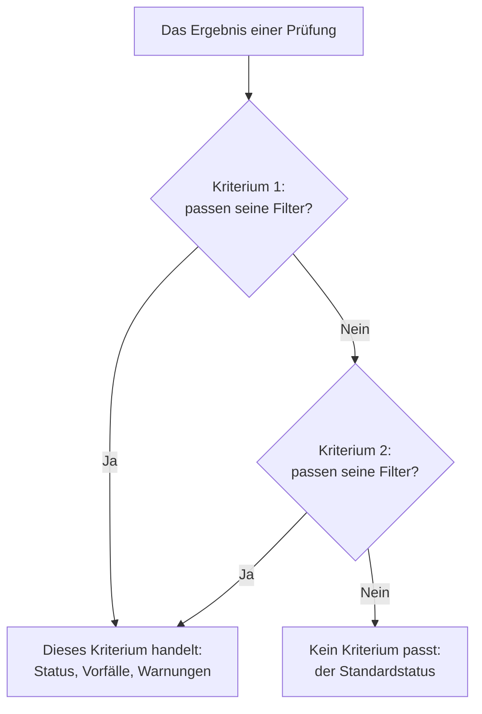
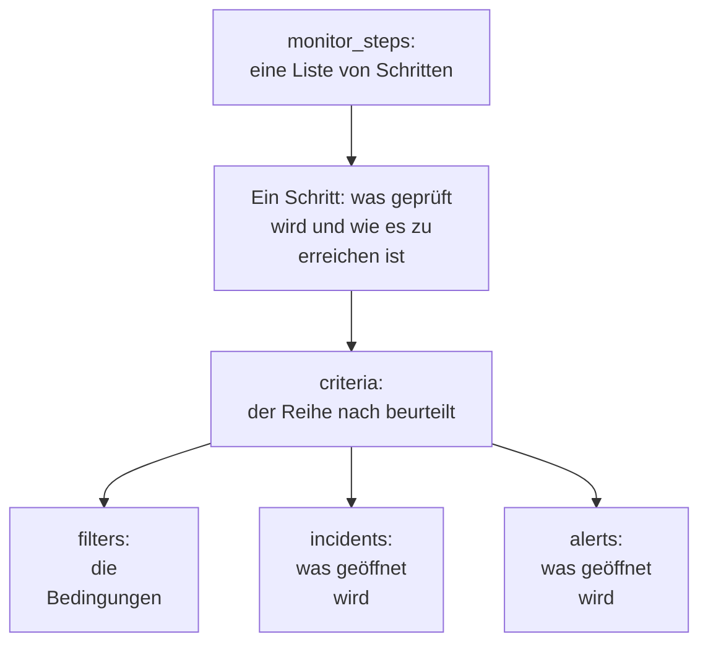

# Monitor-Schritte

`monitor_steps` ist das Attribut von `oneuptime_monitor`, das sagt, was ein Monitor prüft und wie jedes Ergebnis beurteilt wird: die zu prüfende Adresse, die zu sendende Anfrage und die Kriterien, die aus einem Ergebnis einen Monitor-Status, einen Vorfall oder eine Warnung machen. Diese Seite erklärt jeden Teil davon.

:::cards
- [Wie eine Prüfung beurteilt wird](#wie-eine-prüfung-beurteilt-wird): Kriterien der Reihe nach, und das erste, das passt.
- [Die Schritte schreiben](#die-schritte-schreiben): Ihre Form, ein vollständiges Beispiel und die zwei Regeln für Werte.
- [Filter-Referenz](#filter-referenz): Was ein Filter prüfen kann und wie er vergleicht.
- [Häufige Fehler](#häufige-fehler): Was am häufigsten schiefgeht, und die Lösung.
:::

## Wie eine Prüfung beurteilt wird

Jede Prüfung liefert ein Ergebnis: die Antwort einer Probe, den Rückgabewert eines Skripts oder die Telemetrie, die die Prüfung liest. Die Kriterien des Schritts beurteilen es dann in ihrer Reihenfolge. Das erste Kriterium, dessen Filter passen, entscheidet, was geschieht: Es kann den Status des Monitors ändern, Vorfälle öffnen und Warnungen öffnen. Die Kriterien danach werden für diese Prüfung nicht angesehen.



Die Reihenfolge der Kriterien zählt also: Führen Sie die Kriterien, die alarmieren, zuerst auf, das schwerste zuerst, und das gesunde zuletzt. [Attribute eines Kriteriums](#attribute-eines-kriteriums) erklärt warum, und die eine Ausnahme.

## Die Schritte schreiben

`monitor_steps` ist eine Liste typisierter Objekte, direkt in HCL geschrieben. Es gibt kein `jsonencode()`, keine Hülle `{_type, value}`, keinen Schlüssel in camelCase und keine ID zu schreiben: Der Provider macht aus Ihrem HCL das Format der API, und der Server gibt jedem Schritt, jedem Kriterium, jeder Vorfallvorlage und jeder Warnungsvorlage ihre ID. Er behält diese IDs über jedes Apply hinweg und ordnet jedes Kriterium und jede Vorlage der zu, die sie ersetzt, nach Name, sonst nach Position, sodass Probe-Ergebnisse bei ihrem Schritt bleiben und Vorfälle weiter auf die Kriterien zeigen, die sie ausgelöst haben.



Der kleinste nützliche Schritt prüft eine Adresse und hat ein Kriterium mit einem Filter:

```hcl
resource "oneuptime_monitor" "example" {
  name         = "Example"
  description  = "The smallest monitor_steps"
  monitor_type = "Website"

  monitor_steps = [{
    monitor_destination      = "https://example.com"
    monitor_destination_type = "URL"
    request_type             = "GET"

    criteria = [
      {
        name             = "Check if online"
        description      = "The website responds"
        filter_condition = "All"

        filters = [
          {
            check_on    = "Is Online"
            filter_type = "True"
          }
        ]
      }
    ]
  }]
}
```

Zwei Regeln gelten überall in `monitor_steps`:

- **Lassen Sie weg, was Sie nicht nutzen.** Ein Attribut, das Sie nicht setzen, wird nicht an die API gesendet. Schreiben Sie nie `[]`, `{}` oder `""` als Platzhalter: Der Provider lehnt leere Strings, Listen und Maps ab, damit ein fehlender Wert immer „nicht gesetzt“ bedeutet.
- **Filterwerte sind Strings.** Der `value` eines Filters ist ein String, auch eine Zahl: `value = "200"`, nicht `value = 200`. Numerische Einstellungen wie `port` sind Zahlen.

:::details Umstieg von Provider 1.x, wo monitor_steps JSON war
In Provider 1.x war `monitor_steps` ein JSON-String, geschrieben mit `jsonencode({ _type = "MonitorSteps", value = { ... } })`. Schreiben Sie ihn als die typisierten Attribute dieser Seite neu: Entfernen Sie die Hüllen `_type` und `value`, schreiben Sie die Schlüssel in camelCase als snake_case (`monitorDestination` wird zu `monitor_destination` und `monitor_destination_type`, `filterCondition` wird zu `filter_condition`, `checkOn` wird zu `check_on`) und löschen Sie jede `id`. Der Server vergibt jetzt alle IDs, was auch die fest kodierten Zufalls-IDs aus Issue [#2291](https://github.com/OneUptime/oneuptime/issues/2291) beendet. Als JSON-String gespeicherter State wird nicht von selbst aktualisiert: Wenden Sie die neue Konfiguration an.
:::

### Ein vollständiges Beispiel

Dieser Website-Monitor prüft, was der Website-Monitor der End-to-End-Tests des Providers prüft (Test `35-monitor-with-steps`): offline, wenn die Website nicht antwortet, online, wenn sie mit 200 antwortet.

```hcl
resource "oneuptime_monitor_status" "operational" {
  name                 = "Operational"
  description          = "Monitor is operational"
  color                = "#2ecc71"
  priority             = 1
  is_operational_state = true
}

resource "oneuptime_monitor_status" "offline" {
  name                 = "Offline"
  description          = "Monitor is offline"
  color                = "#e74c3c"
  priority             = 3
  is_operational_state = false
}

resource "oneuptime_monitor" "website" {
  name         = "Website"
  description  = "Website monitor with explicit steps"
  monitor_type = "Website"

  monitor_steps = [{
    monitor_destination      = "https://example.com" # what to check
    monitor_destination_type = "URL"                 # URL, Hostname or IP
    request_type             = "GET"                 # the HTTP method

    criteria = [ # judged in order: the first match decides
      {
        name                  = "Offline"
        description           = "Check if website is offline"
        filter_condition      = "Any"
        change_monitor_status = true
        create_incidents      = false
        create_alerts         = false
        monitor_status_id     = oneuptime_monitor_status.offline.id

        filters = [
          {
            check_on    = "Is Online"
            filter_type = "False"
          }
        ]
      },
      {
        name                  = "Online"
        description           = "Check if website is online"
        filter_condition      = "All" # All: every filter, Any: at least one
        change_monitor_status = true
        create_incidents      = false
        create_alerts         = false
        monitor_status_id     = oneuptime_monitor_status.operational.id

        filters = [
          {
            check_on    = "Is Online"
            filter_type = "True"
          },
          {
            check_on    = "Response Status Code"
            filter_type = "Equal To"
            value       = "200" # a string, even for a number
          }
        ]
      }
    ]
  }]
}
```

Ein Kriterium verweist auf einen Status über seine Ressource, wie hier `oneuptime_monitor_status.offline.id`, oder über eine [Datenquelle](/docs/terraform/complete-guide#lesen-was-schon-existiert) auf einen, den Ihr Projekt schon hat.

## Attribute eines Schritts

Jedes Element von `monitor_steps` ist eine Sache, die geprüft wird:

| Attribut | Typ | Verwendet von | Hinweise |
| --- | --- | --- | --- |
| `monitor_destination` | string | Website, API, Ping, IP, Port, SSL-Zertifikat, NTP | Die zu prüfende URL, der Hostname oder die IP-Adresse. Braucht `monitor_destination_type`. |
| `monitor_destination_type` | string | dieselben | `URL`, `Hostname` oder `IP`, wie es der Monitortyp verlangt: eine URL für Website-, API- und SSL-Zertifikat-Monitore; ein Hostname oder eine IP-Adresse für Ping-, IP-, Port- und NTP-Monitore. |
| `port` | number | Port, NTP | Der zu prüfende TCP-Port, etwa `443`. Bei NTP der UDP-Port, auf dem der Zeitserver antwortet: `123`, wenn nicht gesetzt. |
| `request_type` | string | Website, API | Die HTTP-Methode: `GET`, `POST`, `PUT`, `DELETE`, `HEAD` oder `PATCH`. Der Server nimmt `GET`, wenn sie nicht gesetzt ist. |
| `request_headers` | map(string) | Website, API | Zu sendende Header: `{ "Accept" = "application/json" }`. |
| `request_body` | string | API | Der Body der Anfrage, als Text. |
| `do_not_follow_redirects` | bool | Website, API | Bei der ersten Antwort stoppen, statt Weiterleitungen zu folgen. |
| `allow_self_signed_certificates` | bool | Website, API | Ein selbst signiertes TLS-Zertifikat akzeptieren. |
| `tls_client_certificate` | string | Website, API | Ein Client-Zertifikat für gegenseitiges TLS: PEM oder ein Verweis `{{monitorSecrets.name}}`. |
| `tls_client_key` | string (sensibel) | Website, API | Der private Schlüssel des Client-Zertifikats. Setzen Sie ihn mit dem Zertifikat. |
| `tls_client_key_passphrase` | string (sensibel) | Website, API | Die Passphrase des privaten Schlüssels. |
| `request_timeout_in_ms` | number | Prüfungen einer Probe | Wie lange ein Versuch dauern darf, in Millisekunden. Die Probe senkt alles über 60000 auf 60000. |
| `retry_count` | number | Prüfungen einer Probe | Wiederholungen nach einem gescheiterten ersten Versuch: `0` prüft einmal, `3` bis zu viermal. Die Probe senkt alles über 3 auf 3. |
| `custom_code` | string | Custom JavaScript Code, Synthetic | Das Skript, das der Schritt ausführt. |
| `screen_size_types` | list(string) | Synthetic | `Mobile`, `Tablet` und `Desktop`. |
| `browser_types` | list(string) | Synthetic | `Chromium` und `Firefox`. |
| `retry_count_on_error` | number | Synthetic | Wiederholungen, wenn das Skript scheitert: `0` führt es einmal aus. |
| `criteria` | list (erforderlich) | Alle | Wie jedes Ergebnis beurteilt wird: siehe [Attribute eines Kriteriums](#attribute-eines-kriteriums). |

### Einstellungen jedes Monitortyps

Monitortypen, bei denen mehr als eine Adresse einzustellen ist, halten ihre Einstellungen (eine Log-Abfrage, eine Datenbankverbindung, einen zu beobachtenden Cluster) in einem eigenen Attribut, als rohes JSON, geschrieben mit `jsonencode()`: `log_monitor`, `trace_monitor`, `llm_monitor`, `metric_monitor`, `exception_monitor`, `profile_monitor`, `dns_monitor`, `domain_monitor`, `dnssec_monitor`, `sql_monitor`, `database_monitor`, `external_status_page_monitor`, `network_device_monitor`, `kubernetes_monitor`, `docker_monitor`, `docker_swarm_monitor`, `host_monitor`, `podman_monitor`, `proxmox_monitor`, `vmware_monitor`, `ceph_monitor`, `storage_array_monitor`, `iot_monitor` und `probe_status_monitor`.

Ihr JSON ist dasselbe wie das des Dashboards, mit Schlüsseln in camelCase. Eine ID darin wird so geschrieben, wie die API eine schreibt: `{ _type = "ObjectID", value = "..." }`. Ein Logs-Monitor, der die Fehler eines Dienstes zählt:

```hcl
resource "oneuptime_service" "checkout" {
  name = "checkout"
}

resource "oneuptime_monitor" "checkout_errors" {
  name         = "Checkout errors"
  monitor_type = "Logs"

  monitor_steps = [{
    log_monitor = jsonencode({
      attributes          = {}
      body                = "error"
      severityTexts       = ["Error"]
      telemetryServiceIds = [{ _type = "ObjectID", value = oneuptime_service.checkout.id }]
      lastXSecondsOfLogs  = 300
    })

    criteria = [
      {
        name             = "Errors found"
        filter_condition = "Any"

        filters = [
          {
            check_on    = "Log Count"
            filter_type = "Greater Than"
            value       = "0"
          }
        ]
      }
    ]
  }]
}
```

> [!TIP]
> Am einfachsten bekommen Sie dieses JSON richtig, wenn Sie den Monitor im Dashboard einrichten und dann in seinem Bereich **Entwickler** die Seite **Terraform** öffnen. Die Seite schreibt die `monitor_steps` des Monitors, samt `jsonencode()`.

## Attribute eines Kriteriums

Jedes Element von `criteria` ist eine Regel: Wenn ihre Filter passen, tue, was sie sagt.

Die Kriterien werden von oben beurteilt, und das erste passende entscheidet, also führen Sie die Kriterien, die alarmieren, zuerst auf, das schwerste zuerst (kritisch, dann Warnung), und das gesunde zuletzt. Ein gesundes Kriterium ganz oben ist der häufigste Weg zu einem Monitor, der nie alarmiert: Eine breite Regel wie `Is Online` ist `True` oder ein Metrikwert `Greater Than` `0` passt auf fast jede Prüfung, und die Kriterien darunter werden nie angesehen. Steht es zuletzt, passt es nur, wenn nichts darüber gepasst hat, und genau das wollen Sie.

Gruppierte Metrik-Monitore sind die eine Ausnahme. Ist die Abfrage eines Metrik-Monitors gruppiert (`groupByAttributeKeys` im JSON von `metric_monitor` gesetzt, unter `metricViewConfig.queryConfigs[].metricQueryData.groupByAttributeKeys`), erzeugt der Monitor eine Warnung oder einen Vorfall für jede Gruppe (jeden Host, Container oder Einhängepunkt), und jedes Kriterium wird beurteilt, sodass ein kritisches und ein Warnkriterium bei derselben Prüfung für verschiedene Hosts auslösen können. Ein Host, der beide verletzt, wird trotzdem nur einmal alarmiert, vom ersten passenden Kriterium, also steht das schwerste weiterhin zuerst. Siehe [Metriken-Überwachung](/docs/monitor/metrics-monitor).

| Attribut | Typ | Was es ist |
| --- | --- | --- |
| `name` | string (erforderlich) | Der Name, den das Dashboard zeigt. |
| `description` | string | Die Beschreibung, die das Dashboard zeigt. |
| `filter_condition` | string (erforderlich) | `All`: Jeder Filter muss passen. `Any`: Einer genügt. |
| `filters` | list (erforderlich) | Die Bedingungen, mindestens eine: siehe [Filter-Referenz](#filter-referenz). |
| `change_monitor_status` | bool | Ob ein Treffer den Status des Monitors ändert. |
| `monitor_status_id` | string | Die ID des `oneuptime_monitor_status`, zu dem gewechselt wird. Setzen Sie sie, wenn `change_monitor_status` `true` ist. |
| `create_incidents` | bool | Ob ein Treffer Vorfälle öffnet. |
| `incidents` | list | Die zu öffnenden Vorfälle. Lassen Sie es weg, außer bei `create_incidents = true`. |
| `create_alerts` | bool | Ob ein Treffer Warnungen öffnet. |
| `alerts` | list | Die zu öffnenden Warnungen. Lassen Sie es weg, außer bei `create_alerts = true`. |
| `is_enabled` | bool | Auf dem Server `true`, wenn nicht gesetzt. Setzen Sie `false`, um ein Kriterium zu behalten, ohne damit zu beurteilen. |
| `incident_grouping` | string (JSON) | Nur Monitore für eingehende Anfragen: ein Vorfall für jeden in der Anfrage gefundenen Wert, etwa `jsonencode({ groupByJSONPath = "..." })`. |
| `open_for_every_email` | bool | Nur Monitore für eingehende E-Mails: `true` eröffnet für jede passende E-Mail einen Vorfall (und eine Warnung), statt jeweils nur einen. |

### Vorfälle und Warnungen

Ein Element von `incidents` nimmt `title` und `description` (beide erforderlich), `incident_severity_id`, `auto_resolve_incident`, `remediation_notes`, `on_call_policy_ids`, `label_ids`, `owner_team_ids`, `owner_user_ids`, `show_incident_on_status_page` und `is_private`. Ein Element von `alerts` nimmt dasselbe, mit `alert_severity_id` und `auto_resolve_alert`, und ohne `show_incident_on_status_page`.

Dieses Kriterium setzt den Monitor auf offline, öffnet einen Vorfall, der die Bereitschaftsrichtlinie alarmiert, und löst ihn auf, wenn die Website wieder da ist:

```hcl
criteria = [
  {
    name                  = "Offline"
    description           = "The site is unreachable"
    filter_condition      = "Any"
    change_monitor_status = true
    monitor_status_id     = oneuptime_monitor_status.offline.id
    create_incidents      = true

    filters = [
      {
        check_on    = "Is Online"
        filter_type = "False"
      }
    ]

    incidents = [
      {
        title                 = "Website is down"
        description           = "The website did not respond to the probe."
        incident_severity_id  = oneuptime_incident_severity.critical.id
        auto_resolve_incident = true
        on_call_policy_ids    = [oneuptime_on_call_policy.primary.id]
      }
    ]
  }
]
```

## Filter-Referenz

Ein Filter hat `check_on` (was betrachtet wird), `filter_type` (wie verglichen wird) und `value` (womit verglichen wird, als String; lassen Sie ihn bei Wahr-oder-falsch-Prüfungen wie `True` und `False` weg).

Ein Filter kann auch ein Zeitfenster statt der letzten Prüfung beurteilen: Setzen Sie `evaluate_over_time = true`, die Länge des Fensters in `evaluate_over_time_minutes` und in `evaluate_over_time_type`, wie das Fenster gelesen wird: `Average`, `Sum`, `Maximum Value`, `Minimum Value`, `All Values` oder `Any Value`.

`All Values` bedeutet, dass jede Prüfung im Fenster die Regel verletzt hat, also passt es erst, wenn das Fenster mit Daten gefüllt ist: Ein gerade angelegter Monitor wartet, bis sich sein Fenster füllt, statt bei seiner ersten Prüfung zu passen. Geben Sie ihm ein Fenster von mindestens dem Doppelten des `monitoring_interval` des Monitors; sonst enthält das Fenster eine Prüfung, und „alle Werte“ bedeutet dasselbe wie „ein beliebiger Wert“. `Any Value` passt bewusst schon bei einer verletzenden Prüfung.

`evaluate_over_time_no_data_policy` sagt, was der Filter tut, solange das Fenster nicht genug Daten enthält: `Ignore` (der Standard) passt nicht, `Trigger` wertet die fehlenden Daten als Ausfall, wie es ein Heartbeat tut, und `Treat As Zero` vergleicht das Fenster als eine einzelne Null.

### Was ein Filter prüfen kann

Die `check_on`-Werte, die jeder Monitortyp am häufigsten nutzt. Der Kriterien-Editor des Dashboards bietet dieselben an und listet sie alle auf:

| Monitortyp | `check_on`-Werte |
| --- | --- |
| Website / API | `Is Online`, `Response Time (in ms)`, `Response Status Code`, `Response Body`, `Response Header`, `Response Header Value`, `JavaScript Expression`, `Is Request Timeout` |
| Ping / IP | `Is Online`, `Response Time (in ms)`, `Packet Loss (in %)`, `Jitter (in ms)`, `Is Request Timeout` |
| Port | `Is Online`, `Response Time (in ms)` (die gesamte Verbindungszeit des Dashboards), `Port DNS Lookup Time (in ms)`, `Port TCP Connect Time (in ms)`, `Is Request Timeout` |
| SSL-Zertifikat | `Is Valid Certificate`, `Is Not A Valid Certificate`, `Is Self Signed Certificate`, `Is Expired Certificate`, `Expires In Days`, `Expires In Hours` |
| Eingehende Anfrage | `Incoming Request`, `Request Body`, `Request Header`, `Request Header Value`, `JavaScript Expression` |
| Eingehende E-Mail | `Email Received`, `Email Subject`, `Email From Address`, `Email To Address`, `Email Body` |
| Server | `Is Online`, `CPU Usage (in %)`, `Memory Usage (in %)`, `Disk Usage (in %)` (mit `disk_path`), `Server Process Name` |
| Logs | `Log Count` |
| Traces | `Span Count` |
| Ausnahmen | `Exception Count` |
| Profile | `Profile Count` |
| KI / LLM | `Bad AI Answers (in %)`, `Bad AI Answers`, `AI Answers` |
| Metriken | `Metric Value` (Metrik-Filter können JSON in `metric_monitor_options` nehmen) |
| Eigener Code / Synthetic | `Result Value` (kann ein Feld der zurückgegebenen Daten vergleichen, benannt im JSON von `custom_code_monitor_options`, z. B. `jsonencode({ resultValuePath = "status" })` – siehe unten), `Error`, `Execution Time (in ms)` |
| DNS | `DNS Is Online`, `DNS Response Time (in ms)`, `DNS Record Value`, `DNS Record Exists` |
| Domain | `Domain Expires In Days`, `Domain Is Expired`, `Domain Registrar`, `Domain Name Server` |
| DNSSEC | `DNSSEC Chain Is Valid`, `DNSSEC DS Record Exists At Parent`, `DNSSEC Signature Expires In Days` |
| SQL-Abfrage | `SQL Is Online`, `SQL Query Row Count`, `SQL Query Scalar Value` |
| Datenbank-Zustand | `Database Is Online`, `Database Metric` (mit JSON in `database_monitor_options`, das die Reihe nennt, z. B. `jsonencode({ metricType = "oneuptime.monitor.database.connections.used.percent" })`), `Database Collection Error` |
| Externe Statusseite | `External Status Page Is Online`, `External Status Page Active Incidents`, `External Status Page Component Status` |
| NTP | `NTP Is Online`, `NTP Is Synchronized`, `NTP Stratum`, `NTP Clock Offset (in ms)`, `NTP Response Time (in ms)`, `NTP Root Dispersion (in ms)` (`NTP Is Online` und `NTP Is Synchronized` nehmen keinen `value`) |
| Netzwerkgerät (SNMP) | `SNMP Device Is Online` (es antwortet auf Ping oder SNMP), `SNMP Walk Is Succeeding` (false, wenn es antwortet, aber nicht durchlaufen werden kann), `SNMP OID Value` (SNMP-Filter können JSON in `snmp_monitor_options` nehmen) |

### Wie ein Filter vergleicht

| Art | `filter_type`-Werte |
| --- | --- |
| Wahr oder falsch | `True`, `False` |
| Zahlen | `Equal To`, `Not Equal To`, `Greater Than`, `Less Than`, `Greater Than Or Equal To`, `Less Than Or Equal To` |
| Text | `Contains`, `Not Contains`, `Starts With`, `Ends With`, `Is Empty`, `Is Not Empty` |
| Heartbeats | `Recieved In Minutes`, `Not Recieved In Minutes` (so geschrieben, wie die API sie schreibt) |
| Serverprozesse | `Is Executing`, `Is Not Executing` |
| Skripte | `Evaluates To True` |
| Anomalien, für Metriken, Logs und Traces | `Anomalously High`, `Anomalously Low`, `Anomalous` |

Ein Filter, der passt, wenn ein SSL-Zertifikat in 14 Tagen oder weniger abläuft:

```hcl
filters = [
  {
    check_on    = "Expires In Days"
    filter_type = "Less Than Or Equal To"
    value       = "14"
  }
]
```

Der Provider prüft `check_on`, `filter_type` und die anderen festen Listen beim Planen, sodass ein Tippfehler scheitert, bevor etwas an die API gesendet wird. Die Werte sind die Namen der API für die Optionen des Kriterien-Editors im Dashboard.

### Ein Feld des Skriptergebnisses vergleichen

Das Skript eines Monitors für eigenen Code oder eines Synthetic-Monitors gibt `data` zurück, und ein Filter `Result Value` vergleicht es. Ist `data` ein Objekt oder ein Array, nennt `custom_code_monitor_options` das eine Feld daraus, das verglichen wird: den **Feldpfad** des Result-Value-Filters im Dashboard. Verwenden Sie Punkte für verschachtelte Felder und `[n]` für Array-Elemente, und lassen Sie das Attribut weg, um den ganzen Wert zu vergleichen:

```hcl
monitor_steps = [{
  custom_code = <<-EOT
    const response = await axios.get("https://api.example.com/health");
    // For example { status: "UP", checks: [{ name: "db", latency: 12 }] }
    return { data: response.data };
  EOT

  criteria = [
    {
      name             = "Unhealthy"
      filter_condition = "Any"
      filters = [
        {
          check_on                    = "Result Value"
          filter_type                 = "Not Equal To"
          value                       = "UP"
          custom_code_monitor_options = jsonencode({ resultValuePath = "status" })
        },
        {
          check_on                    = "Result Value"
          filter_type                 = "Greater Than"
          value                       = "500"
          custom_code_monitor_options = jsonencode({ resultValuePath = "checks[0].latency" })
        }
      ]
    }
  ]
}]
```

`Greater Than` und die anderen Zahlenbedingungen passen nur auf ein Feld, das eine Zahl ist, und ein Feld, das in den zurückgegebenen Daten fehlt, passt nur auf `Is Empty`. Wie Pfade und Bedingungen funktionieren, steht unter [Alarmieren anhand der zurückgegebenen Daten](/docs/monitor/custom-code-monitor#auf-die-zurückgegebenen-daten-alarmieren).

## Häufige Fehler

1. **Leere Platzhalter.** `incidents = []`, `request_headers = {}` und `description = ""` werden abgelehnt: Lassen Sie das Attribut stattdessen weg.
2. **Eine Zahl, wo ein String hingehört.** Der `value` eines Filters ist ein String, auch für eine Zahl: `value = "200"`. Numerische Einstellungen wie `port`, `retry_count`, `request_timeout_in_ms` und `evaluate_over_time_minutes` nehmen Zahlen.
3. **Der falsche Zieltyp.** `monitor_destination_type = "URL"` mit einem bloßen Hostnamen oder `Hostname` mit einer vollständigen URL lässt die Prüfung scheitern. Website- und API-Monitore nehmen URLs; Ping-, IP- und Port-Monitore nehmen Hostnamen oder IP-Adressen.
4. **Ein Statuswechsel ohne Status.** `change_monitor_status = true` ohne `monitor_status_id` passt und hat keinen Status, zu dem gewechselt werden kann.
5. **IDs.** Kein Element von `monitor_steps` hat ein Attribut `id`. Wenn Sie vom alten JSON umsteigen, löschen Sie sie: Der Server vergibt die IDs.
6. **Von Hand geschriebenes JSON.** Schreiben Sie `log_monitor` und die anderen Einstellungen mit `jsonencode()`, damit Terraform sie quotiert und das JSON jedes Mal gleich schreibt. Für `metric_monitor` geben Sie das ganze Objekt an, das das Dashboard schreibt: Der Server normalisiert es.

## Wenn kein Kriterium passt

Eine Prüfung, auf die keines der Kriterien passt, setzt den Monitor auf seinen Standardstatus: den Betriebsstatus des Projekts, den das Dashboard für einen neuen Monitor wählt. Seine offenen Vorfälle, deren Kriterien die automatische Auflösung gewählt haben, werden ebenfalls aufgelöst. Um jeden Ausgang selbst zu bestimmen, beenden Sie die Liste mit einem breiten gesunden Kriterium, wie es die Beispiele auf dieser Seite tun.

## Ein Monitor ohne Schritte

`monitor_steps` ist optional, aber ein ohne das Attribut angelegter Monitor hat keine Kriterien, nach denen ein Ergebnis beurteilt wird: Probes überspringen einen Monitor ohne Schritte, und er bleibt in dem Status, in dem er begonnen hat. Ihr State hält das Attribut leer, und der Plan bleibt sauber. Ein manueller Monitor braucht nie Schritte: Sie setzen seinen Status selbst. Jeder andere Typ braucht mindestens einen Schritt, um etwas zu prüfen.

## Das Übertragungsformat

Hinter dem Provider spricht die API weiterhin ihr eigenes JSON, in dem jedes reichhaltige Objekt als `{_type, value}` umhüllt ist:

```json
{
  "_type": "MonitorSteps",
  "value": {
    "monitorStepsInstanceArray": [
      {
        "_type": "MonitorStep",
        "value": {
          "monitorDestination": { "_type": "URL", "value": "https://example.com" },
          "requestType": "GET",
          "monitorCriteria": {
            "_type": "MonitorCriteria",
            "value": { "monitorCriteriaInstanceArray": [ { "_type": "MonitorCriteriaInstance", "value": { "...": "..." } } ] }
          }
        }
      }
    ]
  }
}
```

Der Provider baut dies beim Schreiben aus Ihrem HCL und liest es zurück in HCL, ohne das, was der Server verwaltet (die IDs und die Standardwerte, die er ergänzt). Sie begegnen ihm nur, wenn Sie die Antworten der API selbst lesen, etwa in einem Skript, das `monitorSteps` liest.

## Nächste Schritte

:::cards
- [Beispiele](/docs/terraform/examples): Ping-, Port-, SSL-Zertifikat- und API-Monitore, einsatzbereit.
- [Vollständige Anleitung](/docs/terraform/complete-guide): Datenquellen, State und Upgrades.
- [Metriken-Überwachung](/docs/monitor/metrics-monitor): Metrikabfragen, Gruppierung und Anomalien.
- [Fehlerbehebung](/docs/terraform/troubleshooting): Auch ein inkonsistentes Ergebnis nach einem Apply bei einem Monitor.
:::
