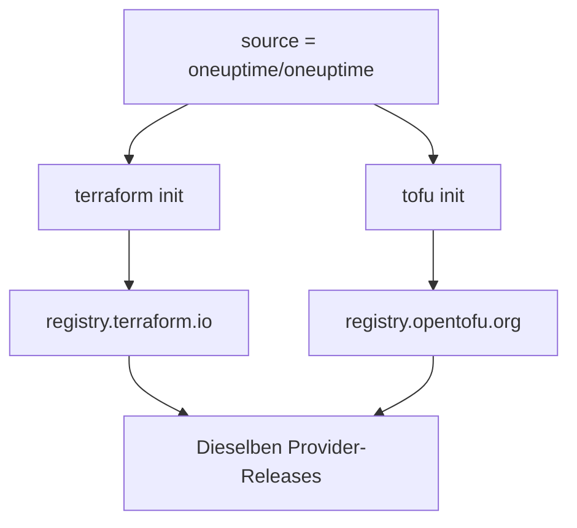

# OpenTofu

Der OneUptime-Provider funktioniert mit [OpenTofu](https://opentofu.org) so, wie er mit Terraform funktioniert. Er wird in der [OpenTofu Registry](https://search.opentofu.org/provider/oneuptime/oneuptime/latest) veröffentlicht, und jedes Release besteht dieselben End-to-End-Tests unter beiden, bevor es veröffentlicht wird. Ihre Konfiguration ändert sich nicht: Führen Sie `tofu` überall dort aus, wo diese Dokumentation `terraform` ausführt.

:::cards
- [Den Provider mit OpenTofu verwenden](#den-provider-mit-opentofu-verwenden): Dieselbe Konfiguration, ausgeführt mit `tofu`.
- [Was sich von Terraform unterscheidet](#was-sich-von-terraform-unterscheidet): Registrys, Lock-Dateien, `.tofu`-Dateien und Versionen.
- [Eine Konfiguration zu OpenTofu umziehen](#eine-konfiguration-zu-opentofu-umziehen): Stellen Sie eine bestehende Konfiguration in vier Schritten um.
- [Ein wiederverwendbares Modul](#ein-wiederverwendbares-modul): Monitore, eine Bereitschaftsrichtlinie und eine Statusseite für einen Dienst.
:::

## Den Provider mit OpenTofu verwenden

Sie brauchen OpenTofu 1.6 oder neuer. Deklarieren Sie den Provider wie für Terraform:

```hcl title="main.tf"
terraform {
  required_providers {
    oneuptime = {
      source  = "oneuptime/oneuptime"
      version = "{{TERRAFORM_PROVIDER_VERSION}}"
    }
  }
}

provider "oneuptime" {
  # The API key comes from the ONEUPTIME_API_KEY environment variable.
  # On a self-hosted OneUptime, add your OneUptime's address:
  # oneuptime_url = "https://oneuptime.example.com"
}
```

Dann führen Sie ihn mit `tofu` aus:

```bash
export ONEUPTIME_API_KEY="<your-api-key>"
tofu init
tofu plan
tofu apply
```

`tofu init` lädt den Provider aus der OpenTofu Registry herunter. Alles im [Schnellstart](/docs/terraform/quick-start), in der [Vollständigen Anleitung](/docs/terraform/complete-guide), in [Monitorschritte](/docs/terraform/monitor-steps), in [Beispiele](/docs/terraform/examples) und in [Ressourcen importieren](/docs/terraform/importing-resources) gilt unverändert, und die Konfiguration, die die Seiten **Terraform** des Dashboards schreiben, funktioniert unverändert.

### Die Registry aus der Quelladresse heraushalten

`source = "oneuptime/oneuptime"` nennt keine Registry, also liest jede Engine sie aus ihrer eigenen:



Lassen Sie den Hostnamen weg. Mit einem verwendet jede Engine diese Registry: Unter `registry.terraform.io/oneuptime/oneuptime` lädt auch OpenTofu aus der Terraform Registry herunter, und Terraform lehnt die Kopie aus der OpenTofu Registry mit `authentication signature from unknown issuer` ab.

## Was sich von Terraform unterscheidet

| Thema | Unter OpenTofu |
| --- | --- |
| Die Registry | `oneuptime/oneuptime` ist `registry.opentofu.org/oneuptime/oneuptime`, die dieselben Versionen veröffentlicht wie die Terraform Registry. |
| Signaturen | `tofu init` meldet, dass die Signaturprüfung übersprungen wurde: Die OpenTofu Registry hat keinen Signaturschlüssel für diesen Provider, also prüft OpenTofu den Download gegen die Prüfsummen der Registry. |
| Der Block `terraform` | Bleibt `terraform`: Er gehört zur Sprache, und OpenTofu liest ihn so, wie er ist. |
| `.tofu`-Dateien | OpenTofu 1.8 und neuer liest auch `.tofu`-Dateien und überspringt eine `.tf`-Datei, neben der eine `.tofu`-Datei gleichen Namens liegt. Terraform liest nur `.tf`-Dateien. |
| `required_version` | Die Versionen von OpenTofu beginnen bei 1.6.0, also lässt `>= 1.5.0`, für Terraform geschrieben, jedes OpenTofu zu. |
| Die Lock-Datei | Nennt `registry.opentofu.org/oneuptime/oneuptime`. Ein Wechsel der Engine schreibt diesen Eintrag neu: Committen Sie die Änderung. |
| State | OpenTofu liest einen State, den Terraform geschrieben hat, so, wie er ist. |
| Variablen | `TF_VAR_name` setzt auch unter OpenTofu eine Variable. |
| Die CLI-Konfigurationsdatei | `~/.tofurc` oder `~/.terraformrc`, oder die Datei, die `TF_CLI_CONFIG_FILE` nennt. |
| Ein `removed`-Block | Sein `lifecycle`-Block braucht OpenTofu 1.10 oder neuer. Ohne einen vergisst OpenTofu die Ressource und behält den Datensatz, wo Terraform ihn zerstört. |
| Wechsel zu einem umbenannten Ressourcentyp | Ein `moved`-Block von `oneuptime_io_t_fleet` zu `oneuptime_iot_fleet`, oder zwischen den anderen umbenannten Typen, braucht OpenTofu 1.12 oder neuer. |

## Eine Konfiguration zu OpenTofu umziehen

Eine Konfiguration, die Terraform verwaltet, zieht so, wie sie ist, mit ihrem State zu OpenTofu um:

:::steps
### OpenTofu installieren

Installieren Sie OpenTofu: 1.6 genügt für den Provider, und 1.12 oder neuer verschiebt außerdem eine Ressource zu einem umbenannten Typ, etwa `oneuptime_io_t_fleet` zu `oneuptime_iot_fleet`.

### Mit tofu initialisieren

Führen Sie im Ordner der Konfiguration `tofu init` aus. Es lädt den Provider aus der OpenTofu Registry herunter und meldet, dass es die Lock-Datei geändert hat: Der Eintrag des Providers nennt jetzt die OpenTofu Registry.

### Planen

Führen Sie `tofu plan` aus. Es liest den State, den Terraform hinterlassen hat, und antwortet `No changes.`

### Die Lock-Datei committen

Committen Sie `.terraform.lock.hcl`, und führen Sie die Konfiguration von nun an mit `tofu` aus, auch in CI.
:::

## Ein wiederverwendbares Modul

[`Examples/opentofu/`](https://github.com/OneUptime/oneuptime/tree/master/Examples/opentofu) im Repository von OneUptime enthält lauffähige Konfigurationen und ein Modul, das einen Dienst einrichtet: einen Website-Monitor für jede Adresse, die Sie ihm geben, eine Beschriftung an allem, was es anlegt, eine Bereitschaftsrichtlinie mit einer Eskalationsregel und eine Statusseite, die die Monitore auflistet. Es ist einfaches HCL und funktioniert daher auch unter Terraform.

```hcl title="main.tf"
module "storefront" {
  source = "github.com/OneUptime/terraform-provider-oneuptime//modules/monitoring-and-incident-response?ref=vX.Y.Z"

  service_name          = "storefront"
  status_page_is_public = true

  monitors = {
    homepage = { url = "https://example.com" }
    checkout = { url = "https://example.com/checkout" }
    api      = { url = "https://api.example.com/health", expected_status_code = "204" }
  }
}
```

Ersetzen Sie `vX.Y.Z` durch eine veröffentlichte Provider-Version, etwa die neueste unter den [Releases des Providers](https://github.com/OneUptime/terraform-provider-oneuptime/releases): Das Modul wird mit dem Provider veröffentlicht, und sein Repository ändert sich mit jedem Release.

Das Modul legt keine Monitorstatus oder Vorfallsschweregrade an. Es sucht die, mit denen jedes Projekt beginnt, über ihren Namen: `Operational`, `Offline` und `Critical Incident`. Hat Ihr Projekt sie umbenannt, setzen Sie `operational_monitor_status_name`, `offline_monitor_status_name` oder `incident_severity_name`.

Seine Eskalationsregel alarmiert niemanden, bis Sie sagen, wen: Fügen Sie ihr mit den Ausgaben des Moduls ein Team hinzu:

```hcl title="main.tf"
resource "oneuptime_team" "storefront" {
  name = "Storefront"
}

resource "oneuptime_team_on_call_duty_escalation_rule" "storefront" {
  on_call_duty_policy_id                 = module.storefront.on_call_policy_id
  on_call_duty_policy_escalation_rule_id = module.storefront.escalation_rule_id
  team_id                                = oneuptime_team.storefront.id
}
```

## Nächste Schritte

:::cards
- [Schnellstart](/docs/terraform/quick-start): Legen Sie einen API-Schlüssel an und wenden Sie Ihre ersten Ressourcen an.
- [Registry-Verwendung](/docs/terraform/registry): Wie Versionen nummeriert werden, und die Lock-Datei.
- [Selbst gehostete Einrichtung](/docs/terraform/self-hosted): Ihre eigene OneUptime-Instanz, und ein Spiegel für Rechner ohne Internetzugang.
- [Fehlerbehebung](/docs/terraform/troubleshooting): Häufige Fehler und wie Sie sie beheben.
:::
