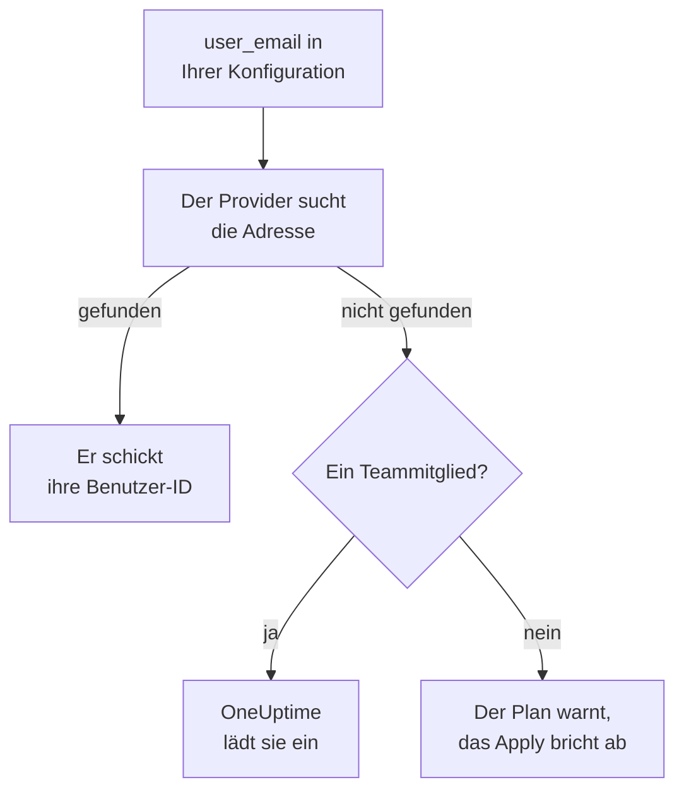

# Personen und Teams

Halten Sie in Ihrer Terraform-Konfiguration fest, wer in Ihrem Projekt ist: Teams und ihre Mitglieder, wer Bereitschaft hat und wem was gehört. Nennen Sie jede Person mit ihrer E-Mail-Adresse: Der Provider findet sie und lädt alle ein, die neu im Projekt sind.

:::cards
- [Personen per E-Mail-Adresse nennen](#personen-per-e-mail-adresse-nennen): Das Attribut neben jeder Benutzer-ID.
- [Neue Personen aufnehmen](#neue-personen-aufnehmen): Laden Sie jemanden ein, und geben Sie der Person ein Team, Bereitschaftsdienste und etwas, das ihr gehört.
- [Personen entfernen](#personen-entfernen): Entfernen Sie jemanden, und was OneUptime mit der Person entfernt.
- [Vorhandene Mitglieder importieren](#vorhandene-mitglieder-importieren): Über ihr Team und ihre Adresse.
:::

## So funktioniert es

Der Provider sucht die Adresse unter den Personen des Projekts, zu dem der API-Schlüssel gehört: seinen Mitgliedern und den Personen, die dazu eingeladen sind. Er schickt der API die ID der Person, die er findet. Ein Teammitglied, das mit einer Adresse genannt wird, die niemand im Projekt hat, lädt stattdessen diese Adresse ein.



Durchsucht wird nur das Projekt des API-Schlüssels selbst. Niemand außerhalb davon wird je gefunden, und der Provider kann nicht erkennen, ob eine Adresse anderswo ein Konto hat.

## Bevor Sie beginnen

- **Ein API-Schlüssel, der die Teams des Projekts lesen darf.** Über sie findet der Provider Personen.
- **Um jemand Neues hinzuzufügen, ein Schlüssel, der Personen einladen darf.** Siehe [Personen einladen](/docs/permissions/inviting-people).

## Personen per E-Mail-Adresse nennen

Jede Ressource, die eine Person nennt, nimmt neben ihrer Benutzer-ID auch ihre E-Mail-Adresse. Geben Sie eines von beiden an:

| Benutzer-ID | E-Mail-Adresse |
| --- | --- |
| `user_id` | `user_email` |
| `owner_users` | `owner_user_emails` |
| `assigned_to_user_id` | `assigned_to_user_email` |
| `override_user_id` | `override_user_email` |

Die Adresse wird ohne Rücksicht auf Groß- und Kleinschreibung gefunden und so im State gehalten, wie Sie sie geschrieben haben. Die Benutzer-ID wird ausgefüllt, damit andere Ressourcen darauf verweisen können.

## Neue Personen aufnehmen

Diese Konfiguration nimmt Alice, die neu im Projekt ist, in ein Team auf, gibt ihr ab ihrem ersten Tag Bereitschaftsdienste und macht Bob, der schon im Projekt ist, zum Eigentümer eines Monitors:

```hcl title="people.tf"
resource "oneuptime_team" "sre" {
  name        = "SRE"
  description = "Site reliability engineering"
}

# New to the project: OneUptime invites her.
resource "oneuptime_team_member" "alice" {
  team_id    = oneuptime_team.sre.id
  user_email = "alice@example.com"
}

resource "oneuptime_on_call_policy_schedule" "weekly" {
  name     = "SRE weekly"
  timezone = "UTC"
}

resource "oneuptime_on_call_schedule_layer" "weekly" {
  on_call_duty_policy_schedule_id = oneuptime_on_call_policy_schedule.weekly.id
  name                            = "Weekly"
  starts_at                       = "2030-01-07T09:00:00Z"
  hand_off_time                   = "2030-01-14T09:00:00Z"
}

# Named through her membership, so she is invited first.
resource "oneuptime_on_call_schedule_layer_user" "alice" {
  on_call_duty_policy_schedule_id       = oneuptime_on_call_policy_schedule.weekly.id
  on_call_duty_policy_schedule_layer_id = oneuptime_on_call_schedule_layer.weekly.id
  user_id                               = oneuptime_team_member.alice.user_id
}

resource "oneuptime_monitor" "api" {
  name         = "Public API"
  monitor_type = "Manual"
}

# In the project already: named by his address.
resource "oneuptime_monitor_user_owner" "api" {
  monitor_id = oneuptime_monitor.api.id
  user_email = "bob@example.com"
}
```

`terraform apply` lädt Alice per E-Mail ein, so wie eine Einladung aus dem Dashboard. OneUptime legt ihr ein Konto an, wenn sie keines hat. `has_accepted_invitation` bleibt `false`, bis sie annimmt, und dass sie annimmt, ist keine Änderung im Plan. Wer schon im Projekt ist, kommt sofort in ein neues Team.

Um jemanden, den diese Konfiguration einlädt, in die Bereitschaft zu nehmen oder zum Eigentümer zu machen, verweisen Sie mit `user_id = oneuptime_team_member.<name>.user_id` auf die Mitgliedschaft: Dann lädt Terraform die Person ein, bevor es sie irgendwo anders nennt. Eine Adresse, die niemand im Projekt hat, ist im Plan eine Warnung und im Apply ein Fehler.

## Jemanden finden

Die Datenquelle `oneuptime_user` sucht jemanden über `email`, `name` oder `id` und liest die Benutzer-ID, den Namen, ob die Person beigetreten ist, und die Teams, in denen sie ist:

```hcl
data "oneuptime_user" "alice" {
  email = "alice@example.com"
}

output "alice_teams" {
  value = data.oneuptime_user.alice.team_ids
}
```

## Personen entfernen

Entfernen Sie die Mitgliedschaften der Person aus Ihrer Konfiguration und wenden Sie sie an. Ist sie aus ihrem letzten Team des Projekts heraus, ist sie aus dem Projekt heraus, und OneUptime nimmt sie aus jedem Bereitschaftsplan, jeder Eskalationsregel und jeder Vertretung heraus und von dem, was ihr gehört: von allem, außer den Vorfällen, Alerts und Wartungsereignissen, die vorbei sind. Entfernen Sie in derselben Änderung die Blöcke, die sie nennen, sonst legt der nächste Plan sie wieder an, für jemanden, der nicht mehr im Projekt ist.

Ihr OneUptime-Konto bleibt ihres: Verlassen wird nur das Projekt. Ein Team, das ein Mitglied behalten muss, lässt sein letztes Mitglied, das angenommen hat, nicht gehen.

## Vorhandene Mitglieder importieren

Kein Bildschirm zeigt die ID einer Mitgliedschaft, also importieren Sie sie über die ID ihres Teams und die Adresse der Person:

```bash
terraform import oneuptime_team_member.alice 6b1d1c2e-4f3a-4b5c-8d6e-7f8091a2b3c4/alice@example.com
```

Die Adresse bleibt so, wie Sie sie geschrieben haben, schreiben Sie sie also wie in Ihrer Konfiguration. Auch die eigene ID der Mitgliedschaft importiert sie, und dann wird die Adresse aus OneUptime gelesen, in Kleinbuchstaben.

Eigentümer und Bereitschaftszeilen werden genauso importiert, über das, wozu sie gehören. Den Eigentümer eines Monitors importieren Sie über die ID des Monitors und die Adresse der Person. Eine Zeile, die ein Team oder einen Plan nennt, etwa ein Eigentümerteam oder das Team, das eine Eskalationsregel alarmiert, importieren Sie über beide IDs:

```bash
terraform import oneuptime_monitor_user_owner.api 68a1b2c3-d4e5-4f6a-8b9c-0d1e2f3a4b01/bob@example.com
terraform import oneuptime_escalation_rule_team.sre 68a1b2c3-d4e5-4f6a-8b9c-0d1e2f3a4b06/6b1d1c2e-4f3a-4b5c-8d6e-7f8091a2b3c4
```

## Wenn jemand seine Adresse ändert

Wer in OneUptime seine Adresse ändert, bleibt für Terraform dieselbe Person: Nichts ändert sich, bis Sie die neue Adresse schreiben, und dann ändert sich nur `user_email`.

## Fehlerbehebung

:::details Der Plan sagt, eine Adresse sei noch nicht in diesem Projekt
Niemand im Projekt oder unter den Eingeladenen hat diese Adresse. Laden Sie die Person zuerst mit einem `oneuptime_team_member` ein. Ist diese Mitgliedschaft in derselben Konfiguration, verweisen Sie mit `user_id = oneuptime_team_member.<name>.user_id` darauf statt auf die Adresse. Hat die Person ihre Adresse in OneUptime geändert, nehmen Sie die neue.
:::

:::details Das Apply sagt, der Benutzer sei schon zu diesem Team eingeladen
Die Person ist schon im Team. Importieren Sie diese Mitgliedschaft, statt sie anzulegen, wie unter [Vorhandene Mitglieder importieren](#vorhandene-mitglieder-importieren).
:::

## Nächste Schritte

:::cards
- [Ressourcen importieren](/docs/terraform/importing-resources): Bringen Sie den Rest Ihres Projekts unter Terraform.
- [Personen einladen](/docs/permissions/inviting-people): Wie Einladungen in OneUptime funktionieren.
- [Beispiele](/docs/terraform/examples): Einsatzbereite Konfigurationen für die gängigen Ressourcen.
:::
