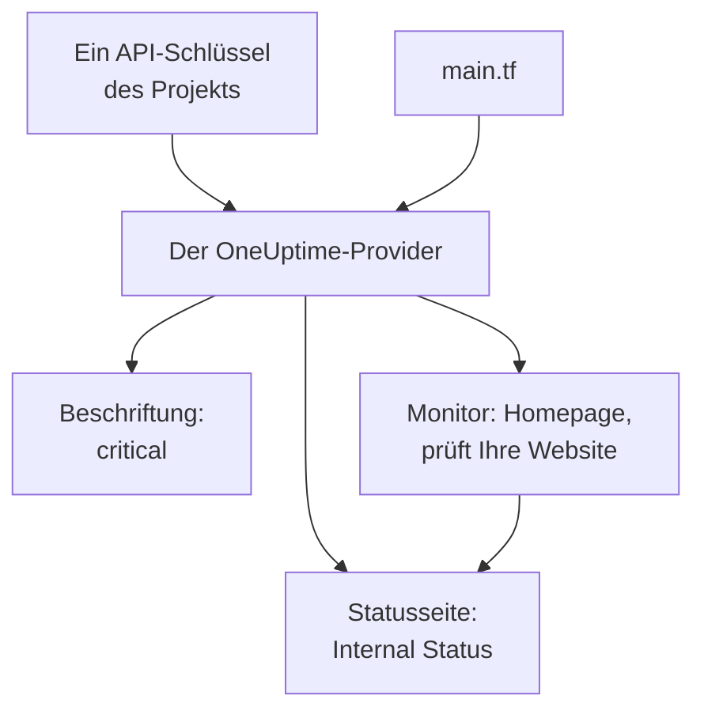

# Schnellstart

Diese Anleitung bringt Sie in etwa zehn Minuten von null zu einem OneUptime-Projekt, das Terraform verwaltet. Sie legen einen API-Schlüssel an, richten Terraform auf Ihr Projekt aus und wenden eine Beschriftung, einen Monitor, der Ihre Website prüft, und eine private Statusseite an, die ihn zeigt. Dann ändern Sie eines davon und räumen auf.

:::cards
- [Bevor Sie beginnen](#bevor-sie-beginnen): Terraform, ein Projekt und ein Tarif mit API-Schlüsseln.
- [Ihre ersten Ressourcen anlegen](#ihre-ersten-ressourcen-anlegen): Von einem API-Schlüssel zu einem angewendeten Plan, in sechs Schritten.
- [Eine Ressource ändern](#eine-ressource-ändern): Die Konfiguration bearbeiten, planen und anwenden.
- [Fehlerbehebung](#fehlerbehebung): Die Fehler, an denen ein erster Lauf scheitern kann.
:::



## Bevor Sie beginnen

- **Terraform 1.5 oder neuer, oder OpenTofu 1.6 oder neuer.** Mit OpenTofu führen Sie `tofu` überall dort aus, wo diese Anleitung `terraform` ausführt.
- **Ein OneUptime-Projekt** auf [oneuptime.com](https://oneuptime.com) oder auf Ihrer eigenen OneUptime-Instanz, in dem Sie API-Schlüssel anlegen dürfen.
- **In OneUptime Cloud der Tarif Growth oder höher.** Die API-Schlüssel eines Projekts funktionieren nur dort.

## Ihre ersten Ressourcen anlegen

:::steps
### Einen API-Schlüssel des Projekts anlegen

Öffnen Sie im OneUptime-Dashboard **Projekteinstellungen → Erweitert → API-Schlüssel** und klicken Sie auf **API-Schlüssel erstellen**. Geben Sie einen **Name** an, etwa `terraform`, und wählen Sie unter **Zugriff** die Option **Projektadministrator**: Terraform legt jede Art von Datensatz, die es verwaltet, an, liest, ändert und löscht sie, und **Projektadministrator** darf all das. Für einen engeren Schlüssel wählen Sie **Berechtigungen später wählen** und fügen auf der Seite des Schlüssels nur die Berechtigungen hinzu, die Sie brauchen.

Der Schlüssel läuft in einem Jahr ab. Für ein anderes Datum öffnen Sie **Weitere Felder**, bevor Sie ihn anlegen, oder ändern das Datum später auf der Seite des Schlüssels. Ist der Schlüssel angelegt, öffnet sich seine Seite: Kopieren Sie den **API-Schlüssel** aus der Karte **API-Schlüssel-Details**.

### Den Schlüssel für Terraform bereitstellen

Legen Sie den Schlüssel in der Umgebungsvariablen `ONEUPTIME_API_KEY` der Shell ab, in der Sie Terraform ausführen, damit er nie in einer Datei landet:

:::tabs
@tab Linux
```bash
export ONEUPTIME_API_KEY="<your-api-key>"
```
@tab macOS
```bash
export ONEUPTIME_API_KEY="<your-api-key>"
```
@tab Windows
```powershell
$env:ONEUPTIME_API_KEY = "<your-api-key>"
```
:::

### Terraform auf OneUptime ausrichten

Legen Sie einen leeren Ordner an und darin eine Datei namens `main.tf`:

```hcl title="main.tf"
terraform {
  required_providers {
    oneuptime = {
      source  = "oneuptime/oneuptime"
      version = "{{TERRAFORM_PROVIDER_VERSION}}"
    }
  }
}

provider "oneuptime" {
  # The API key comes from ONEUPTIME_API_KEY.
  # On a self-hosted OneUptime, add your OneUptime's address:
  # oneuptime_url = "https://oneuptime.example.com"
}
```

Bei einer selbst gehosteten OneUptime-Instanz lesen Sie [Selbst gehostete Einrichtung](/docs/terraform/self-hosted), bevor Sie eine Provider-Version wählen.

### Ihre Ressourcen beschreiben

Fügen Sie diese Blöcke in `main.tf` ein. Sie lesen zwei der Monitor-Status, mit denen jedes Projekt beginnt, und legen eine Beschriftung an, einen Monitor, der `https://example.com` alle fünf Minuten prüft (setzen Sie dort Ihre eigene Website ein), und eine private Statusseite, die den Monitor zeigt:

```hcl title="main.tf"
data "oneuptime_monitor_status" "operational" {
  name = "Operational"
}

data "oneuptime_monitor_status" "offline" {
  name = "Offline"
}

resource "oneuptime_label" "critical" {
  name        = "critical"
  description = "Resources that page on-call when down"
  color       = "#FF5733"
}

resource "oneuptime_monitor" "homepage" {
  name                = "Homepage"
  description         = "Checks that the homepage responds"
  monitor_type        = "Website"
  monitoring_interval = "*/5 * * * *"
  labels              = [oneuptime_label.critical.id]

  monitor_steps = [{
    monitor_destination      = "https://example.com"
    monitor_destination_type = "URL"
    request_type             = "GET"

    criteria = [
      {
        name                  = "Offline"
        description           = "The homepage does not respond"
        filter_condition      = "Any"
        change_monitor_status = true
        monitor_status_id     = data.oneuptime_monitor_status.offline.id

        filters = [
          {
            check_on    = "Is Online"
            filter_type = "False"
          }
        ]
      },
      {
        name                  = "Online"
        description           = "The homepage responds"
        filter_condition      = "All"
        change_monitor_status = true
        monitor_status_id     = data.oneuptime_monitor_status.operational.id

        filters = [
          {
            check_on    = "Is Online"
            filter_type = "True"
          }
        ]
      }
    ]
  }]
}

resource "oneuptime_status_page" "internal" {
  name                  = "Internal Status"
  description           = "Status of our internal services"
  page_title            = "Service Status"
  is_public_status_page = false
}

resource "oneuptime_status_page_resource" "homepage" {
  status_page_id = oneuptime_status_page.internal.id
  monitor_id     = oneuptime_monitor.homepage.id
  display_name   = "Homepage"
}

output "monitor_id" {
  value = oneuptime_monitor.homepage.id
}
```

Die `monitor_steps` des Monitors sagen, was er prüft und was jedes Ergebnis bedeutet: Nach jeder Prüfung setzt das erste passende Kriterium seinen Status. [Monitor-Schritte](/docs/terraform/monitor-steps) erklärt jeden Teil.

### Planen und anwenden

:::tabs
@tab Terraform
```bash
terraform init
terraform plan
terraform apply
```
@tab OpenTofu
```bash
tofu init
tofu plan
tofu apply
```
:::

`init` lädt den Provider. Der Plan endet mit `Plan: 4 to add, 0 to change, 0 to destroy.` Geben Sie `yes` ein, um ihn anzuwenden; wenn das erledigt ist, gibt Terraform die ID des neuen Monitors aus.

### Das Dashboard prüfen

Im OneUptime-Dashboard:

- **Monitore** listet `Homepage` mit der Beschriftung `critical`. Seine erste Prüfung liegt innerhalb weniger Minuten vor.
- **Statusseiten** listet `Internal Status`, die `Homepage` zeigt.
- **Projekteinstellungen → Grundlegend → Beschriftungen** listet `critical` in der Farbe, die Sie gesetzt haben.

Führen Sie `terraform plan` erneut aus. Die Antwort ist `No changes.`: OneUptime enthält genau das, was die Konfiguration sagt.
:::

## Eine Ressource ändern

Ändern Sie die Konfiguration, nicht das Dashboard. Setzen Sie die `color` der Beschriftung in `main.tf` auf `"#2ECC71"`, dann planen und anwenden:

```bash
terraform plan
terraform apply
```

Der Plan endet mit `Plan: 0 to add, 1 to change, 0 to destroy.`: Die Beschriftung wird an Ort und Stelle geändert. Eine Änderung, die jemand im Dashboard an einer von Terraform verwalteten Ressource vornimmt, erscheint im nächsten Plan, und das Anwenden stellt wieder her, was die Konfiguration sagt.

## Aufräumen

War das eine Probefahrt, löschen Sie, was die Konfiguration angelegt hat:

```bash
terraform destroy
```

Das löscht die Beschriftung, den Monitor, die Statusseite und ihre Ressource. Die beiden Monitor-Status bleiben: Die Datenquellen lesen sie nur.

## Fehlerbehebung

:::details Meldung „Missing API Key“
Der Provider hat keinen API-Schlüssel gefunden. Exportieren Sie `ONEUPTIME_API_KEY` in der Shell, in der Sie Terraform ausführen, oder setzen Sie `api_key` im Provider-Block, und führen Sie den Befehl erneut aus.
:::

:::details Meldung „the OneUptime API returned status 400: Invalid API Key“
Der Schlüssel ist falsch geschrieben, abgelaufen oder gelöscht, oder er gehört zu einer anderen OneUptime-Instanz als der, auf die `oneuptime_url` zeigt. Kopieren Sie den Schlüssel erneut von seiner Seite, oder legen Sie einen neuen an.
:::

:::details Meldung „the OneUptime API returned status 402: API keys need the Growth plan“
In OneUptime Cloud funktionieren die API-Schlüssel eines Projekts nur mit dem Tarif Growth oder höher. Stufen Sie das Projekt unter **Projekteinstellungen → Abrechnung und Rechnungen → Abrechnung** hoch, und derselbe Schlüssel funktioniert wieder.
:::

:::details Meldung „the OneUptime API returned status 422: You do not have permissions to create Monitor“
Der Schlüssel hat keine Berechtigung für diese Art von Datensatz. Geben Sie ihm auf der Seite des Schlüssels **Projektadministrator** oder die Berechtigung, die die Meldung nennt.
:::

:::details Meldung „No monitor status matches {name = "Offline"}“
Die Monitor-Status Ihres Projekts haben andere Namen. Verwenden Sie die Namen, die Sie unter **Monitore → Einstellungen → Monitor-Status** sehen, oder suchen Sie den Status stattdessen über `is_offline_state = true`.
:::

## Nächste Schritte

:::cards
- [Vollständige Anleitung](/docs/terraform/complete-guide): Authentifizierung, Projektaufbau, Datenquellen, State und Upgrades.
- [Monitor-Schritte](/docs/terraform/monitor-steps): Festlegen, was ein Monitor prüft und was jedes Ergebnis bedeutet.
- [Beispiele](/docs/terraform/examples): Fertige Konfigurationen für die gängigen Ressourcen.
- [Ressourcen importieren](/docs/terraform/importing-resources): Was Sie im Dashboard angelegt haben, unter Terraform bringen.
:::
