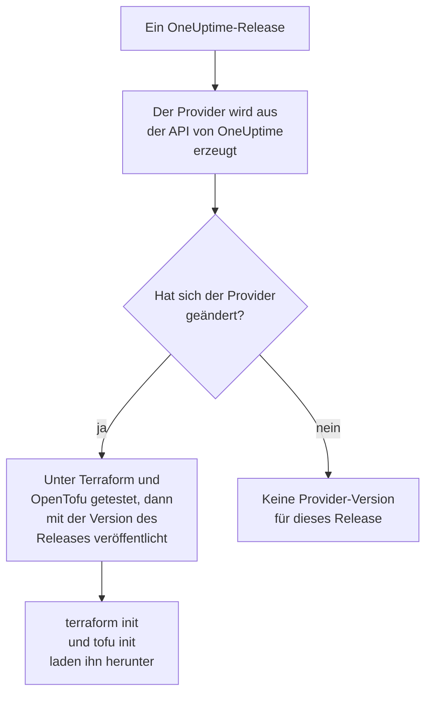

# Registry-Verwendung

Der OneUptime-Provider wird in der [Terraform Registry](https://registry.terraform.io/providers/oneuptime/oneuptime) und der [OpenTofu Registry](https://search.opentofu.org/provider/oneuptime/oneuptime/latest) veröffentlicht. `terraform init` und `tofu init` laden ihn von dort herunter: Es gibt nichts von Hand zu installieren. Diese Seite behandelt, was veröffentlicht wird, wie Versionen nummeriert werden und wie Sie zu einer neueren wechseln.

:::cards
- [Was veröffentlicht wird](#was-veröffentlicht-wird): Der Provider für jede Plattform, seine Referenz und seine Versionen.
- [Wie Versionen nummeriert werden](#wie-versionen-nummeriert-werden): Die Version eines Providers ist das OneUptime-Release, das ihn veröffentlicht hat.
- [Die Lock-Datei](#die-lock-datei): Die Version und die Prüfsummen, die jeder Rechner installiert.
- [Zu einer neueren Version wechseln](#zu-einer-neueren-version-wechseln): Lesen, was sich geändert hat, herunterladen und planen.
:::

## Was veröffentlicht wird

Jedes OneUptime-Release erzeugt den Provider aus der eigenen API von OneUptime. Hat sich der Provider geändert, veröffentlicht das Release ihn unter der Version des Releases, sobald er seine End-to-End-Tests unter Terraform und unter OpenTofu bestanden hat:



| Was | Wo |
| --- | --- |
| Der Provider, für Linux, macOS, Windows, FreeBSD, OpenBSD und Solaris | Von `terraform init` und `tofu init` heruntergeladen, mit Prüfsummen, die OneUptime signiert |
| Die Referenz jeder Ressource und Datenquelle, mit jedem ihrer Attribute | Die Dokumentation der Registry, nach Produkt gruppiert: Monitore, Statusseiten, Vorfälle, Bereitschaft und die anderen |
| Eine Anleitung zur Verwendung des Providers mit OpenTofu | Die Anleitungen der Registry |
| Jede Version, die neueste zuerst | Die Versionsliste der Registry |

Die Referenz nennt, was jedes Attribut ist. Diese Dokumentation zeigt, wie Sie sie zusammen verwenden: Beginnen Sie bei der [Terraform – Übersicht](/docs/terraform/index).

## Wie Versionen nummeriert werden

Die Version eines Providers ist die Version des OneUptime-Releases, das ihn veröffentlicht hat: Provider {{TERRAFORM_PROVIDER_MAJOR}}.0.20 kam mit OneUptime {{TERRAFORM_PROVIDER_MAJOR}}.0.20. Ein Release, dessen Provider sich nicht geändert hat, veröffentlicht keinen, also haben die Versionen Lücken, und eine Einschränkung, die genau eine Version nennt, kann eine Version nennen, die es nicht gibt. Schreiben Sie stattdessen einen Bereich:

| Sie verwenden | Einschränkung | Terraform installiert |
| --- | --- | --- |
| OneUptime Cloud | `{{TERRAFORM_PROVIDER_VERSION}}` | Den neuesten Provider {{TERRAFORM_PROVIDER_MAJOR}}.x |
| Eine selbst gehostete OneUptime-Instanz | Einen Bereich, der bei der Version Ihrer Instanz endet, etwa `>= {{TERRAFORM_PROVIDER_MAJOR}}.0, <= {{TERRAFORM_PROVIDER_MAJOR}}.0.40` | Den neuesten Provider, der nicht neuer ist als Ihre Instanz |

Bei einer selbst gehosteten OneUptime-Instanz kann ein Provider, der neuer ist als Ihre Instanz, Einstellungen senden, die Ihre Instanz noch nicht hat: [Selbst gehostete Einrichtung](/docs/terraform/self-hosted#die-provider-version-wählen) zeigt, wie Sie seinen Bereich schreiben.

```hcl title="main.tf"
terraform {
  required_providers {
    oneuptime = {
      source  = "oneuptime/oneuptime"
      version = "{{TERRAFORM_PROVIDER_VERSION}}"
    }
  }
}
```

Die Quelladresse nennt keine Registry: Terraform liest sie aus der Terraform Registry, und OpenTofu aus der OpenTofu Registry, die dieselben Versionen veröffentlichen.

## Die Lock-Datei

`terraform init` hält die gewählte Version und die Prüfsummen seiner Downloads in `.terraform.lock.hcl` fest. Committen Sie diese Datei: Jeder Rechner und jeder CI-Lauf installiert dann genau diese Version, bis Sie eine andere wählen. Die Prüfsummen decken jede Plattform ab, die die Registry veröffentlicht, sodass eine Lock-Datei Rechnern mit Linux, macOS und Windows gleichermaßen dient.

```hcl title=".terraform.lock.hcl"
provider "registry.terraform.io/oneuptime/oneuptime" {
  version     = "{{TERRAFORM_PROVIDER_MAJOR}}.0.20"
  constraints = "{{TERRAFORM_PROVIDER_VERSION}}"
  hashes = [
    "h1:...",
    "zh:...",
  ]
}
```

Die Lock-Datei nennt die Registry. OpenTofu schreibt `registry.opentofu.org/oneuptime/oneuptime`, wo Terraform `registry.terraform.io/oneuptime/oneuptime` schreibt, sodass ein Wechsel der Engine die Lock-Datei ändert: `init` ersetzt den Eintrag und bittet Sie, die Änderung zu committen.

## Zu einer neueren Version wechseln

:::steps
### Lesen, was sich geändert hat

[Die Releases von OneUptime](https://github.com/OneUptime/oneuptime/releases) sagen, was jedes Release geändert hat, den Provider eingeschlossen. [Die Releases des Providers](https://github.com/OneUptime/terraform-provider-oneuptime/releases) verlinken auf die Änderungen seit dem vorherigen.

### Herunterladen

```bash
terraform init -upgrade
```

`init -upgrade` nimmt die neueste Version, die Ihre Einschränkung erlaubt, gibt sie aus und aktualisiert `.terraform.lock.hcl`. Die Einschränkung `{{TERRAFORM_PROVIDER_VERSION}}` nimmt jedes Release {{TERRAFORM_PROVIDER_MAJOR}}.x; eine neue Hauptversion braucht eine neue Einschränkung.

### Planen, bevor Sie anwenden

Führen Sie `terraform plan` aus, und wenden Sie nur an, wenn der Plan leer ist oder die Änderungen zeigt, die Sie erwarten. Committen Sie die aktualisierte Lock-Datei.
:::

Bei einer selbst gehosteten OneUptime-Instanz aktualisieren Sie zuerst OneUptime und heben dann das Ende des Bereichs des Providers an.

## Wo der Code liegt

Der Provider wird aus der OneUptime-API im [Hauptrepository von OneUptime](https://github.com/OneUptime/oneuptime) erzeugt, und jede Version wird aus dem Release gebaut, das sie veröffentlicht hat. Sein eigenes Repository, [OneUptime/terraform-provider-oneuptime](https://github.com/OneUptime/terraform-provider-oneuptime), enthält, was der Generator geschrieben hat, daher werden Änderungen im Hauptrepository vorgenommen: Melden Sie Probleme, auch solche der Dokumentation, unter [github.com/OneUptime/oneuptime/issues](https://github.com/OneUptime/oneuptime/issues).

## Nächste Schritte

:::cards
- [Selbst gehostete Einrichtung](/docs/terraform/self-hosted): Der Versionsbereich für Ihre eigene OneUptime-Instanz, und ein Spiegel für Rechner ohne Internetzugang.
- [OpenTofu](/docs/terraform/opentofu): Derselbe Provider und dieselbe Konfiguration, mit `tofu`.
- [Vollständige Anleitung](/docs/terraform/complete-guide): Authentifizierung, Projektaufbau, Datenquellen, State und Upgrades.
- [Fehlerbehebung](/docs/terraform/troubleshooting): Häufige Fehler und wie Sie sie beheben.
:::
