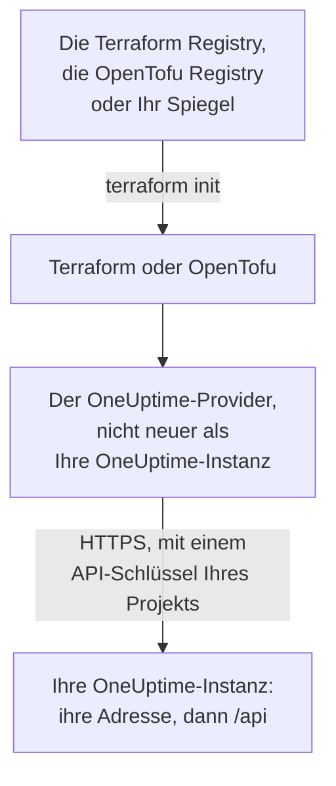

# Selbst gehostete Einrichtung

Der Provider funktioniert mit Ihrer eigenen OneUptime-Instanz so, wie er mit OneUptime Cloud funktioniert: dieselben Ressourcen, dieselben Attribute und dieselben API-Schlüssel des Projekts. Was Sie selbst festlegen: die Adresse Ihrer OneUptime-Instanz, die passende Provider-Version und, wo Sie sie brauchen, einen Spiegel für Rechner ohne Internetzugang und das Vertrauen in eine private Zertifizierungsstelle.

:::cards
- [Den Provider auf Ihre OneUptime-Instanz richten](#den-provider-auf-ihre-oneuptime-instanz-richten): Ihre Adresse, und ein API-Schlüssel Ihres Projekts.
- [Die Provider-Version wählen](#die-provider-version-wählen): Der neueste Provider, der nicht neuer ist als Ihre OneUptime-Instanz.
- [Ohne Internetzugang](#ohne-internetzugang): Spiegeln Sie den Provider in Ihr Netzwerk.
- [TLS und Zertifikate](#tls-und-zertifikate): Eine private Zertifizierungsstelle, Proxys und einfaches HTTP.
:::



## Den Provider auf Ihre OneUptime-Instanz richten

Setzen Sie `oneuptime_url` auf die Adresse, unter der Sie das Dashboard öffnen: das Schema und den Host, ohne Pfad. Der Provider ergänzt `https://`, wenn die Adresse kein Schema hat, und `/api` am Ende, sodass `https://oneuptime.example.com` jede Anfrage an `https://oneuptime.example.com/api` schickt.

```hcl title="main.tf"
terraform {
  required_providers {
    oneuptime = {
      source  = "oneuptime/oneuptime"
      version = "{{TERRAFORM_PROVIDER_MATCHING}}"
    }
  }
}

provider "oneuptime" {
  oneuptime_url = "https://oneuptime.example.com"
  # The API key comes from the ONEUPTIME_API_KEY environment variable.
}
```

Die Adresse kann stattdessen aus der Umgebungsvariablen `ONEUPTIME_URL` kommen, sodass eine Konfiguration auf mehrere Installationen zeigen kann:

```bash
export ONEUPTIME_URL="https://oneuptime.example.com"
export ONEUPTIME_API_KEY="<your-api-key>"
```

Die Adresse ist der Host, unter dem Ihre Installation ausgeliefert wird: `HOST` und `HTTP_PROTOCOL` in `config.env` bei Docker Compose, und `host` und `httpProtocol` in den Werten des Helm-Charts.

Der Schlüssel ist ein API-Schlüssel des Projekts, das Sie verwalten, angelegt im Dashboard Ihrer OneUptime-Instanz unter **Projekteinstellungen → Erweitert → API-Schlüssel**, wie in OneUptime Cloud. Der Master-API-Schlüssel einer selbst gehosteten OneUptime-Instanz gehört zu keinem Projekt, daher scheitert ein Anlegen mit ihm an `ProjectId required`.

> [!TIP]
> Ihre OneUptime-Instanz schreibt diesen Block für Sie. Öffnen Sie eine beliebige Ressource oder Liste im Dashboard, dann **Entwickler** und **Terraform** in ihrem Seitenmenü: Der Provider-Block dort hat die Adresse Ihrer OneUptime-Instanz und einen Versionsbereich, der zu ihr passt.

## Die Provider-Version wählen

Verwenden Sie den neuesten veröffentlichten Provider, der nicht neuer ist als Ihre OneUptime-Instanz. Die Versionen des Providers folgen denen von OneUptime: Ein OneUptime-Release, das den Provider ändert, veröffentlicht ihn unter der eigenen Versionsnummer des Releases, und ein Provider, der neuer ist als Ihre OneUptime-Instanz, kann Einstellungen senden, die Ihre Instanz noch nicht hat.

Schreiben Sie also einen Bereich, der bei der Version Ihrer OneUptime-Instanz endet, wie es das Dashboard tut. Der Block oben nimmt `{{TERRAFORM_PROVIDER_MATCHING}}`, den Bereich für die OneUptime-Instanz, von der diese Dokumentation kommt: Lesen Sie sie auf Ihrer eigenen OneUptime-Instanz, ist dieser Bereich Ihrer. Andernfalls tragen Sie Ihre eigene Version ein:

:::steps
### Die Version Ihrer OneUptime-Instanz ermitteln

Fragen Sie Ihre OneUptime-Instanz danach:

```bash
curl https://oneuptime.example.com/version
```

Die Antwort ist JSON, etwa `{"version":"{{TERRAFORM_PROVIDER_MAJOR}}.0.40","commit":"..."}`. Als Master-Administrator können Sie auch die Editionsbezeichnung im Kopf des Admin-Dashboards öffnen: siehe [Ihre aktuelle Version ermitteln](/docs/installation/upgrading#ermitteln-sie-ihre-aktuelle-version).

### Sie in den Bereich eintragen

Der Bereich beginnt bei der Hauptversion und endet bei Ihrer. Für eine OneUptime-Instanz {{TERRAFORM_PROVIDER_MAJOR}}.0.40:

```hcl title="main.tf"
terraform {
  required_providers {
    oneuptime = {
      source  = "oneuptime/oneuptime"
      version = ">= {{TERRAFORM_PROVIDER_MAJOR}}.0, <= {{TERRAFORM_PROVIDER_MAJOR}}.0.40"
    }
  }
}
```

Terraform nimmt den neuesten Provider im Bereich. Ein OneUptime-Release, das den Provider nicht geändert hat, veröffentlicht keinen, und der Bereich überspringt die Versionen, die es nicht gibt.

### Den Provider herunterladen

Führen Sie `terraform init` aus. Es gibt die installierte Version aus und hält sie in `.terraform.lock.hcl` fest.
:::

Bei einem Upgrade aktualisieren Sie zuerst OneUptime. Dann heben Sie das Ende des Bereichs auf die neue Version an und führen `terraform init -upgrade` aus.

## Ohne Internetzugang

Wenn die Rechner, auf denen Terraform läuft, die Registry nicht erreichen, kopieren Sie den Provider einmal in Ihr Netzwerk und richten Terraform auf die Kopie.

:::steps
### Den Provider spiegeln

Laden Sie auf einem Rechner mit Internetzugang, in einem Ordner mit Ihrer Konfiguration, den Provider für jede Plattform herunter, auf der Ihre Rechner laufen. Ohne `-platform` lädt der Befehl den Provider nur für seine eigene Plattform herunter:

:::tabs
@tab Terraform
```bash
terraform providers mirror -platform=linux_amd64 -platform=darwin_arm64 /srv/terraform-mirror
```
@tab OpenTofu
```bash
tofu providers mirror -platform=linux_amd64 -platform=darwin_arm64 /srv/terraform-mirror
```
:::

Der Ordner enthält den Provider unter der Adresse der Registry, etwa `registry.terraform.io/oneuptime/oneuptime/`. Kopieren Sie ihn in Ihr Netzwerk.

### Terraform auf den Spiegel richten

Schreiben Sie eine CLI-Konfigurationsdatei, die den OneUptime-Provider aus dem Ordner installiert, und alles andere wie gewohnt:

:::tabs
@tab Terraform
```hcl title="mirror.tfrc"
provider_installation {
  filesystem_mirror {
    path    = "/srv/terraform-mirror"
    include = ["registry.terraform.io/oneuptime/oneuptime"]
  }
  direct {
    exclude = ["registry.terraform.io/oneuptime/oneuptime"]
  }
}
```
@tab OpenTofu
```hcl title="mirror.tfrc"
provider_installation {
  filesystem_mirror {
    path    = "/srv/terraform-mirror"
    include = ["registry.opentofu.org/oneuptime/oneuptime"]
  }
  direct {
    exclude = ["registry.opentofu.org/oneuptime/oneuptime"]
  }
}
```
:::

Nennen Sie sie in `TF_CLI_CONFIG_FILE`, das sowohl Terraform als auch OpenTofu lesen: `export TF_CLI_CONFIG_FILE=/etc/terraform/mirror.tfrc`.

### Initialisieren

Führen Sie `terraform init` aus: Es installiert den Provider aus dem Spiegel. Es warnt, dass die Lock-Datei nun nur Prüfsummen für diese Plattform hat. Um sie für jede Plattform festzuhalten, führen Sie `terraform providers lock` mit denselben `-platform`-Optionen auf dem Rechner mit Internetzugang aus, und committen Sie `.terraform.lock.hcl` mit Ihrer Konfiguration.
:::

Spiegeln Sie erneut, wann immer Sie den Versionsbereich anheben.

## TLS und Zertifikate

Der Provider prüft das Zertifikat Ihrer OneUptime-Instanz gegen den Zertifikatsspeicher des Rechners, auf dem Terraform läuft, und es gibt keine Einstellung, die die Prüfung überspringt. Stammt das Zertifikat von einer privaten Zertifizierungsstelle, fügen Sie diese Stelle dem Zertifikatsspeicher jedes Rechners und CI-Runners hinzu, der Terraform ausführt:

:::tabs
@tab Debian / Ubuntu
```bash
sudo cp my-ca.crt /usr/local/share/ca-certificates/
sudo update-ca-certificates
```
@tab RHEL / Fedora
```bash
sudo cp my-ca.crt /etc/pki/ca-trust/source/anchors/
sudo update-ca-trust
```
:::

Unter Linux, wo Sie den Zertifikatsspeicher nicht ändern können, etwa in einem CI-Container, setzen Sie `SSL_CERT_FILE` auf eine Datei, die Ihre Zertifizierungsstelle und die öffentlichen enthält. Unter macOS und Windows fügen Sie die Stelle dem Zertifikatsspeicher des Systems hinzu.

- **Proxys.** Der Provider schickt seine Anfragen über den Proxy in `HTTPS_PROXY`, außer an die Hosts in `NO_PROXY`. Ein Reverse-Proxy vor OneUptime muss jeden `/api`-Pfad und den Header `APIKey` unverändert durchlassen.
- **Einfaches HTTP.** Eine `http://`-Adresse funktioniert, für eine Testinstallation. Der API-Schlüssel reist mit jeder Anfrage, verwenden Sie also für alles andere HTTPS.

## Fehlerbehebung

:::details Meldung „x509: certificate signed by unknown authority“
Der Rechner, auf dem Terraform läuft, vertraut dem Zertifikat Ihrer OneUptime-Instanz nicht: Fügen Sie Ihre Zertifizierungsstelle hinzu, wie [TLS und Zertifikate](#tls-und-zertifikate) zeigt.
:::

:::details Meldung „invalid character '<' looking for beginning of value“
Eine Webseite hat statt der API geantwortet: `oneuptime_url` hat einen Pfad, oder ein Proxy hat geantwortet. Setzen Sie es auf die Adresse Ihrer OneUptime-Instanz allein.
:::

:::details Meldung „no available releases match the given constraints“
Kein veröffentlichter Provider passt zur Versionseinschränkung, etwa einer, die eine einzelne Version nennt, die OneUptime nie veröffentlicht hat. Schreiben Sie einen Bereich, wie [Die Provider-Version wählen](#die-provider-version-wählen) zeigt.
:::

:::details Meldung „ProjectId required“
Der Schlüssel ist der Master-API-Schlüssel, der zu keinem Projekt gehört. Legen Sie einen API-Schlüssel des Projekts an, unter **Projekteinstellungen → Erweitert → API-Schlüssel**.
:::

[Fehlerbehebung](/docs/terraform/troubleshooting) nennt die anderen Fehler, und was jeder bedeutet.

## Nächste Schritte

:::cards
- [Schnellstart](/docs/terraform/quick-start): Legen Sie einen API-Schlüssel an und wenden Sie Ihre ersten Ressourcen an.
- [Registry-Verwendung](/docs/terraform/registry): Wo der Provider veröffentlicht wird, und wie Versionen nummeriert werden.
- [Fehlerbehebung](/docs/terraform/troubleshooting): Häufige Fehler und wie Sie sie beheben.
- [Upgrade](/docs/installation/upgrading): Aktualisieren Sie Ihre OneUptime-Instanz, bevor Sie den Bereich des Providers anheben.
:::
