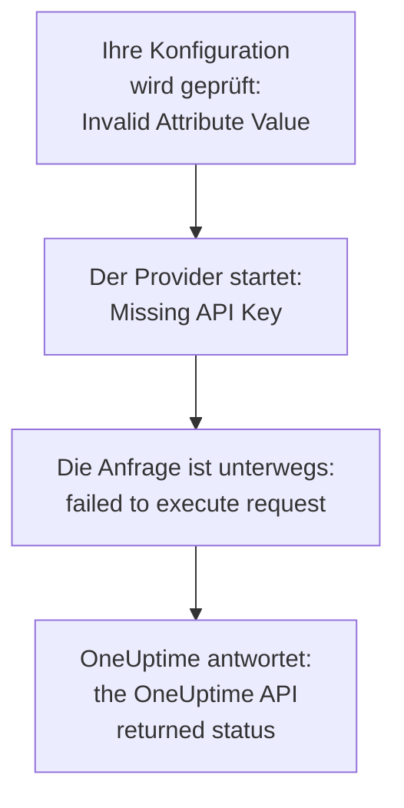

# Fehlerbehebung

Suchen Sie die Meldung, die Terraform ausgegeben hat, oder das, was Sie beobachtet haben, in der Tabelle unten: Jede Zeile führt zu ihrer Lösung. Die Abschnitte nach der Tabelle erklären jeden Fehler, gruppiert danach, woher er kommt.

:::cards
- [Ihren Fehler finden](#ihren-fehler-finden): Jede Meldung und jedes Symptom auf dieser Seite, mit seiner Lösung.
- [API-Schlüssel, Berechtigungen und Tarife](#api-schlüssel-berechtigungen-und-tarife): Wenn OneUptime den Schlüssel des Providers ablehnt.
- [Pläne, die nicht zur Ruhe kommen](#pläne-die-nicht-zur-ruhe-kommen): Änderungen, die wiederkommen, und Ressourcen, die den State verlassen.
- [Verbindung zu einer selbst gehosteten OneUptime-Instanz](#verbindung-zu-einer-selbst-gehosteten-oneuptime-instanz): Die Adresse, Zertifikate und Proxys.
:::

## Ihren Fehler finden

| Meldung oder Symptom | Was zu tun ist |
| --- | --- |
| `Missing API Key` | Geben Sie dem Provider seinen Schlüssel: siehe [`Missing API Key` oder `Invalid API Key`](#missing-api-key-oder-invalid-api-key) |
| `Invalid API Key` | Kopieren Sie den Schlüssel erneut, oder legen Sie einen neuen an: siehe [`Missing API Key` oder `Invalid API Key`](#missing-api-key-oder-invalid-api-key) |
| `ProjectId required` | Verwenden Sie einen API-Schlüssel des Projekts, keinen Master-Schlüssel: siehe [`ProjectId required`](#projectid-required) |
| `You do not have permissions to create Monitor` | Geben Sie dem Schlüssel die Berechtigung, die die Meldung nennt: siehe [Dem Schlüssel fehlt eine Berechtigung](#dem-schlüssel-fehlt-eine-berechtigung) |
| `API keys need the Growth plan` | Bringen Sie das Projekt zurück auf den Tarif Growth: siehe [Zahlung erforderlich](#zahlung-erforderlich) |
| `402` für eine Ressource oder eine Einstellung | Wechseln Sie in einen höheren Tarif, oder lassen Sie die Einstellung auf ihrem Standardwert: siehe [Zahlung erforderlich](#zahlung-erforderlich) |
| `This project has been blocked` | Bitten Sie einen Master-Administrator, das Projekt freizugeben: siehe [Ein gesperrtes Projekt](#ein-gesperrtes-projekt) |
| `references records that are not in this project` | Verwenden Sie die ID eines Datensatzes Ihres eigenen Projekts: siehe [IDs aus einem anderen Projekt](#ids-aus-einem-anderen-projekt) |
| `Not Found` oder `Ambiguous Match` aus einer Datenquelle | Korrigieren Sie die Argumente der Suche: siehe [Suchen, die keinen oder mehrere finden](#suchen-die-keinen-oder-mehrere-finden) |
| `Cannot import non-existent remote object` | Prüfen Sie die ID und die Berechtigungen des Schlüssels: siehe [Ressourcen importieren](/docs/terraform/importing-resources#fehlerbehebung) |
| `Provider produced inconsistent result after apply` | Aktualisieren Sie den Provider: siehe [Inkonsistentes Ergebnis nach dem Apply](#inkonsistentes-ergebnis-nach-dem-apply) |
| Ein Plan legt eine Ressource an, die Sie nicht hinzugefügt haben | Der Schlüssel kann sie nicht mehr lesen, und OneUptime hat mit `404` geantwortet: Geben Sie dem Schlüssel den Lesezugriff zurück, dann importieren Sie die Ressource mit `terraform import`: siehe [Eine Ressource verlässt den State, und das nächste Apply legt sie erneut an](#eine-ressource-verlässt-den-state-und-das-nächste-apply-legt-sie-erneut-an) |
| Eine `priority` oder `order` ändert sich nach dem Apply | Geben Sie jeder eine Nummer, die keine andere hat: siehe [Eine Priorität oder Reihenfolge, die wandert](#eine-priorität-oder-reihenfolge-die-wandert) |
| `Invalid Configuration for Read-Only Attribute` | Entfernen Sie das Attribut aus der Konfiguration: siehe [Schreibgeschützte Attribute](#schreibgeschützte-attribute) |
| `has been renamed to` | Benennen Sie den Ressourcentyp um, mit einem `moved`-Block: siehe [Ein umbenannter Ressourcentyp](#ein-umbenannter-ressourcentyp) |
| Ein mit Terraform angelegter Monitor zeigt seine Prüfungen nie | Aktualisieren Sie OneUptime: siehe [Monitore aus der Zeit vor Schritt-IDs](#monitore-aus-der-zeit-vor-schritt-ids) |
| `must contain at least 1 elements` | Lassen Sie das Attribut weg, statt es leer zu setzen: siehe [Leere Werte](#leere-werte) |
| JSON aus dem Dashboard in einer `.tf`-Datei | Schreiben Sie es als HCL: siehe [JSON aus dem Dashboard](#json-aus-dem-dashboard) |
| `no available releases match the given constraints` | Verwenden Sie einen Versionsbereich, nicht eine einzelne Version: siehe [Eine Version, die nie veröffentlicht wurde](#eine-version-die-nie-veröffentlicht-wurde) |
| `x509: certificate signed by unknown authority` | Vertrauen Sie Ihrer Zertifizierungsstelle: siehe [Zertifikate](#zertifikate) |
| `invalid character '<' looking for beginning of value` | Richten Sie `oneuptime_url` auf Ihre OneUptime-Instanz selbst: siehe [Eine Webseite statt der API](#eine-webseite-statt-der-api) |
| `connection refused` oder `Client.Timeout exceeded` | Prüfen Sie die Adresse, das Netzwerk und jeden Proxy: siehe [Verbindungen, die scheitern](#verbindungen-die-scheitern) |

## Einen Fehler lesen

Ein Fehler nennt den Schritt, der gescheitert ist, und seine Meldung sagt, woher er kam:



- Ein Fehler, der vor jeder Anfrage kommt, etwa `Invalid Attribute Value`, betrifft Ihre Konfiguration: Der Provider prüft sie, bevor er mit OneUptime spricht.
- `failed to execute request` bedeutet, dass die Anfrage nie eine Antwort bekam: siehe [Verbindung zu einer selbst gehosteten OneUptime-Instanz](#verbindung-zu-einer-selbst-gehosteten-oneuptime-instanz).
- `the OneUptime API returned status` ist die Antwort von OneUptime: Der Status und die Meldung danach sagen, was OneUptime abgelehnt hat.

Der Provider nennt, was er gerade tat: `Unable to create monitor` und `Unable to update monitor` bei einer Änderung, und `Unable to parse label response`, wenn er eine Ressource liest. Ein Lesen, das OneUptime ablehnt, wird mit der Zusammenfassung `Parse Error` gemeldet, aber die Meldung danach ist die Antwort von OneUptime, kein Problem beim Parsen.

## API-Schlüssel, Berechtigungen und Tarife

### `Missing API Key` oder `Invalid API Key`

`Missing API Key` hält den Provider an, bevor er irgendeine Anfrage stellt: Weder `api_key` im Provider-Block noch die Umgebungsvariable `ONEUPTIME_API_KEY` ist gesetzt. Exportieren Sie die Variable in der Shell, in der Sie Terraform ausführen, oder übergeben Sie den Schlüssel in einer als `sensitive` markierten Variablen.

`Invalid API Key` ist die Antwort von OneUptime auf einen Schlüssel, den es nicht kennt: einen vertippten, abgelaufenen oder gelöschten, oder einen einer anderen OneUptime-Instanz als der, auf die `oneuptime_url` zeigt. Kopieren Sie den Schlüssel erneut von seiner Seite unter **Projekteinstellungen → Erweitert → API-Schlüssel**, oder legen Sie einen neuen an.

### `ProjectId required`

Der Provider braucht einen API-Schlüssel des Projekts, das er verwaltet: Von dort kommt das Projekt. Der Master-API-Schlüssel einer selbst gehosteten OneUptime-Instanz gehört zu keinem Projekt, daher scheitert jedes Anlegen mit ihm an `ProjectId required`. Legen Sie einen API-Schlüssel des Projekts an, wie unter [Einen API-Schlüssel des Projekts anlegen](/docs/terraform/quick-start#einen-api-schlüssel-des-projekts-anlegen), und verwenden Sie ihn stattdessen.

### Dem Schlüssel fehlt eine Berechtigung

`You do not have permissions to create Monitor` und ähnliche Meldungen kommen mit dem Status `422`: Der Schlüssel darf das mit dieser Art von Datensatz nicht tun. Sie nennen die Berechtigungen, die es erlauben würden. Öffnen Sie die Seite des Schlüssels unter **Projekteinstellungen → Erweitert → API-Schlüssel** und geben Sie ihm eine davon, oder **Projektadministrator**. Ein Import braucht nur die Berechtigung zum Lesen.

### Zahlung erforderlich

- **402 Payment Required bei jeder Anfrage** — `API keys need the Growth plan...`: In OneUptime Cloud liegt das Projekt unter **Growth**, und die API-Schlüssel eines Projekts - auch der des Providers - funktionieren darunter nicht mehr. Jeder Aufruf des Providers wird abgelehnt, auch `terraform plan`, bis das Projekt wieder auf Growth ist; dann funktioniert derselbe Schlüssel wieder, ohne dass Sie etwas an Ihrer Konfiguration ändern müssen. Wechseln Sie unter **Projekteinstellungen → Abrechnung und Rechnungen → Abrechnung** in einen höheren Tarif, oder verwalten Sie das Projekt bis dahin im Dashboard. Siehe [API-Schlüssel und SCIM unterhalb ihres Tarifs](/docs/api-reference/api-reference#api-schlüssel-und-scim-unterhalb-ihres-tarifs).
- **402 Payment Required** — Sie haben eine Grenze Ihres OneUptime-Tarifs erreicht, oder die Konfiguration schaltet eine Einstellung ein, die Ihr Tarif nicht enthält (eine private Statusseite, E-Mail-Berichte, ein öffentliches Dashboard, eine IP-Positivliste...), ob `terraform apply` die Ressource damit anlegt oder sie später ändert. Terraform zeigt die Meldung von OneUptime so, wie sie ist. Wechseln Sie in einen höheren Tarif, oder kürzen Sie die Konfiguration.

Eine solche Einstellung auf ihren Standardwert zurückzusetzen, also die Funktion auszuschalten, funktioniert in jedem Tarif, sodass eine Konfiguration, die kostenpflichtige Funktionen ausschaltet, auch nach dem Ende einer Testphase oder einem Wechsel in einen niedrigeren Tarif angewendet werden kann.

Dasselbe gilt für die Ressourcen, die Ihr Tarif verkauft und die ein Projekt nach einem Wechsel nach unten behält - SSO-Anbieter, SCIM-Verbindungen, API-Schlüssel, Bereitschaftspläne sowie Regeln und Zusammenfassungen für Slack und Microsoft Teams: Unterhalb des Tarifs (solange das Projekt noch auf Growth ist, das der eigene API-Schlüssel des Providers braucht) lassen sich die, die das Projekt schon hat, weiterhin lesen (sodass `terraform plan` und `import` funktionieren), löschen (sodass sich das Entfernen aus der Konfiguration oder `terraform destroy` anwenden lässt) und ausschalten, wo sie ein Attribut `is_enabled` haben. Sie anzulegen, zu ändern oder wieder einzuschalten, wird weiterhin mit 402 beantwortet.

Andere Ressourcen, die Ihr Tarif verkauft, etwa Vorlagen, benutzerdefinierte Felder und Monitorgruppen, brauchen den Tarif weiterhin zum Lesen, also wird ein Plan, der sie aktualisiert, mit 402 beantwortet; löschen lassen sie sich trotzdem, zum Beispiel mit `terraform destroy -refresh=false`.

Die Berechtigungen eines API-Schlüssels werden unterhalb von Growth nicht einzeln gelöscht, da das Löschen einer Sperrberechtigung dem Schlüssel mehr Zugriff gäbe: Führen Sie `terraform state rm` für die Berechtigungs-Ressourcen aus, zerstören Sie dann den Schlüssel, und seine Berechtigungen gehen mit ihm.

### Ein gesperrtes Projekt

`This project has been blocked. Please contact your administrator.` kommt mit dem Status `403`: Ein Master-Administrator hat das Projekt gesperrt, und bis er es freigibt, handelt darin niemand außer einem Master-Administrator, auch nicht die API-Schlüssel des Projekts.

## Datensätze und Suchen

### IDs aus einem anderen Projekt

Jede ID, die eine Ressource nennt - die Beschriftungen eines Monitors, die Statusseite einer Statusseitengruppe, der Standort eines Netzwerkgeräts, die Teams einer Eskalationsregel - muss ein Datensatz des Projekts sein, zu dem Ihr API-Schlüssel gehört. Die ID eines Datensatzes eines anderen Projekts, eine ID, die es nicht gibt, und die ID eines Datensatzes, den der Schlüssel nicht lesen darf, bekommen alle dieselbe Antwort, die das Feld und die ID nennt:

```text
This network device references records that are not in this project: Network Site "…". Please pick values from this project and try again.
```

Meist wurde eine ID aus der Konfiguration oder dem State eines anderen Projekts kopiert, oder der Datensatz wurde außerhalb von Terraform gelöscht. Verweisen Sie auf den Datensatz über seine Ressource oder eine Datenquelle in derselben Konfiguration (`oneuptime_label.critical.id`) statt über eine wörtliche ID, und wenden Sie erneut an. Wer als Benutzer genannt wird, muss Mitglied des Projekts sein.

### Suchen, die keinen oder mehrere finden

Eine Datenquelle findet genau einen Datensatz, oder sie hält den Plan an. `Not Found` sagt, dass kein Datensatz die `id` hat oder keiner zu den gesetzten Argumenten passt; `Ambiguous Match` sagt, dass mehrere passen. Korrigieren Sie die Argumente, setzen Sie weitere, um die Suche auf einen einzugrenzen, oder suchen Sie den Datensatz über seine `id`. [Lesen, was schon existiert](/docs/terraform/complete-guide#lesen-was-schon-existiert) nennt die Regeln.

## Pläne, die nicht zur Ruhe kommen

### Inkonsistentes Ergebnis nach dem Apply

`Provider produced inconsistent result after apply` bedeutet, dass der Provider andere Werte zurückgegeben hat, als er geplant hatte. Ältere Provider taten das bei Werten, die der Server ermittelt: Standardwerte, die der Server in `monitor_steps` ergänzt, Zeitstempel, die der Server anders schrieb, umhüllte Werte wie `probe_version`, und Attribute, die der Server aktuell hält, etwa wann ein Monitor für eingehende Anfragen zuletzt seinen Heartbeat bekam. Sie lasen außerdem eine Dezimalzahl als null, wenn die API sie als Text schickte, sodass jedes Apply einer Farbregel für die Balken einer Statusseite an `uptime_percent_greater_than_or_equal_to` scheiterte. Aktuelle Provider behandeln all das: Zeitstempel werden als Zeitpunkte verglichen, Listen von Beschriftungen sind Mengen, Zahlen werden so zurückgelesen, wie Sie sie geschrieben haben, und ein Attribut, das Sie nicht gesetzt haben, behält seinen geplanten Wert, bis das nächste Aktualisieren den des Servers liest.

:::steps
1. Aktualisieren Sie den Provider: Behalten Sie `version = "{{TERRAFORM_PROVIDER_VERSION}}"` in der Anforderung des Providers, und führen Sie `terraform init -upgrade` aus.
2. Wenden Sie erneut an. Eine Ressource, die das gescheiterte Apply als tainted markiert hat, wird einmal ersetzt, und danach sind die Pläne leer. Um die Ressource stattdessen zu behalten, wie sie ist, heben Sie die Markierung zuerst über ihre Adresse auf: `terraform untaint oneuptime_status_page_history_chart_bar_color.operational`.
:::

Scheitert ein aktueller Provider weiterhin so, melden Sie es unter [github.com/OneUptime/oneuptime/issues](https://github.com/OneUptime/oneuptime/issues), mit der Version des Providers, dem Ressourcentyp, dem kleinsten `resource`-Block, der scheitert, und dem ganzen Fehler. Der Fehler nennt das Attribut, dessen Wert sich geändert hat, und das ist das Nützlichste, was Sie schicken können.

### Eine Ressource verlässt den State, und das nächste Apply legt sie erneut an

Ein Lesen über die ID antwortet mit `404` sowohl für einen Datensatz, den es nicht gibt, als auch für einen, den der API-Schlüssel nicht lesen darf: Die API sagt nichts über einen Datensatz, den sie Ihnen nicht zeigt. Terraform hält ein `404` beim Aktualisieren für eine Ressource, die außerhalb von Terraform gelöscht wurde. Es entfernt die Ressource aus dem State, und das nächste `terraform apply` legt sie erneut an, neben der, die noch da ist.

Das passiert, wenn der Schlüssel, der eine Ressource verwaltet, sie nicht mehr lesen kann: Seine Leseberechtigung wurde auf Beschriftungen beschränkt, die die Ressource nicht trägt, oder auf die Ressourcen, die seinen Teams gehören, oder eine Sperre nimmt ihm die Ressource weg - oder die Beschriftungen oder Eigentümer der Ressource haben sich geändert.

**Bevor Sie planen:**

- Geben Sie dem Schlüssel für jeden Ressourcentyp, den er verwaltet, eine Leseberechtigung, die jede Ressource erreicht, die er verwaltet: im Bereich **Alle**, oder beschränkt auf Beschriftungen, die diese Ressourcen tragen. Die Berechtigungen eines Schlüssels zum Ändern und Löschen erreichen nur, was er lesen darf.
- Lesen Sie den Plan, bevor Sie ihn anwenden: Eine Ressource, die zum Anlegen geplant ist, ohne dass Sie sie hinzugefügt haben, ist eine, die der Schlüssel nicht mehr lesen kann.

**Wenn der State eine Ressource schon verloren hat:** Geben Sie dem Schlüssel seinen Lesezugriff zurück, dann [importieren](/docs/terraform/importing-resources) Sie die Ressource, statt anzuwenden, damit Terraform die vorhandene übernimmt, statt eine zweite anzulegen. Wurde schon eine Kopie angelegt, löschen Sie die, die Sie nicht wollen.

### Eine Priorität oder Reihenfolge, die wandert

Monitorstatus, Status und Schweregrade von Vorfällen und Warnungen sowie die anderen Listen, die Sie im Dashboard ordnen, vergeben jede Nummer nur einmal. Eine Nummer, die keine andere hat, bleibt so, wie sie geschrieben ist. Eine Nummer, die eine andere schon hat, wird übernommen, und die, die im Weg stehen, rücken eine Stelle nach unten, wie beim Ziehen im Dashboard. Zwei, die mit derselben Nummer konfiguriert sind, tauschen also bei jedem Apply die Plätze.

Geben Sie jeder eine eigene Nummer mit Lücken dazwischen, etwa `101`, `102` und `103`, und ordnen Sie die, die Terraform verwaltet, in Terraform neu, nicht durch Ziehen im Dashboard.

### Schreibgeschützte Attribute

`Invalid Configuration for Read-Only Attribute` hält den Plan an, wenn eine Konfiguration ein Attribut setzt, das nur OneUptime schreibt. Wer einen Datensatz angelegt hat, und wer ihn archiviert, gelöst oder bestätigt hat, wird aus der Anfrage aufgezeichnet: die angemeldete Person, und niemand bei einer Anfrage mit einem API-Schlüssel, so wie Terraform sich anmeldet. Daher lässt sich `created_by_user_id`, und jedes andere Attribut, das auf `_by_user_id` endet, aus einer Ressource oder einer Datenquelle lesen, aber nicht setzen. Dasselbe gilt für `archived_at`: Das Setzen von `is_archived` zeichnet auf, wann die Ressource archiviert wurde, und es unverändert erneut anzuwenden, behält diese Zeit. Entfernen Sie das Attribut aus dem Ressourcen-Block; sonst ändert sich nichts an der Ressource.

### Ein umbenannter Ressourcentyp

`has been renamed to` warnt, dass ein Ressourcentyp einen neuen Namen hat. Ressourcentypen lassen Wörter wie IoT und vCenter jetzt ganz: `oneuptime_iot_fleet` und `oneuptime_vcenter`, wo ältere Provider sie trennten (`oneuptime_io_t_fleet`, `oneuptime_v_center`). Die alten Namen funktionieren weiter, als veraltete Aliasse. Um zu wechseln, ohne etwas zu ersetzen, benennen Sie die Ressource in Ihrer Konfiguration um und sagen Terraform, dass sie verschoben wurde:

```hcl
resource "oneuptime_iot_fleet" "factory" {
  name = "Factory floor"
}

moved {
  from = oneuptime_io_t_fleet.factory
  to   = oneuptime_iot_fleet.factory
}
```

`terraform plan` zeigt dann die Verschiebung und keine andere Änderung. Das Verschieben zwischen Ressourcentypen braucht Terraform 1.8 oder neuer, oder OpenTofu 1.12 oder neuer; mit einer älteren Version behalten Sie den alten Namen, der weiter funktioniert. Datenquellen wurden genauso umbenannt: Ändern Sie den Namen, und sonst nichts.

### Monitore aus der Zeit vor Schritt-IDs

Die IDs in den Schritten eines Monitors - die jedes Schritts, jedes Kriteriums und jeder Vorlage für Vorfälle und Warnungen - vergibt der Server. Ältere OneUptime-Versionen vergaben nur IDs für Kriterien, und bei jedem Schreiben neue, sodass ein über die API geschriebener Monitor, wie jeder, den der Provider anlegte, mit einem Schritt ohne ID gespeichert wurde. Seine Probes prüften ihn trotzdem, und sein Status änderte sich trotzdem, aber die Seite des Monitors fand seine Prüfungen nicht, seine Vorfälle konnten sich nicht selbst lösen, und jedes `terraform apply`, das `monitor_steps` änderte, löste offene Vorfälle von ihren Kriterien.

Aktuelle OneUptime-Versionen vergeben jedem davon beim Anlegen eine ID, behalten sie über jedes Apply hinweg und ergänzen die fehlenden bestehender Monitore beim Upgrade. An Ihrer Konfiguration ändert sich nichts: Es gibt weiterhin keine IDs zu schreiben. Ein Vorfall, den das alte Verhalten offen gelassen hat, schließt sich bei der nächsten Erholung des Monitors, solange das Kriterium, das ihn geöffnet hat, noch da ist; einen, dessen Kriterium ein früheres Apply ersetzt hat, müssen Sie einmal von Hand lösen.

## Konfiguration, die der Provider ablehnt

### Leere Werte

Der Provider lehnt eine leere Liste, eine leere Map oder einen leeren Text in `monitor_steps` und seinen Teilen ab, etwa `monitor_steps = []`, `request_headers = {}` oder `request_body = ""`:

```text
Attribute monitor_steps list must contain at least 1 elements, got: 0
```

Lassen Sie das Attribut stattdessen weg: Ein Attribut, das nicht da ist, ist nicht gesetzt. [Monitorschritte](/docs/terraform/monitor-steps) nennt, was jeder Teil annimmt.

### JSON aus dem Dashboard

Das JSON, das das Dashboard und die API für eine Ressource zeigen, ist das, was die API sendet, keine Terraform-Konfiguration: Attributnamen sind in Terraform snake_case, Werte werden anders geschrieben, und viele Felder gehören dem Server. In eine `.tf`-Datei eingefügt, funktioniert es nicht.

- Um die Ressource zu übernehmen, [importieren Sie sie](/docs/terraform/importing-resources): Die Seite **Terraform** des Dashboards schreibt die Konfiguration für Sie.
- Um eine neue zu schreiben, beginnen Sie bei den [Beispielen](/docs/terraform/examples).
- Für die Schritte eines Monitors schreiben Sie das typisierte Attribut `monitor_steps`, das [Monitorschritte](/docs/terraform/monitor-steps) beschreibt: Lassen Sie die Hüllen `{_type, value}` weg, schreiben Sie die camelCase-Schlüssel in snake_case, und lassen Sie jede `id` weg.

## Versionen und die Registry

### Eine Version, die nie veröffentlicht wurde

`no available releases match the given constraints` bedeutet, dass keine veröffentlichte Version zur Versionseinschränkung passt. Nicht jedes OneUptime-Release veröffentlicht einen Provider: Ein Release, dessen Provider sich nicht geändert hat, veröffentlicht keinen, also kann eine Einschränkung, die genau eine Version nennt, eine Version nennen, die es nicht gibt. Verwenden Sie stattdessen einen Bereich:

```hcl
terraform {
  required_providers {
    oneuptime = {
      source  = "oneuptime/oneuptime"
      version = "{{TERRAFORM_PROVIDER_VERSION}}"
    }
  }
}
```

Bei einer selbst gehosteten OneUptime-Instanz begrenzen Sie den Bereich auf die Version Ihrer Instanz, wie [Selbst gehostete Einrichtung](/docs/terraform/self-hosted#die-provider-version-wählen) zeigt. [Registry-Verwendung](/docs/terraform/registry#wie-versionen-nummeriert-werden) erklärt, wie Versionen nummeriert werden.

## Verbindung zu einer selbst gehosteten OneUptime-Instanz

### Zertifikate

`x509: certificate signed by unknown authority` bedeutet, dass der Rechner, auf dem Terraform läuft, dem Zertifikat nicht vertraut, das Ihre OneUptime-Instanz vorlegt, meist eines von einer privaten Zertifizierungsstelle. Der Provider prüft es gegen den Zertifikatsspeicher dieses Rechners. Fügen Sie Ihre Zertifizierungsstelle dort hinzu, auf jedem Rechner und CI-Runner, der Terraform ausführt: siehe [TLS und Zertifikate](/docs/terraform/self-hosted#tls-und-zertifikate). Es gibt keine Einstellung, die die Prüfung überspringt.

### Eine Webseite statt der API

`invalid character '<' looking for beginning of value` bedeutet, dass eine Webseite geantwortet hat, wo der Provider die API erwartet hat: `oneuptime_url` hat nach dem Host einen Pfad, etwa `/dashboard`, oder ein Proxy vor OneUptime hat stattdessen geantwortet. Setzen Sie `oneuptime_url` auf die Adresse Ihrer OneUptime-Instanz allein, etwa `https://oneuptime.example.com`: Der Provider hängt `/api` selbst an.

### Verbindungen, die scheitern

`failed to execute request` mit `connection refused`, `no such host` oder `Client.Timeout exceeded` bedeutet, dass keine Antwort zurückkam. Prüfen Sie, dass Adresse und Port stimmen und von dort erreichbar sind, wo Terraform läuft, und setzen Sie `HTTPS_PROXY`, wenn der Rechner das Internet über einen Proxy erreicht. Der Provider wartet bis zu 60 Sekunden auf jede Antwort. Er versucht ein Lesen oder ein Löschen bis zu dreimal, wenn keine Antwort kommt oder die Antwort `429`, `502`, `503` oder `504` ist, aber nie ein Anlegen oder eine Änderung: Ist ein Anlegen so gescheitert, sehen Sie im Dashboard nach, bevor Sie erneut anwenden, falls es doch angelegt wurde.

## Mehr Details erhalten

Der Provider schreibt seine Warnungen in das Log von Terraform. Führen Sie den Befehl mit `TF_LOG_PROVIDER=WARN` aus, um sie zu sehen, und mit `TF_LOG_PATH`, um sie in einer Datei zu behalten:

```bash
TF_LOG_PROVIDER=WARN TF_LOG_PATH=terraform.log terraform plan
```

`OneUptime rejected a column in the select; dropping it and retrying` nennt eine Spalte, die OneUptime nicht an den Schlüssel des Providers senden wollte, meist mangels einer Berechtigung. Dieses Attribut bleibt im State leer, sodass es bei jedem Plan als Änderung erscheinen kann.

## Kommen Sie nicht weiter?

Eröffnen Sie ein Issue unter [github.com/OneUptime/oneuptime/issues](https://github.com/OneUptime/oneuptime/issues) mit der Version des Providers (`terraform version` gibt sie nach `init` aus), dem Ressourcen-Block und dem ganzen Fehler. Der Provider wird aus dem Code von OneUptime erzeugt, daher werden seine Issues im Hauptrepository geführt.

## Nächste Schritte

:::cards
- [Ressourcen importieren](/docs/terraform/importing-resources): Übernehmen Sie, was Sie im Dashboard angelegt haben, und beheben Sie Importfehler.
- [Selbst gehostete Einrichtung](/docs/terraform/self-hosted): Die Adresse, die Version und die Zertifikate Ihrer eigenen OneUptime-Instanz.
- [Vollständige Anleitung](/docs/terraform/complete-guide): Authentifizierung, Datenquellen, State und Upgrades.
- [Monitorschritte](/docs/terraform/monitor-steps): Jedes Attribut der Prüfungen eines Monitors.
:::
