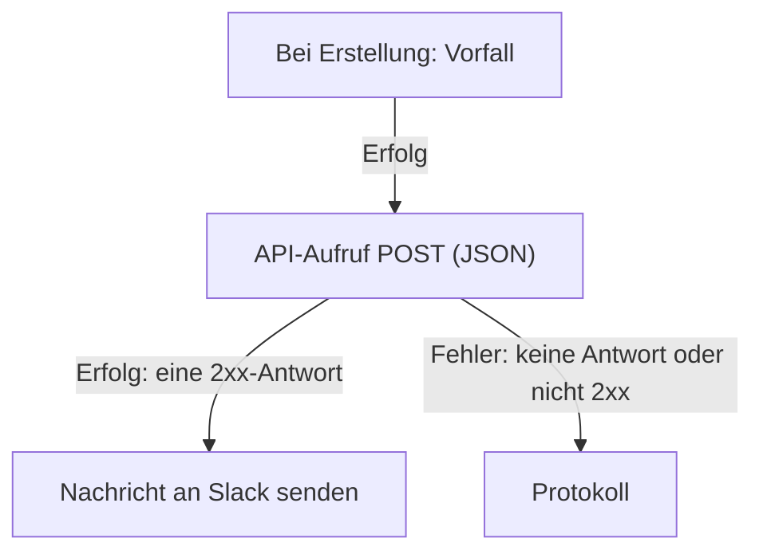

# Workflow-Komponenten

Komponenten sind die Bausteine, die Sie nach dem Trigger hinzufügen. Jede erledigt eine Aufgabe – sendet eine Nachricht, ruft eine API auf, prüft eine Bedingung, ändert einen OneUptime-Datensatz – und nimmt dann einen ihrer Ausgänge zu den Bausteinen, die damit verbunden sind. Diese Seite ist der Katalog: was jeder Baustein braucht, was er zurückgibt und wann er welchen Ausgang nimmt.

Beim Bauen brauchen Sie sie selten offen. Die Einstellungen jedes Bausteins enden mit **Verwendung**: was der Baustein tut, die Schritte zum Einrichten, ein Beispiel aus Ihrem eigenen Workflow und die Fehler, die häufig passieren. Wie Sie Bausteine hinzufügen und verbinden, steht unter [Einen Workflow erstellen](/docs/workflows/authoring).

:::cards
- [Eine Nachricht senden](#slack): Slack, Microsoft Teams, Discord, Telegram, IRC, Mattermost und E-Mail.
- [Eine API aufrufen](#api): Eine Anfrage an jede HTTP-API senden und die Antwort lesen.
- [Logik hinzufügen](#conditions): Nach einem Wert verzweigen, Daten umformen, warten oder protokollieren.
- [Mit OneUptime-Datensätzen arbeiten](#oneuptime-datenkomponenten): Monitore, Vorfälle und mehr finden, anlegen, ändern und löschen.
:::

## Welche Komponente sollte ich verwenden?

| Um…                                                      | Verwenden Sie                                                     |
| -------------------------------------------------------- | ----------------------------------------------------------------- |
| In einem Chat-Tool zu posten                             | [Slack](#slack), [Microsoft Teams](#microsoft-teams), [Discord](#discord), [Telegram](#telegram), [IRC](#irc) oder [Mattermost](#mattermost) |
| Eine E-Mail über Ihren eigenen Mailserver zu senden      | [E-Mail](#email)                                                  |
| Eine Person, ein Team oder die Person in Bereitschaft zu alarmieren | [Paging](#paging) |
| Jede andere API oder Ihren eigenen Dienst aufzurufen     | [API](#api)                                                       |
| Text zusammenzufassen, einzuordnen oder zu entwerfen     | [Generate Text with AI](#generate-text-with-ai)                   |
| Je nach Wert den einen oder anderen Weg zu nehmen        | [Bedingungen](#conditions)                                        |
| Je nach Wert einen von mehreren Wegen zu nehmen          | [Switch / Case](#switch-case)                                     |
| Nur weiterzumachen, wenn ein paar Zeilen JavaScript es sagen | [Check With JavaScript](#check-with-javascript) |
| Daten zwischen zwei Bausteinen umzuformen                | [JSON](#json) oder [Benutzerdefinierter Code](#custom-code)       |
| Vor dem nächsten Baustein zu warten                      | [Sleep](#sleep)                                                   |
| Einen anderen Workflow zu starten                        | [Execute Workflow](#execute-workflow)                             |
| Vorfälle, Monitore und andere Datensätze zu lesen oder zu ändern | [OneUptime-Datenkomponenten](#oneuptime-datenkomponenten) |
| Vorfälle oder Warnungen zu den Problemen eines anderen Tools zu öffnen, zu bestätigen und zu lösen | [Vorfälle und Warnungen aus anderen Tools](#vorfälle-und-warnungen-aus-anderen-tools) |
| Ein Zabbix-Problem zu bestätigen oder zu schließen | [Zabbix](#zabbix) |
| Eine Person eine Korrektur an einer OpenStack-Cloud genehmigen zu lassen | [Eine OpenStack-Korrektur vorschlagen](#propose-an-openstack-fix) |

Ein spezieller Baustein schlägt einen allgemeinen: Der Slack-Baustein kennt die Grenzen von Slack, und ein Datensatz-Baustein kennt die Felder des Datensatzes, sodass Sie klarere Fehler und Protokolle bekommen als von einem **API**-Baustein, der dieselbe Aufgabe erledigt.

## Wie jeder Baustein funktioniert

Ein Baustein läuft, wenn der Baustein davor den Ausgang nimmt, der mit ihm verbunden ist. Er liest seine Einstellungen, erledigt seine Aufgabe und nimmt dann einen seiner Ausgänge. Nur die Bausteine, die mit diesem Ausgang verbunden sind, laufen als Nächstes.



- **Einstellungen** sind das, was Sie ausfüllen. Mit **(Optional)** gekennzeichnete Einstellungen können leer bleiben. Seltener genutzte Einstellungen sind unter **Weitere Felder** eingeklappt.
- **Ausgaben** sind die Punkte am unteren Rand. Die meisten Bausteine haben **Erfolg** und **Fehler**; [Bedingungen](#conditions) hat **Ja** und **Nein**, und [Switch / Case](#switch-case) hat eine für jeden seiner Fälle und dazu **Standard**.
- **Rückkehren** sind die Werte, die ein Baustein an spätere Bausteine weitergibt, etwa den **Antworttext** einer API. Ein späterer Baustein liest einen mit `{{local.components.<block ID>.returnValues.<value ID>}}`; die Schaltfläche **{ }** in einer Einstellung fügt ihn für Sie ein. Siehe [Variablen](/docs/workflows/variables#komponentenausgaben-daten-aus-früheren-bausteinen).

Ein Baustein, der **Fehler** nimmt, übergibt den Fehler an die Bausteine, die mit **Fehler** verbunden sind, und die Ausführung geht dort weiter. Ist mit **Fehler** nichts verbunden, schlägt die Ausführung fehl: Was sie sonst noch tat, läuft weiter, dann endet sie mit dem Status **Fehler**, und der Eintrag des Bausteins unter **Schritte** der Ausführung sagt, warum. Eine leer gelassene Pflichteinstellung oder eine Einstellung, die nie funktionieren kann, stoppt die Ausführung dagegen mit einem Fehler.

## API

Eine HTTP-Anfrage an jede URL senden. Es gibt einen Baustein pro Methode: **API-Aufruf GET (JSON)**, **API-Aufruf POST (JSON)**, **API-Aufruf PUT (JSON)**, **API-Aufruf PATCH (JSON)** und **API-Aufruf DELETE (JSON)**.

| Einstellung         | Was sie tut                                                                                                                           |
| ------------------- | ------------------------------------------------------------------------------------------------------------------------------------- |
| **URL**             | Die Adresse, die aufgerufen wird, `http` oder `https`.                                                                                |
| **Anfragetext**    | Das JSON, das gesendet wird. Meist brauchen nur `POST`-, `PUT`- und `PATCH`-Anfragen eines.                                          |
| **Anfrage-Header** | Header, die gesendet werden, etwa ein API-Schlüssel. Unter **Weitere Felder**. Ihre Werte sind im Protokoll der Ausführung verborgen. |
| **Selbstsignierte Zertifikate zulassen** | Unter **Weitere Felder**, standardmäßig aus. Ist der Schalter an, nimmt der Baustein jedes Zertifikat, das der Server zeigt, sodass ein selbstsigniertes funktioniert, prüft dann aber weder den Hostnamen noch den Gültigkeitszeitraum, und jeder auf dem Netzwerkpfad könnte die Anfrage samt ihren Headern lesen und die Antwort ändern. |
| **CA-Zertifikat** | Unter **Weitere Felder**, solange **Selbstsignierte Zertifikate zulassen** aus ist. Das Zertifikat im PEM-Format der CA, die das Zertifikat des Servers signiert hat, oder das eigene des Servers, wenn es selbstsigniert ist. Der Baustein vertraut dann nur diesem Zertifikat und prüft weiterhin den Hostnamen und den Gültigkeitszeitraum. |

| Ausgang     | Wann                                                                                                |
| ----------- | --------------------------------------------------------------------------------------------------- |
| **Erfolg** | Der Server hat mit einem 2xx-Status geantwortet.                                                    |
| **Fehler**   | Die Anfrage ist fehlgeschlagen: Der Server war nicht erreichbar oder hat mit einem anderen Status geantwortet. |

So oder so gibt der Baustein **Antwortstatus**, **Antwort-Header** und **Antworttext** zurück, dazu **Fehler** mit dem Grund, wenn er fehlgeschlagen ist. Lesen Sie ein Feld einer JSON-Antwort, indem Sie seinen Namen an den Verweis anhängen, wie in `{{local.components.api-get-1.returnValues.response-body.id}}`.

Ein Baustein liest höchstens 10 MB einer Antwort. Eine größere Antwort wird nicht gelesen: Der Baustein nimmt **Fehler**, mit dem Grund.

Weiterleitungen werden nicht verfolgt, richten Sie den Baustein also auf die Adresse, die antwortet. Anfragen gehen von OneUptime aus: Eine URL, die zu einer privaten Netzwerkadresse auflöst, wird abgelehnt, sofern ein Administrator einer selbst gehosteten Installation sie nicht erlaubt, und die Ausführung stoppt mit dem Grund. Siehe [Ausgehender Netzwerkzugriff](/docs/workflows/configuration#ausgehender-netzwerkzugriff).

Ein Server mit einem Zertifikat, das er selbst signiert hat oder das Ihre eigene CA signiert hat, wird abgelehnt, bis der Baustein ihm vertraut: Der Baustein nimmt **Fehler**, es wird nichts gesendet, und **Fehler** sagt, was zu ändern ist. Fügen Sie das Zertifikat, das es signiert hat, unter **CA-Zertifikat** ein: das der CA oder das eigene des Servers, wenn es selbstsigniert ist. Der Baustein prüft das Zertifikat des Servers dann dagegen, samt Hostnamen und Gültigkeitszeitraum, sodass ein Server, der sich nur als Ihrer ausgibt, weiterhin abgelehnt wird. Schalten Sie **Selbstsignierte Zertifikate zulassen** nur ein, wenn Sie keines einfügen können. Beides gilt nur für die Anfrage dieses Bausteins, nie für einen anderen Baustein, eine andere Anfrage von OneUptime oder die Verbindung zu einem ausgehenden Proxy. Ein Server mit einem solchen Zertifikat steht meist in Ihrem eigenen Netzwerk, das der Baustein nur erreicht, wenn ein Administrator einer selbst gehosteten Installation private Netzwerkadressen erlaubt, wie oben beschrieben.

**API-Aufruf GET nach ID (JSON)** liest ein Element über eine ID, die von anderswo kam, etwa den Vorgangsschlüssel, den ein Webhook gesendet hat. Setzen Sie `{id}` in seine **URL**, wo die ID hingehört, wie in `https://your-domain.atlassian.net/rest/api/3/issue/{id}`, und die ID in **ID**. Der Baustein setzt die ID nur ein, wenn sie eine schlichte ID ist, höchstens 200 Buchstaben, Ziffern, Bindestriche und Unterstriche, und kodiert sie trotzdem mit Prozentzeichen: Alles andere, etwa `x/../users`, nimmt **Fehler**, bevor eine Anfrage gesendet wird, sodass Text von außen die Anfrage nicht woandershin lenken kann. Ansonsten arbeitet er wie **API-Aufruf GET (JSON)** und gibt dieselben Werte zurück.

## AI

### Generate Text with AI

Eine Textantwort aus einem Prompt und optionalem JSON-Kontext erzeugen. Der Baustein verwendet den Standard-LLM-Anbieter des Projekts oder den globalen Anbieter der Installation, wenn das Projekt keinen hat. Anbieter werden zentral unter **Projekteinstellungen → KI → LLM-Anbieter** konfiguriert; ihre Schlüssel und Endpunkte sind nie Einstellungen des Bausteins.

| Einstellung               | Was sie tut                                                                                                                                                  |
| ------------------------- | ------------------------------------------------------------------------------------------------------------------------------------------------------------ |
| **Systemanweisungen**   | Optionale Vorgaben für Rolle, Ton und Grenzen des Modells.                                                                                                   |
| **Prompt**                | Die Aufgabe. Sie wird genau so gesendet, wie Sie sie tippen, Markdown ist also in Ordnung, und sie kann Variablen und Werte aus früheren Bausteinen enthalten. |
| **Kontext**               | Optionales JSON, das Sie bewusst mitsenden. Es wird nach einer ausdrücklichen Nachrichtenende-Markierung angehängt und als nicht vertrauenswürdige Daten behandelt. |
| **Temperatur**           | Unter **Weitere Felder**. Variation von `0` bis `1`; der Standard ist `0.2`, für vorhersehbare Automatisierung. Aktuelle Claude-Modelle, Opus 4.7 und neuer und jedes Claude-5-Modell, wählen ihr Sampling selbst: OneUptime lässt **Temperatur** aus ihren Anfragen weg, bei ihnen hat sie also keine Wirkung. |
| **Maximale Ausgabe-Tokens** | Unter **Weitere Felder**. Von `1` bis `4096`; der Standard ist `1024`.                                                                                      |

System Instructions, Prompt und serialisierter Context sind zusammen auf 50.000 Zeichen begrenzt. Ein darin als Base64 eingebettetes Bild, etwa der Screenshot eines synthetischen Monitors in der Beschreibung eines Vorfalls, wird durch einen kurzen Hinweis wie `[image omitted: PNG, 340 KB]` ersetzt, bevor gemessen wird, weil das Modell Text liest, keine Bilder. Das Protokoll der Ausführung sagt, was weggelassen wurde. Die Anfrage an den Anbieter dauert höchstens 60 Sekunden und wird einmal versucht. Pro Projekt laufen höchstens drei KI-Anfragen von Workflows gleichzeitig.

Er gibt **Antwort** (den erzeugten Text), **Anbieter** und **Modell** (wer geantwortet hat), **Tokens insgesamt** und **Completion-Tokens** (den vom Anbieter gemeldeten Verbrauch), **LLM-Protokoll-ID** (den Eintrag des Aufrufs in den KI-Protokollen) und **Fehler** zurück.

Verbinden Sie **Erfolg** mit den Bausteinen, die die Antwort verwenden, und **Fehler** mit einem Ausweichweg: Validierungs-, Zugriffs-, Anbieter-, Budget-, Abrechnungs- und Zeitüberschreitungsfehler nehmen ihn alle. Der Baustein sendet keine Tools, daher kann das Modell weder OneUptime abfragen noch APIs aufrufen noch von sich aus Daten ändern.

> [!WARNING]
> Die Ausgabe des Modells ist nicht vertrauenswürdiger Text. Prüfen Sie sie, bevor sie Kunden erreicht, und lassen Sie nie freien KI-Text allein über eine zerstörerische Aktion entscheiden. Unter [KI-Komponenten](/docs/workflows/configuration#ki-komponenten) steht, was an den Anbieter geht, was protokolliert wird und was es kostet.

## Slack

Eine Nachricht über einen Incoming Webhook in einem Slack-Kanal posten.

| Einstellung                    | Was sie tut                                                                                                                                                                                                                       |
| ------------------------------ | --------------------------------------------------------------------------------------------------------------------------------------------------------------------------------------------------------------------------------- |
| **Slack Eingehende Webhook-URL** | Der Webhook des Kanals, in dem gepostet wird. Er muss mit `https://hooks.slack.com/services/` beginnen. Slacks Anleitung zum [Anlegen eines Webhooks](https://api.slack.com/messaging/webhooks) dauert ein paar Minuten.           |
| **Nachrichtentext**               | Der Text, der gesendet wird. Er wird genau so gesendet, wie Sie ihn tippen, verwenden Sie also Slacks eigene Formatierung: `*bold*`, `_italic_`, `~strikethrough~` und `<https://example.com|a link>`. Ein Text, der länger als ein Slack-Abschnitt (3.000 Zeichen) ist, geht als mehrere; nach zehn Abschnitten wird er abgeschnitten und endet mit "… (truncated — see OneUptime for the full text)". |

**Erfolg** löst aus, wenn Slack die Nachricht angenommen hat, und **Fehler**, wenn Slack sie abgelehnt hat, mit Slacks Grund in **Fehler**. Diese Bausteine posten über den Webhook in ihren Einstellungen, nicht über die Slack-Verbindung Ihres Projekts.

## Microsoft Teams

Eine Nachricht in einem Microsoft-Teams-Kanal posten. Der Baustein heißt **Nachricht an Teams senden**.

| Einstellung                    | Was sie tut                                                                                                                                                                                                                                                |
| ------------------------------ | ---------------------------------------------------------------------------------------------------------------------------------------------------------------------------------------------------------------------------------------------------------- |
| **Teams-Webhook-URL für eingehende Nachrichten** | Der Kanal-Webhook, in dem gepostet wird, eine `https`-URL auf `office.com`, `office365.com`, `logic.azure.com` oder `environment.api.powerplatform.com`. Die Anleitung von Microsoft zeigt, wie Sie [einen mit Teams Workflows anlegen](https://support.microsoft.com/en-us/teams/apps-service/create-incoming-webhooks-with-workflows-for-microsoft-teams). |
| **Nachrichtentext**               | Der Text, der gesendet wird. Eine Nachricht, die größer ist, als ein Incoming Webhook annimmt (etwa 12.000 Zeichen, gemessen beim Senden), wird abgeschnitten und endet mit "… (truncated — see OneUptime for the full text)".                              |

## Discord

Eine Nachricht über einen Incoming Webhook in einem Discord-Kanal posten.

| Einstellung                      | Was sie tut                                                                                                                                                         |
| -------------------------------- | ------------------------------------------------------------------------------------------------------------------------------------------------------------------- |
| **Discord-Webhook-URL für eingehende Nachrichten** | Der Webhook des Kanals, eine `https`-URL auf `discord.com` oder `discordapp.com`.                                                                                   |
| **Nachrichtentext**                 | Der Text, der gesendet wird. Eine Nachricht, die länger als 2.000 Zeichen ist, das Limit von Discord, wird abgeschnitten und endet mit "… (truncated — see OneUptime for the full text)". |

## Telegram

Mit einem Bot eine Nachricht in einen Telegram-Chat senden.

| Einstellung            | Was sie tut                                                                                                                                                                  |
| ---------------------- | ---------------------------------------------------------------------------------------------------------------------------------------------------------------------------- |
| **Telegram-Bot-Token** | Das Token, das BotFather Ihrem Bot gegeben hat, etwa `123456789:ABCdef…`. Ein Token in einer anderen Form stoppt die Ausführung, ohne dass das Token ins Protokoll geschrieben wird. |
| **Chat-ID**            | Der Chat, in dem gepostet wird: seine ID oder der `@username` eines Kanals. Fügen Sie den Bot zuerst der Gruppe oder dem Kanal hinzu. Um einer Person zu schreiben, muss diese zuerst einen Chat mit dem Bot begonnen haben. |
| **Nachrichtentext**       | Der Text, der gesendet wird. Eine Nachricht, die länger als 4.096 Zeichen ist, das Limit von Telegram, wird abgeschnitten und endet mit "… (truncated — see OneUptime for the full text)". |

Lehnt Telegram die Nachricht ab, löst **Fehler** mit dem Grund von Telegram aus.

## IRC

Eine Nachricht in einem IRC-Kanal in jedem IRC-Netz posten: Libera.Chat, OFTC oder einem eigenen Server. IRC hat keine Webhooks, daher verbindet sich der Baustein selbst mit dem Server, betritt den Kanal, sendet die Nachricht und geht wieder.

| Einstellung      | Was sie tut                                                                                                                                                                                                                                                       |
| ---------------- | ----------------------------------------------------------------------------------------------------------------------------------------------------------------------------------------------------------------------------------------------------------------- |
| **IRC-Server**   | Der Hostname des Servers, etwa `irc.libera.chat`. Nur der Name: kein `ircs://` und kein Port.                                                                                                                                                                     |
| **Kanal**      | Der Kanal, in dem gepostet wird, etwa `#ops`. Es muss ein Kanal sein: Ein hier eingetippter Nickname wird abgelehnt, statt ihm eine private Nachricht zu senden.                                                                                                  |
| **Nachrichtentext** | Der Text, der gesendet wird. Jede Zeile geht als eigene IRC-Nachricht hinaus, und eine lange Zeile wird passend aufgeteilt. Eine Nachricht wird als höchstens 15 IRC-Zeilen gesendet: Eine längere wird gekürzt, und ihre letzte Zeile sagt das. IRC hat kein Markdown, der Text wird also so gesendet, wie er getippt ist; IRCs eigene Formatierungscodes, etwa Fett und Farben, funktionieren. |

Unter **Weitere Felder**:

| Einstellung                              | Was sie tut                                                                                                                                                                                                               |
| ---------------------------------------- | ------------------------------------------------------------------------------------------------------------------------------------------------------------------------------------------------------------------------- |
| **Spitzname**                             | Von wem die Nachricht kommt. Standard ist `OneUptime`. Ist der Nickname vergeben, versucht der Baustein ihn mit einem angehängten Unterstrich oder einer Zahl und dann mit einer anstelle seiner letzten Zeichen, für einen Server, der keinen längeren Nickname annimmt. |
| **Port**                                 | Der Port des Servers. Standard ist `6697`, oder `6667` mit eingeschaltetem **TLS deaktivieren**.                                                                                                                               |
| **TLS deaktivieren**                          | Der Baustein verbindet sich über TLS und prüft das Zertifikat des Servers. Schalten Sie dies nur für einen Server ein, der kein TLS anbietet; ein Passwort wird dann unverschlüsselt gesendet. Um einem Zertifikat Ihrer eigenen Zertifizierungsstelle zu vertrauen, setzt eine selbst gehostete Installation stattdessen `NODE_EXTRA_CA_CERTS`. |
| **Kanalschlüssel**                          | Der Schlüssel eines Kanals, der einen hat (Modus `+k`).                                                                                                                                                                   |
| **Ohne Beitritt senden**                 | Postet, ohne den Kanal zu betreten, sodass der Kanal den Baustein nicht kommen und gehen sieht. Funktioniert nur, wo der Kanal Nachrichten von außen annimmt (kein Modus `+n`).                                            |
| **Serverpasswort**                      | Ein Passwort, nach dem der Server oder Ihr Bouncer beim Verbinden fragt.                                                                                                                                                  |
| **SASL-Benutzername** und **SASL-Passwort**  | Melden Sie sich in Netzen, die SASL verwenden, bei Ihrem Konto an, etwa bei Libera.Chat, das es für Verbindungen von manchen Cloud- und VPN-Adressen verlangt. Füllen Sie beide aus oder keines.                            |

**Erfolg** löst aus, sobald der Server jede Zeile angenommen hat. Der Baustein prüft das, indem er den Server nach der letzten Zeile um die Antwort auf einen Ping bittet: Ein Server antwortet der Reihe nach, daher kommt jede Ablehnung der Nachricht zuerst zurück. Ein Bouncer wie ZNC beantwortet den Ping selbst, daher lauscht der Baustein eine Sekunde länger auf die Antwort des Netzes dahinter.

**Fehler** löst aus, wenn der Server nicht erreichbar ist, die Verbindung, den Nickname, ein Passwort oder den Kanal ablehnt oder die Nachricht ablehnt. Er gibt weiter, warum, in den eigenen Worten des Servers, wo er welche geliefert hat. Ein fehlendes **IRC-Server**, **Kanal** oder **Nachrichtentext** oder eine Einstellung, die nie funktionieren kann, stoppt stattdessen die Ausführung.

Jeder Lauf des Bausteins ist eine eigene Verbindung, und IRC-Netze begrenzen, wie oft eine Adresse sich verbinden darf: Eine Folge von Nachrichten kann mit einem Grund wie "Reconnecting too fast" abgelehnt werden und nimmt **Fehler** wie jede andere Ablehnung. Bei einem Workflow, der viele Male pro Minute auslösen kann, fassen Sie zusammen, was er zu sagen hat, in eine Nachricht, oder senden Sie sie über einen eigenen Server.

Bewahren Sie die Passwörter in [geheimen globalen Variablen](/docs/workflows/variables#globale-variablen) auf und verwenden Sie die Variable in der Einstellung; in den Protokollen der Ausführungen sind sie so oder so verborgen. Verbindungen zu Loopback (`localhost`, `127.0.0.1`), Link-Local- und Cloud-Metadaten-Adressen werden abgelehnt. In OneUptime Cloud wird auch ein Server auf einer privaten Netzwerkadresse oder ein Name, der zu einer auflöst, abgelehnt. Selbst gehostete Installationen erreichen einen IRC-Server in ihrem eigenen Netz, es sei denn, `DATA_SOURCE_BLOCK_PRIVATE_ADDRESSES` ist auf `true` gesetzt.

## Mattermost

Eine Nachricht über einen Incoming Webhook in einem Mattermost-Kanal posten, in Mattermost Cloud oder auf einem eigenen Server.

| Einstellung                         | Was sie tut                                                                                                                                                                                                                                                                        |
| ----------------------------------- | ---------------------------------------------------------------------------------------------------------------------------------------------------------------------------------------------------------------------------------------------------------------------------------- |
| **Mattermost-Webhook-URL für eingehende Nachrichten** | Der Webhook, über den gepostet wird, so wie Mattermost ihn unter Integrations, Incoming Webhooks anzeigt: die Adresse des Servers, dann `/hooks/` und die ID des Webhooks. Die Anleitung von Mattermost zeigt, wie Sie [einen anlegen](https://docs.mattermost.com/developers/integrate/webhooks/incoming). |
| **Nachrichtentext**                    | Der Text, der gesendet wird. Er wird genau so gesendet, wie Sie ihn tippen, und Mattermost versteht Markdown: `**bold**`, `_italic_`, Links, Tabellen und Emojis wie `:rotating_light:`. Ein Mattermost-Beitrag fasst 16.383 Zeichen: Eine längere Nachricht wird so gekürzt, dass sie passt, und endet mit "… (truncated — see OneUptime for the full text)". |

Unter **Weitere Felder**:

| Einstellung  | Was sie tut                                                                                                                                                                                                   |
| ------------ | ------------------------------------------------------------------------------------------------------------------------------------------------------------------------------------------------------------- |
| **Kanal**  | Postet woanders als im eigenen Kanal des Webhooks: der Name des Kanals, wie er in seiner URL steht, etwa `town-square`, oder `@` und ein Benutzername für eine Direktnachricht. Ein Webhook, der auf seinen Kanal beschränkt ist, lehnt jeden anderen ab. |
| **Benutzername** | Der Name, unter dem gepostet wird. Mattermost verwendet ihn nur, wo ein Systemadministrator Integrationen erlaubt, Benutzernamen zu überschreiben.                                                            |
| **Symbol-URL** | Das Bild, mit dem gepostet wird, eine `https`-Adresse. Mattermost verwendet es nur, wo ein Systemadministrator Integrationen erlaubt, Profilbilder zu überschreiben.                                          |

**Erfolg** löst aus, wenn Mattermost die Nachricht angenommen hat. **Fehler** löst aus, wenn der Server nicht erreichbar ist oder Mattermost die Nachricht ablehnt, und gibt den Grund von Mattermost weiter. Eine fehlende **Mattermost-Webhook-URL für eingehende Nachrichten** oder ein fehlender **Nachrichtentext**, eine URL, die nicht zu einem Incoming Webhook gehört, oder eine Einstellung, die nie funktionieren kann, stoppt stattdessen die Ausführung.

Bewahren Sie die Webhook-URL in einer [geheimen globalen Variable](/docs/workflows/variables#globale-variablen) auf: Wer sie hat, kann im Kanal posten. In den Protokollen der Ausführungen ist sie so oder so verborgen. Die Nachricht geht von OneUptime aus, und eine Weiterleitung wird nicht verfolgt. Ein Webhook auf einer Loopback- (`localhost`, `127.0.0.1`), Link-Local- oder Cloud-Metadaten-Adresse wird abgelehnt, ebenso ein Webhook auf einer privaten Netzwerkadresse, es sei denn, ein Administrator einer selbst gehosteten Installation erlaubt ihn mit `ALLOW_PRIVATE_NETWORK_WEBHOOKS` oder `PRIVATE_NETWORK_WEBHOOK_ALLOWLIST`. Siehe [Zugriff auf private Netzwerke](/docs/self-hosted/private-network-access).

## Email

Eine E-Mail über einen SMTP-Server senden, den Sie im Baustein eintragen. Der Baustein heißt **E-Mail senden**.

| Einstellung                              | Was sie tut                                                                                          |
| ---------------------------------------- | ---------------------------------------------------------------------------------------------------- |
| **Absender-E-Mail**                           | Der Absender, zum Beispiel `Alerts <alerts@company.com>`.                                            |
| **An E-Mail**                             | Die Adresse des Empfängers. Trennen Sie mehrere Adressen mit Kommas oder Semikolons.                 |
| **Betreff**                              | Die Betreffzeile.                                                                                    |
| **E-Mail-Text**                           | Die Nachricht, gesendet als HTML.                                                                    |
| **SMTP-Host** und **SMTP-Port**          | Der Mailserver, mit dem verbunden wird.                                                              |
| **SMTP-Benutzername** und **SMTP-Passwort**  | Optional. Füllen Sie beide aus oder keines.                                                          |
| **Implizites TLS verwenden**                     | Einschalten für implizites TLS, meist auf Port 465. Für STARTTLS aus lassen, meist auf Port 587.      |

**Erfolg** löst aus, wenn der SMTP-Server die Nachricht angenommen hat. **Fehler** löst aus, wenn der SMTP-Host abgelehnt wird, der Server nicht erreichbar ist oder er die Nachricht ablehnt, und gibt die Fehlermeldung weiter. Ein fehlendes **An E-Mail**, **Absender-E-Mail**, **SMTP-Host** oder **SMTP-Port** stoppt stattdessen die Ausführung.

Der Baustein verbindet sich direkt mit dem Server in seinen Einstellungen. Er verwendet weder die [SMTP](/docs/emails/smtp)-Einstellungen Ihres Projekts noch den eigenen Mailserver von OneUptime, und die E-Mails, die er sendet, erscheinen nicht in den Benachrichtigungsprotokollen. Um zu prüfen, was er getan hat, sehen Sie sich die [Ausführungen](/docs/workflows/runs-and-logs) des Workflows an.

Verbindungen zu Loopback (`localhost`, `127.0.0.1`), Link-Local- und Cloud-Metadaten-Adressen werden abgelehnt. In OneUptime Cloud wird auch ein SMTP-Host auf einer privaten Netzwerkadresse oder ein Name, der zu einer auflöst, abgelehnt. Selbst gehostete Installationen erreichen einen Mailserver in ihrem eigenen Netz, es sei denn, `DATA_SOURCE_BLOCK_PRIVATE_ADDRESSES` ist auf `true` gesetzt. Ein abgelehnter Host nimmt den Ausgang **Fehler**, und nichts wird gesendet.

## Paging

Personen aus einem Workflow alarmieren: Jede Person erhält einen Anruf, eine SMS, eine Push-Benachrichtigung oder eine E-Mail, wie es ihre eigenen Bereitschaftsregeln vorsehen, bis jemand bestätigt. Es gibt einen Baustein für jede Art zu sagen, wer alarmiert wird. Suchen Sie im Bereich **Komponente hinzufügen** nach `page`.

| Baustein                    | Wen er alarmiert |
| --------------------------- | ---------------- |
| **Benutzer alarmieren**              | Die Personen, die Sie nennen. |
| **Ein Team alarmieren**             | Jedes Mitglied eines Teams. |
| **Bereitschaft alarmieren** | Wer in einem Bereitschaftsplan in Bereitschaft ist, wenn der Baustein läuft. |
| **Eine Bereitschaftsrichtlinie alarmieren**  | Eine Bereitschaftsrichtlinie, die über ihre Eskalationsregeln alarmiert und sich so oft wiederholt, wie sie eingestellt ist. |

Die ersten drei alarmieren alle, die sie nennen, gleichzeitig und danach niemanden mehr. Für eine Eskalation verwenden Sie **Eine Bereitschaftsrichtlinie alarmieren**.

Um nur zu alarmieren, wenn etwas zutrifft, setzen Sie [If / Else](#conditions) vor den Baustein und verbinden Sie den Ausgang, der alarmieren soll, mit ihm. Bei mehr als zwei Wegen nimmt [Switch / Case](#switch-case) für jeden Wert einen Weg, und jeder Weg kann jemand anderen alarmieren.

```mermaid title="Alarmieren, wer in Bereitschaft ist, aber nur bei kritischen Vorfällen"
flowchart TB
    trigger["Bei Erstellung: Vorfall"] -->|"Erfolg"| check["Wenn / Sonst"]
    check -->|"Ja"| page["Bereitschaft alarmieren"]
```

Wenn Sie einen Workflow anlegen, halten die Vorlagen unter **Bereitschaft** diesen bereit, und einen, der mit **Auswahl / Fall** nach Schweregrad alarmiert. Der Dialog **Arbeitsablauf erstellen** fragt für jeden Baustein zum Alarmieren einer Vorlage, wen er alarmiert, sodass sich der Workflow mit diesen Angaben öffnet. Ein Baustein zum Alarmieren, den Sie im Editor hinzufügen, zeigt **Click to set up**, bis Sie wählen, wen er alarmiert.

| Einstellung | Was sie tut |
| ----------- | ----------- |
| **Benutzer**, **Teams**, **Bereitschaftspläne** oder **Bereitschaftsrichtlinien** | Wer alarmiert wird: Jeder Baustein hat die Einstellung, die zu seinem Namen gehört. Wählen Sie nach Namen, oder drücken Sie **{ }** am Ende der Zeile, um einen Wert aus einem früheren Baustein hinzuzufügen. Ein Wert kann eine ID oder mehrere enthalten und, bei **Benutzer**, eine E-Mail-Adresse. |
| **Alarmierung betrifft** | Worum es bei der Alarmierung geht: **Eine neue Warnung**, **Ein Vorfall** oder **Eine Warnung**. Die Alarmierung zu bestätigen, bestätigt auch die Warnung oder den Vorfall. |
| **Titel** und **Nachricht** | Für eine neue Warnung. OneUptime legt daraus eine Warnung an, und sie bleibt wie jede andere bei Ihren Warnungen. |
| **Vorfall-ID** oder **Warnungs-ID** | Für einen Vorfall oder eine Warnung, die es schon gibt, meist die, mit der der Workflow begonnen hat: `{{local.components.incident-on-create-1.returnValues.model._id}}`. |
| **Alarmieren als** | Für einen Vorfall oder eine Warnung, die es schon gibt, unter **Weitere Felder**. **Bearbeiter** übernehmen ihn. **Beobachter** werden auf dem Laufenden gehalten, während andere reagieren: Bestätigen sie ihre Alarmierung, heißt das nur, dass sie sie gesehen haben, und der Vorfall oder die Warnung wird dadurch nicht bestätigt. |
| **Schweregrad** | Für eine neue Warnung, unter **Weitere Felder**. Sie entscheidet, welche Bereitschaftsregeln jeder Person sie alarmieren. Bleibt sie leer, ist es der höchste Schweregrad des Projekts. |

Ein Baustein, der zu einem Workflow hinzugefügt wird, der mit einem Vorfall oder einer Warnung beginnt, ist schon darauf eingestellt, zu diesem Datensatz zu alarmieren, sodass er nur noch fragt, wer alarmiert wird.

**Erfolg** läuft, sobald mindestens eine Person alarmiert ist oder eine Richtlinie gestartet wurde. **Fehler** läuft, wenn niemand alarmiert wurde, und der Wert **Fehler** des Bausteins sagt, warum, zum Beispiel, dass im Plan niemand in Bereitschaft ist. **Zusammenfassung** sagt in einem Satz, wer alarmiert wurde und wer ausgelassen wurde, fertig zum Posten in einem Kanal, und **Alarmierte Benutzer** listet die alarmierten Personen auf.

Wer abwesend ist, wird nicht alarmiert: Stattdessen wird alarmiert, wen die Benutzervertretung der Person als Vertretung nennt. Wen eine Bereitschaftsrichtlinie oder eine andere Alarmierung dazu schon alarmiert, wird nicht noch einmal alarmiert und steht trotzdem unter **Alarmierte Benutzer**: Endet diese Alarmierung ohne seine Antwort, alarmiert ihn die Alarmierung des Bausteins selbst. Eine Alarmierung nennt höchstens 100 Personen, Teams und Pläne. Siehe [Wie jede Person erreicht wird](/docs/on-call/escalation-rules#wie-jede-person-erreicht-wird).

Eine Alarmierung ohne Bereitschaftsrichtlinie dahinter wird bei den Läufen der Richtlinien als **Direkte Alarmierung** aufgeführt: in den Bereitschaftsprotokollen des Vorfalls oder der Warnung, in deren Feed und Slack- oder Microsoft-Teams-Kanal und in den Protokollen jeder alarmierten Person. Sie bleibt 30 Minuten offen und danach so lange, wie noch Alarmierungen hinausgehen. Hat bis dahin niemand bestätigt, endet sie, ohne jemand anderen zu alarmieren.

> [!WARNING]
> **Arbeitsablauf ausführen** alarmiert Personen wirklich, ob der Workflow ein- oder ausgeschaltet ist, und **Nur diesen Schritt ausführen** ebenso. Tragen Sie beim Testen sich selbst ein.

## Custom Code

Ein paar Zeilen JavaScript ausführen, wenn die anderen Bausteine nicht können, was Sie brauchen. Der Baustein heißt **Eigenes JavaScript ausführen**.

| Einstellung         | Was sie tut                                                                                                                                       |
| ------------------- | ------------------------------------------------------------------------------------------------------------------------------------------------- |
| **JavaScript-Code** | Ihr Code. Was er mit `return` zurückgibt, wird der **Wert** des Bausteins. Er kann `await` verwenden.                                             |
| **Argumente**       | Ein JSON-Objekt mit Werten für den Code, der sie als `args` liest. Setzen Sie Variablen und Werte aus früheren Bausteinen hierhin; der Code selbst kann sie nicht lesen. |

```json title="Arguments"
{ "title": "{{local.components.incident-on-create-1.returnValues.model.title}}" }
```

```javascript title="JavaScript Code"
const words = args.title.split(" ");

return {
  shortTitle: words.slice(0, 5).join(" "),
  wordCount: words.length,
};
```

Ein späterer Baustein liest den kurzen Titel als `{{local.components.javascript-1.returnValues.returnValue.shortTitle}}`.

Der Code läuft in einer Sandbox mit `args`, `console.log` (ins Protokoll der Ausführung geschrieben), `axios` für HTTP-Anfragen, `crypto` und `sleep`. Er hat kein Dateisystem und keinen Prozess, und seine Anfragen unterliegen denselben Adressregeln wie der API-Baustein. Er hat standardmäßig 5 Sekunden; eine selbst gehostete Installation ändert das mit `WORKFLOW_SCRIPT_TIMEOUT_IN_MS`.

**Erfolg** löst mit dem zurückgegebenen **Wert** aus, und **Fehler**, wenn der Code eine Ausnahme wirft oder die Zeit überschreitet, mit der Meldung in **Fehler**. Für umfangreichere Skripte verwenden Sie stattdessen ein [Runbook](/docs/runbooks/index).

## Check With JavaScript

Ein paar Zeilen JavaScript ausführen und dann je nach Rückgabe **Ja** oder **Nein** nehmen: ein Baustein [Benutzerdefinierter Code](#custom-code) und danach ein [If / Else](#conditions), in einem Baustein. Verwenden Sie ihn, wenn ein einzelner Vergleich für die Entscheidung nicht reicht, etwa um zu lesen, was ein anderes Tool gesendet hat, und zu überspringen, was der Workflow in Ruhe lassen soll.

| Einstellung         | Was sie tut |
| ------------------- | ----------- |
| **JavaScript-Code** | Ihr Code. `return true` nimmt **Ja**. Um auch Werte weiterzugeben, geben Sie ein Objekt mit `proceed: true`, den Werten und einem `reason` zurück. |
| **Argumente**       | Ein JSON-Objekt mit Werten für den Code, der sie als `args` liest, wie bei **Eigenes JavaScript ausführen**. |

```javascript title="JavaScript Code"
if (args.environment !== "production") {
  return { proceed: false, reason: "Not production, so nothing was sent." };
}

return { proceed: true, title: args.title.toUpperCase() };
```

Nur `true` oder ein Objekt, dessen `proceed` `true` ist, nimmt **Ja**: Alles andere nimmt **Nein**, selbst eine Zahl oder ein Text. Der Baustein gibt **Wert** zurück, was der Code zurückgegeben hat, das ein späterer Baustein als `{{local.components.javascript-check-1.returnValues.returnValue.title}}` liest, und **Grund**, den `reason` des Codes oder in einem Satz, was er zurückgegeben hat, den der Reiter **Schritte** der Ausführung neben dem genommenen Ausgang zeigt.

Der Code läuft so, wie **Eigenes JavaScript ausführen** ihn ausführt: in derselben Sandbox, mit denselben `args`, `console.log` und `axios` und mit demselben Zeitlimit. Wirft er eine Ausnahme oder überschreitet er die Zeit, nimmt der Baustein **Fehler**.

## JSON

Zwischen Text und JSON umwandeln oder zwei JSON-Objekte zusammenführen.

| Baustein         | Nimmt                                    | Gibt zurück                                                                                                |
| ---------------- | ---------------------------------------- | ---------------------------------------------------------------------------------------------------------- |
| **JSON zu Text** | **JSON**, ein Objekt                     | **Text**: das Objekt als Zeichenkette. Nützlich, wenn der nächste Baustein Text erwartet.                  |
| **Text zu JSON** | **Text**, auch über mehrere Zeilen       | **JSON**: das geparste Objekt, sodass Sie seine Felder lesen können. Verwenden Sie es für JSON, das als Text ankam. |
| **JSON zusammenführen**   | **JSON 1** und **JSON 2**                | **JSON**: ein Objekt mit den Schlüsseln beider. Wo beide einen Schlüssel haben, gewinnt **JSON 2**.        |

**Text zu JSON** nimmt **Fehler**, wenn der Text kein JSON ist. Eine fehlende Eingabe oder eine Eingabe von **JSON zusammenführen**, die kein Objekt ist, stoppt die Ausführung.

## Conditions

Nach einem Vergleich verzweigen. Im Bereich **Komponente hinzufügen** heißt dieser Baustein **Wenn / Sonst**, unter **Beliebt**. Um zwischen mehr als zwei Wegen zu wählen, verwenden Sie [Switch / Case](#switch-case).

Seine Einstellungen lesen sich wie ein Satz: **Wenn** *zu prüfender Wert* *Vergleich* *Vergleichswert*, weiter bei **Ja**, sonst bei **Nein**. Unter den Einstellungen wird die Bedingung in Worten wiedergegeben, sodass Sie sehen, dass sie sagt, was Sie meinen. Auf der Arbeitsfläche zeigt der Baustein seine Bedingung ebenfalls, zum Beispiel *If environment is equal to “production”*.

| Einstellung        | Was sie tut                                                                                                                                  |
| ------------------ | -------------------------------------------------------------------------------------------------------------------------------------------- |
| **Zu prüfender Wert** | Meist ein Wert aus einem früheren Baustein. Drücken Sie **{ }** im Feld, um einen zu wählen, oder tippen Sie `{{`.                            |
| **Vergleich**     | Wie verglichen wird, in Worten. Die Vergleiche stehen unten.                                                                                 |
| **Vergleichen mit**   | Womit verglichen wird, getippt oder auf dieselbe Weise gewählt. **ist leer**, **ist nicht leer**, **ist wahr** und **ist falsch** verwenden es nicht. |
| **Vergleichen als**     | Unter dem Vergleich eingeklappt: **Text**, **Zahl** oder **Wahr / Falsch**. Wählen Sie **Text**, um als `2026-10-01` geschriebene Daten zu ordnen, oder **Zahl**, damit `200` und `200.0` gleich sind. |

Die Vergleiche:

- **ist gleich** und **ist ungleich**;
- für Text: **enthält**, **enthält nicht**, **beginnt mit** und **endet mit**;
- für Zahlen: **ist größer als**, **ist größer oder gleich**, **ist kleiner als** und **ist kleiner oder gleich**;
- **ist leer** und **ist nicht leer**, die prüfen, ob der Wert überhaupt da ist;
- **ist wahr** und **ist falsch**.

Die Zahlenvergleiche vergleichen Zahlen und die Textvergleiche Text, daher brauchen Sie **Vergleichen als** selten. So werden die Werte verglichen:

- Als Text zählen Großbuchstaben: `Error` ist nicht `error`.
- Als Zahlen zählt Text, der keine Zahl ist, als `0`. Die Einstellungen weisen auf einen solchen getippten Wert hin.
- Als wahr oder falsch zählt nur `true` als wahr.
- **ist leer** wird erfüllt von gar nichts, leerem Text, einer leeren Liste oder einem leeren Objekt oder einem Wert, den der frühere Baustein nicht hatte, etwa einem Feld, das der Webhook nicht gesendet hat. `0` und `false` sind Werte, also nicht leer.

**Ja** läuft, wenn die Bedingung erfüllt ist, und **Nein**, wenn nicht. Bausteine, die eingerichtet wurden, bevor die Einstellungen diese Namen hatten, laufen genau wie zuvor. Eine alte Wahl wird nicht mehr angeboten: einen Wert als **Null** oder **Undefiniert** zu vergleichen, was ignorierte, was der Wert enthielt. Ein Baustein, der sie noch verwendet, sagt das, wenn Sie ihn öffnen; wählen Sie **ist leer**, um auf einen fehlenden Wert zu prüfen.

## Switch / Case

Je nach Wert einen von mehreren Wegen nehmen. Im Bereich **Komponente hinzufügen** heißt dieser Baustein **Auswahl / Fall**, unter **Beliebt**.

Er vergleicht einen Wert der Reihe nach von oben mit jedem seiner Fälle und geht beim ersten passenden Fall weiter, oder bei **Standard**, wenn keiner passt. Es läuft immer nur ein Weg: Ein Wert, der zu zwei Fällen passt, nimmt den ersten davon.

| Einstellung        | Was sie tut |
| ------------------ | ----------- |
| **Zu prüfender Wert** | Der Wert, mit dem jeder Fall verglichen wird, meist aus einem früheren Baustein. Drücken Sie **{ }** im Feld, um einen zu wählen, oder tippen Sie `{{`. |
| **Fälle**          | Ein Vergleich und ein Wert für jeden Weg, von oben geprüft. Drücken Sie **Fall hinzufügen** für einen weiteren, und ziehen Sie einen Fall an seinem Griff, um ihn zu verschieben. Ein Baustein enthält höchstens 25 Fälle. |

Jeder Fall ist ein Ausgang auf der Arbeitsfläche, benannt nach seinem Wert: Ein Fall mit **ist gleich** `production` ist der Ausgang *production*, und einer mit **ist größer als** `500` ist *is greater than 500*. **Standard** ist immer der letzte Ausgang. Verbinden Sie jeden Ausgang mit dem, was als Nächstes laufen soll.

Ein Fall passt genau dann, wenn ein [If / Else](#conditions) mit demselben Vergleich und Wert **Ja** nehmen würde: Die Vergleiche sind dieselben, und die Werte werden auf dieselbe Weise verglichen. **Vergleichen als** ist unter den Fällen eingeklappt, mit einer Wahl für jeden Fall.

Wenn Sie einen Fall entfernen, der eine Verbindung hat, zeigen die Einstellungen, zu welchen Bausteinen er führte, und **Wiederherstellen** holt den Fall zurück. Beim Speichern wird die Verbindung zusammen mit dem Fall entfernt. Die Prüfungen des Editors weisen auf einen Fall hin, mit dem nichts verbunden ist, und auf einen Fall, der nie genommen wird, weil ein Fall darüber dasselbe fragt.

Eine Ausführung, die einen Ausgang nimmt, mit dem nichts verbunden ist, **Standard** eingeschlossen, endet dort ohne Fehler. Der Reiter **Schritte** der Ausführung sagt, welcher Fall gepasst hat und warum, zum Beispiel *Case 2 matched: the value is equal to “staging”. Case 1 did not.*

## Sleep

Die Ausführung vor dem nächsten Baustein anhalten, um einem anderen System einen Moment Zeit zu geben oder später nachzufassen.

**Tage**, **Stunden**, **Minuten** und **Sekunden** werden addiert. Die längste Wartezeit sind 30 Tage: Eine längere wird auf 30 Tage gekürzt, und das Protokoll der Ausführung sagt das.

Während sie wartet, wird die Ausführung mit dem Status **Wartet** beiseitegelegt und wieder aufgenommen, wenn die Zeit um ist, daher hält eine lange Wartezeit nichts auf. Eine Ausführung, deren Workflow in der Zwischenzeit ausgeschaltet oder archiviert wurde, wird beim Aufwachen abgebrochen. Ein Testlauf, gestartet, während der Workflow aus war, wird nicht abgebrochen, weil er aus ist.

## Log

Einen Wert ins Protokoll der Ausführung schreiben. Er ändert sonst nirgends etwas, was ihn zum einfachsten Weg macht, zu sehen, was ein Wert enthielt.

**Wert** ist, was geschrieben wird. Er kann über mehrere Zeilen gehen und Werte aus früheren Bausteinen enthalten, etwa `{{local.components.webhook-1.returnValues.request-body}}`. Der Baustein nimmt **Ausgehend**, wenn er fertig ist.

## Execute Workflow

Einen anderen Workflow desselben Projekts starten. Ihr Workflow läuft weiter, ohne darauf zu warten, dass der andere fertig wird.

| Einstellung   | Was sie tut                                                                                                                                  |
| ------------- | -------------------------------------------------------------------------------------------------------------------------------------------- |
| **Arbeitsablauf**  | Der Workflow, der gestartet wird. Er muss aktiviert sein, und um Argumente zu empfangen, muss er einen Trigger **Manuell** haben.               |
| **Argumente** | JSON, das übergeben wird. Der Manual-Trigger des anderen Workflows reicht jeden Schlüssel als eigenen Wert weiter: Mit `{"customerId": "42"}` liest er `{{local.components.manual-1.returnValues.customerId}}`. |

**Ausgehend** löst aus, sobald der andere Workflow eingereiht ist. **Fehler** löst aus, wenn das nicht geht: Er wird nicht gefunden, ist ausgeschaltet oder archiviert, oder ihn zu starten würde eine Schleife bilden.

Verwenden Sie ihn, um gemeinsame Logik zu teilen: Bauen Sie einen Workflow "im Vorfallkanal posten" einmal und starten Sie ihn aus jedem Workflow, der ihn braucht. Eine Kette von Workflows, die einander starten, kann nicht auf sich selbst zurückführen und ist höchstens 10 tief. Siehe [Konfiguration & Sicherheit](/docs/workflows/configuration#grenze-beim-aufrufen-anderer-workflows).

## Vorfälle und Warnungen aus anderen Tools

Führen Sie einen Vorfall oder eine Warnung für jedes Problem, von dem Ihnen ein anderes Tool berichtet, zugeordnet über die eigene ID dieses Tools dafür. **Vorfall aus einem anderen Tool** und **Warnung aus einem anderen Tool** sind die Grundlage der Vorlagen für Zabbix, Huntress, Jira und Dynamics 365, und sie funktionieren für jedes Tool, das den [Webhook-Trigger](/docs/workflows/triggers#webhook) eines Workflows aufrufen kann. Im Bereich **Komponente hinzufügen** stehen sie unter **Aus anderen Tools**.

Jede Ausführung übergibt dem Baustein ein Ereignis: **Was ist passiert** und **Outside-ID**, die ID des Tools für das Problem. Der Baustein sucht den Datensatz, der diese ID führt, und tut, was **Was ist passiert** sagt:

| What Happened | Was der Baustein tut |
| ------------- | -------------------- |
| `open`, `problem`, `firing`, `triggered` oder `created` | Öffnet einen Vorfall oder erstellt eine Warnung aus **Titel**, **Beschreibung** und **Schweregrad**, es sei denn, ein Datensatz führt die ID bereits. |
| `acknowledge` oder `acknowledged` | Setzt den Datensatz auf Ihren ersten bestätigten Zustand, mit **Notiz** als Grund in seinem Verlauf. |
| `resolve`, `resolved`, `recovery`, `ok` oder `closed` | Setzt den Datensatz auf Ihren ersten gelösten Zustand, mit **Notiz** als Grund in seinem Verlauf. |
| `note`, `update` oder `comment` | Fügt dem Datensatz **Notiz** als private Notiz hinzu. |
| Der Name eines Ihrer Zustände | Setzt den Datensatz auf diesen Zustand. Schreiben Sie `state:` vor einen Namen, der eines dieser Wörter ist, etwa `state: Open`. |

| Ausgang | Wann |
| ------- | ---- |
| **Geöffnet**, beim Baustein für Warnungen **Erstellt** | Er hat einen neuen Datensatz geöffnet. Verbinden Sie hier einen Baustein zum Alarmieren, damit nur ein neues Problem alarmiert. |
| **Aktualisiert** | Er hat den Datensatz in einen anderen Zustand gesetzt oder die Notiz hinzugefügt. |
| **Unverändert** | Es gab nichts zu tun: Kein Datensatz führt die ID, der Datensatz steht bereits in diesem Zustand oder darüber hinaus, oder **Was ist passiert** ist leer. |
| **Fehler** | Er konnte den Datensatz nicht lesen oder ändern. Ist hier nichts verbunden, schlägt die Ausführung fehl. |

Ein Datensatz bewegt sich nur vorwärts und ein gelöster gar nicht mehr, sodass keines der beiden Tools rückgängig macht, was das andere geändert hat. Er führt die ID in einem benutzerdefinierten Feld, `externalId`, sofern **Outside-ID-Feld** kein anderes nennt, und nur dieses Feld wird geschrieben, sodass die anderen benutzerdefinierten Felder des Datensatzes ihre Werte behalten. Für eine ID, die ein Datensatz führt, wird nie wieder einer geöffnet, auch wenn dieser Datensatz gelöst ist: Verwenden Sie eine ID, die für jedes Problem neu ist, wie es eine Zabbix-Ereignis-ID oder eine Huntress-Berichtsnummer ist. Um stattdessen über die eigene ID eines Datensatzes zu handeln, wie es die Jira-Vorlagen mit der ID tun, die die Labels eines Vorgangs tragen, setzen Sie sie in **Vorfall-ID** oder **Warnungs-ID**.

**Schweregrad** nennt einen Ihrer Schweregrade über seinen Namen oder seine ID, ohne Rücksicht auf Groß- und Kleinschreibung, oder über seine Stellung unter ihnen: `most severe`, `middle` oder `least severe`. So werden die eigenen Stufen eines Tools auf die Schweregrade verteilt, die Sie selbst benannt haben. Bleibt die Einstellung leer oder nennt sie keinen davon, ist es Ihr höchster Schweregrad, und das Protokoll der Ausführung sagt es. Ein neuer Vorfall wird von Ihren Statusseiten ferngehalten, und deren Abonnenten erfahren nichts davon, weil der Text eines anderen Tools für dessen Nutzer geschrieben ist: Schalten Sie **Auf Statusseiten anzeigen** ein, um ihn zu zeigen.

Unter **Weitere Felder** ist **Grund** der Grund im Verlauf des Datensatzes, wenn er sich bewegt, und **Notiz** wird dann daneben als private Notiz hinzugefügt, für ein Tool, das beim Bestätigen oder Lösen etwas mitteilt. **Benutzerdefinierte Felder** gibt einem neuen Datensatz weitere benutzerdefinierte Felder, als JSON-Objekt, **Beschriftungen** die IDs seiner Beschriftungen, durch Kommas getrennt, und **Betroffene Ressourcen** die Ressourcen, um die es geht, wie bei **Vorfall erstellen (einzeln)**. **Notiz statt Beheben** fügt die Notiz hinzu und überlässt das Lösen des Datensatzes Ihren Leuten. Der Baustein gibt **Zusammenfassung** zurück, was er getan hat, in einem Satz, und den Datensatz, sodass ein späterer Baustein seine ID als `{{local.components.incident-from-another-tool-1.returnValues.record._id}}` liest.

## Zabbix

Ein Problem in Zabbix über die API von Zabbix bestätigen oder schließen oder ihm eine Nachricht hinzufügen. Der Baustein heißt **Zabbix-Problem aktualisieren**, und die [Zabbix-Vorlagen](/docs/integrations/zabbix) senden damit, was in OneUptime geschieht, an Zabbix zurück.

| Einstellung | Was sie tut |
| ----------- | ----------- |
| **Zabbix-URL** | Die Adresse, unter der Sie Zabbix öffnen, etwa `https://zabbix.example.com`. Anfragen gehen an sein `api_jsonrpc.php`. |
| **API-Token** | Ein API-Token eines Zabbix-Benutzers, der Probleme bestätigen, kommentieren und schließen darf. Bewahren Sie es in einer geheimen Variablen auf. |
| **Ereignis-ID** | Die Ereignis-ID des Problems, meist die, die ein Vorfall oder eine Warnung in den benutzerdefinierten Feldern führt. |
| **Was zu tun ist** | `acknowledge`, `close` oder `message`. Bleibt es leer, wird Zabbix nicht aktualisiert. |
| **Nachricht** | Was Zabbix beim Problem festhält, höchstens 2.048 Zeichen: Eine längere Nachricht wird gekürzt. |
| **Zabbix 6.0** | Unter **Weitere Felder**. Zabbix 6.0 liest das Token aus dem Body der Anfrage, nicht aus ihrem `Authorization`-Header: Schalten Sie dies dafür ein und nach dem Upgrade wieder aus, denn Zabbix 7.2 und neuer lehnen ein Token im Body ab. |

Zum Bestätigen oder Schließen liest der Baustein zuerst das Problem. Ein Problem, das Zabbix bereits gelöst hat, oder bereits bestätigt, wenn Sie nur das verlangen, bleibt, wie es ist, und der Baustein nimmt **Unverändert**, wie bei einem Problem, das Zabbix nicht hat oder das der Benutzer des Tokens nicht sehen kann. Ein Problem, dessen Trigger das manuelle Schließen nicht erlaubt, wird stattdessen bestätigt, und seine Nachricht sagt, dass es offen bleibt, bis Zabbix seine Erholung sieht.

**Aktualisiert** löst aus, wenn Zabbix die Aktualisierung angenommen hat, und **Fehler**, wenn Zabbix nicht erreichbar war oder sie abgelehnt hat, mit dem Grund von Zabbix: Zabbix beantwortet eine abgelehnte Anfrage mit einem Erfolgsstatus, darum liest der Baustein, was Zabbix geantwortet hat, statt des Status. Er gibt **Zusammenfassung** zurück, was er getan hat, in einem Satz.

## OpenStack

### Propose an OpenStack fix

Bittet eine Person, eine Änderung an der OpenStack-Cloud zu genehmigen, um die es in einer Warnung oder einem Vorfall geht. Er nimmt die Änderung nie selbst vor. Die Korrektur wartet an der Warnung oder dem Vorfall und in den Kanälen, in die er postet, wie eine, die OneUptime AI vorschlägt, gleich welchen Korrekturmodus die Cloud hat. Ein Workflow kann nicht genehmigen, was er vorschlägt.

Er braucht kein KI-Modell und durchläuft dieselben Regeln wie eine Korrektur, die OneUptime AI vorschlägt: die Befehlsrichtlinie, die Schreibziele und geschützten Ziele des Agenten und das Lesen des Agenten, was die Änderung berührt. Eine Evakuierung eines Hosts, der noch läuft, oder eine, die der Agent nicht vollständig lesen kann, wird nicht vorgeschlagen.

| Einstellung | Was sie bewirkt |
| -------------------- | ------------------------------------------------------------------------------------------------------------------------------------------------------------------------------------------------------------ |
| **Warnungs-ID** | Die Warnung, für die die Korrektur ist, meist die ID, die Ihr Trigger zurückgab. Füllen Sie diese oder die **Vorfall-ID** aus, und die Cloud ergibt sich daraus, womit der Datensatz verknüpft ist. |
| **Vorfall-ID** | Der Vorfall, für den die Korrektur ist, meist die ID, die Ihr Trigger zurückgab. Füllen Sie diese oder die **Warnungs-ID** aus. |
| **Befehl** | Die vorzuschlagende Änderung, in der einen Schreibweise, die OneUptime annimmt. Siehe [die Änderungen, die eine Korrektur vornehmen kann](/docs/telemetry/openstack#fixes). Er kann Werte aus früheren Bausteinen verwenden und wird gelesen, nachdem diese ausgefüllt sind. |
| **Warum** | Was die Person, die sie genehmigt, zuerst liest. Bleibt es leer, steht dort, welcher Workflow gefragt hat. |
| **ID der OpenStack-Cloud** | Unter **Weitere Felder**. Nur für einen Datensatz, der mit mehr als einer Cloud oder mit keiner verknüpft ist. |

Er gibt **Vorschlags-ID** (die Korrektur, die auf Genehmigung wartet), **Stufe** (Sicher oder Riskanter, wie OneUptime den Befehl einstuft) und **Wartet bereits** (wahr, wenn dieselbe Änderung an dieser Cloud schon wartete, sodass keine zweite hinzugefügt wurde) zurück.

**Erfolg** löst aus, sobald eine Person gefragt wurde, ohne auf ihre Antwort zu warten. **Fehler** löst aus, wenn nichts vorgeschlagen wurde, mit dem Grund in **Fehler**: Der Befehl wird abgelehnt, Korrekturen sind an dieser Cloud noch nicht erlaubt, oder die Workflows eines Projekts haben in der letzten Stunde 20 Korrekturen vorgeschlagen.

Die Vorlage [Vorschlagen, einen ausfallenden OpenStack-Compute-Dienst aus der Planung zu nehmen](/docs/workflows/authoring) ist ein Ausgangspunkt.

## OneUptime-Datenkomponenten

Für jede Art von Datensatz in OneUptime (Monitore, Vorfälle, Warnungen, Statusseiten, Bereitschaftsrichtlinien und viele mehr) hat der Bereich **Komponente hinzufügen** diese Komponenten: Klicken Sie unter **OneUptime-Ressourcen** auf den Datensatztyp (**Alle Ressourcen durchsuchen** enthält die nicht gezeigten) oder suchen Sie nach dem Namen des Typs. Jeder Titel wird aus dem Datensatztyp gebildet, für Monitore lautet die Reihe also:

| Komponente               | Was sie tut                                                          |
| ------------------------ | -------------------------------------------------------------------- |
| **Monitor finden (einzeln)**     | Einen Datensatz lesen, der zur Abfrage passt.                        |
| **Monitore finden (mehrere)**   | Eine Liste von Datensätzen lesen, die zur Abfrage passen.            |
| **Monitor erstellen (einzeln)**   | Einen Datensatz aus einem JSON-Objekt anlegen.                       |
| **Monitore erstellen (mehrere)** | Mehrere Datensätze aus einem JSON-Array anlegen.                     |
| **Monitor aktualisieren (einzeln)**   | Die Schreibdaten auf einen passenden Datensatz anwenden.             |
| **Monitore aktualisieren (mehrere)** | Die Schreibdaten auf passende Datensätze anwenden, bis zu **Höchstzahl**. |
| **Monitor löschen (einzeln)**   | Einen passenden Datensatz löschen.                                   |
| **Monitore löschen (mehrere)** | Passende Datensätze löschen, bis zu **Höchstzahl**.                       |

Dieselbe Reihe gibt Ihnen vier Trigger – **Bei Erstellung: Monitor**, **Bei Aktualisierung: Monitor**, **Bei Erstellung oder Aktualisierung: Monitor** und **Bei Löschung: Monitor**. Siehe [Trigger](/docs/workflows/triggers#oneuptime-ereignis-trigger).

Ein Typ bietet nur die Komponenten an, die sein Modell erlaubt. Ein schreibgeschützter Typ hat die beiden Find-Komponenten und sonst nichts; finden Sie **Monitor löschen (einzeln)** also nicht im Bereich, erlaubt dieser Typ es nicht.

So liest und ändert ein Workflow OneUptime-Daten. Zum Beispiel kann ein Webhook aus Ihrem CI-Tool mit **Vorfall erstellen (einzeln)** einen Vorfall mit den Details des Fehlers eröffnen.

Diese Komponenten handeln als Projektadministrator des Projekts des Workflows: Was ein Projektadministrator nicht darf oder Ihr Plan nicht enthält, wird abgelehnt, und das Protokoll der Ausführung sagt, warum. Siehe [Was Workflow-Schritte tun können](/docs/workflows/configuration#was-workflow-schritte-dürfen).

### Einen Vorfall aus einer Vorlage melden

**Vorfall erstellen (einzeln)** kann den Vorfall aus einer Ihrer [Vorfallsvorlagen](/docs/incidents/settings#vorfall-vorlagen) melden: Wählen Sie sie unter **Vorfallsvorlage**, der ersten Einstellung des Schritts. Die Vorlage füllt jedes Feld aus, das **JSON-Objekt** weglässt – Titel, Beschreibung, Schweregrad, Anfangszustand, Monitore und andere Ressourcen, Bereitschaftsrichtlinien, Beschriftungen, Statusseiten und benutzerdefinierte Felder –, und ihre Eigentümer werden die Eigentümer des Vorfalls. Was Sie in **JSON-Objekt** setzen, gewinnt gegenüber der Vorlage, auch ein Zustand; mit gewählter Vorlage braucht **JSON-Objekt** also nur, was abweichen soll, und kann leer bleiben.

Der Vorfall hält die Vorlage, aus der er gemeldet wurde, in `createdIncidentTemplateId` fest. Diese Spalte setzt OneUptime: Ein Schritt, der sie in **JSON-Objekt** sendet, wird abgelehnt, und sein Protokoll verweist Sie auf **Vorfallsvorlage**. Eine Vorlage aus einem anderen Projekt oder eine gelöschte nimmt den Ausgang **Fehler** des Schritts, und in einem Plan, der keine Vorfallsvorlagen enthält, wird der Schritt mit dem Plan abgelehnt, den er braucht. Siehe [Wie eine Vorlage angewendet wird](/docs/incidents/settings#wie-eine-vorlage-angewendet-wird).

### Die Ressourcen verknüpfen, um die es geht

**Vorfall erstellen (einzeln)** und **Warnung erstellen (einzeln)** haben die Einstellung **Betroffene Ressourcen**: die Hosts, Netzwerkgeräte, Cluster, Datenbanken oder Dienste, um die es beim Datensatz geht, über Name, Adresse oder ID, durch Kommas getrennt – eingetippt oder aus einem früheren Schritt übernommen, etwa der Host, den eine Warnung aus einem anderen Tool nennt. Jeder Eintrag wird in jeder Art von Ressource gesucht, die der Datensatz halten kann, als ganzer Wert und ohne Rücksicht auf Groß- und Kleinschreibung: über den Namen, ein Netzwerkgerät auch über die Adresse, unter der es abgefragt wird, oder seinen DNS-Namen, ein Host über den Namen, den sein Agent meldet, oder eine seiner IP-Adressen, und eine Cloud-Ressource über die ID ihres Anbieters. Jede Ressource, auf die ein Eintrag passt, wird verknüpft, neben dem, was **JSON-Objekt** und die Vorlage schon verknüpfen – bis zu 50 aus den ersten 25 Einträgen.

Ein Eintrag, der auf nichts passt, hält den Schritt nicht auf: Der Datensatz wird trotzdem erstellt, und das Protokoll des Laufs sagt, was jeder Eintrag verknüpft hat und welche auf nichts passten. Archivierte Ressourcen werden nicht verknüpft. Monitore werden nicht nachgeschlagen: Nennen Sie sie in **JSON-Objekt** (`monitors` bei einem Vorfall, `monitorId` bei einer Warnung), denn einen Monitor mit einem Vorfall zu verknüpfen, pausiert seine Überwachung.

### Wem er von Anfang an gehört

**Vorfall erstellen (einzeln)** und **Warnung erstellen (einzeln)** haben die Einstellungen **Eigentümer-Benutzer** und **Eigentümer-Teams**: die Personen und Teams, denen der Datensatz ab seiner Erstellung gehört. Wählen Sie sie aus, oder übernehmen Sie sie aus einem früheren Schritt: die ID oder E-Mail-Adresse eines Benutzers, die ID eines Teams, mehrere durch Kommas getrennt oder eine Liste. Die Eigentümer des Datensatzes erfahren etwa eine Minute nach der Erstellung, dass er erstellt wurde, jeder Eigentümer, den er bis dahin hat: Die hier gewählten sind immer dabei, während Eigentümer, die ein späterer Schritt hinzufügt, es verpassen, wenn dieser Schritt mehr als eine Minute später läuft, und stattdessen die Projektinhaber informiert werden.

Der Schritt fragt als Projektadministrator des Projekts des Workflows, ob er sie hinzufügen darf, bevor der Datensatz gespeichert wird: Eigentümer, die er nicht hinzufügen darf, lassen die Erstellung scheitern. Wer kein Mitglied des Projekts ist, oder ein Team, das nicht zum Projekt gehört, wird weggelassen, und das Protokoll des Laufs sagt es: Der Datensatz wird trotzdem erstellt. So hinzugefügte Eigentümer erfahren nicht, dass sie hinzugefügt wurden: Die Benachrichtigung, dass der Datensatz erstellt wurde, ist die, die sie bekommen.

## Mit Datensätzen arbeiten

Jedes Feld einer Datenkomponente ist nach den eigenen **Spalten**-Namen des Datensatzes benannt – denselben Namen, die die API verwendet, nicht den Beschriftungen im Formular des Dashboards. Die ID-Spalte ist `_id`. Die Schreibweise `id` wird überall, wo Sie einen Spaltennamen tippen können, als Alias angenommen, aber `_id` ist, was ein Datensatz zurückgibt, also lesen Sie das auf dem Rückweg:

```json
{ "_id": "00000000-0000-0000-0000-000000000000" }
```

**Abfrage** entscheidet, auf welche Datensätze die Komponente wirkt. Schlüssel sind Spalten, Werte sind das, was passen soll:

```json
{ "monitorType": "Website", "isEnabled": true }
```

Eine Abfrage ist immer auf das Projekt beschränkt, in dem der Workflow läuft. Sie erreichen die Datensätze eines anderen Projekts nicht und müssen das Projekt nicht selbst in die Abfrage aufnehmen.

**JSON-Objekt** bei Create One, **JSON-Array** bei Create Many und **Daten (JSON-Objekt)** bei den Update-Komponenten enthalten die zu schreibenden Felder, genauso benannt:

```json
{ "name": "Checkout API", "monitorType": "Website" }
```

Ein Schlüssel, der keine Spalte ist, wird ignoriert statt abgelehnt – das Protokoll der Ausführung nennt die verworfenen, schauen Sie also dort nach, wenn ein Feld nicht ankommt. **Weiterzugebende Felder** bei den Find-Komponenten und den Triggern wird aus einer Liste gewählt; **Als JSON bearbeiten** zeigt dort dieselben Spaltenschlüssel mit `true`-Werten: `{"_id": true, "name": true}`. Die Felder eines verknüpften Datensatzes stehen unter seinem Schlüssel, wie in `{"monitor": {"name": true}}`: `{"monitor": true}` reicht nur seine ID weiter.

**Benutzerdefinierte Felder** sind eine Spalte, `customFields`, die den Wert jedes benutzerdefinierten Felds unter dem Namen des Felds enthält. Die Update-Komponenten ändern nur die benutzerdefinierten Felder, die Sie nennen, und jedes andere behält seinen Wert:

```json
{ "customFields": { "Notification Count": 1 } }
```

setzt **Notification Count** und lässt die anderen benutzerdefinierten Felder des Datensatzes, wie sie waren. Setzen Sie ein benutzerdefiniertes Feld auf `null`, um es zu leeren, oder `customFields` selbst auf `null`, um alle zu leeren. Zwei Workflows, die im selben Moment verschiedene benutzerdefinierte Felder desselben Datensatzes ändern, kommen beide an. Das gilt nur für die Update-Komponenten: Die OneUptime-API schreibt `customFields` als Ganzes, eine Anfrage an sie muss also jedes benutzerdefinierte Feld enthalten, das Sie behalten möchten.

Jedes benutzerdefinierte Feld des Projekts wird als eigenes Feld aufgeführt, wo immer eine Komponente die Felder eines Datensatzes nennt: bei den Feldern, die eine Komponente schreibt, mit dem Eingabefeld seines Typs und den eigenen Optionen eines Dropdowns; in den Bedingungen einer Abfrage; bei den Werten, die ein späterer Schritt verwenden kann; und bei den Feldern, die ein Auslöser beobachtet, sodass ein Workflow laufen kann, wenn sich ein einzelnes benutzerdefiniertes Feld ändert. Ein benutzerdefiniertes Dateifeld wird zu einem Datensatz hochgeladen und ist daher die einzige Art, die in JSON bleibt.

Diese Schlüssel tippen Sie selten selbst. In den Einstellungen der Komponente listet **Add a field** (oder **Add a condition** bei einer Abfrage) die Spalten des Modells mit Namen auf, mit der Art des Werts, den jede annimmt. Durchsuchen Sie sie nach Namen, nach Spaltenschlüssel oder nach dem, was das Feld tut, und drücken Sie **Enter**, um den besten Treffer hinzuzufügen. Beim Anlegen kommen zuerst die Felder, ohne die sich der Datensatz nicht anlegen lässt, dann die Hauptfelder des Modells (die es für Sie ausfüllt, wenn Sie sie weglassen), dann alles andere.

Ein Feld, das auf einen anderen Datensatz verweist, etwa der Schweregrad eines Vorfalls, listet die Datensätze des Projekts nach Namen auf: Wählen Sie einen aus, und seine ID wird für Sie eingetragen. Eine Liste von Datensätzen, etwa die Labels eines Vorfalls, funktioniert genauso. Um stattdessen einen Wert aus einem früheren Schritt zu verwenden, klicken Sie neben der Liste auf `{ }`.

Felder, die OneUptime selbst ausfüllt, werden beim Schreiben eines Datensatzes nicht angeboten: die `_id` des Datensatzes, **Erstellt am**, **Aktualisiert am**, **Erstellt von Benutzer**, Slugs, Datensatznummern und Benachrichtigungsstatus. Wer einen Datensatz angelegt, archiviert oder behoben hat, und wann, darf ein Workflow nie setzen: Ein Datensatz, den ein Workflow anlegt, wurde von niemandem angelegt, ein Wert, den ein Workflow für eines dieser Felder neben anderen Feldern sendet, wird ignoriert, und ein Update, das nichts anderes sendet, schlägt mit einer Meldung fehl, die sie nennt. Ein Update bietet nur Felder an, die sich ändern können, nachdem ein Datensatz existiert. Eine Abfrage bietet weiterhin die ID, die Zeitstempel und **Erstellt von Benutzer** an, weil man gut danach filtern kann. **Gelöscht am** wird nirgends angeboten: Datensätze werden direkt gelöscht, das Feld ist also immer leer.

**Überspringen** und **Höchstzahl** sind zwei Zahlenfelder bei Find Many, Update Many und Delete Many, unter **Weitere Felder** – `Skip: 0` mit `Limit: 100` nimmt die ersten hundert Treffer. **Höchstzahl** ist standardmäßig `10`, und bei Update Many und Delete Many begrenzt es, wie viele Datensätze tatsächlich geschrieben werden, nicht nur, wie viele zurückkommen. `Items Deleted: 10` heißt also, dass zehn Datensätze gelöscht wurden, nicht, dass zehn gepasst haben. Erhöhen Sie **Höchstzahl**, wenn Sie mehr als zehn ändern möchten.

Delete One und Delete Many leeren per Abfrage nie einen Verlauf. Bei den Statusereignissen eines Monitors und bei den Zustandsverläufen von Vorfällen, Warnungen, Wartungsereignissen und Episoden entfernen sie nie den aktuellen Zustand eines Datensatzes, und sie behalten jedes Statusereignis eines Monitors, das einen Teil der letzten 90 Tage abdeckt, damit eine Statusseite einen Monitor nie grau anzeigt. Das Protokoll der Ausführung sagt, wie viele behalten wurden. Um ein bestimmtes Ereignis zu löschen, fragen Sie es über seine `_id` ab.

**Erfolg** und **Fehler** melden, ob die Abfrage gelaufen ist, nicht, was sie gefunden hat. Eine Abfrage ohne Treffer gibt `0` zurück und verlässt den Baustein trotzdem über **Erfolg** – das ist kein Fehler. Um danach zu verzweigen, ob etwas gepasst hat, lesen Sie die zurückgegebene Anzahl in einem **Wenn / Sonst**-Baustein.

## Nächste Schritte

:::cards
- [Variablen](/docs/workflows/variables): Werte zwischen Bausteinen weitergeben und Geheimnisse aus ihnen heraushalten.
- [Ausführungen](/docs/workflows/runs-and-logs): Sehen, was jeder Baustein bei einer Ausführung erhalten und zurückgegeben hat.
- [Konfiguration & Sicherheit](/docs/workflows/configuration): Grenzen, Berechtigungen und was Schritte tun dürfen.
:::
