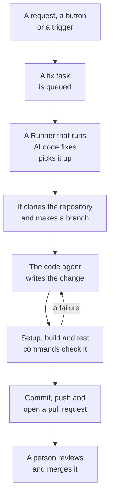

# Code

Code is where you ask OneUptime AI to work in your repositories, the way you would ask a coding agent: fix a bug, write tests, explain the code, make a change. It opens on the box where you ask, with the repository and the branch picked in it and every task under it; a task's page is a conversation you can reply in. OneUptime starts tasks of its own too, from exceptions, traces and investigations. A [Runner](/docs/runbooks/agents) clones the repository, writes the change on a new branch, builds and tests it, and opens a pull request. A person reviews and merges every one: the Runner can push branches and open pull requests, nothing more.

:::cards
- [Ask AI in a repository](#ask-ai-in-a-repository): A request in your own words, with the context it needs.
- [A task's conversation](#a-tasks-conversation): What AI did, what it changed, and your reply.
- [How a fix run works](#how-a-fix-run-works): From a click to a pull request, step by step.
- [Where fix tasks start](#where-fix-tasks-start): The tasks OneUptime starts, and what each pull request does.
- [Production telemetry in a fix](#production-telemetry-in-a-fix): What a fix reads of production while it writes the change.
- [Production review of pull requests](#production-review-of-pull-requests): What production says about the code each pull request changes.
- [Before you begin](#before-you-begin): A model, a connected repository and a Runner.
- [When a fix fails](#when-a-fix-fails): What happens to a run that errors, stalls or waits.
:::

> [!TIP]
> You can also start this from GitHub. Mention the OneUptime GitHub App on an issue or a pull request and it implements, revises or reviews right there: see [GitHub App](/docs/ai/github-app). It is the same agent, the same Runner and the same budgets; only the trigger differs.

## Ask AI in a repository

:::steps
### Open Code

Open **Products → Code**. It opens on **What should AI do?**: the box where you ask, with every task under it, newest first. With no repository yet, it offers **Connect GitHub** instead (see [Before you begin](#before-you-begin)). **Repositories**, in its side menu, lists the repositories AI can work in, and folds those the GitHub App no longer reaches under **Not connected**. Each repository's page has the same box for that repository.

### Pick the repository and the branch

The box starts on the repository you picked last. Pick another in its bottom row, and beside it the branch the task starts from: the repository's main branch, marked **Default**, until you pick another. AI cuts its branch from the one you pick and opens its pull request into it.

### Say what you want

Write the change, the bug or the question in your own words. Until something has been asked, Code suggests a few under **Try asking**.

### Add context

Click **Add context** to give AI what it needs: a file or folder of the repository, a note, a link, or a record of the project. OneUptime reads each record when you send the request, with your permissions, and keeps what AI was given.

### Start the task

Click **Start task**, or press Enter. The task's page opens, and AI's work shows there as it happens.
:::

| Context | What AI is given |
| --- | --- |
| **File or folder** | A path in the repository, which AI reads first. |
| **Note** | Text you paste: an error, a spec, a log line. |
| **Link** | A web address, as a reference. |
| **Incident** or **Alert** | Its state, description and root cause, as they are when you send the request. |
| **Exception** | Its message and stack trace. |
| **Monitor** | Its type, status and description. |
| **Trace** | Its spans: their names, timings and errors. |
| **Logs** | The latest 20 log lines that contain your search, from the last hour, day or week. |
| **Performance profile** | Where a function's time goes in its service's profiles: who calls it, what it calls and its hottest lines. |

A request carries at most 10 pieces of context. Tokens, keys, passwords and email addresses in what OneUptime reads are redacted before AI sees them, as everywhere OneUptime AI reads your data.

## A task's conversation

A task's page is a conversation: what was asked and the context added, then AI's turn - the steps it takes as it takes them (the files it read and edited, what it searched for, the commands it ran), its reply, the files it changed with their diff, and the pull request. The top of the page says where the task works (its repository and the branch it started from), how many lines it changed, with a button to its pull request, and how the task stands:

| State | What it means |
| --- | --- |
| **Queued** | It waits for a Runner to pick it up. |
| **Working…** | AI is on it. **Stop** stops it; what it pushed stays on the branch. |
| **Waiting for you** | AI asked a question. Answer it in the box below. |
| **Done** | AI finished: its reply, and the pull request when it changed code. |
| **Failed** | The turn could not finish, and says why. **Try again** asks the same again. |
| **Stopped** | Someone stopped it. **Try again** asks the same again. |

To follow up, write in the box at the bottom, which stays in view as the conversation scrolls: answer AI, add context, or ask for changes. Each reply is the next turn of the same task: it works on the same branch and pushes to the same pull request while that is open. A task takes one turn at a time, so the box waits while AI works. Each turn's **Log** is the verbatim record of what it did.

Anyone who can read a repository reads its tasks. Asking AI, replying and stopping a task take permission to edit the repository, and so does seeing a change's diff: everyone else sees which files changed. The tasks OneUptime starts on its own (below) are in their repository too, as conversations you can reply in.

## How a fix run works



1. You click **Start task** in Code, or **Fix with AI** on an unresolved exception, or another button or trigger starts a task (see [Where fix tasks start](#where-fix-tasks-start)).
2. The task is queued on its repository, and the Runner the repository picks takes it: one of your Runners, or a global Runner when it picks none (see [Pick the repository's Runner](#pick-the-repositorys-runner)).
3. The Runner fetches the task's context. For a request, that is its words, the context added and the conversation so far; for an exception, its type, its message and its stack trace.
4. It clones the repository into a workspace of its own and makes a branch. A fix of an exception is named `oneuptime-fix-exception-` followed by the first characters of the run's id. A request starts from the branch picked when it was asked, and its pull request opens into it. A reply works on the branch of the task's open pull request instead.
5. A code agent, powered by your project's LLM provider, reads the code and writes the change. The OneUptime server makes the LLM calls, so the Runner never holds your provider's API key, and every call is metered and listed in the AI Logs. A fix of an exception, a slow trace or an incident also reads production while it works: the exceptions, traces, logs and metrics of the repository's services (see [Production telemetry in a fix](#production-telemetry-in-a-fix)).
6. On a Runner of your own, the code agent builds and tests its change the way the repository's `AGENTS.md` says before anything is committed, and repairs what fails (see [Verification before the pull request](#verification-before-the-pull-request)).
7. The Runner commits, pushes the branch, opens the pull request (for a request, only when it changed code), and deletes the workspace.

The page the task was started from shows its live status. Every task is listed in its repository under **Products → Code**: its page is its conversation, and each turn's **Log** has a line for every file the Runner read or wrote and every command it ran.

Each run is held to budgets the server enforces: at most **40 LLM calls** and **100,000 output tokens**. A run's production telemetry queries count against the same 40 calls. A run that reaches one finishes with a summary of the work so far instead of looping. Fix runs also count toward the project's daily AI limits, when the project sets them.

## Where fix tasks start

| Where | Click | The pull request |
| --- | --- | --- |
| An exception's **AI Assistance** page | **Fix with AI** | Fixes the bug behind the exception. |
| An exception's **AI Assistance** page | **Generate Regression Test** | Adds a test that reproduces the exception and fails until the bug is fixed. |
| An exception's **AI Assistance** page | **Improve Error Handling** | For an expected error, such as invalid input: takes user data out of the message, validates the input earlier and marks the error as handled, without changing behaviour. |
| An incident's or alert's **AI Investigation** card | **Open Fix PR from this analysis** | Fixes the root cause the investigation posted (see [Automatic code fixes from investigations](#automatic-code-fixes-from-investigations)). |
| A trace worth fixing | **Fix performance with AI** | Fixes the slow pattern the button names, such as an N+1 query or calls that could run in parallel. |
| A service's **Logs** page | **Improve Logging** | Makes the service's logs structured, at the right severity and tied to its traces, without changing behaviour. |
| A service's **Traces** page | **Improve Tracing** | Adds spans and attributes where the service's tracing is missing, without changing behaviour. |
| A function in **Performance Profiles** | **Fix with AI** | Makes the function do the same work with less time or memory, with its profile as the evidence. |

These buttons show only where they can start a task. With AI switched off for the project, none of them is shown and an exception's side menu has no **AI Assistance**. **Improve Logging** and **Improve Tracing** show once a repository is connected, and **Fix performance with AI** only on a trace worth fixing (see [Traces Explorer](/docs/telemetry/traces-explorer)). A function's **Fix with AI** shows only on the application's own code that takes at least 5% of the profile's time or memory, or whose share grew by 3 points or more since the window it is compared with (see [Continuous Profiling](/docs/telemetry/profiles)).

To open an exception's **AI Assistance** page, open the exception under **Products → Observability → Exceptions** and choose **AI Assistance** in its side menu. A resolved or archived exception has to be marked unresolved first.

OneUptime AI also starts fix tasks on its own: from an investigation that finds a code change, from one that ends inconclusive because telemetry was missing, and from AI Insights about exceptions and slow traces. Each has its own switch; see [Automatic code fixes](/docs/ai/ai-sre#automatic-code-fixes).

## Production telemetry in a fix

OneUptime holds what your code does in production, so a fix does not have to work from a stack trace alone. While the code agent works, it can query the production telemetry of the services the repository serves:

| It reads | What for |
| --- | --- |
| **Exceptions** | The exception groups thrown in given files or a function: how often in the last days, since which release, and the trace of a recent occurrence. |
| **Traces** | The latency and error profile of an endpoint or operation, and the spans of one trace. |
| **Logs** | A service's log lines, by time, severity, text or trace. |
| **Metrics** | A metric a service reports, over time; without a name, the metrics it reports. |
| **Incidents** | Incidents that affected the services, or that a OneUptime fix in this repository was opened for, with their root cause and postmortem. |
| **Deploys** | Recent deploys and other changes of the services, each with OneUptime's verdict on whether it hurt its service. |

| Task | What it checks |
| --- | --- |
| **Fix with AI** on an exception | How often it is thrown now and since which release, the logs and the trace of an occurrence. |
| **Fix performance with AI** | How busy and how slow the operation is across all of its traces, not only the one analyzed. It changes nothing when the operation is no longer slow. |
| **Open Fix PR from this analysis**, and fixes opened automatically from investigations | The deploys before the incident, its errors, logs and slow operations, and whether the cause struck before. |
| `@oneuptime review` from GitHub | What production says about the changed code (see [Reviews with production context](/docs/ai/github-app#reviews-with-production-context)). |

The pull request's description says what the agent queried and what it showed. Other tasks, such as regression tests and logging or tracing improvements, do not query production.

What the agent can read is decided by the OneUptime server, from the task itself:

- **Read only.** The queries run on the OneUptime server, never on the Runner, which holds no credential that reads telemetry. Nothing they do can change your project.
- **This project, and only the services this repository serves.** You do not map them: they are the services OneUptime finds this repository for, the way it finds the repository of a fix - their exceptions' stack traces run through its files, they are named like it, or it is the project's only repository. Another service's telemetry cannot be read.
- **No private incidents**, and tokens, keys, passwords and email addresses are redacted before the agent sees a result, as everywhere OneUptime AI reads your data.
- **Bounded.** At most **12** queries per run, each counted against the run's 40 calls.

When no service maps to the repository, the task runs without production telemetry, as before.

## Production review of pull requests

OneUptime holds what your code does in production, so it can review a pull request with what no one reading the diff can see. Turn on **Review Pull Requests Against Production**, under **More settings** on a repository's **Settings** page in Code, and each pull request someone with write access opens or pushes to gets one comment saying what production shows of the code it changes. The comment is edited in place on every push, and the repository's **Production Reviews** page in Code keeps each review, with **Review again**.

| It reads | Of the code the pull request changes |
| --- | --- |
| **Exceptions** | The exceptions thrown in the changed lines, functions and files in the last 7 days, new and unhandled ones marked. |
| **Operations** | The traced operations that run the changed code in the last hour: their spans, errors and p95. |
| **Hot functions** | The functions of the changed code that take a share of the services' profiles in the last hour. |
| **Incidents** | The services' incidents of the last 30 days that are still open, or whose root cause or postmortem names the changed code. Never a private incident. |
| **Deploys** | The services' deploys of the last 7 days that OneUptime suspects of a regression. |

When production says something, OneUptime AI reads it beside the diff and adds **What to watch**: a few short points, each resting on the facts. It runs only while AI is on for the project, at most 10 times a day for a pull request and 100 for a repository, and is metered like every AI call; the facts are read every time without it. When production shows nothing about the change, OneUptime posts nothing.

- **Aggregates only.** The comment holds counts, durations and the names of code: never an exception's message, a log line, an incident's title or personal data.
- **Public repositories get a link.** Anyone can read a public repository's pull requests, so there the comment only links to the review in OneUptime, which only the project's members can open. **Production Review Comment**, under **More settings** on the repository's **Settings** page, can post **Only a link to the review** everywhere, or **The review, even on a public repository**.
- **Outside contributors cannot start one.** A pull request is reviewed on its own only when its author, and whoever pushed to it, can write to the repository. One from anyone else - an outside contributor, a fork, a bot - is reviewed when someone with write access comments `@oneuptime production review` on it, or presses **Review again** in Code.
- **Read only.** A review clones nothing and runs nothing of the pull request. Its diff and title are data to OneUptime AI, never instructions: the AI has no tools, and what it writes is placed in the comment as text.

The switch is on for the repositories the GitHub App connects from now on. A repository connected before it existed keeps it off until you turn it on.

## Verification before the pull request

A repository says how it is built and tested in an `AGENTS.md` at its root, the file coding agents read. Before the code agent changes anything, it reads the repository's `AGENTS.md` (or its `CLAUDE.md`, when it has no `AGENTS.md`) from the branch the task starts from, and works the way it says. With neither, it learns how from the repository's `CONTRIBUTING.md`, README, package scripts, `Makefile` or CI workflows. There is nothing to set up in OneUptime.

| Where AI works | What it does with the repository's build and tests |
| --- | --- |
| One of your Runners | Builds and tests its change before the pull request opens, fixes what fails and checks again, and says in its summary which checks it ran. Each command it runs gets up to 2 minutes, without the Runner's own credentials in its environment. |
| **Global Runner** | Runs no command: it writes the change and opens the pull request, and your repository's own CI checks it. |

Nothing from a pull request that comes from a fork is ever read as the repository's instructions: a revision refuses such a pull request, and a review reads the base branch.

### Commands set on a repository

Code no longer asks for setup, build and test commands, but a repository that has them, set before or through the API or Terraform, keeps them. They show read-only on the **Build and Test Commands** card, under **More settings** on the repository's **Settings** page, and **Remove Commands** removes all three. While any of them is set, every fix run on a Runner of your own also checks its change with them before the pull request opens:

1. When the code agent finishes, the commands run in order at the root of the repository, on the Runner, in the cloned workspace. Each one gets up to 15 minutes and runs with `CI=true`, so nothing waits on a prompt; the first failure stops the pass.
2. On a failure, the end of the failing command's output goes back to the same code agent as a repair task, with instructions to fix its own change rather than weaken or skip tests, and the commands run again. It makes at most **2** repair attempts. They share the run's LLM budget, and their edits land in the same commit as the fix.
3. The outcome, passed, failed or skipped (no commands set, or a global Runner), is written in a Verification section of the pull request's description and recorded on the task's pull request.

A change that still fails verification is not thrown away: the pull request opens anyway, with a clearly marked "Verification failed" section that names the failing command and ends with its output. The work is kept, and the reviewer decides. A repository with no commands set is reported as skipped, rather than implying a green build.

The commands are repository settings your team writes, run on your own Runner: the same trust model as a runbook's Bash steps. The AI never writes or changes them. A global Runner, which OneUptime runs for every project, never runs them: on a global Runner the fix is written and opened for review, verification is reported as skipped, and your repository's own CI checks the change. [Run a Runner of your own](#run-a-runner-of-your-own) to have fixes built and tested before the pull request opens.

## After a fix merges

Merging a fix fixes nothing until it runs. Once a fix pull request merges, OneUptime waits for a recorded deploy that contains it (see [Deploys and Changes](/docs/telemetry/change-events)) and watches what the fix was for in that deploy. The task's pull request in Code says how it went, and so do the exception's **AI Assistance** page, the incident's AI Logs and the AI insight the fix came from:

| A fix of | What is watched | It worked | It did not |
| --- | --- | --- | --- |
| An exception | Whether the exception happens again | **Fixed in production** | **Still happening after the fix** |
| A slow trace or a latency insight | The p99 of the operation the fix names | **Faster in production** | **Still slow after the fix** |
| An incident's or an alert's root cause | Whether its monitor raises another | **Fixed in production** | **Happened again after the fix** |
| Missing telemetry, logging or tracing | What the fix adds, and the rest of the service's telemetry | **Arriving in production** | **Telemetry stopped after the fix** |

Until a deploy ships it, the fix reads **Merged, waiting for a deploy**, then **Deployed, watching in production** while it is watched. One that no recorded deploy contains within 14 days, or that production cannot tell about, reads **Not verified in production**. [Automatic code fixes](/docs/ai/ai-sre#automatic-code-fixes) has the rules. A regression test, better error handling, a review and a request in Code are not watched: production cannot show what they change.

## Before you begin

A task needs three things. Code's request box and the exception's **AI Assistance** page check all three before they offer to start, and say what is missing.

| What | OneUptime Cloud | Self-hosted |
| --- | --- | --- |
| An LLM provider | Nothing to set up: a project with no provider of its own uses the global provider, paid from the project's AI credits. A provider of your own, under **Project Settings → AI → LLM Providers**, comes first. | Set the `GLOBAL_LLM_PROVIDER_*` environment variables once on the server, or add a provider to the project. |
| A repository connected through the GitHub App | **Products → Code**, then **Connect GitHub**. If the app is already installed on the GitHub account, click **Connect an existing installation** instead: installing it again does not connect it. Needs the Growth plan. | The same, once your instance has a GitHub App (see [GitHub Integration](/docs/self-hosted/github-integration)). |
| A Runner that runs AI code fixes | Nothing to run: a repository that picks none works on OneUptime's global Runners. | The `runner` service of Docker Compose, or the Helm chart's Runner (`runner.enabled`, on by default), registers itself and runs AI code fixes in every repository that picks no Runner. |

On a self-hosted instance, the global provider is one block of `config.env` (Docker Compose) or of your Helm values. For a self-hosted Ollama:

```bash
GLOBAL_LLM_PROVIDER_TYPE=Ollama
# An address the OneUptime server can reach, never localhost.
GLOBAL_LLM_PROVIDER_BASE_URL=http://ollama:11434
GLOBAL_LLM_PROVIDER_MODEL_NAME=llama3.1
# No GLOBAL_LLM_PROVIDER_API_KEY needed — Ollama is keyless.
```

Any supported provider works: see [LLM Providers](/docs/ai/llm-provider) for all of them and every environment variable.

You do not map repositories to services. When a task starts, OneUptime finds the repository by matching the file paths of the exception's stack trace against your connected repositories. When nothing matches, it falls back to a repository named like the service, and then to the project's only repository when there is just one. The **AI Assistance** page shows which repository it found.

### Pick the repository's Runner

Each repository picks the Runner AI works in it on: on its **Settings** page in Code, open **More settings**, click **Edit** on the **Runner** card and pick one. A repository the GitHub App imports starts on the project's [default Runner](/docs/runbooks/agents#the-projects-default-runner), when it has one. A repository that picks none works on **Global Runner**, which OneUptime runs for every project.

| Runner | What it does with a task |
| --- | --- |
| **Global Runner** | Writes the change and opens the pull request without building or testing it: your repository's own CI checks the change. |
| One of your Runners | Also builds and tests the change the way the repository's `AGENTS.md` says, on a host you control. |

Only the Runner a repository picks is handed its tasks and a token for it. In a project that turns **Use global Runners** off under **Runbooks → Runners**, every repository needs one of the project's own Runners. A Runner's page lists the repositories that pick it.

### Run a Runner of your own

To run a Runner elsewhere, for example on a machine close to your repositories:

:::steps
### Create the Runner

Create a Runner under **Runbooks → Runners** and click **Show setup instructions** on its row. The command embeds the Runner's secret key, which only a Project Owner, Project Admin or Runbook Admin can read. It looks like this:

```bash
docker run --name oneuptime-runner --restart unless-stopped \
  -e ONEUPTIME_RUNNER_ID=<runner-id> \
  -e ONEUPTIME_RUNNER_KEY=<runner-key> \
  -e ONEUPTIME_URL=<your-oneuptime-url> \
  -d oneuptime/runner:release
```

### Pick it for the repository

On the repository's **Settings** page in Code, open **More settings**, click **Edit** on the **Runner** card and pick the Runner. The Runner picks the change up with its next heartbeat, within about a minute; there is nothing to restart.

### Check that it connects

The Runner shows as connected on the **Runbooks → Runners** page within a minute or two. If it does not, read the container's log (`docker logs oneuptime-runner`) for a credential or network error.
:::

Any way of running the container works (Docker Compose, Kubernetes and so on), as long as it has these variables and can reach your OneUptime instance over HTTPS:

| Variable | What it is |
| --- | --- |
| `ONEUPTIME_RUNNER_ID` | The Runner's id, from the dashboard. |
| `ONEUPTIME_RUNNER_KEY` | The Runner's secret key. |
| `ONEUPTIME_URL` | Your OneUptime instance's address (`https://oneuptime.com` on OneUptime Cloud). |

> [!NOTE]
> Before OneUptime 12, AI code fixes ran on a separate AI Agent component (the `oneuptime/ai-agent` image with `AI_AGENT_*` variables). It merged into the Runner: if you still run one, the [v11 to v12 upgrade guide](/docs/installation/upgrading) says how to replace it.

## Automatic code fixes from investigations

When an [AI investigation](/docs/ai/ai-sre) posts a root cause analysis on an incident or an alert, and its careful classification recommends a change to the code, the investigation card offers **Open Fix PR from this analysis**: a fix task whose whole context is the posted analysis. The button is hidden when the remedy is operational, infrastructure-only, external, an expected denial, a user error, or inconclusive. Eligible fixes happen without the click while **Fix new incidents automatically** is on, on **Incidents → AI → Settings** (and **Fix new alerts automatically** on **Alerts → AI → Settings**). Fixing starts off, for new projects too. With no auto remediation rule every eligible fix opens; with rules, only one for what a rule matches, when the rule has **Fix pull requests** on (a new rule does), in the code repositories it names.

While fixing is on, an investigation that ends with a confident, evidenced root cause that a code change can fix queues the same fix task the button creates. The decision is a constrained classification the server checks, never a pattern matched against the analysis's text: only a positive code-fix verdict opens a pull request. Missing evidence, a remedy outside the code and a failed classification all end in doing nothing.

Everything else matches the button:

- The pull request opens ready for review, written from the posted analysis, and needs a repository connected through the GitHub App, one the matching rules name when they name some, and a Runner online to work in it: the one the repository picks, or a global Runner.
- It counts toward that signal's daily fix-task limit (**Daily Incident AI Fix Task Limit** or **Daily Alert AI Fix Task Limit**, under **More settings** on its AI settings page) and toward the repository's cap on open pull requests, when either is set. Unset, neither limits anything.
- Every trigger first looks for a fix task already queued or running for the same incident or alert, so an automatic trigger and a click normally become one task, not two pull requests. The check is a read before the write, not a lock, so two triggers at the very same moment can still both get through.
- The run is written by the system, not credited to anyone, and nothing merges on its own.

## When a fix fails

:::details The run errors
The fix could not be applied, the repository or the branch a request started from could not be reached, or the LLM call failed. The task's conversation, and the page it was started from, show the reason and offer to try again. The turn's **Log** has the full run log.
:::

:::details The Runner stops in the middle of a run
A run whose heartbeat has been silent for more than 12 minutes is failed with an error. It is never queued again on its own, because the Runner may already have pushed part of a fix branch; start it again from where you started it.
:::

:::details No Runner picks the task up
A task that waits more than 30 minutes while the Runner that should take it is not connected - the one its repository picks, or a global Runner for a repository that picks none - fails, with a message that says which, so it never shows as in progress forever. When a Runner is online but busy, queued tasks wait their turn. A Runner older than Code is never handed a request from Code: update a Runner you run yourself along with the server.
:::

## Privacy

The clone of your repository lives in a workspace inside the Runner's container and is deleted when the run ends, whether it succeeded or not. The Runner never holds your LLM provider's API key: the OneUptime server makes the LLM calls for it, and runs the production telemetry queries too. OneUptime does not keep your repository and does not train on your code. The task's log keeps the first 300 characters of each step's output, so you can check what the Runner did, and that can include pieces of code. Run a self-hosted Runner with your own LLM provider (local Ollama included), and your code never leaves your infrastructure.

## On the roadmap

Planned, and **not available today**:

- **GitLab support.** Repositories connect through the GitHub App only.

## Next steps

:::cards
- [GitHub App](/docs/ai/github-app): Ask for a change, a revision or a review from GitHub itself.
- [AI SRE](/docs/ai/ai-sre): The investigations whose analyses fix tasks can turn into pull requests.
- [Runners](/docs/runbooks/agents): The worker that carries out every fix run.
:::
