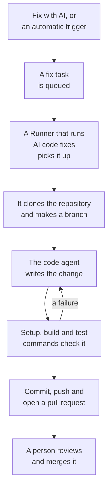

# Fix Tasks

A fix task is a pull request OneUptime AI writes in your code. You start one from an exception, a trace, a service or an investigation, or OneUptime starts one on its own; a [Runner](/docs/runbooks/agents) clones the repository, writes the change on a new branch, builds and tests it, and opens a pull request. A person reviews and merges every one: the Runner can push branches and open pull requests, nothing more.

:::cards
- [How a fix run works](#how-a-fix-run-works): From a click to a pull request, step by step.
- [Where fix tasks start](#where-fix-tasks-start): The buttons that start one, and what each pull request does.
- [Before you begin](#before-you-begin): A model, a connected repository and a Runner.
- [When a fix fails](#when-a-fix-fails): What happens to a run that errors, stalls or waits.
:::

> [!TIP]
> You can also start this from GitHub. Mention the OneUptime GitHub App on an issue or a pull request and it implements, revises or reviews right there: see [GitHub App](/docs/ai/github-app). It is the same agent, the same Runner and the same budgets; only the trigger differs.

## How a fix run works



1. You click **Fix with AI** on an unresolved exception, or another button or trigger starts a task (see [Where fix tasks start](#where-fix-tasks-start)).
2. The task is queued, and an available Runner with **Runs AI Code Fixes** turned on picks it up.
3. The Runner fetches the task's context. For an exception, that is its type, its message and its stack trace.
4. It clones the repository into a workspace of its own and makes a branch. A fix of an exception is named `oneuptime-fix-exception-` followed by the first characters of the run's id.
5. A code agent, powered by your project's LLM provider, reads the code and writes the change. The OneUptime server makes the LLM calls, so the Runner never holds your provider's API key, and every call is metered and listed in the AI Logs.
6. If the repository has verification commands, the Runner builds and tests the change before committing anything, and hands a failure back to the code agent to repair (see [Verification before the pull request](#verification-before-the-pull-request)).
7. The Runner commits, pushes the branch, opens the pull request, and deletes the workspace.

The page the task was started from shows its live status. Every task is listed under **Products → Code → Tasks**: open one for its **Overview**, its **Logs** (a line for every file the Runner read or wrote and every command it ran) and its **Pull Requests**.

Each run is held to budgets the server enforces: at most **40 LLM calls** and **100,000 output tokens**. A run that reaches one finishes with a summary of the work so far instead of looping. Fix runs also count toward the project's daily AI limits, when the project sets them.

## Where fix tasks start

| Where | Click | The pull request |
| --- | --- | --- |
| An exception's **AI Assistance** page | **Fix with AI** | Fixes the bug behind the exception. |
| An exception's **AI Assistance** page | **Generate Regression Test** | Adds a test that reproduces the exception and fails until the bug is fixed. |
| An exception's **AI Assistance** page | **Improve Error Handling** | For an expected error, such as invalid input: takes user data out of the message, validates the input earlier and marks the error as handled, without changing behaviour. |
| An incident's or alert's **AI Investigation** card | **Open Fix PR from this analysis** | Fixes the root cause the investigation posted (see [Automatic code fixes from investigations](#automatic-code-fixes-from-investigations)). |
| A trace | **Fix performance with AI** | Fixes the slow pattern found in the trace, such as N+1 queries or one dominant slow span. |
| A service's **Logs** page | **Improve Logging** | Makes the service's logs structured, at the right severity and tied to its traces, without changing behaviour. |
| A service's **Traces** page | **Improve Tracing** | Adds spans and attributes where the service's tracing is missing, without changing behaviour. |

To open an exception's **AI Assistance** page, open the exception under **Products → Observability → Exceptions** and choose **AI Assistance** in its side menu. A resolved or archived exception has to be marked unresolved first.

OneUptime AI also starts fix tasks on its own: from an investigation that finds a code change, from one that ends inconclusive because telemetry was missing, and from AI Insights about exceptions and slow traces. Each has its own switch; see [Automatic code fixes](/docs/ai/ai-sre#automatic-code-fixes).

## Verification before the pull request

A code repository can carry up to three verification commands on its **Settings** page, under **Code Repositories**:

| Command | Example | When it runs |
| --- | --- | --- |
| **Setup Command** | `npm ci` | First, to install dependencies. |
| **Build Command** | `npm run build` | After setup. |
| **Test Command** | `npm test` | Last. |

When any of them is set, every fix run checks its change before the pull request opens:

1. When the code agent finishes, the commands run in order at the root of the repository, on the Runner, in the cloned workspace. Each one gets up to 15 minutes and runs with `CI=true`, so nothing waits on a prompt; the first failure stops the pass.
2. On a failure, the end of the failing command's output goes back to the same code agent as a repair task, with instructions to fix its own change rather than weaken or skip tests, and the commands run again. It makes at most **2** repair attempts. They share the run's LLM budget, and their edits land in the same commit as the fix.
3. The outcome, passed, failed or skipped (no commands set), is written in a Verification section of the pull request's description and recorded on the task's pull request.

A change that still fails verification is not thrown away: the pull request opens anyway, with a clearly marked "Verification failed" section that names the failing command and ends with its output. The work is kept, and the reviewer decides. A repository with no commands set is reported as skipped, rather than implying a green build.

The commands are repository settings your team writes, run on your own Runner: the same trust model as a runbook's Bash steps. The AI never writes or changes them. OneUptime's shared Runners do not run them at all — on a shared Runner the fix is written and opened for review, verification is reported as skipped, and your repository's own CI checks the change; run a Runner of your own to have fixes built and tested on the Runner before the pull request opens.

## Before you begin

A fix task needs three things. The exception's **AI Assistance** page checks all three before it offers to start, and says what is missing.

| What | OneUptime Cloud | Self-hosted |
| --- | --- | --- |
| An LLM provider | Nothing to set up: a project with no provider of its own uses the global provider, paid from the project's AI credits. A provider of your own, under **Project Settings → AI → LLM Providers**, comes first. | Set the `GLOBAL_LLM_PROVIDER_*` environment variables once on the server, or add a provider to the project. |
| A repository connected through the GitHub App | **Products → Code → Tasks**, then **Code Repositories** and **Connect with GitHub App**. If the app is already installed on the GitHub account, click **Connect an existing installation** instead: installing it again does not connect it. Needs the Growth plan. | The same, once your instance has a GitHub App (see [GitHub Integration](/docs/self-hosted/github-integration)). |
| A Runner that runs AI code fixes | Nothing to run: OneUptime's shared Runners do it. | The `runner` service of Docker Compose, or the Helm chart's Runner (`runner.enabled`, on by default), registers itself and runs AI code fixes. |

On a self-hosted instance, the global provider is one block of `config.env` (Docker Compose) or of your Helm values. For a self-hosted Ollama:

```bash
GLOBAL_LLM_PROVIDER_TYPE=Ollama
# An address the OneUptime server can reach, never localhost.
GLOBAL_LLM_PROVIDER_BASE_URL=http://ollama:11434
GLOBAL_LLM_PROVIDER_MODEL_NAME=llama3.1
# No GLOBAL_LLM_PROVIDER_API_KEY needed — Ollama is keyless.
```

Any supported provider works: see [LLM Providers](/docs/ai/llm-provider) for all of them and every environment variable.

You do not map repositories to services. When a task starts, OneUptime finds the repository by matching the file paths of the exception's stack trace against your connected repositories. When nothing matches, it falls back to a repository named like the service, and then to the project's only repository when there is just one. The **AI Assistance** page shows which repository it found.

### Run a Runner of your own

To run a Runner elsewhere, for example on a machine close to your repositories:

:::steps
### Create the Runner

Create a Runner under **Runbooks → Runners** and click **Show setup instructions** on its row. The command embeds the Runner's secret key, which only a Project Owner, Project Admin or Runbook Admin can read. It looks like this:

```bash
docker run --name oneuptime-runner --restart unless-stopped \
  -e ONEUPTIME_RUNNER_ID=<runner-id> \
  -e ONEUPTIME_RUNNER_KEY=<runner-key> \
  -e ONEUPTIME_URL=<your-oneuptime-url> \
  -d oneuptime/runner:release
```

### Turn on Runs AI Code Fixes

Turn on **Runs AI Code Fixes** on the Runner. It is off by default, and the Runner picks the change up with its next heartbeat, within about a minute; there is nothing to restart.

### Check that it connects

The Runner shows as connected on the **Runbooks → Runners** page within a minute or two. If it does not, read the container's log (`docker logs oneuptime-runner`) for a credential or network error.
:::

Any way of running the container works (Docker Compose, Kubernetes and so on), as long as it has these variables and can reach your OneUptime instance over HTTPS:

| Variable | What it is |
| --- | --- |
| `ONEUPTIME_RUNNER_ID` | The Runner's id, from the dashboard. |
| `ONEUPTIME_RUNNER_KEY` | The Runner's secret key. |
| `ONEUPTIME_URL` | Your OneUptime instance's address (`https://oneuptime.com` on OneUptime Cloud). |

> [!NOTE]
> Before OneUptime 12, AI code fixes ran on a separate AI Agent component (the `oneuptime/ai-agent` image with `AI_AGENT_*` variables). It merged into the Runner: if you still run one, the [v11 to v12 upgrade guide](/docs/installation/upgrading) says how to replace it.

## Automatic code fixes from investigations

When an [AI investigation](/docs/ai/ai-sre) posts a root cause analysis on an incident or an alert, and its careful classification recommends a change to the code, the investigation card offers **Open Fix PR from this analysis**: a fix task whose whole context is the posted analysis. The button is hidden when the remedy is operational, infrastructure-only, external, an expected denial, a user error, or inconclusive. Eligible fixes happen without the click while the switch **Open a fix pull request when an investigation finds a code change** is on. It is part of fixing: it sits under **Fix new incidents automatically** on **Incidents → AI → Settings** (and under **Fix new alerts automatically** on **Alerts → AI → Settings**), comes on when fixing is turned on, and opens pull requests only while fixing is on. Both start off, for new projects too.

While it is on, an investigation that ends with a confident, evidenced root cause that a code change can fix queues the same fix task the button creates. The decision is a constrained classification the server checks, never a pattern matched against the analysis's text: only a positive code-fix verdict opens a pull request. Missing evidence, a remedy outside the code and a failed classification all end in doing nothing.

Everything else matches the button:

- The pull request opens ready for review, written from the posted analysis, and needs a repository connected through the GitHub App and a Runner with **Runs AI Code Fixes** turned on.
- It counts toward that signal's daily fix-task limit (**Daily Incident AI Fix Task Limit** or **Daily Alert AI Fix Task Limit**, under **More settings** on its AI settings page) and toward the repository's cap on open pull requests, when either is set. Unset, neither limits anything.
- Every trigger first looks for a fix task already queued or running for the same incident or alert, so an automatic trigger and a click normally become one task, not two pull requests. The check is a read before the write, not a lock, so two triggers at the very same moment can still both get through.
- The run is written by the system, not credited to anyone, and nothing merges on its own.

## When a fix fails

:::details The run errors
The fix could not be applied, the repository could not be reached, or the LLM call failed. The page the task was started from shows the reason and offers to try again. The task's **Logs** page has the full run log.
:::

:::details The Runner stops in the middle of a run
A run whose heartbeat has been silent for more than 12 minutes is failed with an error. It is never queued again on its own, because the Runner may already have pushed part of a fix branch; start it again from where you started it.
:::

:::details No Runner picks the task up
A task that waits more than 30 minutes while no Runner with **Runs AI Code Fixes** is connected fails, with a message to check the Runner, so it never shows as in progress forever. When a Runner is online but busy, queued tasks wait their turn.
:::

## Privacy

The clone of your repository lives in a workspace inside the Runner's container and is deleted when the run ends, whether it succeeded or not. The Runner never holds your LLM provider's API key: the OneUptime server makes the LLM calls for it. OneUptime does not keep your repository and does not train on your code. The task's log keeps the first 300 characters of each step's output, so you can check what the Runner did, and that can include pieces of code. Run a self-hosted Runner with your own LLM provider (local Ollama included), and your code never leaves your infrastructure.

## On the roadmap

Planned, and **not available today**:

- **GitLab support.** Repositories connect through the GitHub App only.
- **More telemetry in a fix.** Feeding the traces, logs and metrics around an exception into its fix, beyond the stack trace.

## Next steps

:::cards
- [GitHub App](/docs/ai/github-app): Ask for a change, a revision or a review from GitHub itself.
- [AI SRE](/docs/ai/ai-sre): The investigations whose analyses fix tasks can turn into pull requests.
- [Runners](/docs/runbooks/agents): The worker that carries out every fix run.
:::
