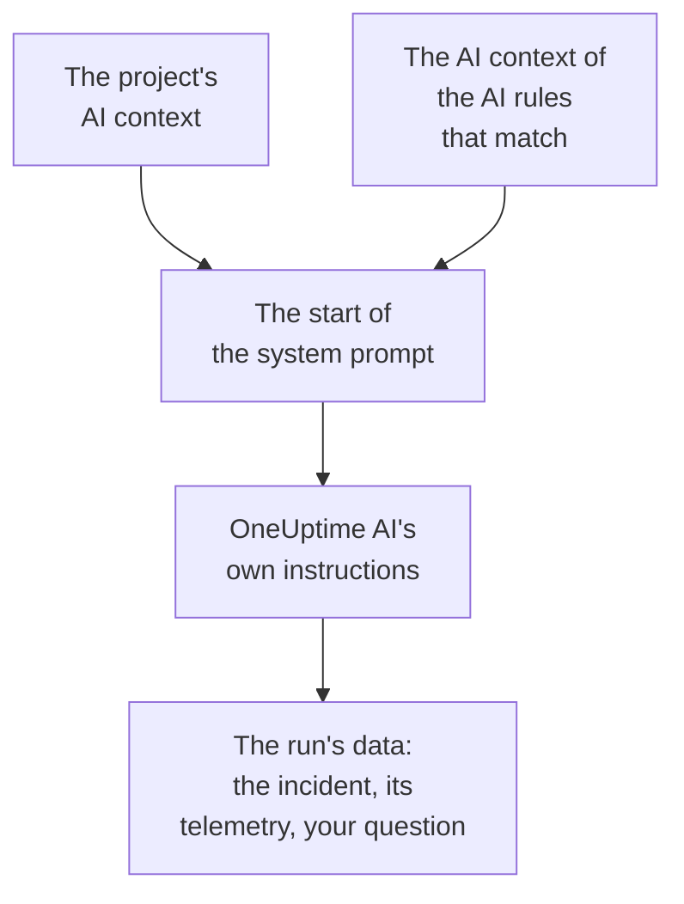

# AI Context

The AI context is what your team writes down for OneUptime AI about your own systems: how they fit together, who owns which symptom, where the logs are and the words your team uses. OneUptime AI reads it first in every investigation, fix, postmortem draft and Ask AI conversation, so it starts from what your team already knows.

:::cards
- [Write the AI context](#write-the-ai-context): One card on the project's AI settings.
- [An AI rule's own notes](#an-ai-rules-own-notes): Notes about what one rule matches.
- [What reads it](#what-reads-it): The features that read it, and the ones that do not.
- [What a run read](#what-a-run-read): Every run shows the notes it was given.
:::

## How it works

OneUptime AI puts the AI context at the very start of its system prompt, ahead of its own instructions and the run's data: the project's notes first, then those of the AI rules that match. It reads them as background from your team. They are not evidence of what is happening now, and they never change OneUptime AI's own rules.

Because the notes come first and stay the same from one run to the next, they are part of the start of the prompt that providers cache. With Anthropic, OneUptime marks the system prompt for caching; OpenAI, Azure OpenAI and the other providers that cache a repeated start of a prompt do so on their own. Notes that have not changed cost less to read again.

## Write the AI context

:::steps
### Open AI Features
Open **Project Settings → AI → AI Features**. The **AI context** card is under **Enable AI**.

### Write the notes
Click **Add AI context**, or **Edit** once there are notes. Write in Markdown, or click **Start from an outline** for a heading for each kind of note.

### Save them
Click **Save Changes**. The card shows the notes, how long they are, and about how many tokens a model reads them as.
:::

Write what you would tell a new engineer on the team:

| Kind of note | For example |
| --- | --- |
| How your systems fit together | `checkout-api` serves the checkout page and depends on `payments-db`. |
| Who owns which symptom | A 502 on the checkout page is the Payments team's: check `payments-db` first. |
| Where the logs are | Checkout's logs are in Loki under `app=checkout`. |
| The words your team uses | PSP is our payment service provider. |

> [!WARNING]
> Leave secrets out: anyone who can see what an AI run did can read the notes it was given.

## An AI rule's own notes

An AI rule can carry notes of its own about the incidents or alerts it matches: one product's services, its owners, where its logs are. Write them in the rule's **AI context**, under **More fields**, after **LLM Provider**. A rule that only runs its runbooks every time asks OneUptime AI nothing, so it has no AI context to write.

- An investigation reads the project's notes, then the notes of every enabled AI rule that investigates and matches the incident or alert, in the order of the rules' names.
- A fix reads the project's notes, then its own rule's.
- The conversation on an incident or an alert reads the same notes as its investigation.

## What reads it

| Feature | What it reads |
| --- | --- |
| AI SRE investigations, and their checks when a new alert opens | The project's notes, and the matching AI rules' |
| The fixes an AI rule starts: their plans, commands and MCP servers | The project's notes, and the rule's |
| Ask AI, and the conversation on an incident or an alert | The project's notes; on an incident or an alert, the matching AI rules' too |
| Answers in Slack and Microsoft Teams | The project's notes |
| Postmortem drafts, for incidents and episodes | The project's notes |
| AI Insights triage and security case triage | The project's notes |

Calls that only reword or judge what they are given do not read it: drafts of notes and public notes, call summaries, an investigation's summary, confidence and grade, and a conversation's title. Neither do the prompts people write themselves, in a workflow's or a runbook's AI step.

## Limits

| What | At most |
| --- | --- |
| The project's AI context | 20,000 characters |
| An AI rule's AI context | 5,000 characters |
| All the AI context one run reads | 30,000 characters |

The form counts the characters as you type and refuses a save past the limit, and so does the API. A run reads the project's notes first, then each matching rule's in the order of their names. A rule whose notes would take the run past 30,000 characters is left out whole, and the run's activity says so.

The token count is an estimate: the notes' size in UTF-8 bytes divided by 4, rounded up. Each model counts tokens its own way, so a provider's count can differ, most of all for text that is not in English.

## What a run read

Every run records the notes it read, word for word. Its activity says **Read the project's AI context**, or how many AI rules' notes it read too, with about how many tokens they came to. **View** opens the notes as the run read them: the project's first, then each rule's under its name, even after they have been changed. When a rule's notes were left out for the run's limit, a warning says so.

## Who can change it

- **Project Owner** and **Project Admin** can change the project's AI context. **Project Member**, **Viewer** and **Read Project** can read it.
- An AI rule's notes are part of the rule: whoever can change the rule can change them.
- The notes are only ever read for their own project: no run reads another project's AI context.

Through the API or Terraform, the project's notes are the project's `aiContext`, and an AI rule's are the rule's own `aiContext`.

## Next steps

:::cards
- [AI SRE](/docs/ai/ai-sre): Let OneUptime AI investigate every new incident and alert.
- [Ask AI](/docs/ai/ask-ai): Ask about your project's data in a conversation.
- [LLM Providers](/docs/ai/llm-provider): Choose the model that reads the notes.
:::
